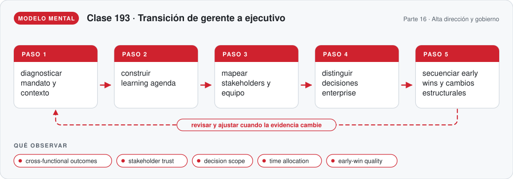

# Clase 193 — Transición de gerente a ejecutivo

<!-- nav:inicio -->
> **Parte 16 · Alta dirección y oficina del CEO** — clase 1 de 12 · [índice de la parte](../../README.md) · [temario](../../../../SYLLABUS.md)
<!-- nav:fin -->

**Parte:** 16 — Alta dirección y oficina del CEO  
**Nivel:** Etapa 5 — Director → CEO  
**Duración sugerida:** 150–180 minutos · **Estándar:** deep-class-v2

## 🎯 Propósito

La promoción de gerente a ejecutivo es la más engañosa de la carrera. El gerente fue ascendido por resolver bien problemas de su función, y llega al comité de dirección con la tentación de seguir haciéndolo: revisar el detalle, defender los recursos de su área, ganar discusiones técnicas. Pero el trabajo cambió. Ya no se le pide que su función rinda, sino que la empresa rinda; ya no decide dentro de prioridades dadas, sino que las fija con otros; ya no gana por saber hacer, sino por elegir bien, habilitar a otros y sostener acuerdos entre pares que no le reportan. Quien no hace ese cambio de trabajo suele fracasar en los primeros dieciocho meses, y no por falta de capacidad sino por usar las mismas armas en otro terreno.

La clase se apoya en el estudio de Gabarro sobre cómo los ejecutivos toman el mando, en el enfoque de Watkins sobre transiciones, en la teoría de los escalones superiores de Hambrick y Mason sobre cómo la experiencia y los valores de los altos directivos moldean sus decisiones, en la visión de Charan sobre lo que el CEO espera de quienes están bajo él y en la crudeza práctica de Horowitz. Al terminar sabrás diagnosticar un mandato, construir una agenda de aprendizaje, mapear relaciones, distinguir las decisiones de la empresa de las de la función y secuenciar tus primeras victorias.

## 📚 Resultados de aprendizaje

Al finalizar podrás:

1. **Diagnosticar** el mandato, la situación y las expectativas del nuevo rol.
2. **Construir** una agenda de aprendizaje con preguntas, personas y datos.
3. **Mapear** a las partes interesadas y a los pares con los que se decide.
4. **Distinguir** las decisiones de la empresa de las de la función y reasignar tu tiempo.
5. **Secuenciar** victorias tempranas y cambios estructurales sin dañar la confianza.

## 🧭 Agenda

| Tramo | Qué se hace |
|---|---|
| 0–20 min | Recuperación: ¿qué hábito de tu rol anterior usas hoy que ya no corresponde al nivel? |
| 20–60 min | Mandato, aprendizaje, relaciones, decisiones, tiempo y victorias. |
| 60–105 min | Ejemplo trabajado: reasignación del tiempo de una nueva directora comercial. |
| 105–150 min | Caso ejecutivo y práctica. |
| 150–175 min | Límites y entregable. |

## 🧩 Conceptos centrales

| Concepto | Definición | Cómo se reconoce |
|---|---|---|
| **Perspectiva de empresa** | Mirada que subordina la función a los objetivos del conjunto. | Se renuncia a algo local para ganar globalmente. |
| **Mandato** | Lo que se espera que el nuevo ejecutivo logre y bajo qué condiciones. | Está claro para el jefe, el directorio y el propio ejecutivo. |
| **Agenda de aprendizaje** | Plan para entender rápido la situación, las personas y los números. | Preguntas, entrevistas y datos con fechas. |
| **Decisión de empresa** | Decisión cuyo efecto cruza varias funciones o afecta la estrategia. | Requiere pares y renunciar a metas locales. |
| **Victoria temprana** | Resultado visible y creíble en los primeros meses. | Genera confianza sin comprometer el futuro. |
| **Confianza en la transición** | Credibilidad que se construye con conducta y coherencia. | Los pares comparten información y cumplen compromisos. |

## 🧠 Modelo mental

**Cómo leer el diagrama.** Una tabla de cinco dimensiones con dos columnas. En **alcance**, el gerente optimiza su función y el ejecutivo responde por la empresa. En **decisiones**, el gerente elige dentro de límites dados y el ejecutivo decide entre trade-offs entre funciones. En **fuente de valor**, el gerente hace y supervisa con pericia y el ejecutivo elige, habilita y sostiene a otros. En **relaciones**, pasa de su equipo y sus clientes internos a pares, directorio, clientes y otras partes. En **tiempo**, pasa de la operación del período a las capacidades y el rumbo de varios años. La nota subraya que el cambio es de criterio, no de cargo.

## 📖 Desarrollo

### 1. El mandato: qué se espera de ti

Antes de actuar, se aclara el mandato. Watkins propone diagnosticar el tipo de situación: **empezar desde cero**, **dar vuelta** a un negocio en problemas, **acelerar el crecimiento**, **realinear** una unidad que perdió rumbo o **sostener el éxito**. Cada una exige un ritmo, un tipo de cambio y un uso distinto del capital político. Se conversa con quien te nombró para saber: qué resultados espera y en qué plazos, qué restricciones existen (presupuesto, personas, compromisos con el directorio), qué se considera éxito y qué es innegociable. Una expectativa no dicha es un mandato oculto; se explicita por escrito y se contrasta con el directorio y con tus pares.

### 2. Aprender rápido: la agenda de aprendizaje

Gabarro estudió cómo los ejecutivos toman el mando de una unidad y encontró un patrón de etapas: **tomar posición** (entender el mandato y fijar los primeros pasos), **inmersión** (aprender en profundidad la organización y sus problemas), **reorganización** (introducir los cambios mayores), **consolidación** (asentar y corregir) y **refinamiento** (ajustes finos). Los plazos varían con el contexto, pero la secuencia sugiere que aprender precede a reorganizar, y que los cambios mayores hechos sin aprendizaje suficiente tienden a corregirse después. Una **agenda de aprendizaje** lista las preguntas que se quieren responder (¿dónde gana dinero la empresa y dónde lo pierde?, ¿qué esperan los clientes que no reciben?, ¿qué decisiones se toman lento?), las personas con las que se conversará, los datos que se revisarán y las fechas.

### 3. Tu experiencia es un sesgo

Hambrick y Mason propusieron que las organizaciones reflejan a sus altos directivos: sus **experiencias**, **valores** y **formación** filtran qué información atienden, cómo la interpretan y qué opciones consideran. Un ejecutivo con trayectoria financiera tenderá a ver los problemas como de costo; uno de ventas, como de clientes; uno de operaciones, como de eficiencia. Conocerlo es una ventaja: se compensa con **equipos diversos**, con preguntas deliberadas fuera de la especialidad y con **datos** que desafíen la intuición. En la transición, esto significa dejar de usar la propia función como lente única y pedir a los pares que desafíen tus supuestos.

### 4. Mapear relaciones: ya no mandas sobre todos

En el nivel ejecutivo, buena parte del trabajo se hace **sin autoridad directa**: con pares del comité, con el directorio, con clientes clave, con reguladores. Charan insiste en que quienes llegan a la dirección deben entender cómo gana dinero la empresa y qué necesita el CEO de ellos: visión de conjunto, ejecución confiable y ausencia de sorpresas. Se construye un **mapa de partes interesadas**: quién influye en tu éxito, qué necesita, qué espera de ti, qué sabe de ti y cuál es la calidad de la relación. Se planifica una conversación inicial con cada una, centrada en escuchar y en comprender sus prioridades, y se acuerda cómo se tomarán las decisiones compartidas.

### 5. Decisiones de empresa y decisiones de función

No toda decisión es de empresa. Una **decisión de empresa** cruza funciones, afecta la estrategia o el capital, o compromete la reputación; requiere pares, información compartida y disposición a ceder algo local. Una **decisión de función** puede y debe tomarla el dueño funcional, sin escalarla. El error típico del recién llegado es doble: **seguir decidiendo lo funcional** (por costumbre o desconfianza) y **no participar a fondo en lo de empresa** (por falta de perspectiva o por defender a su área). Se hace un inventario de las decisiones de un mes y se clasifican; la meta es delegar las funcionales con límites claros y dedicar el tiempo liberado a las de empresa.

### 6. Victorias tempranas y cambios estructurales

Las victorias tempranas generan credibilidad y energía; deben ser **visibles**, **creíbles** y **útiles** para la empresa, no un gesto. Se eligen con el mandato en mente: en un giro, estabilizar caja; en crecimiento, desbloquear un cuello de botella comercial. Los **cambios estructurales** (organización, sistemas, incentivos) requieren más aprendizaje y más apoyo; se secuencian después, cuando hay confianza y datos. Horowitz distingue entre tiempos de paz y de guerra: en la paz se puede delegar y construir; en la guerra se decide con rapidez y se exige disciplina. Identificar en cuál se está evita aplicar el estilo equivocado.

### 7. Hábitos y trampas del nuevo ejecutivo

Algunas trampas frecuentes: **seguir siendo el mejor técnico** del equipo y quitar autonomía; **evitar el conflicto con pares** para ser aceptado; **prometer demasiado** para probarse; **aislarse** con el equipo propio; **no pedir ayuda** por temor a parecer débil; **cambiar demasiado rápido** sin entender el contexto; o, al contrario, **esperar demasiado** y perder la ventana de legitimidad. Los hábitos que ayudan son: **conversaciones periódicas** con tu jefe sobre expectativas, un **círculo de consejeros** externo al comité, **registro de decisiones** y de aprendizajes, y **revisión mensual** de cómo usas tu tiempo.

## 📚 Lectura comparada

| Obra | Qué aporta | Qué no resuelve | Pregunta para contrastar |
|---|---|---|---|
| Gabarro | Etapas de la toma de mando y su relación con el aprendizaje. | Estudio de casos de su época. | ¿En qué etapa estoy? |
| Watkins | Diagnóstico del tipo de situación y plan de transición. | Marco general; hay que adaptarlo. | ¿Qué tipo de situación enfrento? |
| Hambrick y Mason | La experiencia y los valores del directivo moldean las decisiones. | Es una teoría; la relación no es mecánica. | ¿Qué sesgo trae mi trayectoria? |
| Charan | Lo que el CEO espera de los ejecutivos: visión de negocio y ejecución. | Mirada de práctica. | ¿Entiendo cómo gana dinero la empresa? |
| Horowitz | Decisiones en tiempos de paz y de guerra. | Experiencia de un fundador en tecnología. | ¿En qué tiempo estamos? |

## 🧮 Ejemplo trabajado

**Situación (hipotética).** Una gerente de ventas regionales es nombrada directora comercial de una empresa de 1.400 personas, con asiento en el comité de dirección. Su semana tiene 50 horas. En su primer mes registra: 35 horas en su función (revisión de oportunidades, reuniones de equipo y aprobaciones) y 15 horas en temas de la empresa.

**Inventario de decisiones del mes.** Registra 60 decisiones. Las clasifica así.

| Tipo | Cantidad | Tiempo medio | Horas al mes |
|---|---|---|---|
| De empresa (cruzan funciones, capital o estrategia) | 18 | 3,0 h | 54 |
| Funcionales delegables | 24 | 1,5 h | 36 |
| Mixtas (requieren coordinación) | 18 | 2,0 h | 36 |
| **Total** | 60 | | **126** |

**Redistribución propuesta.** Delega las 24 funcionales a sus gerentes regionales con límites claros: ahorra 36 horas al mes. Reduce las reuniones de estado de 40 a 22 horas mensuales (reducción de 18 horas). Total liberado: 36 + 18 = 54 horas al mes, que reinvierte en las 18 decisiones de empresa. Con 54 horas liberadas, las horas dedicadas a la empresa pasan, en el cálculo mensual, de 15 × 4 = 60 a 60 + 54 = 114. Es decir, casi se duplican (114 ÷ 60 = 1,9).

**Agenda de aprendizaje de 30 días.** Entrevistas con 12 personas (5 pares del comité, 3 clientes clave, 2 líderes de operaciones, 1 miembro del directorio, 1 analista de finanzas); revisión de márgenes por cliente; análisis de las 10 mayores oportunidades perdidas del año; y una pregunta guía: ¿dónde pierde dinero la empresa por la forma en que vende?

**Hallazgos hipotéticos.** El 31 % de los descuentos se aprueba fuera de la política; operaciones acepta pedidos que no puede cumplir en plazo; finanzas y ventas usan definiciones distintas de «venta».

**Victoria temprana.** Con finanzas y operaciones, acordar en 45 días una única definición de venta y un umbral de aprobación de descuentos con alerta automática; medir el porcentaje de descuentos fuera de política.

**Decisión estructural pospuesta.** El rediseño de la fuerza de ventas se pospone a la etapa de reorganización, tras tres meses de datos y consulta con los pares.

**Cuidados.** Los cambios que afectan a personas o cargos se consultan con la gerencia de personas y asesoría; los acuerdos con clientes se revisan con legal. Las cifras son ilustrativas.

**Qué muestra.** (1) La reasignación del tiempo se calculó con datos. (2) El aprendizaje precedió a los cambios mayores. (3) La victoria temprana se hizo con los pares.

## 🔀 Comparación y límites

**Transición frente a ascenso.** El ascenso es un hecho de la organización; la transición es un proceso del individuo que cambia su manera de trabajar. Se puede estar ascendido y no haber hecho la transición.

**Límites.** Los modelos de etapas son descriptivos y no predicen plazos. Los casos de Gabarro y Watkins provienen de contextos específicos. La teoría de los escalones superiores se apoya en correlaciones. Abandonar la experiencia funcional por completo también es un error: se conserva el criterio para hacer mejores preguntas y diseñar la rendición de cuentas. Las cifras del ejemplo son ilustrativas.

## 🪜 De profesional a owner

| Nivel | Cómo vive la transición |
|---|---|
| **Profesional** | Trabaja con su pericia y su propio resultado. |
| **Jefe / Team Lead** | Aprende a lograr resultados con otros. |
| **Gerente** | Optimiza su función con límites dados. |
| **CEO / Director** | Pasa a decidir sobre la empresa, con pares y con el directorio. |
| **Founder / Owner** | Aprende a soltar la operación y a institucionalizar decisiones. |

## 🏢 Caso ejecutivo

Un director de operaciones de una empresa de manufactura con 2.200 personas es nombrado director general de una de sus tres divisiones, con asiento en el comité de dirección y 500 millones de pesos de presupuesto de inversión. Venía de dirigir con éxito dos plantas con un estilo muy involucrado: aprueba cada compra sobre un millón y visita la planta cada día. En su primer trimestre: sus jefes de planta se quejan de falta de autonomía; los pares de comercial y de finanzas dicen que «no llega a las reuniones del comité preparado»; la rotación de ingenieros subió de 9 % a 14 %; y la división perdió un cliente importante por una entrega tardía en un pedido que él mismo había priorizado. El gerente general le pide resultados rápidos; el directorio le pregunta por su plan a 100 días. Él piensa que lo mejor es «hacer lo que me trajo hasta aquí, con más intensidad».

Entrega un **plan de transición** que contenga: (a) el diagnóstico del mandato y el tipo de situación; (b) la agenda de aprendizaje de 30 días con preguntas, personas y datos; (c) el mapa de partes interesadas y las conversaciones iniciales; (d) el inventario y la clasificación de decisiones, con la delegación y la reasignación del tiempo; (e) las victorias tempranas y los cambios estructurales, con su secuencia; (f) los hábitos de revisión y los límites del plan.

## 🧪 Práctica

1. Escribe en una página tu mandato, qué esperan de ti y qué es innegociable.
2. Registra tus decisiones de un mes y clasifícalas en de empresa, funcionales y mixtas.
3. Diseña una agenda de aprendizaje de 30 días con diez preguntas y diez personas.
4. Mapea a cinco partes interesadas con su prioridad, su expectativa y la calidad de la relación.
5. Elige una victoria temprana y explica por qué es visible, creíble y útil.

## ⚠️ Errores frecuentes

| Error | Por qué ocurre | Cómo corregirlo |
|---|---|---|
| Seguir haciendo el trabajo anterior | Es lo que se sabe | Delegar con límites y liberar tiempo. |
| Defender solo a la función | Presión del equipo propio | Decidir con perspectiva de empresa. |
| Cambiar antes de aprender | Se quiere mostrar impacto | Agenda de aprendizaje y secuencia. |
| Asumir el mandato sin explicitar | Se evita una conversación incómoda | Escribirlo y contrastarlo. |
| Aislarse | Se confía solo en el equipo propio | Mapa de partes interesadas y conversaciones. |
| Prometer demasiado | Búsqueda de reconocimiento | Compromisos realistas con fechas. |

## ❓ Preguntas de comprobación

1. ¿Qué cambia en el trabajo al pasar de gerente a ejecutivo?
2. ¿Qué tipos de situación distingue Watkins?
3. ¿Qué patrón de etapas describe Gabarro?
4. ¿Qué proponen Hambrick y Mason sobre las decisiones de los altos directivos?
5. ¿Cómo se distingue una decisión de empresa de una funcional?
6. ¿Qué es una victoria temprana útil?
7. ¿Qué límites tiene la transición y sus modelos?

Claves de respuesta

1. El alcance (de la función a la empresa), las decisiones (trade-offs entre funciones), la fuente de valor (elegir y habilitar), las relaciones (pares y directorio) y el horizonte de tiempo.
2. Empezar desde cero, dar vuelta, acelerar el crecimiento, realinear y sostener el éxito.
3. Tomar posición, inmersión, reorganización, consolidación y refinamiento.
4. Que la experiencia, los valores y la formación de los directivos filtran lo que atienden, interpretan y deciden.
5. La de empresa cruza funciones o compromete estrategia o capital y requiere pares; la funcional la toma el dueño dentro de límites.
6. Visible, creíble y útil para el negocio, lograda con apoyo de los pares y sin comprometer el futuro.
7. Los modelos son descriptivos, provienen de contextos específicos y no predicen plazos; abandonar por completo la experiencia funcional también es un error.

## 📥 Entregable

Guarda en `portfolio/193-transicion-de-gerente-a-ejecutivo/`:

- `leadership-decision-brief.md` (plantilla [Leadership Decision Brief](../../../../templates/leadership-decision-brief.md)) con el plan de transición del caso ejecutivo;
- `stakeholder-legitimacy-map.md` (plantilla [Stakeholder legitimacy map](../../../../templates/stakeholder-legitimacy-map.md)) con el mapa de partes interesadas;
- `decision-journal.md` con el inventario de decisiones, la agenda de aprendizaje y las revisiones mensuales.

## 📗 Fuentes y verificación

- John J. Gabarro — *The Dynamics of Taking Charge* (Harvard Business School Press, 1987). **Uso en esta clase:** etapas de la toma de mando y su relación con el aprendizaje. Lectura selectiva sobre **transición de gerente a ejecutivo**. **Localizador:** [ISBN-13 9780875841373](https://openlibrary.org/isbn/9780875841373).
- Michael D. Watkins — *The First 90 Days* (Harvard Business School Press, 2003). **Uso en esta clase:** diagnóstico del tipo de situación y plan de transición. Lectura selectiva sobre **transición de gerente a ejecutivo**. **Localizador:** [ISBN-13 9781591391104](https://openlibrary.org/isbn/9781591391104).
- Donald C. Hambrick & Phyllis A. Mason — *Upper Echelons: The Organization as a Reflection of Its Top Managers* (Academy of Management Review, 1984). **Uso en esta clase:** experiencia y valores de los altos directivos como filtro de decisión. Lectura selectiva sobre **transición de gerente a ejecutivo**. **Localizador:** [DOI 10.2307/258434](https://doi.org/10.2307/258434).
- Ram Charan — *What the CEO Wants You to Know* (Crown, 2001). **Uso en esta clase:** lo que el CEO espera de los ejecutivos. Lectura selectiva sobre **transición de gerente a ejecutivo**. **Localizador:** [ISBN-13 9780609504239](https://openlibrary.org/isbn/9780609504239).
- Ben Horowitz — *The Hard Thing About Hard Things* (HarperCollins Publishers, 2014). **Uso en esta clase:** decisiones en tiempos de paz y de guerra. Lectura selectiva sobre **transición de gerente a ejecutivo**. **Localizador:** [ISBN-13 9780062273215](https://openlibrary.org/isbn/9780062273215).

> **Regla de fuentes para Transición de gerente a ejecutivo:** las obras anteriores estructuran las perspectivas de esta materia; cualquier norma, ley o estándar vivo mencionado debe comprobarse nuevamente en su fuente primaria vigente, incluidas las condiciones laborales de los cambios que afecten a personas. Los ejemplos y casos son hipotéticos, con cifras ilustrativas. El desarrollo es original y no reproduce capítulos protegidos.

<!-- pie:inicio -->
---

| Anterior | Índice | Siguiente |
|---|---|---|
| [← 192 · Capstone: comité integrado de riesgos](../../../15-risk-legal-compliance-cyber-ai-governance/classes/192-capstone-comite-integrado-de-riesgos/README.md) | [Parte 16](../../README.md) · [Programa](../../../../SYLLABUS.md) | [194 · Pensar a nivel empresa →](../194-pensar-a-nivel-empresa/README.md) |
<!-- pie:fin -->
