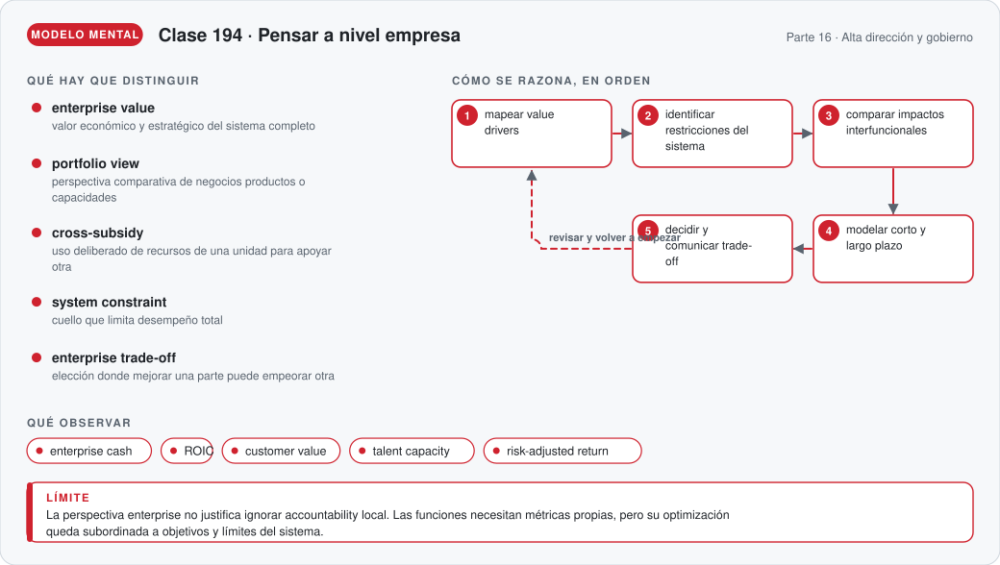

# Clase 194 — Pensar a nivel empresa

<!-- nav:inicio -->
> **Parte 16 · Alta dirección y oficina del CEO** — clase 2 de 12 · [índice de la parte](../../README.md) · [temario](../../../../SYLLABUS.md)
<!-- nav:fin -->

**Parte:** 16 — Alta dirección y oficina del CEO  
**Nivel:** Etapa 5 — Director → CEO  
**Duración sugerida:** 150–180 minutos · **Estándar:** deep-class-v2

## 🎯 Propósito

Ventas quiere más inventario para no perder pedidos; operaciones quiere menos para liberar caja; finanzas quiere recortar gastos; tecnología quiere invertir en una plataforma que dará frutos en tres años; recursos humanos quiere retener talento con aumentos. Cada petición es razonable desde su función, y todas compiten por los mismos recursos y por la misma atención. Pensar a nivel empresa significa decidir entre ellas con una mirada que ninguna función tiene por sí sola: **qué genera valor para la empresa completa, qué restringe su desempeño y qué se sacrifica a corto o largo plazo**. La mayoría de los ejecutivos aprende esta mirada tarde, y a menudo a un costo alto: optimizaron su área y empeoraron el conjunto.

La clase se apoya en la distinción de Rumelt entre una estrategia y una lista de metas, en la teoría de las restricciones de Goldratt, en el cuadro de mando y los mapas estratégicos de Kaplan y Norton, en la valoración de empresas de Koller y colaboradores y en el pensamiento sistémico de Meadows. Al terminar sabrás mapear los motores de valor de la empresa, encontrar la restricción que gobierna el sistema, comparar impactos entre funciones, equilibrar corto y largo plazo y comunicar un trade-off con honestidad.

## 📚 Resultados de aprendizaje

Al finalizar podrás:

1. **Mapear** los motores de valor de la empresa: caja, retorno sobre el capital y ventaja.
2. **Identificar** la restricción que limita el desempeño del sistema completo.
3. **Comparar** el impacto de una decisión sobre varias funciones con números.
4. **Equilibrar** resultados de corto plazo y capacidades de largo plazo.
5. **Comunicar** el trade-off elegido, incluyendo lo que se sacrifica.

## 🧭 Agenda

| Tramo | Qué se hace |
|---|---|
| 0–20 min | Recuperación: ¿qué decisión de tu función mejoró tu métrica y empeoró a otra área? |
| 20–60 min | Motores de valor, restricciones, impactos cruzados, plazos y comunicación. |
| 60–105 min | Ejemplo trabajado: cuánto inventario adicional conviene tener. |
| 105–150 min | Caso ejecutivo y práctica. |
| 150–175 min | Límites y entregable. |

## 🧩 Conceptos centrales

| Concepto | Definición | Cómo se reconoce |
|---|---|---|
| **Valor de empresa** | Valor presente de la caja futura que genera la empresa. | Se relaciona con flujos, riesgo y horizonte. |
| **ROIC** | Retorno sobre el capital invertido: utilidad operativa después de impuestos dividida por el capital invertido. | Compara retorno con el costo del capital. |
| **Restricción** | Elemento que limita el desempeño del sistema completo. | Mejorarlo mejora el sistema; mejorar otro, no. |
| **Subóptimo local** | Optimizar una parte perjudicando al conjunto. | Todas las áreas cumplen y la empresa no mejora. |
| **Trade-off** | Elección en la que se gana algo y se pierde algo. | Se explicita lo sacrificado. |
| **Retorno marginal** | Retorno de cada peso adicional invertido. | Decrece a medida que se invierte más. |

## 🧠 Modelo mental

**Cómo leer el diagrama.** Una cadena de cinco movimientos con retorno. **Motores de valor**: qué genera caja, retorno y ventaja. **Restricciones**: dónde se limita el sistema completo. **Impactos cruzados**: qué ganan y qué pierden las demás funciones. **Corto y largo plazo**: resultados de hoy y capacidades de mañana. **Decidir y explicar**: elegir el trade-off y comunicar por qué. La flecha indica que los resultados reabren los supuestos. La nota advierte que una función optimizada por separado puede empeorar el conjunto; el pie aclara que las funciones conservan metas propias.

## 📖 Desarrollo

### 1. Qué hace valiosa a una empresa

Koller y sus colegas muestran que el valor de una empresa depende de dos cosas: el **retorno sobre el capital invertido** y la **tasa de crecimiento**, siempre que el retorno supere el costo del capital. Crecer con un retorno menor que ese costo destruye valor. De ahí que el ejecutivo piense en **motores de valor**: márgenes, rotación del capital, crecimiento y riesgo. Cada decisión se traduce a su efecto en ellos: un descuento reduce margen y puede aumentar volumen; un inventario mayor reduce faltantes y aumenta capital; una inversión en tecnología reduce costos futuros y aumenta capital presente. Sin esa traducción, las funciones hablan idiomas distintos y las discusiones se vuelven de preferencias.

### 2. Estrategia: lo que se elige y lo que se renuncia

Rumelt distingue una buena estrategia de una lista de metas: la primera parte de un **diagnóstico** del desafío crítico, define una **política guía** que elige un enfoque y renuncia a otros, y organiza **acciones coherentes**. Pensar a nivel empresa es aplicar esa lógica a decisiones concretas: ¿cuál es el desafío crítico que limita a la empresa hoy?, ¿qué políticas y asignaciones lo atacan?, ¿qué se renuncia? Una función que pide recursos para «ser mejor» no está haciendo estrategia; la que muestra cómo su iniciativa resuelve el desafío crítico, sí. Kaplan y Norton ofrecen un instrumento complementario: los **mapas estratégicos**, que conectan objetivos financieros, de clientes, de procesos y de aprendizaje en relaciones de causa y efecto.

### 3. La restricción del sistema

Goldratt, en su teoría de las restricciones, sostiene que todo sistema tiene al menos una **restricción** que limita su rendimiento; mejorar cualquier otra parte no mejora el sistema, y a veces lo empeora. En una empresa, la restricción puede ser la capacidad de una planta, la velocidad de aprobación de crédito, el número de ingenieros senior, el capital disponible o la confianza de los clientes. El ejecutivo se pregunta: ¿qué limita hoy el crecimiento o la rentabilidad?, ¿estamos invirtiendo atención y recursos en eso o en áreas que no son la restricción? Aplicar esfuerzos a lo que no limita produce métricas locales buenas y resultados globales iguales. La restricción se mueve: al resolverla aparece otra, y la mirada se actualiza.

### 4. Comparar impactos entre funciones

Antes de decidir, se estima el efecto sobre cada función y sobre el conjunto con la misma moneda: **caja**, **margen**, **capital** y **riesgo**. Meadows recuerda que los sistemas tienen **retardos** y **ciclos de realimentación**: una medida que ayuda a ventas este trimestre puede perjudicar a operaciones el próximo y a clientes el año siguiente. Una tabla de impacto simple, con una fila por función y columnas de efecto de corto y largo plazo, evita sorpresas. Se incluyen los efectos **no cuantificables** (reputación, moral, dependencia), señalándolos, no ocultándolos. Y se identifican **quién gana y quién pierde** para anticipar la resistencia y diseñar compensaciones.

### 5. Corto y largo plazo

La presión por los resultados del período es real: el directorio, los bancos y los inversionistas miran los trimestres. Pero una empresa que sacrifica sistemáticamente sus capacidades (talento, tecnología, marca, relaciones) para cumplir cifras erosiona su futuro. Un buen ejecutivo **protege un portafolio de horizontes**: lo que financia el hoy, lo que construye el próximo año y lo que prepara los siguientes cinco. Se pregunta qué porcentaje del capital y del tiempo se destina a cada uno y qué señales muestran que el largo plazo avanza. Evita tanto el cortoplacismo como la inversión sin disciplina «para el futuro»: todo compromiso de largo plazo tiene hitos y criterios de revisión.

### 6. Decidir y comunicar el trade-off

Una decisión de empresa sacrifica algo para alguien. Comunicarla con honestidad exige decir: **qué se decidió**, **por qué** (la lógica y los números), **qué se renuncia** y **quién lo siente**, **cuándo se revisa** y **qué evidencia cambiaría la decisión**. Ocultar el costo para evitar conflictos solo lo traslada a la ejecución, donde reaparece como resistencia. Además, se acompaña a quienes pierden: recursos de transición, reconocimiento o una ruta de recuperación. La métrica de éxito de la comunicación no es la aprobación general, sino que las personas entiendan la decisión, la sientan justa en su proceso y sepan qué se espera de ellas.

### 7. Trampas del pensamiento funcional

Las trampas más comunes: **defender las propias métricas** aun cuando perjudiquen a otros; **negociar recursos** por antigüedad o tamaño en lugar de por retorno; **promediar** entre áreas para evitar el conflicto («un poco para cada uno»); **confundir actividad con valor**; **ignorar la restricción** y financiar lo visible; y **cambiar métricas** cuando los resultados no acompañan. Un antídoto es un **tablero de empresa** con pocos indicadores que todas las funciones comparten, y rituales en los que las funciones expongan cómo su plan se conecta con el conjunto.

## 📚 Lectura comparada

| Obra | Qué aporta | Qué no resuelve | Pregunta para contrastar |
|---|---|---|---|
| Rumelt | Diagnóstico, política guía y acciones coherentes. | No entrega métodos de cálculo. | ¿Cuál es el desafío crítico? |
| Goldratt | Restricción del sistema y enfoque de mejora. | Nació en manufactura; se adapta a otros contextos. | ¿Qué limita hoy a la empresa? |
| Kaplan y Norton | Mapas estratégicos con relaciones de causa y efecto. | Puede volverse burocrático. | ¿Cómo se conecta este objetivo con el resultado? |
| Koller y otros | Valor, ROIC y crecimiento. | Los supuestos de pronóstico son inciertos. | ¿El retorno supera el costo del capital? |
| Meadows | Retardos, ciclos y puntos de apoyo en sistemas. | Es conceptual. | ¿Qué efecto aparece más tarde? |

## 🧮 Ejemplo trabajado

**Situación (hipotética).** Una empresa de distribución tiene ventas de 60.000 millones de pesos, costo de ventas de 42.000 millones (margen bruto de 30 %), una utilidad operativa después de impuestos (NOPAT) de 3.000 millones y un capital invertido de 25.000 millones. Su ROIC es 3.000 ÷ 25.000 = 12 %; el costo del capital es 10 % y el retorno mínimo que exige el comité para nuevas inversiones es 15 %. Los quiebres de stock hacen perder el 2 % de las ventas.

**Posiciones.** Ventas pide inventario para eliminar los quiebres. Operaciones, que se mide por días de inventario, se opone. Finanzas teme inmovilizar caja.

**Pérdida por quiebres.** 2 % × 60.000 = 1.200 millones de ventas; con margen de 30 %, 360 millones de margen perdido por año.

**Análisis por tramos.** El 20 % de los productos (los de mayor rotación) explica el 70 % del margen perdido: 0,70 × 360 = 252 millones. El 30 % restante (108 millones) está en productos de cola larga.

| Tramo | Inventario adicional | Margen recuperado | Costo operativo (5 % del inventario) | Utilidad antes de impuestos | Después de impuestos (27 %) | ROIC marginal | Valor económico agregado |
|---|---|---|---|---|---|---|---|
| 1. Productos de alta rotación | 300 millones | 252 | 15 | 237 | 173,0 | 57,7 % | 173,0 − 30 = 143,0 |
| 2. Cola larga | 500 millones | 108 | 25 | 83 | 60,6 | 12,1 % | 60,6 − 50 = 10,6 |

(El valor económico agregado resta el cargo de capital: 10 % del inventario adicional.)

**Lectura.** El tramo 1 tiene un retorno marginal muy superior al mínimo de 15 %: se aprueba. El tramo 2 supera el costo del capital (12,1 % > 10 %) pero no el mínimo de 15 % que exige el comité para otras inversiones; no se financia ahora, y se revisa cuando el costo del capital o las alternativas cambien.

**Efecto en métricas locales.** Con un costo de ventas de 42.000 millones, el inventario base de 48 días equivale a 42.000 × 48 ÷ 365 ≈ 5.523 millones. Con el tramo 1 (+300): 5.823 millones, es decir 5.823 ÷ 42.000 × 365 ≈ 50,6 días. La métrica de operaciones empeora 2,6 días, pero la empresa gana. Se ajusta la meta de inventario de operaciones para reflejarlo y se agrega la **tasa de cumplimiento** como indicador compartido.

**Impacto resumido.** Ventas gana disponibilidad; operaciones gana claridad de meta y pierde 2,6 días; finanzas inmoviliza 300 millones, con retorno marginal de 57,7 %. Corto plazo: mejora de margen de 237 millones antes de impuestos. Largo plazo: mejor servicio al cliente y datos para decidir el tramo 2.

**Comunicación.** «Aprobamos 300 millones de inventario para los productos de mayor rotación; no financiamos la cola larga por ahora porque su retorno no supera nuestro mínimo. Operaciones ajusta su meta. Revisamos en seis meses con datos de cumplimiento.»

**Cuidados.** Las estimaciones de pérdida y de efecto dependen de datos de ventas perdidas que pueden estar subestimados; las cifras son ilustrativas.

**Qué muestra.** (1) Las tres funciones se compararon con la misma moneda. (2) La decisión fue por tramos y no «un poco para cada uno». (3) Se comunicó lo que se gana y lo que se sacrifica.

## 🔀 Comparación y límites

**Perspectiva de empresa frente a centralización.** Pensar a nivel empresa no significa que el centro decida todo; significa que las decisiones locales se toman dentro de objetivos y límites del conjunto.

**Límites.** La perspectiva de empresa no justifica ignorar la rendición de cuentas local: las funciones necesitan métricas propias, subordinadas a los objetivos del sistema. Los datos sobre ventas perdidas y sus efectos son estimaciones. La teoría de las restricciones simplifica sistemas complejos. Las cifras del ejemplo son ilustrativas.

## 🪜 De profesional a owner

| Nivel | Cómo piensa a nivel empresa |
|---|---|
| **Profesional** | Entiende cómo su trabajo afecta a otras áreas. |
| **Jefe / Team Lead** | Conecta las metas del equipo con las de la empresa. |
| **Gerente** | Optimiza su función con atención a los límites del sistema. |
| **CEO / Director** | Decide entre funciones con una moneda común y comunica los trade-offs. |
| **Founder / Owner** | Equilibra caja, crecimiento y riesgo con su visión personal. |

## 🏢 Caso ejecutivo

Una empresa de servicios de ingeniería con 1.800 personas y ventas de 90.000 millones de pesos enfrenta cuatro peticiones en el comité: comercial quiere ampliar la fuerza de ventas en 20 personas (1.400 millones al año) para captar nuevos contratos; operaciones pide contratar 35 ingenieros senior (3.800 millones al año) porque los proyectos se atrasan por falta de capacidad; tecnología solicita 2.500 millones para una plataforma de gestión de proyectos; finanzas propone reducir gastos en 1.800 millones. El margen operativo es 8 %; el ROIC, 11 %; el costo del capital, 9 %. El 62 % de los atrasos de proyectos se debe a la falta de ingenieros senior (restricción); las ventas ya superan la capacidad de ejecución en 15 %; la rotación de ingenieros senior es de 22 %. El gerente general quiere «un poco para cada uno».

Entrega un **análisis de empresa** que contenga: (a) los motores de valor y el desafío crítico; (b) la restricción del sistema, con datos; (c) la tabla de impacto de cada petición en las funciones, con efectos de corto y largo plazo; (d) la decisión recomendada con alternativas y la secuencia; (e) el tablero compartido y los ajustes de metas por función; (f) la comunicación del trade-off, con lo que se renuncia y quién lo siente, y las verificaciones laborales de contrataciones o cambios.

## 🧪 Práctica

1. Calcula el ROIC de tu empresa o unidad y compáralo con el costo del capital.
2. Identifica la restricción actual del sistema con tres datos que la respalden.
3. Elabora una tabla de impacto de una decisión sobre cinco funciones, corto y largo plazo.
4. Redacta la comunicación de un trade-off con lo que se gana, lo que se pierde y cuándo se revisa.
5. Propone un tablero de seis indicadores compartidos por todas las funciones.

## ⚠️ Errores frecuentes

| Error | Por qué ocurre | Cómo corregirlo |
|---|---|---|
| «Un poco para cada uno» | Se evita el conflicto | Decidir por retorno y restricción. |
| Mejorar lo que no limita | Es visible o fácil | Identificar y atacar la restricción. |
| Optimizar la métrica local | Los incentivos son por función | Metas subordinadas al sistema y tablero común. |
| Ignorar efectos tardíos | Se mira el trimestre | Considerar retardos y ciclos. |
| Esconder el costo | Se teme la resistencia | Comunicar lo que se sacrifica y a quién. |
| Cortoplacismo o inversión sin disciplina | Presión o entusiasmo | Portafolio de horizontes con hitos. |

## ❓ Preguntas de comprobación

1. ¿De qué dos factores depende el valor de una empresa según Koller y otros?
2. ¿Qué elementos tiene una buena estrategia según Rumelt?
3. ¿Qué es la restricción de un sistema y por qué importa?
4. ¿Por qué conviene comparar impactos entre funciones con la misma moneda?
5. ¿Cómo se equilibran corto y largo plazo?
6. ¿Qué debe contener la comunicación de un trade-off?
7. ¿Qué límites tiene la perspectiva de empresa?

Claves de respuesta

1. Del retorno sobre el capital invertido y de la tasa de crecimiento, siempre que el retorno supere el costo del capital.
2. Un diagnóstico del desafío crítico, una política guía que elige y renuncia, y acciones coherentes.
3. El elemento que limita el desempeño del conjunto; mejorar otras partes no mejora el sistema.
4. Para que las funciones hablen el mismo idioma y se vea el efecto sobre el conjunto, incluidos los retardos.
5. Con un portafolio de horizontes y señales de avance de cada uno, evitando tanto el cortoplacismo como la inversión sin disciplina.
6. Qué se decidió, por qué, qué se renuncia, quién lo siente, cuándo se revisa y qué evidencia lo cambiaría.
7. No elimina la rendición de cuentas local, depende de estimaciones y simplifica sistemas complejos.

## 📥 Entregable

Guarda en `portfolio/194-pensar-a-nivel-empresa/`:

- `leadership-decision-brief.md` (plantilla [Leadership Decision Brief](../../../../templates/leadership-decision-brief.md)) con el análisis de empresa del caso ejecutivo;
- `ceo-dashboard.md` (plantilla [CEO dashboard](../../../../templates/ceo-dashboard.md)) con el tablero compartido de indicadores;
- `decision-journal.md` con la tabla de impacto, los supuestos y la comunicación del trade-off.

## 📗 Fuentes y verificación

- Richard Rumelt — *Good Strategy/Bad Strategy* (Profile Books, 2011). **Uso en esta clase:** diagnóstico, política guía y acciones coherentes. Lectura selectiva sobre **pensar a nivel empresa**. **Localizador:** [ISBN-13 9781846684807](https://openlibrary.org/isbn/9781846684807).
- Eliyahu M. Goldratt & Jeff Cox — *The Goal* (HighBridge Audio, 2014). **Uso en esta clase:** restricción del sistema y enfoque de mejora. Lectura selectiva sobre **pensar a nivel empresa**. **Localizador:** [ISBN-13 9781622313945](https://openlibrary.org/isbn/9781622313945).
- Robert S. Kaplan & David P. Norton — *Strategy Maps* (Harvard Business School Press, 2004). **Uso en esta clase:** mapas estratégicos con relaciones de causa y efecto. Lectura selectiva sobre **pensar a nivel empresa**. **Localizador:** [ISBN-13 9781591391340](https://openlibrary.org/isbn/9781591391340).
- Tim Koller, Marc Goedhart & David Wessels — *Valuation: Measuring and Managing the Value of Companies* (Wiley, 2005). **Uso en esta clase:** valor de empresa, retorno sobre el capital y crecimiento. Lectura selectiva sobre **pensar a nivel empresa**. **Localizador:** [ISBN-13 9780471702191](https://openlibrary.org/isbn/9780471702191).
- Donella H. Meadows — *Thinking in Systems* (Earthscan, 2009). **Uso en esta clase:** retardos, ciclos y puntos de apoyo en sistemas. Lectura selectiva sobre **pensar a nivel empresa**. **Localizador:** [ISBN-13 9781849773386](https://openlibrary.org/isbn/9781849773386).

> **Regla de fuentes para Pensar a nivel empresa:** las obras anteriores estructuran las perspectivas de esta materia; cualquier norma, ley o estándar vivo mencionado debe comprobarse nuevamente en su fuente primaria vigente, incluidas las condiciones laborales de contrataciones o cambios organizacionales. Los ejemplos y casos son hipotéticos, con cifras ilustrativas. El desarrollo es original y no reproduce capítulos protegidos.

<!-- pie:inicio -->
---

| Anterior | Índice | Siguiente |
|---|---|---|
| [← 193 · Transición de gerente a ejecutivo](../193-transicion-de-gerente-a-ejecutivo/README.md) | [Parte 16](../../README.md) · [Programa](../../../../SYLLABUS.md) | [195 · Construir el executive team →](../195-construir-el-executive-team/README.md) |
<!-- pie:fin -->
