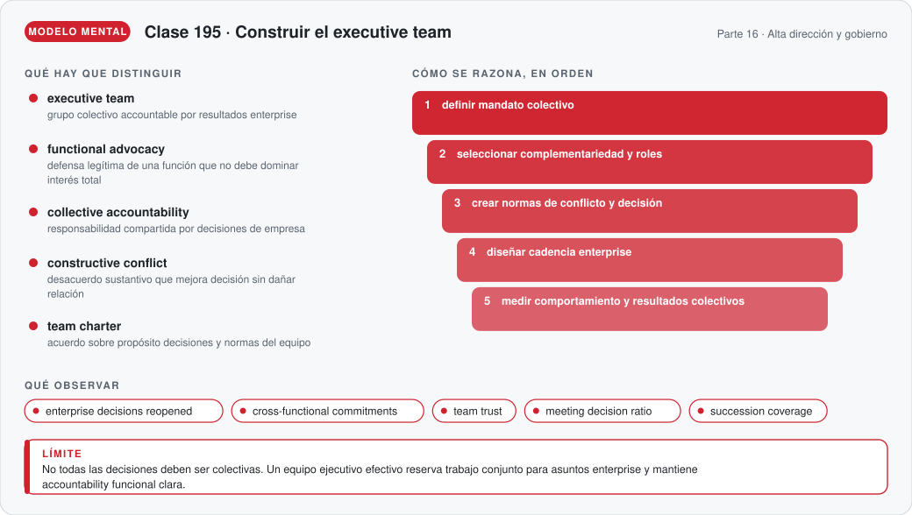

# Clase 195 — Construir el executive team

<!-- nav:inicio -->
> **Parte 16 · Alta dirección y oficina del CEO** — clase 3 de 12 · [índice de la parte](../../README.md) · [temario](../../../../SYLLABUS.md)
<!-- nav:fin -->

**Parte:** 16 — Alta dirección y oficina del CEO  
**Nivel:** Etapa 5 — Director → CEO  
**Duración sugerida:** 150–180 minutos · **Estándar:** deep-class-v2

## 🎯 Propósito

Muchos comités de dirección no son equipos: son reuniones de personas que dirigen cada una su función y se juntan para informar, negociar recursos y evitar roces. Cada miembro llega a defender su presupuesto, a protegerse de los otros y a asegurarse de que no lo sorprendan; las decisiones de empresa se aplazan, se aceptan en la sala y se reabren en los pasillos, y los conflictos que importan se discuten por separado, con el CEO como intermediario. El resultado es un equipo caro, lento y poco leal al conjunto. Y como la dirección fija el tono de la organización, sus defectos se replican hacia abajo.

Un **equipo ejecutivo** efectivo es otra cosa: un grupo pequeño que comparte la responsabilidad por la empresa, discute ideas con franqueza, decide con claridad y se compromete con lo decidido. La clase se apoya en el modelo de disfunciones de Lencioni, en el estudio de Wageman y colaboradores sobre equipos de alta dirección, en las condiciones de diseño de equipos de Hackman, en el trabajo de Katzenbach y Smith sobre la diferencia entre grupo y equipo y en la seguridad psicológica de Edmondson. Al terminar sabrás definir un mandato colectivo, componer el equipo con roles complementarios, fijar normas de conflicto y decisión, diseñar una cadencia de trabajo y medir su funcionamiento con conductas observables.

## 📚 Resultados de aprendizaje

Al finalizar podrás:

1. **Definir** el mandato colectivo y qué asuntos son del equipo y cuáles de cada función.
2. **Componer** el equipo con complementariedad de capacidades y claridad de roles.
3. **Establecer** normas de conflicto, de decisión y de compromiso.
4. **Diseñar** una cadencia de reuniones y de trabajo de empresa.
5. **Medir** el funcionamiento del equipo con conductas y resultados.

## 🧭 Agenda

| Tramo | Qué se hace |
|---|---|
| 0–20 min | Recuperación: ¿qué decisión del comité de tu empresa se reabrió después de aprobarse y por qué? |
| 20–60 min | Mandato, composición, normas, cadencia, confianza y medición. |
| 60–105 min | Ejemplo trabajado: rediseño de la cadencia de un comité de siete personas. |
| 105–150 min | Caso ejecutivo y práctica. |
| 150–175 min | Límites y entregable. |

## 🧩 Conceptos centrales

| Concepto | Definición | Cómo se reconoce |
|---|---|---|
| **Equipo ejecutivo** | Grupo pequeño que responde en conjunto por la empresa. | Tiene un mandato colectivo y resultados compartidos. |
| **Defensor de función** | Ejecutivo que actúa principalmente para proteger su área. | Negocia recursos y evita conflictos. |
| **Mandato colectivo** | Asuntos que solo el equipo puede resolver juntos. | Cruzan funciones y exigen renuncias. |
| **Confianza** | Disposición a mostrarse vulnerable ante los demás. | Se admiten errores y dudas. |
| **Conflicto sobre ideas** | Discusión franca sobre asuntos, sin ataque personal. | Se debate antes de decidir. |
| **Compromiso** | Adhesión visible a una decisión, incluso con desacuerdo previo. | Nadie la reabre fuera de la sala. |

## 🧠 Modelo mental

**Cómo leer el diagrama.** Dos paneles. A la izquierda, el **equipo ejecutivo**: tiene un mandato colectivo claro (trabaja en asuntos de la empresa y no repite informes), conflicto sobre ideas (discute con franqueza y se compromete después) y compromisos cruzados (cada miembro responde también por el resultado de los demás). A la derecha, los **defensores de función**: cada uno defiende su área, las decisiones se reabren y las reuniones son de informe. La nota aclara que no todas las decisiones son colectivas; el pie, que la confianza y el conflicto se observan en conductas.

## 📖 Desarrollo

### 1. Grupo de trabajo o equipo

Katzenbach y Smith distinguen un **grupo de trabajo**, donde cada persona rinde individualmente y el desempeño total es la suma de partes, de un **equipo**, que tiene un propósito común, metas de desempeño compartidas, un enfoque de trabajo y **responsabilidad mutua**. Wageman y sus colegas, tras estudiar equipos de alta dirección, mostraron que muchos de ellos son equipos solo de nombre: sus miembros dedican poco tiempo a trabajar de verdad en conjunto, tienen un mandato difuso y prefieren evitar la fricción. La conclusión práctica: un comité de dirección no es automáticamente un equipo; hay que **diseñarlo y mantenerlo**.

### 2. El mandato colectivo

La pregunta fundacional es: ¿para qué existe este equipo que no pueda lograr cada ejecutivo por separado? La respuesta es el **mandato colectivo**: los asuntos de la empresa que cruzan funciones y exigen renunciar a algo local, como la asignación de capital y talento (clase 198), las prioridades estratégicas, la arquitectura de decisiones (clase 196), el balance entre partes interesadas (clase 199) y la gestión de crisis (clase 202). Todo lo demás (informes de estado, decisiones funcionales) se resuelve en otros foros. Se escribe en una página, con los resultados colectivos esperados y los asuntos que **no** son del equipo. Sin mandato, las reuniones se llenan de lo urgente y lo funcional.

### 3. Composición y roles

Hackman señala que la eficacia de un equipo depende de condiciones de diseño: que sea un **equipo real** (con fronteras claras y membresía estable), tenga una **dirección que importa**, una **estructura que facilita** el trabajo (tamaño adecuado, tareas, normas), un **contexto que apoya** (información, recursos, recompensas) y **orientación experta** disponible. Para equipos ejecutivos esto sugiere: pocos miembros (la coordinación se complica con tamaños grandes), capacidades **complementarias** (no cinco versiones del mismo perfil), claridad sobre **quién es dueño de qué**, y la inclusión de quienes necesitan estar para las decisiones de empresa, no solo de quienes tienen el cargo más alto. Cada miembro tiene un rol doble: dirigir su función y colaborar en el conjunto.

### 4. Confianza, conflicto y compromiso

Lencioni propone una secuencia de disfunciones: **ausencia de confianza** (no se admiten debilidades), que impide el **conflicto productivo** (se finge armonía); sin conflicto, no hay **compromiso** (la decisión no se asume de verdad); sin compromiso, no hay **responsabilidad mutua** (nadie corrige a otro); y sin ella, se pierde la **atención a los resultados** colectivos. Aunque su evidencia proviene de la práctica y no de estudios controlados, ofrece una guía útil de conductas observables. Edmondson añade que la seguridad psicológica, la creencia de que se puede hablar, preguntar y disentir sin castigo, es condición del aprendizaje: en un equipo ejecutivo, se ve cuando el CEO escucha una mala noticia sin reaccionar contra quien la trae.

### 5. Normas de decisión y de conflicto

Un equipo acuerda por escrito sus **normas**: cómo se decide (consenso, consulta y decisión del dueño, voto), quién decide cada tipo de asunto, cuándo se reabre una decisión (solo con evidencia nueva y por el canal convenido), cómo se discrepa («discute las ideas, no a las personas») y cómo se comunican las decisiones hacia abajo (**un mismo mensaje**). Un recurso es separar: **debate** (se escuchan todas las posturas), **decisión** (la toma el dueño o el CEO) y **compromiso** (todos apoyan, incluso quien discrepó). La regla «aceptar y comprometerse» requiere que las personas sientan que fueron escuchadas, no necesariamente que su posición ganó.

### 6. Cadencia: cómo trabaja el equipo

La cadencia convierte el mandato en rutina. Un diseño habitual combina: una reunión **semanal** corta de coordinación y resolución de asuntos operativos de empresa; una sesión **mensual** más larga para temas estratégicos con pre-lectura; una revisión **trimestral** del plan y de los resultados; y una jornada **anual** de estrategia y de revisión del propio equipo. Se cuida la **calidad de las reuniones**: agenda con decisiones, materiales enviados con antelación, tiempo para discutir y no para presentar, y registro de acuerdos con dueños y fechas. Se mide el porcentaje del tiempo dedicado a informar frente a decidir; un equipo que informa más del 40 % del tiempo está desperdiciando su recurso más escaso.

### 7. Medir y ajustar el equipo

El funcionamiento se mide con **conductas**: porcentaje de decisiones de empresa reabiertas, compromisos cruzados cumplidos, tiempo de la reunión dedicado a decidir, evaluaciones de confianza (encuestas breves y observación), y con **resultados**: avance de las prioridades colectivas y velocidad de decisión. Se hace una **revisión periódica**, a veces con un facilitador externo, sobre cómo trabaja el equipo: qué conversaciones se evitan, qué normas no se cumplen, quién no participa. Y se actúa sobre la **composición**: cuando alguien no puede adoptar la perspectiva de empresa, se le apoya, se le reubica o se acuerda su salida con respeto y conforme a las normas laborales vigentes, que se verifican con asesoría.

## 📚 Lectura comparada

| Obra | Qué aporta | Qué no resuelve | Pregunta para contrastar |
|---|---|---|---|
| Lencioni | Secuencia de disfunciones y conductas observables de un equipo. | Evidencia basada en la práctica. | ¿Qué conversación evitamos? |
| Wageman y otros | Condiciones de equipos de alta dirección; muchos son equipos de nombre. | Estudios sobre ciertas muestras. | ¿Es este un equipo real? |
| Hackman | Condiciones de diseño que favorecen a los equipos. | No cubre la cadencia de un comité. | ¿Qué condición falta? |
| Katzenbach y Smith | Diferencia entre grupo de trabajo y equipo. | No fija el tamaño ni la estructura. | ¿Hay responsabilidad mutua? |
| Edmondson | Seguridad psicológica y aprendizaje. | No ofrece normas de decisión. | ¿Se pueden decir malas noticias? |

## 🧮 Ejemplo trabajado

**Situación (hipotética).** El comité de dirección de una empresa de 1.200 personas tiene siete miembros (CEO, finanzas, comercial, operaciones, tecnología, personas y legal). Se reúne ocho horas a la semana. Un registro de un trimestre muestra: 24 decisiones de empresa tomadas, de las cuales **11 se reabrieron** (45,8 %) en reuniones posteriores o por conversaciones paralelas; el 60 % del tiempo se usa en informes de estado; y en una encuesta anónima, 3 de 7 declaran que «a veces no digo lo que pienso por no generar conflicto».

**Diagnóstico.** El comité funciona como grupo de defensores de función: informa más de lo que decide, evita conflictos y reabre decisiones.

**Rediseño.**

1. **Mandato escrito**: cinco asuntos colectivos (asignación de capital y talento, prioridades del año, arquitectura de decisiones, riesgos de la empresa, comunicación a la organización); se retiran los informes de estado a un tablero que se lee antes.
2. **Normas**: la decisión la toma el dueño después de un debate; se registra el compromiso de todos; una decisión solo se reabre con evidencia nueva y se debe avisar antes de la reunión.
3. **Cadencia**: reunión semanal de 2 horas (coordinación y decisiones), sesión mensual de 4 horas con pre-lectura de temas estratégicos, revisión trimestral y jornada anual.
4. **Práctica de conflicto**: el CEO designa un «abogado del diablo» rotativo para decisiones relevantes y pide opiniones por escrito antes de hablar.
5. **Seguridad psicológica**: el CEO inicia cada sesión con un error o duda propios, y no reacciona a las malas noticias con juicios personales.

**Resultados a un trimestre (hipotéticos).** De 26 decisiones de empresa, 4 se reabrieron (15,4 %). El tiempo de informes baja de 60 % a 25 %. La encuesta mejora: 1 de 7 declara que evita opinar.

**Ahorro de tiempo.** Antes, el comité usaba 8 horas semanales y 60 % era informe: 4,8 horas. Después, usa 2 horas semanales más 4 horas al mes de sesión estratégica (alrededor de 1 hora por semana): 3 horas semanales, de las cuales 25 % es informe: 0,75 horas. La reunión baja 5 horas por persona y por semana. Con 44 semanas laborables: 5 × 44 = 220 horas por persona y 220 × 7 = 1.540 horas-persona al año. A un costo medio de 85.000 pesos por hora, equivalen a 130,9 millones de pesos (1.540 × 85.000) de tiempo ejecutivo que se libera para decisiones y para sus equipos.

**Cuidados.** Las medidas de clima se manejan con confidencialidad y de forma agregada; los cambios de composición se verifican con asesoría laboral. Las cifras son ilustrativas.

**Qué muestra.** (1) El mandato redujo informes. (2) Las normas redujeron la reapertura de decisiones. (3) La medición mostró conductas, no solo opiniones.

## 🔀 Comparación y límites

**Equipo ejecutivo frente a comité de coordinación.** Un comité coordina funciones; un equipo ejecutivo comparte responsabilidad por la empresa. Ambos son necesarios, pero no se deben confundir ni mezclar en una misma agenda.

**Límites.** No todas las decisiones deben ser colectivas: un equipo efectivo reserva el trabajo conjunto para asuntos de empresa y mantiene la responsabilidad funcional clara. La evidencia de Lencioni es de práctica. Los estudios de equipos de alta dirección tienen muestras pequeñas. La seguridad psicológica no se decreta; se construye con conducta. Las cifras del ejemplo son ilustrativas.

## 🪜 De profesional a owner

| Nivel | Cómo participa en el equipo ejecutivo |
|---|---|
| **Profesional** | Aporta datos y cumple los compromisos con el equipo. |
| **Jefe / Team Lead** | Replica normas de decisión y de conflicto en su equipo. |
| **Gerente** | Prepara bien las decisiones y sostiene los acuerdos. |
| **CEO / Director** | Construye el equipo, modela la conducta y decide cuando corresponde. |
| **Founder / Owner** | Acepta que el equipo lo desafíe y cede control de decisiones. |

## 🏢 Caso ejecutivo

Una empresa de servicios financieros con 1.600 personas tiene un comité de dirección de nueve miembros que se reúne cada martes de 9 a 13 horas. Los informes de cada área ocupan tres horas. Hay dos ejecutivos que se evitan y no se hablan fuera de las reuniones; el director comercial amenaza con irse si no recibe más presupuesto; la directora de tecnología se queja de que «las decisiones se toman en el pasillo»; el gerente general toma muchas decisiones sin consultar y luego las cambia. En seis meses, el 48 % de las decisiones de empresa se reabrió; el plan estratégico tiene 22 prioridades; la rotación de gerentes bajo el comité subió de 10 % a 19 %. Una consultora sugiere un taller de «team building» de dos días con actividades al aire libre.

Entrega un **diseño del equipo ejecutivo** que contenga: (a) el mandato colectivo y lo que no le corresponde; (b) la composición y los roles, con un tamaño recomendado; (c) las normas de decisión, de conflicto y de compromiso; (d) la cadencia con agendas y materiales; (e) los indicadores de conducta y de resultado y su revisión; (f) el tratamiento de los dos casos individuales y las verificaciones laborales pendientes.

## 🧪 Práctica

1. Escribe en una página el mandato colectivo de un comité y los asuntos que no le corresponden.
2. Mide en un mes qué porcentaje de las reuniones se dedica a informar y cuántas decisiones se reabren.
3. Redacta cinco normas de decisión y de conflicto y pide a tu equipo que las discuta.
4. Diseña la cadencia anual de un equipo con reunión semanal, mensual, trimestral y anual.
5. Define cinco conductas observables que indicarían confianza en tu equipo.

## ⚠️ Errores frecuentes

| Error | Por qué ocurre | Cómo corregirlo |
|---|---|---|
| Reuniones de informe | Es cómodo y evita conflicto | Tablero previo y agenda de decisiones. |
| Mandato difuso | No se discute para qué existe | Escribirlo y listar lo que no es del equipo. |
| Armonía aparente | Se teme al conflicto | Normas de debate y conversaciones difíciles. |
| Decisiones reabiertas | No hay compromiso real | Registro, dueño y regla de reapertura. |
| Equipo demasiado grande | Se incluye a todos | Pocos miembros y foros por asunto. |
| Solución de «taller» único | Se busca un arreglo rápido | Cambiar mandato, normas y cadencia. |

## ❓ Preguntas de comprobación

1. ¿En qué se diferencia un grupo de trabajo de un equipo?
2. ¿Qué incluye el mandato colectivo de un equipo ejecutivo?
3. ¿Qué condiciones de diseño destaca Hackman?
4. ¿Qué secuencia de disfunciones propone Lencioni?
5. ¿Qué normas de decisión conviene acordar?
6. ¿Qué conductas e indicadores miden el funcionamiento del equipo?
7. ¿Qué límites tiene el enfoque de equipo ejecutivo?

Claves de respuesta

1. El equipo tiene propósito común, metas compartidas y responsabilidad mutua; el grupo suma desempeños individuales.
2. Asuntos de la empresa que cruzan funciones y exigen renuncias, como capital y talento, prioridades, decisiones, riesgos y comunicación; y lo que no es del equipo.
3. Equipo real, dirección que importa, estructura que facilita, contexto que apoya y orientación experta.
4. Ausencia de confianza, temor al conflicto, falta de compromiso, evitación de la responsabilidad mutua y desatención de los resultados.
5. Cómo y quién decide cada tipo de asunto, cuándo se reabre una decisión, cómo se discrepa y cómo se comunica un mismo mensaje.
6. Porcentaje de decisiones reabiertas, compromisos cruzados cumplidos, tiempo de decisión, evaluaciones de confianza y avance de prioridades.
7. No todas las decisiones deben ser colectivas; la evidencia es en parte de práctica y de muestras pequeñas, y la seguridad psicológica no se decreta.

## 📥 Entregable

Guarda en `portfolio/195-construir-el-executive-team/`:

- `leadership-decision-brief.md` (plantilla [Leadership Decision Brief](../../../../templates/leadership-decision-brief.md)) con el diseño del caso ejecutivo;
- `team-charter.md` (plantilla [Team charter](../../../../templates/team-charter.md)) con el mandato, las normas y la cadencia;
- `decision-journal.md` con las mediciones de conducta, las revisiones y los acuerdos de seguimiento.

## 📗 Fuentes y verificación

- Patrick Lencioni — *The Five Dysfunctions of a Team* (Pfeiffer, 2012). **Uso en esta clase:** secuencia de disfunciones y conductas observables. Lectura selectiva sobre **construir el executive team**. **Localizador:** [ISBN-13 9781118127308](https://openlibrary.org/isbn/9781118127308).
- Ruth Wageman et al. — *Senior Leadership Teams* (Harvard Business School Press, 2008). **Uso en esta clase:** condiciones y fallas de los equipos de alta dirección. Lectura selectiva sobre **construir el executive team**. **Localizador:** [ISBN-13 9781422103364](https://openlibrary.org/isbn/9781422103364).
- J. Richard Hackman — *Leading Teams* (Harvard Business School Press, 2002). **Uso en esta clase:** condiciones de diseño de equipos efectivos. Lectura selectiva sobre **construir el executive team**. **Localizador:** [ISBN-13 9781578513338](https://openlibrary.org/isbn/9781578513338).
- Jon R. Katzenbach & Douglas K. Smith — *The Wisdom of Teams* (McGraw-Hill, 2005). **Uso en esta clase:** diferencia entre grupo de trabajo y equipo. Lectura selectiva sobre **construir el executive team**. **Localizador:** [ISBN-13 9780077111687](https://openlibrary.org/isbn/9780077111687).
- Amy C. Edmondson — *Psychological Safety and Learning Behavior in Work Teams* (Administrative Science Quarterly, 1999). **Uso en esta clase:** seguridad psicológica y aprendizaje. Lectura selectiva sobre **construir el executive team**. **Localizador:** [DOI 10.2307/2666999](https://doi.org/10.2307/2666999).

> **Regla de fuentes para Construir el executive team:** las obras anteriores estructuran las perspectivas de esta materia; cualquier norma, ley o estándar vivo mencionado debe comprobarse nuevamente en su fuente primaria vigente, incluidas las condiciones laborales de cambios en el equipo directivo. Los ejemplos y casos son hipotéticos, con cifras ilustrativas. El desarrollo es original y no reproduce capítulos protegidos.

<!-- pie:inicio -->
---

| Anterior | Índice | Siguiente |
|---|---|---|
| [← 194 · Pensar a nivel empresa](../194-pensar-a-nivel-empresa/README.md) | [Parte 16](../../README.md) · [Programa](../../../../SYLLABUS.md) | [196 · Arquitectura de decisiones ejecutivas →](../196-arquitectura-de-decisiones-ejecutivas/README.md) |
<!-- pie:fin -->
