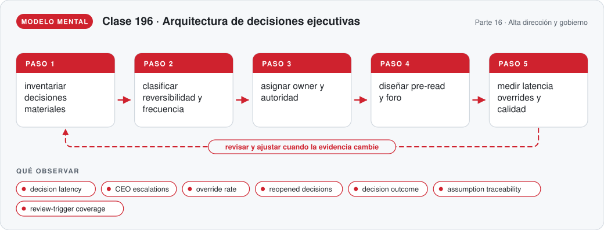

# Clase 196 — Arquitectura de decisiones ejecutivas

<!-- nav:inicio -->
> **Parte 16 · Alta dirección y oficina del CEO** — clase 4 de 12 · [índice de la parte](../../README.md) · [temario](../../../../SYLLABUS.md)
<!-- nav:fin -->

**Parte:** 16 — Alta dirección y oficina del CEO  
**Nivel:** Etapa 5 — Director → CEO  
**Duración sugerida:** 150–180 minutos · **Estándar:** deep-class-v2

## 🎯 Propósito

En una empresa mediana se toman miles de decisiones por semana, pero unas pocas determinan el rumbo: dónde invertir, a quién nombrar, qué cliente aceptar o rechazar, cuándo lanzar, cuándo detener. Cuando esas decisiones no tienen un diseño, ocurren cosas predecibles: todo sube al CEO, que se convierte en cuello de botella; o nadie decide y los temas circulan por comités; o se decide en cualquier parte y se corrige después a un costo alto; o decide quien grita más fuerte. Una **arquitectura de decisiones** es el diseño explícito de qué decisiones importan, quién las toma, en qué foro, con qué información, con cuánta velocidad y con qué revisión posterior.

La clase se apoya en el estudio de Mankins y Garton sobre cómo las organizaciones gastan su tiempo, talento y energía, en el análisis de Kahneman, Sibony y Sunstein sobre el **ruido** en los juicios, en la guía de Duke para decidir con incertidumbre y en el trabajo de Eisenhardt sobre decisiones rápidas en entornos cambiantes. Al terminar sabrás inventariar decisiones materiales, clasificarlas por reversibilidad y materialidad, asignar dueño y foro, preparar y desafiar una pre-lectura y medir la calidad de la arquitectura con indicadores de latencia, escalamientos y reversiones.

## 📚 Resultados de aprendizaje

Al finalizar podrás:

1. **Inventariar** las decisiones materiales de una empresa y clasificarlas por reversibilidad.
2. **Asignar** dueño, autoridad y foro a cada tipo de decisión.
3. **Preparar y desafiar** una pre-lectura con afirmación, evidencia, supuestos y riesgos.
4. **Reducir** el ruido y los sesgos con una higiene de decisión.
5. **Medir** latencia, escalamientos, reversiones y calidad.

## 🧭 Agenda

| Tramo | Qué se hace |
|---|---|
| 0–20 min | Recuperación: ¿qué decisión se tomó en tu empresa por la persona o en el foro equivocados y qué costó? |
| 20–60 min | Inventario, clasificación, dueños, pre-lectura, ruido, velocidad y medición. |
| 60–105 min | Ejemplo trabajado: rediseño de las decisiones que llegan al CEO. |
| 105–150 min | Caso ejecutivo y práctica. |
| 150–175 min | Límites y entregable. |

## 🧩 Conceptos centrales

| Concepto | Definición | Cómo se reconoce |
|---|---|---|
| **Arquitectura de decisiones** | Diseño de quién decide qué, dónde, con qué información y con qué revisión. | Reglas, foros y registros. |
| **Reversibilidad** | Facilidad y costo de deshacer una decisión. | Se clasifica antes de decidir. |
| **Latencia de decisión** | Tiempo desde que surge la decisión hasta que se toma. | Se mide en días. |
| **Pre-lectura** | Documento breve que prepara una decisión. | Contiene afirmación, evidencia y riesgos. |
| **Ruido** | Variabilidad no deseada en juicios que deberían ser iguales. | Dos decisores resuelven el mismo caso de forma distinta. |
| **Tasa de anulación** | Proporción de decisiones delegadas que el CEO revierte. | Indica que la delegación carece de contexto o de límites. |

## 🧠 Modelo mental

**Cómo leer el diagrama.** Un cuadrante con la reversibilidad en el eje horizontal y la materialidad en el vertical. **Alta materialidad y reversible**: un dueño decide pronto y se corrige con datos. **Alta materialidad e irreversible**: foro ejecutivo con pre-lectura, desafío independiente y registro. **Baja materialidad y reversible**: se delega con límites. **Baja materialidad e irreversible**: una regla clara y revisión periódica del dueño. La nota dice que la arquitectura asigna a cada decisión un dueño, un foro y un criterio de revisión; el pie, que delegar exige contexto, datos y límites.

## 📖 Desarrollo

### 1. Dónde se va el tiempo ejecutivo

Mankins y Garton estudiaron miles de empresas y concluyeron que el recurso más escaso de las organizaciones no es el capital sino el **tiempo de sus líderes**, y que se invierte con poca intención: reuniones sin decisión, procesos duplicados, informes sin lectores y capas innecesarias. De ahí la idea de **productividad organizacional**: hacer más con la misma atención. Una arquitectura de decisiones es la herramienta principal para ello, porque evita que las decisiones circulen sin dueño o suban sin necesidad. Cada decisión que sube al CEO sin ser de empresa le quita tiempo a las que sí lo son; cada decisión de empresa que se toma sin foro adecuado produce errores caros.

### 2. Inventario y clasificación

El primer paso es un **inventario** de decisiones materiales en un período: las que movieron capital, personas, clientes, riesgos o la estrategia. Para cada una se anotan: quién la tomó, quién participó, cuánto tardó, si se revirtió y cuánto costó el error o el retraso. Luego se **clasifican** por dos ejes: **reversibilidad** (¿se puede deshacer a bajo costo?) y **materialidad** (¿cuánto valor o riesgo mueve?). Las decisiones reversibles y de bajo impacto se delegan con límites; las irreversibles y de alto impacto reciben el máximo rigor. Duke recomienda además distinguir la **calidad de la decisión** de la **calidad del resultado**: un buen proceso puede dar un mal resultado y viceversa, y juzgar solo por resultados (*resulting*) distorsiona el aprendizaje.

### 3. Dueño, autoridad y foro

Cada tipo de decisión tiene un **dueño** con nombre, que la toma y responde por ella; **quién debe ser consultado** (aporta información o veto legítimo); y **quién se informa**. Es la lógica de los marcos de derechos de decisión (clase 173). Se define el **foro**: individual (el dueño decide tras consultar), comité de decisión (para las que cruzan funciones) o el equipo ejecutivo con el CEO (para las de empresa e irreversibles). Y se fijan **límites de autoridad**: montos, tipos de contrato, contrataciones, desviaciones de política. Delegar exige **contexto** (estrategia y prioridades), **datos**, **límites** claros y **retroalimentación**: el permiso por sí solo no produce buenas decisiones.

### 4. La pre-lectura que se puede desafiar

Una decisión de empresa se prepara con un documento corto, enviado con antelación, que responde: ¿cuál es la **afirmación** o recomendación?, ¿qué **evidencia** la respalda?, ¿cuáles son los **supuestos** críticos y cómo se podrían comprobar?, ¿cuál es el **peor caso razonable** (*downside*)?, ¿qué **falta** saber?, ¿qué **riesgo** se acepta y quién lo acepta?, ¿quién es el **dueño** y cuál es el **disparador de revisión** que reabriría la decisión? Quien lee interroga con esas ocho preguntas. Esto evita la presentación persuasiva y obliga a mostrar incertidumbre. Un buen foro dedica el tiempo a discutir el documento y no a presentarlo.

### 5. Ruido y sesgos: higiene de decisión

Kahneman, Sibony y Sunstein distinguen el **sesgo** (error sistemático en una dirección) del **ruido** (variabilidad no deseada). Mostraron que profesionales cualificados, como jueces, médicos o suscriptores de seguros, dan juicios muy distintos ante el mismo caso, con costos significativos. La **auditoría de ruido** consiste en dar los mismos casos a varios decisores y comparar. Para reducirlo proponen una **higiene de decisión**: descomponer el juicio en dimensiones, evaluar cada una de forma **independiente** antes de integrar, usar **criterios** y escalas comunes, y **agregar** juicios independientes. En decisiones ejecutivas esto significa pedir las opiniones por escrito y por separado antes de la discusión, y fijar guías para decisiones recurrentes (precios, descuentos, contrataciones, crédito).

### 6. Velocidad: decidir a tiempo

Eisenhardt estudió empresas en entornos de cambio rápido y encontró que las más veloces **no decidían con menos información, sino con información distinta**: datos en tiempo real, más alternativas consideradas en paralelo, consejeros de confianza con experiencia, y un proceso para resolver conflictos que no paralizaba. La velocidad se mejora con **plazos** para decidir, un dueño claro, reglas de escalamiento y la **reversibilidad**: si la decisión es reversible, se decide con información razonable y se corrige. El costo de decidir tarde, en ventanas de mercado o en incertidumbre del equipo, suele estar subestimado frente al de decidir con imperfección.

### 7. Medir y mejorar la arquitectura

Algunos indicadores: **latencia** de decisión por tipo, **número de escalamientos** al CEO, **tasa de anulación** de decisiones delegadas, **decisiones reabiertas**, **reversiones** costosas, **calidad** evaluada a posteriori (¿se cumplieron los supuestos?) y **tiempo del equipo ejecutivo** dedicado a decidir. Se lleva un **registro de decisiones** con fecha, dueño, supuestos, alternativas y disparador de revisión; se revisa trimestralmente para aprender. Si la tasa de anulación es alta, falta contexto o límites; si la latencia es alta, sobran capas o falta autoridad; si hay muchas reversiones, falta rigor en las irreversibles.

## 📚 Lectura comparada

| Obra | Qué aporta | Qué no resuelve | Pregunta para contrastar |
|---|---|---|---|
| Mankins y Garton | El tiempo y la atención de los líderes como recurso escaso. | Se centra en productividad organizacional. | ¿Dónde se pierde el tiempo del equipo? |
| Kahneman, Sibony y Sunstein | Ruido, sesgo e higiene de decisión. | Requiere datos de casos comparables. | ¿Decidirían igual dos personas? |
| Duke | Distinguir decisión y resultado; apostar con incertidumbre. | No define foros ni autoridades. | ¿Evaluamos el proceso o el resultado? |
| Eisenhardt | Decisiones rápidas con información en tiempo real y alternativas. | Estudio en un sector de cambio rápido. | ¿Qué información usamos para decidir pronto? |
| Bazerman y Moore | Sesgos de juicio frecuentes en los gerentes. | No fija una arquitectura. | ¿Qué sesgo opera aquí? |

## 🧮 Ejemplo trabajado

**Situación (hipotética).** Una empresa de 1.500 personas tiene un CEO que recibe 74 decisiones por trimestre. El tiempo medio de decisión es 19 días y el CEO modificó 18 de ellas (24,3 %).

**Inventario y clasificación (120 decisiones materiales del trimestre).**

| Clase | Cantidad | Tratamiento propuesto |
|---|---|---|
| Alta materialidad y reversible | 30 | Dueño decide en 5 días con consulta |
| Alta materialidad e irreversible | 12 | Foro ejecutivo con pre-lectura y desafío |
| Baja materialidad y reversible | 58 | Delegada con límites |
| Baja materialidad e irreversible | 20 | Regla escrita y revisión trimestral del dueño |

**Escalamientos al CEO.** Antes: 74 decisiones. Después: solo las 12 irreversibles y de alta materialidad, más las 9 en las que hay conflicto entre funciones: 21. Con 1,5 horas de tiempo promedio del CEO por decisión, el uso baja de 74 × 1,5 = 111 horas a 21 × 1,5 = 31,5 horas por trimestre: se liberan 79,5 horas.

**Tasa de anulación.** De 18 a 6 modificaciones en las delegadas tras definir límites: 6 ÷ 53 delegadas con seguimiento = 11,3 % (antes 24,3 %). El resto se debe a falta de contexto; se agrega una página de prioridades del año y límites de autoridad.

**Auditoría de ruido.** Se da el mismo caso de descuento para un contrato de 2.000 millones de pesos a cinco ejecutivos: proponen descuentos entre 4 % y 19 % (amplitud de 15 puntos). La diferencia entre los extremos es 15 % × 2.000 = 300 millones. Se introduce una guía con criterios y se pide la evaluación independiente por escrito; en la repetición con otro caso similar, el rango es de 8 % a 12 % (4 puntos): 4 % × 2.000 = 80 millones de diferencia posible.

**Pre-lectura.** Una decisión irreversible (adquirir una empresa pequeña por 6.000 millones) se discute con el formato de ocho preguntas. La revisión muestra que dos supuestos de ingresos no están respaldados; el foro pide una verificación y exige un tope de pago contingente. Se registra el disparador: «si la retención de clientes de la empresa adquirida baja de 85 % a seis meses, se revisa el plan de integración».

**Resultados a un trimestre (hipotéticos).** Latencia promedio: de 19 a 9 días en las reversibles; 14 días en las irreversibles; escalamientos al CEO: 21; tasa de anulación: 11,3 %.

**Cuidados.** Las delegaciones de autoridad deben ser coherentes con los estatutos, el gobierno corporativo y las políticas de control; las cifras son ilustrativas.

**Qué muestra.** (1) La clasificación redujo escalamientos. (2) La auditoría de ruido cuantificó el costo de la variabilidad. (3) El registro y los disparadores permiten aprender.

## 🔀 Comparación y límites

**Arquitectura frente a burocracia.** La arquitectura reduce las decisiones que se toman mal por exceso de capas; la burocracia las aumenta. La diferencia está en si hay dueños claros, límites y velocidad.

**Límites.** Descentralizar sin capacidades, datos o límites puede aumentar el riesgo. Las clasificaciones por reversibilidad son juicios que se discuten. La auditoría de ruido requiere casos comparables. Las medidas de latencia no capturan la calidad. Las cifras del ejemplo son ilustrativas.

## 🪜 De profesional a owner

| Nivel | Cómo participa en la arquitectura |
|---|---|
| **Profesional** | Prepara decisiones con evidencia y supuestos visibles. |
| **Jefe / Team Lead** | Decide dentro de límites y escala lo que corresponde. |
| **Gerente** | Es dueño de decisiones de su ámbito y mide su latencia. |
| **CEO / Director** | Diseña la arquitectura, delega con límites y se reserva lo irreversible. |
| **Founder / Owner** | Acepta cambiar su rol de decisor único a diseñador de decisiones. |

## 🏢 Caso ejecutivo

Una empresa de retail con 3.000 personas y 90 tiendas tiene un CEO que aprueba personalmente todo gasto sobre 5 millones de pesos, toda contratación de gerentes, todo cambio de precios de más de 50 productos y toda excepción comercial. Recibe 140 solicitudes por mes; responde en promedio en 11 días; el 30 % de las decisiones se revierte; los gerentes de tienda dicen que «no se atreven» a decidir; y en las reuniones se presentan diapositivas sin documentos previos. Una decisión de abrir 12 tiendas nuevas por 8.400 millones de pesos fue tomada en una reunión de una hora con una presentación del director de expansión y sin desafío alguno; seis meses después, 4 de las 12 tiendas están por debajo del punto de equilibrio. Otra decisión, cambiar de proveedor logístico, tardó 90 días porque pasó por cinco comités. El directorio pide un diseño de decisiones antes de aprobar el plan del próximo año.

Entrega una **arquitectura de decisiones** que contenga: (a) el inventario y la clasificación de decisiones por reversibilidad y materialidad; (b) la asignación de dueños, consultados, foros y límites de autoridad; (c) el formato de pre-lectura con las ocho preguntas y su aplicación a la apertura de tiendas; (d) la higiene de decisión contra el ruido y los sesgos; (e) los indicadores, el registro y la revisión trimestral; (f) las coherencias con el gobierno corporativo y las verificaciones pendientes.

## 🧪 Práctica

1. Inventaria quince decisiones materiales de tu área y clasifícalas por reversibilidad y materialidad.
2. Define dueño, consultados, foro y límite de autoridad para cinco de ellas.
3. Redacta una pre-lectura de una página con las ocho preguntas para una decisión real.
4. Diseña una auditoría de ruido con un caso y cinco decisores.
5. Calcula la latencia y la tasa de anulación de las decisiones de tu equipo en un trimestre.

## ⚠️ Errores frecuentes

| Error | Por qué ocurre | Cómo corregirlo |
|---|---|---|
| Todo sube al CEO | No hay límites ni confianza | Clasificar y delegar con límites. |
| Nadie decide | Dueños difusos | Asignar un dueño con nombre. |
| Presentaciones en lugar de documentos | Costumbre | Pre-lectura enviada con antelación. |
| Juzgar solo por resultados | Sesgo de resultado | Evaluar proceso y supuestos. |
| Ignorar el ruido | Se cree que juzgan igual | Auditar y usar guías. |
| Delegar sin contexto | Se confía en el permiso | Entregar prioridades, datos y límites. |

## ❓ Preguntas de comprobación

1. ¿Qué es una arquitectura de decisiones?
2. ¿Qué ejes sirven para clasificar las decisiones y qué tratamiento corresponde?
3. ¿Qué preguntas contiene una pre-lectura que se puede desafiar?
4. ¿Qué diferencia hay entre sesgo y ruido?
5. ¿Qué enseña Eisenhardt sobre la velocidad de decisión?
6. ¿Qué indicadores miden la arquitectura?
7. ¿Qué requiere una delegación efectiva?

Claves de respuesta

1. El diseño de quién decide qué, en qué foro, con qué información y con qué revisión.
2. Reversibilidad y materialidad; las reversibles y de bajo impacto se delegan, las irreversibles y de alto impacto reciben foro ejecutivo con desafío.
3. Afirmación, evidencia, supuestos, peor caso, lo que falta, riesgo aceptado, dueño y disparador de revisión.
4. El sesgo es un error sistemático en una dirección; el ruido es variabilidad no deseada entre juicios que deberían coincidir.
5. Que las empresas rápidas usan información en tiempo real, más alternativas, consejeros de confianza y un proceso de resolución de conflictos.
6. Latencia, escalamientos, tasa de anulación, decisiones reabiertas, reversiones costosas y calidad posterior.
7. Contexto, datos, límites y retroalimentación, no solo el permiso.

## 📥 Entregable

Guarda en `portfolio/196-arquitectura-de-decisiones-ejecutivas/`:

- `leadership-decision-brief.md` (plantilla [Leadership Decision Brief](../../../../templates/leadership-decision-brief.md)) con la arquitectura del caso ejecutivo;
- `decision-brief.md` (plantilla [Decision Brief](../../../../templates/decision-brief.md)) con la pre-lectura de la decisión de apertura de tiendas;
- `decision-journal.md` con el registro de decisiones, los indicadores y las revisiones.

## 📗 Fuentes y verificación

- Michael C. Mankins & Eric Garton — *Time, Talent, Energy* (Harvard Business Review Press, 2017). **Uso en esta clase:** tiempo, talento y energía como recursos de la organización. Lectura selectiva sobre **arquitectura de decisiones ejecutivas**. **Localizador:** [ISBN-13 9781633691766](https://openlibrary.org/isbn/9781633691766).
- Daniel Kahneman, Olivier Sibony & Cass R. Sunstein — *Noise* (Little, Brown Spark, 2021). **Uso en esta clase:** ruido, sesgo e higiene de decisión. Lectura selectiva sobre **arquitectura de decisiones ejecutivas**. **Localizador:** [ISBN-13 9780316451383](https://openlibrary.org/isbn/9780316451383).
- Annie Duke — *How to Decide* (Portfolio, 2020). **Uso en esta clase:** distinguir decisión y resultado. Lectura selectiva sobre **arquitectura de decisiones ejecutivas**. **Localizador:** [ISBN-13 9780593418482](https://openlibrary.org/isbn/9780593418482).
- Kathleen M. Eisenhardt — *Making Fast Strategic Decisions in High-Velocity Environments* (Academy of Management Journal, 1989). **Uso en esta clase:** decisiones rápidas en entornos cambiantes. Lectura selectiva sobre **arquitectura de decisiones ejecutivas**. **Localizador:** [DOI 10.2307/256434](https://doi.org/10.2307/256434).
- Max H. Bazerman & Don A. Moore — *Judgment in Managerial Decision Making* (John Wiley & Sons Inc). **Uso en esta clase:** sesgos de juicio frecuentes en los gerentes. Lectura selectiva sobre **arquitectura de decisiones ejecutivas**. **Localizador:** [ISBN-13 9781119427384](https://openlibrary.org/isbn/9781119427384).

> **Regla de fuentes para Arquitectura de decisiones ejecutivas:** las obras anteriores estructuran las perspectivas de esta materia; cualquier norma, ley o estándar vivo mencionado debe comprobarse nuevamente en su fuente primaria vigente, incluidos los estatutos y el gobierno corporativo que limitan la delegación de autoridad. Los ejemplos y casos son hipotéticos, con cifras ilustrativas. El desarrollo es original y no reproduce capítulos protegidos.

<!-- pie:inicio -->
---

| Anterior | Índice | Siguiente |
|---|---|---|
| [← 195 · Construir el executive team](../195-construir-el-executive-team/README.md) | [Parte 16](../../README.md) · [Programa](../../../../SYLLABUS.md) | [197 · Agenda y tiempo del CEO →](../197-agenda-y-tiempo-del-ceo/README.md) |
<!-- pie:fin -->
