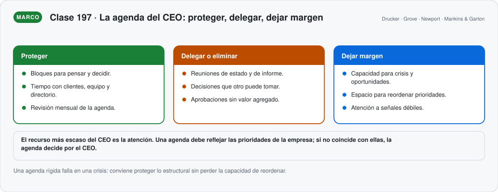

# Clase 197 — Agenda y tiempo del CEO

<!-- nav:inicio -->
> **Parte 16 · Alta dirección y oficina del CEO** — clase 5 de 12 · [índice de la parte](../../README.md) · [temario](../../../../SYLLABUS.md)
<!-- nav:fin -->

**Parte:** 16 — Alta dirección y oficina del CEO  
**Nivel:** Etapa 5 — Director → CEO  
**Duración sugerida:** 150–180 minutos · **Estándar:** deep-class-v2

## 🎯 Propósito

La agenda de un CEO es su estrategia hecha visible. Si la empresa necesita reorientar su oferta, pero el calendario del CEO está lleno de reuniones de estado, aprobaciones y visitas protocolares, la estrategia real de la empresa es la que muestra el calendario. Casi ningún CEO distribuye su tiempo con intención: las demandas llegan, se acomodan y la semana se llena. Al cabo de un año, quien dirige la empresa no es el CEO, sino quien más insiste en tener una reunión con él. Y como el tiempo del CEO es el recurso más costoso y menos reemplazable de la organización, su mala distribución es una pérdida estratégica.

La clase se apoya en la propuesta de Drucker de registrar y administrar el propio tiempo, en el concepto de apalancamiento gerencial de Grove, en el análisis de Newport sobre el trabajo profundo, en los estudios de Mankins y Garton sobre el uso del tiempo directivo y en el esencialismo de McKeown. Al terminar sabrás auditar un calendario con datos, definir categorías de alto apalancamiento, eliminar o delegar actividades sin valor, proteger bloques para pensar y para las partes interesadas clave, y revisar la agenda de forma periódica sin volverla rígida.

## 📚 Resultados de aprendizaje

Al finalizar podrás:

1. **Auditar** el uso del tiempo con datos de calendario y de decisiones.
2. **Definir** categorías de alto apalancamiento acordes con las prioridades de la empresa.
3. **Eliminar o delegar** reuniones y decisiones que no requieren al CEO.
4. **Diseñar** bloques estructurales de pensamiento, de personas y de partes interesadas.
5. **Revisar** la agenda con indicadores y conservar margen para lo imprevisto.

## 🧭 Agenda

| Tramo | Qué se hace |
|---|---|
| 0–20 min | Recuperación: ¿cuánto de tu última semana respondió a tus prioridades y cuánto a las demandas de otros? |
| 20–60 min | Auditoría, apalancamiento, eliminación, bloques, margen y revisión. |
| 60–105 min | Ejemplo trabajado: auditoría y rediseño de la semana de un CEO. |
| 105–150 min | Caso ejecutivo y práctica. |
| 150–175 min | Límites y entregable. |

## 🧩 Conceptos centrales

| Concepto | Definición | Cómo se reconoce |
|---|---|---|
| **Agenda del CEO** | Distribución deliberada de tiempo y atención según las prioridades de la empresa. | El calendario refleja la estrategia. |
| **Actividad de alto apalancamiento** | Actividad cuyo efecto se multiplica en la organización. | Una hora mueve a muchas personas o decisiones. |
| **Auditoría de tiempo** | Registro y clasificación de cómo se usó el tiempo. | Datos de varias semanas, no memoria. |
| **Trabajo profundo** | Trabajo de concentración sin interrupciones. | Bloques protegidos sin correo ni reuniones. |
| **Margen** | Tiempo no comprometido para lo imprevisto. | Permite reordenar sin romper todo. |
| **Cartera de decisiones pendientes** | Decisiones esperando al CEO. | Se mide en cantidad y espera. |

## 🧠 Modelo mental

**Cómo leer el diagrama.** Tres columnas. **Proteger**: bloques para pensar y decidir, tiempo con clientes, equipo y directorio, y revisión mensual de la agenda. **Delegar o eliminar**: reuniones de estado y de informe, decisiones que otro puede tomar y aprobaciones sin valor agregado. **Dejar margen**: capacidad para crisis y oportunidades, espacio para reordenar prioridades y atención a señales débiles. La nota afirma que el recurso más escaso del CEO es la atención y que, si la agenda no coincide con las prioridades, la agenda decide por el CEO; el pie, que una agenda rígida falla en una crisis.

## 📖 Desarrollo

### 1. Primero, saber dónde se va el tiempo

Drucker sostiene que los ejecutivos efectivos no empiezan con sus tareas sino con su **tiempo**: lo **registran**, lo **administran** y lo **consolidan** en bloques utilizables. La razón es que la memoria subestima las interrupciones y sobreestima el trabajo importante. Una auditoría de tres a cuatro semanas, con el calendario y un registro simple de decisiones, suele revelar sorpresas: reuniones que se repiten sin propósito, reportes que nadie usa, atención a temas de bajo impacto y casi nada de tiempo en lo que el CEO dice que importa. Mankins y Garton muestran, en estudios con directivos, que una parte considerable del tiempo de las organizaciones se pierde en reuniones y procesos que no agregan valor, lo que sugiere un margen de mejora importante.

### 2. Qué es alto apalancamiento

Grove definió el **apalancamiento gerencial**: el resultado de un gerente es el de su organización y el de las organizaciones que influye. Una actividad es de alto apalancamiento si **multiplica** el desempeño de otros: una decisión que desbloquea a cien personas, una conversación que cambia la estrategia de una unidad, una contratación clave, un cliente decisivo. Es de bajo apalancamiento si solo afecta al CEO o si otra persona podría hacerla. Para un CEO, las categorías típicas de alto apalancamiento son: **estrategia y asignación de capital** (clase 198), **talento y equipo** (clases 195 y 201), **cliente y mercado**, **cultura y comunicación** (clase 200), **directorio e inversionistas** y **riesgos críticos** (clase 202). Se definen según las prioridades del año, no por tradición.

### 3. Eliminar, delegar, automatizar

McKeown propone el **esencialismo**: hacer menos pero mejor, eligiendo con intención y diciendo no a lo que no contribuye de forma significativa. Un proceso práctico para la agenda: para cada actividad recurrente, preguntarse si se puede **eliminar** (no aporta), **delegar** (otro puede hacerla con la misma calidad o mejor), **automatizar** (un tablero reemplaza un informe), **acortar** (la reunión de 60 minutos puede ser de 25) o **mantener** (solo el CEO puede aportar). Las reuniones de estado se reemplazan por tableros leídos previamente; las aprobaciones, por límites de autoridad (clase 196); los eventos protocolares, por una selección con criterio. Cada «no» debe acompañarse de una alternativa para quien lo recibe.

### 4. Proteger el pensamiento

Newport describe el **trabajo profundo** como actividades que exigen concentración sin distracción y que crean valor difícil de replicar. Para un CEO, incluye pensar en la estrategia, preparar una decisión irreversible, escribir una comunicación importante o revisar el plan de talento. Requiere **bloques protegidos** (por ejemplo, dos mañanas por semana de tres horas), sin dispositivos ni interrupciones, y un ayudante o jefe de gabinete que defienda el calendario. Un error común es reservar tiempo «cuando haya espacio»: nunca lo hay. Se agenda primero lo importante y se organiza el resto alrededor, y se acompaña con rituales de **cierre y arranque** de la semana.

### 5. Tiempo con personas y partes interesadas

La agenda también protege el tiempo con quienes más influyen en el futuro: el **equipo directivo** (uno a uno periódicos y sesiones colectivas), los **líderes de segunda línea** y talento clave, los **clientes** (visitas y llamadas sin intermediarios), el **directorio** y los **inversionistas** y las **autoridades** cuando corresponda. Grove subraya que las reuniones son «el medio de trabajo» del gerente: conviene diseñarlas bien (propósito, participantes, preparación, decisión). Un equilibrio útil es dividir el tiempo en: **mirar hacia dentro** (equipo, ejecución), **mirar hacia fuera** (clientes, mercado, socios) y **mirar hacia adelante** (estrategia, riesgos). Una agenda que solo mira hacia dentro y hacia hoy produce una empresa ciega.

### 6. Margen: la agenda no puede ser rígida

Una agenda sin margen se rompe con la primera crisis y hace que el CEO pase a modo reactivo. Se reserva un **margen estructural** (por ejemplo, 10 % del tiempo sin compromiso) y reglas para **reordenar**: ¿qué sale si surge una crisis?, ¿quién decide? El margen permite además **atender señales débiles**: caminar por la operación, conversar con clientes y escuchar a quienes no están en el comité. Una crisis o una oportunidad cambian las prioridades; la agenda debe poder cambiar con ellas sin culpa. Lo que no se negocia es la **intención**: saber qué se está sacrificando cuando se reordena.

### 7. Medir y revisar

Se revisa la agenda **cada mes** con indicadores: **tiempo por prioridad** (porcentaje de horas en cada categoría frente a la meta), **razón de reuniones con decisión** (qué proporción de reuniones termina con una decisión), **cartera de decisiones pendientes** (cantidad y espera), **horas de trabajo profundo** protegidas, **tiempo con clientes** y **tiempo con el equipo**. Cada trimestre se contrasta la agenda con las prioridades: si cambió la estrategia, debe cambiar la agenda. También se evalúa el **costo**: si un CEO cuesta, por ejemplo, 600.000 pesos por hora entre compensación y apoyo, cada reunión de una hora con ocho personas senior tiene un costo que se compara con su valor. Esta cuenta no sustituye el criterio, pero humaniza el costo.

## 📚 Lectura comparada

| Obra | Qué aporta | Qué no resuelve | Pregunta para contrastar |
|---|---|---|---|
| Drucker | Registrar, administrar y consolidar el propio tiempo. | Orientado al ejecutivo individual. | ¿Qué muestra mi registro real? |
| Grove | Apalancamiento gerencial y reuniones como medio de trabajo. | Contexto de manufactura de tecnología. | ¿Qué actividad multiplica a otros? |
| Newport | Trabajo profundo y bloques protegidos. | Evidencia mayormente anecdótica. | ¿Cuándo pienso sin interrupciones? |
| Mankins y Garton | Uso del tiempo directivo y productividad organizacional. | Estudios agregados. | ¿Qué reuniones sobran? |
| McKeown | Hacer menos pero mejor; decir no con intención. | Enfoque personal. | ¿Qué dejaría de hacer? |

## 🧮 Ejemplo trabajado

**Situación (hipotética).** Un CEO de una empresa de 1.100 personas audita cuatro semanas de calendario y decisiones. Trabaja 55 horas por semana. Los promedios semanales son estos.

| Categoría | Horas antes | % del total |
|---|---|---|
| Reuniones de estado e informes | 14 | 25,5 % |
| Escalamientos operativos | 9 | 16,4 % |
| Personas y equipo | 7 | 12,7 % |
| Clientes y mercado | 5 | 9,1 % |
| Directorio, inversionistas y externos | 6 | 10,9 % |
| Estrategia y pensamiento | 3 | 5,5 % |
| Traslados, administración y otros | 11 | 20,0 % |
| **Total** | **55** | **100 %** |

**Apalancamiento.** Las categorías de alto apalancamiento definidas según las prioridades del año son personas y equipo, clientes y mercado, directorio e inversionistas y estrategia: 7 + 5 + 6 + 3 = 21 horas, el 38,2 % del tiempo (21 ÷ 55). La meta del año es llegar al 60 %.

**Otros indicadores.** Reuniones que terminan con una decisión: 22 %. Decisiones pendientes en la cartera del CEO: 23, con una espera promedio de 12 días. Trabajo profundo protegido: 2 horas por semana.

**Rediseño.**

| Acción | Efecto |
|---|---|
| Sustituir reuniones de estado por un tablero leído antes y mantener solo una revisión de 45 minutos | −10 horas (de 14 a 4) |
| Delegar escalamientos operativos con límites (clase 196) y un jefe de gabinete como filtro | −4 horas (de 9 a 5) |
| Reducir traslados y administración (viajes con propósito, ayudante) | −3 horas (de 11 a 8) |
| **Horas liberadas** | **17** |

**Reinversión de las 17 horas.** Estrategia y pensamiento: de 3 a 8 (+5); personas y equipo: de 7 a 10 (+3); clientes y mercado: de 5 a 9 (+4); directorio e inversionistas: de 6 a 7 (+1); margen no comprometido: 0 a 4 (+4). Suma: 5 + 3 + 4 + 1 + 4 = 17.

**Resultado esperado.** Alto apalancamiento: 8 + 10 + 9 + 7 = 34 horas, el 61,8 % (34 ÷ 55). Trabajo profundo: dos bloques de tres horas por semana, 6 horas dentro de las 8 de estrategia. Reuniones con decisión: meta de 55 %. Cartera pendiente: meta de 6 decisiones con una espera de 4 días.

**Costo del tiempo liberado.** Si el costo por hora del CEO es 600.000 pesos, 17 horas por semana en 44 semanas son 748 horas, es decir, 748 × 600.000 = 448,8 millones de pesos anuales de tiempo que pasa de actividades de bajo apalancamiento a otras de alto apalancamiento.

**Margen y reglas.** Si ocurre una crisis, se activa el margen de 4 horas y se suspenden primero las actividades de menor apalancamiento; el jefe de gabinete reordena y avisa. Cada mes se revisa la agenda contra las metas.

**Cuidados.** Las condiciones de contratación y de compensación de los apoyos adicionales se verifican con asesoría y el directorio; las cifras son ilustrativas.

**Qué muestra.** (1) La auditoría reemplazó la percepción por datos. (2) Las horas liberadas se reasignaron con intención. (3) Se mantuvo margen para lo imprevisto.

## 🔀 Comparación y límites

**Agenda frente a productividad personal.** La agenda del CEO no es un sistema de eficiencia individual: es un instrumento de gobierno de la atención que afecta a toda la organización.

**Límites.** Una agenda rígida falla en crisis y en transiciones; se protegen los bloques estructurales, pero se conserva capacidad de reordenar. Los datos de calendario no capturan conversaciones informales. Los indicadores de apalancamiento son juicios. Las cifras del ejemplo son ilustrativas; el costo por hora es una convención para dimensionar, no una valoración de las personas.

## 🪜 De profesional a owner

| Nivel | Cómo cuida su agenda |
|---|---|
| **Profesional** | Protege bloques de concentración para su trabajo. |
| **Jefe / Team Lead** | Equilibra operación, personas y mejora. |
| **Gerente** | Define sus categorías de apalancamiento y delega lo demás. |
| **CEO / Director** | Hace que la agenda coincida con la estrategia y revisa su uso cada mes. |
| **Founder / Owner** | Aprende a retirarse de lo operativo para dedicar su atención a la visión. |

## 🏢 Caso ejecutivo

La CEO de una empresa de servicios con 2.500 personas trabaja 60 horas semanales. Su calendario muestra: 22 reuniones por semana; 11 de ellas son informes de estado; asiste a 6 eventos externos al mes por compromiso; aprueba personalmente todos los viajes y contrataciones sobre cierto nivel; no tiene bloques de pensamiento; su equipo de dirección dice que «hay que pedir hora con tres semanas de anticipación». La estrategia del año priorizaba entrar en un nuevo segmento, rediseñar la organización comercial y reforzar el equipo de tecnología, pero en el trimestre dedicó 4 % de su tiempo a esos tres temas. Una crisis con un cliente grande le ocupó 20 horas en dos semanas. El directorio le pregunta por qué los avances son lentos; ella responde que «no tiene tiempo». Su jefe de gabinete propone «bloquear las mañanas» para pensar.

Entrega un **rediseño de la agenda** que contenga: (a) la auditoría con categorías, horas y porcentajes; (b) las categorías de alto apalancamiento según las prioridades del año; (c) el plan de eliminación, delegación y automatización con efecto en horas; (d) los bloques estructurales de pensamiento, equipo, clientes y directorio, y el margen; (e) los indicadores mensuales y las reglas de reordenamiento ante una crisis; (f) el rol del jefe de gabinete y los límites de autoridad asociados.

## 🧪 Práctica

1. Registra tu calendario de cuatro semanas y clasifica las horas en seis categorías.
2. Define tus categorías de alto apalancamiento y calcula qué porcentaje de tu tiempo ocupan.
3. Elige cinco reuniones recurrentes y decide para cada una: eliminar, delegar, automatizar, acortar o mantener.
4. Diseña una semana ideal con bloques protegidos y margen.
5. Establece tres indicadores mensuales para revisar tu agenda.

## ⚠️ Errores frecuentes

| Error | Por qué ocurre | Cómo corregirlo |
|---|---|---|
| Confiar en la memoria | Se subestiman las interrupciones | Auditar con datos de varias semanas. |
| Reservar tiempo «cuando haya espacio» | Lo urgente gana | Agendar primero lo importante. |
| Agenda llena de estado | Es cómodo y da sensación de control | Tablero previo y reuniones de decisión. |
| Agenda rígida | Se teme perder el control | Margen y reglas de reordenamiento. |
| No decir no | Se teme parecer inaccesible | Alternativas y criterios de selección. |
| Medir horas sin propósito | Se obsesiona con la eficiencia | Relacionar agenda y prioridades. |

## ❓ Preguntas de comprobación

1. ¿Por qué comenzar por una auditoría del tiempo?
2. ¿Qué es una actividad de alto apalancamiento según Grove?
3. ¿Qué opciones hay frente a una actividad recurrente?
4. ¿Qué es el trabajo profundo y cómo se protege?
5. ¿Para qué sirve el margen en la agenda?
6. ¿Qué indicadores se revisan mensualmente?
7. ¿Qué límites tiene la gestión de la agenda?

Claves de respuesta

1. Porque la memoria subestima las interrupciones y sobreestima el trabajo importante; los datos revelan el uso real.
2. Una actividad que multiplica el desempeño de otros o de la organización.
3. Eliminar, delegar, automatizar, acortar o mantener.
4. Trabajo de concentración sin distracciones; con bloques agendados primero, sin dispositivos y con apoyo de un jefe de gabinete.
5. Para absorber crisis y oportunidades y reordenar prioridades sin romper la agenda.
6. Tiempo por prioridad, reuniones con decisión, cartera de decisiones pendientes, horas de trabajo profundo y tiempo con clientes y equipo.
7. Una agenda rígida falla en crisis; los datos de calendario no capturan lo informal; los indicadores son juicios.

## 📥 Entregable

Guarda en `portfolio/197-agenda-y-tiempo-del-ceo/`:

- `board-or-executive-memo.md` (plantilla [Board or executive memo](../../../../templates/board-or-executive-memo.md)) con el rediseño de la agenda del caso ejecutivo;
- `ceo-dashboard.md` (plantilla [CEO dashboard](../../../../templates/ceo-dashboard.md)) con los indicadores mensuales de uso del tiempo;
- `decision-journal.md` con la auditoría, las decisiones de eliminación y delegación y las revisiones.

## 📗 Fuentes y verificación

- Peter F. Drucker — *The Effective Executive* (Collins, 2002). **Uso en esta clase:** registrar, administrar y consolidar el propio tiempo. Lectura selectiva sobre **agenda y tiempo del ceo**. **Localizador:** [ISBN-13 9780060516079](https://openlibrary.org/isbn/9780060516079).
- Andrew S. Grove — *High Output Management* (Random House, 1983). **Uso en esta clase:** apalancamiento gerencial y reuniones como medio de trabajo. Lectura selectiva sobre **agenda y tiempo del ceo**. **Localizador:** [ISBN-13 9780394532349](https://openlibrary.org/isbn/9780394532349).
- Cal Newport — *Deep Work* (Grand Central Publishing, 2016). **Uso en esta clase:** trabajo profundo y bloques protegidos. Lectura selectiva sobre **agenda y tiempo del ceo**. **Localizador:** [ISBN-13 9781455586691](https://openlibrary.org/isbn/9781455586691).
- Michael C. Mankins & Eric Garton — *Time, Talent, Energy* (Harvard Business Review Press, 2017). **Uso en esta clase:** uso del tiempo directivo y productividad organizacional. Lectura selectiva sobre **agenda y tiempo del ceo**. **Localizador:** [ISBN-13 9781633691766](https://openlibrary.org/isbn/9781633691766).
- Greg McKeown — *Essentialism* (Virgin Books, 2014). **Uso en esta clase:** hacer menos pero mejor con intención. Lectura selectiva sobre **agenda y tiempo del ceo**. **Localizador:** [ISBN-13 9780753555163](https://openlibrary.org/isbn/9780753555163).
- Matt Mochary — *The Great CEO Within* (Mochary Films, 2019). **Uso en esta clase:** prácticas de coaching a CEO sobre el uso del tiempo y las conversaciones. Lectura selectiva sobre **agenda y tiempo del ceo**. **Localizador:** [ISBN-13 9780578599281](https://openlibrary.org/isbn/9780578599281).

> **Regla de fuentes para Agenda y tiempo del CEO:** las obras anteriores estructuran las perspectivas de esta materia; cualquier norma, ley o estándar vivo mencionado debe comprobarse nuevamente en su fuente primaria vigente, incluidas las condiciones de contratación de apoyos y de gobierno corporativo. Los ejemplos y casos son hipotéticos, con cifras ilustrativas. El desarrollo es original y no reproduce capítulos protegidos.

<!-- pie:inicio -->
---

| Anterior | Índice | Siguiente |
|---|---|---|
| [← 196 · Arquitectura de decisiones ejecutivas](../196-arquitectura-de-decisiones-ejecutivas/README.md) | [Parte 16](../../README.md) · [Programa](../../../../SYLLABUS.md) | [198 · Asignación de capital y talento →](../198-asignacion-de-capital-y-talento/README.md) |
<!-- pie:fin -->
