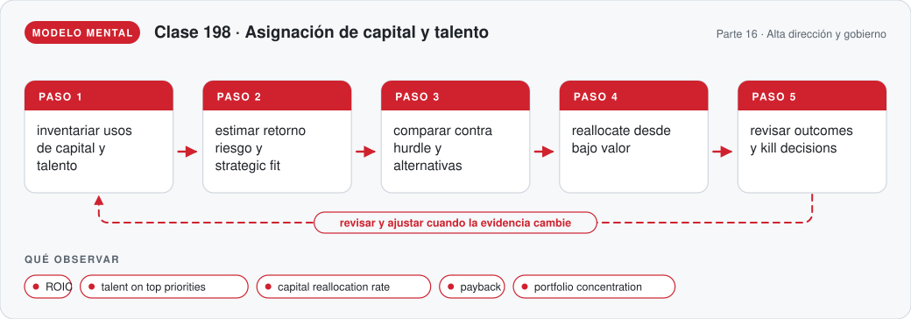

# Clase 198 — Asignación de capital y talento

<!-- nav:inicio -->
> **Parte 16 · Alta dirección y oficina del CEO** — clase 6 de 12 · [índice de la parte](../../README.md) · [temario](../../../../SYLLABUS.md)
<!-- nav:fin -->

**Parte:** 16 — Alta dirección y oficina del CEO  
**Nivel:** Etapa 5 — Director → CEO  
**Duración sugerida:** 150–180 minutos · **Estándar:** deep-class-v2

## 🎯 Propósito

Dos recursos definen el futuro de una empresa y se asignan con rigor muy distinto. El **capital** pasa por un proceso formal: propuestas, modelos financieros, comités y umbrales de retorno. El **talento**, en cambio, se asigna por inercia: los mejores líderes se quedan donde están, los cargos se llenan cuando quedan vacantes y las prioridades de la empresa compiten con las necesidades del día a día por las personas más capaces. El resultado es que las iniciativas más importantes se ejecutan con equipos promedio mientras los mejores apagan incendios en el negocio actual. El CEO es, entre otras cosas, el responsable último de esta asignación: decide a dónde van el dinero y las personas, y por tanto qué empresa existirá en cinco años.

La clase se apoya en el estudio de Bower sobre el proceso de asignación de recursos, en el análisis de Thorndike sobre CEO que destacan por su disciplina en la asignación de capital, en la teoría del valor de Koller y colaboradores, en el trabajo de Mankins y Garton sobre la asignación de talento y atención, y en las ideas de Collins sobre poner a las personas correctas en los roles correctos. Al terminar sabrás inventariar usos de capital y talento, evaluar retorno y ajuste estratégico, comparar con un umbral y alternativas, reasignar desde lo de bajo valor y revisar resultados reales frente a lo prometido.

## 📚 Resultados de aprendizaje

Al finalizar podrás:

1. **Inventariar** cómo se usan hoy el capital y el talento clave.
2. **Evaluar** propuestas con retorno, riesgo y ajuste estratégico.
3. **Comparar** con un umbral de retorno y con alternativas, incluidas las no financieras.
4. **Reasignar** recursos desde usos de bajo valor hacia las prioridades.
5. **Revisar** resultados reales frente a lo prometido y aprender del proceso.

## 🧭 Agenda

| Tramo | Qué se hace |
|---|---|
| 0–20 min | Recuperación: ¿cuántos de tus mejores líderes trabajan hoy en las tres prioridades de la empresa? |
| 20–60 min | Inventario, evaluación, umbral, reasignación, revisión y sesgos del proceso. |
| 60–105 min | Ejemplo trabajado: un presupuesto de capital de 12.000 millones y la asignación de talento. |
| 105–150 min | Caso ejecutivo y práctica. |
| 150–175 min | Límites y entregable. |

## 🧩 Conceptos centrales

| Concepto | Definición | Cómo se reconoce |
|---|---|---|
| **Asignación de capital** | Decisión de a qué proyectos, negocios o usos se destinan los recursos financieros. | Se refleja en el presupuesto y en las inversiones. |
| **Asignación de talento** | Decisión de dónde se ubican las personas más capaces. | Se refleja en quién lidera las prioridades. |
| **Tasa mínima de retorno** | Retorno mínimo que debe superar una inversión para aprobarse. | Se compara con el costo del capital y con alternativas. |
| **Índice de rentabilidad** | Valor presente neto por unidad de capital invertido. | Ordena proyectos cuando el capital es limitado. |
| **Tasa de reasignación** | Proporción del capital que cambia de uso en un período. | Una tasa muy baja indica inercia. |
| **Talento en prioridades** | Proporción de líderes clave asignados a las prioridades de la empresa. | Se mide con listas de nombres. |

## 🧠 Modelo mental

**Cómo leer el diagrama.** Una tabla de cinco preguntas con dos columnas, capital y talento. **Inventario**: en qué se usa hoy cada peso y en qué trabaja cada persona clave. **Retorno**: retorno ajustado por riesgo y ajuste estratégico, frente a efecto de la persona en las prioridades. **Umbral**: tasa mínima de retorno y alternativas, frente a estándar mínimo para ocupar un rol crítico. **Reasignación**: retirar de lo de bajo valor y reinvertir, frente a mover talento hacia las prioridades. **Revisión**: resultado real frente a lo prometido, frente a desempeño y aprendizaje de los traslados. La nota dice que el capital se asigna con cálculos y el talento con costumbre.

## 📖 Desarrollo

### 1. El proceso de asignación es la estrategia en acción

Bower estudió cómo las grandes empresas asignan recursos y mostró que la estrategia no es solo lo que la cúpula declara, sino lo que **el proceso de asignación permite que ocurra**. Las propuestas de inversión se originan en los niveles medios, que definen qué se pone sobre la mesa y cómo se presenta; la cúpula decide entre lo que se le propone. Si el proceso favorece proyectos con retornos fáciles de medir y de corto plazo, la estrategia real será de corto plazo, aunque el discurso diga lo contrario. Por eso el CEO diseña el proceso: qué se financia, con qué criterios, quién propone, quién decide y cómo se revisa. Las propuestas se evalúan con los mismos criterios, y los criterios son visibles.

### 2. Las opciones de uso del capital

Thorndike examinó a CEO con rendimientos sobresalientes a largo plazo y encontró que compartían una disciplina: pensaban en el capital como el recurso a asignar, y consideraban todas las opciones: **reinvertir** en el negocio, **adquirir** otros negocios, **recomprar acciones**, **pagar dividendos**, **reducir deuda** o **mantener caja**. Elegían con criterio de valor por acción a largo plazo y tendían a la **descentralización operativa** con una **asignación de capital centralizada**. La enseñanza para cualquier empresa es que el menú es más amplio que «qué proyectos aprobar», y que a veces la mejor decisión es no invertir o devolver capital. Koller y sus colegas recuerdan que crecer solo crea valor si el retorno sobre el capital supera su costo.

### 3. Evaluar propuestas: retorno, riesgo y ajuste

Una propuesta se evalúa con: **valor presente neto** y **tasa interna de retorno** con supuestos explícitos; **análisis de sensibilidad** (¿qué pasa si ventas, costos o plazos cambian?); **riesgo** (probabilidad de lograr el caso base, concentración, dependencia de un cliente o tecnología); **ajuste estratégico** (¿refuerza el desafío crítico?); y **capacidad de ejecución** (¿hay personas para ejecutarla?). Se compara con un **umbral de retorno** que incluye el costo del capital y una prima por riesgo, y con **alternativas** (incluida la de no hacer). Las propuestas con beneficios estratégicos difíciles de cuantificar se tratan con **opciones**: pequeñas inversiones que preservan la posibilidad de crecer si se cumplen hitos. No todo cabe en una fórmula, y se hacen explícitas las consideraciones no monetizables en lugar de esconderlas en el modelo.

### 4. Sesgos del proceso de capital

Los procesos de capital están expuestos a sesgos conocidos: el **optimismo** de los proponentes (los casos base son generosos), la **falacia de costos hundidos** (se sigue invirtiendo en lo que ya se invirtió), el **anclaje** en el presupuesto del año anterior, la **competencia por recursos** entre divisiones que lleva a «repartir parejo», la **aversión a cerrar** lo que ya no funciona y la **presión de corto plazo**. Algunos antídotos: pedir un **escenario pesimista** y un **pre-mortem** del proyecto (imaginar que fracasó y explicar por qué), comparar el desempeño pasado de **proyectos similares**, exigir **revisión independiente** de los supuestos y establecer **puntos de decisión** con criterios de continuar o detener.

### 5. Asignar talento como se asigna capital

Mankins y Garton plantean que el talento de más alto valor también debe asignarse con intención: los pocos **líderes clave** de la empresa (por ejemplo, los 20 o 30 más críticos) pasan una parte excesiva de su tiempo en actividades de bajo valor. Una medición simple es el porcentaje de ellos que lidera las **tres a cinco prioridades** de la empresa. Collins sostiene que las empresas sobresalientes primero acomodan a las **personas correctas** y luego deciden el rumbo: «primero quién, luego qué». Asignar talento exige: un **inventario** de líderes con sus fortalezas, **perfiles** para cada prioridad, **conversaciones** con los afectados (traslados, rotación), **reemplazos** para los cargos que quedan, y **seguimiento** del desempeño. El costo de mover a una persona clave es real y se pondera con el beneficio.

### 6. Reasignar: retirar de lo que ya no vale

Casi toda reasignación empieza por **quitar**. Una empresa que no mueve capital ni talento de usos de bajo valor solo puede crecer agregando recursos. Se identifica lo que rinde menos que el costo del capital (productos, clientes, iniciativas, unidades), se analiza si puede **mejorarse**, **venderse**, **cerrarse** o **mantenerse** con límite, y se asigna lo liberado a las prioridades. La **tasa de reasignación** (porcentaje del capital que cambia de uso al año) es un indicador de dinamismo: en empresas con inercia es muy baja. Reasignar produce conflicto porque hay perdedores identificables; se prepara con datos, con transparencia sobre criterios y con apoyo a quienes pierden recursos o roles.

### 7. Revisar: lo prometido frente a lo ocurrido

Cada inversión relevante se revisa **después**: ¿se cumplieron los ingresos, costos, plazos y beneficios previstos?, ¿qué supuestos fallaron?, ¿qué se aprendió para el siguiente caso? La revisión se hace por alguien **independiente del proponente**, se publica en el comité y alimenta la **calibración** de futuras propuestas: si un área sobreestima sistemáticamente en 20 %, se ajusta. Lo mismo para el talento: ¿cómo les fue a las personas asignadas a las prioridades?, ¿qué ocurrió en los cargos que dejaron? Una cultura que revisa con honestidad y sin cacería de culpables mejora con cada ciclo.

## 📚 Lectura comparada

| Obra | Qué aporta | Qué no resuelve | Pregunta para contrastar |
|---|---|---|---|
| Bower | La estrategia surge del proceso de asignación de recursos. | Estudio de casos de grandes empresas de su época. | ¿Qué favorece nuestro proceso? |
| Thorndike | CEO con disciplina en asignación de capital y opciones de uso. | Casos seleccionados por su éxito. | ¿Qué opciones no estamos considerando? |
| Koller y otros | Valor, retorno sobre el capital y crecimiento. | Los pronósticos son inciertos. | ¿El retorno supera el costo del capital? |
| Mankins y Garton | Asignación de talento y atención a las prioridades. | Estudios agregados. | ¿Dónde están nuestros mejores líderes? |
| Collins | Primero las personas, luego el rumbo. | Evidencia criticada por selección de casos. | ¿Tenemos a las personas correctas en los roles correctos? |

## 🧮 Ejemplo trabajado

**Situación (hipotética).** Una empresa tiene un presupuesto de capital de 12.000 millones de pesos, un costo de capital de 9 % y un retorno mínimo exigido para nuevas inversiones de 15 %. Hay cinco propuestas.

| Propuesta | Capital (millones) | VAN (millones) | TIR | Índice (VAN ÷ capital) |
|---|---|---|---|---|
| D. Mantención y cumplimiento (obligatoria) | 1.500 | n. a. | n. a. | n. a. |
| E. Nueva línea de producto | 2.500 | 1.500 | 28 % | 0,60 |
| A. Ampliación de planta | 4.500 | 1.800 | 19 % | 0,40 |
| B. Plataforma digital | 3.000 | 1.200 | 21 % | 0,40 |
| C. Adquisición de un competidor pequeño | 5.000 | 900 | 14 % | 0,18 |

**Asignación.** 1) La obligatoria D se financia (1.500): quedan 10.500. 2) E, de mayor índice (2.500): quedan 8.000. 3) A y B tienen índice 0,40: A (4.500) deja 3.500; B (3.000) deja 500. 4) C no cumple el mínimo (14 % < 15 %) ni cabe: se rechaza, y se explora una alianza o una oferta menor.

**Resultado.** Capital asignado: 1.500 + 2.500 + 4.500 + 3.000 = 11.500 millones. VAN creado: 1.500 + 1.800 + 1.200 = 4.500 millones, un índice global de 4.500 ÷ 10.000 (capital de proyectos discrecionales: 2.500 + 4.500 + 3.000 = 10.000) = 0,45. Quedan 500 millones como reserva.

**Reasignación de lo que ya existe.** Tres programas actuales tienen ROIC de 6 %, 7 % y 4 %, menores que el costo del capital de 9 %, con capital invertido de 1.200, 900 y 700 millones (total 2.800). Se decide: mejorar el primero con un plan de 12 meses, vender el segundo y cerrar el tercero. Con un capital total de la empresa de 25.000 millones, el capital que cambia de uso es 2.800 ÷ 25.000 = 11,2 %.

**Asignación de talento.** De los 12 líderes más críticos, solo 3 (25 %) trabajan en las tres prioridades (E, A y B). Se propone mover a 5 más: 8 de 12 = 66,7 %. Los cargos que dejan se cubren con sucesores identificados. Estimación de efecto: un equipo liderado por una persona de primera línea entrega 2 meses antes. Si E aporta 90 millones mensuales a madurez, A 120 y B 100, adelantar dos meses vale: 2 × (90 + 120 + 100) = 620 millones. El costo estimado de los traslados (apoyo a los reemplazos, riesgo en el negocio actual) es de 150 millones; el efecto neto esperado es 470 millones.

**Revisión.** Se agenda una revisión a los 12 meses por el área de finanzas y un directorio independiente, con las métricas prometidas, y se ajusta la calibración de las propuestas. La propuesta C se vuelve a mirar si se puede reestructurar con un pago contingente.

**Cuidados.** Los traslados y las salidas se hacen respetando las condiciones laborales vigentes, que se verifican con asesoría; la venta o el cierre de unidades se revisa con asesoría legal y contable; las cifras son ilustrativas.

**Qué muestra.** (1) El capital se asignó por índice y umbral. (2) La reasignación comenzó por quitar de lo de bajo valor. (3) El talento se trató con el mismo rigor que el capital.

## 🔀 Comparación y límites

**Asignación frente a presupuesto anual.** El presupuesto reparte recursos para operar; la asignación decide qué cambia de lugar. Muchas empresas hacen lo primero y creen que hacen lo segundo.

**Límites.** No hay que reducir la asignación al VAN cuando hay opciones estratégicas, capacidades o impactos difíciles de monetizar; se hacen explícitos. Los casos de Thorndike y Collins están seleccionados por su éxito y pueden sufrir sesgos. Los pronósticos de proyectos son inciertos y optimistas. La reasignación de personas está sujeta a normas laborales. Las cifras del ejemplo son ilustrativas.

## 🪜 De profesional a owner

| Nivel | Cómo participa en la asignación |
|---|---|
| **Profesional** | Prepara propuestas con supuestos honestos. |
| **Jefe / Team Lead** | Identifica talento y proyectos de bajo valor en su equipo. |
| **Gerente** | Propone inversiones con retorno y acepta ser comparado con alternativas. |
| **CEO / Director** | Diseña el proceso, decide entre usos y reasigna con criterio. |
| **Founder / Owner** | Decide entre reinvertir, distribuir y diversificar su patrimonio. |

## 🏢 Caso ejecutivo

Una empresa de alimentos con ventas de 150.000 millones de pesos, un capital invertido de 90.000 millones y un ROIC de 8 % (con un costo de capital de 9 %) tiene seis divisiones que reciben capital «parejo, con ajuste por inflación». El comité recibe siete propuestas por 22.000 millones, con un presupuesto de 15.000 millones: una planta nueva (7.000 millones, TIR proyectada de 17 %), un canal digital (2.500, 24 %), una marca premium (3.000, 21 %), una adquisición (6.500, 12 %), automatización (2.000, 18 %), mantenimiento obligatorio (1.800) y una línea sin retorno claro que el presidente del directorio quiere por «razones estratégicas» (1.200). Tres divisiones tienen ROIC por debajo de 5 % desde hace cuatro años. De los 25 líderes más críticos, solo 6 trabajan en las prioridades del plan. La división de mayor retorno no ha recibido a ninguno de los mejores líderes en tres años.

Entrega un **memo de asignación** que contenga: (a) el inventario de capital y de talento clave; (b) la evaluación de las siete propuestas con retorno, riesgo y ajuste, y el tratamiento de la que tiene razones estratégicas; (c) la asignación del presupuesto con cálculo y alternativas; (d) el plan de reasignación desde las divisiones de bajo retorno; (e) la asignación de talento y la medición «talento en prioridades»; (f) la revisión posterior y las verificaciones laborales, legales y contables.

## 🧪 Práctica

1. Calcula el ROIC de cada unidad de tu empresa y compáralo con el costo del capital.
2. Ordena cinco propuestas por índice y aplica un umbral mínimo y un límite de capital.
3. Redacta las condiciones bajo las cuales aceptarías una inversión estratégica con retorno poco claro.
4. Lista tus doce líderes más críticos y en qué prioridad trabaja cada uno.
5. Diseña una revisión posterior para una inversión reciente con tres métricas.

## ⚠️ Errores frecuentes

| Error | Por qué ocurre | Cómo corregirlo |
|---|---|---|
| Repartir parejo | Se evita el conflicto | Asignar por retorno, riesgo y ajuste. |
| Aprobar por entusiasmo | Se confía en el proponente | Escenario pesimista y revisión independiente. |
| No reasignar | Se teme perder apoyos | Medir la tasa de reasignación y retirar de lo de bajo valor. |
| Asignar talento por costumbre | Las personas se quedan donde están | Inventario y asignación a las prioridades. |
| Ocultar lo estratégico en el modelo | Se quiere justificar una decisión | Hacer explícitas las razones no monetizables. |
| No revisar | Se da por terminado | Revisión posterior independiente. |

## ❓ Preguntas de comprobación

1. ¿Por qué se dice que la estrategia surge del proceso de asignación de recursos?
2. ¿Qué opciones de uso del capital considera Thorndike?
3. ¿Qué criterios se usan para evaluar una propuesta?
4. ¿Qué sesgos afectan al proceso de capital y cómo se mitigan?
5. ¿Cómo se mide la asignación de talento a las prioridades?
6. ¿Por qué la reasignación empieza por quitar?
7. ¿Qué límites tienen los cálculos de retorno?

Claves de respuesta

1. Porque lo que se financia y cómo se evalúa determina lo que la empresa hace realmente, más allá del discurso.
2. Reinvertir, adquirir, recomprar acciones, pagar dividendos, reducir deuda o mantener caja.
3. VAN y TIR con supuestos, sensibilidad, riesgo, ajuste estratégico, capacidad de ejecución, umbral y alternativas.
4. Optimismo, costos hundidos, anclaje, reparto parejo, aversión a cerrar y presión de corto plazo; se mitigan con escenario pesimista, revisión independiente y puntos de decisión.
5. Con el porcentaje de los líderes críticos que trabajan en las prioridades de la empresa.
6. Porque sin retirar recursos de lo de bajo valor solo se puede crecer agregando más.
7. Los pronósticos son inciertos y optimistas, y no capturan opciones y capacidades ni consideraciones no monetizables.

## 📥 Entregable

Guarda en `portfolio/198-asignacion-de-capital-y-talento/`:

- `modelo-financiero-y-memo-de-decision.md` (plantilla [Modelo financiero y memo de decisión](../../../../templates/modelo-financiero-y-memo-de-decision.md)) con la evaluación y asignación del caso ejecutivo;
- `capital-allocation.md` (plantilla [Capital allocation](../../../../templates/capital-allocation.md)) con el presupuesto y las reasignaciones;
- `decision-journal.md` con el inventario de talento, los supuestos y la revisión posterior.

## 📗 Fuentes y verificación

- Joseph L. Bower — *Managing the Resource Allocation Process* (Harvard Business School, 1970). **Uso en esta clase:** la estrategia como resultado del proceso de asignación. Lectura selectiva sobre **asignación de capital y talento**. **Localizador:** [ISBN-13 9780875840833](https://openlibrary.org/isbn/9780875840833).
- William N. Thorndike — *The Outsiders* (Harvard Business Review Press, 2012). **Uso en esta clase:** disciplina de los CEO en la asignación de capital. Lectura selectiva sobre **asignación de capital y talento**. **Localizador:** [ISBN-13 9781422162675](https://openlibrary.org/isbn/9781422162675).
- Tim Koller, Marc Goedhart & David Wessels — *Valuation: Measuring and Managing the Value of Companies* (Wiley, 2005). **Uso en esta clase:** valor, retorno sobre el capital y crecimiento. Lectura selectiva sobre **asignación de capital y talento**. **Localizador:** [ISBN-13 9780471702191](https://openlibrary.org/isbn/9780471702191).
- Michael C. Mankins & Eric Garton — *Time, Talent, Energy* (Harvard Business Review Press, 2017). **Uso en esta clase:** asignación de talento y atención a las prioridades. Lectura selectiva sobre **asignación de capital y talento**. **Localizador:** [ISBN-13 9781633691766](https://openlibrary.org/isbn/9781633691766).
- Jim Collins — *Good to Great* (HarperBusiness, 2001). **Uso en esta clase:** primero las personas correctas, luego el rumbo. Lectura selectiva sobre **asignación de capital y talento**. **Localizador:** [ISBN-13 9780066620992](https://openlibrary.org/isbn/9780066620992).

> **Regla de fuentes para Asignación de capital y talento:** las obras anteriores estructuran las perspectivas de esta materia; cualquier norma, ley o estándar vivo mencionado debe comprobarse nuevamente en su fuente primaria vigente, incluidas las condiciones laborales de traslados y salidas y las exigencias contables y legales de ventas o cierres de unidades. Los ejemplos y casos son hipotéticos, con cifras ilustrativas. El desarrollo es original y no reproduce capítulos protegidos.

<!-- pie:inicio -->
---

| Anterior | Índice | Siguiente |
|---|---|---|
| [← 197 · Agenda y tiempo del CEO](../197-agenda-y-tiempo-del-ceo/README.md) | [Parte 16](../../README.md) · [Programa](../../../../SYLLABUS.md) | [199 · Balance entre clientes, personas, accionistas y sociedad →](../199-balance-entre-clientes-personas-accionistas-y-sociedad/README.md) |
<!-- pie:fin -->
