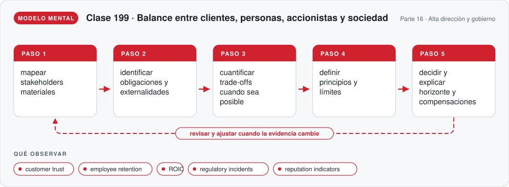

# Clase 199 — Balance entre clientes, personas, accionistas y sociedad

<!-- nav:inicio -->
> **Parte 16 · Alta dirección y oficina del CEO** — clase 7 de 12 · [índice de la parte](../../README.md) · [temario](../../../../SYLLABUS.md)
<!-- nav:fin -->

**Parte:** 16 — Alta dirección y oficina del CEO  
**Nivel:** Etapa 5 — Director → CEO  
**Duración sugerida:** 150–180 minutos · **Estándar:** deep-class-v2

## 🎯 Propósito

Un CEO decide a diario entre intereses que no coinciden. Subir precios mejora el margen y perjudica a los clientes; invertir en capacitación mejora el desempeño futuro y reduce el dividendo de este año; cerrar una planta ineficiente protege a la empresa y daña a una comunidad; ahorrar en seguridad mejora el trimestre y arriesga a las personas. El debate público suele formularse como una disyuntiva moral: ¿la empresa existe para sus accionistas o para todos? En la práctica, la pregunta del CEO es más concreta y más difícil: **¿cómo decido cuando mis obligaciones con varias partes entran en conflicto, con qué criterios, con qué costo y con qué rendición de cuentas?**

La clase se apoya en la teoría de las partes interesadas de Freeman, en la propuesta de Jensen de una «maximización ilustrada del valor» con un solo objetivo de largo plazo, en la creación de valor compartido de Porter y Kramer, en la visión de impacto positivo de Polman y Winston y en los principios de gobierno corporativo de la OCDE sobre el papel de las partes interesadas. Al terminar sabrás mapear a las partes materiales, identificar obligaciones y externalidades, cuantificar los trade-offs cuando sea posible, definir principios y límites y decidir y explicar con honestidad, sin usar el equilibrio como excusa para no elegir.

## 📚 Resultados de aprendizaje

Al finalizar podrás:

1. **Mapear** las partes interesadas materiales de una decisión.
2. **Distinguir** obligaciones legales, compromisos y preferencias.
3. **Cuantificar** trade-offs entre partes cuando sea posible y señalar lo que no se puede cuantificar.
4. **Definir** principios, límites y reglas de decisión explícitas.
5. **Comunicar** la decisión con sus costos y rendir cuentas.

## 🧭 Agenda

| Tramo | Qué se hace |
|---|---|
| 0–20 min | Recuperación: ¿qué decisión reciente benefició a una parte a costa de otra y cómo se explicó? |
| 20–60 min | Teorías, partes materiales, obligaciones, valor compartido, principios y rendición de cuentas. |
| 60–105 min | Ejemplo trabajado: pasar a envases reciclados con efectos en las cuatro partes. |
| 105–150 min | Caso ejecutivo y práctica. |
| 150–175 min | Límites y entregable. |

## 🧩 Conceptos centrales

| Concepto | Definición | Cómo se reconoce |
|---|---|---|
| **Parte interesada** | Persona o grupo que afecta a la empresa o es afectado por ella. | Clientes, personas, accionistas, proveedores, comunidades, autoridades. |
| **Materialidad** | Importancia de una parte o un tema para el valor y los riesgos de la empresa. | Cambia con la decisión y el contexto. |
| **Externalidad** | Costo o beneficio que la empresa causa a terceros sin pagarlo ni cobrarlo. | Contaminación, empleo, bienestar de una comunidad. |
| **Valor compartido** | Valor económico que se crea resolviendo necesidades de la sociedad. | Reconcibe productos, productividad o entorno. |
| **Maximización ilustrada** | Maximizar el valor de largo plazo atendiendo a todas las partes que lo sostienen. | Un solo objetivo con restricciones y criterios de partes. |
| **Rendición de cuentas** | Responder por decisiones con datos y responsables. | Objetivos, responsables y revisión. |

## 🧠 Modelo mental

**Cómo leer el diagrama.** Una tabla con cuatro filas. **Clientes**: necesitan valor, confianza y trato justo; aportan ingresos y recomendación; la señal de alerta son reclamos y bajas crecientes. **Personas**: necesitan trabajo con sentido, seguridad y desarrollo; aportan capacidad y compromiso; la señal es la rotación de talento clave. **Accionistas**: necesitan retorno ajustado por riesgo y claridad; aportan capital y paciencia; la señal es un costo de capital que sube. **Sociedad**: necesita impacto acotado y cumplimiento; aporta licencia para operar; la señal son conflictos con comunidades o autoridades. La nota aclara que equilibrar no es evitar elegir.

## 📖 Desarrollo

### 1. Dos grandes visiones y su punto de encuentro

Freeman propuso que la gestión estratégica debe considerar a todas las **partes interesadas**: grupos que pueden afectar el logro de los objetivos de la empresa o ser afectados por él. Jensen, desde la economía, argumentó que una empresa necesita un **objetivo único** (si tiene varios, los gerentes no pueden decidir ni rendir cuentas) y que ese objetivo debe ser maximizar el **valor de largo plazo**; a diferencia de la versión estrecha de la maximización de utilidades del período, su «maximización ilustrada» reconoce que no se crea valor duradero maltratando a clientes, empleados, proveedores o la sociedad. Ambos coinciden en lo esencial para el CEO: las partes importan porque sostienen el valor, y un criterio único de decisión ayuda a ordenar, siempre que se defina con horizonte largo y no excluya obligaciones.

### 2. Obligaciones, compromisos y preferencias

No todo lo que una parte desea tiene el mismo estatus. Conviene distinguir: **obligaciones** (legales, contractuales, regulatorias: no se negocian); **compromisos** (promesas, políticas y valores asumidos públicamente: se cumplen salvo causa mayor y con explicación); y **preferencias** (cosas deseables que pueden ponderarse). La confusión entre ellas lleva a dos errores: tratar como negociable lo que es obligatorio, o tratar como obligatorio lo que es solo preferencia. Los principios de gobierno corporativo de la OCDE reconocen que los derechos de las partes establecidos por ley o por acuerdos deben respetarse, y que el marco debe permitir cooperar con ellas para crear riqueza y empleo y sostener empresas sólidas. Los textos vigentes se consultan en la fuente.

### 3. Mapear partes y materialidad

Para cada decisión se identifican las partes **materiales**: las que, según su reacción, podrían alterar el valor o los riesgos, y aquellas sobre las cuales la decisión tiene un efecto significativo. Se anota, para cada una: qué gana, qué pierde, con qué probabilidad, qué poder tiene, qué alternativas tiene y cómo reaccionará. Se distinguen los **efectos directos** (precio para el cliente) de los **indirectos** (menos recursos para proveedores) y las **externalidades** (efectos sobre quienes no participan en la transacción). Las comunidades locales, los reguladores, los proveedores y las generaciones futuras suelen ser invisibles en las decisiones internas; hacerlos visibles es parte de pensar a nivel empresa.

### 4. Cuantificar lo que se puede, nombrar lo que no

Muchos trade-offs se pueden expresar en la **moneda común** de la empresa: caja, margen, capital y riesgo. Un cambio de precio afecta ingresos y retención; una inversión en seguridad reduce probabilidad de accidentes y costos; una política salarial afecta rotación y costos de reemplazo. Se estiman con rangos. Otros efectos no son monetizables sin forzar: la dignidad en el trabajo, la confianza de una comunidad, el impacto ambiental. Estos se **nombran** y se incluyen como criterios explícitos, no se disfrazan de cifras ficticias ni se omiten porque no caben en el modelo. Una buena práctica es presentar tres columnas: **efectos cuantificados**, **efectos estimados con rango** y **efectos cualitativos**, y evitar mezclar.

### 5. Valor compartido y oportunidades de no sacrificio

Porter y Kramer sostienen que muchas veces el conflicto aparente entre desempeño económico y social puede reducirse si la empresa **redefine** su negocio: **reconcebir productos y mercados** (atender necesidades sociales no cubiertas), **redefinir la productividad en la cadena de valor** (usar menos energía, reducir desperdicios, mejorar la salud de los empleados) y **construir clústeres locales** (fortalecer proveedores e instituciones del entorno). Polman y Winston describen la idea de ser «positivo neto»: crear más valor para la sociedad que el que se toma. Estas ideas son útiles como **búsqueda de soluciones**, pero no eliminan los conflictos reales ni sustituyen la contabilidad de costos; un CEO se pregunta primero si existe una opción que no sacrifique a nadie, y luego decide el trade-off que queda.

### 6. Principios, límites y reglas de decisión

Un conjunto breve de **principios** orienta decisiones difíciles: por ejemplo, «no se transgrede la ley ni la seguridad de las personas por rendimiento»; «los cambios que afectan a las personas se informan con anticipación y se acompañan»; «se acepta un costo de hasta cierto monto por año para evitar riesgos de reputación o de salud». También se fijan **límites cuantitativos** (por ejemplo, rotación máxima tolerada, nivel de precios relativo a la competencia) y **reglas de desempate**: qué prevalece cuando dos principios chocan, y quién decide. Escribir de antemano el «precio» que se está dispuesto a pagar por un principio evita improvisar bajo presión y facilita la rendición de cuentas.

### 7. Decidir, comunicar y rendir cuentas

Una decisión de balance se comunica a cada parte con **honestidad sobre lo que cambia para ella**, el **motivo**, el **criterio** y el **plazo de revisión**. Se evita el lenguaje que oculta el costo («optimización», «ajustes»). La retórica de las partes interesadas puede usarse para justificar decisiones sin responsabilidad; por eso se mantienen **objetivos**, **responsables** y **cifras** claros, y se informa periódicamente (por ejemplo, al directorio) qué se prometió y qué se logró con cada parte. Y se reconoce que algunas decisiones tienen perdedores: se compensan en lo posible, se explican, y se aprende. El balance no es un acuerdo con todos, sino un proceso justo con criterios conocidos.

## 📚 Lectura comparada

| Obra | Qué aporta | Qué no resuelve | Pregunta para contrastar |
|---|---|---|---|
| Freeman | Gestión con foco en las partes interesadas. | No fija criterios de desempate. | ¿Qué partes son materiales aquí? |
| Jensen (2002) | Objetivo único de valor de largo plazo con partes como sostén. | Debate sobre su aplicación práctica. | ¿Cuál es el criterio único de decisión? |
| Porter y Kramer | Valor compartido: productos, cadena de valor y clústeres. | No elimina todos los conflictos. | ¿Existe una opción que no sacrifique a nadie? |
| Polman y Winston | Visión de empresa de impacto positivo. | Ejemplos de empresas con recursos particulares. | ¿Qué valor creamos más allá del que tomamos? |
| OCDE, principios de gobierno corporativo | Papel de las partes interesadas en el gobierno de la empresa. | Principios de alto nivel. | ¿Qué derechos están establecidos y se respetan? |

## 🧮 Ejemplo trabajado

**Situación (hipotética).** Una empresa de envases con ventas de 40.000 millones de pesos y un EBITDA de 4.800 millones (12 %) enfrenta la exigencia de dos grandes clientes (que suman 6.000 millones de ventas, con un margen de 15 %, es decir 900 millones) de usar material reciclado en un plazo de 18 meses. Debe decidir entre mantener su línea actual o invertir en una línea con material reciclado.

**Partes y obligaciones.** Obligaciones: cumplir la regulación ambiental y laboral vigentes, que se verifican en fuentes oficiales. Compromisos: la empresa se comprometió públicamente a reducir residuos. Preferencias: dos clientes quieren reciclado; el sindicato pide estabilidad; el directorio quiere retorno.

**Opción A: mantener.** EBITDA actual 4.800. Probabilidad de que los dos clientes se retiren: 40 %. Pérdida esperada: 0,40 × 900 = 360 millones. EBITDA esperado: 4.800 − 360 = 4.440 millones. Sin cargo de capital.

**Opción B: línea reciclada.** Inversión de 3.000 millones; el costo de operación sube 600 millones al año; el precio sube 1,0 % para cubrir parte (1,0 % × 40.000 = 400 millones): efecto neto de −200 millones. Nuevos clientes atraídos por el producto reciclado: +1.500 millones de ventas con 15 % de margen: +225 millones. Efecto neto: −200 + 225 = +25 millones. Probabilidad de perder a los dos clientes: 10 %: pérdida esperada de 0,10 × 900 = 90 millones. EBITDA esperado: 4.800 + 25 − 90 = 4.735 millones. Cargo de capital (9 % × 3.000): 270 millones. Resultado después del cargo: 4.735 − 270 = 4.465 millones.

**Comparación.** B − A = 4.465 − 4.440 = 25 millones al año a favor de B: una diferencia pequeña, dentro del error de las estimaciones. La decisión no se cierra por el cálculo; se miran las demás partes.

| Parte | Opción A | Opción B |
|---|---|---|
| Clientes | Sin cambio de precio; riesgo de no cumplir sus exigencias | Precio +1,0 %; producto con material reciclado |
| Personas | Estabilidad a corto plazo; riesgo si se pierden clientes (empleo de 85 personas en esa línea) | Capacitación de 85 personas (40 millones) y nuevos puestos |
| Accionistas | Mayor pérdida esperada concentrada en dos clientes | Retorno similar, menor concentración de riesgo |
| Sociedad | Sin cambios | Unas 6.500 toneladas anuales de residuo desviado (estimación) |

**Principios y regla.** Principio: se acepta un costo de hasta 100 millones al año frente al mejor caso económico para reducir riesgo de concentración y cumplir compromisos ambientales. Como B cuesta menos que ese umbral (es incluso +25 millones), se aprueba. Reglas: si el precio sube más de 2 %, se revisa; si la rotación de la línea supera el 15 %, se revisa el plan de personas; si el costo supera lo estimado en 20 %, vuelve al comité.

**Comunicación.** A los clientes: qué ajuste de precio, desde cuándo y con qué beneficio. A las personas: qué cambia, con qué capacitación y cómo se protege su empleo. Al directorio: las cifras, el riesgo y los indicadores de revisión. A la comunidad: el compromiso de residuos y su medición.

**Cuidados.** Las cifras de impacto ambiental deben medirse con metodologías reconocidas y verificarse; las obligaciones legales laborales, ambientales y de competencia se consultan en fuentes oficiales y con asesoría; los números son ilustrativos.

**Qué muestra.** (1) Se distinguieron obligaciones, compromisos y preferencias. (2) Se cuantificó lo cuantificable y se nombró lo demás. (3) Se fijó un criterio explícito de cuánto se paga por un principio.

## 🔀 Comparación y límites

**Balance frente a neutralidad.** Equilibrar partes no es dar un poco a cada una: es decidir con un criterio conocido a quién se favorece, por qué y con qué compensación.

**Límites.** La retórica de las partes interesadas puede encubrir la falta de rendición de cuentas; se mantienen objetivos, responsables y cifras claros. Las estimaciones de efectos sobre clientes, personas y sociedad son inciertas. Las teorías de Freeman y Jensen son debatidas. El valor compartido no elimina todos los conflictos. Las obligaciones legales no se negocian. Las cifras del ejemplo son ilustrativas.

## 🪜 De profesional a owner

| Nivel | Cómo participa en el balance |
|---|---|
| **Profesional** | Señala efectos sobre clientes o personas que otros no ven. |
| **Jefe / Team Lead** | Cuida a su equipo y a los clientes internos al decidir. |
| **Gerente** | Presenta efectos de sus propuestas en todas las partes. |
| **CEO / Director** | Fija principios y límites, decide los trade-offs y rinde cuentas. |
| **Founder / Owner** | Equilibra su patrimonio, su propósito y la confianza de las partes. |

## 🏢 Caso ejecutivo

Una empresa de salud privada con 4.000 personas, 12 clínicas y ventas de 180.000 millones de pesos enfrenta una decisión: una clínica en una ciudad mediana pierde 2.300 millones al año y la empresa evalúa cerrarla. Hay 320 trabajadores en esa sede, que es el principal centro de salud privado de la zona; el 35 % de sus pacientes son de un convenio con una entidad pública. La alternativa es reconvertirla en un centro ambulatorio con 110 personas, o venderla a un competidor. Los accionistas piden recortar pérdidas; el sindicato anuncia movilizaciones; las autoridades locales piden mantener el servicio; los clínicos temen perder a los pacientes derivados; los clientes del convenio dependen de contratos con fecha de término. La CEO escucha que «hay que cuidar a todos».

Entrega un **memo de balance** que contenga: (a) el mapa de partes interesadas materiales y su poder; (b) la distinción entre obligaciones legales y contractuales, compromisos y preferencias; (c) la cuantificación de las tres alternativas, con efectos económicos y con efectos cualitativos; (d) los principios, límites y reglas de decisión, incluido el costo que se acepta asumir; (e) el plan de comunicación y de acompañamiento a cada parte; (f) los indicadores de revisión y las verificaciones laborales, sanitarias, contractuales y regulatorias pendientes.

## 🧪 Práctica

1. Elige una decisión reciente y lista las partes materiales con lo que ganan y pierden.
2. Clasifica cinco demandas de partes como obligación, compromiso o preferencia.
3. Calcula el efecto económico de una decisión en tres escenarios y lista tres efectos que no se pueden cuantificar.
4. Redacta tres principios con el «precio» que la empresa está dispuesta a pagar por cada uno.
5. Escribe la comunicación de una decisión difícil para dos partes que salen perdiendo.

## ⚠️ Errores frecuentes

| Error | Por qué ocurre | Cómo corregirlo |
|---|---|---|
| «Cuidar a todos» sin elegir | Se evita el conflicto | Criterio único de decisión y reglas de desempate. |
| Tratar lo obligatorio como negociable | Se prioriza el costo | Distinguir obligaciones, compromisos y preferencias. |
| Cifras ficticias para lo cualitativo | Se busca precisión | Nombrar lo no cuantificable por separado. |
| Olvidar a las partes invisibles | Solo se mira a quien reclama | Mapear materialidad y externalidades. |
| Usar el valor compartido como excusa | Se evita pagar un costo | Revisar la contabilidad y los compromisos. |
| No rendir cuentas | La retórica reemplaza a los datos | Objetivos, responsables e informes periódicos. |

## ❓ Preguntas de comprobación

1. ¿Qué proponen Freeman y Jensen y dónde coinciden?
2. ¿Qué diferencia hay entre obligaciones, compromisos y preferencias?
3. ¿Qué es una externalidad y por qué importa?
4. ¿Cómo se tratan los efectos que no se pueden cuantificar?
5. ¿Qué tres vías de valor compartido describen Porter y Kramer?
6. ¿Para qué sirve definir de antemano cuánto se paga por un principio?
7. ¿Qué límites tiene el enfoque de partes interesadas?

Claves de respuesta

1. Freeman propone gestionar considerando a todas las partes; Jensen propone un objetivo único de valor de largo plazo; coinciden en que las partes sostienen el valor y en que se necesita un criterio de decisión claro.
2. Las obligaciones son legales o contractuales y no se negocian; los compromisos son promesas asumidas; las preferencias son deseos que se ponderan.
3. Un costo o beneficio causado a terceros sin que la empresa lo pague o cobre; importa porque afecta a comunidades y a la licencia para operar.
4. Se nombran como criterios cualitativos separados, sin disfrazarlos de cifras.
5. Reconcebir productos y mercados, redefinir la productividad en la cadena de valor y construir clústeres locales.
6. Para evitar improvisar bajo presión, facilitar desempates y la rendición de cuentas.
7. Puede encubrir falta de responsabilidad, las estimaciones son inciertas, las teorías son debatidas y las obligaciones legales no se negocian.

## 📥 Entregable

Guarda en `portfolio/199-balance-entre-clientes-personas-accionistas-y-sociedad/`:

- `commercial-decision-brief.md` (plantilla [Commercial decision brief](../../../../templates/commercial-decision-brief.md)) con el memo de balance del caso ejecutivo;
- `stakeholder-legitimacy-map.md` (plantilla [Stakeholder legitimacy map](../../../../templates/stakeholder-legitimacy-map.md)) con el mapa de partes, poder y legitimidad;
- `decision-journal.md` con los principios, los efectos cuantificados y los indicadores de revisión.

## 📗 Fuentes y verificación

- R. Edward Freeman — *Strategic Management: A Stakeholder Approach* (Cambridge University Press, 2010). **Uso en esta clase:** gestión estratégica con foco en las partes interesadas. Lectura selectiva sobre **balance entre clientes, personas, accionistas y sociedad**. **Localizador:** [ISBN-13 9780521151740](https://openlibrary.org/isbn/9780521151740).
- Michael C. Jensen — *Value Maximization, Stakeholder Theory, and the Corporate Objective Function* (Business Ethics Quarterly, 2002). **Uso en esta clase:** objetivo único de valor de largo plazo con partes interesadas como sostén. Lectura selectiva sobre **balance entre clientes, personas, accionistas y sociedad**. **Localizador:** [DOI 10.2307/3857812](https://doi.org/10.2307/3857812).
- Michael E. Porter & Mark R. Kramer — *Creating Shared Value* (Managing Sustainable Business, 2018). **Uso en esta clase:** valor compartido en productos, cadena de valor y clústeres. Lectura selectiva sobre **balance entre clientes, personas, accionistas y sociedad**. **Localizador:** [DOI 10.1007/978-94-024-1144-7_16](https://doi.org/10.1007/978-94-024-1144-7_16).
- Paul Polman & Andrew Winston — *Net Positive* (Harvard Business Review Press, 2021). **Uso en esta clase:** empresa de impacto positivo. Lectura selectiva sobre **balance entre clientes, personas, accionistas y sociedad**. **Localizador:** [ISBN-13 9781647821302](https://openlibrary.org/isbn/9781647821302).
- OECD — *G20/OECD Principles of Corporate Governance 2023*. **Uso en esta clase:** papel de las partes interesadas en el gobierno corporativo. **Fuente primaria:** <https://www.oecd.org/en/publications/2023/09/g20-oecd-principles-of-corporate-governance-2023_60836fcb.html>.

> **Regla de fuentes para Balance entre clientes, personas, accionistas y sociedad:** las obras anteriores estructuran las perspectivas de esta materia; cualquier norma, ley o estándar vivo mencionado debe comprobarse nuevamente en su fuente primaria vigente, incluidas las obligaciones laborales, ambientales, sanitarias y de competencia. Los ejemplos y casos son hipotéticos, con cifras ilustrativas. El desarrollo es original y no reproduce capítulos protegidos.

<!-- pie:inicio -->
---

| Anterior | Índice | Siguiente |
|---|---|---|
| [← 198 · Asignación de capital y talento](../198-asignacion-de-capital-y-talento/README.md) | [Parte 16](../../README.md) · [Programa](../../../../SYLLABUS.md) | [200 · Comunicación del CEO →](../200-comunicacion-del-ceo/README.md) |
<!-- pie:fin -->
