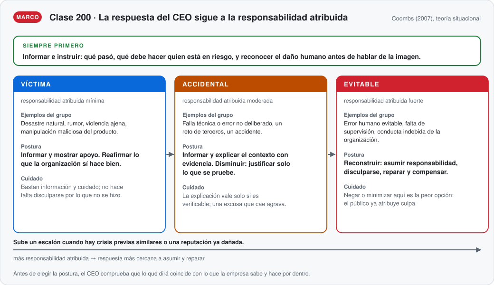

# Clase 200 — Comunicación del CEO

<!-- nav:inicio -->
> **Parte 16 · Alta dirección y oficina del CEO** — clase 8 de 12 · [índice de la parte](../../README.md) · [temario](../../../../SYLLABUS.md)
<!-- nav:fin -->

**Parte:** 16 — Alta dirección y oficina del CEO  
**Nivel:** Etapa 5 — Director → CEO  
**Duración sugerida:** 150–180 minutos · **Estándar:** deep-class-v2

## 🎯 Propósito

Lo que dice un CEO se lee a la vez como información, como señal de lo que viene y como prueba de su carácter. Habla ante empleados, directorio, clientes, inversionistas, autoridades y medios, y cada uno compara lo que oye con lo que ve. Por eso la comunicación del CEO tiene una exigencia que otras comunicaciones no tienen: **el mensaje externo debe coincidir con la realidad interna**, porque basta una contradicción para que todo lo demás pierda credibilidad.

Esta clase da un método para tres momentos difíciles: una **declaración controvertida**, una **pregunta que el CEO no quiere responder** y la **pérdida del vocero** que sostenía la relación con el exterior. Se apoya en la teoría situacional de comunicación de crisis de Coombs, en la evidencia experimental sobre disculpa y negación de Kim y colegas, y en el análisis de las conversaciones difíciles de Stone, Patton y Heen.

## 📚 Resultados de aprendizaje

Al finalizar podrás:

1. **Estructurar** un mensaje ejecutivo con lo que se sabe, lo que no se sabe, lo que se hace y cuándo habrá novedades.
2. **Clasificar** una situación según la responsabilidad que el público atribuye y elegir la postura de respuesta que le corresponde.
3. **Decidir** entre mantener, aclarar o retractarse tras una declaración controvertida, según si fue inexacta, mal expresada o correcta pero discutida.
4. **Responder** una pregunta difícil separando hecho, límite de la información y compromiso.
5. **Preparar** un manual de vocería y el traspaso cuando el vocero se va.
6. **Reconocer** errores y límites de la información sin ocultar hechos relevantes.

## 🧭 Agenda

| Tramo | Qué se hace |
|---|---|
| 0–20 min | Recuperación: recuerda una declaración pública de un directivo que te pareció poco creíble; ¿qué la contradecía? |
| 20–65 min | Responsabilidad atribuida y posturas de respuesta, con el diagrama de la clase. |
| 65–105 min | Ejemplo trabajado: el CEO que dice a empleados e inversionistas cosas incompatibles. |
| 105–140 min | Caso ejecutivo: declaración, preguntas y traspaso del vocero. |
| 140–170 min | Límites del modelo y entregable. |

## 🧩 Conceptos centrales

| Concepto | Definición | Cómo se reconoce |
|---|---|---|
| **Teoría situacional de comunicación de crisis** | Marco de Coombs (2007) que relaciona la responsabilidad que el público atribuye a la organización con las respuestas más adecuadas. | Se pregunta primero «¿quién cree el público que es responsable?» y después «¿qué decimos?». |
| **Atribución de responsabilidad** | Grado en que los interesados creen que la organización causó la crisis; se agrupa en víctima, accidental y evitable. | Se observa en qué dicen los medios, los clientes y los empleados sobre la causa. |
| **Intensificadores** | Historial de crisis similares y reputación previa: aumentan la responsabilidad atribuida. | Una empresa con fallas repetidas es leída más severamente. |
| **Información de instrucción** | Qué ocurrió y qué debe hacer quien está en riesgo para protegerse. | Es lo primero que se comunica. |
| **Información de ajuste** | Reconocimiento del daño y apoyo para afrontarlo emocionalmente. | Expresa cuidado por los afectados antes de hablar de la imagen. |
| **Estrategias de respuesta** | Negación, disminución, reconstrucción y refuerzo, con variantes en cada grupo. | Se identifican por lo que el mensaje hace con la culpa. |
| **Mensaje central** | Una frase verificable que sostiene toda la comunicación; todo lo demás la respalda. | Se puede comprobar con hechos. |
| **Manual de vocería** | Documento previo que define quién habla, qué dice, qué no dirá y cómo se corrige un error. | Existe antes de la crisis y se ensaya. |

## 🧠 Modelo mental

**Cómo leer el diagrama.** Primero, siempre, se informa e instruye. Después se mira cuánta responsabilidad atribuye el público: cuanto más, más cerca debe estar la respuesta de **asumir y reparar**, y más peligrosa es una negación o una excusa que los hechos no sostienen. Los intensificadores desplazan la lectura un escalón hacia la derecha.

## 📖 Desarrollo

### 1. Un hecho, varios públicos

Un CEO no tiene mensajes distintos para cada audiencia; tiene **un hecho** y lo adapta en profundidad, orden y lenguaje. Los empleados necesitan saber qué cambia para ellos; los inversionistas, qué cambia para el negocio; los clientes, qué cambia para el servicio; la autoridad, qué cumple la empresa. Pero el hecho de fondo es el mismo, porque los públicos se comunican entre sí y comparan. La regla práctica: antes de hablar, escribir el hecho en una frase y comprobar que no contradice nada de lo que se dirá a otra audiencia.

### 2. Qué comunicar primero

Coombs propone una **respuesta base** que precede a cualquier tratamiento de la reputación: **información de instrucción** —qué ocurrió y qué debe hacer quien está en riesgo— e **información de ajuste** —reconocer el daño y expresar cuidado por los afectados—. Solo después se decide cuánto asumir. Esto invierte el orden que tienta a muchos directivos: primero proteger a las personas, luego la imagen.

### 3. Responsabilidad atribuida: tres grupos

La teoría agrupa las crisis según cuánta responsabilidad **percibe** el público en la organización. En el grupo **víctima** (desastre natural, rumor, violencia ajena, manipulación maliciosa del producto) la atribución es mínima. En el **accidental** (fallas técnicas no deliberadas, retos de terceros) es moderada. En el **evitable** (error humano evitable, falta de supervisión, conducta indebida) es fuerte. Dos factores la intensifican: haber tenido **crisis similares antes** y una **reputación previa deteriorada**.

El punto clave es que importa lo que el público *percibe*, no lo que la empresa cree. Si la empresa se ve a sí misma como víctima y el público la ve como responsable, usará una postura equivocada.

### 4. Elegir la postura

Coombs organiza las respuestas en cuatro familias: **negación** (negar, atacar al acusador o culpar a otro), **disminución** (excusa o justificación), **reconstrucción** (compensación y disculpa) y **refuerzo** (recordar lo positivo, congraciarse, presentarse como víctima). La teoría propone ajustarlas a la responsabilidad atribuida: cuando es mínima, bastan información y apoyo; cuando es moderada, se suma una explicación con evidencia; cuando es fuerte, la respuesta apropiada es reconstruir.

Dos precauciones. Primera, la **disminución** solo funciona con evidencia: una excusa que se desmiente empeora la situación. Segunda, la **negación** es una estrategia legítima únicamente cuando los hechos la respaldan, por ejemplo ante un rumor falso; como principio de esta clase, **nunca se niega lo que se sabe cierto**.

### 5. La declaración controvertida

Cuando una declaración del CEO genera polémica, la primera pregunta es de hecho: ¿fue **inexacta** (dijo algo falso), **mal expresada** (quiso decir otra cosa) o **correcta pero discutida** (los hechos la respaldan, aunque incomoda)? De la respuesta depende la estrategia: si fue inexacta, **corregir** de inmediato y explicar el error; si fue mal expresada, **aclarar** el sentido sin cambiar los hechos; si fue correcta, **mantenerla y explicar** su base. Retractarse de lo cierto daña la credibilidad tanto como sostener lo falso.

Las investigaciones de Kim y colegas sobre reparación de confianza muestran que, cuando la falla es de competencia —una equivocación—, una disculpa suele funcionar mejor que negarla. Como esos resultados vienen de experimentos, sirven para orientar el diagnóstico y no para decidir sin conocer los hechos.

### 6. La pregunta difícil

Stone, Patton y Heen proponen que toda conversación difícil contiene tres conversaciones a la vez: **qué ocurrió** (hechos y atribución de culpa), **los sentimientos** involucrados y **la identidad** (qué dice esto de quien responde). La pregunta hostil de un periodista suele apuntar a la tercera, y el CEO, sin darse cuenta, responde a la tercera cuando debería responder a la primera.

Una estructura útil: **hecho confirmado → límite de lo que se sabe → compromiso verificable**. Por ejemplo: «Confirmamos que 3.200 clientes recibieron el mensaje equivocado. Aún no sabemos si alguien accedió a sus datos. Informaremos el jueves a las 12:00, haya o no novedades.» Evita tres evasiones: negar sin respaldo, desviar hacia otro tema y adelantar conclusiones que la investigación aún no alcanza.

### 7. Incertidumbre y errores sin ocultar hechos

Decir «aún no lo sabemos» con una fecha de actualización es más creíble que una certeza que luego se corrige. Lo que convierte un error en un problema mayor es **retener un dato relevante que ya se conoce**: cuando se descubre, la lectura pasa de falla de competencia a duda de integridad (clase 137). La regla del manual: registrar la hora en que se supo cada hecho y el momento en que se comunicó, y corregir un dato erróneo apenas se detecta, con la misma visibilidad con que se dijo.

### 8. El manual de vocería y el reemplazo del vocero

El manual define: quién habla y sobre qué; el mensaje central en una frase verificable; tres hechos que lo sostienen; lo que aún no se sabe; las preguntas difíciles anticipadas; lo que no se dirá y por qué (reserva legal, privacidad de personas, investigación en curso); y cómo se corrige un error propio. Cuando un vocero **renuncia o es reemplazado**, se pierde la relación con los medios y el conocimiento de los hechos. Se prepara de antemano: traspaso de relaciones y mensajes vigentes, un sucesor entrenado, un solo vocero provisional y una explicación honesta del cambio que no sugiera causas que no se conocen.

## 📚 Lectura comparada

| Obra | Qué aporta | Qué no resuelve | Pregunta para contrastar |
|---|---|---|---|
| Coombs (2007) | Responsabilidad atribuida, respuesta base y posturas. | No cubre la vocería cotidiana. | ¿Qué responsabilidad te atribuye el público y qué postura corresponde? |
| Kim et al. (2004) | Disculpa o negación según la falla sea de competencia o de integridad. | Experimentos de laboratorio. | ¿Qué diagnóstico harías antes de disculparte? |
| Stone, Patton y Heen (1999) | Las tres conversaciones dentro de una conversación difícil. | No es específico de medios. | ¿A qué conversación respondiste la última vez? |
| Goleman, Boyatzis y McKee (2002) | El estado emocional del líder se contagia y condiciona la recepción del mensaje. | No da una estructura de mensaje. | ¿Qué tono transmite tu comunicado antes de que alguien lea el contenido? |
| Mayer, Davis y Schoorman (1995) | Qué factores observa quien decide confiar. | No habla de vocería. | ¿Qué factor de confianza afecta tu declaración? |

## 🧮 Ejemplo trabajado

**Situación (hipotética).** Tras la adquisición de una empresa, el CEO dice a los empleados que *nada cambiará* y, al mismo tiempo, promete a los inversionistas **USD 20 millones en sinergias de personal**. La contradicción se filtra el mismo día.

**Paso 1: hecho.** Una sinergia de personal significa menos puestos; por lo tanto, «nada cambiará» y «sinergias de personal» no pueden ser ciertas a la vez para los mismos cargos.

**Paso 2: atribución.** El público lo leerá como engaño deliberado: grupo **evitable**, con intensificador si la empresa ya tuvo reestructuraciones. La respuesta adecuada está en **reconstruir**.

**Paso 3: tres opciones defendibles.**

| Opción | Qué hace | Qué protege | Qué arriesga | Cuándo conviene |
|---|---|---|---|---|
| **A. Mantener y explicar** | Sostiene que «nada cambiará» se refería a los próximos 12 meses y que las sinergias son futuras. | Evita admitir un error. | Parece una excusa; si el plan real ya existe, es la peor. | Solo si el plan real efectivamente no contempla recortes antes de 12 meses. |
| **B. Aclarar y corregir** | Reconoce que el mensaje a los empleados fue impreciso, informa qué se sabe del plan y cuándo se informará el detalle. | Credibilidad interna y externa. | Reacción inmediata de los empleados. | Si el plan es real y aún no está definido en detalle. |
| **C. Retractarse y disculparse** | Reconoce que se dio un mensaje incompatible, se disculpa con los empleados y fija un proceso de información. | Confianza a largo plazo. | Costo de reputación inmediato y presión sobre el CEO. | Si se ocultó información que ya se conocía. |

**Paso 4: decisión.** Depende de **un hecho que aún no sabemos**: si el plan de recortes ya estaba definido al hablar con los empleados. Si estaba definido, la opción es C; si no, B. En cualquier caso se informa **primero a los empleados**, antes de que se enteren por la prensa.

**Qué muestra.** El método no elige por intuición: elige la postura según la responsabilidad atribuida y declara qué dato cambiaría la decisión. Y deja claro por qué no se elige A sin evidencia.

## 🔀 Comparación y límites

**Aclarar frente a retractarse.** Aclarar mantiene los hechos y corrige el significado; retractarse retira lo dicho. Aclarar lo falso es una forma de evasión; retractarse de lo cierto es una forma de cobardía comunicacional.

**Respuesta defensiva frente a reconstructiva.** La defensiva (negar, disminuir) protege la imagen en el corto plazo, y exige que los hechos la sostengan; la reconstructiva (disculpa, compensación, corrección) cuesta más en el corto plazo y repara en el largo.

**Límites.** La teoría de Coombs se apoya en estudios experimentales y de casos y en percepciones que varían entre culturas y momentos. Una disculpa tiene consecuencias legales según la jurisdicción: se coordina con asesoría legal, pero **el asesor legal no decide el mensaje por el CEO**. Ningún método reemplaza la veracidad: si el mensaje no coincide con los hechos internos, ninguna técnica lo salva.

## 🪜 De profesional a owner

| Nivel | Comunicación |
|---|---|
| **Profesional** | Informa de un error propio apenas lo detecta y propone cómo corregirlo. |
| **Jefe / Team Lead** | Comunica un cambio al equipo con lo que se sabe, lo que no y cuándo habrá más información. |
| **Gerente** | Alinea los mensajes de su área con el resto de la empresa y prepara respuestas difíciles. |
| **CEO / Director** | Habla ante todos los públicos con un solo hecho, elige la postura según la responsabilidad atribuida y responde por la coherencia. |
| **Founder / Owner** | Su declaración compromete su patrimonio y su palabra ante socios y clientes: la honestidad es una decisión de supervivencia. |

## 🏢 Caso ejecutivo

La vocera de una empresa de transporte renuncia un día antes de la presentación trimestral. En la presentación se esperan preguntas sobre un accidente ocurrido hace un mes y sobre la causa judicial en curso. Dos días antes, el CEO dijo en una entrevista que «el accidente no tuvo relación con mantenimiento», aunque la investigación interna aún no concluye.

Entrega un **manual de vocería** que contenga: (a) la clasificación de la crisis por responsabilidad atribuida y la postura elegida; (b) el mensaje central y tres hechos que lo sostienen; (c) qué se hará con la afirmación del CEO si resulta inexacta, mal expresada o correcta; (d) las tres preguntas más difíciles con respuesta en la estructura *hecho → límite → compromiso*; (e) el plan de traspaso de la vocería, con vocero provisional; (f) qué dato cambiaría tu recomendación.

## 🧪 Práctica

1. Escribe en una frase el hecho central de una situación de tu organización y comprueba que no contradice nada de lo que dirías a empleados, clientes e inversionistas.
2. Clasifica una crisis real o simulada en víctima, accidental o evitable y justifica con lo que percibe el público.
3. Responde en dos minutos a una pregunta hostil y evalúa si respondiste a la conversación sobre los hechos o a la de la identidad.
4. Redacta el mensaje de corrección de un dato inexacto, con la misma visibilidad con que se dijo.
5. Escribe el plan de traspaso de la vocería si tu vocero se va mañana.

## ⚠️ Errores frecuentes

| Error | Por qué ocurre | Cómo corregirlo |
|---|---|---|
| Hablar de imagen antes que de personas | Se prioriza la reputación | Informar e instruir primero; reconocer el daño. |
| Mensajes distintos por audiencia | Cada área comunica por su cuenta | Un hecho escrito y un vocero coordinador. |
| Excusa sin evidencia | Se quiere atenuar la responsabilidad | Disminuir solo con hechos comprobables. |
| Negar lo cierto | Se teme el costo de admitir | Nunca negar lo que se sabe; corregir pronto. |
| Retractarse de lo correcto | Se cede a la presión | Mantener y explicar lo que los hechos sostienen. |
| Responder a la identidad | La pregunta toca el orgullo | Volver al hecho: confirmado, límite, compromiso. |
| Dejar al vocero sin sucesor | Nadie imagina que se irá | Un traspaso escrito y un provisional. |

## ❓ Preguntas de comprobación

1. ¿Qué dos tipos de información propone Coombs comunicar primero y por qué preceden a la reputación?
2. ¿Qué diferencia hay entre una crisis de tipo víctima y una de tipo evitable, y cómo cambia la postura?
3. ¿Cuándo es defendible una estrategia de negación y qué límite fija la clase?
4. Una declaración del CEO fue inexacta. ¿Qué debe hacer y qué diferencia hay con una declaración correcta pero discutida?
5. ¿Qué tres conversaciones contiene una conversación difícil según Stone, Patton y Heen?
6. Escribe la estructura *hecho → límite → compromiso* para una pregunta sobre la cantidad de afectados.
7. ¿Qué pierde una organización cuando retiene un dato relevante que ya conoce?
8. ¿Qué debe incluir el traspaso de la vocería?

Claves de respuesta

1. Información de instrucción (qué ocurrió y qué debe hacer quien está en riesgo) e información de ajuste (reconocer el daño y apoyar). Preceden a la reputación porque protegen a las personas primero.
2. En víctima la atribución es mínima y bastan información y apoyo; en evitable es fuerte y corresponde reconstruir: asumir, disculparse y reparar.
3. Cuando los hechos la respaldan, por ejemplo un rumor falso. Nunca se niega lo que se sabe cierto.
4. Corregir de inmediato y explicar el error, con la misma visibilidad. Si es correcta, se mantiene y se explica su base.
5. Qué ocurrió, los sentimientos y la identidad.
6. Por ejemplo: «Confirmamos 3.200 afectados; aún no sabemos si hubo acceso a sus datos; informaremos el jueves a las 12:00.»
7. Pasa de falla de competencia a duda de integridad; la confianza se daña más que con el error mismo.
8. Mensajes vigentes y relaciones con medios, un sucesor entrenado, un vocero provisional único y una explicación honesta del cambio.

## 📥 Entregable

Guarda en `portfolio/200-comunicacion-del-ceo/`:

- `executive-spokesperson-manual.md` (plantilla [manual de vocería ejecutiva](../../../../templates/executive-spokesperson-manual.md)) con el caso ejecutivo resuelto;
- `reading-note.md` contrastando dos fuentes y su efecto en la postura elegida;
- `decision-journal.md` con la clasificación de la crisis, la decisión y el dato que la cambiaría;
- `red-team.md` con la objeción más fuerte a tu postura y la respuesta.

## 📗 Fuentes y verificación

- W. Timothy Coombs — *Protecting Organization Reputations During a Crisis: The Development and Application of Situational Crisis Communication Theory* (Corporate Reputation Review, 2007). **Uso en esta clase:** responsabilidad atribuida, respuesta base y posturas de respuesta. Lectura selectiva sobre **comunicación del ceo**. **Localizador:** [DOI 10.1057/palgrave.crr.1550049](https://doi.org/10.1057/palgrave.crr.1550049).
- Peter H. Kim, Donald L. Ferrin, Cecily D. Cooper & Kurt T. Dirks — *Removing the Shadow of Suspicion: The Effects of Apology Versus Denial for Repairing Competence- Versus Integrity-Based Trust Violations* (Journal of Applied Psychology, 2004). **Uso en esta clase:** disculpa o negación según el tipo de falla. Lectura selectiva sobre **comunicación del ceo**. **Localizador:** [DOI 10.1037/0021-9010.89.1.104](https://doi.org/10.1037/0021-9010.89.1.104).
- Douglas Stone, Bruce Patton & Sheila Heen — *Difficult Conversations* (Random House Audio, 1999). **Uso en esta clase:** las tres conversaciones de una pregunta difícil. Lectura selectiva sobre **comunicación del ceo**. **Localizador:** [ISBN-13 9780553525687](https://openlibrary.org/isbn/9780553525687).
- Daniel Goleman, Richard Boyatzis & Annie McKee — *Primal Leadership* (Harvard Business School Press, 2002). **Uso en esta clase:** el estado emocional del líder y su efecto en la recepción del mensaje. Lectura selectiva sobre **comunicación del ceo**. **Localizador:** [ISBN-13 9781578514861](https://openlibrary.org/isbn/9781578514861).
- Roger C. Mayer, James H. Davis & F. David Schoorman — *An Integrative Model of Organizational Trust* (Academy of Management Review, 1995). **Uso en esta clase:** qué factores observa quien decide confiar en una declaración. Lectura selectiva sobre **comunicación del ceo**. **Localizador:** [DOI 10.2307/258792](https://doi.org/10.2307/258792).

> **Regla de fuentes para Comunicación del CEO:** las obras anteriores estructuran las perspectivas de esta materia; cualquier norma, ley o estándar vivo mencionado debe comprobarse nuevamente en su fuente primaria vigente, incluidas las implicancias legales de una disculpa. Los casos y ejemplos son hipotéticos y no describen a ninguna empresa real. El desarrollo es original y no reproduce capítulos protegidos.

<!-- pie:inicio -->
---

| Anterior | Índice | Siguiente |
|---|---|---|
| [← 199 · Balance entre clientes, personas, accionistas y sociedad](../199-balance-entre-clientes-personas-accionistas-y-sociedad/README.md) | [Parte 16](../../README.md) · [Programa](../../../../SYLLABUS.md) | [201 · Leadership pipeline →](../201-leadership-pipeline/README.md) |
<!-- pie:fin -->
