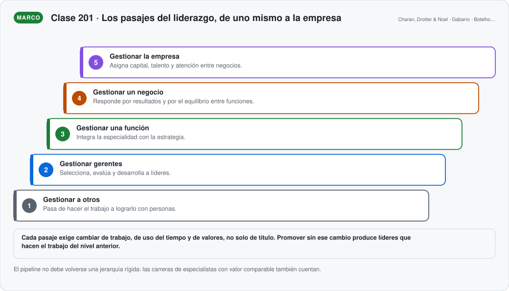

# Clase 201 — Leadership pipeline

<!-- nav:inicio -->
> **Parte 16 · Alta dirección y oficina del CEO** — clase 9 de 12 · [índice de la parte](../../README.md) · [temario](../../../../SYLLABUS.md)
<!-- nav:fin -->

**Parte:** 16 — Alta dirección y oficina del CEO  
**Nivel:** Etapa 5 — Director → CEO  
**Duración sugerida:** 150–180 minutos · **Estándar:** deep-class-v2

## 🎯 Propósito

Cuando se abre un cargo crítico, muchas empresas descubren que no tienen a nadie listo. Entonces contratan afuera, a un costo alto y con un riesgo mayor de fracaso, o ascienden a la persona más cercana con la esperanza de que «crezca en el cargo». Lo primero ocurre en el nivel de directores; lo segundo, en todos los niveles, y produce los líderes que hacen el trabajo del nivel anterior porque nadie les enseñó el del nuevo. Un **pipeline de liderazgo** es el sistema que evita esa sorpresa: define qué cambia en cada nivel, identifica quién está listo y quién no, ofrece asignaciones y acompañamiento para crecer y mantiene una visión del banco de talento para los cargos críticos.

La clase se apoya en el modelo de pasajes de liderazgo de Charan, Drotter y Noel, en el estudio de Gabarro sobre la toma de mando, en el análisis de Botelho, Powell y Raz sobre las conductas de CEO exitosos, en la mirada de Kegan y Lahey sobre cómo las personas cambian (o no) y en el trabajo de Mankins y Garton sobre asignación de talento. Al terminar sabrás mapear niveles y cargos críticos, definir qué cambia en cada pasaje, calibrar potencial y preparación, diseñar asignaciones de desarrollo, medir la cobertura de sucesores y evitar que el pipeline se convierta en una jerarquía rígida.

## 📚 Resultados de aprendizaje

Al finalizar podrás:

1. **Mapear** los niveles de liderazgo y los cargos críticos de la empresa.
2. **Definir** qué cambia en cada pasaje: trabajo, uso del tiempo y valores.
3. **Calibrar** potencial y preparación con evidencia y sin sesgos evidentes.
4. **Diseñar** asignaciones de desarrollo y acompañamiento.
5. **Medir** cobertura de sucesores, tiempo de cobertura y calidad de las promociones.

## 🧭 Agenda

| Tramo | Qué se hace |
|---|---|
| 0–20 min | Recuperación: ¿a quién promoviste por su desempeño técnico y cómo le fue en el nuevo cargo? |
| 20–60 min | Pasajes, cargos críticos, potencial y preparación, asignaciones, cobertura y límites. |
| 60–105 min | Ejemplo trabajado: caso de negocio de un pipeline para 48 cargos críticos. |
| 105–150 min | Caso ejecutivo y práctica. |
| 150–175 min | Límites y entregable. |

## 🧩 Conceptos centrales

| Concepto | Definición | Cómo se reconoce |
|---|---|---|
| **Pasaje de liderazgo** | Transición a un nivel que exige cambiar de trabajo, de uso del tiempo y de valores. | De líder de uno mismo a líder de otros, etc. |
| **Cargo crítico** | Rol cuya vacancia o mal desempeño afecta gravemente a la empresa. | Alto impacto y difícil de reemplazar. |
| **Preparación (readiness)** | Capacidad actual de asumir el nivel siguiente. | Se evidencia en conductas y resultados. |
| **Potencial** | Capacidad de crecer hasta niveles superiores en el tiempo. | Se estima con evidencia y no con simpatía. |
| **Sucesor listo ahora** | Persona que podría asumir el cargo de inmediato. | Hay evidencia de que ya hace partes del trabajo. |
| **Banco de talento** | Visión de personas y su preparación para cargos críticos. | Se revisa periódicamente. |

## 🧠 Modelo mental

**Cómo leer el diagrama.** Una escalera de cinco pasajes. **Gestionar a otros**: pasar de hacer el trabajo a lograrlo con personas. **Gestionar gerentes**: seleccionar, evaluar y desarrollar a líderes. **Gestionar una función**: integrar la especialidad con la estrategia. **Gestionar un negocio**: responder por resultados y por el equilibrio entre funciones. **Gestionar la empresa**: asignar capital, talento y atención entre negocios. La nota afirma que cada pasaje exige cambiar de trabajo, de uso del tiempo y de valores, y no solo de título; el pie, que el pipeline no debe volverse una jerarquía rígida.

## 📖 Desarrollo

### 1. Pasajes, no solo ascensos

Charan, Drotter y Noel describen el desarrollo de liderazgo como una serie de **pasajes** (en su modelo original son seis; aquí se agrupan los dos últimos): de gestionarse a sí mismo a gestionar a otros; de gestionar a otros a gestionar gerentes; de gestionar gerentes a gestionar una función; de gestionar una función a gestionar un negocio; y hasta gestionar la empresa. En cada pasaje cambian tres cosas: las **habilidades** (qué hay que saber hacer), la **asignación del tiempo** (en qué se gasta la jornada) y los **valores de trabajo** (qué se considera importante). La tesis central es que muchos fracasos de liderazgo se deben a que la persona no hizo el cambio de valores: sigue valorando el trabajo del nivel anterior. El ascenso concede el título; el pasaje exige abandonar hábitos que antes se premiaron.

### 2. Qué cambia en cada nivel

Para cada pasaje, la empresa define con claridad: **qué trabajo se hace** (por ejemplo, el gerente de gerentes selecciona y evalúa a sus gerentes, asigna recursos entre ellos y se preocupa por la capacidad de la unidad); **cómo se usa el tiempo** (más planificación, coordinación y coaching; menos ejecución directa); y **qué valores sostienen el nuevo nivel** (por ejemplo, valorar el éxito de otros más que el propio). Estas descripciones se convierten en **perfiles** de cada nivel, que sirven para seleccionar, evaluar y desarrollar. También permiten detectar el **estancamiento**: el líder que, en un nivel, sigue haciendo trabajo del nivel anterior porque le gusta o porque no confía en su gente.

### 3. Cargos críticos y cobertura

No todos los cargos exigen el mismo nivel de planificación de sucesión. Se identifican los **cargos críticos**: los que, si se vacan o se desempeñan mal, afectan gravemente los resultados, los clientes, los riesgos o la estrategia. Para cada uno se mantienen: el **perfil** (qué se necesita en el contexto actual y futuro), los **sucesores** (internos con su nivel de preparación: listos ahora, listos en uno o dos años, en desarrollo), el **plan de contingencia** si el titular se va de forma imprevista y el **riesgo de pérdida** del titular. La **cobertura** se mide por la proporción de cargos críticos con al menos un sucesor listo ahora y con al menos dos preparados en dos años.

### 4. Potencial y preparación: evaluar con evidencia

Se separan dos preguntas: ¿está **lista** esta persona para el nivel siguiente? (evidencia de que ya hace parte del trabajo y con los valores correctos) y ¿tiene **potencial** de llegar más alto? (capacidad de aprender rápido, de adaptarse y de asumir más complejidad). Se evita juzgar por simpatía, por visibilidad o por parecido con el jefe. Botelho y colaboradores, a partir de evaluaciones de miles de ejecutivos, informan que las conductas que mejor se asociaron con el éxito de los CEO (decidir con rapidez y convicción, comprometerse con las partes interesadas para adaptarse, entregar de manera confiable y adaptarse con audacia) no coincidían con varios estereotipos populares sobre el CEO ideal. La enseñanza para el pipeline es evaluar **conductas y resultados observables** y desafiar los prejuicios sobre quién «tiene aspecto» de líder.

### 5. Asignaciones que hacen crecer

Las personas crecen sobre todo por **experiencia**: asignaciones con más complejidad, ambigüedad, alcance o riesgo. Se diseñan **asignaciones de desarrollo**: liderar un proyecto interfuncional, asumir una unidad en problemas, abrir un mercado, pasar por otra función, dirigir un cambio. Se acompañan con **coaching**, **mentores** y retroalimentación basada en conductas. Kegan y Lahey muestran que las personas, aun deseando cambiar, tienen «compromisos ocultos» que las protegen de hacerlo (por ejemplo, el deseo de no mostrar vulnerabilidad), y que el desarrollo requiere sacarlos a la luz. Se evalúa si cada asignación tiene objetivos de aprendizaje además de resultados, y si el sistema permite que la persona se equivoque sin que sea el final de su carrera. Mankins y Garton recuerdan que se necesita **atención** sobre estos temas: el comité de dirección dedica tiempo regular al talento, no solo una vez al año.

### 6. Revisiones periódicas y diseño del proceso

El pipeline se mantiene con **revisiones periódicas** (semestrales o anuales) en las que el CEO y el equipo directivo discuten cargo por cargo: cobertura, sucesores, riesgos de pérdida, planes de desarrollo y decisiones de asignación. Se usa información **comparable** (perfiles, evidencias, evaluaciones calibradas entre áreas para reducir el ruido de cada jefe) y se registran decisiones con responsables. La función de personas facilita el proceso; los líderes de línea son los dueños de su talento. Se cuida la **confidencialidad**: la información sobre potencial se maneja con cuidado y con transparencia proporcional con las personas sobre su desarrollo, y se cumple la normativa de protección de datos y laboral aplicable, que se verifica con asesoría.

### 7. Evitar los defectos del pipeline

Un pipeline mal diseñado produce: **jerarquía rígida** (solo se asciende por una vía), **sesgos** (se favorece a quienes se parecen a los jefes), **inflación de potencial** (todos son «alto potencial»), **desatención de los especialistas** (no hay carrera técnica con valor comparable) y **desánimo** de quienes no están en el banco de talento. Soluciones: rutas **técnicas y gerenciales** de valor comparable cuando el trabajo lo permita, criterios explícitos y calibraciones cruzadas, comunicación honesta sobre desarrollo para todos y reglas para que las personas puedan **postular** a oportunidades. Y se mide la **calidad de las promociones**: porcentaje de promovidos que logran el desempeño esperado a los 12 y 24 meses.

## 📚 Lectura comparada

| Obra | Qué aporta | Qué no resuelve | Pregunta para contrastar |
|---|---|---|---|
| Charan, Drotter y Noel | Pasajes de liderazgo con habilidades, tiempo y valores. | Modelo general; hay que adaptarlo a cada empresa. | ¿Qué cambia en este pasaje? |
| Gabarro | Cómo toman el mando los ejecutivos y qué aprenden. | Casos de su época. | ¿Qué tiempo necesita esta persona para aprender? |
| Botelho, Powell y Raz | Conductas asociadas al éxito de los CEO y mitos sobre el perfil. | Estudio de una consultora con sus propios datos. | ¿Evaluamos conductas o estereotipos? |
| Kegan y Lahey | Compromisos ocultos que frenan el cambio personal. | Exige tiempo y apertura. | ¿Qué le impide a esta persona cambiar? |
| Mankins y Garton | Atención del equipo directivo al talento. | Estudios agregados. | ¿Cuánto tiempo dedicamos al talento? |

## 🧮 Ejemplo trabajado

**Situación (hipotética).** Una empresa de 3.500 personas tiene 48 cargos críticos. Su rotación en esos cargos es del 12 % anual: 48 × 0,12 = 5,76 vacantes por año. El diagnóstico muestra: 14 cargos (29,2 %) tienen al menos un sucesor listo ahora; 31 (64,6 %) tienen al menos un sucesor listo en dos años; el tiempo medio para cubrir un cargo crítico con un candidato externo es 5,2 meses y con uno interno 1,8 meses; el costo de una vacante crítica es de unos 2,1 millones de pesos por mes; la búsqueda externa cuesta 36 millones por cargo; la tasa de fracaso de las contrataciones externas en cargos críticos es 30 % y la de las internas 15 %; y el costo de un fracaso en un cargo crítico se estima en 180 millones.

**Meta del programa.** Pasar la cobertura de sucesores listos ahora de 29,2 % a 70 % en dos años, con un costo de 120 millones al año (asignaciones, coaching y gestión).

**Cálculo.**

1. Vacantes anuales: 5,76. Con 29,2 % de cobertura, cubiertas internamente: 5,76 × 0,292 ≈ 1,68. Con 70 %: 5,76 × 0,70 ≈ 4,03. Vacantes adicionales cubiertas de forma interna: 5,76 × (0,70 − 0,2917) ≈ 2,35.
2. Ahorro por cada cobertura interna adicional:
   - tiempo de vacancia: (5,2 − 1,8) × 2,1 = 3,4 × 2,1 = 7,14 millones;
   - costo de búsqueda evitado: 36 millones;
   - menor costo esperado de fracaso: (0,30 − 0,15) × 180 = 27 millones.
   - Total por cobertura: 7,14 + 36 + 27 = 70,14 millones.
3. Beneficio anual: 2,35 × 70,14 ≈ 165 millones.
4. Relación beneficio/costo: 165 ÷ 120 ≈ 1,4.

**Lectura.** El programa se justifica con holgura moderada, y no incluye beneficios no cuantificados (retención, conocimiento de la cultura, motivación). La conclusión depende de supuestos inciertos, como la tasa de fracaso; se prueba con sensibilidad: si el costo de fracaso fuera 100 millones, el ahorro por cobertura sería 7,14 + 36 + 15 = 58,14 millones y el beneficio 2,35 × 58,14 ≈ 136,6 millones (relación 1,1).

**Diseño del pipeline.** Perfiles por pasaje (con trabajo, tiempo y valores); inventario de 48 cargos críticos; calibración entre áreas de potencial y preparación con evidencias; 20 asignaciones de desarrollo al año con objetivos de aprendizaje; revisión semestral del equipo directivo; rutas técnica y gerencial de valor comparable para especialistas; y reglas de postulación abierta.

**Indicadores.** Cobertura con sucesor listo ahora; cargos críticos con dos sucesores a dos años; tiempo medio de cobertura; porcentaje de promovidos con buen desempeño a 12 y 24 meses; rotación voluntaria de personas en el banco; diversidad del banco frente a la de la población.

**Cuidados.** La información sobre potencial se trata con confidencialidad; las decisiones de promoción, traslado o salida respetan la normativa laboral y de protección de datos, que se verifica con asesoría; las cifras son ilustrativas.

**Qué muestra.** (1) La cobertura se midió por cargos críticos. (2) El caso de negocio se calculó y se probó con sensibilidad. (3) El diseño cuidó la ruta técnica y las revisiones.

## 🔀 Comparación y límites

**Pipeline frente a plan de sucesión del CEO.** El pipeline atiende a todos los niveles y cargos críticos; la sucesión del CEO es un proceso del directorio (clase 203). El primero alimenta al segundo.

**Límites.** El pipeline no debe convertirse en una jerarquía rígida ni sesgar contra carreras expertas. Los modelos de pasajes son generales; las empresas con estructuras planas necesitan adaptarlos. Los estudios sobre CEO provienen de datos de una consultora. Las estimaciones de costos de vacancia y de fracaso son aproximadas. Las cifras del ejemplo son ilustrativas.

## 🪜 De profesional a owner

| Nivel | Cómo participa en el pipeline |
|---|---|
| **Profesional** | Pide retroalimentación y asignaciones que amplíen su alcance. |
| **Jefe / Team Lead** | Aprende a lograr resultados con otros y desarrolla a su gente. |
| **Gerente** | Selecciona y evalúa líderes; mantiene sucesores en su equipo. |
| **CEO / Director** | Dedica tiempo al talento, decide asignaciones y vigila la cobertura. |
| **Founder / Owner** | Acepta que otros lideren y prepara el relevo de la empresa. |

## 🏢 Caso ejecutivo

Una empresa de servicios con 2.800 personas tiene 36 cargos críticos y un historial de promociones por desempeño técnico. En dos años: 9 gerentes promovidos recientemente, 4 han tenido un desempeño inferior al esperado y 3 dejaron la empresa; dos directores se retiran en seis meses sin sucesores listos; para cubrir uno de ellos se contrató a un externo que se fue a los ocho meses. La evaluación de potencial se hace por cada jefe sin calibración: el 41 % de las personas están clasificadas como «alto potencial», con una mayoría de hombres de las mismas áreas. Los especialistas técnicos de alto valor se quejan de que «para ganar más hay que dirigir gente». Una gerente de datos, con excelente desempeño y poco interés en gestionar equipos, está pensando en irse. El directorio pregunta cuál es la cobertura de sucesores y el gerente de personas no puede responder con datos.

Entrega un **diseño del pipeline** que contenga: (a) los perfiles de pasajes con trabajo, tiempo y valores; (b) el inventario de cargos críticos con cobertura y riesgos; (c) el proceso de evaluación de potencial y preparación con calibración y control de sesgos; (d) las asignaciones de desarrollo, el acompañamiento y la ruta técnica; (e) el caso de negocio con cálculos y sensibilidad; (f) los indicadores, las revisiones y las verificaciones laborales y de protección de datos.

## 🧪 Práctica

1. Describe el cambio de trabajo, de uso del tiempo y de valores en un pasaje de tu empresa.
2. Lista tus diez cargos más críticos y señala la cobertura de sucesores de cada uno.
3. Diseña una escala de preparación con evidencias observables.
4. Propone tres asignaciones de desarrollo con objetivos de aprendizaje para una persona.
5. Diseña una ruta técnica con valor comparable para un especialista.

## ⚠️ Errores frecuentes

| Error | Por qué ocurre | Cómo corregirlo |
|---|---|---|
| Promover por pericia técnica | Es la señal más visible | Evaluar preparación para el nuevo trabajo y valores. |
| Todos son «alto potencial» | Cada jefe evalúa por sí solo | Calibración entre áreas y criterios explícitos. |
| Pipeline como jerarquía rígida | Se busca orden | Rutas técnicas y reglas de postulación. |
| Sin sucesores listos | No se mira el banco | Cobertura de cargos críticos y planes. |
| Asignaciones sin aprendizaje | Se mide solo el resultado | Objetivos de aprendizaje y acompañamiento. |
| Información sin cuidado | Se comparte con ligereza | Confidencialidad y verificación normativa. |

## ❓ Preguntas de comprobación

1. ¿Qué cambia en un pasaje de liderazgo según Charan, Drotter y Noel?
2. ¿Qué es un cargo crítico y cómo se mide la cobertura?
3. ¿Qué diferencia hay entre preparación y potencial?
4. ¿Qué conductas destacan Botelho y colaboradores en CEO exitosos?
5. ¿Qué papel tienen las asignaciones de desarrollo?
6. ¿Qué defectos suelen tener los pipelines?
7. ¿Qué límites tiene el pipeline como modelo?

Claves de respuesta

1. Las habilidades, la asignación del tiempo y los valores de trabajo.
2. Un cargo cuya vacancia o mal desempeño afecta gravemente a la empresa; se mide por la proporción con sucesores listos ahora y con sucesores preparados a dos años.
3. La preparación es la capacidad actual de asumir el nivel siguiente; el potencial es la capacidad de crecer hasta niveles superiores en el tiempo.
4. Decidir con rapidez y convicción, comprometerse con las partes interesadas para adaptarse, entregar de forma confiable y adaptarse con audacia.
5. Hacen crecer a las personas por experiencia de mayor complejidad, con objetivos de aprendizaje y acompañamiento.
6. Jerarquía rígida, sesgos, inflación de potencial, desatención de especialistas y desánimo de quienes no están en el banco.
7. Los modelos son generales; los estudios provienen de datos específicos; las estimaciones de costos son aproximadas; no debe sesgar contra carreras expertas.

## 📥 Entregable

Guarda en `portfolio/201-leadership-pipeline/`:

- `commercial-decision-brief.md` (plantilla [Commercial decision brief](../../../../templates/commercial-decision-brief.md)) con el caso de negocio del pipeline;
- `role-scorecard.md` (plantilla [Role scorecard](../../../../templates/role-scorecard.md)) con los perfiles de pasajes y de cargos críticos;
- `decision-journal.md` con el inventario de cobertura, la calibración y las revisiones.

## 📗 Fuentes y verificación

- Ram Charan, Stephen Drotter & James Noel — *The Leadership Pipeline* (Jossey-Bass, 2000). **Uso en esta clase:** pasajes de liderazgo con habilidades, tiempo y valores. Lectura selectiva sobre **leadership pipeline**. **Localizador:** [ISBN-13 9780787951726](https://openlibrary.org/isbn/9780787951726).
- John J. Gabarro — *The Dynamics of Taking Charge* (Harvard Business School Press, 1987). **Uso en esta clase:** cómo toman el mando los ejecutivos. Lectura selectiva sobre **leadership pipeline**. **Localizador:** [ISBN-13 9780875841373](https://openlibrary.org/isbn/9780875841373).
- Elena L. Botelho, Kim R. Powell & Tahl Raz — *The CEO Next Door* (Currency, 2018). **Uso en esta clase:** conductas asociadas al éxito de los CEO. Lectura selectiva sobre **leadership pipeline**. **Localizador:** [ISBN-13 9781101906491](https://openlibrary.org/isbn/9781101906491).
- Robert Kegan & Lisa Laskow Lahey — *Immunity to Change* (Harvard Business Press, 2009). **Uso en esta clase:** compromisos ocultos que frenan el cambio personal. Lectura selectiva sobre **leadership pipeline**. **Localizador:** [ISBN-13 9781422117361](https://openlibrary.org/isbn/9781422117361).
- Michael C. Mankins & Eric Garton — *Time, Talent, Energy* (Harvard Business Review Press, 2017). **Uso en esta clase:** atención del equipo directivo al talento. Lectura selectiva sobre **leadership pipeline**. **Localizador:** [ISBN-13 9781633691766](https://openlibrary.org/isbn/9781633691766).

> **Regla de fuentes para Leadership pipeline:** las obras anteriores estructuran las perspectivas de esta materia; cualquier norma, ley o estándar vivo mencionado debe comprobarse nuevamente en su fuente primaria vigente, incluidas las normas laborales y de protección de datos aplicables a la evaluación de personas. Los ejemplos y casos son hipotéticos, con cifras ilustrativas. El desarrollo es original y no reproduce capítulos protegidos.

<!-- pie:inicio -->
---

| Anterior | Índice | Siguiente |
|---|---|---|
| [← 200 · Comunicación del CEO](../200-comunicacion-del-ceo/README.md) | [Parte 16](../../README.md) · [Programa](../../../../SYLLABUS.md) | [202 · Crisis y decisiones irreversibles →](../202-crisis-y-decisiones-irreversibles/README.md) |
<!-- pie:fin -->
