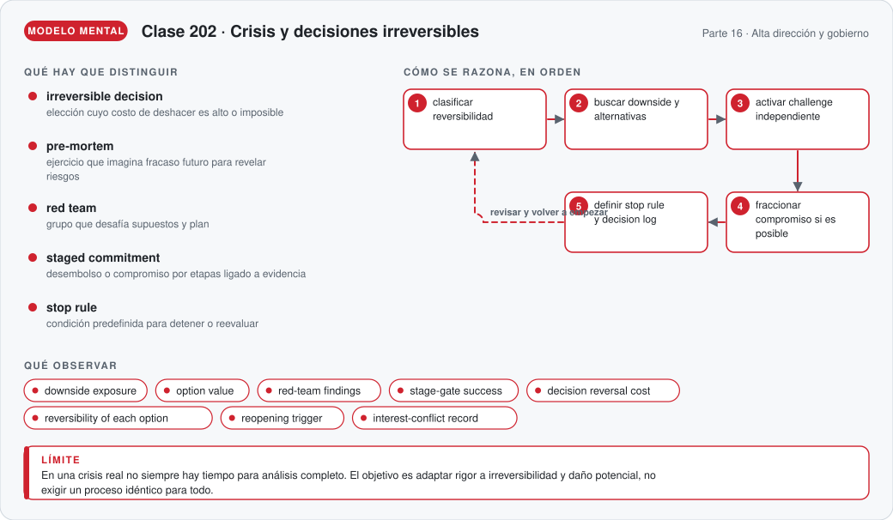

# Clase 202 — Crisis y decisiones irreversibles

<!-- nav:inicio -->
> **Parte 16 · Alta dirección y oficina del CEO** — clase 10 de 12 · [índice de la parte](../../README.md) · [temario](../../../../SYLLABUS.md)
<!-- nav:fin -->

**Parte:** 16 — Alta dirección y oficina del CEO  
**Nivel:** Etapa 5 — Director → CEO  
**Duración sugerida:** 150–180 minutos · **Estándar:** deep-class-v2

## 🎯 Propósito

Las decisiones más difíciles de un CEO tienen dos rasgos a la vez: son **irreversibles** (despedir a un ejecutivo clave, cerrar una planta, adquirir una empresa, comunicar una cifra) y se toman **bajo presión** (poco tiempo, información incompleta, emociones intensas, presión de directorio, prensa o clientes). Esa combinación lleva a dos errores opuestos: decidir demasiado rápido porque «hay que hacer algo», o paralizarse por no equivocarse. Las organizaciones que lo hacen mejor no deciden con más genio, sino con **un procedimiento que adapta el rigor a la irreversibilidad y al daño potencial**: clasifican, buscan el peor caso, convocan a quien desafía, comprometen por etapas cuando pueden y fijan de antemano qué evidencia reabriría la decisión.

La clase se apoya en el estudio de Klein sobre cómo decide la experiencia bajo presión, en el análisis de Weick del desastre de Mann Gulch sobre el colapso del sentido, en la mirada práctica de Horowitz sobre las decisiones del CEO en tiempos de guerra, en el pensamiento de Taleb sobre las pérdidas extremas y las opciones, y en la guía de Duke para decidir con incertidumbre. Al terminar sabrás clasificar una decisión por su reversibilidad, buscar el peor caso y las alternativas, organizar un desafío independiente, fraccionar el compromiso y registrar una regla de parada, incluidas las decisiones sobre una persona clave y aquellas en las que interviene la IA.

## 📚 Resultados de aprendizaje

Al finalizar podrás:

1. **Clasificar** una decisión según su reversibilidad y su daño potencial.
2. **Buscar** el peor caso razonable y alternativas antes de comprometerte.
3. **Organizar** un desafío independiente y evitar el pensamiento de grupo.
4. **Fraccionar** el compromiso y definir reglas de parada y de reapertura.
5. **Decidir** sobre una persona clave y con intervención de IA asignando responsabilidad humana.

## 🧭 Agenda

| Tramo | Qué se hace |
|---|---|
| 0–20 min | Recuperación: ¿qué decisión irreversible tomó tu empresa con prisa y qué habrías pedido antes de decidir? |
| 20–60 min | Experiencia bajo presión, sentido, clasificación, desafío, fraccionamiento y registro. |
| 60–105 min | Ejemplo trabajado: qué hacer con un ejecutivo clave ante una denuncia creíble. |
| 105–150 min | Caso ejecutivo y práctica. |
| 150–175 min | Límites y entregable. |

## 🧩 Conceptos centrales

| Concepto | Definición | Cómo se reconoce |
|---|---|---|
| **Decisión irreversible** | Decisión difícil o imposible de deshacer a costo razonable. | Despidos, cierres, adquisiciones, comunicaciones públicas. |
| **Reconocimiento de patrones** | Uso de la experiencia para ver una situación como familiar y actuar. | Decisiones rápidas de expertos. |
| **Colapso del sentido** | Pérdida de la capacidad de interpretar una situación durante una crisis. | Las personas dejan de seguir roles y reglas. |
| **Desafío independiente** | Revisión por alguien sin interés en el resultado, cuyo rol es buscar fallas. | Equipo rojo, «abogado del diablo» formal. |
| **Regla de parada** | Condición pactada de antemano que obliga a detenerse o revisar. | Umbrales de evidencia o de daño. |
| **Registro de decisión** | Documento con contexto, supuestos, alternativas y razones. | Permite aprender y rendir cuentas. |

## 🧠 Modelo mental

**Cómo leer el diagrama.** Una cadena de cinco pasos con retorno. **Clasificar**: ¿se puede revertir y a qué costo? **Peor caso y alternativas**: qué se pierde y qué otras opciones hay. **Desafío independiente**: alguien ajeno busca lo que no se ve. **Fraccionar**: comprometer por etapas si se puede. **Regla de parada y registro**: qué evidencia reabre la decisión. La flecha indica que la evidencia nueva reabre la decisión. La nota explica que el rigor se adapta a la irreversibilidad y al daño potencial; el pie, que una decisión irreversible sin registro de supuestos no se puede aprender ni defender.

## 📖 Desarrollo

### 1. Qué hace la experiencia bajo presión

Klein estudió a bomberos, militares y enfermeras que deciden en segundos y encontró que no comparan opciones sistemáticamente: **reconocen** la situación como parecida a otra que conocen, **simulan mentalmente** la acción y, si anticipan un problema, la ajustan. Este reconocimiento de patrones funciona muy bien cuando la persona tiene **experiencia relevante** y el entorno ofrece **retroalimentación**; falla cuando la situación es nueva, el entorno engañoso o la experiencia irrelevante. Para el CEO, esto implica: confiar en la intuición de expertos genuinos en situaciones que conocen, pero **desconfiar de la propia** en terrenos nuevos, y buscar a quienes tienen la experiencia relevante. Klein también propone el **pre-mortem**: imaginar que la decisión fracasó y explicar por qué, para detectar riesgos antes de comprometerse.

### 2. Cuando el sentido se rompe

Weick analizó el desastre de Mann Gulch, donde trece bomberos murieron en un incendio forestal, y describió un **colapso del sentido**: cuando el incendio cambió de forma inesperada, las personas dejaron de entender qué ocurría, los roles dejaron de funcionar y algunos actuaron de manera que no se adaptaba a la situación (por ejemplo, seguir cargando sus herramientas pesadas mientras huían). Su lección para las organizaciones es que, en una crisis, el primer problema no es decidir, sino **entender** lo que ocurre: construir un relato provisional compartido, verificarlo con datos y corregirlo. Un CEO en crisis ayuda a restablecer el sentido: define qué se sabe y qué no, asigna roles, comunica con frecuencia y acepta revisar la interpretación.

### 3. Clasificar por reversibilidad

La pregunta clave antes de decidir es: **si me equivoco, ¿puedo deshacerlo y a qué costo?** Las decisiones reversibles se toman con información razonable y se corrigen. Las irreversibles exigen más rigor, tiempo y desafío. Se consideran: **costo de revertir** (dinero, relaciones, reputación), **plazo** (¿se puede esperar sin daño grave?), **daño potencial** en el peor caso y **opciones intermedias** (¿hay un paso reversible que reduzca la urgencia?). Duke recuerda que la calidad de una decisión no se mide solo por su resultado: se evalúa por el proceso, los datos y las probabilidades, y se registra para aprender. Y Taleb advierte de ser especialmente cuidadosos con decisiones que exponen a **pérdidas extremas** que no se podrían soportar, porque ninguna probabilidad pequeña compensa un daño que destruye a la empresa.

### 4. Peor caso, alternativas y pre-mortem

Antes de comprometer, se responden tres preguntas: ¿cuál es el **peor caso razonable** y podemos soportarlo?, ¿qué **alternativas** hay, incluidas no hacer nada, esperar o hacer una versión más pequeña?, y ¿qué pasaría si la decisión **falla** (pre-mortem)? Se suele descubrir que la urgencia es menor de lo percibido, que hay un paso reversible que da tiempo (por ejemplo, **suspender** antes de **despedir**) o que el peor caso es inaceptable. Se identifican además las **opciones** que se pierden y las que se ganan con cada camino, y los **disparadores** que cambiarían la elección. Horowitz señala que en tiempos de guerra el CEO debe decidir sin certezas, pero debe hacerlo con claridad sobre lo que no sabe.

### 5. Desafío independiente y pensamiento de grupo

Las decisiones importantes bajo presión están expuestas al **pensamiento de grupo**: el grupo busca consenso rápido, se silencian las dudas y se refuerza la postura de quien lidera. Se contrarresta con **desafío independiente**: designar a una persona o equipo (con distancia del resultado) que busque los fallos, pedir opiniones por escrito antes de la discusión, invitar a quienes disienten, consultar a expertos externos y escuchar en último lugar al líder. El desafío no es un trámite: tiene **acceso a los datos**, **tiempo** y **autoridad** para detener o pedir más análisis. Su resultado se registra, incluyendo los hallazgos que no se aceptaron y por qué. Edmondson (clase 174) recuerda que sin seguridad psicológica el desafío no ocurre.

### 6. Fraccionar y fijar reglas de parada

Cuando es posible, se **fracciona** el compromiso: probar en pequeña escala, pagar por etapas, firmar una opción antes del contrato, suspender antes de separar, anunciar internamente antes de hacerlo público. Cada etapa tiene criterios de **continuar, ajustar o detener**. Se escribe una **regla de parada**: qué evidencia haría que cambiemos de rumbo y quién tiene la autoridad. Esto protege del sesgo de continuar por costos hundidos y de la rigidez posterior. Taleb argumenta que conviene preferir estructuras con **opciones** (poder detenerse o aprovechar sin costo alto) frente a las que obligan a apostar todo de una vez.

### 7. Decidir sobre una persona clave

Entre las decisiones más delicadas están las que afectan a una persona clave de la que se tiene una denuncia o un desempeño problemático. Las opciones suelen ser: **mantener**, **reasignar**, **apartar temporalmente** (con investigación) o **separar**. Se comparan con criterio de **reversibilidad** (apartar temporalmente es reversible; separar, no), **obligaciones** (la empresa debe investigar denuncias creíbles y proteger a las personas afectadas, conforme a normas laborales y de seguridad que se verifican con asesoría), **evidencia** (qué se sabe y qué no) y **riesgos** comerciales, legales, laborales, éticos y reputacionales. Se define de antemano qué evidencia reabriría la decisión. Y se cuida el **proceso**: imparcialidad, confidencialidad, derecho a ser oído y registro.

### 8. Cuando interviene la IA

Si un sistema de IA recomienda, prioriza o redacta parte de la decisión, **la responsabilidad sigue siendo humana**: un dueño con nombre decide, conoce los límites del sistema, verifica sus resultados y puede explicar por qué aceptó o rechazó la recomendación. No se delega en la IA una decisión irreversible sobre personas sin supervisión humana efectiva (clase 188). Se registra qué recomendó el sistema, con qué datos y qué decidió la persona. La IA puede ayudar a buscar escenarios o a detectar patrones; no sustituye el criterio ni la rendición de cuentas.

## 📚 Lectura comparada

| Obra | Qué aporta | Qué no resuelve | Pregunta para contrastar |
|---|---|---|---|
| Klein | Cómo decide la experiencia y el pre-mortem. | Funciona en dominios con experiencia relevante. | ¿Tenemos experiencia relevante aquí? |
| Weick (Mann Gulch) | Colapso del sentido y papel de roles y reglas. | Un caso de desastre específico. | ¿Entendemos lo que está ocurriendo? |
| Horowitz | Decisiones del CEO en tiempos difíciles. | Experiencia personal de un fundador. | ¿Qué sabemos y qué no? |
| Taleb | Pérdidas extremas y opciones. | Concepto general. | ¿Podemos sobrevivir al peor caso? |
| Duke | Decidir con incertidumbre y separar decisión de resultado. | No fija procedimientos para crisis. | ¿Qué probabilidad le asignamos? |

## 🧮 Ejemplo trabajado

**Situación (hipotética).** Una empresa recibe una denuncia creíble contra un director comercial por conductas que podrían violar la política interna y normas laborales. Su cartera es de 9.800 millones de pesos de ventas con un margen de 20 %: 1.960 millones. La empresa estima en 25 % la probabilidad de que los hechos sean ciertos.

**Restricción dura.** La empresa tiene la **obligación de investigar** una denuncia creíble y de proteger a las personas afectadas, conforme a la normativa vigente que se verifica con asesoría. Por tanto, **mantener sin investigar no es una opción admisible**, aunque tenga un costo esperado bajo.

**Comparación de opciones (en millones de pesos).**

| Opción | Costo si los hechos son ciertos (25 %) | Costo si no lo son (75 %) | Costo esperado | Peor caso |
|---|---|---|---|---|
| 1. Mantener sin investigar | 600 (legal y reputación) + 300 (agravante por inacción) = 900 | 0 | 0,25 × 900 = 225 | 900 |
| 2. Apartar 30 días e investigar | 123 + 294 + 200 = 617 | 123 + 20 = 143 | 0,25 × 617 + 0,75 × 143 = 261,5 | 617 |
| 3. Separar de inmediato | 294 + 200 = 494 | 294 + 300 (reclamo por separación injustificada) = 594 | 0,25 × 494 + 0,75 × 594 = 569 | 594 |

**Notas de cálculo.** Apartar 30 días: disrupción de 5 % del margen de la cartera (98) más 25 de la investigación = 123. Si se prueba, se separa y se pierde el 15 % del margen por fuga de clientes (294) con un costo legal y reputacional menor por haber actuado a tiempo (200). Si no se prueba, se reintegra y se invierten 20 en reparación. Separar de inmediato: fuga de 294 con certeza; si resultara que no eran ciertos, el costo de un reclamo se estima en 300.

**Lectura.** La opción 1 tiene el menor costo esperado, pero no es admisible. Entre las opciones 2 y 3, la **opción 2 cuesta menos de la mitad** en términos esperados (261,5 frente a 569), es **reversible** y mantiene la posibilidad de separar si la investigación lo respalda. Su peor caso (617) es comparable al de la opción 3 (594), con una probabilidad menor de ocurrir.

**Pre-mortem.** Se imagina que la decisión fracasó: ¿por qué? Respuestas: la investigación fue percibida como parcial; se filtró la información; los clientes de la cartera se fueron antes de aclarar los hechos; la persona afectada sufrió represalias. Medidas: investigación a cargo de un tercero independiente, confidencialidad reforzada, plan de continuidad de la cartera con un responsable interino y comunicación a los clientes, y protección de la denunciante.

**Desafío independiente.** Un miembro del directorio y la asesoría legal revisan el procedimiento antes de aplicarlo; se pide por escrito la opinión del gerente de personas y de la gerente legal antes de que hable el CEO.

**Regla de parada y registro.** Si a los 30 días la investigación no ha reunido evidencia suficiente, se prorroga una sola vez por 15 días con la aprobación del directorio; si los hechos se confirman, se aplica el procedimiento disciplinario conforme a la normativa; si no, se reintegra con plan de reparación. Se registra el análisis con fecha, supuestos y razones.

**Uso de IA.** Un sistema de análisis de comunicaciones sugirió «alto riesgo» sobre varios correos; la gerente de personas decide no usarlo como prueba y pide que un investigador humano revise los documentos originales, con registro de la recomendación y de la decisión.

**Cuidados.** Las probabilidades y costos son estimaciones; el procedimiento disciplinario, los plazos y los derechos de las partes se verifican con asesoría laboral y las normas vigentes; las cifras son ilustrativas.

**Qué muestra.** (1) La restricción dura excluyó una opción barata. (2) La reversibilidad favoreció suspender antes de separar. (3) El registro y la regla de parada permiten rendir cuentas.

## 🔀 Comparación y límites

**Decisión irreversible frente a pre-mortem.** El pre-mortem es una técnica para encontrar riesgos antes de comprometerse; la irreversibilidad es una propiedad de la decisión que determina cuánto rigor se necesita. Se usan juntas.

**Límites.** En una crisis real no siempre hay tiempo para un análisis completo; el objetivo es adaptar el rigor a la irreversibilidad y al daño, no exigir un proceso idéntico para todo. La intuición experta es valiosa solo en dominios con experiencia relevante. Los costos y probabilidades del ejemplo son estimaciones. Las obligaciones laborales y de protección se verifican con asesoría y fuentes oficiales.

## 🪜 De profesional a owner

| Nivel | Cómo participa |
|---|---|
| **Profesional** | Señala riesgos y supuestos antes de una decisión grave. |
| **Jefe / Team Lead** | Evita decidir por pánico y escala a tiempo. |
| **Gerente** | Prepara alternativas y el peor caso para el comité. |
| **CEO / Director** | Decide con procedimiento, pide desafío y firma con registro. |
| **Founder / Owner** | Acepta frenar decisiones propias cuando el desafío muestra riesgos. |

## 🏢 Caso ejecutivo

Una empresa de manufactura con 2.600 personas recibe un martes la noticia de que un lote de producto podría tener un defecto de seguridad. Hay 38.000 unidades vendidas en las últimas seis semanas; un retiro total costaría unos 2.900 millones de pesos más el daño reputacional; esperar a confirmar con pruebas externas llevará 10 días; un abogado sugiere «no decir nada hasta tener certeza». El director de calidad está seguro en un 60 % de que el defecto existe; el director comercial teme perder a tres cadenas de distribución; el CEO está presionado por el directorio, por un periodista que ya llamó y por los empleados de la planta. En la sala, nadie discrepa del plan de «esperar». Además, un sistema de IA de calidad predice «bajo riesgo» con base en datos de procesos anteriores, y se propone usarlo como argumento.

Entrega un **protocolo de decisión irreversible** que contenga: (a) la clasificación de las decisiones por reversibilidad y daño potencial, y las restricciones duras (seguridad de las personas y obligaciones legales); (b) el peor caso razonable, las alternativas (incluido un retiro parcial o escalonado) y el pre-mortem; (c) el desafío independiente y quién lo lidera; (d) el fraccionamiento del compromiso y las reglas de parada; (e) el registro de la decisión y el papel de la IA; (f) las verificaciones legales, regulatorias y de comunicación con asesoría.

## 🧪 Práctica

1. Clasifica diez decisiones recientes de tu empresa por reversibilidad y daño potencial.
2. Haz un pre-mortem de una decisión pendiente y lista cinco causas de fracaso.
3. Diseña un desafío independiente para una decisión: quién, con qué datos y con qué autoridad.
4. Fracciona una decisión irreversible en tres etapas con criterios de continuar o detener.
5. Escribe el registro de una decisión con contexto, supuestos, alternativas, razones y disparador de revisión.

## ⚠️ Errores frecuentes

| Error | Por qué ocurre | Cómo corregirlo |
|---|---|---|
| Decidir por la urgencia percibida | Presión emocional | Clasificar la reversibilidad y buscar un paso reversible. |
| Pensamiento de grupo | Se evita el conflicto | Desafío independiente y opiniones por escrito. |
| Confiar en la intuición en terrenos nuevos | Sobreconfianza | Buscar expertos y evidencia relevante. |
| No fijar regla de parada | Se teme revisar | Disparadores y autoridad definidos de antemano. |
| Delegar en la IA lo irreversible | Se busca objetividad | Dueño humano, supervisión y registro. |
| No registrar la decisión | Urgencia | Documento breve con supuestos y razones. |

## ❓ Preguntas de comprobación

1. ¿Cuándo funciona bien la intuición experta según Klein?
2. ¿Qué es el colapso del sentido y cómo ayuda un CEO a restablecerlo?
3. ¿Qué preguntas se hacen antes de una decisión irreversible?
4. ¿Qué es un pre-mortem?
5. ¿Para qué sirve el desafío independiente?
6. ¿Cómo se fracciona un compromiso y qué es una regla de parada?
7. ¿Quién es responsable cuando la IA interviene en la decisión?

Claves de respuesta

1. Cuando la persona tiene experiencia relevante y el entorno ofrece retroalimentación; falla en situaciones nuevas o engañosas.
2. La pérdida de la capacidad de interpretar la situación; el CEO ayuda definiendo lo que se sabe y no se sabe, asignando roles, comunicando y aceptando revisar la interpretación.
3. Si se puede revertir y a qué costo, cuál es el peor caso razonable, qué alternativas hay y qué pasaría si falla.
4. Imaginar que la decisión fracasó y explicar por qué para detectar riesgos antes de comprometerse.
5. Para buscar fallas con distancia del resultado, evitar el pensamiento de grupo y pedir más análisis cuando corresponde.
6. Probando en pequeña escala, pagando por etapas o suspendiendo antes de separar; la regla de parada es la evidencia pactada que obliga a revisar.
7. Un dueño humano con nombre, que verifica el sistema, decide y registra la recomendación y sus razones.

## 📥 Entregable

Guarda en `portfolio/202-crisis-y-decisiones-irreversibles/`:

- `leadership-decision-brief.md` (plantilla [Leadership Decision Brief](../../../../templates/leadership-decision-brief.md)) con el protocolo del caso ejecutivo;
- `crisis-committee-charter.md` (plantilla [Acta de constitución del comité de crisis](../../../../templates/crisis-committee-charter.md)) con el desafío independiente y las reglas de decisión;
- `decision-journal.md` con el registro de la decisión, el pre-mortem y las reglas de parada.

## 📗 Fuentes y verificación

- Gary Klein — *Sources of Power* (The MIT Press, 1999). **Uso en esta clase:** cómo decide la experiencia bajo presión y el pre-mortem. Lectura selectiva sobre **crisis y decisiones irreversibles**. **Localizador:** [ISBN-13 9780262611466](https://openlibrary.org/isbn/9780262611466).
- Karl E. Weick — *The Collapse of Sensemaking in Organizations: The Mann Gulch Disaster* (Administrative Science Quarterly, 1993). **Uso en esta clase:** colapso del sentido en una crisis. Lectura selectiva sobre **crisis y decisiones irreversibles**. **Localizador:** [DOI 10.2307/2393339](https://doi.org/10.2307/2393339).
- Ben Horowitz — *The Hard Thing About Hard Things* (HarperCollins Publishers, 2014). **Uso en esta clase:** decisiones del CEO en tiempos difíciles. Lectura selectiva sobre **crisis y decisiones irreversibles**. **Localizador:** [ISBN-13 9780062273215](https://openlibrary.org/isbn/9780062273215).
- Nassim Nicholas Taleb — *Antifragile* (Random House, 2012). **Uso en esta clase:** pérdidas extremas y opciones. Lectura selectiva sobre **crisis y decisiones irreversibles**. **Localizador:** [ISBN-13 9780679645276](https://openlibrary.org/isbn/9780679645276).
- Annie Duke — *How to Decide* (Portfolio, 2020). **Uso en esta clase:** decisión y resultado bajo incertidumbre. Lectura selectiva sobre **crisis y decisiones irreversibles**. **Localizador:** [ISBN-13 9780593418482](https://openlibrary.org/isbn/9780593418482).

> **Regla de fuentes para Crisis y decisiones irreversibles:** las obras anteriores estructuran las perspectivas de esta materia; cualquier norma, ley o estándar vivo mencionado debe comprobarse nuevamente en su fuente primaria vigente, incluidas las normas laborales, de seguridad de productos y de comunicación. Los ejemplos y casos son hipotéticos, con cifras ilustrativas. El desarrollo es original y no reproduce capítulos protegidos.

<!-- pie:inicio -->
---

| Anterior | Índice | Siguiente |
|---|---|---|
| [← 201 · Leadership pipeline](../201-leadership-pipeline/README.md) | [Parte 16](../../README.md) · [Programa](../../../../SYLLABUS.md) | [203 · Sucesión y continuidad de liderazgo →](../203-sucesion-y-continuidad-de-liderazgo/README.md) |
<!-- pie:fin -->
