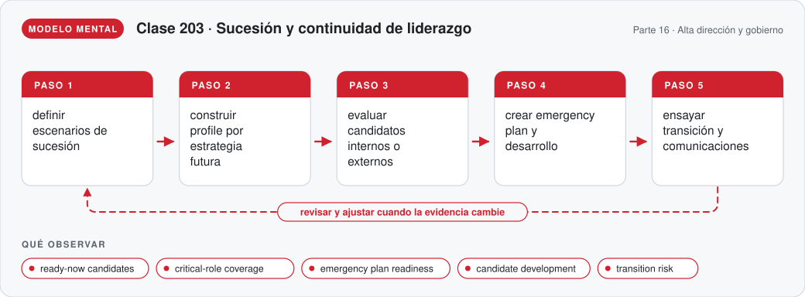

# Clase 203 — Sucesión y continuidad de liderazgo

<!-- nav:inicio -->
> **Parte 16 · Alta dirección y oficina del CEO** — clase 11 de 12 · [índice de la parte](../../README.md) · [temario](../../../../SYLLABUS.md)
<!-- nav:fin -->

**Parte:** 16 — Alta dirección y oficina del CEO  
**Nivel:** Etapa 5 — Director → CEO  
**Duración sugerida:** 150–180 minutos · **Estándar:** deep-class-v2

## 🎯 Propósito

La decisión más importante de un directorio es quién dirige la empresa, y es una de las que peor se prepara. Muchas veces se activa tarde: el CEO anuncia su retiro con pocos meses de anticipación, o sufre un accidente o una enfermedad, o el directorio decide cambiarlo por desempeño, y recién entonces se pregunta quiénes podrían reemplazarlo, qué necesita la empresa en los próximos años y qué hacer mientras tanto. Sin preparación, se elige por urgencia, por simpatía o por temor al cambio, o se contrata a un externo brillante cuya cultura no calza. La sucesión es una de las mayores fuentes de riesgo de continuidad, y también una de las grandes oportunidades de renovación.

La clase se apoya en el enfoque de Charan sobre el papel del directorio en las decisiones de sucesión, en el estudio de Botelho y colaboradores sobre conductas de CEO exitosos, en el modelo de pasajes de liderazgo de Charan, Drotter y Noel, en la visión de Collins sobre el liderazgo de las empresas que sostienen resultados y en el gobierno corporativo de Tricker. Al terminar sabrás distinguir sucesión planificada de sucesión de emergencia, definir el perfil según la estrategia futura, evaluar candidatos internos y externos con criterios explícitos, preparar un plan de emergencia, ensayar la transición y cuidar la confidencialidad sin anunciar un heredero ni congelar la estrategia.

## 📚 Resultados de aprendizaje

Al finalizar podrás:

1. **Distinguir** escenarios de sucesión: planificada, de emergencia y por desempeño.
2. **Construir** el perfil del próximo CEO a partir de la estrategia futura.
3. **Evaluar** candidatos internos y externos con criterios, pesos y evidencia.
4. **Preparar** un plan de emergencia y ensayar la transición.
5. **Gestionar** la confidencialidad, la comunicación y el desarrollo de candidatos.

## 🧭 Agenda

| Tramo | Qué se hace |
|---|---|
| 0–20 min | Recuperación: si el CEO de tu empresa no pudiera trabajar mañana, ¿quién decide qué en las primeras 48 horas? |
| 20–60 min | Escenarios, perfil, evaluación, emergencia, transición y confidencialidad. |
| 60–105 min | Ejemplo trabajado: evaluación de cuatro candidatos y prueba de sensibilidad. |
| 105–150 min | Caso ejecutivo y práctica. |
| 150–175 min | Límites y entregable. |

## 🧩 Conceptos centrales

| Concepto | Definición | Cómo se reconoce |
|---|---|---|
| **Sucesión planificada** | Relevo organizado del CEO con tiempo y proceso. | Directorio, perfil, evaluación y transición. |
| **Sucesión de emergencia** | Plan para cubrir la salida repentina del CEO. | Define quién asume, con qué poderes y por cuánto tiempo. |
| **Perfil del sucesor** | Conjunto de capacidades que la empresa necesitará. | Se deriva de la estrategia futura. |
| **Candidato listo ahora** | Persona que podría asumir de inmediato con alta probabilidad de éxito. | Hay evidencia de desempeño y de conductas. |
| **CEO interino** | Persona que dirige de forma transitoria mientras se decide el relevo. | Tiene mandato y plazo claros. |
| **Transición** | Período de traspaso de la información, relaciones y decisiones. | Con plan y reglas de coordinación. |

## 🧠 Modelo mental

**Cómo leer el diagrama.** Tres columnas. **Emergencia**: quién asume si el CEO falta de repente, poderes, firmas y comunicaciones definidos, actualización cada seis meses. **Planificada**: perfil según la estrategia futura, candidatos internos y externos evaluados, proceso del directorio con plazos. **Desarrollo continuo**: asignaciones que preparan a candidatos, cobertura de cargos críticos y revisión anual del banco de talento. La nota afirma que la sucesión no es un nombre en un sobre sino un sistema que mantiene opciones, criterios y desarrollo; el pie, que la confidencialidad se gradúa.

## 📖 Desarrollo

### 1. El directorio es el dueño

Charan sostiene que la sucesión del CEO es una responsabilidad **del directorio**, no del CEO en funciones, y que debe tratarse como un proceso continuo y no como un evento. El directorio necesita **tiempo**, **información** y **conocimiento directo** de los candidatos, incluso fuera de las presentaciones formales. Tricker recuerda que el gobierno corporativo asigna al directorio funciones de nombramiento, evaluación y relevo de la alta dirección. Un directorio que solo ve a los candidatos en presentaciones de 30 minutos decide con poca información. Se agenda **al menos una revisión anual** del plan de sucesión, con acceso a candidatos internos mediante asignaciones, visitas y conversaciones, y con la posibilidad de evaluar alternativas externas.

### 2. Tres escenarios

Se distinguen: la **sucesión planificada** (el CEO se retira o rota en un plazo conocido, 18 a 36 meses), la **sucesión de emergencia** (salida repentina por salud, accidente, renuncia súbita o conflicto) y la **sucesión por desempeño** (el directorio decide un cambio porque los resultados o la conducta no son aceptables). Cada una requiere un diseño distinto: la planificada permite un proceso completo; la de emergencia exige un plan **preparado**, de ejecución inmediata; la de desempeño requiere un proceso delicado, con asesoría legal y con cuidado de la confidencialidad y del impacto en el mercado y en el equipo. Lo habitual es no tener ninguno de los tres preparado.

### 3. El perfil sale de la estrategia

Antes de mirar candidatos se pregunta: ¿qué necesitará esta empresa en los próximos cinco a diez años? Si la estrategia exige una transformación, se buscarán capacidades de cambio; si exige consolidar y mejorar la eficiencia, serán otras; si exige abrir mercados, otras. Botelho y colaboradores reportan que las conductas asociadas con el éxito de los CEO no siempre coinciden con las características que se suelen buscar por tradición o intuición (por ejemplo, carisma o una trayectoria prestigiosa); sugieren evaluar **conductas observables** como la capacidad de decidir con rapidez, de adaptarse y de cumplir de manera confiable. Collins, por su parte, describe líderes de empresas con resultados sostenidos como personas que combinan ambición por la organización con humildad personal, un rasgo que no se aprecia fácilmente en entrevistas. El perfil se escribe con criterios, pesos y evidencias esperadas.

### 4. Evaluar candidatos con rigor

El proceso de evaluación contempla: **criterios** del perfil con pesos acordados antes de ver a los candidatos; **evidencia** (resultados, conductas observadas, referencias estructuradas, asignaciones de prueba, evaluaciones externas); **comparación** entre candidatos internos y externos con los mismos criterios; **revisión de sesgos** (preferencia por semejantes, por el último que se vio, por la narrativa más fluida); y **opiniones independientes** de los directores antes de discutir. Los candidatos internos aportan conocimiento de la cultura y continuidad; los externos aportan perspectiva fresca y capacidades nuevas, con mayor incertidumbre de ajuste. No hay una regla universal: depende del perfil y del estado de la empresa. Se evita decidir por «es el que más se parece a nuestro CEO».

### 5. El plan de emergencia

Un **plan de emergencia** responde, por escrito y con fechas de actualización: ¿quién asume de forma interina y con qué **poderes** (firmas, autorizaciones bancarias, representación legal)?, ¿quién lo apoya?, ¿cómo se **comunica** a empleados, clientes, inversionistas, autoridades y medios?, ¿qué decisiones se aplazan?, ¿cuál es el **plazo** del interinato y cómo se inicia el proceso formal? También considera la **cobertura de otros cargos críticos** (clase 201). El plan se **ensaya** con un ejercicio de mesa y se revisa cada seis meses; los poderes y las firmas se verifican con asesoría legal y conforme a los estatutos y a la ley aplicables.

### 6. Desarrollo continuo de candidatos

La mejor forma de reducir el riesgo de sucesión es **desarrollar a varios candidatos** con asignaciones que amplíen su alcance: responsabilidad por resultados de un negocio, relación con el directorio, liderazgo de un cambio, experiencia en otra función o geografía. Se acompañan con retroalimentación honesta y se evalúa su desempeño en esas asignaciones. Se evita crear un **heredero designado** demasiado pronto: los demás candidatos se desmotivan, el elegido puede acomodarse, y la estrategia se congela por la sombra del relevo. Se mantienen **opciones abiertas**, se comunica con transparencia el proceso de desarrollo a las personas involucradas y se acepta que algunos candidatos se vayan.

### 7. Transición, comunicación y confidencialidad

Una buena transición incluye: **traspaso** de información y relaciones clave, **coordinación** entre el CEO saliente y el entrante (con reglas claras sobre quién decide qué durante el período), **comunicación** coherente a empleados, clientes, inversionistas y autoridades, y un **plan para los primeros 100 días** del nuevo CEO (clase 204). El CEO saliente puede quedar como asesor o directivo, con límites para no debilitar al nuevo. La **confidencialidad** se gradúa: el directorio conoce todo; los candidatos, lo que corresponde a su situación; la organización, lo necesario para cumplir sus funciones; en empresas abiertas a bolsa, los deberes de información al mercado se verifican con asesoría y la normativa vigente. Se cuidan los **efectos** en el equipo: la salida de candidatos no elegidos requiere acompañamiento.

## 📚 Lectura comparada

| Obra | Qué aporta | Qué no resuelve | Pregunta para contrastar |
|---|---|---|---|
| Charan (*Boards That Deliver*) | Sucesión como responsabilidad del directorio y proceso continuo. | No fija criterios específicos de cada empresa. | ¿Qué sabe el directorio de los candidatos? |
| Botelho y otros | Conductas observables de CEO exitosos y mitos del perfil. | Datos de una consultora. | ¿Evaluamos conductas o estereotipos? |
| Charan, Drotter y Noel | Pasajes y preparación para niveles superiores. | Modelo general. | ¿Quién está listo para el pasaje a CEO? |
| Collins | Liderazgo con ambición por la organización y humildad. | Críticas por selección de casos. | ¿Cómo evidenciamos humildad y ambición? |
| Tricker | Funciones del directorio en nombramientos y relevo. | No es específico de sucesión. | ¿Qué dicen los estatutos y la política del directorio? |

## 🧮 Ejemplo trabajado

**Situación (hipotética).** El directorio de una empresa de 3.200 personas prepara el relevo del CEO, que se retirará en 18 meses. Hay cuatro candidatos: A (directora financiera), B (director de operaciones), C (jefe de la mayor división) y D (candidato externo). Los criterios y pesos acordados antes de ver a los candidatos son: ajuste con la estrategia futura (25 %), historial de ejecución (20 %), liderazgo de líderes (15 %), credibilidad con el directorio y partes interesadas (15 %), adaptabilidad y continuidad cultural (15 %) y preparación (tiempo hasta lograr impacto) (10 %). Se puntúa de 1 a 5 con evidencia por escrito.

**Puntuaciones y totales.**

| Criterio (peso) | A | B | C | D |
|---|---|---|---|---|
| Ajuste con la estrategia (25 %) | 3 | 4 | 5 | 4 |
| Ejecución (20 %) | 5 | 4 | 3 | 3 |
| Liderazgo de líderes (15 %) | 3 | 4 | 3 | 4 |
| Credibilidad (15 %) | 4 | 3 | 3 | 3 |
| Adaptabilidad y cultura (15 %) | 4 | 4 | 3 | 3 |
| Preparación (10 %) | 5 | 4 | 2 | 2 |
| **Total ponderado** | **3,90** | **3,85** | **3,40** | **3,30** |

(Cálculo de A: 0,25×3 + 0,20×5 + 0,15×3 + 0,15×4 + 0,15×4 + 0,10×5 = 0,75 + 1,00 + 0,45 + 0,60 + 0,60 + 0,50 = 3,90. Cálculo de B: 1,00 + 0,80 + 0,60 + 0,45 + 0,60 + 0,40 = 3,85.)

**Prueba de sensibilidad.** Si el directorio sube el peso del ajuste con la estrategia a 30 % y baja el de ejecución a 15 %: A = 0,90 + 0,75 + 0,45 + 0,60 + 0,60 + 0,50 = 3,80; B = 1,20 + 0,60 + 0,60 + 0,45 + 0,60 + 0,40 = 3,85. El orden entre A y B **se invierte**: la diferencia (0,05) es menor que el error de la evaluación.

**Lectura.** El puntaje no decide: ordena y revela que A y B están empatados. El directorio decide profundizar con más evidencia: una asignación de 12 meses con responsabilidades ampliadas para ambos, un caso estratégico presentado al directorio y referencias estructuradas con clientes y pares. Para C se identifican brechas de preparación (2) y se diseña un plan de desarrollo; D se mantiene como referencia externa.

**Plan de emergencia.** Si el CEO falta de repente, asume como interino el director de operaciones (B) por un máximo de 6 meses; el presidente del directorio asume la relación con inversionistas y autoridades; los poderes y firmas están registrados y verificados con asesoría legal; el comunicado a empleados y clientes está redactado y se envía en 24 horas; el proceso formal de sucesión se activa en 30 días. Se ensaya en un ejercicio de mesa de dos horas y se actualiza cada seis meses.

**Cobertura.** De 40 cargos críticos, 17 (42,5 %) tienen al menos un sucesor listo ahora; la meta a 24 meses es 70 %. Si C se retira por no ser elegido, el plan de retención se evalúa con criterios y no como privilegio opaco.

**Cuidados.** La comunicación a candidatos no elegidos y los acuerdos de salida o retención se verifican con asesoría laboral; los deberes de información al mercado y los poderes de representación se consultan en la normativa y los estatutos vigentes; las cifras son ilustrativas.

**Qué muestra.** (1) Los criterios se fijaron antes de ver a los candidatos. (2) La sensibilidad mostró que el orden no era robusto. (3) El plan de emergencia no depende del proceso planificado.

## 🔀 Comparación y límites

**Sucesión frente a pipeline.** El pipeline desarrolla líderes en todos los niveles; la sucesión del CEO es una decisión del directorio sobre un cargo único. Se retroalimentan, pero no son lo mismo.

**Límites.** Un plan de sucesión no debe anunciar un heredero de forma prematura ni congelar la estrategia. Las evaluaciones por puntajes dan una apariencia de precisión mayor que la real. Los estudios sobre CEO provienen de muestras y consultoras específicas. Las normas societarias, de información al mercado y laborales varían y se verifican con asesoría. Las cifras del ejemplo son ilustrativas.

## 🪜 De profesional a owner

| Nivel | Cómo participa en la sucesión |
|---|---|
| **Profesional** | Documenta su conocimiento para que su trabajo no dependa de él. |
| **Jefe / Team Lead** | Prepara a un reemplazo para su cargo. |
| **Gerente** | Mantiene sucesores y participa en las revisiones de talento. |
| **CEO / Director** | Prepara su propio relevo con el directorio y facilita la transición. |
| **Founder / Owner** | Decide cómo separar la propiedad de la gestión y cuándo soltar el mando. |

## 🏢 Caso ejecutivo

Una empresa de energía con 2.100 personas, controlada por una familia y con un directorio de siete miembros, tiene a su CEO fundador de 67 años en funciones desde hace 22 años. Nunca se habló de sucesión; el directorio sabe poco de los ejecutivos, pues el CEO les presenta pocos. Hay tres candidatos internos: la directora de operaciones (44 años), con excelente ejecución pero poca experiencia con el directorio; el director comercial (51), carismático y apoyado por la familia; y la gerente general de una filial (39), con un cambio exitoso y sin relación con la matriz. Un headhunter propone dos externos. El CEO dice que «el sucesor es el director comercial» y lo ha estado presentando así a clientes. Hace un mes sufrió un accidente doméstico y estuvo siete días ausente; durante ese lapso, los bancos pidieron firmas que nadie podía dar y una negociación importante se detuvo. La familia está dividida entre profesionalizar o mantener el control.

Entrega un **plan de sucesión y continuidad** que contenga: (a) los tres escenarios y el plan de emergencia con poderes, firmas y comunicación; (b) el perfil del próximo CEO derivado de la estrategia a diez años; (c) el proceso de evaluación con criterios, pesos, evidencias, control de sesgos y sensibilidad; (d) el desarrollo de candidatos internos y el uso de candidatos externos; (e) el tratamiento de la situación del director comercial y del CEO fundador, la transición y la confidencialidad; (f) los roles del directorio y de la familia, y las verificaciones legales y societarias.

## 🧪 Práctica

1. Redacta un plan de emergencia de una página para el cargo de CEO de tu empresa.
2. Escribe el perfil del próximo CEO a partir de la estrategia a cinco años, con criterios y pesos.
3. Evalúa a tres candidatos hipotéticos con una matriz y haz una prueba de sensibilidad.
4. Diseña dos asignaciones de desarrollo para un candidato interno.
5. Redacta el comunicado a empleados y clientes de una salida repentina del CEO.

## ⚠️ Errores frecuentes

| Error | Por qué ocurre | Cómo corregirlo |
|---|---|---|
| Sucesión como evento | Se pospone hasta que es urgente | Proceso continuo y revisión anual. |
| Heredero designado temprano | Se busca certeza | Mantener opciones y desarrollo de varios. |
| Perfil por tradición | Se busca parecido con el actual | Derivarlo de la estrategia futura. |
| Evaluar por simpatía | Falta evidencia | Criterios, pesos y evidencias antes de ver candidatos. |
| Sin plan de emergencia | Se piensa que no ocurrirá | Plan escrito, ensayado y actualizado. |
| Confidencialidad total o nula | No se gradúa | Definir quién sabe qué y por qué. |

## ❓ Preguntas de comprobación

1. ¿Quién es el dueño de la sucesión del CEO y por qué?
2. ¿Qué tres escenarios de sucesión se distinguen?
3. ¿De dónde sale el perfil del próximo CEO?
4. ¿Qué elementos tiene una evaluación rigurosa de candidatos?
5. ¿Qué debe contener un plan de emergencia?
6. ¿Por qué no conviene designar un heredero demasiado pronto?
7. ¿Qué límites tienen las evaluaciones con puntajes?

Claves de respuesta

1. El directorio, porque tiene la función de nombrar, evaluar y relevar a la alta dirección y debe tratarla como un proceso continuo.
2. Planificada, de emergencia y por desempeño.
3. De la estrategia futura de la empresa y de las capacidades que necesitará.
4. Criterios y pesos previos, evidencia, comparación con los mismos criterios, control de sesgos y opiniones independientes.
5. Quién asume y con qué poderes, firmas y representación, comunicación, decisiones aplazadas, plazo del interinato y cómo se activa el proceso formal, con ensayos y actualización.
6. Desmotiva a otros candidatos, puede acomodar al elegido y congela la estrategia; se pierden opciones.
7. Dan una apariencia de precisión mayor que la real y el orden puede cambiar con pequeñas variaciones de peso.

## 📥 Entregable

Guarda en `portfolio/203-sucesion-y-continuidad-de-liderazgo/`:

- `people-decision-brief.md` (plantilla [People decision brief](../../../../templates/people-decision-brief.md)) con el plan del caso ejecutivo;
- `board-or-executive-memo.md` (plantilla [Board or executive memo](../../../../templates/board-or-executive-memo.md)) con el informe al directorio sobre el perfil, la evaluación y el plan de emergencia;
- `decision-journal.md` con los criterios, las evidencias, la sensibilidad y las verificaciones pendientes.

## 📗 Fuentes y verificación

- Ram Charan — *Boards That Deliver* (John Wiley & Sons, Incorporated, 2007). **Uso en esta clase:** sucesión como responsabilidad del directorio y proceso continuo. Lectura selectiva sobre **sucesión y continuidad de liderazgo**. **Localizador:** [ISBN-13 9781118046616](https://openlibrary.org/isbn/9781118046616).
- Elena L. Botelho, Kim R. Powell & Tahl Raz — *The CEO Next Door* (Currency, 2018). **Uso en esta clase:** conductas observables de los CEO exitosos y mitos del perfil. Lectura selectiva sobre **sucesión y continuidad de liderazgo**. **Localizador:** [ISBN-13 9781101906491](https://openlibrary.org/isbn/9781101906491).
- Ram Charan, Stephen Drotter & James Noel — *The Leadership Pipeline* (Jossey-Bass, 2000). **Uso en esta clase:** pasajes y preparación para niveles superiores. Lectura selectiva sobre **sucesión y continuidad de liderazgo**. **Localizador:** [ISBN-13 9780787951726](https://openlibrary.org/isbn/9780787951726).
- Jim Collins — *Good to Great* (HarperBusiness, 2001). **Uso en esta clase:** liderazgo con ambición por la organización y humildad. Lectura selectiva sobre **sucesión y continuidad de liderazgo**. **Localizador:** [ISBN-13 9780066620992](https://openlibrary.org/isbn/9780066620992).
- Bob Tricker — *Corporate Governance* (Oxford University Press, 2019). **Uso en esta clase:** funciones del directorio en nombramientos y relevo. Lectura selectiva sobre **sucesión y continuidad de liderazgo**. **Localizador:** [ISBN-13 9780198809869](https://openlibrary.org/isbn/9780198809869).

> **Regla de fuentes para Sucesión y continuidad de liderazgo:** las obras anteriores estructuran las perspectivas de esta materia; cualquier norma, ley o estándar vivo mencionado debe comprobarse nuevamente en su fuente primaria vigente, incluidos los estatutos, los deberes de información al mercado, los poderes de representación y las normas laborales. Los ejemplos y casos son hipotéticos, con cifras ilustrativas. El desarrollo es original y no reproduce capítulos protegidos.

<!-- pie:inicio -->
---

| Anterior | Índice | Siguiente |
|---|---|---|
| [← 202 · Crisis y decisiones irreversibles](../202-crisis-y-decisiones-irreversibles/README.md) | [Parte 16](../../README.md) · [Programa](../../../../SYLLABUS.md) | [204 · Capstone: primeros 100 días como CEO →](../204-capstone-primeros-100-dias-como-ceo/README.md) |
<!-- pie:fin -->
