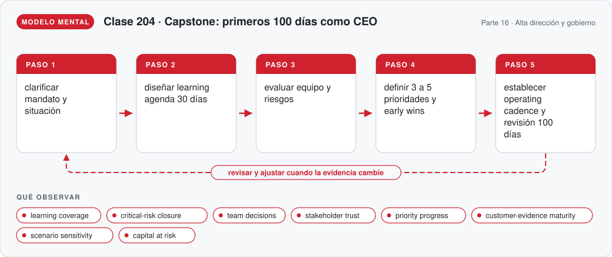

# Clase 204 — Capstone: primeros 100 días como CEO

<!-- nav:inicio -->
> **Parte 16 · Alta dirección y oficina del CEO** — clase 12 de 12 · [índice de la parte](../../README.md) · [temario](../../../../SYLLABUS.md)
<!-- nav:fin -->

**Parte:** 16 — Alta dirección y oficina del CEO  
**Nivel:** Etapa 5 — Director → CEO  
**Duración sugerida:** 150–180 minutos · **Estándar:** deep-class-v2

## 🎯 Propósito

Los primeros cien días de un CEO son una ventana de legitimidad: el directorio espera señales, el equipo observa cada gesto, los clientes y los inversionistas se preguntan qué cambiará y la propia organización está dispuesta a escuchar lo que en otro momento ignoraría. Pero también son un período de alto riesgo: se toman decisiones con información incompleta, se crean impresiones que duran años y se agota rápido el capital político si se actúa sin entender. El capstone integra la parte 16 en un **plan de transición**: un mandato claro, una agenda de aprendizaje, una evaluación del equipo y de los riesgos, tres a cinco prioridades con victorias tempranas y una cadencia de gobierno que sobreviva a la euforia inicial.

El trabajo es un **paquete de decisión integrado**: se apoya en Watkins sobre transiciones, en Gabarro sobre la toma de mando, en Charan sobre lo que el CEO debe dominar, en Botelho y colaboradores sobre conductas de CEO exitosos y en Horowitz sobre las duras decisiones del cargo. Combina las clases anteriores: transición (193), perspectiva de empresa (194), equipo ejecutivo (195), arquitectura de decisiones (196), agenda (197), capital y talento (198), balance entre partes (199), comunicación (200), pipeline (201), crisis (202) y sucesión (203). Al terminar tendrás un documento que podrías presentar al directorio.

## 📚 Resultados de aprendizaje

Al finalizar podrás:

1. **Clarificar** el mandato, las expectativas y las restricciones con el directorio.
2. **Diseñar** una agenda de aprendizaje de 30 días y medir su cobertura.
3. **Evaluar** al equipo y los riesgos críticos y decidir qué se cierra primero.
4. **Definir** tres a cinco prioridades con victorias tempranas y capital, dueños y revisión.
5. **Establecer** una cadencia operativa, una comunicación y un plan de ajuste.

## 🧭 Agenda

| Tramo | Qué se hace |
|---|---|
| 0–20 min | Recuperación: ¿qué crees que el directorio espera de un CEO nuevo en los primeros noventa días y qué no se ha dicho? |
| 20–60 min | Mandato, aprendizaje, equipo y riesgos, prioridades, cadencia y comunicación. |
| 60–105 min | Ejemplo trabajado: plan de 100 días con diagnóstico integrado y cálculo de impacto. |
| 105–150 min | Caso ejecutivo y práctica. |
| 150–175 min | Límites y entregable. |

## 🧩 Conceptos centrales

| Concepto | Definición | Cómo se reconoce |
|---|---|---|
| **Mandato de transición** | Lo que el directorio y la empresa esperan lograr con el nuevo CEO. | Resultados, plazos y límites acordados. |
| **Plan de aprendizaje** | Estrategia para entender rápido mercado, clientes, números, personas y riesgos. | Preguntas, entrevistas y datos con cobertura. |
| **Riesgo crítico** | Amenaza grave que no puede esperar. | Se identifica en la primera etapa y se cierra o se mitiga. |
| **Prioridad** | Objetivo de alto impacto con dueño, recursos y métrica. | Entre tres y cinco, no más. |
| **Victoria temprana** | Resultado visible y creíble en poco tiempo. | Refuerza la confianza sin hipotecar el futuro. |
| **Cadencia operativa** | Ritmo de reuniones, revisiones y comunicación. | Calendario fijo y decisiones registradas. |

## 🧠 Modelo mental

**Cómo leer el diagrama.** Una cadena de cinco etapas con retorno. **Mandato y situación**: qué esperan el directorio y la empresa. **Aprender en 30 días**: clientes, números, personas y riesgos. **Equipo y riesgos**: evaluar el equipo y cerrar los riesgos críticos. **Tres a cinco prioridades**: primeras victorias y cambios estructurales. **Cadencia operativa**: ritmo de decisiones, revisión y comunicación. La flecha indica que lo aprendido ajusta el plan. La nota advierte que los 100 días son una convención y que el plan sigue a la evidencia.

## 📖 Desarrollo

### 1. Mandato: antes de actuar, acordar qué se espera

El CEO nuevo empieza con una serie de conversaciones con el directorio, y con los accionistas o propietarios, para fijar: **resultados esperados** y plazos, **restricciones** (capital, personas, compromisos con terceros, apetito de riesgo), **áreas intocables** y **qué se considera éxito en 12 y 36 meses**. Watkins propone diagnosticar el tipo de situación (empezar, dar vuelta, acelerar, realinear o sostener) porque determina el estilo y el ritmo: en un giro se actúa con rapidez en caja y costos; en una situación de éxito sostenido, se tiene cuidado con no romper lo que funciona. Gabarro muestra que los ejecutivos que logran una buena toma de mando dedican tiempo inicial a aprender y a construir relaciones antes de reorganizar. Se escribe el mandato en una página y se confirma con el presidente del directorio.

### 2. Aprender en 30 días: cobertura y calidad

La agenda de aprendizaje se organiza por **preguntas**: ¿dónde gana y pierde dinero la empresa?, ¿qué valoran y qué critican los clientes?, ¿qué ocurre en el mercado y qué hacen los competidores?, ¿qué capacidades tiene y cuáles faltan?, ¿cómo decide la organización?, ¿qué riesgos están latentes?, ¿quién es quién en el equipo? Se cubre con **fuentes diversas**: clientes (incluidos los que se fueron), proveedores y socios, empleados de primera línea, líderes de segunda línea, directorio, analistas externos, datos financieros y operativos. Charan insiste en que el CEO debe dominar cómo gana dinero la empresa y por qué: si no puede explicarlo en términos simples, aún no la entiende. Se mide la **cobertura** (porcentaje de personas y fuentes previstas realmente consultadas) y se evita el sesgo de escuchar solo a quien está cerca.

### 3. Equipo y riesgos críticos

En las primeras semanas se evalúa **al equipo directivo**: ¿tiene las capacidades que exige la estrategia?, ¿hay confianza?, ¿quiénes son críticos y están en riesgo de irse?, ¿hay roles ambiguos? Se decide con **criterios y evidencia**, no por impresión; los cambios importantes de personas se toman con cuidado porque son visibles e irreversibles (clase 202). Se identifican los **riesgos críticos** (financieros, de clientes, legales, de seguridad, de continuidad, de cumplimiento) y se decide cuáles se **cierran**, cuáles se **mitigan** y cuáles se **aceptan** conscientemente (clase 181). Se verifican con asesoría las contingencias legales y laborales; no se anuncia nada irreversible sin haber entendido el contexto.

### 4. Tres a cinco prioridades

Con el diagnóstico, el CEO fija **tres a cinco prioridades** (más son un deseo, no un plan). Cada una tiene: un **dueño**, un **objetivo medible**, un **horizonte**, **capital y talento** asignados (clase 198), **riesgos** y **un indicador adelantado**. Se aplican las ideas de la parte: se piensa a nivel empresa (clase 194), se decide con una arquitectura clara (clase 196), se equilibran las partes interesadas (clase 199) y se protege la agenda (clase 197). Se distinguen **victorias tempranas** (resultados visibles en 30 a 100 días, que dan confianza y financian el cambio) de **cambios estructurales** (que requieren más tiempo y capital político). Horowitz advierte de que el CEO debe estar dispuesto a tomar decisiones impopulares con claridad sobre lo que no sabe.

### 5. Cadencia operativa y comunicación

Un plan sin cadencia se evapora. Se establece el **ritmo de gobierno**: reunión semanal del equipo ejecutivo, revisión mensual de las prioridades con indicadores, informe trimestral al directorio, y una **comunicación regular** a la organización (clase 200) con mensajes coherentes: qué se aprendió, qué se decidió, qué no se sabe y qué viene. Se define el **registro de decisiones**, la **revisión de riesgos** y el uso del tiempo del CEO. Botelho y colaboradores observan que los CEO efectivos combinan decisión con **compromiso con las partes interesadas**; la comunicación es el mecanismo. Se evita el error de anunciar un «plan estratégico» detallado a los 30 días y de ignorar al directorio entre sesiones.

### 6. Sucesión y pipeline desde el primer día

Un CEO nuevo suele ignorar su propio relevo. Sin embargo, desde los primeros meses conviene: **conocer el banco de talento** (clase 201), identificar **cargos críticos sin cobertura**, **documentar el plan de emergencia** (clase 203) y **empezar a desarrollar** a los futuros líderes. También conviene definir su propio **sistema de apoyo**: un consejero externo, un jefe de gabinete, un círculo de pares de otras empresas y un espacio para aprender de los errores sin exponerse. La soledad del CEO es real y afecta la calidad de las decisiones.

### 7. Evaluar el plan a los 100 días

A los cien días se revisa con el directorio: **cobertura del aprendizaje** (qué se cumplió y qué se aprendió), **cierre de riesgos críticos**, **decisiones del equipo** (cuántas se tomaron y cuántas se reabrieron), **avance de las prioridades** con sus indicadores, **estado del equipo** (cambios, confianza, retención de personas críticas), **resultados de las victorias tempranas** y **lo que se corrige**. Se actualiza el plan a 12 meses, con los supuestos validados o descartados. Y se hace una **autoevaluación honesta**: ¿qué hice distinto de lo planificado?, ¿qué subestimé?, ¿qué no me han dicho? Los 100 días son una convención: en crisis se decide antes y en negocios complejos algunas conclusiones requieren más tiempo.

## 📚 Lectura comparada

| Obra | Qué aporta | Qué no resuelve | Pregunta para contrastar |
|---|---|---|---|
| Watkins | Diagnóstico del tipo de situación y plan de transición. | Marco general. | ¿Qué tipo de situación enfrento? |
| Gabarro | Etapas de la toma de mando y aprendizaje antes de reorganizar. | Casos de su época. | ¿Cuánto aprendí antes de decidir? |
| Charan | Lo que el CEO debe dominar y lo que espera de los ejecutivos. | Visión de práctica. | ¿Puedo explicar cómo gana dinero la empresa? |
| Botelho y otros | Conductas asociadas al éxito de los CEO. | Datos de una consultora. | ¿Decido con rapidez y me comprometo con las partes? |
| Horowitz | Decisiones difíciles y duras del cargo. | Experiencia de un fundador. | ¿Estoy decidiendo con claridad sobre lo que no sé? |

## 🧮 Ejemplo trabajado

**Situación (hipotética).** Un CEO nuevo asume una empresa de servicios B2B de 1.900 personas, con ventas de 70.000 millones de pesos, EBITDA de 4.900 millones (7 %), deuda neta de 6.000 millones (1,2 veces el EBITDA) y un mandato del directorio: «recuperar crecimiento y margen en 24 meses sin comprometer la caja».

**Plan de aprendizaje de 30 días.** 45 conversaciones: 12 clientes (incluidos 3 que se fueron), 10 empleados de primera línea, 8 entre directorio y socios, 10 líderes y 5 externos. Se completan 42 (93,3 % de cobertura; 42 ÷ 45).

**Diagnóstico integrado.**

| Pregunta | Hallazgo (hipotético) |
|---|---|
| Mercado | El mercado crece 6 % al año; la empresa, 2 %: pierde participación |
| Clientes | Los 10 mayores suman 48 % de las ventas (33.600 millones); dos de ellos (12 % de las ventas: 8.400 millones) evalúan alternativas |
| Modelo de negocio | 70 % de las ventas son servicios recurrentes y 30 % proyectos con margen bajo |
| Economía | Descuentos de 4 % de las ventas (2.800 millones); capital de trabajo de 68 días frente a 55 de comparables |
| Alianzas | Un proveedor crítico concentra 14.000 millones de gasto anual y su contrato vence en 11 meses |
| Proyección sin cambios | EBITDA esperado del próximo año: 4.350 millones (−11 %) |

**Riesgos críticos.** Pérdida de dos clientes grandes; vencimiento del contrato del proveedor; pérdida de dos gerentes clave; un incumplimiento de la política de descuentos. De 11 riesgos identificados, 8 se cierran o mitigan en los 100 días (72,7 %; 8 ÷ 11).

**Prioridades.** 1) Defender a los 10 mayores clientes; 2) disciplina de descuentos; 3) renegociar el contrato del proveedor antes del vencimiento; 4) liberar capital de trabajo; 5) fortalecer el equipo comercial. Cada una con dueño, métrica y revisión.

**Impacto anual estimado en EBITDA (supuestos hipotéticos).**

| Prioridad | Cálculo | Efecto (millones) |
|---|---|---|
| Defender clientes | Clientes en riesgo: 8.400 millones de ventas con margen de contribución de 25 %. Probabilidad de pérdida sin acción 36 %: 0,36 × 8.400 × 0,25 = 756. Con acción 15 %: 0,15 × 8.400 × 0,25 = 315. Mejora: 756 − 315 | +441 |
| Disciplina de descuentos | Reducir 20 % de los descuentos (0,20 × 2.800 = 560) y retener 70 % del efecto por negocios que se pierden: 0,70 × 560 | +392 |
| Proveedor | Renegociar 3 % del gasto de 14.000 | +420 |
| Costo del plan | Equipo comercial y gestión del cambio | −300 |
| **Efecto neto** | 441 + 392 + 420 − 300 | **+953** |

**Resultado esperado.** EBITDA = 4.350 + 953 = 5.303 millones, un margen de 7,6 % (5.303 ÷ 70.000), frente a 7 % hoy y 6,2 % en la proyección sin cambios (4.350 ÷ 70.000).

**Capital de trabajo.** Reducir de 68 a 58 días libera 10 días de ventas: 10 × 70.000 ÷ 365 ≈ 1.918 millones de caja, de una sola vez. Se invierten 2.000 millones en capacidades comerciales y de servicio recurrente (dueño: director comercial; revisión a los seis meses); el efecto neto de caja del año es 1.918 − 2.000 = −82 millones, dentro del mandato de no comprometer la caja.

**Victorias tempranas.** Visitas del CEO a los 10 mayores clientes en 45 días; nueva política de aprobación de descuentos en 30 días; programa de capital de trabajo con metas semanales. **Cambios estructurales posteriores:** rediseño de la oferta de proyectos y de la estructura comercial.

**Cadencia.** Reunión semanal del equipo ejecutivo con agenda de decisiones; revisión mensual de prioridades con tablero; informe trimestral al directorio; comunicación quincenal a la organización con lo aprendido, lo decidido y lo que no se sabe.

**Autoevaluación a los 100 días.** Cobertura de aprendizaje: 93,3 %; riesgos críticos cerrados o mitigados: 72,7 %; de 26 decisiones del equipo, 3 se reabrieron (11,5 %); dos gerentes clave retenidos; se identifican 5 cargos críticos sin sucesor.

**Cuidados.** Las decisiones sobre personas y la renegociación de contratos se verifican con asesoría laboral y legal; los cálculos son estimaciones; las cifras son ilustrativas.

**Qué muestra.** (1) El aprendizaje precedió a la acción y se midió su cobertura. (2) Las prioridades se tradujeron en efectos con supuestos visibles. (3) La cadencia y la revisión dieron continuidad.

## 🔀 Comparación y límites

**Capstone frente a un caso individual.** Un caso individual practica una pieza; el capstone exige integrar mandato, aprendizaje, equipo, capital, comunicación y gobierno en un solo plan coherente.

**Límites.** Los 100 días son una convención; el plan debe seguir a la evidencia. Los hallazgos de un diagnóstico rápido pueden ser incompletos. Las probabilidades y los efectos estimados son inciertos. Los estudios de transición provienen de contextos específicos. Las decisiones sobre personas, contratos y comunicaciones al mercado dependen de normas que se verifican con asesoría. Las cifras del ejemplo son ilustrativas.

## 🪜 De profesional a owner

| Nivel | Cómo vive los primeros 100 días |
|---|---|
| **Profesional** | Observa con atención, ofrece datos y se alinea con las prioridades. |
| **Jefe / Team Lead** | Traduce las prioridades al trabajo del equipo. |
| **Gerente** | Es dueño de una prioridad y rinde cuentas en la cadencia. |
| **CEO / Director** | Aprende, decide, forma al equipo y comunica con coherencia. |
| **Founder / Owner** | Acepta que un nuevo CEO cambie cosas que ella o él creó. |

## 🏢 Caso ejecutivo

Una empresa de salud privada con 4.500 personas, ingresos de 240.000 millones de pesos y un margen EBITDA de 6 % nombra a un nuevo CEO tras la salida abrupta del anterior. El directorio pide «estabilizar y crecer». Hechos: tres clínicas pierden dinero (suman 5.200 millones de pérdida anual); la rotación de enfermería es 24 %; hay una investigación pendiente de un regulador por registros clínicos; el principal convenio con una aseguradora (22 % de las ventas) vence en seis meses; el equipo directivo tiene dos vacantes y dos ejecutivos que compitieron por el cargo; una consultora ya preparó un plan de reorganización de 120 diapositivas para anunciar en la primera semana; el área de tecnología advierte de una deuda técnica que afecta la historia clínica; y la empresa tiene un historial de comunicaciones contradictorias. El presidente del directorio quiere «anuncios rápidos» para tranquilizar al mercado.

Entrega un **plan de los primeros 100 días** que contenga: (a) el mandato y el tipo de situación, con los acuerdos que pedirás al directorio; (b) la agenda de aprendizaje con fuentes, cobertura y preguntas; (c) la evaluación del equipo y los riesgos críticos, con decisiones sobre qué cerrar primero; (d) las tres a cinco prioridades con dueños, métricas, capital y talento y las victorias tempranas; (e) el diagnóstico integrado de mercado, cliente, modelo de negocio, economía, alianzas y proyección con cálculo de impacto; (f) la cadencia, la comunicación, la sucesión y las verificaciones legales, regulatorias y laborales pendientes.

## 🧪 Práctica

1. Redacta el mandato de transición en una página y lista tres expectativas que no se han dicho.
2. Diseña un plan de aprendizaje de 30 días con 30 conversaciones y mide su cobertura.
3. Identifica diez riesgos críticos y clasifica cuáles cerrar, mitigar o aceptar.
4. Define cuatro prioridades con dueño, métrica, capital y victoria temprana.
5. Elabora el calendario de cadencia de tus primeros 100 días y el esquema del informe al directorio.

## ⚠️ Errores frecuentes

| Error | Por qué ocurre | Cómo corregirlo |
|---|---|---|
| Anunciar un plan antes de aprender | Presión por mostrar impacto | Aprender primero y anunciar con evidencia. |
| Demasiadas prioridades | Se quiere abarcar todo | Tres a cinco con dueño y métrica. |
| Cambios de personas por impresión | Se actúa por intuición | Criterios y evidencia; cuidado con lo irreversible. |
| Aislarse del directorio | Se confía en la propia lectura | Cadencia de informes y conversación abierta. |
| Ignorar la sucesión | Se piensa en el presente | Banco de talento y plan de emergencia desde el inicio. |
| Comunicación inconsistente | No hay mensajes ordenados | Calendario y mensajes coherentes sobre lo que se sabe y no se sabe. |

## ❓ Preguntas de comprobación

1. ¿Qué se acuerda con el directorio al empezar?
2. ¿Qué preguntas organiza la agenda de aprendizaje y cómo se mide su cobertura?
3. ¿Cómo se decide qué riesgos críticos cerrar primero?
4. ¿Qué debe tener cada prioridad?
5. ¿En qué se diferencian las victorias tempranas de los cambios estructurales?
6. ¿Qué incluye la cadencia operativa?
7. ¿Qué límites tiene el plan de 100 días?

Claves de respuesta

1. Resultados y plazos esperados, restricciones, áreas intocables y definición de éxito a 12 y 36 meses.
2. Dónde gana y pierde dinero, qué valoran los clientes, mercado, capacidades, decisiones, riesgos y equipo; se mide con el porcentaje de fuentes previstas realmente consultadas.
3. Por gravedad, probabilidad, urgencia y irreversibilidad; se cierran los más graves y urgentes, se mitigan los demás y se aceptan conscientemente los restantes.
4. Dueño, objetivo medible, horizonte, capital y talento, riesgos e indicador adelantado.
5. Las primeras dan resultados visibles en poco tiempo y confianza; los segundos requieren más tiempo, capital y apoyo.
6. Reuniones semanales, revisiones mensuales de prioridades, informe trimestral al directorio, comunicación regular, registro de decisiones y revisión de riesgos.
7. Son una convención; los diagnósticos rápidos son incompletos; los efectos estimados son inciertos; las decisiones sobre personas y contratos dependen de normas.

## 📥 Entregable

Guarda en `portfolio/204-capstone-primeros-100-dias-como-ceo/`:

- `integrated-executive-decision-brief.md` (plantilla [Integrated executive decision brief](../../../../templates/integrated-executive-decision-brief.md)) con el plan de 100 días del caso ejecutivo;
- `ceo-dashboard.md` (plantilla [CEO dashboard](../../../../templates/ceo-dashboard.md)) con el tablero de prioridades, riesgos y cadencia;
- `board-or-executive-memo.md` (plantilla [Board or executive memo](../../../../templates/board-or-executive-memo.md)) con el informe al directorio a los 100 días;
- `decision-journal.md` con los hallazgos, los supuestos, las decisiones y la autoevaluación.

## 📗 Fuentes y verificación

- Michael D. Watkins — *The First 90 Days* (Harvard Business School Press, 2003). **Uso en esta clase:** diagnóstico del tipo de situación y plan de transición. Lectura selectiva sobre **capstone: primeros 100 días como ceo**. **Localizador:** [ISBN-13 9781591391104](https://openlibrary.org/isbn/9781591391104).
- John J. Gabarro — *The Dynamics of Taking Charge* (Harvard Business School Press, 1987). **Uso en esta clase:** etapas de la toma de mando y aprendizaje antes de reorganizar. Lectura selectiva sobre **capstone: primeros 100 días como ceo**. **Localizador:** [ISBN-13 9780875841373](https://openlibrary.org/isbn/9780875841373).
- Ram Charan — *What the CEO Wants You to Know* (Crown, 2001). **Uso en esta clase:** lo que el CEO debe dominar y lo que espera de los ejecutivos. Lectura selectiva sobre **capstone: primeros 100 días como ceo**. **Localizador:** [ISBN-13 9780609504239](https://openlibrary.org/isbn/9780609504239).
- Elena L. Botelho, Kim R. Powell & Tahl Raz — *The CEO Next Door* (Currency, 2018). **Uso en esta clase:** conductas asociadas al éxito de los CEO. Lectura selectiva sobre **capstone: primeros 100 días como ceo**. **Localizador:** [ISBN-13 9781101906491](https://openlibrary.org/isbn/9781101906491).
- Ben Horowitz — *The Hard Thing About Hard Things* (HarperCollins Publishers, 2014). **Uso en esta clase:** decisiones difíciles del cargo de CEO. Lectura selectiva sobre **capstone: primeros 100 días como ceo**. **Localizador:** [ISBN-13 9780062273215](https://openlibrary.org/isbn/9780062273215).

> **Regla de fuentes para el Capstone de los primeros 100 días como CEO:** las obras anteriores estructuran las perspectivas de esta materia; cualquier norma, ley o estándar vivo mencionado debe comprobarse nuevamente en su fuente primaria vigente, incluidas las normas laborales, societarias, regulatorias y de información al mercado. Los ejemplos y casos son hipotéticos, con cifras ilustrativas. El desarrollo es original y no reproduce capítulos protegidos.

<!-- pie:inicio -->
---

| Anterior | Índice | Siguiente |
|---|---|---|
| [← 203 · Sucesión y continuidad de liderazgo](../203-sucesion-y-continuidad-de-liderazgo/README.md) | [Parte 16](../../README.md) · [Programa](../../../../SYLLABUS.md) | [205 · Propiedad, administración y gobierno →](../../../17-boards-corporate-governance/classes/205-propiedad-administracion-y-gobierno/README.md) |
<!-- pie:fin -->
