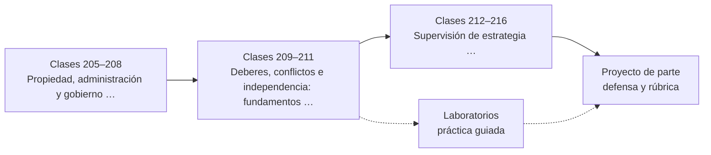

# Parte 17 — Directorios y gobierno corporativo

<!-- parte:inicio -->

> ← [Parte 16 — Alta dirección y oficina del CEO](../16-executive-leadership-ceo-office/README.md) · [Temario](../../SYLLABUS.md) · [Parte 18 — Finanzas corporativas, capital y M&A](../18-corporate-finance-capital-ma/README.md) →

*Entender quién manda, quién controla y quién rinde cuentas*

**Etapa:** 5 — Alta dirección y gobierno  
**Duración:** 12 clases · 30 horas  
**Resultado de salida:** Comprender la relación entre propiedad, directorio, CEO, control y rendición de cuentas.

🔴 [Ver las 6 etapas](../../SYLLABUS.md) · 12 clases (205–216) · 4 laboratorios · [proyecto de parte](project.md)

## 🎯 De qué trata esta parte

El directorio es la institución que separa la propiedad de la administración. Quien llega a CEO o funda una empresa con socios debe entender su funcionamiento, sus deberes y los conflictos que gestiona.

El eje es **supervisar sin administrar**: el directorio hace preguntas, controla y evalúa; no dirige. Cubre comités, deberes, independencia, información, evaluación del CEO y efectividad del propio directorio.

## 🧱 Con qué hay que llegar

| Parte | Qué aporta |
|---|---|
| [16 — Alta dirección y oficina del CEO](../16-executive-leadership-ceo-office/README.md) | El rol del CEO. |
| [15 — Riesgo, legal, compliance, ciberseguridad e IA](../15-risk-legal-compliance-cyber-ai-governance/README.md) | Riesgo y controles. |

Cada clase supone la anterior: el orden importa, y saltarse una deja sin base a las que vienen después.

## 📚 Resultados de la parte

Al terminar esta parte podrás:

1. **Distinguir** propiedad, directorio y administración.
2. **Precisar** el rol del presidente y del CEO.
3. **Explicar** la función de los comités de auditoría, riesgo y compensación.
4. **Gestionar** deberes, conflictos de interés e independencia.
5. **Preparar** un board pack que permita decidir.

## 🗺️ Mapa de la parte

## 🧭 Cómo se encadenan las 12 clases

Las clases **205 a 208** definen la institución: propiedad y gobierno, qué hace un directorio, presidente y CEO, y comités.

Las clases **209 a 211** definen la conducta: deberes y conflictos, información y board pack.

Las clases **212 a 216** definen la supervisión: estrategia, riesgo, evaluación del CEO, efectividad y el capstone de reunión de directorio.

## 📘 Las 12 clases

| # | Clase | Qué se trabaja | Entregable | Min |
|---:|---|---|---|---:|
| 205 | [Propiedad, administración y gobierno](classes/205-propiedad-administracion-y-gobierno/README.md) | Propiedad, Gobierno corporativo, Administración (gerencia) | [board-or-executive-memo](../../templates/board-or-executive-memo.md) | 150 |
| 206 | [Qué hace un directorio](classes/206-que-hace-un-directorio/README.md) | Mandato del directorio, Supervisión (*oversight*), Asesoría | [board-or-executive-memo](../../templates/board-or-executive-memo.md) | 150 |
| 207 | [Rol del presidente y del CEO](classes/207-rol-del-presidente-y-del-ceo/README.md) | Presidente del directorio, Gerente general (CEO), Dualidad | [board-or-executive-memo](../../templates/board-or-executive-memo.md) | 150 |
| 208 | [Comités de auditoría, riesgo y compensación](classes/208-comites-de-auditoria-riesgo-y-compensacion/README.md) | Comité del directorio, Comité de auditoría, Comité de riesgos | [risk-governance-brief](../../templates/risk-governance-brief.md) | 150 |
| 209 | [Deberes, conflictos e independencia: fundamentos](classes/209-deberes-conflictos-e-independencia-fundamentos/README.md) | Deber fiduciario, Conflicto de interés real, Conflicto potencial | [risk-governance-brief](../../templates/risk-governance-brief.md) | 150 |
| 210 | [Información y transparencia](classes/210-informacion-y-transparencia/README.md) | Materialidad, Divulgación (*disclosure*), Fuente única de verdad | [risk-governance-brief](../../templates/risk-governance-brief.md) | 150 |
| 211 | [Board pack y calidad de información](classes/211-board-pack-y-calidad-de-informacion/README.md) | Board pack, Pre-lectura, Resumen ejecutivo | [operating-improvement-brief](../../templates/operating-improvement-brief.md) | 150 |
| 212 | [Supervisión de estrategia](classes/212-supervision-de-estrategia/README.md) | Supervisión estratégica, Supuesto crítico, Escenario | [strategy-memo](../../templates/strategy-memo.md) | 150 |
| 213 | [Supervisión de riesgo y controles](classes/213-supervision-de-riesgo-y-controles/README.md) | Supervisión de riesgos, Control crítico, Aseguramiento independiente | [risk-governance-brief](../../templates/risk-governance-brief.md) | 150 |
| 214 | [Evaluación del CEO y sucesión](classes/214-evaluacion-del-ceo-y-sucesion/README.md) | Evaluación del CEO, Criterios ex ante, Resultados y conductas | [people-decision-brief](../../templates/people-decision-brief.md) | 150 |
| 215 | [Efectividad del directorio](classes/215-efectividad-del-directorio/README.md) | Efectividad del directorio, Mapa de capacidades (*skills matrix*), Conflicto cognitivo | [board-or-executive-memo](../../templates/board-or-executive-memo.md) | 150 |
| 216 | [Capstone: board meeting](classes/216-capstone-board-meeting/README.md) | Agenda del directorio, Documento de decisión, Desafío preparado | [board-or-executive-memo](../../templates/board-or-executive-memo.md) | 150 |

## ⚠️ Riesgos característicos

- Confundir supervisar con administrar.
- Aprobar sin información suficiente.
- Tolerar un conflicto de interés por costumbre.
- Evaluar al CEO solo por resultados de corto plazo.

## 🔤 Glosario de la parte

71 conceptos definidos en las clases, con la definición operacional que usa cada una.

| Concepto | Definición operacional |
|---|---|
| **Acuerdo con condiciones** | Aprobación sujeta a requisitos específicos. |
| **Administración (gerencia)** | Gestión del día a día y ejecución de la estrategia. |
| **Agenda del directorio** | Lista ordenada de temas con tiempos y objetivos. |
| **Ajuste por contexto** | Consideración de factores externos fuera del control del CEO. |
| **Anexo** | Información de apoyo que no se presenta. |
| **Aseguramiento independiente** | Evaluación de los controles por alguien ajeno a quien los opera. |
| **Asesoría** | Aportar experiencia y perspectiva a la gerencia. |
| **Asimetría de información** | Una parte sabe más que otra. |
| **Autoevaluación** | Proceso por el cual el directorio se evalúa a sí mismo. |
| **Board pack** | Conjunto de documentos que se entrega al directorio para una sesión. |
| **Calendario anual** | Plan de temas y decisiones del directorio durante el año. |
| **Calibración** | Ajuste de las evaluaciones individuales hacia un criterio común. |
| **Comité de auditoría** | Supervisa la información financiera, el control interno y la auditoría. |
| **Comité de compensación** | Propone la remuneración y los incentivos de la alta dirección. |
| **Comité de riesgos** | Supervisa el apetito, los riesgos principales y los controles críticos. |
| **Comité del directorio** | Grupo de directores que estudia un tema y recomienda al pleno. |
| **Conflicto cognitivo** | Desacuerdo constructivo sobre ideas y supuestos. |
| **Conflicto de interés real** | Interés personal que choca con el deber hacia la empresa en una decisión concreta. |
| **Conflicto percibido** | Apariencia de conflicto para un observador razonable. |
| **Conflicto potencial** | Situación que podría generar un conflicto real. |
| **Control crítico** | Control cuya falla permitiría que un riesgo mayor se materialice. |
| **Costo de agencia** | Pérdida de valor por el conflicto entre quien decide y quien soporta las consecuencias. |
| **Criterios ex ante** | Objetivos y conductas acordados antes del período. |
| **Deber fiduciario** | Obligación de actuar en el mejor interés de otro, con diligencia y lealtad. |
| **Desafío preparado** | Preguntas anticipadas por uno o más directores. |
| **Director independiente líder** | Director que lidera la independencia cuando el presidente no lo es. |
| **Disidencia registrada** | Constancia de un voto o posición contraria con sus razones. |
| **Diversidad cognitiva** | Variedad de perspectivas y modos de pensar. |
| **Divulgación (*disclosure*)** | Comunicación de información a terceros por obligación o decisión. |
| **Doble comando** | Dos autoridades dan instrucciones contradictorias a la organización. |
| **Documento de decisión** | Escrito breve que prepara una decisión del directorio. |
| **Dualidad** | Una misma persona ocupa ambos cargos. |
| **Efectividad del directorio** | Capacidad de cumplir su mandato con decisiones y supervisión de calidad. |
| **Escalamiento** | Llevar un asunto a una instancia superior. |
| **Escenario** | Historia plausible del entorno futuro usada para probar la estrategia. |
| **Estatuto del comité** | Documento que fija mandato y reglas del comité. |
| **Evaluación del CEO** | Proceso del directorio para juzgar el desempeño del gerente general. |
| **Fuente única de verdad** | Una definición y un conjunto de datos para cada indicador. |
| **Gerente general (CEO)** | Quien dirige la empresa y responde por su ejecución. |
| **Gobierno corporativo** | Sistema por el cual se dirige y controla la empresa. |
| **Hito** | Resultado intermedio verificable. |
| **Independencia** | Ausencia de vínculos que comprometan el juicio. |
| **Influencia indebida** | Intento de condicionar decisiones mediante favores, presión o engaño. |
| **Información privilegiada** | Información material no pública. |
| **Línea de defensa** | Capa de responsabilidad en la gestión del riesgo. |
| **Mandato del directorio** | Funciones, facultades y límites del órgano. |
| **Mapa de capacidades (*skills matrix*)** | Tabla de capacidades requeridas frente a las de cada director. |
| **Materialidad** | Importancia de una información para las decisiones de quien la recibe. |
| **Materias reservadas** | Decisiones que no puede tomar la gerencia sin aprobación del directorio o de los propietarios. |
| **Microgestión** | Intervenir en decisiones operativas que corresponden a la gerencia. |
| **Narrativa causal** | Explicación de por qué cambian los números. |
| **Necesidad de saber (*need to know*)** | Acceso a información solo para quien lo requiere. |
| **Parte relacionada** | Persona o entidad vinculada a la empresa, a sus directores o ejecutivos. |
| **Pre-lectura** | Documento breve que prepara una decisión o discusión. |
| **Pre-lectura (*pre-read*)** | Material enviado antes de la sesión para preparar la discusión. |
| **Presidente del directorio** | Quien conduce el directorio y asegura su efectividad. |
| **Propiedad** | Derecho sobre el capital y sobre lo que queda tras pagar las obligaciones. |
| **Reasignación** | Mover capital y talento de lo que no funciona a lo que sí. |
| **Recusación** | Abstenerse de participar y de votar en un asunto. |
| **Registro de acuerdos** | Lista de decisiones y acciones con responsables y fechas. |
| **Renovación** | Incorporación y salida planificada de directores. |
| **Resultados y conductas** | Qué se logró y cómo se logró. |
| **Resumen ejecutivo** | Primera página con lo esencial: decisiones y alertas. |
| **Retroalimentación** | Conversación que comunica la evaluación y el plan de desarrollo. |
| **Sesión ejecutiva** | Reunión del directorio sin la gerencia. |
| **Señal de alerta (*signpost*)** | Indicador que anticipa que un supuesto falla. |
| **Sombrero** | Rol que una persona ocupa a la vez, como dueño, director o gerente. |
| **Supervisión (*oversight*)** | Vigilar que la gerencia cumpla la estrategia, los riesgos y la ley. |
| **Supervisión de riesgos** | Revisión por el directorio del apetito, los riesgos principales y los controles. |
| **Supervisión estratégica** | Revisión por el directorio de la lógica, los supuestos y la ejecución de la estrategia. |
| **Supuesto crítico** | Creencia cuya falsedad cambiaría el resultado de la estrategia. |

## 📦 Qué queda como evidencia

- Un board pack con decisión solicitada.
- Una declaración de conflictos.
- Una evaluación del CEO con criterios previos.
- El capstone: reunión de directorio simulada.

## 🔗 Cómo se conecta

Alimenta la parte 18 (decisiones de capital) y la 22 (gobierno proporcional al tamaño). Las simulaciones de directorio de la clase 202 usan este marco.

## 🧪 Cómo se trabaja

Son **12 clases de 150 minutos** —30 horas— con **4 laboratorios** y un proyecto integrador. Cada clase trae su propósito, sus conceptos, un caso, práctica, errores frecuentes, preguntas de comprobación, entregable y fuentes, y se evalúa con su `assessment.md`. Los laboratorios se resuelven con datos propios o sintéticos, nunca con datos reales de terceros, y la parte se cierra con el proyecto y su defensa. Las reglas de recorrido están en [la guía de navegación](../../docs/NAVIGATION.md).

<!-- parte:fin -->

## Laboratorios

- [Lab 01 — Board pack](labs/lab-01.md)
- [Lab 02 — Board agenda](labs/lab-02.md)
- [Lab 03 — Conflict-of-interest case](labs/lab-03.md)
- [Lab 04 — Board simulation](labs/lab-04.md)

## Proyecto de parte

Preparar y defender un board pack ante un directorio simulado.

## Bibliografía rectora

- Bob Tricker — *Corporate Governance* (Gobierno corporativo)
- OECD — *G20/OECD Principles of Corporate Governance 2023* (Gobierno corporativo)
- Richard Leblanc & James Gillies — *Inside the Boardroom* (Directorios)
- Ram Charan — *Boards That Deliver* (Directorios)
- Robert A. G. Monks & Nell Minow — *Corporate Governance* (Gobierno corporativo)

## Criterio de aprobación

80/100 y entrega del proyecto integrador.
