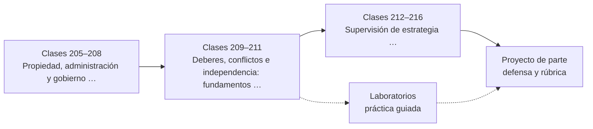

# Parte 17 — Directorios y gobierno corporativo

<!-- parte:inicio -->

> ← [Parte 16 — Alta dirección y oficina del CEO](../16-executive-leadership-ceo-office/README.md) · [Temario](../../SYLLABUS.md) · [Parte 18 — Finanzas corporativas, capital y M&A](../18-corporate-finance-capital-ma/README.md) →

*Entender quién manda, quién controla y quién rinde cuentas*

**Etapa:** 5 — Alta dirección y gobierno  
**Duración:** 12 clases · 30 horas  
**Resultado de salida:** Comprender la relación entre propiedad, directorio, CEO, control y rendición de cuentas.

🔴 [Ver las 6 etapas](../../SYLLABUS.md) · 12 clases (205–216) · 4 laboratorios · [proyecto de parte](project.md)

## 🎯 De qué trata esta parte

El directorio es la institución que separa la propiedad de la administración. Quien llega a CEO o funda una empresa con socios debe entender su funcionamiento, sus deberes y los conflictos que gestiona.

El eje es **supervisar sin administrar**: el directorio hace preguntas, controla y evalúa; no dirige. Cubre comités, deberes, independencia, información, evaluación del CEO y efectividad del propio directorio.

## 🧱 Con qué hay que llegar

| Parte | Qué aporta |
|---|---|
| [16 — Alta dirección y oficina del CEO](../16-executive-leadership-ceo-office/README.md) | El rol del CEO. |
| [15 — Riesgo, legal, compliance, ciberseguridad e IA](../15-risk-legal-compliance-cyber-ai-governance/README.md) | Riesgo y controles. |

Cada clase supone la anterior: el orden importa, y saltarse una deja sin base a las que vienen después.

## 📚 Resultados de la parte

Al terminar esta parte podrás:

1. **Distinguir** propiedad, directorio y administración.
2. **Precisar** el rol del presidente y del CEO.
3. **Explicar** la función de los comités de auditoría, riesgo y compensación.
4. **Gestionar** deberes, conflictos de interés e independencia.
5. **Preparar** un board pack que permita decidir.

## 🗺️ Mapa de la parte

## 🧭 Cómo se encadenan las 12 clases

Las clases **205 a 208** definen la institución: propiedad y gobierno, qué hace un directorio, presidente y CEO, y comités.

Las clases **209 a 211** definen la conducta: deberes y conflictos, información y board pack.

Las clases **212 a 216** definen la supervisión: estrategia, riesgo, evaluación del CEO, efectividad y el capstone de reunión de directorio.

## 📘 Las 12 clases

| # | Clase | Qué se trabaja | Entregable | Min |
|---:|---|---|---|---:|
| 205 | [Propiedad, administración y gobierno](classes/205-propiedad-administracion-y-gobierno/README.md) | ownership, governance, board | [board-or-executive-memo](../../templates/board-or-executive-memo.md) | 150 |
| 206 | [Qué hace un directorio](classes/206-que-hace-un-directorio/README.md) | board mandate, oversight, management accountability | [board-or-executive-memo](../../templates/board-or-executive-memo.md) | 150 |
| 207 | [Rol del presidente y del CEO](classes/207-rol-del-presidente-y-del-ceo/README.md) | board chair, CEO, lead independent director | [board-or-executive-memo](../../templates/board-or-executive-memo.md) | 150 |
| 208 | [Comités de auditoría, riesgo y compensación](classes/208-comites-de-auditoria-riesgo-y-compensacion/README.md) | board committee, audit committee, risk committee | [risk-governance-brief](../../templates/risk-governance-brief.md) | 150 |
| 209 | [Deberes, conflictos e independencia: fundamentos](classes/209-deberes-conflictos-e-independencia-fundamentos/README.md) | fiduciary duty, conflict of interest, disclosure | [risk-governance-brief](../../templates/risk-governance-brief.md) | 150 |
| 210 | [Información y transparencia](classes/210-informacion-y-transparencia/README.md) | materiality, disclosure, information asymmetry | [risk-governance-brief](../../templates/risk-governance-brief.md) | 150 |
| 211 | [Board pack y calidad de información](classes/211-board-pack-y-calidad-de-informacion/README.md) | board pack, pre-read, variance | [operating-improvement-brief](../../templates/operating-improvement-brief.md) | 150 |
| 212 | [Supervisión de estrategia](classes/212-supervision-de-estrategia/README.md) | strategy oversight, strategic assumption, capital commitment | [strategy-memo](../../templates/strategy-memo.md) | 150 |
| 213 | [Supervisión de riesgo y controles](classes/213-supervision-de-riesgo-y-controles/README.md) | risk oversight, critical control, assurance | [risk-governance-brief](../../templates/risk-governance-brief.md) | 150 |
| 214 | [Evaluación del CEO y sucesión](classes/214-evaluacion-del-ceo-y-sucesion/README.md) | CEO evaluation, scorecard, relative performance | [people-decision-brief](../../templates/people-decision-brief.md) | 150 |
| 215 | [Efectividad del directorio](classes/215-efectividad-del-directorio/README.md) | board effectiveness, skills matrix, board evaluation | [board-or-executive-memo](../../templates/board-or-executive-memo.md) | 150 |
| 216 | [Capstone: board meeting](classes/216-capstone-board-meeting/README.md) | board agenda, decision paper, minutes | [board-or-executive-memo](../../templates/board-or-executive-memo.md) | 150 |

## ⚠️ Riesgos característicos

- Confundir supervisar con administrar.
- Aprobar sin información suficiente.
- Tolerar un conflicto de interés por costumbre.
- Evaluar al CEO solo por resultados de corto plazo.

## 🔤 Glosario de la parte

57 conceptos definidos en las clases, con la definición operacional que usa cada una.

| Concepto | Definición operacional |
|---|---|
| **action log** | seguimiento de compromisos y responsables. |
| **agency problem** | riesgo de divergencia entre intereses de propietarios directorio y gestores. |
| **assurance** | grado de confianza obtenido mediante evaluación independiente o evidencia. |
| **audit committee** | comité que supervisa reporting financiero auditoría y controles. |
| **behavioral objective** | conducta de liderazgo observable. |
| **board** | órgano colegiado de supervisión y determinadas decisiones. |
| **board action log** | registro de acuerdos responsables y seguimiento. |
| **board agenda** | secuencia de asuntos priorizada por mandato y decisión. |
| **board calendar** | agenda anual de materias que requieren supervisión. |
| **board chair** | líder del funcionamiento del directorio. |
| **board challenge** | pregunta independiente que prueba lógica y evidencia. |
| **board committee** | subgrupo con mandato delegado para profundizar una materia. |
| **board effectiveness** | capacidad del board para cumplir mandato con buen juicio y conducta. |
| **board evaluation** | proceso para analizar desempeño colectivo e individual. |
| **board mandate** | conjunto de responsabilidades reservadas al directorio. |
| **board pack** | paquete periódico de información para supervisión y decisión. |
| **board refreshment** | renovación deliberada de composición. |
| **board-management interface** | relación formal para información challenge y apoyo. |
| **capital commitment** | recursos irreversibles o materiales dedicados a una choice. |
| **CEO** | máximo ejecutivo responsable de gestión. |
| **CEO evaluation** | proceso del board para valorar desempeño y liderazgo del máximo ejecutivo. |
| **committee charter** | documento que define alcance autoridad y reporting. |
| **compensation committee** | comité que diseña y supervisa remuneración ejecutiva. |
| **conflict of interest** | situación donde interés personal puede interferir con deber. |
| **critical control** | control cuya falla podría producir impacto material. |
| **decision paper** | documento que presenta una decisión requerida y alternativas. |
| **disclosure** | revelación suficiente del conflicto relevante. |
| **executive session** | reunión de directores sin management. |
| **fiduciary duty** | deber jurídico de actuar conforme al estándar aplicable en interés de la entidad o beneficiarios. |
| **governance** | sistema por el que la organización es dirigida y controlada. |
| **independence** | capacidad de juicio no comprometida por vínculos materiales. |
| **information asymmetry** | diferencia de información entre management board y propietarios. |
| **integrated reporting** | visión conectada de estrategia performance riesgos y recursos. |
| **KRI** | indicador adelantado de exposición. |
| **lead independent director** | director independiente con facultades reforzadas cuando se necesita contrapeso. |
| **management** | equipo responsable de ejecutar operación y estrategia. |
| **management accountability** | obligación del equipo ejecutivo de responder por ejecución. |
| **materiality** | importancia suficiente para influir en una decisión razonable. |
| **minutes** | registro formal de deliberaciones y acuerdos según requisitos aplicables. |
| **oversight** | supervisión mediante información challenge y seguimiento. |
| **ownership** | derechos económicos y de voto de propietarios. |
| **pre-read** | documento distribuido antes de reunión para preparar challenge. |
| **psychological safety** | condición para preguntas y desacuerdo sin represalia. |
| **recusal** | abstención de participar en una decisión cuando corresponde. |
| **relative performance** | desempeño interpretado frente a contexto o pares. |
| **reserved matter** | decisión que estatutos o governance reservan al board. |
| **risk committee** | comité que supervisa framework y exposiciones materiales. |
| **risk oversight** | responsabilidad del board de supervisar exposiciones materiales y framework. |
| **scorecard** | conjunto equilibrado de resultados y capacidades. |
| **selective disclosure** | entrega desigual de información que puede crear problemas legales o de confianza. |
| **skills matrix** | mapa de capacidades y experiencias requeridas. |
| **strategic assumption** | condición incierta de la que depende una estrategia. |
| **strategic milestone** | señal de que la tesis progresa. |
| **strategy oversight** | supervisión del proceso elecciones y ejecución estratégica. |
| **succession readiness** | grado en que el CEO construye continuidad y talento. |
| **three lines** | modelo de responsabilidades entre management funciones de riesgo compliance y auditoría interna. |
| **variance** | desviación entre plan y resultado con explicación. |

## 📦 Qué queda como evidencia

- Un board pack con decisión solicitada.
- Una declaración de conflictos.
- Una evaluación del CEO con criterios previos.
- El capstone: reunión de directorio simulada.

## 🔗 Cómo se conecta

Alimenta la parte 18 (decisiones de capital) y la 22 (gobierno proporcional al tamaño). Las simulaciones de directorio de la clase 202 usan este marco.

## 🧪 Cómo se trabaja

Son **12 clases de 150 minutos** —30 horas— con **4 laboratorios** y un proyecto integrador. Cada clase trae su propósito, sus conceptos, un caso, práctica, errores frecuentes, preguntas de comprobación, entregable y fuentes, y se evalúa con su `assessment.md`. Los laboratorios se resuelven con datos propios o sintéticos, nunca con datos reales de terceros, y la parte se cierra con el proyecto y su defensa. Las reglas de recorrido están en [la guía de navegación](../../docs/NAVIGATION.md).

<!-- parte:fin -->

## Laboratorios

- [Lab 01 — Board pack](labs/lab-01.md)
- [Lab 02 — Board agenda](labs/lab-02.md)
- [Lab 03 — Conflict-of-interest case](labs/lab-03.md)
- [Lab 04 — Board simulation](labs/lab-04.md)

## Proyecto de parte

Preparar y defender un board pack ante un directorio simulado.

## Bibliografía rectora

- Bob Tricker — *Corporate Governance* (Gobierno corporativo)
- OECD — *G20/OECD Principles of Corporate Governance 2023* (Gobierno corporativo)
- Richard Leblanc & James Gillies — *Inside the Boardroom* (Directorios)
- Ram Charan — *Boards That Deliver* (Directorios)
- Robert A. G. Monks & Nell Minow — *Corporate Governance* (Gobierno corporativo)

## Criterio de aprobación

80/100 y entrega del proyecto integrador.
