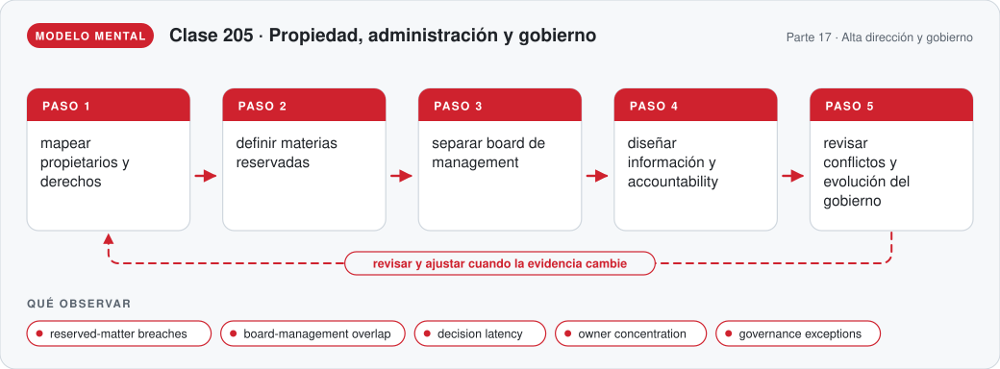

# Clase 205 — Propiedad, administración y gobierno

<!-- nav:inicio -->
> **Parte 17 · Directorios y gobierno corporativo** — clase 1 de 12 · [índice de la parte](../../README.md) · [temario](../../../../SYLLABUS.md)
<!-- nav:fin -->

**Parte:** 17 — Directorios y gobierno corporativo  
**Nivel:** Etapa 5 — Director → CEO  
**Duración sugerida:** 150–180 minutos · **Estándar:** deep-class-v2

## 🎯 Propósito

En una empresa pequeña, una sola persona suele ser dueña, presidente del directorio y gerente general. Decide qué hacer con las utilidades, contrata a sus parientes, fija su propio sueldo y se evalúa a sí misma. Mientras la empresa es pequeña, eso funciona: el costo de coordinarse es bajo y las decisiones son rápidas. Pero a medida que crece, entran socios, bancos, empleados clave, clientes grandes y, a veces, inversionistas o el mercado, y aparece la pregunta que organiza todo el gobierno corporativo: **¿quién manda sobre qué, y quién vigila a quien manda?** Confundir la propiedad (quién aportó el capital y recibe lo que sobra), la administración (quién gestiona el día a día) y el gobierno (quién fija el rumbo, controla y responde ante los propietarios) es una fuente permanente de conflictos, de pérdidas de valor y, en ocasiones, de fraudes.

La clase se apoya en la teoría de la agencia de Jensen y Meckling, en el análisis de Fama y Jensen sobre la separación entre decidir y controlar, en la visión de Tricker sobre el gobierno corporativo, en los principios de la OCDE y en el marco chileno de sociedades anónimas, al que remite sin interpretarlo. Al terminar sabrás mapear propietarios y derechos, distinguir los roles de propiedad, directorio y gerencia, definir las materias reservadas, diseñar flujos de información y rendición de cuentas y documentar los conflictos y la evolución del gobierno cuando los roles coinciden.

## 📚 Resultados de aprendizaje

Al finalizar podrás:

1. **Distinguir** propiedad, gobierno y administración y sus funciones.
2. **Mapear** a los propietarios, sus derechos y sus umbrales de decisión.
3. **Definir** las materias reservadas y la frontera entre directorio y gerencia.
4. **Estimar** los costos de agencia y diseñar mecanismos para reducirlos.
5. **Documentar** los sombreros y conflictos cuando los roles coinciden.

## 🧭 Agenda

| Tramo | Qué se hace |
|---|---|
| 0–20 min | Recuperación: ¿qué decisión de tu empresa toma una misma persona con tres sombreros distintos? |
| 20–60 min | Agencia, separación de roles, derechos, materias reservadas, información y evolución. |
| 60–105 min | Ejemplo trabajado: tres socios, umbrales de decisión y costos de agencia. |
| 105–150 min | Caso ejecutivo y práctica. |
| 150–175 min | Límites y entregable. |

## 🧩 Conceptos centrales

| Concepto | Definición | Cómo se reconoce |
|---|---|---|
| **Propiedad** | Derecho sobre el capital y sobre lo que queda tras pagar las obligaciones. | Acciones, participaciones, pactos. |
| **Gobierno corporativo** | Sistema por el cual se dirige y controla la empresa. | Directorio, estatutos, políticas, rendición de cuentas. |
| **Administración (gerencia)** | Gestión del día a día y ejecución de la estrategia. | Gerente general y equipo. |
| **Costo de agencia** | Pérdida de valor por el conflicto entre quien decide y quien soporta las consecuencias. | Gastos de vigilancia, compromisos y pérdidas residuales. |
| **Materias reservadas** | Decisiones que no puede tomar la gerencia sin aprobación del directorio o de los propietarios. | Se enumeran en estatutos o pactos. |
| **Sombrero** | Rol que una persona ocupa a la vez, como dueño, director o gerente. | Se declara para manejar los conflictos. |

## 🧠 Modelo mental

**Cómo leer el diagrama.** Tres columnas. **Propiedad**: aporta el capital y elige al directorio, fija las reglas en los estatutos y aprueba lo que se reserva a la junta. **Directorio**: nombra, evalúa y releva al CEO, aprueba estrategia, riesgos y capital, y supervisa sin gestionar. **Gerencia**: propone y ejecuta la estrategia, gestiona la operación y rinde cuentas, e informa con veracidad al directorio. La nota advierte que separar roles no elimina las relaciones de poder y que, en empresas cerradas y startups, los sombreros pueden coincidir; el pie, que las facultades dependen de la ley y de los estatutos.

## 📖 Desarrollo

### 1. La relación de agencia

Jensen y Meckling definieron la **relación de agencia** como un contrato por el cual una o más personas (el principal, por ejemplo el dueño) encargan a otra (el agente, por ejemplo el gerente) que actúe en su nombre, delegándole poder de decisión. Cuando los intereses difieren y no es posible observar todo lo que el agente hace, surgen **costos de agencia**: los gastos de **vigilar** al agente (auditorías, informes, directorios), los de **comprometerlo** (incentivos, garantías) y la **pérdida residual** de las decisiones que aún se desvían del interés del principal. Su análisis explica por qué existen directorios, auditorías y bonos: son mecanismos para reducir esos costos. También muestra que no se eliminan: se equilibran contra su propio costo.

### 2. Decidir y controlar: por qué se separan

Fama y Jensen distinguieron cuatro etapas de una decisión: **iniciar** una propuesta, **ratificarla**, **implementarla** y **controlar** sus resultados. Sostienen que, en organizaciones donde quienes soportan el riesgo residual no son quienes gestionan, conviene **separar la gestión de decisiones (iniciar e implementar) de su control (ratificar y vigilar)**, para que nadie se evalúe a sí mismo. De ahí la lógica del directorio: aprobar y vigilar lo que la gerencia propone y ejecuta. En empresas pequeñas y familiares, la separación es menos necesaria o imposible, pero el principio persiste: cuando una persona propone, aprueba y se evalúa, se pierde el control y se debe compensar con otros mecanismos.

### 3. Tres roles y sus relaciones

Tricker describe el gobierno corporativo como el sistema por el cual se dirige y se controla una empresa, y distingue su función de la **administración**: el gobierno se ocupa de **dirección** (fijar el rumbo y las políticas), **supervisión** (vigilar a la gerencia), **rendición de cuentas** (ante los propietarios y otras partes) y de **acción ejecutiva** cuando corresponde, mientras la administración se ocupa de ejecutar. Los **propietarios** eligen al directorio, aprueban los estados financieros y las materias que la ley o los estatutos les reservan, y reciben los resultados. Los principios de la OCDE añaden que el marco debe proteger los **derechos de los accionistas**, tratarlos de manera equitativa, reconocer el papel de otras partes interesadas, asegurar la transparencia y definir las **responsabilidades del directorio**. Las facultades concretas dependen de la ley y los estatutos (en Chile, entre otras, la normativa de sociedades anónimas, que se consulta en LeyChile y con asesoría).

### 4. Mapear propietarios y derechos

El primer paso del diseño es un **mapa de propiedad**: quiénes son los propietarios, qué porcentaje tienen, qué **clases de acciones** o derechos especiales existen, qué **pactos** firmaron entre sí, qué **mayorías** se necesitan para cada tipo de decisión, qué derechos de **información**, **venta** o **preferencia** tienen, y quién designa a cuántos directores. También se identifican los **propietarios finales** y los vínculos entre ellos (familiares, societarios). Este mapa descubre sorpresas: un socio minoritario con poder de veto sobre inversiones, una mayoría aparente que no alcanza para una decisión, o una familia dividida que paraliza el directorio.

### 5. Materias reservadas y frontera con la gerencia

Un buen gobierno define por escrito qué decisiones corresponden a cada órgano. **Materias reservadas a los propietarios**: reforma de estatutos, aumentos o disminuciones de capital, fusiones, distribución de utilidades, nombramiento del directorio y de auditores, según lo que la ley y los estatutos dispongan. **Materias reservadas al directorio**: estrategia y presupuesto, endeudamiento y garantías sobre ciertos montos, grandes inversiones y desinversiones, nombramiento, evaluación y remuneración del gerente general, políticas de riesgo y de partes relacionadas. **Lo demás es de la gerencia.** Se fijan **umbrales** claros (montos, plazos, tipos) y un procedimiento para consultas. La frontera mal definida produce dos males: un directorio que gestiona o una gerencia que decide lo que debería consultar.

### 6. Información y rendición de cuentas

La separación solo funciona si el directorio recibe **información veraz, oportuna y suficiente** (clase 211) y la gerencia **rinde cuentas** de forma regular. Se definen: informes periódicos, indicadores comparables, contactos directos del directorio con auditoría y control interno, **sesiones sin la gerencia** y un **registro de decisiones y acuerdos**. Los propietarios, a su vez, reciben información en la junta y por canales definidos. Un problema frecuente es la **asimetría de información**: la gerencia sabe mucho más y puede decidir qué mostrar. Por eso se complementa con fuentes independientes: auditoría, informes de terceros y acceso directo a personas clave.

### 7. Cuando los sombreros coinciden

En empresas cerradas y startups, una persona puede ser dueña, directora y gerente. No es ilegítimo, pero exige **transparencia sobre los sombreros**: se escribe qué decisiones toma con cada sombrero, quién la vigila y cómo se evita que se evalúe a sí misma. Mecanismos útiles: un **director independiente** o consejero externo con voz real; un **comité de compensación** o un procedimiento para fijar sueldos y operaciones con partes relacionadas; **estados financieros auditados**; **separación de cuentas personales y de la empresa**; **política de dividendos** conocida; y **plan de evolución del gobierno** (cuándo se incorpora un directorio, cuándo se separa la presidencia, cuándo se profesionaliza la gerencia). Monks y Minow subrayan que el gobierno es en definitiva una relación de poder y de confianza entre las personas, no un conjunto de formularios.

## 📚 Lectura comparada

| Obra | Qué aporta | Qué no resuelve | Pregunta para contrastar |
|---|---|---|---|
| Jensen y Meckling | Relación de agencia y costos de agencia. | Supone intereses y comportamientos simplificados. | ¿Quién vigila a quién y a qué costo? |
| Fama y Jensen | Separación entre decidir y controlar. | Modelo teórico; las empresas familiares difieren. | ¿Quién propone, aprueba y controla? |
| Tricker | Gobierno y administración, y funciones del directorio. | No fija reglas legales. | ¿Qué funciones cumple nuestro directorio? |
| OCDE (2023) | Principios sobre derechos de accionistas, partes y directorio. | No tienen fuerza legal por sí mismos. | ¿Nuestro marco cumple estos principios? |
| LeyChile (BCN) | Texto oficial de la normativa chilena de sociedades. | No es asesoría ni interpretación. | ¿Qué versión rige y qué dicen los estatutos? |

## 🧮 Ejemplo trabajado

**Situación (hipotética).** Una empresa familiar de servicios, con utilidades antes de ciertas partidas de 2.800 millones de pesos, tiene tres socios: A (52 %, fundador y gerente general), B (28 %, hermano de A, director no ejecutivo) y C (20 %, inversionista externo). No tiene directorio formal y A decide casi todo.

**Mapa de propiedad y umbrales (pacto hipotético).** Las materias reservadas (endeudamiento sobre 1.000 millones, venta de activos relevantes, cambio de giro, distribución de utilidades distinta de la política) requieren el 75 % de los votos.

| Combinación | Votos | ¿Alcanza el 75 %? |
|---|---|---|
| A solo | 52 % | No |
| A + B | 80 % | Sí |
| A + C | 72 % | No |
| B + C | 48 % | No (pero puede bloquear) |
| B solo | 28 % | Puede bloquear (>25 %) |
| C solo | 20 % | No puede bloquear |

**Lectura.** A no puede decidir solo las materias reservadas; necesita a B. B puede bloquear cualquier decisión por sí solo (28 % > 25 %); C no puede bloquear sin B. C, el inversionista externo, tiene poca protección real.

**Costos de agencia estimados.**

| Concepto | Monto anual (millones) |
|---|---|
| Sueldo del gerente general sobre el mercado | 180 |
| Cuatro familiares en cargos con pago sobre el mercado (60 cada uno) | 240 |
| **Pérdida de valor por desalineación** | **420** |

Eso equivale a 420 ÷ 2.800 = 15 % de las utilidades.

**Rediseño del gobierno.**

1. Directorio de cinco miembros: A, B, C y dos independientes.
2. Comité de compensación con mayoría independiente para fijar sueldos y revisar operaciones con partes relacionadas.
3. Política de dividendos y de reinversión escrita; estados financieros auditados.
4. Lista de materias reservadas al directorio con umbrales y una frontera clara con la gerencia.
5. Informes mensuales a la gerencia y trimestrales al directorio; una sesión al año sin la gerencia.
6. Un plan para separar la presidencia del directorio de la gerencia general en 24 meses.

**Efecto estimado.** Los 420 millones de desalineación bajan a 120 millones: ahorro de 300 millones al año. Costos del nuevo gobierno: honorarios de dos independientes (40 millones cada uno), auditoría y secretaría (20 millones): 100 millones. Beneficio neto: 300 − 100 = 200 millones al año, es decir, 200 ÷ 2.800 ≈ 7,1 % de las utilidades, más una mayor protección para C y mejor acceso a crédito.

**Documentación de sombreros.** Se registra que A tiene tres sombreros (propietario, director y gerente) y que sus decisiones sobre su propia remuneración y sobre operaciones con familiares pasan por el comité; B tiene dos (propietario y director) y declara su parentesco.

**Cuidados.** La validez de pactos, mayorías y materias reservadas, y los deberes de los directores, dependen de la ley y de los estatutos; se verifican con asesoría y en fuentes oficiales como LeyChile. Las cifras son ilustrativas.

**Qué muestra.** (1) El mapa de propiedad reveló quién bloquea. (2) La separación de funciones redujo los costos de agencia. (3) Se documentaron los sombreros.

## 🔀 Comparación y límites

**Gobierno frente a gestión.** El gobierno decide el rumbo y vigila; la gestión ejecuta. Un directorio que gestiona debilita a la gerencia; una gerencia que se gobierna a sí misma elimina el control.

**Límites.** La separación formal no elimina las relaciones de poder: en empresas cerradas y startups los roles pueden coincidir y conviene documentar los sombreros, los conflictos y el proceso de decisión. La teoría de la agencia simplifica motivaciones. Los costos de agencia se estiman con supuestos. Las normas de sociedades varían por país y tipo de sociedad. Las cifras del ejemplo son ilustrativas.

## 🪜 De profesional a owner

| Nivel | Cómo se relaciona con el gobierno |
|---|---|
| **Profesional** | Entiende quién decide y a quién rinde cuentas. |
| **Jefe / Team Lead** | Informa con veracidad hacia arriba. |
| **Gerente** | Respeta la frontera con el directorio y consulta lo reservado. |
| **CEO / Director** | Trabaja con el directorio y acepta ser vigilado y evaluado. |
| **Founder / Owner** | Acepta pasar de decidir todo a gobernar con reglas y con terceros. |

## 🏢 Caso ejecutivo

Una empresa de transporte con 600 personas, fundada por una familia de dos hermanos y una hermana, tiene tres socios con 40 %, 40 % y 20 %. Un hermano es gerente general y presidente de un «directorio» de tres familiares que se reúne dos veces al año; el otro hermano es gerente de operaciones; la hermana es socia no ejecutiva. Un banco pide información y estados financieros auditados para renovar una línea de crédito de 4.500 millones de pesos; la empresa nunca ha tenido auditoría. Se descubre que la empresa arrienda tres propiedades a sociedades de los hermanos por 38 millones al mes (el mercado, según una tasación, es de 26 millones), que el gerente general fija su sueldo y el de dos hijos en la empresa, y que los préstamos entre la empresa y los socios no están documentados. La socia no ejecutiva pide cuentas y amenaza con vender a un tercero. Los hermanos discuten sobre quién tiene «el control».

Entrega un **memo de gobierno** que contenga: (a) el mapa de propiedad, derechos y umbrales de decisión; (b) la diferenciación de sombreros y las materias reservadas a la junta, al directorio y a la gerencia; (c) la estimación de costos de agencia con supuestos y el plan para reducirlos; (d) el diseño de información, auditoría y rendición de cuentas; (e) el plan de evolución del gobierno a 24 meses; (f) los puntos que se verificarán con asesoría legal, contable y tributaria, y en fuentes oficiales.

## 🧪 Práctica

1. Dibuja el mapa de propiedad de una empresa con porcentajes, pactos y mayorías.
2. Escribe qué decisiones toma cada persona con cada sombrero y qué conflictos genera.
3. Redacta una lista de diez materias reservadas con sus umbrales y órganos competentes.
4. Estima tres costos de agencia de una empresa que conozcas y propón un mecanismo para cada uno.
5. Diseña un plan de evolución del gobierno de una empresa pequeña a tres años.

## ⚠️ Errores frecuentes

| Error | Por qué ocurre | Cómo corregirlo |
|---|---|---|
| Confundir dueño con gerente | Una misma persona ocupa ambos roles | Documentar sombreros y funciones. |
| Directorio decorativo | Se cumple la forma | Mandato, información y evaluación reales. |
| Materias sin definir | Se improvisa | Lista escrita con umbrales y órganos. |
| Operaciones con familiares sin control | Se confía en la buena fe | Política de partes relacionadas y revisión independiente. |
| Información solo de la gerencia | Es lo habitual | Fuentes independientes y sesiones sin gerencia. |
| No planificar la evolución | Funciona mientras es pequeña | Hitos para cambiar el gobierno al crecer. |

## ❓ Preguntas de comprobación

1. ¿Qué es un costo de agencia y qué componentes tiene?
2. ¿Por qué conviene separar decidir de controlar?
3. ¿Qué funciones tienen propiedad, directorio y gerencia?
4. ¿Qué incluye un mapa de propiedad?
5. ¿Qué son las materias reservadas y cómo se definen?
6. ¿Cómo se gobierna una empresa donde los sombreros coinciden?
7. ¿Qué se verifica con asesoría y fuentes oficiales?

Claves de respuesta

1. La pérdida de valor por el conflicto entre quien decide y quien soporta las consecuencias; incluye gastos de vigilancia, de compromiso y pérdida residual.
2. Para que nadie se evalúe a sí mismo: quien propone e implementa no es quien aprueba y vigila.
3. La propiedad aporta capital y elige al directorio; el directorio dirige, supervisa y nombra al CEO; la gerencia ejecuta y rinde cuentas.
4. Propietarios, porcentajes, clases de acciones, pactos, mayorías, derechos de información y de venta, designación de directores y propietarios finales.
5. Decisiones que la gerencia no puede tomar sin aprobación del directorio o de los propietarios; se enumeran con umbrales en estatutos o pactos.
6. Con transparencia sobre los sombreros, directores independientes, comité de compensación, políticas de partes relacionadas, auditoría y un plan de evolución.
7. La ley de sociedades, los estatutos, los pactos, los deberes de los directores y las obligaciones contables y tributarias.

## 📥 Entregable

Guarda en `portfolio/205-propiedad-administracion-y-gobierno/`:

- `board-or-executive-memo.md` (plantilla [Board or executive memo](../../../../templates/board-or-executive-memo.md)) con el memo de gobierno del caso ejecutivo;
- `stakeholder-legitimacy-map.md` (plantilla [Stakeholder legitimacy map](../../../../templates/stakeholder-legitimacy-map.md)) con el mapa de propiedad, poder y legitimidad;
- `decision-journal.md` con los sombreros, las materias reservadas y las verificaciones pendientes.

## 📗 Fuentes y verificación

- Michael C. Jensen & William H. Meckling — *Theory of the firm: Managerial behavior, agency costs and ownership structure* (Journal of Financial Economics, 1976). **Uso en esta clase:** relación de agencia y costos de agencia. Lectura selectiva sobre **propiedad, administración y gobierno**. **Localizador:** [DOI 10.1016/0304-405X(76)90026-X](https://doi.org/10.1016/0304-405X(76)90026-X).
- Eugene F. Fama & Michael C. Jensen — *Separation of Ownership and Control* (The Journal of Law and Economics, 1983). **Uso en esta clase:** separación entre decidir y controlar. Lectura selectiva sobre **propiedad, administración y gobierno**. **Localizador:** [DOI 10.1086/467037](https://doi.org/10.1086/467037).
- Bob Tricker — *Corporate Governance* (Oxford University Press, 2019). **Uso en esta clase:** gobierno corporativo y funciones del directorio. Lectura selectiva sobre **propiedad, administración y gobierno**. **Localizador:** [ISBN-13 9780198809869](https://openlibrary.org/isbn/9780198809869).
- OECD — *G20/OECD Principles of Corporate Governance 2023*. **Uso en esta clase:** principios de gobierno corporativo. **Fuente primaria:** <https://www.oecd.org/en/publications/2023/09/g20-oecd-principles-of-corporate-governance-2023_60836fcb.html>.
- Biblioteca del Congreso Nacional de Chile — *LeyChile: sociedades anónimas (Ley 18.046) y su reglamento* (1981). **Uso en esta clase:** texto oficial de la normativa chilena de sociedades anónimas. **Fuente primaria:** <https://www.bcn.cl/leychile/>.

> **Regla de fuentes para Propiedad, administración y gobierno:** las obras anteriores estructuran las perspectivas de esta materia; cualquier norma, ley o estándar vivo mencionado debe comprobarse nuevamente en su fuente primaria vigente, incluidos los estatutos, los pactos y la ley de sociedades aplicable. Los ejemplos y casos son hipotéticos, con cifras ilustrativas. El desarrollo es original y no reproduce capítulos protegidos.

<!-- pie:inicio -->
---

| Anterior | Índice | Siguiente |
|---|---|---|
| [← 204 · Capstone: primeros 100 días como CEO](../../../16-executive-leadership-ceo-office/classes/204-capstone-primeros-100-dias-como-ceo/README.md) | [Parte 17](../../README.md) · [Programa](../../../../SYLLABUS.md) | [206 · Qué hace un directorio →](../206-que-hace-un-directorio/README.md) |
<!-- pie:fin -->
