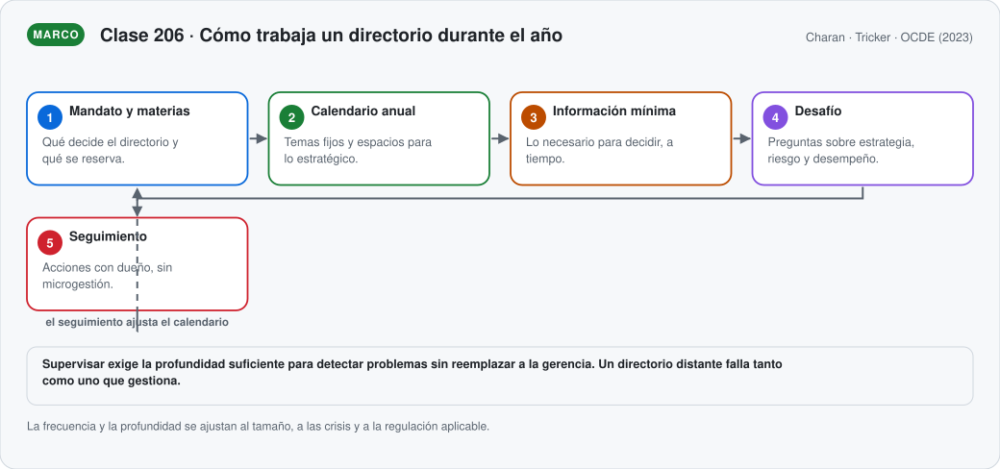

# Clase 206 — Qué hace un directorio

<!-- nav:inicio -->
> **Parte 17 · Directorios y gobierno corporativo** — clase 2 de 12 · [índice de la parte](../../README.md) · [temario](../../../../SYLLABUS.md)
<!-- nav:fin -->

**Parte:** 17 — Directorios y gobierno corporativo  
**Nivel:** Etapa 5 — Director → CEO  
**Duración sugerida:** 150–180 minutos · **Estándar:** deep-class-v2

## 🎯 Propósito

Pregúntale a diez directores qué hace un directorio y recibirás diez respuestas: «vigila a la gerencia», «aprueba el presupuesto», «aconseja al CEO», «cuida que se cumpla la ley», «representa a los accionistas». Todas son parciales. Cuando un directorio no tiene un mandato claro, el trabajo se llena con lo urgente y lo cómodo: revisar resultados pasados, aprobar documentos que otros prepararon, discutir los detalles de proyectos operativos, y rara vez enfrentar lo difícil: si la estrategia es correcta, si el riesgo es aceptable, si el CEO es el adecuado, si la empresa tendrá capital y personas para el próximo ciclo. El resultado es un directorio caro, ocupado y poco útil, y una gerencia que lo siente como un trámite o como un estorbo.

La clase propone un enfoque práctico: definir un **mandato**, un **calendario anual** que lo cumpla, una **información mínima** para decidir, un nivel de **desafío** sobre estrategia, riesgo y desempeño, y un **seguimiento** sin microgestión. Se apoya en la visión de Charan sobre directorios que agregan valor, en las funciones del directorio descritas por Tricker, en el estudio de Adams, Hermalin y Weisbach sobre los roles de los directorios, en las observaciones de LeBlanc y Gillies sobre el funcionamiento real de las salas de directorio y en los principios de la OCDE. Al terminar sabrás diseñar el trabajo anual de un directorio, medir cómo usa su tiempo y distinguir supervisión de gestión.

## 📚 Resultados de aprendizaje

Al finalizar podrás:

1. **Definir** el mandato y las materias reservadas de un directorio.
2. **Diseñar** un calendario anual alineado con ese mandato.
3. **Establecer** la información mínima que necesita el directorio para decidir.
4. **Distinguir** supervisión, asesoría y gestión, y evitar la microgestión.
5. **Medir** el uso del tiempo del directorio y ajustarlo.

## 🧭 Agenda

| Tramo | Qué se hace |
|---|---|
| 0–20 min | Recuperación: ¿en qué temas gastó tu directorio la mayor parte de su última sesión y qué decisión importante quedó sin discutir? |
| 20–60 min | Funciones, mandato, calendario, información, desafío y seguimiento. |
| 60–105 min | Ejemplo trabajado: rediseño del uso del tiempo de un directorio de seis personas. |
| 105–150 min | Caso ejecutivo y práctica. |
| 150–175 min | Límites y entregable. |

## 🧩 Conceptos centrales

| Concepto | Definición | Cómo se reconoce |
|---|---|---|
| **Mandato del directorio** | Funciones, facultades y límites del órgano. | Escrito en estatutos, reglamento o estatuto del directorio. |
| **Supervisión (*oversight*)** | Vigilar que la gerencia cumpla la estrategia, los riesgos y la ley. | Preguntas, información independiente, seguimiento. |
| **Asesoría** | Aportar experiencia y perspectiva a la gerencia. | Se pide y se ofrece sin quitar responsabilidad. |
| **Microgestión** | Intervenir en decisiones operativas que corresponden a la gerencia. | El directorio discute detalles de ejecución. |
| **Calendario anual** | Plan de temas y decisiones del directorio durante el año. | Temas fijos y espacios estratégicos. |
| **Sesión ejecutiva** | Reunión del directorio sin la gerencia. | Permite hablar con libertad. |

## 🧠 Modelo mental

**Cómo leer el diagrama.** Una cadena de cinco pasos con retorno. **Mandato y materias**: qué decide el directorio y qué se reserva. **Calendario anual**: temas fijos y espacios para lo estratégico. **Información mínima**: lo necesario para decidir, a tiempo. **Desafío**: preguntas sobre estrategia, riesgo y desempeño. **Seguimiento**: acciones con dueño, sin microgestión. La flecha indica que el seguimiento ajusta el calendario. La nota explica que supervisar exige profundidad suficiente para detectar problemas sin reemplazar a la gerencia; el pie, que la frecuencia y la profundidad se ajustan al tamaño, a las crisis y a la regulación.

## 📖 Desarrollo

### 1. Las funciones de un directorio

Tricker describe cuatro tareas del directorio: **dirección** (fijar el propósito, la estrategia y las políticas), **acción ejecutiva** (decisiones propias de su nivel, como aprobar grandes inversiones o nombrar al CEO), **supervisión** (vigilar a la gerencia y los resultados) y **rendición de cuentas** (ante los propietarios y otras partes). Adams, Hermalin y Weisbach, en una revisión de la literatura económica, destacan dos roles principales: **monitorear** a la gerencia y **asesorar**, y señalan que la composición y el funcionamiento de los directorios responden a las condiciones de cada empresa (tamaño, complejidad, estructura de propiedad, regulación). La conclusión práctica es que no existe un modelo único: cada directorio define su mandato según su realidad.

### 2. Un mandato escrito

Un mandato útil responde: ¿qué decide este directorio y qué recomienda a la junta?, ¿qué aprueba y qué solo conoce?, ¿cómo se relaciona con la gerencia?, ¿qué comités existen (clase 208)?, ¿cómo se reúne y se informa? Se enumeran las **materias reservadas** con umbrales: aprobación del plan estratégico y del presupuesto; inversiones y deuda sobre ciertos montos; nombramiento, evaluación y remuneración del CEO y de su equipo directo; políticas de riesgo, de partes relacionadas y de información; y la supervisión del auditor y de los controles. Los principios de la OCDE destacan que el directorio debe actuar con información completa, de buena fe, con diligencia y en el mejor interés de la empresa y de sus propietarios, tratando de manera equitativa a los accionistas. El detalle legal de los deberes depende de la jurisdicción y se verifica con asesoría.

### 3. El calendario anual

Charan propone que el directorio debe dedicar su tiempo a lo que **solo él puede hacer**: elegir al CEO y evaluarlo, asegurar que la estrategia sea la correcta, vigilar los riesgos y asignar el capital. Para lograrlo, se planifica un **calendario anual**: sesiones con temas fijos (resultados, auditoría, presupuesto, evaluación del CEO, sucesión, riesgos), **sesiones estratégicas** profundas (una o dos al año), un espacio para **temas emergentes** y **sesiones ejecutivas** en cada reunión. Se prevé la **carga de trabajo** de los comités y se evita que todo se acumule en pocas sesiones. Se revisa el calendario cada año, para que refleje las prioridades de la empresa.

### 4. Información: lo mínimo para decidir

El directorio decide con la información que recibe; por eso se define una **información mínima**: resultados con comparaciones y explicaciones, indicadores del negocio, riesgos principales y su evolución, avance de proyectos críticos, hallazgos de auditoría, cumplimiento y decisiones pendientes (clases 210 y 211). Debe llegar **con antelación**, ser **comparable** de una sesión a otra y distinguir **decisiones** de **informes**. LeBlanc y Gillies, con base en observaciones de salas de directorio, remarcan que gran parte del tiempo se pierde en presentaciones largas de la gerencia, y que los mejores directorios reservan la discusión para lo importante. También conviene complementar la información de la gerencia con **fuentes independientes** (auditores, asesores, contactos directos con personal clave).

### 5. Desafiar con respeto y con foco

El valor diferencial del directorio es el **desafío constructivo**: hacer las preguntas que la gerencia no se hace o no quiere hacerse. ¿Qué supuestos sostienen la estrategia?, ¿qué haría falta para que esté equivocada?, ¿qué riesgo estamos aceptando y quién lo aceptó?, ¿cuánto capital queda si el plan sale mal?, ¿qué señales vigilamos? El desafío es más efectivo cuando es **específico**, **informado** y **respetuoso**, y cuando se sigue con **acciones**. Los desafíos sin consecuencias convierten al directorio en un espectador. Y el directorio debe distinguir los **temas estratégicos** de los **operativos**: preguntar por qué se eligió un proveedor es normal; elegir al proveedor es gestión.

### 6. Supervisar sin microgestionar

La línea entre supervisión y gestión es borrosa, y las crisis la desplazan. Algunas señales de **microgestión**: el directorio discute la ejecución de proyectos en detalle, pide revisar decisiones de contratación bajo la jerarquía directa del CEO, o aprueba gastos menores. Señales de **distancia excesiva**: el directorio se entera de problemas por la prensa, no conoce a los ejecutivos clave, aprueba presupuestos sin discutirlos o no recibe información de auditoría independiente. El equilibrio depende del tamaño, la complejidad y la etapa: una empresa en crisis o con un CEO nuevo puede requerir más involucramiento temporal, con fecha de término. Se pacta con el CEO cuándo y por qué el directorio profundizará.

### 7. Seguimiento y aprendizaje

Cada sesión termina con un **registro de acuerdos**, con responsables y fechas, y una **lista de acciones** que se revisa al comienzo de la siguiente. Se mide el **uso del tiempo** del directorio: porcentaje de la reunión dedicado a informes, estrategia, riesgos, personas y cumplimiento. Y se hace una **revisión anual** del propio funcionamiento (clase 215): ¿cumplimos el mandato?, ¿qué decisiones importantes pasaron sin discusión?, ¿la información fue suficiente? El directorio que no se evalúa a sí mismo difícilmente podrá evaluar a otros con credibilidad.

## 📚 Lectura comparada

| Obra | Qué aporta | Qué no resuelve | Pregunta para contrastar |
|---|---|---|---|
| Tricker | Cuatro tareas del directorio y su diferencia con la gestión. | Marco general; hay que traducirlo. | ¿Cumplimos las cuatro tareas? |
| Charan | Directorios que agregan valor: CEO, estrategia, riesgos, capital. | Visión de práctica. | ¿Qué hace solo el directorio? |
| Adams, Hermalin y Weisbach | Roles de monitoreo y asesoría y su dependencia del contexto. | Revisión económica; poco sobre dinámicas internas. | ¿Qué rol necesita hoy la empresa? |
| LeBlanc y Gillies | Funcionamiento real de las salas de directorio. | Observaciones de casos específicos. | ¿En qué se usa realmente el tiempo? |
| OCDE (2023) | Principios sobre responsabilidades del directorio. | No tienen fuerza legal por sí mismos. | ¿Se cumplen los principios en nuestro caso? |

## 🧮 Ejemplo trabajado

**Situación (hipotética).** Un directorio de seis personas se reúne ocho veces al año, en sesiones de cuatro horas (32 horas anuales). Cada director recibe 3,5 millones de pesos por sesión: el costo anual de honorarios es 8 × 6 × 3,5 = 168 millones. Una revisión de las actas muestra cómo se usó el tiempo.

**Uso del tiempo antes y después.**

| Tema | Antes (horas) | % | Después (horas) | % |
|---|---|---|---|---|
| Informes y actualizaciones | 22,4 | 70,0 | 8,0 | 25,0 |
| Estrategia | 3,2 | 10,0 | 9,6 | 30,0 |
| Riesgos y controles | 3,2 | 10,0 | 6,4 | 20,0 |
| Personas, CEO y sucesión | 2,4 | 7,5 | 6,4 | 20,0 |
| Otros (cumplimiento, varios) | 0,8 | 2,5 | 1,6 | 5,0 |
| **Total** | **32,0** | **100** | **32,0** | **100** |

**Costo del tiempo.** Cada hora de reunión de los seis directores cuesta 168 ÷ 32 = 5,25 millones, es decir, 0,875 millones por director-hora. Las 14,4 horas liberadas de informes (22,4 − 8,0) equivalen a 14,4 × 5,25 = 75,6 millones de atención al año que pasan a temas de mayor valor.

**Medidas.**

1. **Mandato y materias reservadas** escritos y aprobados por la junta.
2. **Calendario anual**: dos sesiones estratégicas de media jornada adicionales a las ocho ordinarias (se sustituyen informes por una pre-lectura obligatoria), una sesión de riesgos con el comité, una de talento y sucesión, y una sesión ejecutiva en cada reunión.
3. **Información mínima**: un tablero de dos páginas con diez indicadores; el pack se envía siete días antes; los informes operativos se leen previamente y no se presentan.
4. **Desafío**: cada tema relevante tiene un director líder que prepara tres preguntas críticas.
5. **Seguimiento**: registro de acuerdos con responsables y fechas; revisión de acciones al inicio de cada sesión.
6. **Evaluación**: autoevaluación anual con tres indicadores: porcentaje de tiempo en estrategia y riesgos (meta 50 %), decisiones con alternativas documentadas y acciones cerradas a tiempo.

**Resultados a un año (hipotéticos).** El tiempo en estrategia y riesgos pasa de 20 % a 50 % (3,2 + 3,2 = 6,4 horas frente a 9,6 + 6,4 = 16 horas); las acciones cerradas a tiempo pasan de 55 % a 85 %; el CEO informa que la preparación de presentaciones se redujo en un 40 %.

**Señales de microgestión corregidas.** El directorio dejó de aprobar contratos operativos bajo 300 millones, que pasan a la gerencia con informe trimestral.

**Cuidados.** La frecuencia de sesiones, los quórums, las materias reservadas y los deberes de los directores dependen de la ley y de los estatutos, y se verifican con asesoría; las cifras son ilustrativas.

**Qué muestra.** (1) El análisis del uso del tiempo mostró la brecha entre mandato y práctica. (2) El rediseño trasladó el tiempo hacia estrategia, riesgos y personas. (3) El seguimiento y la evaluación sostienen el cambio.

## 🔀 Comparación y límites

**Mandato frente a supervisión.** El mandato define qué le corresponde al directorio; la supervisión es la forma de ejercer parte de ese mandato. Se puede tener un buen mandato y supervisar mal.

**Límites.** Un directorio demasiado distante también falla: la supervisión requiere profundidad suficiente para detectar problemas sin reemplazar a la gerencia; ajusta según tamaño, crisis y regulación. Los estudios sobre directorios dependen de contextos y muestras. Las cifras de uso del tiempo del ejemplo son ilustrativas. Los deberes y facultades concretos dependen de la ley y los estatutos.

## 🪜 De profesional a owner

| Nivel | Cómo participa del trabajo del directorio |
|---|---|
| **Profesional** | Prepara información clara y veraz para quienes la presentan. |
| **Jefe / Team Lead** | Entiende cómo sus resultados llegan al directorio. |
| **Gerente** | Presenta decisiones con alternativas y riesgos, y acepta el desafío. |
| **CEO / Director** | Acuerda con el directorio el mandato, la información y la cadencia. |
| **Founder / Owner** | Acepta que el directorio pueda desafiar sus decisiones. |

## 🏢 Caso ejecutivo

Una empresa agroindustrial con 1.800 personas y ventas de 120.000 millones de pesos tiene un directorio de siete miembros que se reúne mensualmente por cinco horas. Las actas muestran que el 75 % del tiempo se usa en presentaciones de la gerencia, el 10 % en discusiones sobre contratos y compras específicas, el 10 % en cumplimiento y el 5 % en estrategia. Hace dos años no se discute la sucesión del CEO; el plan estratégico se aprobó sin escenarios; el comité de riesgos no existe; una pérdida de 3.800 millones por una concentración en un cliente se conoció por una llamada del banco. Dos directores dicen que «el CEO nos trata como un trámite»; el CEO, que «el directorio se mete en todo menos en lo importante». Los honorarios del directorio suman 360 millones anuales.

Entrega un **rediseño del trabajo del directorio** que contenga: (a) el mandato y las materias reservadas; (b) el calendario anual con sesiones estratégicas, de riesgos y de personas; (c) la información mínima y el formato de pack; (d) el modelo de desafío y de seguimiento; (e) la medición del uso del tiempo y la evaluación anual; (f) los puntos legales y estatutarios a verificar con asesoría.

## 🧪 Práctica

1. Redacta en una página el mandato de un directorio con cinco materias reservadas y sus umbrales.
2. Analiza las actas de las últimas cuatro sesiones y calcula el porcentaje de tiempo por tema.
3. Diseña un calendario anual con ocho sesiones y los temas de cada una.
4. Define diez indicadores para el tablero del directorio.
5. Redacta cinco preguntas de desafío para una propuesta estratégica.

## ⚠️ Errores frecuentes

| Error | Por qué ocurre | Cómo corregirlo |
|---|---|---|
| Directorio de informes | Es cómodo y evita decisiones | Pre-lecturas y discusión de lo importante. |
| Mandato implícito | Nunca se escribió | Documentarlo y revisarlo cada año. |
| Microgestión | Falta confianza o información | Umbrales de aprobación y confianza basada en datos. |
| Distancia excesiva | Se confía en la gerencia | Información independiente y contacto con el personal clave. |
| Calendario improvisado | Se llena con lo urgente | Calendario anual con temas estratégicos. |
| No evaluarse | Se teme el conflicto | Autoevaluación anual con acciones. |

## ❓ Preguntas de comprobación

1. ¿Qué cuatro tareas describe Tricker para un directorio?
2. ¿Qué roles destacan Adams, Hermalin y Weisbach?
3. ¿Qué contiene un mandato escrito del directorio?
4. ¿Qué debe incluir la información mínima?
5. ¿Qué distingue la supervisión de la microgestión?
6. ¿Para qué sirve una sesión ejecutiva?
7. ¿Cómo se mide el uso del tiempo del directorio?

Claves de respuesta

1. Dirección, acción ejecutiva, supervisión y rendición de cuentas.
2. Monitorear a la gerencia y asesorarla, según el contexto de la empresa.
3. Funciones, materias reservadas con umbrales, relación con la gerencia, comités y forma de reunirse e informarse.
4. Resultados comparados y explicados, riesgos, avance de proyectos críticos, hallazgos de auditoría, cumplimiento y decisiones pendientes, con antelación y comparables.
5. La supervisión pregunta, fija límites y exige información; la microgestión decide detalles operativos que corresponden a la gerencia.
6. Para que el directorio hable con libertad, sin la gerencia, sobre desempeño, personas y riesgos.
7. Con el porcentaje de horas por tema (informes, estrategia, riesgos, personas, cumplimiento) en las actas.

## 📥 Entregable

Guarda en `portfolio/206-que-hace-un-directorio/`:

- `board-or-executive-memo.md` (plantilla [Board or executive memo](../../../../templates/board-or-executive-memo.md)) con el rediseño del caso ejecutivo;
- `board-pack.md` (plantilla [Board pack](../../../../templates/board-pack.md)) con el formato de tablero y pre-lectura;
- `decision-journal.md` con el calendario anual, el análisis de uso del tiempo y las verificaciones legales pendientes.

## 📗 Fuentes y verificación

- Bob Tricker — *Corporate Governance* (Oxford University Press, 2019). **Uso en esta clase:** cuatro tareas del directorio y diferencia con la gestión. Lectura selectiva sobre **qué hace un directorio**. **Localizador:** [ISBN-13 9780198809869](https://openlibrary.org/isbn/9780198809869).
- Ram Charan — *Boards That Deliver* (John Wiley & Sons, Incorporated, 2007). **Uso en esta clase:** directorios que agregan valor. Lectura selectiva sobre **qué hace un directorio**. **Localizador:** [ISBN-13 9781118046616](https://openlibrary.org/isbn/9781118046616).
- Renée B. Adams, Benjamin E. Hermalin & Michael S. Weisbach — *The Role of Boards of Directors in Corporate Governance: A Conceptual Framework and Survey* (Journal of Economic Literature, 2010). **Uso en esta clase:** roles de monitoreo y asesoría de los directorios. Lectura selectiva sobre **qué hace un directorio**. **Localizador:** [DOI 10.1257/jel.48.1.58](https://doi.org/10.1257/jel.48.1.58).
- Richard Leblanc & James Gillies — *Inside the Boardroom* (John Wiley & Sons, Incorporated, 2009). **Uso en esta clase:** funcionamiento real de las salas de directorio. Lectura selectiva sobre **qué hace un directorio**. **Localizador:** [ISBN-13 9780470739952](https://openlibrary.org/isbn/9780470739952).
- OECD — *G20/OECD Principles of Corporate Governance 2023*. **Uso en esta clase:** responsabilidades del directorio. **Fuente primaria:** <https://www.oecd.org/en/publications/2023/09/g20-oecd-principles-of-corporate-governance-2023_60836fcb.html>.

> **Regla de fuentes para Qué hace un directorio:** las obras anteriores estructuran las perspectivas de esta materia; cualquier norma, ley o estándar vivo mencionado debe comprobarse nuevamente en su fuente primaria vigente, incluidos los estatutos, la ley de sociedades y las normas del regulador aplicable. Los ejemplos y casos son hipotéticos, con cifras ilustrativas. El desarrollo es original y no reproduce capítulos protegidos.

<!-- pie:inicio -->
---

| Anterior | Índice | Siguiente |
|---|---|---|
| [← 205 · Propiedad, administración y gobierno](../205-propiedad-administracion-y-gobierno/README.md) | [Parte 17](../../README.md) · [Programa](../../../../SYLLABUS.md) | [207 · Rol del presidente y del CEO →](../207-rol-del-presidente-y-del-ceo/README.md) |
<!-- pie:fin -->
