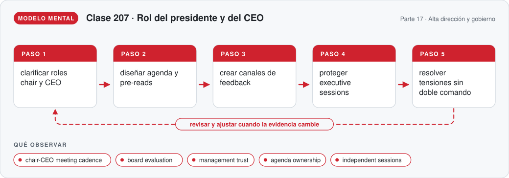

# Clase 207 — Rol del presidente y del CEO

<!-- nav:inicio -->
> **Parte 17 · Directorios y gobierno corporativo** — clase 3 de 12 · [índice de la parte](../../README.md) · [temario](../../../../SYLLABUS.md)
<!-- nav:fin -->

**Parte:** 17 — Directorios y gobierno corporativo  
**Nivel:** Etapa 5 — Director → CEO  
**Duración sugerida:** 150–180 minutos · **Estándar:** deep-class-v2

## 🎯 Propósito

La relación entre el presidente del directorio y el gerente general (CEO) es la bisagra del gobierno de una empresa. Si funciona, el directorio recibe información veraz, desafía con criterio y apoya al CEO en lo difícil; si falla, el directorio se vuelve un tribunal o un decorado, el CEO se aísla o se protege, y la empresa queda con dos centros de mando que se contradicen. Los conflictos más dañinos no suelen ser de ideas sino de **roles**: un presidente que da instrucciones a los ejecutivos como si fuera el CEO, un CEO que controla la agenda y la información del directorio, o un expresidente ejecutivo que sigue dirigiendo desde la silla del presidente. La separación formal de cargos no basta: lo que importa es qué hace cada uno, cómo se informan y cómo resuelven sus tensiones.

La clase se apoya en el enfoque de Charan sobre directorios efectivos, en el análisis de LeBlanc y Gillies sobre el liderazgo del directorio, en los principios de gobierno de Monks y Minow y de Tricker, y en la noción de seguridad psicológica de Edmondson, que condiciona la calidad del desafío. Al terminar sabrás distinguir los roles, diseñar la agenda y las pre-lecturas, construir canales de retroalimentación entre el directorio y el CEO, proteger las sesiones ejecutivas y resolver tensiones sin doble comando.

## 📚 Resultados de aprendizaje

Al finalizar podrás:

1. **Distinguir** las funciones del presidente del directorio y las del CEO.
2. **Diseñar** la agenda y las pre-lecturas del directorio con el presidente y el CEO.
3. **Construir** canales de retroalimentación entre el directorio y el CEO.
4. **Proteger** las sesiones ejecutivas y la independencia del desafío.
5. **Resolver** tensiones y evitar el doble comando.

## 🧭 Agenda

| Tramo | Qué se hace |
|---|---|
| 0–20 min | Recuperación: ¿quién controla la agenda de tu directorio y quién decide qué información llega? |
| 20–60 min | Roles, estructuras, agenda, retroalimentación, sesiones ejecutivas y tensiones. |
| 60–105 min | Ejemplo trabajado: matriz de roles y presupuesto de tiempo del presidente. |
| 105–150 min | Caso ejecutivo y práctica. |
| 150–175 min | Límites y entregable. |

## 🧩 Conceptos centrales

| Concepto | Definición | Cómo se reconoce |
|---|---|---|
| **Presidente del directorio** | Quien conduce el directorio y asegura su efectividad. | Fija la agenda con el CEO y modera la discusión. |
| **Gerente general (CEO)** | Quien dirige la empresa y responde por su ejecución. | Lidera a la gerencia y rinde cuentas al directorio. |
| **Dualidad** | Una misma persona ocupa ambos cargos. | Menor separación entre dirección y control. |
| **Director independiente líder** | Director que lidera la independencia cuando el presidente no lo es. | Preside las sesiones ejecutivas. |
| **Doble comando** | Dos autoridades dan instrucciones contradictorias a la organización. | Los ejecutivos no saben a quién obedecer. |
| **Pre-lectura (*pre-read*)** | Material enviado antes de la sesión para preparar la discusión. | Permite deliberar y no solo presentar. |

## 🧠 Modelo mental

**Cómo leer el diagrama.** Dos paneles. A la izquierda, **el presidente del directorio**: conduce el directorio (agenda, tiempos y calidad de la discusión), protege el desafío (cuida que se hable y se disienta) y reúne las sesiones ejecutivas sin la gerencia. A la derecha, **el gerente general**: dirige la empresa (decide y responde por la ejecución), informa con veracidad (datos completos y a tiempo) y rinde cuentas (acepta evaluación y retroalimentación). La nota aclara que separar los roles no garantiza independencia ni efectividad; el pie, que los requisitos de separación o independencia dependen de la ley, del mercado y de los estatutos.

## 📖 Desarrollo

### 1. Dos roles, dos mandatos

El **presidente** lidera el directorio: define con el CEO la agenda, asegura que el directorio reciba información suficiente, modera las discusiones, cuida que todos los directores participen, lidera la evaluación del directorio y, con el comité correspondiente, la del CEO, y representa al directorio ante los propietarios y, cuando corresponde, ante terceros. El **CEO** lidera la empresa: propone la estrategia, la ejecuta, nombra y gestiona a su equipo, administra los recursos y rinde cuentas. Charan sostiene que los directorios funcionan mejor cuando el presidente y el CEO tienen una relación de **confianza y franqueza**, con roles claros: el presidente no es «el jefe del CEO en el día a día», pero sí es quien convoca al directorio a evaluarlo, apoyarlo y, si es necesario, reemplazarlo.

### 2. Dualidad o separación

Monks y Minow y Tricker discuten desde distintos ángulos las ventajas y riesgos de que una persona sea a la vez presidente y CEO. La **dualidad** facilita la unidad de mando y la rapidez, pero concentra poder, reduce la independencia del control y hace más difícil evaluar al CEO. La **separación** distribuye el poder y facilita la supervisión, pero requiere una relación bien gestionada y puede generar conflictos de roles. En muchos países, los códigos de gobierno o la regulación recomiendan o exigen la separación o, cuando hay dualidad, la designación de un **director independiente líder**. La evidencia empírica sobre el efecto de la dualidad en el desempeño es mixta; lo que predomina es que **depende del contexto**: etapa de la empresa, estructura de propiedad y calidad de los demás mecanismos de control. Las exigencias legales se verifican en la normativa y los estatutos.

### 3. Qué ocurre cuando el expresidente ejecutivo preside

Una situación común: el fundador o el CEO saliente pasa a presidir el directorio. Tiene conocimiento, historia y a veces el cariño del equipo, pero también puede **eclipsar** a su sucesor, mantener una red de lealtades y dificultar el desafío. Para que funcione se acuerda por escrito: qué hará (apoyo, relaciones con ciertos clientes o propietarios, mentoría) y qué **no** hará (dar instrucciones al equipo, vetar decisiones operativas); un **período de transición** con plazo; la **evaluación del nuevo CEO** a cargo de un comité con independencia; y la posibilidad de que el expresidente se retire del directorio si se vuelve un obstáculo. LeBlanc y Gillies describen que las transiciones mal gestionadas suelen generar los conflictos más costosos.

### 4. Agenda y pre-lecturas: quién controla qué

Quien controla la **agenda** y la **información** controla la discusión. Un buen arreglo es que el presidente y el CEO **construyan juntos** la agenda anual y la de cada sesión, que el presidente tenga la **última palabra** sobre la agenda del directorio (con el consejo del CEO y de otros directores), y que cualquier director pueda proponer temas. Las pre-lecturas se envían con **antelación** (por ejemplo, siete días), con un formato estándar (clase 211) y con una separación clara entre decisiones e informes. El presidente revisa que la información sea suficiente y no quede reducida a lo que a la gerencia le conviene. Se reserva en cada sesión tiempo para **discusión**, no solo para presentaciones.

### 5. Retroalimentación en ambos sentidos

La relación funciona si hay **canales de retroalimentación**: reuniones periódicas entre el presidente y el CEO (por ejemplo, quincenales y breves), un espacio para que el presidente transmita el sentir del directorio **sin sorprender** al CEO en las sesiones, y la posibilidad de que el CEO exprese sus dudas, dificultades y requerimientos de apoyo. El presidente también conversa con cada director a lo largo del año para conocer sus puntos de vista y su disponibilidad. Edmondson recuerda que sin **seguridad psicológica** las personas esconden errores y dudas; un CEO que teme que cualquier problema se use en su contra oculta información al directorio, y un directorio que no siente que puede hablar con libertad pierde calidad de desafío.

### 6. Sesiones ejecutivas y sesiones con el CEO

Las **sesiones ejecutivas** (sin la gerencia) son un mecanismo básico de independencia: el directorio discute el desempeño del CEO, la sucesión, las dudas sobre la información recibida y asuntos sensibles. Se programan en cada reunión, de manera rutinaria, para que no se interpreten como una señal de crisis; el presidente (o el director independiente líder) las conduce y luego **retroalimenta al CEO** con lo que corresponda. También se pueden convocar sesiones **solo con el CEO** para conversaciones francas. Se registran los acuerdos relevantes sin exponer innecesariamente opiniones individuales. La confidencialidad se protege, y se verifican los deberes de información y de registro de actas con asesoría y los estatutos.

### 7. Resolver tensiones y evitar el doble comando

Las tensiones aparecen: el CEO siente que el presidente interfiere; el presidente siente que el CEO oculta información; un director conversa con ejecutivos fuera de los canales. Se previenen con **reglas claras**: los directores **no dan instrucciones** a la gerencia; las consultas a ejecutivos pasan por el CEO o se informan a él; el presidente comunica sus inquietudes al CEO antes que al pleno, salvo en casos de riesgo grave; y existe un **procedimiento de escalamiento** cuando hay desacuerdos de fondo (por ejemplo, facilitación de un tercero). Cuando el problema es grave (pérdida de confianza, conducta indebida), el directorio actúa con el procedimiento formal y con asesoría legal. Lo que no puede permitirse es el **doble comando**: la organización debe saber que quien dirige es el CEO.

## 📚 Lectura comparada

| Obra | Qué aporta | Qué no resuelve | Pregunta para contrastar |
|---|---|---|---|
| Charan | Relación de franqueza entre presidente y CEO; funciones del directorio. | Visión de práctica de directorios grandes. | ¿Qué hace el presidente que el CEO no puede hacer? |
| LeBlanc y Gillies | Liderazgo del directorio y dinámicas en la sala. | Casos de ciertos países y empresas. | ¿Quién conduce de verdad la discusión? |
| Monks y Minow | Poder, independencia y separación de roles. | Posición fuerte en materia de gobierno. | ¿Qué riesgo implica la dualidad? |
| Tricker | Roles del directorio y relación con la gerencia. | No fija reglas legales. | ¿Qué cumple cada rol y qué no? |
| Edmondson | Seguridad psicológica como condición del desafío. | No es específico de directorios. | ¿Se puede discrepar aquí sin costo? |

## 🧮 Ejemplo trabajado

**Situación (hipotética).** Una empresa con ventas de 90.000 millones de pesos tiene a su CEO fundador como presidente del directorio (dualidad). El directorio, de seis personas, se reúne ocho veces al año. La relación con inversionistas es tensa, la sucesión no se discute y las actas muestran que solo el 12 % del tiempo se dedica a estrategia. El directorio decide separar los cargos: el fundador pasa a ser presidente de honor sin funciones ejecutivas; una directora independiente asume la presidencia; se contrata a un nuevo CEO.

**Matriz de roles para decisiones recurrentes.**

| Decisión | Presidente | CEO |
|---|---|---|
| Agenda del directorio | Decide (con consejo del CEO) | Propone y colabora |
| Contenido de las pre-lecturas | Revisa y pide ajustes | Prepara y entrega |
| Comunicación externa de la empresa | Se informa; habla solo por el directorio | Decide y ejecuta |
| Nombramiento del gerente financiero | Es consultado | Propone; el directorio aprueba |
| Evaluación del CEO | Lidera con el comité | Participa y recibe retroalimentación |
| Sucesión del CEO | Lidera | Colabora en el desarrollo de candidatos |
| Presupuesto y estrategia | Pone a discusión | Propone y defiende |
| Relación con inversionistas | Lidera con propietarios | Lidera con inversionistas operativos |
| Gestión del equipo ejecutivo | No interviene | Decide y responde |
| Evaluación del directorio | Lidera | Opina como invitado |

**Reparto.** De las 10 decisiones, el presidente lidera 4 (agenda, evaluación del CEO, sucesión, evaluación del directorio); el CEO lidera 4 (comunicación, gerente financiero, presupuesto y estrategia, equipo ejecutivo); 2 se comparten (pre-lecturas y relación con inversionistas).

**Presupuesto de tiempo del presidente (horas al año).**

| Actividad | Horas |
|---|---|
| Reuniones con el CEO (semanales de 1 hora) | 52 |
| Conversaciones individuales con directores (6 × 2 × 1 hora) | 12 |
| Preparación de agendas (8 × 4 horas) | 32 |
| Sesiones del directorio (8 × 4 horas) | 32 |
| Sesiones ejecutivas (8 × 1 hora) | 8 |
| Evaluaciones (CEO y directorio) | 10 |
| Relación con propietarios y otras partes | 20 |
| **Total** | **166** |

**Costo.** Con 166 horas al año y un honorario del presidente del doble del de un director (2 × 28 = 56 millones), el costo es 56 ÷ 166 ≈ 0,34 millones por hora.

**Indicadores a doce meses (hipotéticos).** Tiempo del directorio en estrategia: de 12 % a 30 %; casos en que un director dio instrucciones directas a ejecutivos: de 9 a 1; sesiones ejecutivas realizadas: 8 de 8; evaluación del CEO con criterios previos realizada: sí; confianza del CEO en poder plantear problemas al directorio (encuesta de 1 a 5): de 2,8 a 4,1.

**Acuerdos con el fundador.** Funciones por escrito: mentoría y relaciones con clientes antiguos; no da instrucciones a ejecutivos; no asiste a las sesiones ejecutivas; revisión de su rol a los 18 meses.

**Cuidados.** La separación de cargos, los requisitos de independencia y las atribuciones del presidente dependen de la ley y los estatutos, y se verifican con asesoría; las cifras son ilustrativas.

**Qué muestra.** (1) La matriz aclaró quién decide qué. (2) El presupuesto de tiempo dimensionó el cargo. (3) Los acuerdos con el fundador evitaron el doble comando.

## 🔀 Comparación y límites

**Separar frente a equilibrar.** Separar cargos es una condición necesaria en muchos contextos, pero no suficiente: se necesita además un presidente competente, información independiente y un CEO dispuesto a ser desafiado.

**Límites.** La separación de roles no garantiza independencia ni efectividad: la cultura, la composición, la información y la capacidad de desafío importan tanto como el organigrama. La evidencia sobre dualidad es mixta. Los requisitos legales o de códigos de gobierno varían. Las cifras del ejemplo son ilustrativas.

## 🪜 De profesional a owner

| Nivel | Cómo participa |
|---|---|
| **Profesional** | Entrega información veraz que llegará al directorio. |
| **Jefe / Team Lead** | No usa canales paralelos para influir en directores. |
| **Gerente** | Presenta con honestidad y acepta preguntas incómodas. |
| **CEO / Director** | Construye una relación franca con el presidente y acepta la evaluación. |
| **Founder / Owner** | Acepta ceder la presidencia cuando la empresa lo necesita. |

## 🏢 Caso ejecutivo

Una empresa de retail con 5.000 personas y ventas de 300.000 millones de pesos cambió de CEO hace ocho meses. El anterior, que lo fue durante 18 años, es ahora presidente del directorio. La nueva CEO informa que el presidente llama directamente a los gerentes de compras y de tiendas para pedir cambios; que fijó la agenda de las últimas cuatro sesiones sin consultarla; que ha cuestionado en público decisiones de precios que ella había tomado y que dos directores independientes no se sienten con libertad para disentir de él. La rotación de gerentes subió de 11 % a 20 %; la estrategia nueva se aprobó con escasa discusión; el presidente opina que «ella necesita tiempo para aprender» y que él «solo ayuda». Los gerentes dicen que ya no saben a quién obedecer. La CEO considera renunciar; los inversionistas piden una reunión.

Entrega un **protocolo presidente-CEO** que contenga: (a) las funciones de cada cargo y una matriz de roles para diez decisiones recurrentes; (b) el diseño de la agenda y las pre-lecturas con quién decide qué; (c) los canales de retroalimentación y la regla de no instrucciones a la gerencia; (d) el diseño de sesiones ejecutivas y su retroalimentación; (e) el plan de transición para el expresidente ejecutivo, con funciones, límites y plazos; (f) el procedimiento de escalamiento de tensiones y las verificaciones estatutarias y legales.

## 🧪 Práctica

1. Redacta una matriz de roles presidente-CEO para diez decisiones de tu empresa.
2. Diseña la agenda de una sesión con el presidente y el CEO, y define quién propone y quién decide cada punto.
3. Define cinco reglas de relación entre directores y gerencia.
4. Escribe el temario de una sesión ejecutiva y la retroalimentación que se daría al CEO.
5. Redacta un acuerdo de transición para un expresidente ejecutivo con funciones y límites.

## ⚠️ Errores frecuentes

| Error | Por qué ocurre | Cómo corregirlo |
|---|---|---|
| Presidente que dirige | Costumbre o desconfianza | Reglas de no instrucciones y matriz de roles. |
| CEO que controla agenda e información | Poder de la gerencia | Presidente con la última palabra sobre la agenda y fuentes independientes. |
| Sorpresas en la sala | Falta de conversaciones previas | Reuniones periódicas presidente-CEO. |
| Sesiones ejecutivas esporádicas | Se ven como señal de crisis | Rutina en cada reunión. |
| Expresidente que eclipsa | Transición sin reglas | Acuerdo escrito con funciones y plazo. |
| Creer que separar los cargos basta | Se ve el organigrama | Cultura, información y capacidad de desafío. |

## ❓ Preguntas de comprobación

1. ¿Qué funciones tiene el presidente del directorio y cuáles el CEO?
2. ¿Qué ventajas y riesgos tiene la dualidad?
3. ¿Qué riesgos hay cuando el expresidente ejecutivo preside?
4. ¿Quién debería controlar la agenda del directorio y por qué?
5. ¿Para qué sirven las sesiones ejecutivas?
6. ¿Qué es el doble comando y cómo se evita?
7. ¿Por qué separar los cargos no garantiza efectividad?

Claves de respuesta

1. El presidente conduce el directorio, protege el desafío y reúne sesiones ejecutivas; el CEO dirige la empresa, informa con veracidad y rinde cuentas.
2. Unidad de mando y rapidez frente a concentración de poder y menor independencia del control; el efecto depende del contexto.
3. Eclipsar al sucesor, mantener lealtades y dificultar el desafío; se mitiga con acuerdos escritos, plazos y evaluación independiente.
4. El presidente, con el consejo del CEO y de otros directores, porque quien controla agenda e información controla la discusión.
5. Para que el directorio hable con libertad sobre el desempeño del CEO, la sucesión y la calidad de la información.
6. Cuando dos autoridades dan instrucciones contradictorias; se evita con reglas de no instrucciones a la gerencia y canales claros.
7. Porque la cultura, la composición, la información y la capacidad de desafío importan tanto como el organigrama.

## 📥 Entregable

Guarda en `portfolio/207-rol-del-presidente-y-del-ceo/`:

- `board-or-executive-memo.md` (plantilla [Board or executive memo](../../../../templates/board-or-executive-memo.md)) con el protocolo del caso ejecutivo;
- `team-charter.md` (plantilla [Team charter](../../../../templates/team-charter.md)) con las reglas de relación entre el presidente, el CEO y el directorio;
- `decision-journal.md` con la matriz de roles, el presupuesto de tiempo y los acuerdos de transición.

## 📗 Fuentes y verificación

- Ram Charan — *Boards That Deliver* (John Wiley & Sons, Incorporated, 2007). **Uso en esta clase:** relación de franqueza entre presidente y CEO. Lectura selectiva sobre **rol del presidente y del ceo**. **Localizador:** [ISBN-13 9781118046616](https://openlibrary.org/isbn/9781118046616).
- Richard Leblanc & James Gillies — *Inside the Boardroom* (John Wiley & Sons, Incorporated, 2009). **Uso en esta clase:** liderazgo del directorio y dinámicas en la sala. Lectura selectiva sobre **rol del presidente y del ceo**. **Localizador:** [ISBN-13 9780470739952](https://openlibrary.org/isbn/9780470739952).
- Robert A. G. Monks & Nell Minow — *Corporate Governance* (John Wiley & Sons, Incorporated, 2001). **Uso en esta clase:** poder, independencia y separación de roles. Lectura selectiva sobre **rol del presidente y del ceo**. **Localizador:** [ISBN-13 9781118874899](https://openlibrary.org/isbn/9781118874899).
- Bob Tricker — *Corporate Governance* (Oxford University Press, 2019). **Uso en esta clase:** roles del directorio y relación con la gerencia. Lectura selectiva sobre **rol del presidente y del ceo**. **Localizador:** [ISBN-13 9780198809869](https://openlibrary.org/isbn/9780198809869).
- Amy C. Edmondson — *Psychological Safety and Learning Behavior in Work Teams* (Administrative Science Quarterly, 1999). **Uso en esta clase:** seguridad psicológica como condición del desafío. Lectura selectiva sobre **rol del presidente y del ceo**. **Localizador:** [DOI 10.2307/2666999](https://doi.org/10.2307/2666999).

> **Regla de fuentes para Rol del presidente y del CEO:** las obras anteriores estructuran las perspectivas de esta materia; cualquier norma, ley o estándar vivo mencionado debe comprobarse nuevamente en su fuente primaria vigente, incluidos los estatutos, los códigos de gobierno y los requisitos de independencia aplicables. Los ejemplos y casos son hipotéticos, con cifras ilustrativas. El desarrollo es original y no reproduce capítulos protegidos.

<!-- pie:inicio -->
---

| Anterior | Índice | Siguiente |
|---|---|---|
| [← 206 · Qué hace un directorio](../206-que-hace-un-directorio/README.md) | [Parte 17](../../README.md) · [Programa](../../../../SYLLABUS.md) | [208 · Comités de auditoría, riesgo y compensación →](../208-comites-de-auditoria-riesgo-y-compensacion/README.md) |
<!-- pie:fin -->
