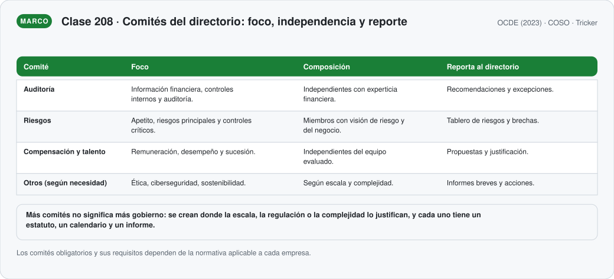

# Clase 208 — Comités de auditoría, riesgo y compensación

<!-- nav:inicio -->
> **Parte 17 · Directorios y gobierno corporativo** — clase 4 de 12 · [índice de la parte](../../README.md) · [temario](../../../../SYLLABUS.md)
<!-- nav:fin -->

**Parte:** 17 — Directorios y gobierno corporativo  
**Nivel:** Etapa 5 — Director → CEO  
**Duración sugerida:** 150–180 minutos · **Estándar:** deep-class-v2

## 🎯 Propósito

Un directorio completo no puede revisar en profundidad las cuentas, los riesgos, las remuneraciones, el nombramiento de directores y la ética de la empresa en cuatro horas mensuales. Por eso delega el trabajo de profundidad en **comités**: grupos pequeños de directores que estudian un tema con más detalle, conversan con los responsables y recomiendan al pleno. Bien diseñados, los comités multiplican la capacidad del directorio y protegen su independencia en los asuntos donde el conflicto es más probable: quién revisa las cuentas, quién fija el pago de los ejecutivos. Mal diseñados, fragmentan la responsabilidad, duplican trabajo y se convierten en instancias formales donde se aprueba lo que la gerencia presenta.

La clase examina los tres comités más frecuentes (auditoría, riesgos y compensación), su composición, su mandato y su relación con el directorio. Se apoya en los principios de gobierno de la OCDE, en el marco COSO de control interno y de gestión de riesgos, en el análisis de Tricker sobre las funciones del directorio y en la visión de Charan sobre directorios efectivos. Remite a la ley de sociedades y a las normas del regulador para los comités obligatorios, sin interpretarlas. Al terminar sabrás decidir qué comités crear, definir su estatuto y composición, planificar su calendario e información y reportar al directorio con recomendaciones y excepciones.

## 📚 Resultados de aprendizaje

Al finalizar podrás:

1. **Decidir** qué comités necesita un directorio según su escala, regulación y complejidad.
2. **Redactar** el estatuto de un comité con mandato, composición, facultades y calendario.
3. **Seleccionar** miembros considerando independencia y experiencia.
4. **Definir** la información que recibe el comité y lo que reporta al directorio.
5. **Evitar** la fragmentación y la duplicación entre comités y con el directorio.

## 🧭 Agenda

| Tramo | Qué se hace |
|---|---|
| 0–20 min | Recuperación: ¿qué comités tiene tu directorio y qué recomendación concreta produjo cada uno el último año? |
| 20–60 min | Para qué sirven, auditoría, riesgos, compensación, composición, calendario e informe. |
| 60–105 min | Ejemplo trabajado: composición, carga de trabajo y seguimiento de hallazgos. |
| 105–150 min | Caso ejecutivo y práctica. |
| 150–175 min | Límites y entregable. |

## 🧩 Conceptos centrales

| Concepto | Definición | Cómo se reconoce |
|---|---|---|
| **Comité del directorio** | Grupo de directores que estudia un tema y recomienda al pleno. | Estatuto, miembros, calendario e informe. |
| **Comité de auditoría** | Supervisa la información financiera, el control interno y la auditoría. | Se relaciona con auditores y con control interno. |
| **Comité de riesgos** | Supervisa el apetito, los riesgos principales y los controles críticos. | Revisa tablero de riesgos y excepciones. |
| **Comité de compensación** | Propone la remuneración y los incentivos de la alta dirección. | Basado en desempeño y criterios previos. |
| **Independencia** | Ausencia de vínculos que comprometan el juicio. | Se define por ley, estatutos o códigos. |
| **Estatuto del comité** | Documento que fija mandato y reglas del comité. | Aprobado por el directorio. |

## 🧠 Modelo mental

**Cómo leer el diagrama.** Una tabla con cuatro filas. **Auditoría**: información financiera, controles internos y auditoría; independientes con experticia financiera; recomienda y reporta excepciones. **Riesgos**: apetito, riesgos principales y controles críticos; miembros con visión de riesgo y del negocio; presenta tablero y brechas. **Compensación y talento**: remuneración, desempeño y sucesión; independientes del equipo evaluado; propone con justificación. **Otros según necesidad**: ética, ciberseguridad, sostenibilidad; según escala y complejidad; informes breves y acciones. La nota advierte que más comités no significa más gobierno; el pie, que los comités obligatorios dependen de la normativa aplicable.

## 📖 Desarrollo

### 1. Para qué sirven los comités

Los comités permiten **profundizar** en temas técnicos (cuentas, riesgos, remuneración), **reunir experticia** específica, **proteger la independencia** en temas con conflicto potencial y **liberar tiempo** del pleno para estrategia y decisiones de fondo. Los principios de gobierno de la OCDE reconocen que los directorios pueden crear comités para tareas específicas, y recomiendan que las funciones de auditoría, nombramientos y remuneraciones se asignen a miembros no ejecutivos e independientes cuando haya conflictos potenciales. Pero el directorio **no delega su responsabilidad**: el comité estudia y recomienda; la decisión y el deber de supervisión siguen en el pleno, salvo facultades legalmente delegadas. Se crean comités donde la **escala**, la **regulación** o la **complejidad** lo justifican, y no por imitación.

### 2. Comité de auditoría

Es el más extendido. Supervisa la **integridad de la información financiera**, el **sistema de control interno** (COSO, clase 183), la función de **auditoría interna** (su plan, independencia y hallazgos) y la relación con el **auditor externo** (selección, independencia, alcance y honorarios). Se reúne con el auditor externo y con el auditor interno **sin la gerencia presente**, al menos algunas veces al año. Revisa los estados financieros antes de su aprobación, los juicios contables significativos, los hallazgos y su remediación, y los canales de denuncia y los casos graves (clase 189). Requiere miembros con **experticia financiera** y mayoría o totalidad de independientes. En muchos países, la ley o los reguladores bursátiles imponen requisitos sobre su existencia y composición; en Chile, la ley de sociedades anónimas contempla un comité de directores en ciertas sociedades abiertas, cuyas condiciones y facultades se verifican en LeyChile y en las normas de la autoridad, sin interpretarlas de memoria.

### 3. Comité de riesgos

Supervisa el **apetito de riesgo** (clase 182), el **mapa de riesgos principales** y sus escenarios (clase 181), los **controles críticos** (clase 213), la **respuesta a incidentes** y la **continuidad**. Recibe un **tablero** periódico con tendencias, excepciones y brechas, y se reúne con el responsable de riesgos y, cuando corresponde, con ciberseguridad y cumplimiento. COSO enfatiza que la gestión de riesgos se integra con la estrategia y el desempeño; por eso, un comité de riesgos útil es el que conecta los riesgos con los objetivos de la empresa y no solo repasa listados. En empresas pequeñas, el comité de auditoría puede asumir esta función; en reguladas o complejas (bancos, seguros, salud, energía), suele ser un comité propio. Los requisitos regulatorios del sector se verifican en la fuente.

### 4. Comité de compensación y talento

Propone la **política de remuneración** del CEO y de la alta dirección, sus **incentivos** (corto y largo plazo, con contrapesos, clase 175), los **criterios de evaluación** y las condiciones de ingreso o salida. Conviene que esté formado por directores **independientes del equipo evaluado**, que no incluya al CEO, y que use **información comparativa** y asesoría externa con independencia. Su valor está en evitar dos extremos: pagar por resultados que no dependen del ejecutivo (suerte) o crear incentivos que premian riesgos excesivos. Con frecuencia se amplía a **talento y sucesión** (clases 201 y 203): evaluación del CEO, desarrollo de candidatos y planes de emergencia. La transparencia sobre las políticas de remuneración se ajusta a las exigencias legales y de mercado, que se verifican con asesoría.

### 5. Otros comités: nombramientos, ética, ciberseguridad, sostenibilidad

Según la empresa pueden existir comités de **nombramientos y gobierno corporativo** (composición, evaluación del directorio, independencia), de **ética y cumplimiento**, de **ciberseguridad y tecnología**, de **sostenibilidad** o de **partes relacionadas**. Cada uno debe justificar su existencia con una pregunta: ¿qué decisiones o supervisiones requieren una profundidad que el pleno no puede dar?, ¿hay una regulación que lo exija?, ¿hay un conflicto que requiere independencia especial? Una regla útil es **no crear más comités de los que el directorio pueda atender bien**: cada comité consume horas de directores, exige preparación de la gerencia y puede dispersar la responsabilidad.

### 6. Composición, independencia y experticia

La composición combina **independencia** (los directores sin vínculos con la gerencia, con propietarios relevantes o con la empresa que comprometan su juicio, según la definición legal y de los estatutos) y **experticia** (financiera, de riesgos, de talento, tecnológica). Se evita que los mismos directores se concentren en todos los comités: genera sobrecarga y poder excesivo. Se rota o se amplía el pool. Se verifica que los miembros **no tengan conflictos** con el tema (por ejemplo, un proveedor de la empresa en el comité de compras o un ejecutivo en el comité que fija su sueldo). La definición de independencia tiene contenido legal específico: no se asume, se verifica en la ley, los estatutos y los códigos aplicables.

### 7. Estatuto, calendario, información e informe

Cada comité tiene un **estatuto** que define: propósito, facultades (por ejemplo, contratar asesores externos, acceder a información y a personas), composición, quórum, frecuencia, relación con el pleno e información que recibe. Un **calendario anual** distribuye los temas (por ejemplo, el comité de auditoría revisa en el primer trimestre el cierre y la auditoría; en el tercero, el plan de auditoría interna). La **información** llega con antelación y tiene un formato estable. Cada reunión termina con **acuerdos y recomendaciones**; el presidente del comité **informa al pleno** con un resumen breve: temas tratados, recomendaciones, excepciones y puntos que requieren decisión. Se hace una **autoevaluación** anual del comité y se actualiza el estatuto cuando cambia el contexto.

## 📚 Lectura comparada

| Obra | Qué aporta | Qué no resuelve | Pregunta para contrastar |
|---|---|---|---|
| OCDE (2023) | Funciones del directorio y asignación a miembros independientes. | Principios de alto nivel. | ¿Qué tarea requiere independencia especial? |
| COSO Control Interno | Cinco componentes y supervisión del control. | No define el estatuto de un comité. | ¿Qué evidencia recibe el comité de auditoría? |
| COSO ERM | Integración del riesgo con estrategia y desempeño. | No fija la estructura del directorio. | ¿Conecta el comité de riesgos con la estrategia? |
| Tricker | Tareas del directorio y relación con comités. | Marco general. | ¿Qué no se puede delegar? |
| Charan | Directorios efectivos y uso del tiempo. | Visión de práctica. | ¿Nuestros comités ahorran tiempo o lo duplican? |

## 🧮 Ejemplo trabajado

**Situación (hipotética).** Un directorio de seis personas (D1 a D6) de una empresa con ventas de 150.000 millones de pesos evalúa su estructura de comités. D1, D2 y D3 son independientes; D4 y D5 representan a propietarios; D6 es el CEO (director ejecutivo). El pleno sesiona ocho veces al año por 4 horas (32 horas).

**Propuesta de comités.**

| Comité | Sesiones | Horas por sesión | Miembros | Horas de directores |
|---|---|---|---|---|
| Auditoría | 6 | 3 | D1, D2, D3 (3 miembros) | 6 × 3 × 3 = 54 |
| Riesgos | 4 | 3 | D2, D3, D4 (3 miembros) | 4 × 3 × 3 = 36 |
| Compensación y talento | 3 | 2 | D1, D3, D5 (3 miembros) | 3 × 2 × 3 = 18 |
| **Total comités** | | | | **108** |

**Carga total.** Pleno: 32 horas × 6 = 192 horas de directores. Total con comités: 192 + 108 = 300. Los comités representan 108 ÷ 300 = 36 % de las horas de directores.

**Carga por director.** D3 participa en tres comités: 18 + 12 + 6 = 36 horas de comités más 32 del pleno: 68 horas. D2: auditoría 18, riesgos 12: 30 + 32 = 62. D1: auditoría 18, compensación 6: 24 + 32 = 56. D4: riesgos 12 + 32 = 44. D5: compensación 6 + 32 = 38. D6, el CEO, solo el pleno (32 horas) y no integra ningún comité. La carga se concentra en D3 (68 horas), un 79 % más que D5 (68 ÷ 38).

**Ajuste.** Se rota la presidencia de los comités, se incorpora a un cuarto independiente (D7) al comité de riesgos en lugar de D3 y se pasa a D3 a compensación solo cuando el comité lo requiere. Con ello, D3 baja a 56 horas (18 de auditoría, 6 de compensación y 32 del pleno).

**Independencia.** Auditoría: 100 % independientes con experticia financiera de D1. Compensación: mayoría independiente (D1, D3) y D5 como representante de propietarios; el CEO no participa y sale de la sala cuando se discute su remuneración. Riesgos: mayoría independiente (D2, D3) y un propietario (D4) para la visión del negocio.

**Costos.** Con un honorario de 1 millón por sesión y miembro: auditoría 6 × 3 × 1 = 18 millones; riesgos 4 × 3 × 1 = 12; compensación 3 × 3 × 1 = 9. Total: 39 millones al año.

**Seguimiento de hallazgos de auditoría.** El comité de auditoría revisa 13 hallazgos de auditoría interna, de los cuales 8 están cerrados (61,5 %). Se fija la meta de 12 cerrados al cierre del año (92,3 %), con un responsable por hallazgo y un reporte trimestral al pleno de los vencidos.

**Calendario de auditoría.** T1: cierre del año y auditor externo; T2: plan de auditoría interna y canal de denuncias; T3: hallazgos y control interno; T4: plan del año siguiente y evaluación del auditor.

**Cuidados.** La obligación de contar con ciertos comités, su composición, sus facultades y los criterios de independencia dependen de la ley, de la normativa del regulador y de los estatutos; se verifican con asesoría. Las cifras son ilustrativas.

**Qué muestra.** (1) Se dimensionó la carga de trabajo de comités. (2) Se cuidó la independencia donde hay conflicto. (3) Se fijó un seguimiento medible de los hallazgos.

## 🔀 Comparación y límites

**Comité frente a pleno.** El comité profundiza y recomienda; el pleno decide y responde. Un comité que reemplaza al pleno debilita la responsabilidad colectiva.

**Límites.** Más comités pueden fragmentar la responsabilidad y duplicar trabajo; se crean solo donde la escala, la regulación o la complejidad lo justifican. La independencia formal no garantiza independencia de juicio. La experticia de un miembro no sustituye la revisión de los demás. Los requisitos legales varían por país, sector y tipo de sociedad. Las cifras del ejemplo son ilustrativas.

## 🪜 De profesional a owner

| Nivel | Cómo se relaciona con los comités |
|---|---|
| **Profesional** | Entrega información precisa a las funciones que reportan a comités. |
| **Jefe / Team Lead** | Responde por la remediación de hallazgos de su área. |
| **Gerente** | Prepara informes y atiende los pedidos de los comités. |
| **CEO / Director** | Respeta la independencia de los comités y facilita su acceso a información. |
| **Founder / Owner** | Acepta que quienes controlan sean independientes de su influencia. |

## 🏢 Caso ejecutivo

Una empresa de salud privada con 4.200 personas y ventas de 200.000 millones de pesos tiene un directorio de siete miembros y un único comité «de todo» que se reúne dos veces al año por tres horas y en el que participan cuatro directores, entre ellos el CEO y un proveedor de servicios clínicos. El auditor externo emitió una carta de control interno con 17 hallazgos, de los cuales 6 son críticos y nadie los sigue; la auditoría interna depende del gerente financiero; la remuneración del CEO la propone el propio CEO al directorio con un estudio que contrató la empresa; el mapa de riesgos no se ha presentado al directorio; y tras un incidente de ciberseguridad hace un año nadie recibió un informe. Dos directores independientes proponen crear «cuatro comités nuevos». Otro director dice que «con tres personas ya hay burocracia suficiente». Un regulador del sector pide evidencia de supervisión de riesgos.

Entrega un **diseño de comités** que contenga: (a) la decisión de qué comités crear, con justificación según escala, regulación y complejidad; (b) los estatutos con mandato, facultades, composición e independencia; (c) la carga de trabajo por director y los costos; (d) los calendarios anuales y la información que recibe cada comité; (e) el seguimiento de los 17 hallazgos con responsables, plazos y reportes al pleno; (f) las verificaciones legales y regulatorias sobre comités obligatorios e independencia.

## 🧪 Práctica

1. Decide qué comités necesita un directorio de tu empresa y justifica cada uno con una pregunta.
2. Redacta el estatuto de un comité de auditoría en una página.
3. Calcula las horas de directores por comité y por persona, y detecta sobrecargas.
4. Diseña el calendario anual de un comité de riesgos con la información de cada sesión.
5. Define un formato de informe de una página del comité al pleno.

## ⚠️ Errores frecuentes

| Error | Por qué ocurre | Cómo corregirlo |
|---|---|---|
| Un comité de todo | Se evita crear estructuras | Separar donde hay conflicto o complejidad. |
| Muchos comités | Se imita a otras empresas | Crear solo los justificados y atenderlos bien. |
| Los mismos directores en todos | Es más cómodo | Rotación y ampliación del pool. |
| Independencia asumida | Se confía en las etiquetas | Verificar la definición legal y los vínculos. |
| Comités que aprueban lo que presenta la gerencia | Falta de información independiente | Reuniones con auditores sin la gerencia y acceso a asesores. |
| Informes sin recomendaciones | Se informa por informar | Formato con recomendaciones y excepciones. |

## ❓ Preguntas de comprobación

1. ¿Para qué sirven los comités del directorio?
2. ¿Qué supervisa un comité de auditoría?
3. ¿Qué supervisa un comité de riesgos y cómo se conecta con la estrategia?
4. ¿Por qué el comité de compensación debe ser independiente del equipo evaluado?
5. ¿Qué debe incluir un estatuto de comité?
6. ¿Por qué evitar que los mismos directores estén en todos los comités?
7. ¿Qué se verifica con asesoría y fuentes oficiales?

Claves de respuesta

1. Para profundizar en temas técnicos, reunir experticia, proteger la independencia en temas con conflicto y liberar tiempo del pleno.
2. La información financiera, el control interno, la auditoría interna y la relación con el auditor externo.
3. El apetito, los riesgos principales y los controles críticos; conecta con la estrategia al vincular los riesgos con los objetivos de la empresa.
4. Para evitar conflictos de interés al fijar remuneraciones y para que los incentivos reflejen desempeño real y no influencia.
5. Propósito, facultades, composición, quórum, frecuencia, información que recibe y relación con el pleno.
6. Porque genera sobrecarga y concentración de poder.
7. Los comités obligatorios, su composición, las facultades y la definición de independencia según la ley, el regulador y los estatutos.

## 📥 Entregable

Guarda en `portfolio/208-comites-de-auditoria-riesgo-y-compensacion/`:

- `risk-governance-brief.md` (plantilla [Risk Governance Brief](../../../../templates/risk-governance-brief.md)) con el diseño del caso ejecutivo;
- `board-or-executive-memo.md` (plantilla [Board or executive memo](../../../../templates/board-or-executive-memo.md)) con el informe de ejemplo de un comité al pleno;
- `decision-journal.md` con los estatutos, la carga de trabajo y el seguimiento de hallazgos.

## 📗 Fuentes y verificación

- OECD — *G20/OECD Principles of Corporate Governance 2023*. **Uso en esta clase:** funciones del directorio y asignación a miembros independientes. **Fuente primaria:** <https://www.oecd.org/en/publications/2023/09/g20-oecd-principles-of-corporate-governance-2023_60836fcb.html>.
- COSO — *Internal Control - Integrated Framework* (2013). **Uso en esta clase:** componentes del control interno y su supervisión. **Fuente primaria:** <https://www.coso.org/guidance-on-ic>.
- COSO — *Enterprise Risk Management—Integrating with Strategy and Performance*. **Uso en esta clase:** integración del riesgo con la estrategia y el desempeño. **Fuente primaria:** <https://www.coso.org/>.
- Bob Tricker — *Corporate Governance* (Oxford University Press, 2019). **Uso en esta clase:** tareas del directorio y relación con los comités. Lectura selectiva sobre **comités de auditoría, riesgo y compensación**. **Localizador:** [ISBN-13 9780198809869](https://openlibrary.org/isbn/9780198809869).
- Ram Charan — *Boards That Deliver* (John Wiley & Sons, Incorporated, 2007). **Uso en esta clase:** directorios efectivos y uso del tiempo. Lectura selectiva sobre **comités de auditoría, riesgo y compensación**. **Localizador:** [ISBN-13 9781118046616](https://openlibrary.org/isbn/9781118046616).

> **Regla de fuentes para Comités de auditoría, riesgo y compensación:** las obras anteriores estructuran las perspectivas de esta materia; cualquier norma, ley o estándar vivo mencionado debe comprobarse nuevamente en su fuente primaria vigente, incluidos los comités obligatorios, los requisitos de independencia y las normas del regulador sectorial. Los ejemplos y casos son hipotéticos, con cifras ilustrativas. El desarrollo es original y no reproduce capítulos protegidos.

<!-- pie:inicio -->
---

| Anterior | Índice | Siguiente |
|---|---|---|
| [← 207 · Rol del presidente y del CEO](../207-rol-del-presidente-y-del-ceo/README.md) | [Parte 17](../../README.md) · [Programa](../../../../SYLLABUS.md) | [209 · Deberes, conflictos e independencia: fundamentos →](../209-deberes-conflictos-e-independencia-fundamentos/README.md) |
<!-- pie:fin -->
