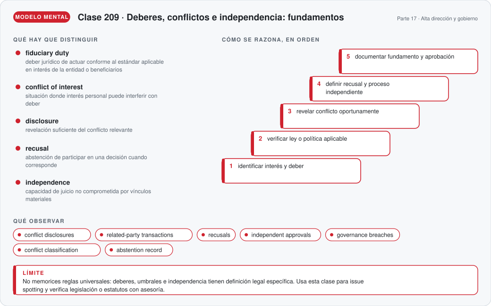

# Clase 209 — Deberes, conflictos e independencia: fundamentos

<!-- nav:inicio -->
> **Parte 17 · Directorios y gobierno corporativo** — clase 5 de 12 · [índice de la parte](../../README.md) · [temario](../../../../SYLLABUS.md)
<!-- nav:fin -->

**Parte:** 17 — Directorios y gobierno corporativo  
**Nivel:** Etapa 5 — Director → CEO  
**Duración sugerida:** 150–180 minutos · **Estándar:** deep-class-v2

## 🎯 Propósito

Un director no es solo una persona con experiencia que da opiniones: es alguien a quien la ley y los estatutos le imponen **deberes** frente a la empresa y sus propietarios, y cuya independencia de juicio es el activo principal que aporta. Los problemas más graves de gobierno nacen casi siempre de un conflicto de interés mal manejado: un director cuya firma vende servicios a la empresa, un ejecutivo que contrata a un familiar, un asesor que recibe un favor «sin importancia» y luego se siente en deuda. Rara vez empieza con una mala intención; empieza con una cercanía que se vuelve dependencia, y con la falta de reglas claras para detectarla, declararla y manejarla antes de que afecte la decisión.

Esta clase no enseña derecho: enseña a **detectar y manejar** conflictos con método, y a reconocer los mecanismos de influencia que los generan, para decidir cuándo se debe consultar a asesoría legal y qué fuente oficial verificar. Se apoya en Tricker sobre el gobierno corporativo, en los principios de la OCDE sobre los deberes del directorio, en Monks y Minow sobre poder e independencia, y en los principios de influencia de Cialdini, útiles para entender cómo se construye, paso a paso, una relación de dependencia. Remite a la ley de sociedades y a los estatutos. Al terminar sabrás clasificar conflictos, aplicar un procedimiento de declaración, recusación y documentación, y diseñar políticas de regalos, partes relacionadas y acceso a información.

## 📚 Resultados de aprendizaje

Al finalizar podrás:

1. **Identificar** los deberes generales de un director e identificar cuándo consultar la norma.
2. **Clasificar** conflictos como reales, potenciales y percibidos.
3. **Aplicar** un procedimiento de declaración, recusación y decisión independiente.
4. **Reconocer** mecanismos de influencia que generan dependencia.
5. **Diseñar** políticas de partes relacionadas, regalos y acceso a información.

## 🧭 Agenda

| Tramo | Qué se hace |
|---|---|
| 0–20 min | Recuperación: ¿qué relación personal o comercial de un director o ejecutivo de tu empresa podría afectar una decisión? |
| 20–60 min | Deberes, tipos de conflicto, procedimiento, partes relacionadas, influencia e independencia. |
| 60–105 min | Ejemplo trabajado: contrato con una empresa del cónyuge de un director. |
| 105–150 min | Caso ejecutivo y práctica. |
| 150–175 min | Límites y entregable. |

## 🧩 Conceptos centrales

| Concepto | Definición | Cómo se reconoce |
|---|---|---|
| **Deber fiduciario** | Obligación de actuar en el mejor interés de otro, con diligencia y lealtad. | Se aplica a directores y a quienes administran. |
| **Conflicto de interés real** | Interés personal que choca con el deber hacia la empresa en una decisión concreta. | La persona puede ganar a costa de la empresa. |
| **Conflicto potencial** | Situación que podría generar un conflicto real. | Vínculos que aún no se activan. |
| **Conflicto percibido** | Apariencia de conflicto para un observador razonable. | Afecta la confianza aunque no haya daño. |
| **Recusación** | Abstenerse de participar y de votar en un asunto. | Se registra en el acta. |
| **Parte relacionada** | Persona o entidad vinculada a la empresa, a sus directores o ejecutivos. | Familiares, sociedades propias, controladores. |

## 🧠 Modelo mental

**Cómo leer el diagrama.** Una cadena de cinco pasos con retorno. **Identificar**: qué interés propio o de un tercero hay. **Verificar**: ley, estatutos y política aplicables. **Revelar a tiempo**: antes de que se delibere o decida. **Recusarse**: proceso independiente de decisión. **Documentar**: fundamento, aprobación y seguimiento. La flecha indica que el caso mejora la política. La nota explica que los conflictos pueden ser reales, potenciales o percibidos; el pie, que los deberes, los umbrales y la definición de independencia son legales y específicos y se verifican con asesoría, no de memoria.

## 📖 Desarrollo

### 1. Los deberes de un director

Los sistemas jurídicos imponen a los directores obligaciones que, en términos generales, se agrupan en: **diligencia y cuidado** (informarse, dedicar tiempo, preguntar, decidir con razonabilidad), **lealtad** (anteponer el interés de la empresa, no usar la posición ni la información para beneficio propio, evitar o declarar conflictos), **reserva** de la información confidencial y **cumplimiento** de la ley y de los estatutos. Los principios de la OCDE sostienen que los directores deben actuar con información completa, de buena fe, con la debida diligencia y en el mejor interés de la empresa y de los accionistas, tratando de forma equitativa a distintos grupos de accionistas y considerando los intereses de las partes interesadas. La ley de sociedades anónimas de cada país, y en Chile la normativa de sociedades y sus normas complementarias, regula los deberes, las operaciones con partes relacionadas y las responsabilidades; su alcance exacto, los umbrales y las excepciones se verifican en el texto vigente y con asesoría. Esta clase sirve para **ver el tema**, no para resolverlo de memoria.

### 2. Tipos de conflicto

Un conflicto **real** existe cuando una persona tiene un interés que choca, en la práctica, con su deber hacia la empresa en una decisión concreta (por ejemplo, vota la contratación de una firma de la que es socio). Un conflicto **potencial** es una situación que podría volverse real (por ejemplo, un director es socio minoritario de un proveedor al que la empresa podría contratar en el futuro). Un conflicto **percibido** es una apariencia que un observador razonable interpretaría como conflicto, aun cuando la persona esté segura de su imparcialidad (por ejemplo, un regalo de un licitante). Los tres exigen atención: el real, para evitar daño; el potencial, para anticiparlo; el percibido, para proteger la confianza de empleados, inversionistas y reguladores. Las reglas legales pueden tratar de manera distinta cada categoría.

### 3. El procedimiento: declarar, recusarse, decidir, documentar

Un procedimiento sólido tiene cinco pasos. **Identificar** el interés propio, de un familiar o de una entidad vinculada. **Verificar** la norma, los estatutos y la política de la empresa, con asesoría si hay dudas. **Revelar** el conflicto por escrito y **antes** de que se delibere o decida: la revelación tardía es una señal de alerta en sí misma. **Recusarse**: la persona no participa en la deliberación ni vota, y no recibe información privilegiada sobre el asunto; la decisión la toman directores sin conflicto, con información comparativa independiente. **Documentar**: el acta recoge la declaración, la recusación, los antecedentes considerados, las alternativas y la fundamentación; se informa a quien corresponda. El procedimiento se **prueba** con casos y se revisa tras cada incidente.

### 4. Partes relacionadas

Las operaciones con partes relacionadas (compras, ventas, arriendos, préstamos, remuneraciones, servicios) son legítimas en muchos casos, pero llevan un riesgo de **transferencia de valor** hacia quien tiene el conflicto. Se rigen por reglas legales que suelen exigir revelación, aprobación por órganos o personas sin conflicto y condiciones **equivalentes a las de mercado**. En la práctica, una política efectiva incluye: **definición** de quién es parte relacionada; **registro** actualizado; **comparación** con alternativas de mercado (al menos tres cotizaciones o una tasación independiente); **aprobación** por directores independientes o un comité; **información** al directorio y, cuando corresponda, a los propietarios; y **seguimiento** posterior. Los umbrales y las excepciones dependen de la normativa vigente.

### 5. Regalos, hospitalidad y favores

Los regalos y las invitaciones son el terreno donde el conflicto percibido es más frecuente. Una política simple define: **umbral de valor** por encima del cual se informa o se rechaza; **frecuencia** máxima; **prohibición total** en procesos de licitación y con funcionarios públicos (con la normativa anticorrupción aplicable, clase 189); **registro** público interno; y **devolución o destino** de lo rechazado. Cialdini describe que las personas tienden a corresponder a los favores recibidos (**reciprocidad**), aun cuando el favor sea pequeño y no pedido, y que los pequeños compromisos facilitan otros mayores (**coherencia y compromiso**). Conocer estas tendencias sirve como defensa: un regalo «sin importancia» puede ser el primer paso de una relación de dependencia.

### 6. Cómo se construye la influencia

Los casos históricos de captura de personas con acceso a información o decisiones muestran un patrón repetido más que una sola gran falta: **acercamiento amistoso**, **favores o atenciones** que crean una deuda emocional, **solicitud de pequeños servicios** (una opinión, un dato), **progresión gradual** de las peticiones, **aislamiento** (pedir discreción) y, finalmente, **dependencia** que dificulta negarse. Cialdini añade los principios de **autoridad** (obedecer a quien parece experto), **simpatía** (ceder ante quien nos cae bien), **prueba social** y **escasez**. La defensa no es la desconfianza general, sino **reglas claras** (declarar contactos y ofrecimientos inusuales), **cultura de consulta** (preguntar sin temor) y **diseño de acceso** (menos información sensible a menos personas). No se trata de vigilar la vida privada de nadie, sino de proteger decisiones y datos de la empresa (clase 213).

### 7. Independencia: qué significa y qué no

La **independencia** de un director es la capacidad de juzgar sin que lo afecten vínculos con la gerencia, con propietarios relevantes o con la empresa. Las leyes, los reguladores y los códigos de gobierno definen criterios específicos (relaciones laborales o comerciales, parentesco, antigüedad, participación en propiedad, remuneraciones adicionales), que cambian según el país y el tipo de sociedad. La independencia **formal** (cumplir los criterios) no es sinónimo de independencia **de juicio** (voluntad de discrepar y capacidad para hacerlo). Se promueve con **procesos de selección** transparentes, **información** de calidad, **tiempo**, **sesiones ejecutivas** y **protección** frente a represalias. La definición aplicable se verifica en la fuente oficial, no se asume.

## 📚 Lectura comparada

| Obra | Qué aporta | Qué no resuelve | Pregunta para contrastar |
|---|---|---|---|
| Tricker | Deberes y responsabilidades del directorio. | No es derecho local. | ¿Qué deber está en juego? |
| OCDE (2023) | Deberes de diligencia, lealtad y trato equitativo; partes relacionadas. | Principios de alto nivel. | ¿Qué principio ilumina este caso? |
| Monks y Minow | Poder, independencia y conflictos en el gobierno. | Posición fuerte sobre reforma. | ¿Quién controla a quién? |
| Cialdini | Mecanismos de influencia: reciprocidad, compromiso, autoridad y otros. | Describe la influencia, no los deberes legales. | ¿Cómo se construyó esta relación? |
| LeyChile (BCN) | Texto oficial de la normativa de sociedades. | No es asesoría ni interpretación. | ¿Qué versión rige y qué dicen los estatutos? |

## 🧮 Ejemplo trabajado

**Situación (hipotética).** La gerencia propone renovar, por 420 millones de pesos al año, el contrato de servicios de mantenimiento con una empresa cuyo dueño es el cónyuge de la directora D. El contrato actual lleva cuatro años sin licitarse.

**Clasificación.** Conflicto **real** para D en esta decisión (el interés económico de su cónyuge); **potencial** para la gerencia (la relación histórica con el proveedor); **percibido** para los empleados y los demás proveedores si no se compara.

**Procedimiento aplicado.**

1. **Identificar**: D declara por escrito el vínculo antes de la sesión.
2. **Verificar**: la asesoría legal confirma qué norma y qué estatutos aplican a las operaciones con partes relacionadas y qué aprobaciones se requieren, y la empresa documenta la fuente consultada.
3. **Revelar**: se incluye en el acta y en el registro de partes relacionadas.
4. **Recusarse**: D se retira de la sala y no recibe los antecedentes; la decisión la toma el comité de auditoría sin D.
5. **Comparar con el mercado**: se solicitan tres cotizaciones para el mismo alcance.

**Comparación de ofertas.**

| Oferta | Monto anual (millones) | Diferencia con la mejor |
|---|---|---|
| Proveedor relacionado | 420 | +60 (+16,7 % sobre 360) |
| Alternativa 1 | 360 | 0 |
| Alternativa 2 | 372 | +12 |
| Alternativa 3 | 395 | +35 |

El promedio de las tres alternativas es (360 + 372 + 395) ÷ 3 ≈ 375,7 millones; el proveedor relacionado está 44,3 millones por encima (420 − 375,7), un 11,8 %.

**Decisión.** El comité solicita al proveedor relacionado que iguale las condiciones de mercado; este ofrece 380 millones con el mismo alcance y mejora de plazos. El comité compara la calidad histórica (indicadores de servicio) y el costo de cambio (transición de 25 millones una sola vez). Costo a tres años: proveedor relacionado a 380 = 1.140 millones; alternativa 1 a 360 más 25 de transición = 1.105 millones. Diferencia: 35 millones a favor de la alternativa 1 (3,1 %). El comité decide contratar con la alternativa 1, con una cláusula de desempeño, y documenta la fundamentación.

**Costo del procedimiento.** Asesoría, cotizaciones y análisis: unos 8 millones, frente a un sobrecosto potencial de 60 millones anuales (180 millones a tres años) si se hubiera renovado sin comparar.

**Política de regalos.** Umbral de 150.000 pesos; prohibición en licitaciones; registro. Una revisión del año muestra 24 regalos o invitaciones declarados, 5 sobre el umbral (20,8 %): 3 se devolvieron y 2 se sortearon con fines benéficos.

**Cuidados.** Los deberes de los directores, las operaciones con partes relacionadas, la definición de independencia y las sanciones se verifican en la ley, los estatutos y con asesoría; las cifras son ilustrativas.

**Qué muestra.** (1) El conflicto se clasificó y se declaró antes de decidir. (2) La comparación con el mercado cuantificó la transferencia posible de valor. (3) La recusación y la documentación protegieron la decisión.

## 🔀 Comparación y límites

**Conflicto frente a incumplimiento.** Tener un conflicto no es una falta; no declararlo o decidir con él sí puede serlo. El objetivo del gobierno es manejarlo, no negarlo.

**Límites.** No memorices reglas universales: los deberes, los umbrales y la independencia tienen definiciones legales específicas. Esta clase sirve para detectar y ordenar los temas (*issue spotting*) y debe complementarse con la legislación, los estatutos y asesoría. Los patrones de influencia describen tendencias, no determinismos. Las cifras del ejemplo son ilustrativas.

## 🪜 De profesional a owner

| Nivel | Cómo maneja conflictos |
|---|---|
| **Profesional** | Declara vínculos y rechaza regalos fuera de política. |
| **Jefe / Team Lead** | Evita decidir sobre personas o proveedores con vínculos. |
| **Gerente** | Propone compras con comparación y se recusa cuando corresponde. |
| **CEO / Director** | Declara, se recusa y protege el procedimiento. |
| **Founder / Owner** | Separa el patrimonio personal del de la empresa y acepta controles. |

## 🏢 Caso ejecutivo

Una empresa de energía con 1.500 personas va a licitar un contrato de 18.000 millones de pesos. El presidente del comité de adquisiciones, un director, almorzó con el gerente de uno de los licitantes, que además le regaló una invitación a un evento deportivo (valor aproximado de 400.000 pesos). La gerente de compras es prima del dueño de otro licitante; un tercer licitante contrató, hace dos meses, al hijo del gerente general como asesor; un cuarto ofreció a un director un puesto en su propio directorio tras la licitación. Un director independiente recibe de un competidor llamadas amistosas «sobre el mercado». La empresa no tiene política de regalos ni registro de partes relacionadas. Una denuncia anónima menciona «arreglos». El presidente del directorio quiere «resolverlo discretamente».

Entrega un **protocolo de conflictos** que contenga: (a) la clasificación de los cinco casos como reales, potenciales o percibidos, con la acción de cada uno; (b) el procedimiento de declaración, recusación, decisión independiente y documentación aplicado a la licitación; (c) las políticas de partes relacionadas y de regalos y hospitalidad, con umbrales y registro; (d) el análisis de mecanismos de influencia presentes y las defensas de diseño; (e) el tratamiento de la denuncia anónima con asesoría; (f) los puntos legales, estatutarios y de independencia a verificar en fuentes oficiales.

## 🧪 Práctica

1. Clasifica cinco situaciones reales de tu entorno como conflicto real, potencial o percibido y propón la acción.
2. Redacta un formulario de declaración de intereses de una página.
3. Escribe una política de regalos con umbral, registro y prohibiciones.
4. Compara un contrato con una parte relacionada con tres cotizaciones y calcula la diferencia.
5. Describe cómo se podría construir una dependencia con un directivo en seis pasos y qué regla la habría frenado.

## ⚠️ Errores frecuentes

| Error | Por qué ocurre | Cómo corregirlo |
|---|---|---|
| Revelar tarde | Se espera que nadie lo note | Declarar antes de la deliberación. |
| Recusarse sin dejar de influir | Se opina «informalmente» | Salir de la sala y no recibir antecedentes. |
| Aprobar sin comparar | Se confía en la relación | Cotizaciones y tasaciones independientes. |
| Regalos «sin importancia» | Se minimiza el efecto | Umbral, registro y prohibiciones. |
| Confundir independencia formal con de juicio | Se miran los criterios | Cultura de desafío y sesiones ejecutivas. |
| Resolver «discretamente» | Se teme el escándalo | Procedimiento formal con asesoría. |

## ❓ Preguntas de comprobación

1. ¿Qué deberes generales tiene un director?
2. ¿Qué diferencia hay entre conflicto real, potencial y percibido?
3. ¿Qué pasos tiene el procedimiento ante un conflicto?
4. ¿Qué incluye una política de partes relacionadas?
5. ¿Qué principios de Cialdini ayudan a entender la construcción de dependencia?
6. ¿Por qué la independencia formal no basta?
7. ¿Qué se verifica con asesoría y fuentes oficiales?

Claves de respuesta

1. Diligencia y cuidado, lealtad, reserva y cumplimiento de la ley y los estatutos.
2. El real choca con el deber en una decisión concreta; el potencial podría serlo; el percibido es una apariencia que afecta la confianza.
3. Identificar, verificar la norma, revelar a tiempo, recusarse y documentar.
4. Definición, registro, comparación con el mercado, aprobación independiente, información y seguimiento.
5. Reciprocidad, coherencia y compromiso, autoridad, simpatía, prueba social y escasez.
6. Porque cumplir criterios no garantiza la voluntad ni la capacidad de discrepar.
7. Los deberes, las operaciones con partes relacionadas, la definición de independencia, los umbrales y las sanciones.

## 📥 Entregable

Guarda en `portfolio/209-deberes-conflictos-e-independencia-fundamentos/`:

- `risk-governance-brief.md` (plantilla [Risk Governance Brief](../../../../templates/risk-governance-brief.md)) con el protocolo del caso ejecutivo;
- `influence-and-conflict-disclosure-brief.md` (plantilla [Ficha de influencia y declaración de conflictos](../../../../templates/influence-and-conflict-disclosure-brief.md)) con la declaración y el tratamiento de cada caso;
- `decision-journal.md` con la clasificación, los análisis comparativos y las verificaciones legales pendientes.

## 📗 Fuentes y verificación

- Bob Tricker — *Corporate Governance* (Oxford University Press, 2019). **Uso en esta clase:** deberes y responsabilidades del directorio. Lectura selectiva sobre **deberes, conflictos e independencia: fundamentos**. **Localizador:** [ISBN-13 9780198809869](https://openlibrary.org/isbn/9780198809869).
- OECD — *G20/OECD Principles of Corporate Governance 2023*. **Uso en esta clase:** deberes de diligencia, lealtad y trato equitativo. **Fuente primaria:** <https://www.oecd.org/en/publications/2023/09/g20-oecd-principles-of-corporate-governance-2023_60836fcb.html>.
- Robert A. G. Monks & Nell Minow — *Corporate Governance* (John Wiley & Sons, Incorporated, 2001). **Uso en esta clase:** poder, independencia y conflictos en el gobierno. Lectura selectiva sobre **deberes, conflictos e independencia: fundamentos**. **Localizador:** [ISBN-13 9781118874899](https://openlibrary.org/isbn/9781118874899).
- Robert B. Cialdini — *Influence* (HarperCollins Publishers and Blackstone Audio, 2016). **Uso en esta clase:** mecanismos de influencia y dependencia. Lectura selectiva sobre **deberes, conflictos e independencia: fundamentos**. **Localizador:** [ISBN-13 9781624608049](https://openlibrary.org/isbn/9781624608049).
- Biblioteca del Congreso Nacional de Chile — *LeyChile: sociedades anónimas (Ley 18.046) y su reglamento* (1981). **Uso en esta clase:** texto oficial de la normativa chilena de sociedades anónimas. **Fuente primaria:** <https://www.bcn.cl/leychile/>.

> **Regla de fuentes para Deberes, conflictos e independencia: fundamentos:** las obras anteriores estructuran las perspectivas de esta materia; cualquier norma, ley o estándar vivo mencionado debe comprobarse nuevamente en su fuente primaria vigente, incluidos los deberes de los directores, las operaciones con partes relacionadas y la definición de independencia, que no se interpretan de memoria. Los ejemplos y casos son hipotéticos, con cifras ilustrativas. El desarrollo es original y no reproduce capítulos protegidos.

<!-- pie:inicio -->
---

| Anterior | Índice | Siguiente |
|---|---|---|
| [← 208 · Comités de auditoría, riesgo y compensación](../208-comites-de-auditoria-riesgo-y-compensacion/README.md) | [Parte 17](../../README.md) · [Programa](../../../../SYLLABUS.md) | [210 · Información y transparencia →](../210-informacion-y-transparencia/README.md) |
<!-- pie:fin -->
