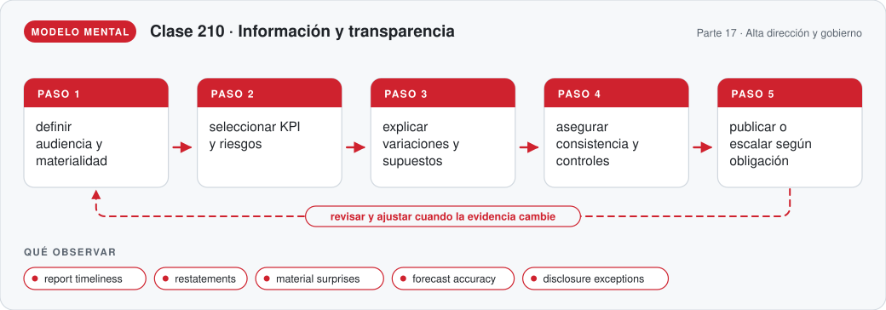

# Clase 210 — Información y transparencia

<!-- nav:inicio -->
> **Parte 17 · Directorios y gobierno corporativo** — clase 6 de 12 · [índice de la parte](../../README.md) · [temario](../../../../SYLLABUS.md)
<!-- nav:fin -->

**Parte:** 17 — Directorios y gobierno corporativo  
**Nivel:** Etapa 5 — Director → CEO  
**Duración sugerida:** 150–180 minutos · **Estándar:** deep-class-v2

## 🎯 Propósito

Un directorio solo puede decidir tan bien como la información que recibe. Y la información que llega a un directorio es, casi siempre, **filtrada**: la gerencia decide qué mostrar, cómo, cuándo y con qué lenguaje. No hace falta mala fe para que el resultado sea engañoso: un indicador con una definición distinta cada mes, un promedio que esconde un cliente en problemas, una buena noticia al comienzo y una mala al pie de la página doce, una cifra que se «ajusta» para que cierre. Del mismo modo, hacia afuera, la empresa informa a bancos, inversionistas, reguladores, empleados y la sociedad, con distintos niveles de detalle y de obligación. Transparencia no es publicar todo; es **no ocultar lo material a quien debe decidir** y cumplir con lo que se debe informar, con consistencia entre lo que se dice a unos y a otros.

La clase propone un enfoque por **audiencia y materialidad**: ¿quién necesita saber qué, para qué decisión, con qué precisión y en qué plazo? Se apoya en los principios de gobierno de la OCDE sobre información y transparencia, en Tricker y en Monks y Minow sobre la relación entre información y poder, en el cuadro de mando integral de Kaplan y Norton para elegir y definir indicadores y en el marco COSO de control interno, que incluye la información y la comunicación. Remite a la ley y a la normativa del regulador para las obligaciones de información. Al terminar sabrás definir materialidad, seleccionar indicadores, explicar variaciones, asegurar la consistencia y decidir cuándo publicar o escalar.

## 📚 Resultados de aprendizaje

Al finalizar podrás:

1. **Definir** audiencias y criterios de materialidad para decidir qué informar.
2. **Seleccionar** indicadores y riesgos con definiciones únicas y comparables.
3. **Explicar** variaciones y supuestos con una narrativa causal.
4. **Asegurar** consistencia y controles sobre la información.
5. **Decidir** cuándo publicar o escalar según obligaciones y límites legítimos.

## 🧭 Agenda

| Tramo | Qué se hace |
|---|---|
| 0–20 min | Recuperación: ¿cuántas versiones de la misma cifra circulan hoy en tu empresa y quién decide cuál es la correcta? |
| 20–60 min | Audiencias, materialidad, indicadores, explicación, consistencia y límites. |
| 60–105 min | Ejemplo trabajado: reconciliación de cifras y aplicación de un umbral de materialidad. |
| 105–150 min | Caso ejecutivo y práctica. |
| 150–175 min | Límites y entregable. |

## 🧩 Conceptos centrales

| Concepto | Definición | Cómo se reconoce |
|---|---|---|
| **Materialidad** | Importancia de una información para las decisiones de quien la recibe. | Su omisión o error cambiaría una decisión. |
| **Divulgación (*disclosure*)** | Comunicación de información a terceros por obligación o decisión. | Informes, hechos esenciales, estados financieros. |
| **Fuente única de verdad** | Una definición y un conjunto de datos para cada indicador. | Todos los informes usan la misma cifra. |
| **Asimetría de información** | Una parte sabe más que otra. | La gerencia conoce más que el directorio. |
| **Información privilegiada** | Información material no pública. | Su uso o filtración tiene reglas especiales. |
| **Escalamiento** | Llevar un asunto a una instancia superior. | Reglas por umbral, tipo o plazo. |

## 🧠 Modelo mental

**Cómo leer el diagrama.** Un cuadrante con la obligación en el eje horizontal (voluntaria u obligatoria) y la materialidad en el vertical. **Material y obligatoria**: publicar o escalar sin demora, con plazo, contenido y responsable definidos. **Material pero voluntaria**: informar con criterio, decidiendo con el directorio. **Poco material y obligatoria**: cumplir la forma con precisión y sin ruido. **Poco material y voluntaria**: resumir u omitir para no saturar a quien decide. La nota afirma que el objetivo no es publicar todo sino no ocultar lo material a quien debe decidir; el pie, que las obligaciones de información dependen de la ley y del mercado.

## 📖 Desarrollo

### 1. Información para decidir

Los principios de gobierno de la OCDE señalan que un marco de gobierno corporativo debe asegurar la **divulgación oportuna y precisa** de los asuntos materiales de la empresa (resultados financieros y operativos, objetivos, propiedad, remuneración de directores y ejecutivos, partes relacionadas, factores de riesgo, entre otros) y la existencia de una **auditoría independiente**. Pero la información no es solo un asunto hacia afuera: Tricker subraya que la calidad de la información que llega al directorio determina la calidad de su supervisión, y que los directores necesitan acceso a información **completa, oportuna y confiable**, además de contacto directo con las fuentes. Monks y Minow recuerdan que la **asimetría de información** es una de las fuentes de poder de la gerencia, y que el gobierno corporativo busca equilibrarla.

### 2. Audiencias y materialidad

Se comienza con la pregunta: **¿para quién y para qué decisión?** Las audiencias típicas son: el **directorio** (supervisión y decisiones estratégicas), los **propietarios** (evaluar al directorio y asignar capital), los **financistas** (capacidad de pago y cumplimiento de condiciones), los **empleados** (rumbo y estabilidad), los **clientes y proveedores** (continuidad), los **reguladores** (cumplimiento) y el **público** (en empresas abiertas). Para cada una, la información **material** es la que, de omitirse o presentarse con error, **cambiaría su decisión**. Se establecen **criterios de materialidad** cuantitativos (por ejemplo, un porcentaje del resultado, del patrimonio o de los ingresos) y cualitativos (violaciones legales, conflictos, daño reputacional, efecto en covenants), y se aplican de forma **agregada**: varias partidas pequeñas pueden ser, en conjunto, materiales.

### 3. Indicadores con una sola definición

Kaplan y Norton proponen que los indicadores se organicen en perspectivas (financiera, clientes, procesos internos, aprendizaje y crecimiento) y vinculados a la estrategia; para el directorio, esto significa **pocos indicadores**, cada uno con **definición escrita**, fórmula, fuente de datos, responsable, frecuencia y meta. Un problema común es que cada área calcula el mismo indicador de forma distinta (por ejemplo, el «EBITDA ajustado» con distintos tratamientos de partidas extraordinarias), de modo que el directorio recibe cifras incompatibles. Se resuelve con un **diccionario de indicadores** aprobado por el comité de auditoría o finanzas, con cambios controlados y comunicados, y con **comparabilidad** en el tiempo: cuando una definición cambia, se reexpresan los períodos anteriores y se explica.

### 4. Explicar, no solo mostrar

Un número sin explicación es una invitación a la especulación. Un buen informe explica **variaciones** frente al plan y al año anterior en sus **causas** (precio, volumen, mezcla, costo, eventos únicos), distingue lo **estructural** de lo **transitorio**, muestra los **supuestos** de las proyecciones y su sensibilidad, y declara **lo que no se sabe**. También separa lo **bueno** y lo **malo** con el mismo peso: los malos resultados no se entierran en anexos. La narrativa causal permite al directorio hacer buenas preguntas. Y la **conciliación** entre cifras de distintos informes (por ejemplo, contables y de gestión) forma parte de la explicación.

### 5. Consistencia y control de la información

COSO incluye la **información y la comunicación** como componente del control interno: los datos que se usan deben ser **relevantes, de calidad y oportunos**, y fluir hacia quienes los necesitan, hacia arriba, hacia abajo y hacia afuera. Esto implica controles sobre los datos (fuentes, conciliaciones, accesos, cambios), **revisión independiente** de los informes críticos, **trazabilidad** de las cifras hasta su origen y **un solo responsable** por indicador. Además, la información que se entrega a distintos públicos debe ser **consistente**: lo que se dice al banco no debe contradecir lo que se dice al directorio, ni lo que se dice a los empleados lo que se comunica al regulador. La inconsistencia es una de las primeras señales de problemas de gobierno.

### 6. Obligación, voluntariedad y límites legítimos

Parte de la información es **obligatoria** (estados financieros, hechos relevantes en empresas abiertas, informes a reguladores, información a accionistas) y su plazo, contenido y responsables dependen de la ley y de las normas del regulador (en Chile, por ejemplo, la normativa de sociedades y las normas de la Comisión para el Mercado Financiero para ciertas entidades), que se verifican en la fuente oficial y con asesoría. Otra es **voluntaria**: informes de sostenibilidad, comunicados, presentaciones a inversionistas. La transparencia tiene **límites legítimos**: confidencialidad comercial, secretos industriales, privilegio de las comunicaciones con abogados, protección de datos personales, información **privilegiada** cuyo uso o divulgación selectiva está regulado. El estándar es: no ocultar lo material a quien debe decidir y no publicar lo que no se debe.

### 7. Publicar o escalar

Se define un **protocolo** para decidir qué hacer cuando surge información material: ¿quién evalúa su materialidad?, ¿qué plazo hay para informar al presidente del directorio y al comité?, ¿corresponde divulgar al mercado o a un regulador?, ¿quién redacta y aprueba?, ¿cómo se evita la filtración selectiva? Se preparan **plantillas** y una **lista de verificación**. La regla de oro es la **escalada rápida**: un asunto material que el directorio se entera por un tercero indica un problema del sistema de información. Y se aprende de cada caso: ¿por qué no llegó antes?, ¿qué señal se ignoró?, ¿qué cambia en el protocolo?

## 📚 Lectura comparada

| Obra | Qué aporta | Qué no resuelve | Pregunta para contrastar |
|---|---|---|---|
| OCDE (2023) | Principios de divulgación y de auditoría independiente. | Principios generales. | ¿Qué divulgación es material para nuestros públicos? |
| Tricker | Información como base de la supervisión del directorio. | No fija indicadores específicos. | ¿Qué sabe el directorio y cómo lo sabe? |
| Monks y Minow | Asimetría de información y poder. | Posición firme sobre reforma. | ¿Quién controla la información? |
| Kaplan y Norton | Indicadores por perspectivas ligados a la estrategia. | Puede producir exceso de indicadores. | ¿Cuáles son los pocos indicadores críticos? |
| COSO Control Interno | Información y comunicación como componente del control. | No define qué informar. | ¿Los datos son confiables y trazables? |

## 🧮 Ejemplo trabajado

**Situación (hipotética).** El directorio de una empresa de servicios recibe cada mes un tablero. Un director nota que el EBITDA del mes difiere entre tres informes.

**Reconciliación de la cifra.**

| Informe | EBITDA anual proyectado (millones) | Tratamiento de partidas únicas |
|---|---|---|
| Finanzas (contable) | 4.800 | Incluye gastos de reestructuración y venta de un activo |
| Comercial (gestión) | 5.150 | Excluye reestructuración y la venta se contabiliza como ingreso |
| Operaciones | 4.620 | Excluye la venta y suma un ajuste de inventario |

La diferencia entre la cifra más alta y la más baja es 5.150 − 4.620 = 530 millones, el 11,0 % de la cifra de finanzas (530 ÷ 4.800). La causa es la definición, no el negocio.

**Solución.** El comité de auditoría aprueba una definición única de «EBITDA ajustado» con una lista cerrada de partidas únicas y una conciliación mensual con el resultado contable; los informes de áreas usan solo esa cifra. Se reexpresan los últimos 12 meses.

**Umbral de materialidad para escalar al directorio.** Se fija en 3 % del EBITDA anual (0,03 × 4.800 = 144 millones) por partida, o en 5 % en el agregado de partidas no individuales (240 millones), o cualquier asunto legal o reputacional grave sin importar el monto.

**Aplicación.** Surgen cuatro asuntos en el mes.

| Asunto | Monto (millones) | ¿Supera 144? | Decisión |
|---|---|---|---|
| Disputa con un cliente por facturación | 210 | Sí | Escalar al directorio |
| Castigo de inventario | 90 | No | Registrar; revisar en agregado |
| Contingencia tributaria | 60 | No | Registrar; revisar en agregado |
| Multa menor de un regulador | 45 | No (pero asunto de cumplimiento) | Informar al comité por su naturaleza |

**Agregado.** 90 + 60 + 45 = 195 millones, por debajo del umbral agregado de 240 pero cercano; se informa al comité de auditoría con tendencia.

**Pack mejorado.** Una página de resumen con decisiones y alertas; diez indicadores con definiciones; un cuadro de variaciones con causas (precio, volumen, mezcla, costos, únicos); un registro de asuntos legales y de cumplimiento; y un anexo con la conciliación. Los indicadores en rojo se explican en la misma página.

**Consistencia hacia afuera.** Las cifras que se entregan al banco para el cálculo de covenants se concilian con las del directorio antes de su envío; las obligaciones de información al regulador se rigen por un calendario con responsables.

**Resultados (hipotéticos).** Tras seis meses, los informes con cifras inconsistentes bajan de 9 a 1 por trimestre; el tiempo de preparación del pack baja de 5 a 3 días hábiles; el directorio se entera del 100 % de los asuntos sobre el umbral por la vía formal, frente a 60 % antes.

**Cuidados.** Las obligaciones de divulgación, los plazos y los contenidos dependen de la ley y del regulador; el tratamiento de información privilegiada y de datos personales se verifica con asesoría; las cifras son ilustrativas.

**Qué muestra.** (1) Una definición única eliminó la discrepancia. (2) El umbral de materialidad ordenó el escalamiento. (3) La conciliación aseguró consistencia hacia adentro y hacia afuera.

## 🔀 Comparación y límites

**Transparencia frente a exceso de información.** Más páginas no es más transparencia: el exceso de información oculta lo importante. La transparencia efectiva destaca lo material y lo hace comprensible.

**Límites.** La transparencia tiene límites legítimos de confidencialidad, privilegio y competitividad; el objetivo no es publicar todo. La materialidad es un juicio que se apoya en criterios, no una fórmula exacta. Las obligaciones de divulgación varían por país, mercado y tipo de empresa. Las cifras del ejemplo son ilustrativas.

## 🪜 De profesional a owner

| Nivel | Cómo cuida la información |
|---|---|
| **Profesional** | Registra datos con exactitud y no los «arregla». |
| **Jefe / Team Lead** | Usa las definiciones oficiales y avisa de errores. |
| **Gerente** | Presenta información material, explicada y consistente. |
| **CEO / Director** | Exige información independiente y la usa para decidir. |
| **Founder / Owner** | Acepta que el directorio y los terceros vean la realidad completa. |

## 🏢 Caso ejecutivo

Una empresa de alimentos con 2.300 personas y ventas de 110.000 millones de pesos tiene un covenant bancario de deuda neta sobre EBITDA máximo de 3,0 veces. Hace tres trimestres, el gerente financiero presentó al directorio una razón de 2,6 y al banco una de 2,4, con definiciones distintas de EBITDA. El informe de gestión muestra un crecimiento de ventas de 8 % «sin considerar devoluciones»; con ellas, el crecimiento es 3 %. Un incidente de calidad en una planta, con un costo estimado de 700 millones, se informó al directorio tres semanas después, tras una llamada de un cliente. El pack mensual tiene 120 páginas; una pérdida contingente de 1.100 millones por un juicio aparece en la página 97. Las presentaciones a inversionistas no coinciden con las de empleados. Un director pregunta por qué «los números cambian cada mes» y recibe respuestas distintas. Un auditor menciona una debilidad de control en el cierre.

Entrega un **sistema de información y transparencia** que contenga: (a) el mapa de audiencias con decisiones y obligaciones; (b) los criterios de materialidad y las reglas de escalamiento; (c) el diccionario de indicadores y la reconciliación de las cifras en conflicto; (d) el formato del pack con narrativa causal y alertas; (e) los controles de calidad de la información y la consistencia hacia afuera; (f) el protocolo de divulgación y los límites legales, con las verificaciones en fuentes oficiales y asesoría.

## 🧪 Práctica

1. Lista las audiencias de la información de tu empresa y la decisión que toma cada una.
2. Define criterios de materialidad cuantitativos y cualitativos para tu directorio.
3. Escribe la definición de tres indicadores clave con fórmula, fuente y responsable.
4. Reconcilia dos cifras que difieran en tu empresa y explica la causa.
5. Diseña un protocolo de escalamiento de asuntos materiales con plazos y responsables.

## ⚠️ Errores frecuentes

| Error | Por qué ocurre | Cómo corregirlo |
|---|---|---|
| Varias versiones de la cifra | Cada área define a su modo | Diccionario único y conciliación. |
| Malas noticias al final | Se busca amortiguar | Alertas al comienzo con explicación. |
| Exceso de páginas | Se quiere cubrir todo | Material primero; detalle en anexos. |
| Materialidad por partida | Se mira cada asunto aislado | Evaluar también el agregado. |
| Información inconsistente hacia afuera | Se adapta el mensaje a cada público | Conciliación previa y un responsable. |
| Enterarse por terceros | Falta de protocolo | Escalamiento rápido y revisión de causas. |

## ❓ Preguntas de comprobación

1. ¿Qué es materialidad y cómo se define?
2. ¿Por qué es importante una definición única de los indicadores?
3. ¿Qué debe incluir la explicación de una variación?
4. ¿Qué controles apoyan la calidad de la información?
5. ¿Qué límites legítimos tiene la transparencia?
6. ¿Qué incluye un protocolo de escalamiento o divulgación?
7. ¿Por qué la consistencia hacia afuera es una señal de gobierno?

Claves de respuesta

1. La importancia de una información para las decisiones de quien la recibe; se define con criterios cuantitativos y cualitativos, incluido el efecto agregado.
2. Para que el directorio reciba cifras comparables y no incompatibles por diferencias de definición.
3. Causas (precio, volumen, mezcla, costos, únicos), distinción estructural/transitorio, supuestos y lo que no se sabe.
4. Fuentes confiables, conciliaciones, accesos, control de cambios, revisión independiente, trazabilidad y un responsable por indicador.
5. Confidencialidad comercial, secretos, privilegio legal, datos personales e información privilegiada.
6. Quién evalúa la materialidad, plazos, obligaciones de divulgación, quién redacta y aprueba, y cómo se evita la filtración selectiva.
7. Porque la inconsistencia entre lo que se dice a distintos públicos suele indicar problemas de control o de honestidad.

## 📥 Entregable

Guarda en `portfolio/210-informacion-y-transparencia/`:

- `risk-governance-brief.md` (plantilla [Risk Governance Brief](../../../../templates/risk-governance-brief.md)) con el sistema del caso ejecutivo;
- `board-pack.md` (plantilla [Board pack](../../../../templates/board-pack.md)) con el formato de pack con materialidad y alertas;
- `decision-journal.md` con el diccionario de indicadores, las reconciliaciones y las verificaciones legales pendientes.

## 📗 Fuentes y verificación

- OECD — *G20/OECD Principles of Corporate Governance 2023*. **Uso en esta clase:** divulgación oportuna y auditoría independiente. **Fuente primaria:** <https://www.oecd.org/en/publications/2023/09/g20-oecd-principles-of-corporate-governance-2023_60836fcb.html>.
- Bob Tricker — *Corporate Governance* (Oxford University Press, 2019). **Uso en esta clase:** información como base de la supervisión del directorio. Lectura selectiva sobre **información y transparencia**. **Localizador:** [ISBN-13 9780198809869](https://openlibrary.org/isbn/9780198809869).
- Robert A. G. Monks & Nell Minow — *Corporate Governance* (John Wiley & Sons, Incorporated, 2001). **Uso en esta clase:** asimetría de información y poder. Lectura selectiva sobre **información y transparencia**. **Localizador:** [ISBN-13 9781118874899](https://openlibrary.org/isbn/9781118874899).
- Robert S. Kaplan & David P. Norton — *The Balanced Scorecard* (Harvard Business School Press, 1996). **Uso en esta clase:** indicadores por perspectivas ligados a la estrategia. Lectura selectiva sobre **información y transparencia**. **Localizador:** [ISBN-13 9780875846514](https://openlibrary.org/isbn/9780875846514).
- COSO — *Internal Control - Integrated Framework* (2013). **Uso en esta clase:** información y comunicación como componente del control interno. **Fuente primaria:** <https://www.coso.org/guidance-on-ic>.
- Comisión para el Mercado Financiero — *Portal oficial de la CMF de Chile* (2017). **Uso en esta clase:** portal oficial del regulador para las obligaciones de información de las entidades supervisadas. **Fuente primaria:** <https://www.cmfchile.cl/>.

> **Regla de fuentes para Información y transparencia:** las obras anteriores estructuran las perspectivas de esta materia; cualquier norma, ley o estándar vivo mencionado debe comprobarse nuevamente en su fuente primaria vigente, incluidas las obligaciones de divulgación, los plazos, el tratamiento de información privilegiada y la protección de datos personales. Los ejemplos y casos son hipotéticos, con cifras ilustrativas. El desarrollo es original y no reproduce capítulos protegidos.

<!-- pie:inicio -->
---

| Anterior | Índice | Siguiente |
|---|---|---|
| [← 209 · Deberes, conflictos e independencia: fundamentos](../209-deberes-conflictos-e-independencia-fundamentos/README.md) | [Parte 17](../../README.md) · [Programa](../../../../SYLLABUS.md) | [211 · Board pack y calidad de información →](../211-board-pack-y-calidad-de-informacion/README.md) |
<!-- pie:fin -->
