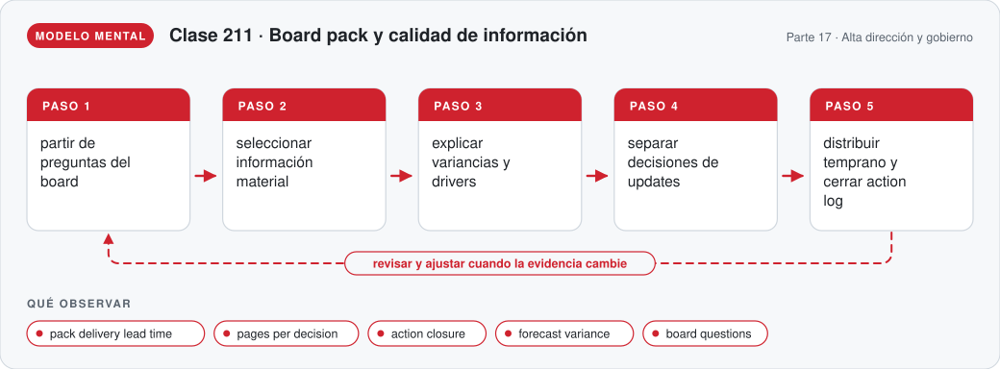

# Clase 211 — Board pack y calidad de información

<!-- nav:inicio -->
> **Parte 17 · Directorios y gobierno corporativo** — clase 7 de 12 · [índice de la parte](../../README.md) · [temario](../../../../SYLLABUS.md)
<!-- nav:fin -->

**Parte:** 17 — Directorios y gobierno corporativo  
**Nivel:** Etapa 5 — Director → CEO  
**Duración sugerida:** 150–180 minutos · **Estándar:** deep-class-v2

## 🎯 Propósito

El paquete de información que recibe el directorio antes de cada sesión (el *board pack*) es el producto más caro y menos evaluado del gobierno corporativo. Cada mes, decenas de personas dedican semanas a preparar cientos de páginas que los directores, con tiempo limitado, hojean en el avión o la noche anterior. El resultado es predecible: el pack se vuelve un archivo, las discusiones se centran en lo que alguien alcanzó a leer o en lo que se presenta en voz alta, y las decisiones importantes aparecen enterradas en el medio. Un directorio no se vuelve mejor leyendo más; se vuelve mejor leyendo **lo que necesita para decidir y supervisar**, organizado para ser comprendido y desafiado.

La clase trata el pack como un **producto de información** con un cliente (el director), un propósito (decidir y supervisar) y un estándar de calidad (materialidad, comparabilidad, narrativa causal, oportunidad). Se apoya en Charan sobre cómo usan el tiempo los directorios efectivos, en Tricker sobre la información como base de la supervisión, en LeBlanc y Gillies sobre la dinámica real de las salas de directorio, en los principios de la OCDE sobre información y en el trabajo de Mankins y Garton sobre el uso del tiempo y la atención. Al terminar sabrás diseñar un pack a partir de las preguntas del directorio, separar decisiones de informes, explicar variaciones, distribuir con antelación y cerrar la lista de acciones.

## 📚 Resultados de aprendizaje

Al finalizar podrás:

1. **Diseñar** un pack que parta de las preguntas del directorio.
2. **Seleccionar** la información material y retirar la que no lo es.
3. **Explicar** variaciones y causas con una narrativa causal.
4. **Separar** decisiones de actualizaciones y distribuir con antelación.
5. **Medir** la calidad del pack y cerrar la lista de acciones.

## 🧭 Agenda

| Tramo | Qué se hace |
|---|---|
| 0–20 min | Recuperación: ¿cuántas páginas tiene el último pack de tu directorio y cuántas se discutieron realmente? |
| 20–60 min | Propósito, preguntas, estructura, variaciones, decisiones, distribución y medición. |
| 60–105 min | Ejemplo trabajado: rediseño de un pack de 120 páginas. |
| 105–150 min | Caso ejecutivo y práctica. |
| 150–175 min | Límites y entregable. |

## 🧩 Conceptos centrales

| Concepto | Definición | Cómo se reconoce |
|---|---|---|
| **Board pack** | Conjunto de documentos que se entrega al directorio para una sesión. | Incluye agenda, decisiones, informes y anexos. |
| **Pre-lectura** | Documento breve que prepara una decisión o discusión. | Se lee antes y se discute en la sesión. |
| **Resumen ejecutivo** | Primera página con lo esencial: decisiones y alertas. | Se entiende sin leer el resto. |
| **Narrativa causal** | Explicación de por qué cambian los números. | Conecta resultados con causas. |
| **Registro de acuerdos** | Lista de decisiones y acciones con responsables y fechas. | Se revisa en la siguiente sesión. |
| **Anexo** | Información de apoyo que no se presenta. | Disponible para quien quiera profundizar. |

## 🧠 Modelo mental

**Cómo leer el diagrama.** Tres columnas. **Decidir**: decisiones pedidas al comienzo, con alternativas, recomendación y riesgos, separadas de las actualizaciones. **Entender**: resultados frente a plan y a años anteriores, causas de las variaciones, indicadores comparables y definidos. **Dar seguimiento**: acuerdos y responsables, lista de acciones con fechas y envío con antelación suficiente. La nota explica que reducir páginas no basta porque un pack breve puede omitir riesgos; el pie, que el pack parte de las preguntas del directorio y no de lo que cada área quiere mostrar.

## 📖 Desarrollo

### 1. El pack como producto

Un pack tiene tres funciones: permitir al directorio **decidir** (asuntos que requieren su aprobación), **entender** (cómo va la empresa y por qué) y **supervisar** (seguimiento de acuerdos, riesgos y compromisos). Cada página debe servir a una de ellas; las que no sirven, sobran. Charan observa que los mejores directorios dedican su tiempo a lo que solo ellos pueden hacer y que, para lograrlo, necesitan que la información llegue ordenada por **relevancia**, no por área. Tricker subraya que los directores deben recibir información suficiente para ejercer su deber de supervisión, y los principios de la OCDE agregan que el acceso debe ser **oportuno y confiable**. El pack es, entonces, un **instrumento de gobierno**, no un informe de gestión.

### 2. Partir de las preguntas del directorio

El pack se diseña de **afuera hacia adentro**: ¿qué preguntas necesita responder el directorio en esta sesión?, ¿qué decisiones se le piden?, ¿qué riesgos necesita vigilar?, ¿qué temas pidió seguir? A partir de allí se define el contenido. Un método simple: el presidente y el CEO (con el secretario del directorio) fijan la **agenda** con dos o tres decisiones principales y los temas de supervisión; cada responsable prepara un documento que responde a una pregunta específica, no un relato de actividades. Se revisa periódicamente, preguntando a los directores qué páginas usaron y qué echaron de menos; la respuesta suele ser reveladora: las secciones más extensas, a menudo, son las menos leídas.

### 3. Estructura recomendada

Una estructura eficaz: **1)** agenda con tiempos y objetivo de cada punto; **2)** **resumen ejecutivo** (una página) con las decisiones pedidas, las alertas y los cambios relevantes desde la última sesión; **3)** **documentos de decisión** (una a tres páginas cada uno, con la pre-lectura de ocho preguntas de la clase 196); **4)** **tablero** de indicadores clave con tendencia, meta y semáforo; **5)** **explicación de variaciones y riesgos principales**; **6)** **informe de comités** (resumen de recomendaciones); **7)** **registro de acciones** de sesiones anteriores; y **8)** **anexos** (detalle financiero y operativo, informes de áreas). Se numera todo y se enlaza para que cada director vaya directamente a lo que le interesa.

### 4. Explicar variaciones: causas y no solo cifras

La parte «entender» es donde más fallan los packs. Una tabla con 80 líneas de resultados frente al presupuesto, sin explicación, obliga al director a adivinar. Se recomienda: mostrar pocos indicadores con **tendencia**, **comparación con el plan y con el año anterior** y **semáforo**; explicar las **tres a cinco variaciones más grandes** en sus causas (precio, volumen, mezcla, costos, eventos únicos); separar lo **estructural** de lo **transitorio**; señalar el **efecto en el año** y en la proyección; y declarar lo que **no se sabe**. La **comparabilidad** (mismas definiciones y períodos) permite ver tendencias; los cambios de definición se anuncian (clase 210). La narrativa causal es la diferencia entre un informe y un análisis.

### 5. Decisiones primero, actualizaciones después

Un error frecuente es que las decisiones aparezcan al final de la sesión, cuando queda poco tiempo y energía. Se ordena la agenda con **las decisiones al comienzo** y se separa lo que es **para aprobar** de lo que es **para informar**. Cada decisión incluye: qué se pide, por qué ahora, alternativas consideradas, recomendación, riesgos, efecto financiero y plazos. Las actualizaciones se leen **antes** y solo se discuten si hay preguntas o alertas. Esto libera tiempo para el desafío. También se acuerda con el presidente qué decisiones requieren **más de una sesión** (primera lectura y segunda para aprobar) para evitar aprobar bajo presión.

### 6. Distribución, formato y confidencialidad

El pack llega con **antelación suficiente** (por ejemplo, siete días) y en un **formato accesible** (una plataforma segura para directores, con control de acceso y de versión). Se cuida la **confidencialidad**: la información privilegiada, los datos personales y los asuntos legales se manejan según las reglas de la empresa y de la ley, con acceso restringido y registro de quién descargó qué. Se define quién **aprueba** el contenido final (por ejemplo, el CEO y el presidente) y quién **resguarda** el pack (el secretario del directorio). Un pack enviado la noche anterior no es un pack: es una carga; la puntualidad se mide.

### 7. Medir la calidad y cerrar el ciclo

Algunos indicadores de calidad: **número de páginas** del cuerpo principal (no del anexo); **tiempo de lectura estimado**; **porcentaje de directores que lo leyeron** antes (por encuesta o por la plataforma); **proporción de la sesión** dedicada a decisiones frente a presentaciones; **cantidad de preguntas** que quedan sin responder; **puntualidad** del envío; y **calidad percibida** (encuesta breve semestral). Después de cada sesión se actualiza el **registro de acuerdos** con responsables y fechas, y se revisa al inicio de la siguiente. Mankins y Garton muestran que el tiempo y la atención son los recursos más escasos de una organización; un pack bien diseñado los usa mejor y mejora la calidad de las decisiones.

## 📚 Lectura comparada

| Obra | Qué aporta | Qué no resuelve | Pregunta para contrastar |
|---|---|---|---|
| Charan | El directorio dedica su tiempo a lo que solo él puede hacer. | Visión de práctica. | ¿Qué pide el directorio que le llegue? |
| Tricker | Información suficiente como base de la supervisión. | No fija un formato. | ¿Qué necesita saber para supervisar? |
| LeBlanc y Gillies | Dinámica real: presentaciones largas y poca discusión. | Casos específicos. | ¿Cuánto del tiempo se usa en presentar? |
| OCDE (2023) | Acceso oportuno y confiable a la información. | Principios generales. | ¿Llega a tiempo y es confiable? |
| Mankins y Garton | Tiempo y atención como recursos escasos. | Estudio agregado. | ¿Qué páginas pueden eliminarse? |

## 🧮 Ejemplo trabajado

**Situación (hipotética).** El pack mensual de un directorio de seis personas tiene 120 páginas, se envía dos días antes y las decisiones aparecen entre las páginas 55 y 80. Una encuesta muestra que los directores leen, en promedio, el 40 % de las páginas. La sesión dura 4 horas.

**Diagnóstico por sección (páginas y uso).**

| Sección | Páginas | Páginas leídas (aprox.) | Valor para el directorio |
|---|---|---|---|
| Informes de áreas (ventas, operaciones, personas, TI) | 64 | 15 | Bajo: se repite lo del tablero |
| Estados financieros y detalle | 26 | 12 | Medio: útil como anexo |
| Decisiones | 14 | 11 | Alto |
| Riesgos y cumplimiento | 10 | 6 | Alto |
| Otros (agenda, actas) | 6 | 4 | Medio |
| **Total** | **120** | **48** | |

**Lectura.** Si se lee a razón de 3 minutos por página: 120 × 3 = 360 minutos (6,0 horas) para leer todo; los directores leen 48 páginas (2,4 horas), a menudo sin las más importantes.

**Rediseño.**

- **Cuerpo principal de 12 páginas**: resumen ejecutivo (1), documentos de decisión (6, de dos páginas cada uno, para tres decisiones), tablero de 10 indicadores (2), variaciones y riesgos (2) y registro de acciones (1).
- **Anexos de 16 páginas** (financiero, operativo, comités).
- Los informes de áreas se reemplazan por un **tablero**; el detalle queda en el anexo.
- Envío siete días antes; cierre de contenido cinco días antes; el secretario valida consistencia.

**Tiempo de lectura nuevo.** Cuerpo principal: 12 × 4 minutos (se lee con más atención) = 48 minutos (0,8 horas). Anexo opcional: 16 × 4 = 64 minutos (1,07 horas). Si un director lee el cuerpo principal completo, invierte 0,8 horas frente a 2,4 horas de lectura parcial antes, y comprende más.

**Efecto en la sesión (4 horas).**

| Uso del tiempo | Antes | Después |
|---|---|---|
| Presentaciones de la gerencia | 2,4 h (60 %) | 0,6 h (15 %) |
| Decisiones y desafío | 0,8 h (20 %) | 2,2 h (55 %) |
| Riesgos y cumplimiento | 0,4 h (10 %) | 0,8 h (20 %) |
| Sesión ejecutiva | 0,4 h (10 %) | 0,4 h (10 %) |

**Indicadores a seis meses (hipotéticos).** Directores que leyeron el cuerpo principal antes: de 40 % a 92 %; acciones del registro cerradas en plazo: de 58 % a 88 %; preguntas que quedaron sin respuesta: de 11 a 3 por sesión; puntualidad del envío: de 2 a 7 días de antelación.

**Cuidados.** La información privilegiada, los datos personales y los asuntos legales del pack tienen reglas de acceso y de registro que se verifican con asesoría y con la normativa; las cifras son ilustrativas.

**Qué muestra.** (1) El análisis de uso reveló el valor real de cada sección. (2) El rediseño pasó de más páginas a mejor información. (3) La medición permite mejorar el pack.

## 🔀 Comparación y límites

**Pack frente a pre-lectura.** El pack es el conjunto completo; la pre-lectura es el documento breve que prepara una decisión o un tema. Un buen pack contiene pre-lecturas bien hechas.

**Límites.** Reducir páginas no basta: un pack breve puede omitir riesgos. La calidad depende de materialidad, comparabilidad y narrativa causal, no solo de longitud. Los tiempos de lectura y los porcentajes de uso son aproximaciones. Las necesidades de información varían con la etapa y los riesgos de la empresa. Las cifras del ejemplo son ilustrativas.

## 🪜 De profesional a owner

| Nivel | Cómo contribuye al pack |
|---|---|
| **Profesional** | Prepara datos exactos y definiciones consistentes. |
| **Jefe / Team Lead** | Resume lo esencial de su área en pocas líneas con causas. |
| **Gerente** | Escribe documentos de decisión con alternativas y riesgos. |
| **CEO / Director** | Pide información útil, la lee y devuelve preguntas concretas. |
| **Founder / Owner** | Acepta información incómoda y completa, y no la filtra. |

## 🏢 Caso ejecutivo

Una empresa de transporte con 3.100 personas entrega a su directorio de siete personas un pack de 180 páginas, siempre un día antes de la sesión. Contiene 12 informes de áreas con distinto formato, un balance de 40 páginas sin comparación con el año anterior, y las decisiones al final. Los indicadores cambian cada mes: «puntualidad» se mide por salida en un informe y por llegada en otro. Una pérdida de un cliente que representa el 9 % de los ingresos aparece en una nota al pie de la página 134. El presidente dice que «nadie lee los packs»; la gerencia, que «hay que mostrar todo para que no digan que ocultamos». En la última sesión se aprobó una inversión de 5.200 millones de pesos tras una presentación de 10 minutos. Un director propone «contratar un consultor para que haga un pack bonito».

Entrega un **rediseño del pack** que contenga: (a) las preguntas que debe responder el directorio y la agenda de una sesión modelo; (b) la estructura del pack con cuerpo principal y anexos, y qué se elimina; (c) el diccionario de indicadores y la narrativa de variaciones con un ejemplo; (d) el formato de documento de decisión y la regla de lectura anticipada; (e) la distribución, la confidencialidad y el registro de acuerdos; (f) los indicadores de calidad, el plan de medición y las verificaciones legales sobre información confidencial.

## 🧪 Práctica

1. Cuenta las páginas del último pack de tu directorio y clasifícalas por valor (alto, medio, bajo).
2. Redacta las diez preguntas que debería responder el pack de la próxima sesión.
3. Rediseña un pack de 50 páginas en un cuerpo principal de ocho y anexos.
4. Escribe la narrativa de las tres mayores variaciones de un tablero con causas.
5. Define cinco indicadores de calidad del pack y cómo se medirían.

## ⚠️ Errores frecuentes

| Error | Por qué ocurre | Cómo corregirlo |
|---|---|---|
| Pack por área | Cada responsable quiere mostrar | Estructura por preguntas y decisiones. |
| Decisiones al final | Se sigue el orden del organigrama | Decisiones al comienzo con pre-lecturas. |
| Cifras sin causas | Se supone que se entienden | Narrativa causal de las variaciones principales. |
| Envío tardío | Se prepara a último momento | Calendario con cierre de contenido y envío anticipado. |
| Reducir páginas sin criterio | Se busca brevedad | Materialidad, comparabilidad y riesgos primero. |
| No cerrar el registro de acciones | No hay seguimiento | Revisión al inicio de cada sesión. |

## ❓ Preguntas de comprobación

1. ¿Qué tres funciones cumple un pack?
2. ¿Por qué se diseña a partir de las preguntas del directorio?
3. ¿Qué estructura recomendada tiene un pack?
4. ¿Qué debe incluir la explicación de variaciones?
5. ¿Por qué conviene poner las decisiones al comienzo?
6. ¿Qué indicadores miden la calidad del pack?
7. ¿Por qué reducir páginas no basta?

Claves de respuesta

1. Permitir decidir, entender y supervisar.
2. Porque el valor del pack está en responder lo que el directorio necesita para decidir y supervisar, no en lo que cada área quiere mostrar.
3. Agenda, resumen ejecutivo, documentos de decisión, tablero, variaciones y riesgos, informe de comités, registro de acciones y anexos.
4. Causas de las variaciones, distinción estructural/transitorio, efecto en el año, supuestos y lo que no se sabe.
5. Porque al final de la sesión queda poco tiempo y energía; las decisiones merecen la mejor atención.
6. Páginas del cuerpo principal, tiempo de lectura, directores que lo leyeron, tiempo en decisiones, preguntas sin responder, puntualidad y calidad percibida.
7. Porque un pack breve puede omitir riesgos; la calidad depende de la materialidad, la comparabilidad y la narrativa causal.

## 📥 Entregable

Guarda en `portfolio/211-board-pack-y-calidad-de-informacion/`:

- `operating-improvement-brief.md` (plantilla [Operating improvement brief](../../../../templates/operating-improvement-brief.md)) con el rediseño del caso ejecutivo;
- `board-pack.md` (plantilla [Board pack](../../../../templates/board-pack.md)) con un pack modelo de una sesión;
- `decision-journal.md` con el análisis de uso del pack, los indicadores de calidad y las verificaciones pendientes.

## 📗 Fuentes y verificación

- Ram Charan — *Boards That Deliver* (John Wiley & Sons, Incorporated, 2007). **Uso en esta clase:** el directorio dedica su tiempo a lo que solo él puede hacer. Lectura selectiva sobre **board pack y calidad de información**. **Localizador:** [ISBN-13 9781118046616](https://openlibrary.org/isbn/9781118046616).
- Bob Tricker — *Corporate Governance* (Oxford University Press, 2019). **Uso en esta clase:** información suficiente como base de la supervisión. Lectura selectiva sobre **board pack y calidad de información**. **Localizador:** [ISBN-13 9780198809869](https://openlibrary.org/isbn/9780198809869).
- Richard Leblanc & James Gillies — *Inside the Boardroom* (John Wiley & Sons, Incorporated, 2009). **Uso en esta clase:** dinámica real de las salas de directorio. Lectura selectiva sobre **board pack y calidad de información**. **Localizador:** [ISBN-13 9780470739952](https://openlibrary.org/isbn/9780470739952).
- OECD — *G20/OECD Principles of Corporate Governance 2023*. **Uso en esta clase:** acceso oportuno y confiable a la información. **Fuente primaria:** <https://www.oecd.org/en/publications/2023/09/g20-oecd-principles-of-corporate-governance-2023_60836fcb.html>.
- Michael C. Mankins & Eric Garton — *Time, Talent, Energy* (Harvard Business Review Press, 2017). **Uso en esta clase:** tiempo y atención como recursos escasos. Lectura selectiva sobre **board pack y calidad de información**. **Localizador:** [ISBN-13 9781633691766](https://openlibrary.org/isbn/9781633691766).

> **Regla de fuentes para Board pack y calidad de información:** las obras anteriores estructuran las perspectivas de esta materia; cualquier norma, ley o estándar vivo mencionado debe comprobarse nuevamente en su fuente primaria vigente, incluidas las reglas de confidencialidad, de información privilegiada y de protección de datos. Los ejemplos y casos son hipotéticos, con cifras ilustrativas. El desarrollo es original y no reproduce capítulos protegidos.

<!-- pie:inicio -->
---

| Anterior | Índice | Siguiente |
|---|---|---|
| [← 210 · Información y transparencia](../210-informacion-y-transparencia/README.md) | [Parte 17](../../README.md) · [Programa](../../../../SYLLABUS.md) | [212 · Supervisión de estrategia →](../212-supervision-de-estrategia/README.md) |
<!-- pie:fin -->
