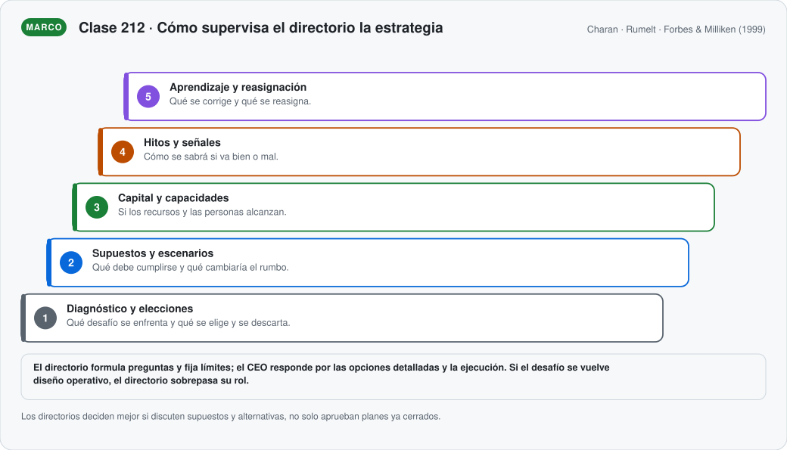

# Clase 212 — Supervisión de estrategia

<!-- nav:inicio -->
> **Parte 17 · Directorios y gobierno corporativo** — clase 8 de 12 · [índice de la parte](../../README.md) · [temario](../../../../SYLLABUS.md)
<!-- nav:fin -->

**Parte:** 17 — Directorios y gobierno corporativo  
**Nivel:** Etapa 5 — Director → CEO  
**Duración sugerida:** 150–180 minutos · **Estándar:** deep-class-v2

## 🎯 Propósito

Pocas cosas desgastan tanto a un directorio como la sesión anual de estrategia: una presentación de 80 diapositivas, un plan ya cerrado, tres horas de preguntas de detalle y una aprobación por unanimidad. El directorio sale con la sensación de haber visto «el plan», pero sin haberlo desafiado, y la gerencia sale con la sensación de haber cumplido un trámite. Meses después, cuando el mercado cambia o un supuesto falla, nadie recuerda qué se asumió, quién lo aprobó ni qué señales se iban a vigilar. La supervisión de la estrategia no consiste en diseñarla (es tarea de la gerencia) ni en aprobarla sin examen: consiste en asegurarse de que la estrategia sea **coherente, con supuestos explícitos, financiable, con capacidades para ejecutarla y con señales para saber si funciona**, y en acompañar su ajuste a lo largo del tiempo.

La clase se apoya en la visión de Charan sobre directorios que contribuyen a la estrategia, en el análisis de Forbes y Milliken sobre los directorios como grupos de decisión estratégica, en el concepto de estrategia de Rumelt (diagnóstico, política guía y acciones coherentes), en el método de escenarios de Schwartz y en la mirada de McGrath sobre las ventajas transitorias y las señales de agotamiento. Al terminar sabrás conducir una revisión estratégica en cinco niveles, formular preguntas de desafío, verificar capital y capacidades, acordar hitos y señales y aprender y reasignar sin invadir el rol de la gerencia.

## 📚 Resultados de aprendizaje

Al finalizar podrás:

1. **Distinguir** la supervisión de la estrategia de su diseño operativo.
2. **Revisar** diagnóstico, elecciones y renuncias de una estrategia.
3. **Desafiar** los supuestos con escenarios y pruebas de estrés.
4. **Verificar** que el capital y las capacidades alcancen para ejecutarla.
5. **Acordar** hitos, señales de alerta y puntos de revisión y reasignación.

## 🧭 Agenda

| Tramo | Qué se hace |
|---|---|
| 0–20 min | Recuperación: ¿qué supuesto de la estrategia de tu empresa ya no es válido y quién lo notó primero? |
| 20–60 min | Rol del directorio, diagnóstico, supuestos, escenarios, capital, señales y aprendizaje. |
| 60–105 min | Ejemplo trabajado: revisión de un plan a tres años con prueba de estrés y señales. |
| 105–150 min | Caso ejecutivo y práctica. |
| 150–175 min | Límites y entregable. |

## 🧩 Conceptos centrales

| Concepto | Definición | Cómo se reconoce |
|---|---|---|
| **Supervisión estratégica** | Revisión por el directorio de la lógica, los supuestos y la ejecución de la estrategia. | Preguntas, límites y seguimiento; sin decidir lo operativo. |
| **Supuesto crítico** | Creencia cuya falsedad cambiaría el resultado de la estrategia. | Se puede probar con datos. |
| **Escenario** | Historia plausible del entorno futuro usada para probar la estrategia. | Pocos, distintos y coherentes. |
| **Señal de alerta (*signpost*)** | Indicador que anticipa que un supuesto falla. | Se vigila con umbral y dueño. |
| **Hito** | Resultado intermedio verificable. | Fecha, métrica y responsable. |
| **Reasignación** | Mover capital y talento de lo que no funciona a lo que sí. | Decisiones registradas. |

## 🧠 Modelo mental

**Cómo leer el diagrama.** Una escalera de cinco niveles. **Diagnóstico y elecciones**: qué desafío se enfrenta y qué se elige y se descarta. **Supuestos y escenarios**: qué debe cumplirse y qué cambiaría el rumbo. **Capital y capacidades**: si los recursos y las personas alcanzan. **Hitos y señales**: cómo se sabrá si va bien o mal. **Aprendizaje y reasignación**: qué se corrige y qué se reasigna. La nota dice que el directorio formula preguntas y fija límites y el CEO responde por las opciones detalladas y la ejecución; el pie, que los directorios deciden mejor si discuten supuestos y alternativas.

## 📖 Desarrollo

### 1. Qué le toca al directorio

Charan sostiene que los directorios deben participar en la estrategia **sin diseñarla**: asegurar que la gerencia tenga una, que sea sólida, que refleje la realidad del negocio y que cuente con los recursos para ejecutarse. Forbes y Milliken proponen entender el directorio como un **grupo de decisión estratégica** y muestran que su eficacia depende de procesos: el **esfuerzo** que los directores dedican, el **conflicto cognitivo** (debatir ideas con franqueza), el **uso de conocimientos y habilidades** de cada uno y la **cohesión** del grupo (que no se convierta en pensamiento de grupo). La implicancia es que el directorio aporta más cuando **desafía con información y respeto** que cuando solo aprueba o cuando intenta redactar el plan. La frontera entre desafío y diseño es: el directorio pregunta y fija límites; el CEO decide las opciones y responde por ellas.

### 2. Nivel 1: diagnóstico y elecciones

Rumelt describe que una buena estrategia tiene un **núcleo**: un **diagnóstico** que identifica el desafío crítico, una **política guía** que elige un enfoque y renuncia a otros, y **acciones coherentes** que se refuerzan. El directorio comienza preguntando: ¿cuál es el **desafío crítico**?, ¿es el correcto o es una lista de metas?, ¿qué se **elige** y qué se **renuncia**?, ¿cómo se compite y por qué ganaremos?, ¿las acciones se refuerzan entre sí? Las estrategias que son listas de objetivos sin elecciones, o que prometen crecimiento en todos los frentes, merecen una pregunta directa: ¿qué no vamos a hacer? Un directorio que acepta un plan sin renuncias no está supervisando una estrategia.

### 3. Nivel 2: supuestos y escenarios

Todo plan descansa en **supuestos**: crecimiento del mercado, comportamiento de clientes y competidores, precios, costos, regulación, tecnología, tipo de cambio. El directorio pide que se **expliciten** los diez supuestos críticos, que se indique la **evidencia** de cada uno y que se señale cuáles, si fallan, cambiarían el resultado. Schwartz propone el método de **escenarios**: construir pocas historias plausibles y distintas del entorno futuro (no pronósticos) para probar la robustez de la estrategia: ¿qué pasa si ocurre A?, ¿y si B? El objetivo es descubrir **dónde la estrategia es frágil** y qué opciones se pueden preservar. Se acompaña con **pruebas de estrés**: ¿qué ocurre con la caja y los compromisos si las ventas caen 15 % o un cliente grande se va?

### 4. Nivel 3: capital y capacidades

Una estrategia sin recursos es un deseo. El directorio verifica: ¿cuánto capital exige el plan y de dónde sale (generación de caja, deuda, aportes)?, ¿se respetan el apetito de riesgo y los compromisos con financistas? (clase 182), ¿hay **capacidades** (personas, tecnología, procesos, relaciones) para ejecutarlo, o hay que construirlas o comprarlas?, ¿el equipo tiene la experiencia necesaria?, ¿cuánto cambio simultáneo puede absorber la organización? Se contrasta con las **asignaciones** reales de capital y talento (clase 198): si el plan dice que la prioridad es X pero el presupuesto la subfinancia, la verdad está en el presupuesto. Y se evalúa la **secuencia**: qué debe hacerse primero para habilitar lo siguiente.

### 5. Nivel 4: hitos y señales

La estrategia necesita **hitos** (resultados intermedios verificables, con fecha y responsable) y **señales de alerta** (indicadores adelantados que muestran que un supuesto falla). McGrath sostiene que las ventajas competitivas son cada vez más **transitorias**; por eso, el directorio pide que la gerencia identifique cuándo una ventaja se agota (caída de márgenes, pérdida de clientes clave, aparición de sustitutos) y qué haría. Se acuerdan **umbrales de revisión**: si cierto indicador cae bajo cierto nivel durante un período, se reabre la decisión. Los hitos y señales se incorporan al tablero del directorio (clase 211) y se revisan en cada sesión; así, la supervisión no depende de una revisión anual.

### 6. Nivel 5: aprender y reasignar

La última pregunta es: ¿qué hemos aprendido y qué cambiamos? Se revisan los resultados contra los hitos, se contrastan los supuestos con los datos y se decide: **continuar**, **ajustar**, **acelerar** o **detener**. Se pregunta por la **reasignación**: ¿qué capital y qué talento salen de lo que no funciona hacia lo que sí? Se evita la inercia: la mayoría de las estrategias fallan más por no ajustarse a tiempo que por estar mal diseñadas. Se registra el **aprendizaje** (qué se esperaba, qué ocurrió, por qué) para mejorar la próxima revisión. Duke recuerda que conviene separar la calidad de la decisión de la del resultado: una buena decisión puede dar un mal resultado por azar; lo importante es que la revisión mejore el proceso.

### 7. Cuándo el directorio sobrepasa su rol

El directorio sobrepasa su rol cuando convierte el desafío en **diseño operativo**: elegir proveedores, definir la estructura comercial, fijar precios. Señales: discute la ejecución de proyectos concretos, exige cambiar la estrategia sin evidencia, impone una visión personal de un director o aprueba y desaprueba iniciativas menores. También falla el directorio que **abdica**: aprueba el plan sin discusión, no verifica supuestos y solo se entera de los problemas cuando ya son crisis. El equilibrio se logra con **preguntas** y **límites**, **sesiones dedicadas** a la estrategia, **información independiente** (analistas, clientes, expertos) y un **acuerdo con el CEO** sobre cuándo y cómo se involucra el directorio.

## 📚 Lectura comparada

| Obra | Qué aporta | Qué no resuelve | Pregunta para contrastar |
|---|---|---|---|
| Charan | Participación del directorio en la estrategia sin diseñarla. | Visión de práctica. | ¿Qué estrategia ve el directorio y cuándo? |
| Forbes y Milliken | Procesos del directorio como grupo de decisión: esfuerzo, conflicto cognitivo, conocimiento y cohesión. | Marco teórico con poca evidencia directa. | ¿Se debate o se aprueba? |
| Rumelt | Diagnóstico, política guía y acciones coherentes. | No fija cómo supervisar. | ¿Cuál es el desafío crítico y qué se renuncia? |
| Schwartz | Escenarios para probar estrategias. | Exige imaginación y tiempo. | ¿Dónde es frágil el plan? |
| McGrath | Ventajas transitorias y señales de agotamiento. | Basado en ejemplos de empresas. | ¿Qué señal anticipa que la ventaja se agota? |

## 🧮 Ejemplo trabajado

**Situación (hipotética).** El directorio de una empresa de servicios revisa un plan a tres años. Ventas actuales: 100.000 millones de pesos; EBITDA: 12.000 millones (12 %); deuda neta: 14.400 millones (1,2 veces el EBITDA). El plan propone crecer 9 % anual: 2 puntos por precio, 3 por volumen en el negocio actual y 4 por un nuevo segmento.

**Proyección del plan.** Ventas al año 3: 100.000 × 1,09³ = 129.503 millones.

**Supuestos críticos.** (1) El nuevo segmento aporta 4 puntos de crecimiento. (2) Se mantiene el margen de contribución de 18 %. (3) Un cliente grande (14 % de las ventas) renueva. (4) La inversión de 6.000 millones se ejecuta en tres años. (5) La empresa contrata 40 especialistas en 18 meses.

**Prueba de escenarios.**

| Escenario | Crecimiento anual | Ventas año 3 (millones) | Diferencia con el plan |
|---|---|---|---|
| Plan | 9 % | 129.503 | — |
| El nuevo segmento rinde la mitad | 7 % | 122.504 | −6.999 |
| Además se pierde el cliente grande en el año 2 | Se calcula aparte | Ver nota | |

(Con 1,07³ = 1,225043; 100.000 × 1,225043 = 122.504.) La caída de 6.999 millones de ventas, con 18 % de margen de contribución, representa 6.999 × 0,18 ≈ 1.260 millones de EBITDA menos al año 3.

**Pérdida del cliente grande.** El 14 % de las ventas actuales son 14.000 millones; a margen de contribución de 18 %, 2.520 millones de EBITDA anuales. Si se pierde, el EBITDA del año 3 en el escenario combinado se reduce en 2.520 adicionales (sin considerar crecimiento de ese cliente).

**Capital y capacidad.** La inversión de 6.000 millones se financia con 50 % de deuda (3.000) y 50 % de caja. Deuda neta resultante: 14.400 + 3.000 = 17.400 millones. Con un EBITDA estresado de −15 % (12.000 × 0,85 = 10.200): 17.400 ÷ 10.200 = 1,71 veces, por debajo del límite de apetito de 2,5. El plan es financiable; el cuello de botella es la contratación de 40 especialistas en 18 meses (la empresa contrató 12 el último año): el directorio pregunta por el plan de talento.

**Hitos y señales.**

| Hito o señal | Umbral | Revisión |
|---|---|---|
| Ventas del nuevo segmento a 12 meses | ≥ 3.000 millones | Si < 1.500 millones, se reabre la decisión de inversión |
| Contratación de especialistas | ≥ 20 en 9 meses | Si < 12, se revisa el calendario |
| Renovación del cliente grande | Conversaciones iniciadas a 6 meses del vencimiento | Informe al comité de riesgos |
| Margen de contribución | ≥ 17,5 % | Si 2 trimestres bajo 16,5 %, revisión de precios |
| Deuda neta/EBITDA | ≤ 2,0 | Si > 2,3, se congela el gasto de capital |

**Resultado de la revisión.** El directorio no rechaza ni diseña: **aprueba la estrategia con condiciones**: un plan de talento antes de 60 días, una reunión de revisión a los seis meses con las señales, y la opción de detener la segundo tramo de la inversión (3.000 millones) si el nuevo segmento no alcanza los hitos. Registra el aprendizaje en el acta.

**Cuidados.** Las proyecciones son escenarios, no pronósticos; las condiciones de financiamiento y covenants se verifican con asesoría y contratos; las cifras son ilustrativas.

**Qué muestra.** (1) Los supuestos se hicieron explícitos y se estresaron. (2) La verificación de capital identificó el cuello de botella en capacidades. (3) Los hitos y señales hacen posible reasignar a tiempo.

## 🔀 Comparación y límites

**Supervisar frente a diseñar.** El directorio hace preguntas y fija límites; la gerencia propone y decide las opciones. Cuando el directorio diseña, diluye la responsabilidad del CEO.

**Límites.** El directorio puede sobrepasar su rol si convierte el desafío en diseño operativo; formula preguntas y límites y deja al CEO responsable de la ejecución y de las opciones detalladas. Los escenarios no son pronósticos. Las señales de alerta pueden dar falsas alarmas. Las cifras del ejemplo son ilustrativas.

## 🪜 De profesional a owner

| Nivel | Cómo participa en la estrategia |
|---|---|
| **Profesional** | Aporta datos que contrastan los supuestos. |
| **Jefe / Team Lead** | Traduce la estrategia a metas y señales de su equipo. |
| **Gerente** | Explicita los supuestos de su parte del plan y acepta el desafío. |
| **CEO / Director** | Presenta una estrategia con renuncias y supuestos y acepta ajustes. |
| **Founder / Owner** | Acepta que el directorio cuestione su visión y la contraste con datos. |

## 🏢 Caso ejecutivo

Una empresa de educación con 2.700 personas y ventas de 80.000 millones de pesos presenta a su directorio un plan quinquenal con ocho prioridades, inversiones por 14.000 millones y una meta de duplicar las ventas. El plan asume matrícula creciente en un contexto de caída demográfica en dos de sus tres mercados, el lanzamiento de una plataforma en línea sin presupuesto de talento tecnológico, y la compra de dos competidores pequeños cuyos datos no se han revisado. El directorio, de siete miembros, aprobó el plan anterior en 40 minutos y no volvió a verlo. Hoy el 60 % de las metas del plan anterior no se cumplió, y nadie sabe por qué. Los dos directores con experiencia en tecnología creen que el plan «no es creíble»; el presidente quiere aprobarlo para «dar una señal al mercado»; el CEO dice que «los detalles son de gestión».

Entrega una **revisión estratégica del directorio** que contenga: (a) las preguntas sobre diagnóstico, elecciones y renuncias; (b) los diez supuestos críticos con su evidencia y la prueba de escenarios; (c) la verificación de capital, financiamiento y capacidades, con pruebas de estrés; (d) los hitos, las señales de alerta y los umbrales de revisión; (e) el mecanismo de aprendizaje y reasignación y el acuerdo con el CEO sobre el rol del directorio; (f) las condiciones con que se aprobaría y las verificaciones contractuales y legales.

## 🧪 Práctica

1. Escribe el desafío crítico de una estrategia y cinco preguntas de desafío sobre sus elecciones.
2. Lista los diez supuestos críticos de un plan y marca los tres más frágiles.
3. Diseña dos escenarios para una estrategia y calcula su efecto en ventas y EBITDA.
4. Define cinco hitos y cinco señales de alerta con umbrales.
5. Redacta un acuerdo breve con el CEO sobre cuándo se involucra el directorio.

## ⚠️ Errores frecuentes

| Error | Por qué ocurre | Cómo corregirlo |
|---|---|---|
| Aprobar planes ya cerrados | Se presenta al final | Revisar diagnóstico y supuestos antes. |
| Estrategia sin renuncias | Se quiere complacer a todos | Preguntar qué no se hará. |
| Supuestos implícitos | Se da por sentado | Listar y estresar los críticos. |
| Plan sin capital ni talento | Se separa de la asignación | Verificar financiamiento y capacidades. |
| Revisión anual única | Se trata como evento | Hitos y señales en el tablero del directorio. |
| Diseñar desde el directorio | Falta de claridad de roles | Preguntas, límites y responsabilidad del CEO. |

## ❓ Preguntas de comprobación

1. ¿Cuál es el rol del directorio frente a la estrategia?
2. ¿Qué elementos tiene el núcleo de una buena estrategia según Rumelt?
3. ¿Para qué sirven los escenarios y las pruebas de estrés?
4. ¿Qué verifica el directorio sobre capital y capacidades?
5. ¿Qué son los hitos y las señales de alerta?
6. ¿Qué significa aprender y reasignar?
7. ¿Cuándo el directorio sobrepasa su rol?

Claves de respuesta

1. Asegurar que exista una estrategia sólida, con supuestos explícitos y recursos, y supervisar su ejecución sin diseñarla.
2. Diagnóstico del desafío crítico, política guía que elige y renuncia, y acciones coherentes.
3. Para descubrir dónde la estrategia es frágil y qué opciones preservar, sin pretender pronosticar.
4. Cuánto capital se necesita y de dónde sale, si respeta el apetito de riesgo y si hay personas, tecnología y procesos para ejecutar.
5. Los hitos son resultados intermedios verificables; las señales son indicadores adelantados de que un supuesto falla.
6. Contrastar resultados y supuestos con los datos y decidir continuar, ajustar, acelerar o detener, moviendo capital y talento.
7. Cuando convierte el desafío en diseño operativo o decide la ejecución que corresponde al CEO.

## 📥 Entregable

Guarda en `portfolio/212-supervision-de-estrategia/`:

- `strategy-memo.md` (plantilla [Strategy memo](../../../../templates/strategy-memo.md)) con la revisión estratégica del caso ejecutivo;
- `board-or-executive-memo.md` (plantilla [Board or executive memo](../../../../templates/board-or-executive-memo.md)) con las condiciones de aprobación y el acuerdo con el CEO;
- `decision-journal.md` con los supuestos, las pruebas de escenarios, los hitos y las señales.

## 📗 Fuentes y verificación

- Ram Charan — *Boards That Deliver* (John Wiley & Sons, Incorporated, 2007). **Uso en esta clase:** participación del directorio en la estrategia sin diseñarla. Lectura selectiva sobre **supervisión de estrategia**. **Localizador:** [ISBN-13 9781118046616](https://openlibrary.org/isbn/9781118046616).
- Daniel P. Forbes & Frances J. Milliken — *Cognition and Corporate Governance: Understanding Boards of Directors as Strategic Decision-Making Groups* (The Academy of Management Review, 1999). **Uso en esta clase:** procesos del directorio como grupo de decisión estratégica. Lectura selectiva sobre **supervisión de estrategia**. **Localizador:** [DOI 10.2307/259138](https://doi.org/10.2307/259138).
- Richard Rumelt — *Good Strategy/Bad Strategy* (Profile Books, 2011). **Uso en esta clase:** diagnóstico, política guía y acciones coherentes. Lectura selectiva sobre **supervisión de estrategia**. **Localizador:** [ISBN-13 9781846684807](https://openlibrary.org/isbn/9781846684807).
- Peter Schwartz — *The Art of the Long View* (Doubleday/Currency, 1991). **Uso en esta clase:** escenarios para probar estrategias. Lectura selectiva sobre **supervisión de estrategia**. **Localizador:** [ISBN-13 9780385267311](https://openlibrary.org/isbn/9780385267311).
- Rita Gunther McGrath — *The End of Competitive Advantage* (Harvard Business Review Press, 2013). **Uso en esta clase:** ventajas transitorias y señales de agotamiento. Lectura selectiva sobre **supervisión de estrategia**. **Localizador:** [ISBN-13 9781422172810](https://openlibrary.org/isbn/9781422172810).

> **Regla de fuentes para Supervisión de estrategia:** las obras anteriores estructuran las perspectivas de esta materia; cualquier norma, ley o estándar vivo mencionado debe comprobarse nuevamente en su fuente primaria vigente, incluidos los covenants, contratos de financiamiento y obligaciones regulatorias. Los ejemplos y casos son hipotéticos, con cifras ilustrativas. El desarrollo es original y no reproduce capítulos protegidos.

<!-- pie:inicio -->
---

| Anterior | Índice | Siguiente |
|---|---|---|
| [← 211 · Board pack y calidad de información](../211-board-pack-y-calidad-de-informacion/README.md) | [Parte 17](../../README.md) · [Programa](../../../../SYLLABUS.md) | [213 · Supervisión de riesgo y controles →](../213-supervision-de-riesgo-y-controles/README.md) |
<!-- pie:fin -->
