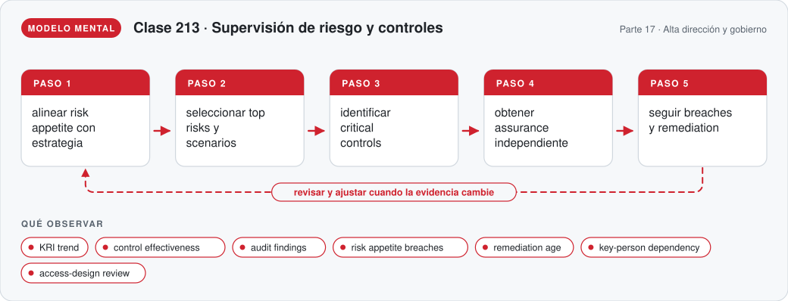

# Clase 213 — Supervisión de riesgo y controles

<!-- nav:inicio -->
> **Parte 17 · Directorios y gobierno corporativo** — clase 9 de 12 · [índice de la parte](../../README.md) · [temario](../../../../SYLLABUS.md)
<!-- nav:fin -->

**Parte:** 17 — Directorios y gobierno corporativo  
**Nivel:** Etapa 5 — Director → CEO  
**Duración sugerida:** 150–180 minutos · **Estándar:** deep-class-v2

## 🎯 Propósito

Después de una crisis, la pregunta que se le hace al directorio siempre es la misma: ¿qué sabía y qué hizo? Nadie espera que un grupo de personas que se reúne ocho veces al año evite todas las fallas. Se espera algo más preciso: que haya **entendido los riesgos principales**, que haya fijado **cuánto riesgo aceptaba**, que haya preguntado por los **controles críticos**, que haya recibido **aseguramiento independiente** de que funcionaban y que haya **exigido acciones** cuando no lo hacían. La supervisión del riesgo no es una lista de verificación ni un informe trimestral: es una conversación informada, repetida, con registro, entre un directorio que pregunta y una gerencia que responde con datos.

La clase conecta lo aprendido en la parte 15 (riesgos, apetito, controles, ciberseguridad, cumplimiento) con el rol del directorio. Se apoya en el marco COSO de gestión de riesgos, en el marco de ciberseguridad del NIST (que incluye la función de gobierno), en la visión de Anderson sobre la ingeniería de seguridad y las amenazas internas, en Charan sobre el trabajo del directorio y en los principios de influencia de Cialdini, para incorporar una dimensión que suele ignorarse: la **protección ejecutiva defensiva** frente a la influencia indebida y la fuga de información, sin invadir la vida privada de las personas. Al terminar sabrás alinear el apetito con la estrategia, elegir los riesgos y controles que merecen atención del directorio, pedir aseguramiento independiente y seguir las brechas hasta su cierre.

## 📚 Resultados de aprendizaje

Al finalizar podrás:

1. **Alinear** el apetito de riesgo con la estrategia y los límites aprobados.
2. **Seleccionar** los riesgos principales y los controles críticos que el directorio debe vigilar.
3. **Exigir** aseguramiento independiente y evaluar su calidad.
4. **Seguir** brechas, excesos y remediaciones hasta su cierre.
5. **Diseñar** medidas defensivas frente a la influencia indebida, el acceso a información y las amenazas internas, sin vigilar la vida privada.

## 🧭 Agenda

| Tramo | Qué se hace |
|---|---|
| 0–20 min | Recuperación: ¿qué tres riesgos preocupan hoy al directorio de tu empresa y qué evidencia tiene de que están controlados? |
| 20–60 min | Apetito, riesgos principales, controles críticos, aseguramiento, remediación y protección ejecutiva. |
| 60–105 min | Ejemplo trabajado: tablero de riesgos, controles probados y acceso a información sensible. |
| 105–150 min | Caso ejecutivo y práctica. |
| 150–175 min | Límites y entregable. |

## 🧩 Conceptos centrales

| Concepto | Definición | Cómo se reconoce |
|---|---|---|
| **Supervisión de riesgos** | Revisión por el directorio del apetito, los riesgos principales y los controles. | Preguntas, informes y seguimiento con registro. |
| **Control crítico** | Control cuya falla permitiría que un riesgo mayor se materialice. | Está asociado a un riesgo principal. |
| **Aseguramiento independiente** | Evaluación de los controles por alguien ajeno a quien los opera. | Auditoría interna o externa, pruebas de terceros. |
| **Línea de defensa** | Capa de responsabilidad en la gestión del riesgo. | Operación, funciones de control, auditoría. |
| **Necesidad de saber (*need to know*)** | Acceso a información solo para quien lo requiere. | Listas de acceso con justificación. |
| **Influencia indebida** | Intento de condicionar decisiones mediante favores, presión o engaño. | Regalos, solicitudes fuera de rol, secretos compartidos. |

## 🧠 Modelo mental

**Cómo leer el diagrama.** Tres columnas. **Apetito y riesgos principales**: apetito alineado con la estrategia, pocos riesgos y escenarios clave, límites e indicadores aprobados. **Controles críticos**: los controles de los riesgos mayores, fallas, excesos y remediación, y señales de influencia y de acceso indebido. **Aseguramiento independiente**: auditoría interna y externa, pruebas y revisiones de terceros, informe directo al directorio. La nota dice que el directorio no puede garantizar la ausencia de fallas y que su estándar es una supervisión razonable, con evidencia de que preguntó, recibió información y exigió acciones; el pie, que proteger de la influencia indebida no implica vigilar la vida privada.

## 📖 Desarrollo

### 1. Qué se espera del directorio en riesgos

El marco COSO de gestión de riesgos empresariales asigna al directorio la **supervisión** del riesgo en relación con la estrategia: entender el perfil de riesgo, fijar el apetito, exigir que la gerencia gestione con un proceso y que se informe con regularidad. Los principios de gobierno de la OCDE incluyen entre las funciones del directorio la revisión y orientación de la **política de riesgos** y el aseguramiento de la integridad de los sistemas de control. El estándar práctico es el de una **supervisión razonable**: no se exige que el directorio garantice la ausencia de fallas ni que revise controles técnicos uno por uno, sino que **demuestre**, con actas e informes, que identificó los riesgos principales, pidió información adecuada, discutió, y actuó cuando hubo señales de problemas. Los deberes legales precisos y las exigencias de los reguladores dependen de la jurisdicción y del sector y se verifican en fuente oficial.

### 2. Apetito y riesgos principales

El directorio **aprueba el apetito** (clase 182) y lo contrasta con la estrategia: ¿el plan exige más riesgo del que estamos dispuestos a asumir?, ¿hay límites claros y medibles?, ¿quién es el dueño de cada uno? De allí surge la **lista corta de riesgos principales** (cinco a diez), cada uno descrito como **escenario** con probabilidad, impacto, exposición residual y tendencia (clase 181). Se agregan los riesgos de **cola** y las **interdependencias**. Esta lista es el centro de la conversación: si la gerencia presenta 80 riesgos con colores, el directorio no puede supervisar; si presenta 8 con escenarios, dueños y señales, sí. Los riesgos de **cumplimiento, de datos, de ciberseguridad y de IA** entran en esa lista cuando sean materiales (clases 186 a 189).

### 3. Controles críticos

Para cada riesgo principal se identifican los **controles críticos**: aquellos cuya falla permitiría que el riesgo se materialice con consecuencias graves. Ejemplos: la autenticación multifactor y los respaldos probados para un riesgo de ransomware; la segregación de funciones en pagos para un riesgo de fraude; el control de calidad de un lote para un riesgo de seguridad de producto. El directorio no revisa todos los controles, pero pregunta por los críticos: ¿quién es el dueño?, ¿cómo se prueba que funcionan?, ¿cuándo fue la última prueba y su resultado?, ¿hay fallas pendientes? (clase 183). Anderson observa que muchas fallas de seguridad no son técnicas sino de **incentivos y diseño**: controles que nadie quiere operar, accesos acumulados o procesos que se saltan por presión de tiempo; esas son las preguntas que el directorio puede y debe hacer.

### 4. Aseguramiento independiente

La gerencia informa sobre los controles que ella misma opera; por eso el directorio necesita una **segunda mirada**: la **auditoría interna** (con reporte funcional al comité de auditoría), la **auditoría externa**, pruebas **independientes** (por ejemplo, pruebas de intrusión de ciberseguridad), revisiones de **terceros especializados** y, en sectores regulados, inspecciones de la autoridad. En el modelo de tres líneas, la primera línea (gerencia operativa) es dueña de los riesgos; la segunda (riesgos, cumplimiento, seguridad) supervisa y desafía; la tercera (auditoría interna) aporta aseguramiento independiente al directorio. Se evalúa la **calidad del aseguramiento**: alcance, independencia, competencia, hallazgos y seguimiento; un auditor sin acceso directo al comité o con presupuesto controlado por la gerencia pierde independencia. El directorio se reúne con ellos **sin la gerencia** (clase 208).

### 5. Brechas, excesos y remediación

Los informes de riesgos deben mostrar con transparencia: **brechas** (controles con falla o sin dueño), **excesos** de límites aprobados, **incidentes** materiales y **acciones de remediación** con responsables y fechas. Se siguen hasta su **cierre**, con un indicador de **envejecimiento** (cuántas brechas llevan más de 90 días abiertas) y con **escalamiento** de las críticas. Una señal de alarma es el hallazgo que reaparece de un año a otro, o la brecha que se reclasifica a menor gravedad sin justificación. El directorio pregunta por qué ocurrió (causa raíz) y no solo qué se corrigió, y verifica que las lecciones se incorporen al mapa de riesgos (clase 190).

### 6. Protección ejecutiva defensiva: influencia indebida e información

Los directores y ejecutivos manejan información de alto valor (fusiones, resultados, litigios, estrategia, datos de clientes) y toman decisiones que benefician o perjudican a terceros; por eso son objetivos de **influencia indebida**: regalos, hospitalidad, favores, amistad instrumental, presión, halagos o engaño para obtener información o decisiones. Cialdini describe principios (reciprocidad, compromiso, simpatía, autoridad, escasez, prueba social) que facilitan esa influencia, y Anderson explica que las **amenazas internas** (por intención o descuido) son una de las fuentes principales de incidentes de seguridad. Una protección defensiva y proporcionada incluye: **declaración** de ofrecimientos y contactos inusuales; **canal** para consultar sin temor; **política de regalos y hospitalidad** (clase 209); **acceso por necesidad de saber** a información sensible, con listas, registro y caducidad; **capacitación** con casos; **controles técnicos** sobre datos críticos; y **protocolos** para viajes y reuniones con terceros sensibles.

### 7. Los límites: no vigilar la vida privada

La protección defensiva **no consiste en espiar** a directores o empleados. Debe respetar la **privacidad**, la **dignidad** y las normas de protección de datos y laborales (clase 186): se informa a las personas qué se registra y por qué; se limita a los **sistemas, datos y decisiones de la empresa**; se evita el perfilamiento de la vida personal, política o familiar; y se involucra a asesoría legal y de personas antes de implementar controles. Su foco son las **señales de conducta en el trabajo** (accesos inusuales, solicitudes fuera de rol, incumplimientos de reglas) y no la condición personal de nadie. Se mide el efecto en la confianza: una política percibida como persecución debilita la cultura que se busca proteger.

## 📚 Lectura comparada

| Obra | Qué aporta | Qué no resuelve | Pregunta para contrastar |
|---|---|---|---|
| COSO ERM | Supervisión del riesgo integrada con estrategia y desempeño. | No define límites concretos. | ¿Qué riesgo amenaza la estrategia? |
| NIST CSF 2.0 | Función de gobierno de la ciberseguridad y supervisión. | Marco voluntario y genérico. | ¿Qué reporta el responsable de seguridad al directorio? |
| Anderson | Seguridad como ingeniería, incentivos y amenazas internas. | Técnico; hay que traducirlo. | ¿Qué incentivo debilita este control? |
| Charan | Trabajo del directorio en riesgos y estrategia. | Visión de práctica. | ¿Qué conversación se repite cada trimestre? |
| Cialdini | Principios de influencia útiles para diseñar defensas. | Describe, no regula. | ¿Cómo se construiría una dependencia aquí? |

## 🧮 Ejemplo trabajado

**Situación (hipotética).** El comité de riesgos de una empresa de servicios financieros con ventas de 90.000 millones de pesos revisa su tablero trimestral. Hay 8 riesgos principales y 12 controles críticos asociados.

**Resultados de las pruebas independientes (auditoría interna y externa).**

| Resultado | Controles | % |
|---|---|---|
| Efectivos | 9 | 75,0 |
| Efectivos con observaciones | 2 | 16,7 |
| No efectivos | 1 | 8,3 |
| **Total** | **12** | **100** |

El control no efectivo corresponde al respaldo y la recuperación del sistema de pagos (RTO real de 19 horas frente a 8 planificadas).

**Brechas y excesos.** 14 acciones de remediación abiertas: 9 vencen en menos de 90 días, 5 llevan más de 90 días (35,7 %; 5 ÷ 14); una es crítica (la del respaldo). Un límite de concentración de clientes (30 % del ingreso) se excedió: el principal cliente representa 33,5 %.

**Decisiones del comité.** (1) Escalar la brecha del respaldo al directorio y exigir un plan con fecha en 30 días; (2) pedir a auditoría interna una prueba de seguimiento a los 60 días; (3) aprobar una excepción de concentración por seis meses con plan de diversificación; (4) solicitar un informe sobre por qué dos hallazgos se repiten desde el año anterior.

**Acceso a información sensible.** Un proyecto de adquisición confidencial tiene 40 personas con acceso (directores, ejecutivos, asesores, analistas y asistentes). Un análisis simple, bajo la hipótesis de que cada persona tiene una probabilidad de 0,5 % al año de filtrar o perder información por descuido o presión, estima la probabilidad de al menos una fuga: 1 − 0,995⁴⁰ ≈ 1 − 0,818 = 18,2 %. Con acceso por necesidad de saber, la lista baja a 14 personas: 1 − 0,995¹⁴ ≈ 1 − 0,932 = 6,8 %. La reducción es de 11,4 puntos porcentuales.

**Medidas de protección defensiva.** Lista de acceso aprobada y registrada con caducidad; acuerdos de confidencialidad; sala y sistemas dedicados; recordatorio de la política de regalos y hospitalidad; canal de consulta; revisión de accesos al cierre del proyecto. Ninguna medida implica revisar la vida privada de las personas; se informa a todos qué se registra.

**Señal de influencia.** Un asesor externo ofrece a un ejecutivo entradas a un evento y le pide «información de contexto» sobre la operación; el ejecutivo lo declara y se rechazan ambas cosas; el caso se registra y se refuerza la capacitación.

**Informe al directorio.** Una página con los riesgos principales, el estado de los controles críticos, las brechas envejecidas, los excesos y excepciones, los incidentes, las decisiones requeridas y las señales de influencia reportadas.

**Cuidados.** La probabilidad de fuga es una hipótesis para ilustrar el efecto del acceso; las medidas sobre personas respetan la normativa laboral y de protección de datos, que se verifica con asesoría; las cifras son ilustrativas.

**Qué muestra.** (1) El aseguramiento independiente localizó el control crítico que fallaba. (2) El seguimiento de brechas fijó plazos y escalamiento. (3) La protección defensiva redujo el acceso sin vigilar la vida privada.

## 🔀 Comparación y límites

**Supervisar frente a gestionar los riesgos.** La gerencia gestiona los riesgos; el directorio supervisa que exista un sistema que los gestione y que funcione. Cuando el directorio gestiona, diluye la responsabilidad.

**Límites.** El directorio no puede garantizar la ausencia de fallas; su estándar es una supervisión razonable y evidencia de gobierno, no certificar controles técnicos individuales. Las probabilidades del ejemplo son hipótesis. La protección frente a la influencia indebida debe respetar la privacidad y las normas laborales y de datos. Las exigencias de los reguladores varían por sector y país. Las cifras son ilustrativas.

## 🪜 De profesional a owner

| Nivel | Cómo participa en la supervisión de riesgos |
|---|---|
| **Profesional** | Cumple los controles y declara ofrecimientos inusuales. |
| **Jefe / Team Lead** | Reporta fallas y evita accesos innecesarios. |
| **Gerente** | Es dueño de riesgos y controles críticos y entrega información veraz. |
| **CEO / Director** | Pregunta, exige aseguramiento y deja evidencia de la supervisión. |
| **Founder / Owner** | Acepta controles sobre sí mismo y sobre su empresa. |

## 🏢 Caso ejecutivo

Una empresa de salud con 3.600 personas tiene un directorio que recibe cada trimestre un informe de riesgos de 45 páginas con 63 riesgos en una matriz de colores. En un año: sufrió un ransomware que dejó sin sistema clínico a dos centros durante 26 horas; una fiscalización detectó fallas en el control de medicamentos; una filtración de información sobre una compra pendiente llegó a la prensa antes del anuncio (la lista de acceso incluía a 52 personas, entre ellas asesores y asistentes); y un director aceptó un viaje pagado de un proveedor que luego se adjudicó un contrato. La auditoría interna depende del gerente financiero. El responsable de seguridad nunca ha hablado con el directorio. Una consultora propone «monitorear las redes sociales de los ejecutivos y directores» para evitar filtraciones, y un director pide revisar los antecedentes personales de todos los empleados con acceso a información sensible.

Entrega un **diseño de supervisión de riesgos** que contenga: (a) la lista corta de riesgos principales con escenarios, el apetito y los límites; (b) los controles críticos asociados y su plan de pruebas independientes; (c) la estructura de aseguramiento y de reportes al directorio; (d) el sistema de seguimiento de brechas y excesos; (e) las medidas defensivas frente a la influencia indebida y la fuga de información, con el análisis de las dos propuestas de la consultora y del director a la luz de la privacidad y las normas laborales; (f) las verificaciones legales y regulatorias pendientes.

## 🧪 Práctica

1. Reduce una lista de 30 riesgos a los 8 que merecen la atención del directorio y justifica la selección.
2. Para tres riesgos, identifica el control crítico y cómo se probaría de forma independiente.
3. Diseña un tablero de una página con riesgos, controles, brechas y excesos.
4. Define las reglas de acceso por necesidad de saber para un proyecto confidencial.
5. Redacta cinco reglas de protección ejecutiva que respeten la privacidad.

## ⚠️ Errores frecuentes

| Error | Por qué ocurre | Cómo corregirlo |
|---|---|---|
| Matriz de 60 riesgos | Se quiere cubrir todo | Lista corta con escenarios y dueños. |
| Creer en el informe de la gerencia | Falta de segunda mirada | Aseguramiento independiente con acceso directo. |
| Brechas que envejecen | No hay escalamiento | Indicador de antigüedad y plazos. |
| Accesos amplios a lo sensible | Comodidad | Necesidad de saber con registro y caducidad. |
| Vigilar la vida privada | Se busca seguridad total | Controles sobre sistemas y conductas laborales, con informe a las personas. |
| Supervisión sin registro | Se confía en la memoria | Actas con preguntas, información y acciones. |

## ❓ Preguntas de comprobación

1. ¿Qué estándar de supervisión se espera del directorio en riesgos?
2. ¿Por qué conviene una lista corta de riesgos principales?
3. ¿Qué es un control crítico y qué se pregunta sobre él?
4. ¿Qué es el aseguramiento independiente y cómo se evalúa su calidad?
5. ¿Cómo se siguen las brechas y los excesos?
6. ¿Qué incluye una protección defensiva frente a la influencia indebida?
7. ¿Qué límites tiene esa protección?

Claves de respuesta

1. Una supervisión razonable, demostrable con actas e informes, no la garantía de que no habrá fallas.
2. Porque permite una conversación informada; con decenas de riesgos el directorio no puede supervisar.
3. Un control cuya falla permitiría que un riesgo mayor se materialice; se pregunta quién es el dueño, cómo se prueba y con qué resultado.
4. Evaluación de los controles por alguien ajeno a quien los opera; se evalúan alcance, independencia, competencia, hallazgos y seguimiento.
5. Con acciones con responsable y fecha, indicador de antigüedad, escalamiento de las críticas y análisis de causas.
6. Declaración de ofrecimientos, canal de consulta, política de regalos, acceso por necesidad de saber, capacitación y controles técnicos.
7. No vigila la vida privada; respeta la privacidad, las normas laborales y de datos y se centra en sistemas, datos y conductas laborales.

## 📥 Entregable

Guarda en `portfolio/213-supervision-de-riesgo-y-controles/`:

- `risk-governance-brief.md` (plantilla [Risk Governance Brief](../../../../templates/risk-governance-brief.md)) con el diseño del caso ejecutivo;
- `influence-and-conflict-disclosure-brief.md` (plantilla [Ficha de influencia y declaración de conflictos](../../../../templates/influence-and-conflict-disclosure-brief.md)) con el protocolo de declaración de ofrecimientos y contactos;
- `decision-journal.md` con el plan de pruebas, el seguimiento de brechas y las verificaciones legales pendientes.

## 📗 Fuentes y verificación

- COSO — *Enterprise Risk Management—Integrating with Strategy and Performance*. **Uso en esta clase:** supervisión del riesgo integrada con estrategia y desempeño. **Fuente primaria:** <https://www.coso.org/>.
- NIST — *Cybersecurity Framework (CSF) 2.0*. **Uso en esta clase:** función de gobierno de la ciberseguridad. **Fuente primaria:** <https://www.nist.gov/cyberframework>.
- Ross Anderson — *Security Engineering* (John Wiley & Sons, Incorporated, 2001). **Uso en esta clase:** seguridad como ingeniería, incentivos y amenazas internas. Lectura selectiva sobre **supervisión de riesgo y controles**. **Localizador:** [ISBN-13 9781119642831](https://openlibrary.org/isbn/9781119642831).
- Ram Charan — *Boards That Deliver* (John Wiley & Sons, Incorporated, 2007). **Uso en esta clase:** trabajo del directorio en riesgos y estrategia. Lectura selectiva sobre **supervisión de riesgo y controles**. **Localizador:** [ISBN-13 9781118046616](https://openlibrary.org/isbn/9781118046616).
- Robert B. Cialdini — *Influence* (HarperCollins Publishers and Blackstone Audio, 2016). **Uso en esta clase:** principios de influencia útiles para diseñar defensas. Lectura selectiva sobre **supervisión de riesgo y controles**. **Localizador:** [ISBN-13 9781624608049](https://openlibrary.org/isbn/9781624608049).

> **Regla de fuentes para Supervisión de riesgo y controles:** las obras anteriores estructuran las perspectivas de esta materia; cualquier norma, ley o estándar vivo mencionado debe comprobarse nuevamente en su fuente primaria vigente, incluidas las exigencias de los reguladores, la normativa laboral y de protección de datos que limita las medidas sobre las personas. Los ejemplos y casos son hipotéticos, con cifras ilustrativas. El desarrollo es original y no reproduce capítulos protegidos.

<!-- pie:inicio -->
---

| Anterior | Índice | Siguiente |
|---|---|---|
| [← 212 · Supervisión de estrategia](../212-supervision-de-estrategia/README.md) | [Parte 17](../../README.md) · [Programa](../../../../SYLLABUS.md) | [214 · Evaluación del CEO y sucesión →](../214-evaluacion-del-ceo-y-sucesion/README.md) |
<!-- pie:fin -->
