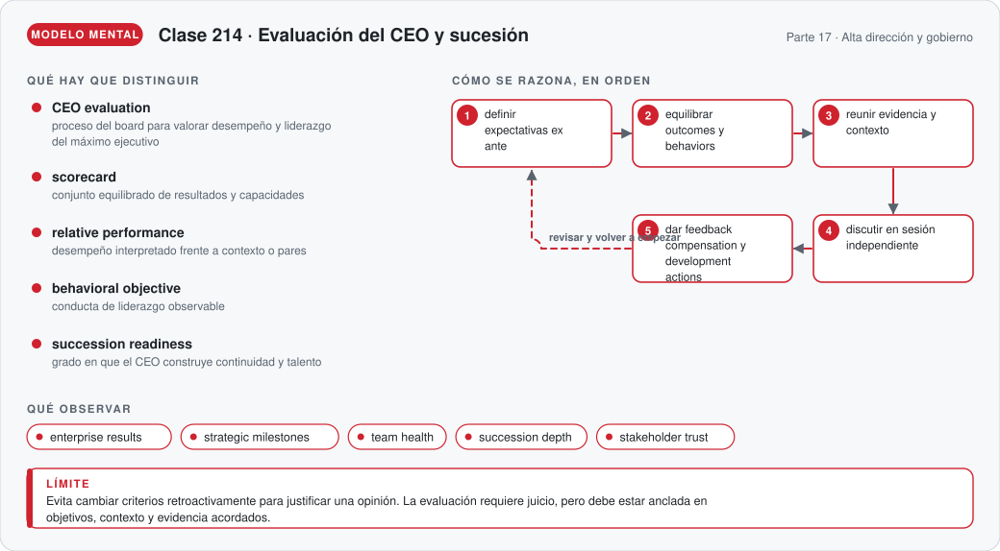

# Clase 214 — Evaluación del CEO y sucesión

<!-- nav:inicio -->
> **Parte 17 · Directorios y gobierno corporativo** — clase 10 de 12 · [índice de la parte](../../README.md) · [temario](../../../../SYLLABUS.md)
<!-- nav:fin -->

**Parte:** 17 — Directorios y gobierno corporativo  
**Nivel:** Etapa 5 — Director → CEO  
**Duración sugerida:** 150–180 minutos · **Estándar:** deep-class-v2

## 🎯 Propósito

Evaluar al CEO es la función más delicada y menos estructurada del directorio. Muchas evaluaciones se reducen a una conversación incómoda al final del año, con criterios que cambian según los resultados («logró los números, entonces es un buen CEO») o según la simpatía («no me gusta cómo trata al equipo, pero…»), sin evidencia de cómo se alcanzaron los resultados ni de qué parte se debió al contexto. Y como la evaluación se separa de la compensación y de la sucesión, el directorio puede premiar a un CEO por resultados de corto plazo mientras debilita la empresa, o castigarlo por un shock de mercado que nadie podía controlar. Evaluar bien al CEO es un acto de gobierno: define qué se espera, mide con justicia, retroalimenta con franqueza y decide con criterio sobre compensación, desarrollo y continuidad.

La clase conecta la evaluación con la sucesión (clase 203): son dos caras del mismo proceso. Se apoya en Charan sobre el papel del directorio, en Botelho y colaboradores sobre las conductas asociadas al desempeño de los CEO, en Tricker sobre las responsabilidades del directorio, en el trabajo de Kahneman, Sibony y Sunstein sobre el ruido en los juicios y en el cuadro de mando integral de Kaplan y Norton para equilibrar resultados y capacidades. Al terminar sabrás definir expectativas ex ante, equilibrar resultados y conductas, reunir evidencia y contexto, discutir en sesión independiente y dar retroalimentación que alimente compensación, desarrollo y planes de sucesión.

## 📚 Resultados de aprendizaje

Al finalizar podrás:

1. **Definir** expectativas ex ante con objetivos y conductas acordados.
2. **Equilibrar** resultados financieros, estratégicos y conductas de liderazgo.
3. **Reunir** evidencia y contexto de varias fuentes.
4. **Reducir** el ruido y los sesgos del juicio de los directores.
5. **Conectar** la evaluación con la compensación, el desarrollo y la sucesión.

## 🧭 Agenda

| Tramo | Qué se hace |
|---|---|
| 0–20 min | Recuperación: ¿qué criterios se usaron la última vez que se evaluó al CEO de tu empresa y se acordaron antes? |
| 20–60 min | Expectativas, equilibrio, evidencia, sesión independiente, retroalimentación y sucesión. |
| 60–105 min | Ejemplo trabajado: tablero de evaluación, calibración y vínculo con el bono. |
| 105–150 min | Caso ejecutivo y práctica. |
| 150–175 min | Límites y entregable. |

## 🧩 Conceptos centrales

| Concepto | Definición | Cómo se reconoce |
|---|---|---|
| **Evaluación del CEO** | Proceso del directorio para juzgar el desempeño del gerente general. | Criterios previos, evidencia y conversación. |
| **Criterios ex ante** | Objetivos y conductas acordados antes del período. | Se pueden verificar al final. |
| **Resultados y conductas** | Qué se logró y cómo se logró. | Se evalúan por separado. |
| **Ajuste por contexto** | Consideración de factores externos fuera del control del CEO. | Shocks de mercado, cambios regulatorios. |
| **Calibración** | Ajuste de las evaluaciones individuales hacia un criterio común. | Los directores comparan y discuten. |
| **Retroalimentación** | Conversación que comunica la evaluación y el plan de desarrollo. | Ejemplos concretos y compromisos. |

## 🧠 Modelo mental

**Cómo leer el diagrama.** Una cadena de cinco pasos con retorno. **Expectativas ex ante**: objetivos y conductas acordados al inicio. **Resultados y conductas**: cuánto se logró y cómo. **Evidencia y contexto**: datos, opiniones y factores externos. **Sesión independiente**: el directorio discute sin el CEO. **Retroalimentación**: conversación, compensación y desarrollo. La flecha indica que la evaluación ajusta las expectativas. La nota afirma que los criterios no se cambian de forma retroactiva para justificar una opinión; el pie, que las decisiones de compensación y de término se verifican con asesoría y con los estatutos.

## 📖 Desarrollo

### 1. Por qué evaluar y para qué

La evaluación del CEO sirve a cuatro propósitos: **rendición de cuentas** (el CEO responde ante el directorio, que responde ante los propietarios), **retroalimentación** y desarrollo del propio CEO, **decisiones de compensación** (bono y remuneración variable) y **continuidad** (si el CEO es la persona adecuada para la siguiente etapa y qué plan hay si no lo es). Charan sostiene que seleccionar, evaluar y, si hace falta, reemplazar al CEO es una de las funciones centrales del directorio, y que la evaluación debe ser **continua**, no un evento anual: el presidente conversa regularmente con el CEO, y el directorio recibe información sobre su desempeño a lo largo del año. Tricker incluye la evaluación de la alta dirección entre las responsabilidades de supervisión del directorio.

### 2. Expectativas ex ante

Lo primero es acordar **antes del período** qué se espera: objetivos financieros (ventas, margen, caja, retorno), **hitos estratégicos** (lanzamientos, transformaciones, adquisiciones), **objetivos de riesgo y cumplimiento**, **objetivos de personas y cultura** (talento, sucesión, clima, seguridad) y **conductas esperadas** (decidir con rapidez, desarrollar al equipo, honestidad con el directorio). Se acuerdan **metas, pesos y la forma de medir cada una**, y cómo se tratarán los factores externos. Kaplan y Norton recuerdan que un conjunto equilibrado de indicadores (financieros, de clientes, de procesos, de aprendizaje) evita sobreoptimizar el corto plazo. Cambiar los criterios después de ver los resultados distorsiona la evaluación y erosiona la confianza del CEO en el proceso.

### 3. Resultados y conductas

Un CEO puede lograr los números **cómo no se debe** (recortando la inversión en talento, forzando prácticas de venta riesgosas, deteriorando la cultura) o puede no lograrlos por **razones externas** pese a decisiones correctas. Por eso se evalúan **resultados** y **conductas** por separado, y se examina su relación. Botelho y colaboradores informan, a partir de evaluaciones de miles de ejecutivos, que las conductas asociadas con un mejor desempeño del CEO (decidir con rapidez y convicción, comprometerse con las partes interesadas para adaptarse, entregar de manera confiable y adaptarse con audacia) tuvieron más peso que ciertas características que el imaginario popular atribuye a los CEO. Para el directorio, esto sugiere observar **conductas concretas** con ejemplos: ¿qué decisiones difíciles tomó?, ¿cómo trató las malas noticias?, ¿cómo desarrolló a su equipo?

### 4. Evidencia y contexto

La evaluación se basa en **evidencia de varias fuentes**: resultados medidos contra metas y contra comparables del sector; avance de hitos; opiniones del equipo directivo, de líderes de segunda línea, de clientes y de socios clave (con garantías de confidencialidad); resultados de auditoría y cumplimiento; indicadores de talento y cultura; y la propia observación del directorio en las sesiones. Se incorpora el **contexto**: ¿cuánto del resultado se debió a factores externos (precios de materias primas, tipo de cambio, regulación, ciclo económico)? Una práctica útil es comparar con **pares**: si el mercado cayó 6 % y la empresa cayó 2 %, el desempeño relativo cuenta. El contexto no excusa todo, pero evita premiar o castigar por suerte.

### 5. Reducir el ruido: calibrar y discutir

Kahneman, Sibony y Sunstein documentan que, ante los mismos antecedentes, distintos evaluadores emiten juicios muy distintos (**ruido**), y que las evaluaciones de desempeño son particularmente propensas a él, además de a sesgos como el efecto de halo (una impresión general que contagia todos los criterios) y la influencia del último período. Para reducirlo proponen: **evaluar por dimensiones** y de forma **independiente** antes de integrar; usar **escalas con anclas descriptivas** (qué significa un 3 o un 5); pedir a cada director su evaluación **por escrito, antes de discutir**; **comparar** las evaluaciones y analizar las diferencias grandes; y consolidar un juicio de grupo. El presidente modera para que las voces dominantes no arrastren al resto.

### 6. La sesión independiente y la retroalimentación

El directorio discute la evaluación en **sesión sin el CEO** (y, si el CEO es director, sin su presencia ni voto). Se revisan la evidencia, las calificaciones y las diferencias, y se acuerdan las **conclusiones**: reconocimientos, preocupaciones, expectativas para el siguiente período, compensación y plan de desarrollo. Luego el presidente comunica la evaluación al CEO en una conversación **franca, específica y respetuosa**, con ejemplos, sin sorpresas (nada de lo comunicado debería ser novedad si hubo retroalimentación durante el año). Se acuerdan **compromisos mutuos**: lo que el CEO hará distinto y lo que el directorio hará para apoyarlo (información, tiempo, recursos). Se documenta el proceso con cuidado y confidencialidad, de acuerdo con la ley y los estatutos.

### 7. Compensación, desarrollo y sucesión

La evaluación alimenta tres decisiones. **Compensación**: el bono y los incentivos de largo plazo se vinculan con los criterios acordados, con contrapesos (clase 175) y con reglas claras de ajuste por contexto; se evita la remuneración por resultados de suerte y los incentivos que premian riesgos excesivos. **Desarrollo**: el CEO también necesita aprender; se acuerdan áreas de crecimiento, mentores o coaching y se revisa el avance. **Sucesión** (clase 203): la evaluación informa si el CEO es la persona adecuada para la próxima etapa, cuánto tiempo seguirá, qué perfil necesitará el sucesor y cómo está el banco de candidatos. Y se actualiza el **plan de emergencia**. Las decisiones de remuneración y de término se toman con asesoría legal y laboral y respetando los estatutos y los contratos.

## 📚 Lectura comparada

| Obra | Qué aporta | Qué no resuelve | Pregunta para contrastar |
|---|---|---|---|
| Charan | Evaluación y sucesión del CEO como funciones centrales del directorio. | Visión de práctica. | ¿Qué se evalúa de forma continua? |
| Botelho y otros | Conductas asociadas al desempeño de los CEO. | Datos de una consultora. | ¿Evaluamos conductas observables o estereotipos? |
| Tricker | Evaluación de la alta dirección como parte de la supervisión. | No define criterios. | ¿Quién lidera la evaluación? |
| Kahneman, Sibony y Sunstein | Ruido, halo y cómo reducirlos con calibración. | Exige disciplina. | ¿Cuánto varían las evaluaciones de los directores? |
| Kaplan y Norton | Indicadores equilibrados vinculados a la estrategia. | Puede generar exceso de indicadores. | ¿Equilibramos resultado y capacidades? |

## 🧮 Ejemplo trabajado

**Situación (hipotética).** El directorio de una empresa con ventas de 96.000 millones de pesos evalúa a su CEO tras un año en que el mercado cayó 4 %. Los criterios y pesos se acordaron al inicio del año.

**Resultados frente a metas.**

| Indicador | Meta | Resultado | Cumplimiento |
|---|---|---|---|
| Ventas (millones) | 100.000 | 96.000 | 96 % |
| EBITDA (millones) | 12.000 | 12.600 | 105 % |
| Hitos estratégicos | 5 | 4 | 80 % |

**Contexto.** El mercado cayó 4 %; las ventas de la empresa, frente a las del año anterior (100.000), cayeron 4 %: igual que el mercado. El EBITDA superó la meta por control de costos, con una reducción de gasto en desarrollo comercial que el directorio quiere examinar.

**Evaluación por dimensiones (escala de 1 a 5, con anclas).**

| Dimensión | Peso | Calificación consensuada | Aporte |
|---|---|---|---|
| Resultados financieros | 30 % | 3,5 | 1,05 |
| Hitos estratégicos | 20 % | 4,0 | 0,80 |
| Liderazgo y talento | 15 % | 3,0 | 0,45 |
| Cultura e integridad | 10 % | 4,0 | 0,40 |
| Partes interesadas | 10 % | 3,5 | 0,35 |
| Riesgos y controles | 15 % | 4,0 | 0,60 |
| **Total** | **100 %** | | **3,65** |

**Calibración del ruido.** Cinco directores calificaron de forma independiente antes de discutir: totales de 3,1; 3,5; 3,65; 3,9 y 4,2. El rango es 1,1 puntos. Tras revisar las diferencias en «liderazgo y talento» (donde las calificaciones iban de 2 a 4) con evidencia (rotación de gerentes de 18 % y retención de los clave), el consenso fue 3,0. Rango final entre calificaciones individuales ajustadas: 0,5 puntos.

**Vínculo con el bono.** El bono objetivo es 60 % de un salario base de 480 millones: 288 millones. La tabla ex ante dice: calificación ≥ 4,0 → 120 % del objetivo; entre 3,5 y 3,99 → 100 %; entre 3,0 y 3,49 → 70 %; menor de 3,0 → 0 %. Con 3,65, el factor es 100 %: bono de 288 millones. El directorio rechaza una propuesta de un director de elevarlo por «el esfuerzo en un año difícil», porque violaría los criterios acordados.

**Retroalimentación.** Reconocimientos: control de costos y hitos estratégicos. Preocupaciones: recorte de desarrollo comercial que podría afectar las ventas futuras; rotación de gerentes; baja delegación. Expectativas: un plan de talento y de sucesión en seis meses, y revertir parcialmente el recorte si los indicadores comerciales empeoran. Compromisos del directorio: información trimestral de clima y una sesión de desarrollo con un coach.

**Sucesión.** La evaluación confirma que el CEO sigue siendo la persona adecuada para los próximos dos años; se actualiza el plan de emergencia y se revisa el banco de candidatos (de tres ejecutivos, uno listo ahora).

**Cuidados.** Las decisiones de compensación, el tratamiento de la información de evaluación y cualquier decisión de término se verifican con asesoría legal y laboral y con los estatutos; las cifras son ilustrativas.

**Qué muestra.** (1) Los criterios y pesos fijados antes impidieron cambiar la regla. (2) La calibración redujo el ruido entre directores. (3) La evaluación alimentó compensación, desarrollo y sucesión.

## 🔀 Comparación y límites

**Evaluación frente a cuadro de mando.** Un tablero de resultados es una parte de la evaluación; no incluye conductas, contexto ni juicio sobre cómo se lograron.

**Límites.** La evaluación requiere juicio, pero anclado en objetivos, contexto y evidencia acordados; evita cambiar criterios retroactivamente para justificar una opinión. Los estudios sobre conductas de CEO provienen de datos específicos. Las escalas numéricas dan una apariencia de precisión. La información sobre personas es sensible y se trata con confidencialidad y conforme a la ley. Las cifras del ejemplo son ilustrativas.

## 🪜 De profesional a owner

| Nivel | Cómo participa en la evaluación |
|---|---|
| **Profesional** | Aporta datos veraces sobre resultados y clima cuando se le consulta. |
| **Jefe / Team Lead** | Da retroalimentación franca al equipo y a su jefe. |
| **Gerente** | Entiende cómo sus resultados alimentan la evaluación del CEO. |
| **CEO / Director** | Acepta metas claras y retroalimentación, y evalúa a su equipo con el mismo rigor. |
| **Founder / Owner** | Acepta ser evaluado por un directorio con criterios independientes. |

## 🏢 Caso ejecutivo

Una empresa de manufactura con 2.400 personas y ventas de 140.000 millones de pesos evaluó a su CEO el último mes del año. Al inicio no se acordaron metas por escrito; el presidente dijo que «los números hablan solos». El año cerró con ventas 6 % sobre el presupuesto y un EBITDA 14 % sobre la meta, gracias a un alza de precios del sector. La rotación de gerentes fue de 24 %, se postergó la inversión de mantenimiento en dos plantas, dos accidentes laborales graves recibieron una sanción de la autoridad, y la encuesta de clima cayó 15 puntos. El director comercial dice que el CEO «es brillante»; un director independiente teme que se hayan sacrificado seguridad y talento; otro propone un bono de 180 % del objetivo; el presidente quiere renovar el contrato por cinco años. No hay plan de sucesión: el único candidato interno, el director de operaciones, es hostil con el CEO. El CEO pregunta cómo se le evaluó «si nadie le dijo qué se esperaba».

Entrega un **proceso de evaluación del CEO** que contenga: (a) las expectativas ex ante con objetivos, conductas, pesos y tratamiento del contexto; (b) la evaluación del caso con evidencia, resultados y conductas, y el ajuste por el alza de precios del sector; (c) el procedimiento de calibración para reducir el ruido y los sesgos; (d) la sesión independiente y el contenido de la retroalimentación; (e) la propuesta sobre el bono y la renovación del contrato con criterios y contrapesos; (f) la conexión con el plan de sucesión y las verificaciones legales y laborales.

## 🧪 Práctica

1. Redacta las expectativas ex ante de un CEO para el próximo año con seis dimensiones y pesos.
2. Diseña una escala de 1 a 5 con anclas para dos dimensiones.
3. Simula la calibración: cinco calificaciones que difieren y cómo las discutirías.
4. Escribe el guion de una retroalimentación de cinco minutos con ejemplos.
5. Diseña la tabla que vincula la calificación con el bono, con un contrapeso de riesgo.

## ⚠️ Errores frecuentes

| Error | Por qué ocurre | Cómo corregirlo |
|---|---|---|
| Evaluar sin criterios previos | «Los números hablan solos» | Acordar objetivos y conductas ex ante. |
| Juzgar solo por resultados | Es lo más visible | Evaluar también cómo se lograron. |
| Premiar la suerte | No se ajusta por contexto | Comparar con pares y descontar efectos externos. |
| Efecto halo | Una impresión domina | Dimensiones independientes y calibración. |
| Sorpresas en la conversación | Falta retroalimentación continua | Conversaciones regulares presidente-CEO. |
| Cambiar la regla del bono | Presión o simpatía | Tabla ex ante y aprobación por el comité. |

## ❓ Preguntas de comprobación

1. ¿Qué propósitos tiene la evaluación del CEO?
2. ¿Por qué se acuerdan los criterios antes del período?
3. ¿Por qué se evalúan resultados y conductas por separado?
4. ¿Qué evidencias se usan y cómo se trata el contexto?
5. ¿Cómo se reduce el ruido en las evaluaciones de los directores?
6. ¿Qué incluye la retroalimentación al CEO?
7. ¿Cómo se conecta la evaluación con compensación y sucesión?

Claves de respuesta

1. Rendición de cuentas, retroalimentación y desarrollo, decisiones de compensación y continuidad o sucesión.
2. Para evitar cambiar los criterios para justificar una opinión y para que el CEO sepa qué se espera.
3. Porque se puede lograr un resultado de forma dañina o no lograrlo por razones externas; se examina su relación.
4. Resultados contra metas y pares, hitos, opiniones de varias fuentes, auditoría, clima; el contexto se ajusta comparando con pares y factores externos.
5. Evaluando por dimensiones de forma independiente y por escrito antes de discutir, con escalas ancladas, comparando diferencias y consolidando.
6. Reconocimientos, preocupaciones, expectativas, compromisos mutuos y plan de desarrollo, con ejemplos concretos.
7. Con tablas ex ante que vinculan calificación y bono con contrapesos, con áreas de desarrollo y con la decisión sobre la continuidad y el plan de sucesión.

## 📥 Entregable

Guarda en `portfolio/214-evaluacion-del-ceo-y-sucesion/`:

- `people-decision-brief.md` (plantilla [People decision brief](../../../../templates/people-decision-brief.md)) con el proceso del caso ejecutivo;
- `role-scorecard.md` (plantilla [Role scorecard](../../../../templates/role-scorecard.md)) con las expectativas, pesos y escalas de evaluación del CEO;
- `decision-journal.md` con la calibración, la retroalimentación y las verificaciones legales y laborales.

## 📗 Fuentes y verificación

- Ram Charan — *Boards That Deliver* (John Wiley & Sons, Incorporated, 2007). **Uso en esta clase:** evaluación y sucesión del CEO como funciones centrales del directorio. Lectura selectiva sobre **evaluación del ceo y sucesión**. **Localizador:** [ISBN-13 9781118046616](https://openlibrary.org/isbn/9781118046616).
- Elena L. Botelho, Kim R. Powell & Tahl Raz — *The CEO Next Door* (Currency, 2018). **Uso en esta clase:** conductas asociadas al desempeño de los CEO. Lectura selectiva sobre **evaluación del ceo y sucesión**. **Localizador:** [ISBN-13 9781101906491](https://openlibrary.org/isbn/9781101906491).
- Bob Tricker — *Corporate Governance* (Oxford University Press, 2019). **Uso en esta clase:** evaluación de la alta dirección como parte de la supervisión. Lectura selectiva sobre **evaluación del ceo y sucesión**. **Localizador:** [ISBN-13 9780198809869](https://openlibrary.org/isbn/9780198809869).
- Daniel Kahneman, Olivier Sibony & Cass R. Sunstein — *Noise* (Little, Brown Spark, 2021). **Uso en esta clase:** ruido y sesgos en los juicios y cómo reducirlos. Lectura selectiva sobre **evaluación del ceo y sucesión**. **Localizador:** [ISBN-13 9780316451383](https://openlibrary.org/isbn/9780316451383).
- Robert S. Kaplan & David P. Norton — *The Balanced Scorecard* (Harvard Business School Press, 1996). **Uso en esta clase:** indicadores equilibrados vinculados a la estrategia. Lectura selectiva sobre **evaluación del ceo y sucesión**. **Localizador:** [ISBN-13 9780875846514](https://openlibrary.org/isbn/9780875846514).

> **Regla de fuentes para Evaluación del CEO y sucesión:** las obras anteriores estructuran las perspectivas de esta materia; cualquier norma, ley o estándar vivo mencionado debe comprobarse nuevamente en su fuente primaria vigente, incluidos los estatutos, la normativa laboral y de remuneraciones y los contratos. Los ejemplos y casos son hipotéticos, con cifras ilustrativas. El desarrollo es original y no reproduce capítulos protegidos.

<!-- pie:inicio -->
---

| Anterior | Índice | Siguiente |
|---|---|---|
| [← 213 · Supervisión de riesgo y controles](../213-supervision-de-riesgo-y-controles/README.md) | [Parte 17](../../README.md) · [Programa](../../../../SYLLABUS.md) | [215 · Efectividad del directorio →](../215-efectividad-del-directorio/README.md) |
<!-- pie:fin -->
