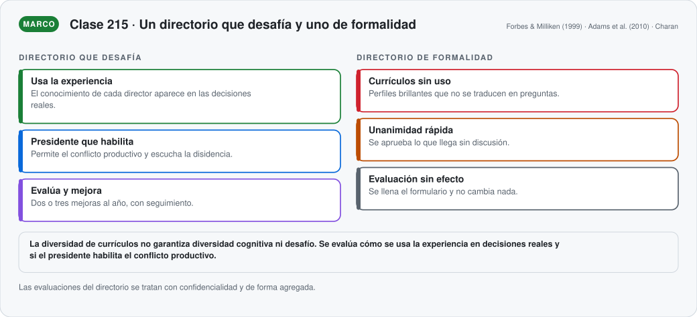

# Clase 215 — Efectividad del directorio

<!-- nav:inicio -->
> **Parte 17 · Directorios y gobierno corporativo** — clase 11 de 12 · [índice de la parte](../../README.md) · [temario](../../../../SYLLABUS.md)
<!-- nav:fin -->

**Parte:** 17 — Directorios y gobierno corporativo  
**Nivel:** Etapa 5 — Director → CEO  
**Duración sugerida:** 150–180 minutos · **Estándar:** deep-class-v2

## 🎯 Propósito

Un directorio puede tener un currículo impresionante (ex gerentes generales, abogados, financistas, expertos en tecnología) y ser, aun así, un mal directorio: se reúne, aprueba y se despide sin haber desafiado nada importante. También puede tener directores menos célebres y funcionar muy bien, porque hace las preguntas correctas, trabaja con información de calidad y se tiene confianza para discrepar. La efectividad de un directorio no se infiere de su composición ni de su asistencia; se **observa en lo que hace con su tiempo y en la calidad de sus decisiones**. Y como casi ningún directorio se evalúa a sí mismo con rigor (el tema es incómodo, nadie quiere herir a un colega), los problemas persisten por años: directores que no se preparan, presidentes que dominan la conversación, comités que no aportan, composiciones que no se renuevan.

La clase propone un enfoque sencillo para evaluar y mejorar al directorio: definir el mandato y las capacidades requeridas, observar la agenda y la conducta, reunir retroalimentación individual y colectiva, elegir dos o tres mejoras con seguimiento y revisar la composición con criterio. Se apoya en el análisis de Forbes y Milliken sobre los procesos que hacen efectivos a los directorios, en la revisión de Adams, Hermalin y Weisbach sobre sus roles y su composición, en Charan y en LeBlanc y Gillies sobre cómo funcionan las salas, y en Tricker sobre sus responsabilidades. Al terminar sabrás diseñar una evaluación anual útil, interpretar un mapa de capacidades, medir indicadores de conducta y convertir los hallazgos en acciones.

## 📚 Resultados de aprendizaje

Al finalizar podrás:

1. **Definir** el mandato y las capacidades que necesita el directorio.
2. **Observar** el uso del tiempo y la conducta del directorio con datos.
3. **Recoger** retroalimentación individual y colectiva de forma confidencial.
4. **Elegir** dos o tres mejoras y hacerles seguimiento.
5. **Revisar** la composición y la renovación con criterios explícitos.

## 🧭 Agenda

| Tramo | Qué se hace |
|---|---|
| 0–20 min | Recuperación: ¿qué haría diferente tu directorio si dijera con franqueza lo que nadie dice en la sala? |
| 20–60 min | Procesos, mandato, capacidades, observación, retroalimentación, mejoras y composición. |
| 60–105 min | Ejemplo trabajado: evaluación de un directorio de siete personas con datos de sesión. |
| 105–150 min | Caso ejecutivo y práctica. |
| 150–175 min | Límites y entregable. |

## 🧩 Conceptos centrales

| Concepto | Definición | Cómo se reconoce |
|---|---|---|
| **Efectividad del directorio** | Capacidad de cumplir su mandato con decisiones y supervisión de calidad. | Desafío, información, conducta y resultados. |
| **Mapa de capacidades (*skills matrix*)** | Tabla de capacidades requeridas frente a las de cada director. | Muestra brechas y redundancias. |
| **Conflicto cognitivo** | Desacuerdo constructivo sobre ideas y supuestos. | Se debate antes de decidir. |
| **Diversidad cognitiva** | Variedad de perspectivas y modos de pensar. | No equivale a variedad de currículos. |
| **Autoevaluación** | Proceso por el cual el directorio se evalúa a sí mismo. | Encuesta, entrevistas y plan de acción. |
| **Renovación** | Incorporación y salida planificada de directores. | Plazos, criterios y proceso. |

## 🧠 Modelo mental

**Cómo leer el diagrama.** Dos paneles. A la izquierda, el **directorio que desafía**: usa la experiencia (el conocimiento de cada director aparece en las decisiones reales), tiene un presidente que habilita el conflicto productivo y escucha la disidencia, y evalúa y mejora con dos o tres cambios al año. A la derecha, el **directorio de formalidad**: currículos sin uso, unanimidad rápida (se aprueba lo que llega sin discusión) y evaluación sin efecto (se llena el formulario y no cambia nada). La nota advierte que la diversidad de currículos no garantiza diversidad cognitiva ni desafío; el pie, que las evaluaciones se tratan con confidencialidad y de forma agregada.

## 📖 Desarrollo

### 1. Qué hace efectivo a un directorio

Forbes y Milliken propusieron que la efectividad de un directorio no se explica por la composición formal (porcentaje de independientes, tamaño, currículo) sino por los **procesos** que ocurren en él: el **esfuerzo** (tiempo y preparación), el **uso del conocimiento y las habilidades** de cada director, el **conflicto cognitivo** (desafío franco de ideas) y la **cohesión** (confianza para trabajar juntos sin caer en el pensamiento de grupo). Adams, Hermalin y Weisbach, al revisar la evidencia económica, concluyen que la composición y la estructura de los directorios responden a las condiciones de cada empresa y que no hay una fórmula universal. La implicancia práctica: para evaluar, hay que **mirar cómo trabaja el directorio**, no solo quiénes lo integran.

### 2. Mandato y capacidades

La evaluación comienza por el **mandato** (clase 206): ¿qué debe lograr este directorio para esta empresa en esta etapa? De allí se deducen las **capacidades** necesarias: experiencia en el negocio y en la industria, finanzas y control, gestión de riesgos, tecnología y datos, talento y sucesión, regulación, conocimiento de los mercados y de los clientes, gestión de crisis. Un **mapa de capacidades** cruza las requeridas con las de cada director; muestra brechas (capacidades que nadie tiene), redundancias (cinco directores con la misma experiencia) y riesgos de continuidad (una capacidad crítica que depende de una persona que se retira). El mapa debe basarse en **evidencia** y no en autoevaluaciones optimistas. Conviene complementar con **perfiles de comportamiento**: capacidad de hacer buenas preguntas, de escuchar, de discrepar con respeto.

### 3. Observar: tiempo y conducta

La forma más directa de evaluar es **observar** cómo se usa el tiempo: porcentaje de la sesión en estrategia, riesgos, personas y cumplimiento (clase 206); proporción de **tiempo de palabra** de cada persona (el presidente, el CEO y cada director); número de **preguntas** y su naturaleza (informativas, desafiantes, operativas); frecuencia de **disidencias** registradas; **calidad de la preparación** (¿se leyeron los materiales?); y **seguimiento** de acuerdos. LeBlanc y Gillies, que observaron salas de directorio, describen patrones frecuentes: el presidente o el CEO hablan más de la mitad del tiempo, unos pocos directores concentran las intervenciones y las preguntas de fondo se hacen en los pasillos. Estos datos, presentados con respeto, son más persuasivos que una opinión.

### 4. Retroalimentación individual y colectiva

La **autoevaluación** combina: una **encuesta** anónima y breve (por ejemplo, 20 preguntas en escala de 1 a 5 sobre información, estrategia, riesgos, relación con el CEO, funcionamiento de los comités, cultura y conducta) y **entrevistas** individuales, a cargo del presidente, de un director independiente líder o de un facilitador **externo** (recomendable al menos cada dos o tres años, porque suelen decirle cosas que los directores no se dicen entre sí). También hay **evaluación de pares** (cada director recibe retroalimentación sobre su contribución, de forma confidencial y constructiva) y **opinión del CEO y del equipo directivo** sobre cómo es el directorio para ellos. Los resultados se presentan **agregados** y se discuten en sesión; la retroalimentación individual se entrega en privado.

### 5. Elegir dos o tres mejoras

Una evaluación que produce 30 recomendaciones no cambia nada. El directorio selecciona **dos o tres mejoras** de alto impacto, con **responsable**, **plazo** e **indicador**. Ejemplos: «reducir el tiempo en informes al 25 % de la sesión»; «establecer rondas de opinión iniciadas por los directores menos habladores»; «crear un comité de riesgos y redefinir la información de ciberseguridad»; «incorporar a un director con experiencia en tecnología». Se revisan al año siguiente y en cada sesión se dedica un breve espacio al **seguimiento**. Un directorio efectivo acepta la incomodidad de mirarse y de mejorar.

### 6. Composición, renovación y diversidad

La renovación equilibra **continuidad** (conocimiento acumulado) y **frescura** (nuevas perspectivas). Criterios: un **proceso transparente** de selección con el mapa de capacidades, definición de **independencia** conforme a la ley y los estatutos (clase 209), **tiempos máximos de permanencia** o revisiones periódicas, **tamaño** adecuado (suficiente para cubrir capacidades y comités, no tan grande que impida la discusión), y **diversidad** en un sentido amplio (género, edad, trayectoria, disciplina, geografía). Pero Forbes y Milliken recuerdan que la **diversidad de currículos no garantiza diversidad cognitiva ni desafío**: lo que importa es si las perspectivas distintas se escuchan y se usan. Los procesos de nominación, los plazos de mandato y las reglas de elección dependen de la ley y los estatutos y se verifican con asesoría.

### 7. Cuándo un directorio necesita un cambio mayor

Algunas señales indican que no bastan los ajustes: **decisiones importantes que pasan sin discusión**, un presidente o un director que **dominan** y silencian, **conflictos personales** que bloquean, **información que se esconde**, **asistencia o preparación** sistemáticamente bajas, **brechas graves** de capacidades en riesgos críticos, o **fracasos repetidos** de supervisión. Las respuestas pueden ser: reforzar el rol del presidente o cambiarlo, incorporar directores, pedir la salida de miembros que no aportan (con respeto y de acuerdo con los estatutos), redefinir comités o reducir o ampliar el tamaño. Estas decisiones involucran a los propietarios y se toman con asesoría legal.

## 📚 Lectura comparada

| Obra | Qué aporta | Qué no resuelve | Pregunta para contrastar |
|---|---|---|---|
| Forbes y Milliken | Procesos del directorio: esfuerzo, conocimiento, conflicto cognitivo, cohesión. | Marco con poca contrastación directa. | ¿Se debate o se aprueba? |
| Adams, Hermalin y Weisbach | Composición y estructura como respuesta al contexto. | Revisión de evidencia económica. | ¿Qué composición necesita esta empresa? |
| Charan | Directorios efectivos y su trabajo. | Visión de práctica. | ¿Qué hacemos que solo el directorio puede hacer? |
| LeBlanc y Gillies | Dinámicas reales y conductas en la sala. | Casos específicos. | ¿Quién habla y quién calla? |
| Tricker | Responsabilidades del directorio. | No fija métodos de evaluación. | ¿Cumplimos nuestras tareas? |

## 🧮 Ejemplo trabajado

**Situación (hipotética).** Un directorio de siete personas (presidente, cinco directores y el CEO) se evalúa por primera vez. La sesión analizada dura 4 horas (240 minutos).

**Mapa de capacidades requeridas (8) frente a los directores con experiencia sólida.**

| Capacidad | Directores con experiencia | % de 7 |
|---|---|---|
| Industria y clientes | 5 | 71 % |
| Finanzas y control | 4 | 57 % |
| Riesgos | 2 | 29 % |
| Tecnología y datos | 1 | 14 % |
| Talento y sucesión | 2 | 29 % |
| Regulación y asuntos públicos | 1 | 14 % |
| Gestión de crisis | 2 | 29 % |
| Mercados internacionales | 0 | 0 % |

**Brechas.** Mercados internacionales (0 directores) y tecnología y regulación (1 cada una, ambos con riesgo de retiro en dos años). Redundancia: industria y clientes (5 de 7).

**Observación de una sesión (tiempo de palabra).**

| Participante | Minutos | % |
|---|---|---|
| Presidente | 67 | 27,9 |
| CEO | 58 | 24,2 |
| Director A | 42 | 17,5 |
| Director B | 31 | 12,9 |
| Director C | 24 | 10,0 |
| Director D | 11 | 4,6 |
| Director E | 7 | 2,9 |
| **Total** | **240** | **100** |

El presidente y el CEO usan 125 minutos (52,1 %); los directores D y E, que son los de tecnología y regulación, solo 18 minutos (7,5 %).

**Encuesta (1 a 5, promedio de los siete).**

| Dimensión | Puntaje |
|---|---|
| Calidad de la información | 3,1 |
| Tiempo dedicado a estrategia | 2,6 |
| Facilitación del presidente | 3,8 |
| Comodidad para discrepar | 2,9 |
| Funcionamiento de los comités | 3,4 |
| Cultura e integridad | 4,0 |

**Decisiones y disidencias.** De 38 decisiones del año, 36 se aprobaron por unanimidad (94,7 %); hubo 2 disidencias registradas.

**Hallazgos.** (1) La estrategia recibe poca atención y el directorio no se siente cómodo discrepando. (2) Las capacidades en tecnología y regulación están poco utilizadas, y quienes las tienen casi no hablan. (3) La unanimidad casi total sugiere poco desafío.

**Mejoras elegidas (tres).**

1. **Tiempo de estrategia**: de 10 % a 30 % de la sesión mediante pre-lecturas obligatorias; responsable: presidente; indicador: horas en estrategia por sesión.
2. **Uso de capacidades y conducta**: rondas de opinión que empiezan por los directores menos habladores; el presidente reduce su tiempo de palabra al 20 %; indicador: ningún director bajo el 8 % del tiempo.
3. **Composición**: iniciar la búsqueda de un director con experiencia internacional y otro con experiencia en tecnología, con un proceso transparente; plazo: 12 meses.

**Seguimiento.** Al año siguiente: tiempo en estrategia 27 %; el presidente baja a 21 % de la palabra; directores D y E suben a 8,5 % y 7,2 % (casi en la meta); comodidad para discrepar sube de 2,9 a 3,8; disidencias registradas: 5 de 40 (12,5 %); se incorpora un director con experiencia internacional.

**Cuidados.** Los resultados individuales de evaluación se tratan con confidencialidad y de forma agregada; los cambios de composición se rigen por la ley, los estatutos y las decisiones de los propietarios; las cifras son ilustrativas.

**Qué muestra.** (1) Los datos de conducta revelaron lo que la encuesta sugería. (2) El mapa mostró brechas y redundancias. (3) Las tres mejoras fueron medibles y se siguieron.

## 🔀 Comparación y límites

**Efectividad frente a cumplimiento.** Cumplir las formas (reuniones, actas, comités) es necesario pero no suficiente: la efectividad se ve en la calidad del desafío y de las decisiones.

**Límites.** La diversidad de currículos no garantiza diversidad cognitiva ni desafío: se evalúa cómo se usa la experiencia en decisiones reales y si el presidente habilita el conflicto productivo. Las encuestas dependen de la franqueza de los directores. La observación de una sesión es una muestra. Las cifras del ejemplo son ilustrativas.

## 🪜 De profesional a owner

| Nivel | Cómo participa |
|---|---|
| **Profesional** | Pide que las decisiones se registren con razones. |
| **Jefe / Team Lead** | Comparte lo que ve del funcionamiento de la gerencia con el directorio. |
| **Gerente** | Ofrece retroalimentación franca sobre la información y el trato del directorio. |
| **CEO / Director** | Se somete a la evaluación y propone mejoras al directorio. |
| **Founder / Owner** | Acepta cambios de composición aunque afecten a personas cercanas. |

## 🏢 Caso ejecutivo

Una empresa de servicios con 1.900 personas tiene un directorio de nueve miembros: cuatro representan al grupo controlador (uno es el presidente), tres son independientes y dos son ejecutivos. Se reúne diez veces al año; la asistencia es de 78 %; el 30 % de los directores declara que no lee los materiales; el presidente habla el 40 % del tiempo y el CEO el 25 %; en cuatro años no se registró una sola disidencia; los dos directores con experiencia en tecnología y en riesgos han faltado a seis de las últimas diez sesiones; el comité de auditoría se reúne dos veces al año. Un incidente que costó 1.200 millones de pesos podría haberse evitado si se hubiese discutido un informe de riesgos que estaba en el pack. El presidente cree que «el directorio funciona bien» y se opone a una evaluación externa «porque no hay problemas»; dos directores independientes la piden.

Entrega un **diseño de evaluación y mejora** que contenga: (a) el mandato y el mapa de capacidades con brechas y redundancias; (b) la observación de las sesiones con indicadores de tiempo de palabra, preparación y disidencia; (c) la encuesta, las entrevistas y la retroalimentación individual con su confidencialidad; (d) las tres mejoras elegidas con responsables, plazos e indicadores; (e) el plan de composición y renovación con criterios y proceso; (f) la gestión del rechazo del presidente y las verificaciones estatutarias y legales.

## 🧪 Práctica

1. Redacta el mapa de capacidades de un directorio en ocho filas y marca brechas y redundancias.
2. Observa una reunión y calcula el porcentaje de tiempo de palabra de cada participante.
3. Diseña una encuesta de diez preguntas sobre el funcionamiento del directorio.
4. Escribe tres mejoras con responsable, plazo e indicador.
5. Define los criterios y el proceso de una búsqueda de un nuevo director.

## ⚠️ Errores frecuentes

| Error | Por qué ocurre | Cómo corregirlo |
|---|---|---|
| No evaluarse | Se teme la incomodidad | Evaluación anual con facilitador periódico. |
| Evaluar solo composición | Es lo más visible | Observar procesos y conducta. |
| Treinta recomendaciones | Se quiere cubrir todo | Dos o tres mejoras con seguimiento. |
| Retroalimentación pública | Se expone a las personas | Resultados agregados y feedback individual privado. |
| Diversidad cosmética | Se cuentan currículos | Evaluar si se escuchan y se usan las perspectivas. |
| Evitar decisiones sobre composición | Hay relaciones personales | Proceso transparente y apoyo de los propietarios. |

## ❓ Preguntas de comprobación

1. ¿Qué procesos hacen efectivo a un directorio según Forbes y Milliken?
2. ¿Qué es un mapa de capacidades y qué muestra?
3. ¿Qué se observa en una sesión para evaluar la conducta?
4. ¿Qué combina una autoevaluación completa?
5. ¿Por qué elegir solo dos o tres mejoras?
6. ¿Por qué la diversidad de currículos no garantiza efectividad?
7. ¿Qué señales indican que se necesita un cambio mayor?

Claves de respuesta

1. El esfuerzo, el uso del conocimiento, el conflicto cognitivo y la cohesión.
2. Una tabla que cruza las capacidades requeridas con las de cada director; muestra brechas, redundancias y riesgos de continuidad.
3. Uso del tiempo por tema, tiempo de palabra, tipo de preguntas, disidencias, preparación y seguimiento de acuerdos.
4. Encuesta anónima, entrevistas, evaluación de pares y opinión del CEO y el equipo, con apoyo externo periódico.
5. Porque muchas recomendaciones no se implementan; pocas con responsable, plazo e indicador sí.
6. Porque lo que importa es si las perspectivas se escuchan y se usan en decisiones reales, y si el presidente habilita el conflicto productivo.
7. Decisiones importantes sin discusión, dominio de una persona, conflictos que bloquean, información escondida, baja preparación o brechas graves.

## 📥 Entregable

Guarda en `portfolio/215-efectividad-del-directorio/`:

- `board-or-executive-memo.md` (plantilla [Board or executive memo](../../../../templates/board-or-executive-memo.md)) con el diseño del caso ejecutivo;
- `team-charter.md` (plantilla [Team charter](../../../../templates/team-charter.md)) con las normas de funcionamiento y de conducta del directorio;
- `decision-journal.md` con el mapa de capacidades, los datos de observación y el seguimiento de mejoras.

## 📗 Fuentes y verificación

- Daniel P. Forbes & Frances J. Milliken — *Cognition and Corporate Governance: Understanding Boards of Directors as Strategic Decision-Making Groups* (The Academy of Management Review, 1999). **Uso en esta clase:** procesos que hacen efectivo a un directorio. Lectura selectiva sobre **efectividad del directorio**. **Localizador:** [DOI 10.2307/259138](https://doi.org/10.2307/259138).
- Renée B. Adams, Benjamin E. Hermalin & Michael S. Weisbach — *The Role of Boards of Directors in Corporate Governance: A Conceptual Framework and Survey* (Journal of Economic Literature, 2010). **Uso en esta clase:** composición y estructura de los directorios según el contexto. Lectura selectiva sobre **efectividad del directorio**. **Localizador:** [DOI 10.1257/jel.48.1.58](https://doi.org/10.1257/jel.48.1.58).
- Ram Charan — *Boards That Deliver* (John Wiley & Sons, Incorporated, 2007). **Uso en esta clase:** directorios efectivos y su trabajo. Lectura selectiva sobre **efectividad del directorio**. **Localizador:** [ISBN-13 9781118046616](https://openlibrary.org/isbn/9781118046616).
- Richard Leblanc & James Gillies — *Inside the Boardroom* (John Wiley & Sons, Incorporated, 2009). **Uso en esta clase:** dinámicas y conductas reales en la sala. Lectura selectiva sobre **efectividad del directorio**. **Localizador:** [ISBN-13 9780470739952](https://openlibrary.org/isbn/9780470739952).
- Bob Tricker — *Corporate Governance* (Oxford University Press, 2019). **Uso en esta clase:** responsabilidades del directorio. Lectura selectiva sobre **efectividad del directorio**. **Localizador:** [ISBN-13 9780198809869](https://openlibrary.org/isbn/9780198809869).

> **Regla de fuentes para Efectividad del directorio:** las obras anteriores estructuran las perspectivas de esta materia; cualquier norma, ley o estándar vivo mencionado debe comprobarse nuevamente en su fuente primaria vigente, incluidos los estatutos y las reglas de nombramiento, independencia y remoción de directores. Los ejemplos y casos son hipotéticos, con cifras ilustrativas. El desarrollo es original y no reproduce capítulos protegidos.

<!-- pie:inicio -->
---

| Anterior | Índice | Siguiente |
|---|---|---|
| [← 214 · Evaluación del CEO y sucesión](../214-evaluacion-del-ceo-y-sucesion/README.md) | [Parte 17](../../README.md) · [Programa](../../../../SYLLABUS.md) | [216 · Capstone: board meeting →](../216-capstone-board-meeting/README.md) |
<!-- pie:fin -->
