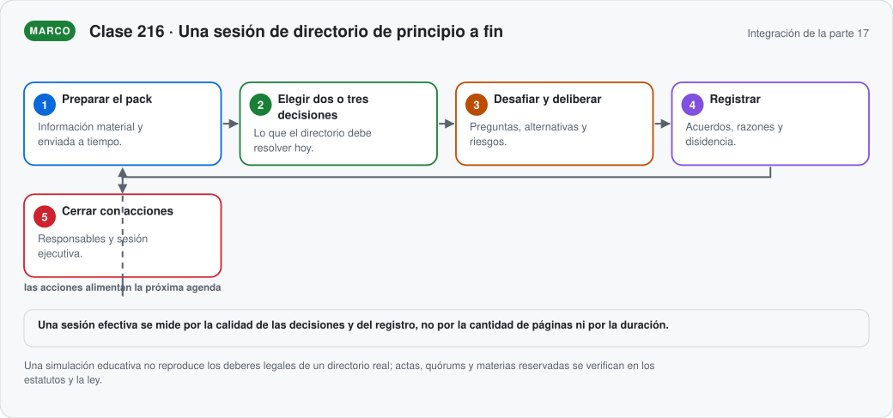

# Clase 216 — Capstone: board meeting

<!-- nav:inicio -->
> **Parte 17 · Directorios y gobierno corporativo** — clase 12 de 12 · [índice de la parte](../../README.md) · [temario](../../../../SYLLABUS.md)
<!-- nav:fin -->

**Parte:** 17 — Directorios y gobierno corporativo  
**Nivel:** Etapa 5 — Director → CEO  
**Duración sugerida:** 150–180 minutos · **Estándar:** deep-class-v2

## 🎯 Propósito

Esta clase integra la parte 17 en una sesión completa de directorio. Se trata de aplicar, en una simulación, todo lo aprendido: un mandato claro (clase 206), roles bien separados entre presidente y CEO (clase 207), comités que alimentan al pleno (clase 208), conflictos de interés declarados y manejados (clase 209), información material y consistente (clases 210 y 211), una supervisión seria de la estrategia (clase 212) y de los riesgos (clase 213), una evaluación y una sucesión pensadas (clase 214) y un directorio que se evalúa (clase 215). Una buena sesión de directorio no se mide por su duración ni por la cantidad de presentaciones, sino por la calidad de **dos o tres decisiones** bien preparadas, desafiadas y registradas, y por los **compromisos de acción** que dejan.

El trabajo del capstone es un **paquete completo de una sesión**: agenda, resumen ejecutivo, documentos de decisión, desafío preparado, acta con acuerdos y disidencias, lista de acciones y temario de la sesión ejecutiva. Se apoya en Charan sobre directorios efectivos, en Tricker y los principios de la OCDE sobre las responsabilidades del directorio, en LeBlanc y Gillies sobre la dinámica de la sala y en Forbes y Milliken sobre los procesos de decisión. Es un ejercicio educativo: no reproduce los deberes legales de un directorio real, cuyas actas, quórums, materias reservadas y conflictos dependen de la ley y los estatutos.

## 📚 Resultados de aprendizaje

Al finalizar podrás:

1. **Preparar** un pack con resumen ejecutivo, documentos de decisión y tablero.
2. **Identificar** las dos o tres decisiones que el directorio debe tomar en la sesión.
3. **Conducir** el desafío y la deliberación con información y respeto.
4. **Registrar** acuerdos, razones y disidencias con precisión.
5. **Cerrar** con acciones, responsables y una sesión ejecutiva útil.

## 🧭 Agenda

| Tramo | Qué se hace |
|---|---|
| 0–20 min | Recuperación: ¿qué decisión de tu directorio habría necesitado más desafío y qué pregunta nadie hizo? |
| 20–60 min | Método de una sesión: pack, decisiones, desafío, registro y cierre. |
| 60–105 min | Ejemplo trabajado: simulación de una sesión con una adquisición, una política de capital y un riesgo. |
| 105–150 min | Caso ejecutivo y práctica. |
| 150–175 min | Límites y entregable. |

## 🧩 Conceptos centrales

| Concepto | Definición | Cómo se reconoce |
|---|---|---|
| **Agenda del directorio** | Lista ordenada de temas con tiempos y objetivos. | Decisiones primero y tiempo para el desafío. |
| **Documento de decisión** | Escrito breve que prepara una decisión del directorio. | Afirmación, evidencia, supuestos, riesgos y propuesta. |
| **Desafío preparado** | Preguntas anticipadas por uno o más directores. | Un director líder por tema. |
| **Disidencia registrada** | Constancia de un voto o posición contraria con sus razones. | Figura en el acta. |
| **Acuerdo con condiciones** | Aprobación sujeta a requisitos específicos. | Responsable y plazo por condición. |
| **Sesión ejecutiva** | Reunión del directorio sin la gerencia. | Temas sensibles y retroalimentación. |

## 🧠 Modelo mental

**Cómo leer el diagrama.** Una cadena de cinco pasos con retorno. **Preparar el pack**: información material y enviada a tiempo. **Elegir dos o tres decisiones**: lo que el directorio debe resolver hoy. **Desafiar y deliberar**: preguntas, alternativas y riesgos. **Registrar**: acuerdos, razones y disidencia. **Cerrar con acciones**: responsables y sesión ejecutiva. La flecha indica que las acciones alimentan la próxima agenda. La nota afirma que una sesión efectiva se mide por la calidad de las decisiones y del registro, no por la cantidad de páginas ni la duración; el pie, que una simulación educativa no reproduce los deberes legales de un directorio real.

## 📖 Desarrollo

### 1. Antes de la sesión: preparar con intención

El éxito de la sesión se decide antes. El presidente y el CEO, con el secretario del directorio, definen el **objetivo** de la sesión y las **dos o tres decisiones** que deben tomarse; el resto es información. Cada decisión tiene un **documento de decisión** de una a tres páginas con: qué se pide, por qué ahora, alternativas consideradas, evidencia, supuestos críticos, riesgos (incluido el peor caso razonable), efecto financiero, recomendación y condiciones. Se prepara un **resumen ejecutivo** de una página, un **tablero** de indicadores con definiciones claras y un **registro de acciones** de la sesión anterior (clase 211). El pack se envía con siete días de antelación. Charan insiste en que una buena preparación libera tiempo para lo que solo el directorio puede hacer: desafiar y decidir.

### 2. Elegir y priorizar decisiones

Las decisiones de una sesión se clasifican por **reversibilidad** y **materialidad** (clase 196). Las irreversibles y materiales (una adquisición, un endeudamiento mayor, un nombramiento clave) requieren una **primera lectura** en una sesión anterior (para que los directores puedan pedir información) y una **segunda** para aprobar; en una emergencia, se justifica la excepción y se documenta. Se verifican de antemano los **conflictos de interés** (clase 209): quién debe recusarse y cómo se manejará la deliberación. Se revisa si la decisión es **competencia del directorio** o corresponde a la junta de propietarios, según los estatutos y la ley (clase 205), y se coordina con los comités competentes (clase 208).

### 3. Preparar el desafío

El desafío no debe improvisarse. Para cada decisión importante, el presidente asigna a un **director líder** que revisa el documento con antelación, habla con la gerencia y prepara **tres a cinco preguntas** críticas. Se recomienda que cada director envíe por escrito sus preguntas y reservas antes de la sesión, lo que reduce el efecto de la influencia de quien habla primero y facilita la discusión con datos (clase 214, sobre ruido). Las preguntas se organizan: **lógica** (¿se sostiene el argumento?), **supuestos** (¿qué pasaría si fallan?), **alternativas** (¿qué más se consideró?), **riesgos** (¿qué es lo peor razonable y lo podemos soportar?), **capacidad** (¿tenemos las personas y el capital?) y **ejecución** (¿quién es responsable y cómo sabremos si falla?). El presidente cuida que todos participen.

### 4. Conducir la sesión

El presidente abre con el objetivo y las reglas del día. **Primero las decisiones**, cuando la energía es mayor. Cada decisión sigue una estructura: **breve presentación** de la gerencia (diez minutos, porque el documento ya se leyó), **preguntas del director líder** y de los demás, **respuestas** con datos, **discusión** sobre alternativas y condiciones, y **resolución**. El presidente modera: da la palabra a quienes hablan menos, pide ejemplos, evita que la discusión se desvíe a lo operativo y sintetiza. Forbes y Milliken muestran que el desafío constructivo y la participación de todos mejoran las decisiones, siempre que no derive en conflicto personal ni en pensamiento de grupo. El CEO responde por la propuesta y escucha sin defensa excesiva.

### 5. Decidir y registrar

La **decisión** se toma conforme a las reglas de quórum y mayoría de los estatutos. Se pueden adoptar tres formas: **aprobar**, **aprobar con condiciones** (con responsables y plazos) o **diferir** (con información que falta y fecha de nueva revisión). El **acta** registra: asistentes, conflictos declarados y recusaciones, documentos considerados, los puntos principales de la discusión, la decisión, los votos y las **disidencias con sus razones**, y los compromisos de acción. Tricker recuerda que el acta es la **evidencia** de cómo el directorio ejerció su deber de diligencia; debe ser precisa y neutral, sin transcribir todo ni omitir lo esencial. La redacción y aprobación de actas se ajustan a la ley y los estatutos, que se verifican con asesoría.

### 6. Comités, riesgos y estrategia en la misma sesión

Aparte de las decisiones, la sesión incluye **informes de comités** breves (con recomendaciones y excepciones, clase 208), el **tablero de riesgos** con los cambios relevantes (clase 213), el **avance de la estrategia** con hitos y señales (clase 212) y los **asuntos de cumplimiento** que corresponda. Se separan en una sección de **información** que se lee antes y se discute solo si hay preguntas o alertas. Esto permite que la mayor parte del tiempo se dedique a las decisiones y a los temas de supervisión estratégica. Si surge un asunto material no previsto (una crisis, un incidente), se altera la agenda sin culpa.

### 7. Cierre: acciones y sesión ejecutiva

La sesión termina con un **resumen de acuerdos**: qué se decidió, qué condiciones se impusieron, qué acciones se asignaron, con responsable y fecha. Luego, la **sesión ejecutiva** (sin la gerencia) trata la evaluación de la reunión, el desempeño del CEO, la sucesión, las dudas sobre la calidad de la información y cualquier tema sensible. El presidente da luego retroalimentación al CEO (clase 207). Después de la sesión, el secretario envía el **borrador de acta** y el **registro de acciones**, y el CEO informa el avance. En la próxima sesión, el seguimiento de las acciones abre la agenda, y cada cierto tiempo el directorio revisa **cómo trabaja** (clase 215).

## 📚 Lectura comparada

| Obra | Qué aporta | Qué no resuelve | Pregunta para contrastar |
|---|---|---|---|
| Charan | Preparación del directorio y foco en lo que solo él puede hacer. | Visión de práctica. | ¿Qué decisiones requieren al directorio hoy? |
| Tricker | Responsabilidades y evidencia del ejercicio del deber. | No es derecho local. | ¿Qué prueba el acta? |
| OCDE (2023) | Principios sobre funciones y responsabilidades del directorio. | Principios de alto nivel. | ¿Se respetan en esta sesión? |
| LeBlanc y Gillies | Dinámica real de la sala. | Casos específicos. | ¿Quién habla y quién calla? |
| Forbes y Milliken | Procesos de decisión: conflicto cognitivo y cohesión. | Marco teórico. | ¿Hubo desafío o solo aprobación? |

## 🧮 Ejemplo trabajado

**Situación (hipotética).** Un directorio de seis personas (presidenta, cuatro directores y el CEO) de una empresa con ventas de 100.000 millones de pesos, EBITDA de 12.000 millones y deuda neta de 14.400 millones (1,2 veces) se reúne durante 4 horas. Se preparó un pack con 12 páginas de cuerpo principal y anexos.

**Agenda y tiempos.**

| Punto | Minutos |
|---|---|
| Apertura, conflictos declarados y acta anterior | 10 |
| Informe del CEO (leído antes; solo preguntas) | 20 |
| Decisión 1: adquisición de una empresa pequeña | 80 |
| Decisión 2: política de capital (dividendo y límite de deuda) | 40 |
| Decisión 3: riesgo de ciberseguridad y excepción de concentración | 40 |
| Informes de comités | 15 |
| Sesión ejecutiva | 20 |
| Resumen de acuerdos y acciones | 15 |
| **Total** | **240** |

**Decisión 1: adquisición.** La gerencia propone adquirir una empresa con un EBITDA de 800 millones por 6.000 millones, 7,5 veces. Sinergias esperadas: 250 millones. Múltiplo ajustado por sinergias: 6.000 ÷ (800 + 250) = 5,7 veces. Riesgos: un cliente representa el 35 % de las ventas de la empresa objetivo; los fundadores se irían a los 12 meses. Un director independiente, líder del desafío, observa que el múltiplo propio de la empresa es de 8 veces (por lo que la operación sería «acretiva»), pero que las sinergias no están respaldadas por evidencia de clientes ni de costos.

**Preguntas de desafío.** ¿Qué parte de las sinergias depende de ventas cruzadas y qué evidencia hay?, ¿qué pasa si el cliente grande se va?, ¿qué pasa con el equipo clave?, ¿se consideró comprar solo una parte?, ¿qué pasa con la deuda en un escenario de estrés?

**Prueba de apalancamiento.** Pago de 4.500 millones al cierre financiado con deuda: deuda neta 14.400 + 4.500 = 18.900; EBITDA combinado 12.000 + 800 = 12.800; razón 18.900 ÷ 12.800 = 1,48. En estrés (EBITDA combinado −15 %: 10.880): 18.900 ÷ 10.880 = 1,74. Con el pago contingente de 1.500 millones: 20.400 ÷ 12.800 = 1,59. Todos bajo el límite de apetito de 2,5.

**Resolución.** El directorio **aprueba con condiciones**: precio total máximo de 6.000 millones, pero estructurado como 4.500 al cierre y 1.500 contingentes a que la empresa objetivo retenga al menos 85 % de las ventas del cliente grande durante 18 meses; acuerdos de permanencia con tres ejecutivos clave; un plan de integración con responsable y un informe al comité a los 90 días. **Votos:** 5 a favor y 1 en contra. La disidencia, de un director, se registra con sus razones: considera frágiles las sinergias y alto el riesgo de integración. El CEO responde por los resultados.

**Decisión 2: política de capital.** Se aprueba un dividendo de 30 % de la utilidad y un límite de deuda neta de 2,0 veces el EBITDA, con aprobación del directorio para excederlo temporalmente.

**Decisión 3: riesgo.** Se aprueba la inversión de 450 millones en un programa de ciberseguridad (autenticación multifactor, respaldos probados) y se aprueba una excepción temporal de concentración de clientes por seis meses, con plan de diversificación.

**Acciones.**

| Acción | Responsable | Fecha |
|---|---|---|
| Acuerdos de permanencia con ejecutivos clave de la empresa adquirida | Director comercial y legal | 30 días |
| Plan de integración con hitos | CEO | 45 días |
| Prueba de restauración de respaldos | Responsable de seguridad | 60 días |
| Informe de diversificación de clientes | Gerente comercial | 90 días |
| Informe al comité de auditoría sobre la integración | Gerente financiero | 90 días |

**Sesión ejecutiva (20 minutos).** Se evalúa el nivel de desafío (hubo un voto en contra y preguntas de fondo), se revisa el tiempo de palabra (el presidente 18 %, el CEO 22 %, todos los directores sobre 10 %), se conversa con el presidente sobre retroalimentar al CEO sobre la solidez de las sinergias, y se pide más información sobre el cliente grande.

**Cuidados.** La sesión es una simulación educativa: las atribuciones del directorio, los quórums, las mayorías, el tratamiento de operaciones de adquisición y los deberes de los directores dependen de la ley y los estatutos, que se verifican con asesoría; las cifras son ilustrativas.

**Qué muestra.** (1) Se priorizaron tres decisiones con tiempo suficiente. (2) El desafío modificó la propuesta y quedó registrada la disidencia. (3) El cierre dejó acciones con responsables y fechas.

## 🔀 Comparación y límites

**Simulación frente a directorio real.** Una simulación educativa permite practicar el método, pero no reproduce las responsabilidades legales, las presiones ni las relaciones de un directorio real.

**Límites.** Para actas, quórums, materias reservadas y conflictos se deben verificar los estatutos y la legislación aplicable. Una buena sesión no garantiza buenas decisiones; mejora la probabilidad y deja evidencia. Los estudios sobre dinámica de directorios provienen de casos y muestras específicas. Las cifras del ejemplo son ilustrativas.

## 🪜 De profesional a owner

| Nivel | Cómo participa en la sesión |
|---|---|
| **Profesional** | Prepara datos exactos para los documentos de decisión. |
| **Jefe / Team Lead** | Entiende cómo su trabajo llega al pack. |
| **Gerente** | Presenta propuestas con alternativas, riesgos y condiciones. |
| **CEO / Director** | Prepara el desafío, delibera con rigor y registra con precisión. |
| **Founder / Owner** | Acepta ser desafiado y que el acta registre las disidencias. |

## 🏢 Caso ejecutivo

El directorio de una empresa de servicios de salud con 3.400 personas y ventas de 190.000 millones de pesos se reúne para decidir: (1) la compra de una red de seis clínicas por 22.000 millones de pesos (EBITDA objetivo de 2.600 millones, deuda asumida de 4.000 millones); (2) la renovación de un convenio con una aseguradora que representa el 24 % de las ventas, con una exigencia de baja de tarifas de 6 %; y (3) la aprobación de un plan de ciberseguridad por 1.100 millones tras un incidente reciente. El director D tiene un familiar socio de una de las clínicas objetivo; el CEO quiere cerrar la compra antes de fin de mes y ha enviado el pack tres días antes con 140 páginas; el presidente propone aprobar los tres temas «en bloque»; dos directores no han leído los materiales; un director independiente pide una segunda lectura. En la sala hay presión de los propietarios por crecer. Una investigación de un regulador sobre una de las clínicas objetivo no está en el pack.

Entrega un **paquete de una sesión de directorio** que contenga: (a) el objetivo, la agenda con tiempos y el manejo de los conflictos; (b) el resumen ejecutivo y los documentos de decisión de las tres decisiones; (c) el desafío preparado, con director líder y preguntas críticas; (d) el análisis financiero y de riesgo de la compra, con pruebas de estrés; (e) un acta modelo con acuerdos, condiciones, votos y disidencias; (f) el registro de acciones, el temario de la sesión ejecutiva y las verificaciones estatutarias y legales.

## 🧪 Práctica

1. Redacta la agenda de una sesión de cuatro horas con tres decisiones y los tiempos de cada punto.
2. Escribe un documento de decisión de dos páginas con las ocho preguntas de pre-lectura.
3. Prepara cinco preguntas críticas de desafío para una propuesta de inversión.
4. Redacta un extracto de acta con una decisión aprobada con condiciones y una disidencia.
5. Diseña el temario de una sesión ejecutiva y la retroalimentación al CEO.

## ⚠️ Errores frecuentes

| Error | Por qué ocurre | Cómo corregirlo |
|---|---|---|
| Aprobar «en bloque» | Falta tiempo | Priorizar dos o tres decisiones con tiempo propio. |
| Pack tardío y extenso | No se planifica | Envío anticipado y cuerpo principal breve. |
| Ignorar conflictos | Se espera que no se note | Declarar y recusarse antes de deliberar. |
| Desafío improvisado | Se confía en la sala | Director líder y preguntas anticipadas. |
| Acta incompleta | Se evita registrar discrepancias | Registrar acuerdos, razones y disidencias. |
| Sesión sin cierre | Se acaba el tiempo | Resumen de acciones y sesión ejecutiva. |

## ❓ Preguntas de comprobación

1. ¿Qué incluye la preparación de una sesión de directorio?
2. ¿Cómo se eligen las decisiones de una sesión?
3. ¿Qué es un director líder del desafío y para qué sirve?
4. ¿Qué formas puede adoptar una decisión del directorio?
5. ¿Qué debe registrar un acta?
6. ¿Qué se trata en la sesión ejecutiva?
7. ¿Qué límites tiene una simulación educativa?

Claves de respuesta

1. Objetivo, dos o tres decisiones con documentos, resumen ejecutivo, tablero, registro de acciones, envío anticipado y verificación de conflictos.
2. Por reversibilidad y materialidad, con primera y segunda lectura para las irreversibles, y verificando competencia y conflictos.
3. Un director que revisa la propuesta antes, habla con la gerencia y prepara preguntas críticas para estructurar el desafío.
4. Aprobar, aprobar con condiciones o diferir con información y fecha de nueva revisión.
5. Asistentes, conflictos y recusaciones, documentos, puntos principales, decisión, votos, disidencias con razones y compromisos de acción.
6. Evaluación de la sesión, desempeño del CEO, sucesión, calidad de la información y asuntos sensibles.
7. No reproduce los deberes legales ni las presiones reales; actas, quórums y materias reservadas se verifican en estatutos y ley.

## 📥 Entregable

Guarda en `portfolio/216-capstone-board-meeting/`:

- `board-or-executive-memo.md` (plantilla [Board or executive memo](../../../../templates/board-or-executive-memo.md)) con el documento de decisión y el acta modelo del caso ejecutivo;
- `board-pack.md` (plantilla [Board pack](../../../../templates/board-pack.md)) con el pack de la sesión: agenda, resumen ejecutivo y tablero;
- `risk-governance-brief.md` (plantilla [Risk Governance Brief](../../../../templates/risk-governance-brief.md)) con el análisis de riesgos y los conflictos;
- `decision-journal.md` con el registro de acciones, la sesión ejecutiva y las verificaciones estatutarias y legales.

## 📗 Fuentes y verificación

- Ram Charan — *Boards That Deliver* (John Wiley & Sons, Incorporated, 2007). **Uso en esta clase:** preparación del directorio y foco en lo que solo él puede hacer. Lectura selectiva sobre **capstone: board meeting**. **Localizador:** [ISBN-13 9781118046616](https://openlibrary.org/isbn/9781118046616).
- Bob Tricker — *Corporate Governance* (Oxford University Press, 2019). **Uso en esta clase:** responsabilidades del directorio y evidencia del ejercicio del deber. Lectura selectiva sobre **capstone: board meeting**. **Localizador:** [ISBN-13 9780198809869](https://openlibrary.org/isbn/9780198809869).
- OECD — *G20/OECD Principles of Corporate Governance 2023*. **Uso en esta clase:** principios sobre funciones y responsabilidades del directorio. **Fuente primaria:** <https://www.oecd.org/en/publications/2023/09/g20-oecd-principles-of-corporate-governance-2023_60836fcb.html>.
- Richard Leblanc & James Gillies — *Inside the Boardroom* (John Wiley & Sons, Incorporated, 2009). **Uso en esta clase:** dinámica real de la sala del directorio. Lectura selectiva sobre **capstone: board meeting**. **Localizador:** [ISBN-13 9780470739952](https://openlibrary.org/isbn/9780470739952).
- Daniel P. Forbes & Frances J. Milliken — *Cognition and Corporate Governance: Understanding Boards of Directors as Strategic Decision-Making Groups* (The Academy of Management Review, 1999). **Uso en esta clase:** procesos de decisión con conflicto cognitivo y cohesión. Lectura selectiva sobre **capstone: board meeting**. **Localizador:** [DOI 10.2307/259138](https://doi.org/10.2307/259138).

> **Regla de fuentes para el Capstone de board meeting:** las obras anteriores estructuran las perspectivas de esta materia; cualquier norma, ley o estándar vivo mencionado debe comprobarse nuevamente en su fuente primaria vigente, incluidos los estatutos, quórums, materias reservadas, deberes de los directores y la regulación aplicable. Los ejemplos y casos son hipotéticos, con cifras ilustrativas. El desarrollo es original y no reproduce capítulos protegidos.

<!-- pie:inicio -->
---

| Anterior | Índice | Siguiente |
|---|---|---|
| [← 215 · Efectividad del directorio](../215-efectividad-del-directorio/README.md) | [Parte 17](../../README.md) · [Programa](../../../../SYLLABUS.md) | [217 · Estructura de capital →](../../../18-corporate-finance-capital-ma/classes/217-estructura-de-capital/README.md) |
<!-- pie:fin -->
