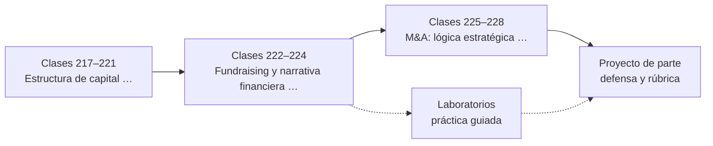

# Parte 18 — Finanzas corporativas, capital y M&A

<!-- parte:inicio -->

> ← [Parte 17 — Directorios y gobierno corporativo](../17-boards-corporate-governance/README.md) · [Temario](../../SYLLABUS.md) · [Parte 19 — Tecnología, datos, IA y transformación digital para ejecutivos](../19-technology-data-ai-digital-transformation/README.md) →

*Financiar, valorar y adquirir con criterio de propietario*

**Etapa:** 5 — Alta dirección y gobierno  
**Duración:** 12 clases · 30 horas  
**Resultado de salida:** Tomar decisiones de financiación, valoración, inversión, adquisición y retorno para propietarios.

🔴 [Ver las 6 etapas](../../SYLLABUS.md) · 12 clases (217–228) · 4 laboratorios · [proyecto de parte](project.md)

## 🎯 De qué trata esta parte

Las decisiones de capital son las más difíciles de revertir y las que más afectan al patrimonio de los dueños. Esta parte da el marco para financiar, valorar, levantar capital y comprar o integrar empresas.

El eje es **retorno ajustado por riesgo y control**: cuánto cuesta el capital, qué se cede al financiarse y qué se promete al comprar.

## 🧱 Con qué hay que llegar

| Parte | Qué aporta |
|---|---|
| [09 — Finanzas y contabilidad para gerentes](../09-managerial-finance-accounting/README.md) | Lectura financiera y retorno. |
| [17 — Directorios y gobierno corporativo](../17-boards-corporate-governance/README.md) | Gobierno y deberes. |

Cada clase supone la anterior: el orden importa, y saltarse una deja sin base a las que vienen después.

## 📚 Resultados de la parte

Al terminar esta parte podrás:

1. **Decidir** estructura de capital y comparar deuda con capital propio.
2. **Estimar** el costo de capital.
3. **Valorar** por flujos y por múltiplos, y señalar sus límites.
4. **Leer** un cap table y un term sheet en economía y control.
5. **Evaluar** una adquisición y su integración.

## 🗺️ Mapa de la parte

## 🧭 Cómo se encadenan las 12 clases

Las clases **217 a 221** cubren el valor: estructura y costo de capital, deuda frente a capital, valoración por flujos y por múltiplos.

Las clases **222 a 224** cubren el levantamiento: relato financiero, cap table y term sheets.

Las clases **225 a 228** cubren las adquisiciones: lógica estratégica, due diligence, integración y el capstone de comité de capital.

## 📘 Las 12 clases

| # | Clase | Qué se trabaja | Entregable | Min |
|---:|---|---|---|---:|
| 217 | [Estructura de capital](classes/217-estructura-de-capital/README.md) | capital structure, financial leverage, debt capacity | [modelo-financiero-y-memo-de-decision](../../templates/modelo-financiero-y-memo-de-decision.md) | 150 |
| 218 | [Costo de capital](classes/218-costo-de-capital/README.md) | cost of equity, cost of debt, WACC | [modelo-financiero-y-memo-de-decision](../../templates/modelo-financiero-y-memo-de-decision.md) | 150 |
| 219 | [Deuda versus equity](classes/219-deuda-versus-equity/README.md) | debt, equity, dilution | [leadership-decision-brief](../../templates/leadership-decision-brief.md) | 150 |
| 220 | [Valoración por flujos](classes/220-valoracion-por-flujos/README.md) | free cash flow, DCF, terminal value | [modelo-financiero-y-memo-de-decision](../../templates/modelo-financiero-y-memo-de-decision.md) | 150 |
| 221 | [Múltiplos y comparables](classes/221-multiplos-y-comparables/README.md) | enterprise value, equity value, trading multiple | [leadership-decision-brief](../../templates/leadership-decision-brief.md) | 150 |
| 222 | [Fundraising y narrativa financiera](classes/222-fundraising-y-narrativa-financiera/README.md) | fundraising, use of proceeds, milestone financing | [modelo-financiero-y-memo-de-decision](../../templates/modelo-financiero-y-memo-de-decision.md) | 150 |
| 223 | [Cap table y dilución](classes/223-cap-table-y-dilucion/README.md) | cap table, fully diluted, option pool | [leadership-decision-brief](../../templates/leadership-decision-brief.md) | 150 |
| 224 | [Term sheets: economía y control](classes/224-term-sheets-economia-y-control/README.md) | liquidation preference, participation, anti-dilution | [risk-governance-brief](../../templates/risk-governance-brief.md) | 150 |
| 225 | [M&A: lógica estratégica](classes/225-m-a-logica-estrategica/README.md) | M&A, strategic rationale, synergy | [strategy-memo](../../templates/strategy-memo.md) | 150 |
| 226 | [Due diligence](classes/226-due-diligence/README.md) | due diligence, quality of earnings, red flag | [leadership-decision-brief](../../templates/leadership-decision-brief.md) | 150 |
| 227 | [Integración post-adquisición](classes/227-integracion-post-adquisicion/README.md) | Day 1, integration management office, synergy capture | [leadership-decision-brief](../../templates/leadership-decision-brief.md) | 150 |
| 228 | [Capstone: comité de capital](classes/228-capstone-comite-de-capital/README.md) | capital allocation framework, capital budget, portfolio return | [modelo-financiero-y-memo-de-decision](../../templates/modelo-financiero-y-memo-de-decision.md) | 150 |

## ⚠️ Riesgos característicos

- Valorar con un único método y sin escenarios.
- Ceder control sin haberlo valorado.
- Comprar por tamaño y no por lógica estratégica.
- Subestimar la integración.

## 🔤 Glosario de la parte

60 conceptos definidos en las clases, con la definición operacional que usa cada una.

| Concepto | Definición operacional |
|---|---|
| **anti-dilution** | ajuste frente a futuras emisiones a menor precio. |
| **beta** | medida de sensibilidad sistemática usada en CAPM. |
| **cap table** | registro de ownership y securities de una compañía. |
| **capital allocation framework** | reglas para comparar usos de capital. |
| **capital budget** | conjunto de inversiones propuestas para un periodo. |
| **capital recycling** | venta o reducción de activos de bajo valor para financiar mejores usos. |
| **capital structure** | mezcla de deuda equity y otros instrumentos. |
| **comparable company** | empresa con economics y riesgo comparables. |
| **confirmatory diligence** | validación final después de indicaciones iniciales. |
| **control premium** | precio adicional por obtener control. |
| **cost of debt** | retorno exigido por prestamistas ajustado por condiciones. |
| **cost of equity** | retorno requerido por accionistas por asumir riesgo residual. |
| **covenant** | compromiso contractual que limita o exige ciertas condiciones. |
| **critical talent** | personas cuya salida amenaza tesis o continuidad. |
| **data room** | repositorio controlado de documentos. |
| **Day 1** | primer día bajo nueva propiedad con continuidad y mensajes definidos. |
| **DCF** | valor presente de flujos esperados. |
| **deal thesis** | hipótesis específica de valor y condiciones de éxito. |
| **debt** | capital con obligación contractual de repago e interés. |
| **debt capacity** | capacidad de soportar deuda sin riesgo excesivo de distress. |
| **default risk** | riesgo de incumplir obligaciones de deuda. |
| **dilution** | reducción porcentual de propiedad por nueva emisión. |
| **discount rate** | tasa que refleja tiempo y riesgo. |
| **due diligence** | investigación estructurada antes de una transacción. |
| **enterprise value** | valor de operaciones para todos los financiadores. |
| **equity** | capital residual con participación en propiedad. |
| **equity value** | valor residual atribuible a accionistas. |
| **financial flexibility** | capacidad de obtener recursos o adaptarse bajo estrés. |
| **financial leverage** | uso de deuda que amplifica retorno y pérdida para equity. |
| **free cash flow** | efectivo generado después de inversión necesaria disponible para financiadores. |
| **fully diluted** | propiedad asumiendo ejercicio o conversión de instrumentos relevantes. |
| **fundraising** | proceso de captar capital externo. |
| **fundraising funnel** | proceso desde target list hasta term sheet y close. |
| **hurdle rate** | tasa mínima exigida para aceptar una inversión. |
| **integration archetype** | grado de absorción preservación o simbiosis entre empresas. |
| **integration management office** | mecanismo temporal que coordina workstreams y dependencias. |
| **investor fit** | compatibilidad entre inversor etapa horizonte y apoyo. |
| **liquidation preference** | derecho de inversor a cobrar antes o bajo reglas específicas en liquidez. |
| **M&A** | fusiones y adquisiciones como forma de reasignar propiedad y capacidades. |
| **milestone financing** | capital suficiente para alcanzar hitos que reducen riesgo. |
| **NOPAT** | beneficio operativo después de impuestos sin efecto de financiación. |
| **normalization** | ajuste de métricas para eliminar distorsiones no recurrentes. |
| **option pool** | acciones reservadas para incentivos de empleados. |
| **participation** | posible derecho a cobrar preferencia y luego participar en remanente. |
| **portfolio return** | retorno agregado ponderado por capital. |
| **post-money valuation** | pre-money más inversión nueva. |
| **pre-money valuation** | valor antes del nuevo capital. |
| **protective provision** | materia que requiere consentimiento especial. |
| **quality of earnings** | análisis de sostenibilidad y normalización de resultados. |
| **red flag** | hallazgo que puede cambiar materialmente el deal. |
| **risk-adjusted return** | retorno interpretado según exposición. |
| **runway** | tiempo financiable antes de agotar caja. |
| **strategic rationale** | razón causal por la que combinación crea más valor. |
| **synergy** | beneficio incremental de combinación no disponible por separado. |
| **synergy capture** | realización medible de beneficios del deal. |
| **terminal value** | valor de flujos posteriores al horizonte explícito. |
| **trading multiple** | relación entre valor de mercado y métrica financiera. |
| **use of proceeds** | destino específico del capital. |
| **vesting** | adquisición gradual de derechos sobre equity. |
| **WACC** | costo promedio ponderado de capital para riesgo del negocio financiado. |

## 📦 Qué queda como evidencia

- Una valoración con rangos y supuestos.
- Un análisis de cap table y dilución.
- Una tesis de adquisición con riesgos de due diligence.
- El capstone: comité de capital.

## 🔗 Cómo se conecta

Alimenta la parte 20 (equity entre cofundadores), la 22 (adquisiciones y holdings) y la 23 (runway y concentración de riesgo).

## 🧪 Cómo se trabaja

Son **12 clases de 150 minutos** —30 horas— con **4 laboratorios** y un proyecto integrador. Cada clase trae su propósito, sus conceptos, un caso, práctica, errores frecuentes, preguntas de comprobación, entregable y fuentes, y se evalúa con su `assessment.md`. Los laboratorios se resuelven con datos propios o sintéticos, nunca con datos reales de terceros, y la parte se cierra con el proyecto y su defensa. Las reglas de recorrido están en [la guía de navegación](../../docs/NAVIGATION.md).

<!-- parte:fin -->

## Laboratorios

- [Lab 01 — DCF lite](labs/lab-01.md)
- [Lab 02 — Cap table simulator](labs/lab-02.md)
- [Lab 03 — Term sheet case](labs/lab-03.md)
- [Lab 04 — Acquisition memo](labs/lab-04.md)

## Proyecto de parte

Elegir entre deuda, equity y adquisición para financiar una expansión estratégica.

## Bibliografía rectora

- Richard Brealey, Stewart Myers & Franklin Allen — *Principles of Corporate Finance* (Finanzas corporativas)
- Tim Koller, Marc Goedhart & David Wessels — *Valuation: Measuring and Managing the Value of Companies* (Valoración)
- Aswath Damodaran — *Investment Valuation* (Valoración)
- Brad Feld & Jason Mendelson — *Venture Deals* (Venture capital)
- Donald DePamphilis — *Mergers, Acquisitions, and Other Restructuring Activities* (M&A)

## Criterio de aprobación

80/100 y entrega del proyecto integrador.
