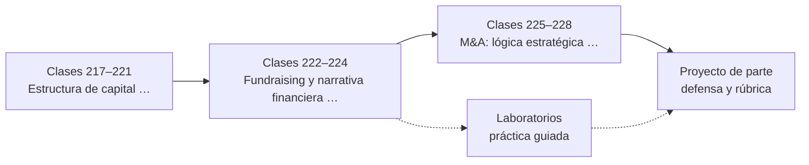

# Parte 18 — Finanzas corporativas, capital y M&A

<!-- parte:inicio -->

> ← [Parte 17 — Directorios y gobierno corporativo](../17-boards-corporate-governance/README.md) · [Temario](../../SYLLABUS.md) · [Parte 19 — Tecnología, datos, IA y transformación digital para ejecutivos](../19-technology-data-ai-digital-transformation/README.md) →

*Financiar, valorar y adquirir con criterio de propietario*

**Etapa:** 5 — Alta dirección y gobierno  
**Duración:** 12 clases · 30 horas  
**Resultado de salida:** Tomar decisiones de financiación, valoración, inversión, adquisición y retorno para propietarios.

🔴 [Ver las 6 etapas](../../SYLLABUS.md) · 12 clases (217–228) · 4 laboratorios · [proyecto de parte](project.md)

## 🎯 De qué trata esta parte

Las decisiones de capital son las más difíciles de revertir y las que más afectan al patrimonio de los dueños. Esta parte da el marco para financiar, valorar, levantar capital y comprar o integrar empresas.

El eje es **retorno ajustado por riesgo y control**: cuánto cuesta el capital, qué se cede al financiarse y qué se promete al comprar.

## 🧱 Con qué hay que llegar

| Parte | Qué aporta |
|---|---|
| [09 — Finanzas y contabilidad para gerentes](../09-managerial-finance-accounting/README.md) | Lectura financiera y retorno. |
| [17 — Directorios y gobierno corporativo](../17-boards-corporate-governance/README.md) | Gobierno y deberes. |

Cada clase supone la anterior: el orden importa, y saltarse una deja sin base a las que vienen después.

## 📚 Resultados de la parte

Al terminar esta parte podrás:

1. **Decidir** estructura de capital y comparar deuda con capital propio.
2. **Estimar** el costo de capital.
3. **Valorar** por flujos y por múltiplos, y señalar sus límites.
4. **Leer** un cap table y un term sheet en economía y control.
5. **Evaluar** una adquisición y su integración.

## 🗺️ Mapa de la parte

## 🧭 Cómo se encadenan las 12 clases

Las clases **217 a 221** cubren el valor: estructura y costo de capital, deuda frente a capital, valoración por flujos y por múltiplos.

Las clases **222 a 224** cubren el levantamiento: relato financiero, cap table y term sheets.

Las clases **225 a 228** cubren las adquisiciones: lógica estratégica, due diligence, integración y el capstone de comité de capital.

## 📘 Las 12 clases

| # | Clase | Qué se trabaja | Entregable | Min |
|---:|---|---|---|---:|
| 217 | [Estructura de capital](classes/217-estructura-de-capital/README.md) | Estructura de capital, Apalancamiento financiero, Capacidad de deuda | [modelo-financiero-y-memo-de-decision](../../templates/modelo-financiero-y-memo-de-decision.md) | 150 |
| 218 | [Costo de capital](classes/218-costo-de-capital/README.md) | Costo de capital, Costo de la deuda, Costo del capital propio | [modelo-financiero-y-memo-de-decision](../../templates/modelo-financiero-y-memo-de-decision.md) | 150 |
| 219 | [Deuda versus equity](classes/219-deuda-versus-equity/README.md) | Deuda, Capital propio (*equity*), Dilución | [leadership-decision-brief](../../templates/leadership-decision-brief.md) | 150 |
| 220 | [Valoración por flujos](classes/220-valoracion-por-flujos/README.md) | Flujo de caja libre (FCF), Valor presente, NOPAT | [modelo-financiero-y-memo-de-decision](../../templates/modelo-financiero-y-memo-de-decision.md) | 150 |
| 221 | [Múltiplos y comparables](classes/221-multiplos-y-comparables/README.md) | Múltiplo, Valor de empresa (EV), Valor del patrimonio | [leadership-decision-brief](../../templates/leadership-decision-brief.md) | 150 |
| 222 | [Fundraising y narrativa financiera](classes/222-fundraising-y-narrativa-financiera/README.md) | Captación (*fundraising*), Uso de fondos, Pista de caja (*runway*) | [modelo-financiero-y-memo-de-decision](../../templates/modelo-financiero-y-memo-de-decision.md) | 150 |
| 223 | [Cap table y dilución](classes/223-cap-table-y-dilucion/README.md) | Tabla de capitalización, Valoración previa (*pre-money*), Valoración posterior (*post-money*) | [leadership-decision-brief](../../templates/leadership-decision-brief.md) | 150 |
| 224 | [Term sheets: economía y control](classes/224-term-sheets-economia-y-control/README.md) | Term sheet, Preferencia de liquidación, Participación | [risk-governance-brief](../../templates/risk-governance-brief.md) | 150 |
| 225 | [M&A: lógica estratégica](classes/225-m-a-logica-estrategica/README.md) | Tesis estratégica, Valor independiente (*stand-alone*), Sinergia | [strategy-memo](../../templates/strategy-memo.md) | 150 |
| 226 | [Due diligence](classes/226-due-diligence/README.md) | Debida diligencia, Calidad de utilidades (*quality of earnings*), Deuda implícita (*debt-like items*) | [leadership-decision-brief](../../templates/leadership-decision-brief.md) | 150 |
| 227 | [Integración post-adquisición](classes/227-integracion-post-adquisicion/README.md) | Integración, Día 1, Oficina de integración (IMO) | [leadership-decision-brief](../../templates/leadership-decision-brief.md) | 150 |
| 228 | [Capstone: comité de capital](classes/228-capstone-comite-de-capital/README.md) | Marco de asignación de capital, Presupuesto de capital, Piso de caja | [modelo-financiero-y-memo-de-decision](../../templates/modelo-financiero-y-memo-de-decision.md) | 150 |

## ⚠️ Riesgos característicos

- Valorar con un único método y sin escenarios.
- Ceder control sin haberlo valorado.
- Comprar por tamaño y no por lógica estratégica.
- Subestimar la integración.

## 🔤 Glosario de la parte

71 conceptos definidos en las clases, con la definición operacional que usa cada una.

| Concepto | Definición operacional |
|---|---|
| **Antidilución** | Protección que ajusta el precio de conversión si hay rondas a la baja. |
| **Apalancamiento financiero** | Efecto de la deuda sobre el retorno y el riesgo del capital propio. |
| **Arrastre y acompañamiento** | Reglas para vender el 100 % o para acompañar una venta. |
| **Base totalmente diluida** | Cuenta todas las acciones posibles: emitidas, opciones, convertibles y *pool*. |
| **Beta** | Sensibilidad del retorno de un activo al del mercado. |
| **Calidad de utilidades (*quality of earnings*)** | Análisis de cuánto del resultado reportado es recurrente y real. |
| **Capacidad de deuda** | Deuda máxima que el flujo soporta en el escenario adverso. |
| **Capital de trabajo normal** | Nivel de capital de trabajo necesario para operar. |
| **Capital propio (*equity*)** | Aporte de propietarios sin obligación fija de pago. |
| **Captación (*fundraising*)** | Proceso de obtener capital de inversionistas. |
| **Captura de sinergias** | Valor efectivamente logrado frente al prometido. |
| **Cobertura del servicio de deuda (DSCR)** | Caja disponible sobre intereses y amortizaciones del período. |
| **Comparables** | Empresas similares en economía, riesgo y crecimiento. |
| **Costo de capital** | Retorno mínimo exigido por quienes financian la empresa. |
| **Costo de la deuda** | Tasa a la que la empresa puede endeudarse hoy, neta de impuestos. |
| **Costo de lograr (*cost to achieve*)** | Gasto necesario para obtener las sinergias. |
| **Costo de quiebra** | Pérdida de valor por dificultades financieras. |
| **Costo del capital propio** | Retorno que exigen los propietarios por soportar el riesgo residual. |
| **Covenant** | Condición financiera impuesta por el acreedor. |
| **Debida diligencia** | Revisión del objetivo antes del cierre para verificar la tesis y detectar riesgos. |
| **Declaraciones y garantías** | Afirmaciones del vendedor sobre el negocio, con consecuencias si son falsas. |
| **Derecho de veto** | Capacidad de bloquear ciertas decisiones. |
| **Deuda** | Financiamiento con obligación de pagar intereses y capital en fechas. |
| **Deuda implícita (*debt-like items*)** | Obligaciones que se comportan como deuda aunque no estén en el balance. |
| **Dilución** | Reducción de la participación de los actuales propietarios. |
| **Día 1** | Primer día de operación conjunta. |
| **Embudo de inversionistas** | Secuencia de contactos, reuniones y ofertas. |
| **Estructura de capital** | Proporción de deuda y capital propio con que se financia la empresa. |
| **Flujo de caja libre (FCF)** | Caja operativa después de impuestos e inversión, disponible para los financistas. |
| **Hito** | Resultado verificable que reduce la incertidumbre del negocio. |
| **Instrumento híbrido** | Mezcla de deuda y capital, como un convertible. |
| **Integración** | Proceso de combinar operaciones, sistemas y personas tras la compra. |
| **Marco de asignación de capital** | Principios y criterios con que se decide dónde va el capital. |
| **Materialidad** | Umbral a partir del cual un hallazgo importa. |
| **Múltiplo** | Razón entre el valor (o precio) de una empresa y una métrica financiera. |
| **Múltiplo de transacciones** | Múltiplo pagado en compras de empresas, incluye prima de control. |
| **NOPAT** | Utilidad operativa después de impuestos, antes de costos financieros. |
| **Normalización** | Ajuste de las cifras por partidas únicas y políticas distintas. |
| **Oficina de integración (IMO)** | Equipo que coordina y mide la integración. |
| **Opción estratégica** | Derecho, no obligación, de invertir más si se cumplen condiciones. |
| **Participación** | Derecho de cobrar la preferencia y además compartir el resto. |
| **Piso de caja** | Liquidez mínima que no se compromete. |
| **Pista de caja (*runway*)** | Meses de operación que permite la caja disponible. |
| **Plan B de financiamiento** | Alternativa si falla la fuente principal. |
| **Pool de opciones** | Acciones reservadas para empleados futuros. |
| **Precio máximo (*walk-away price*)** | Precio por encima del cual no se compra. |
| **Preferencia de liquidación** | Derecho del inversionista a cobrar primero en una salida. |
| **Presupuesto de capital** | Aplicación anual del marco a las propuestas concretas. |
| **Prima de control** | Sobreprecio que se paga por tomar el control. |
| **Puerta de decisión (*stage gate*)** | Punto en que se decide continuar, ajustar o detener. |
| **Rango objetivo** | Intervalo de deuda con margen de seguridad. |
| **Reinversión neta** | Inversión en capital fijo y de trabajo por encima de la depreciación. |
| **Retención de talento y clientes** | Permanencia de personas y clientes críticos. |
| **Revisión posterior (*post-investment review*)** | Comparación de lo logrado con lo prometido. |
| **Sala de evidencia (*data room*)** | Repositorio ordenado de documentos y datos para inversionistas. |
| **Sinergia** | Valor adicional por combinar los negocios. |
| **Soberbia (*hubris*)** | Exceso de confianza del comprador en su valoración. |
| **Tabla de capitalización** | Registro de los propietarios y sus participaciones. |
| **Tasa de corte (*hurdle rate*)** | Retorno mínimo exigido a un proyecto. |
| **Term sheet** | Resumen de las condiciones principales de una inversión. |
| **Tesis estratégica** | Razón por la que la combinación vale más que las partes por separado. |
| **Uso de fondos** | Destino planificado del capital levantado. |
| **Valor de empresa (EV)** | Valor del negocio operativo para todos los financistas. |
| **Valor de empresa y de patrimonio** | El primero valora todo el negocio; el segundo, lo que corresponde a los propietarios. |
| **Valor del patrimonio** | Valor de lo que corresponde a los propietarios. |
| **Valor independiente (*stand-alone*)** | Valor del objetivo sin considerar la compra. |
| **Valor presente** | Valor hoy de un flujo futuro, descontado por riesgo y tiempo. |
| **Valor terminal** | Valor de los flujos posteriores al horizonte explícito. |
| **Valoración posterior (*post-money*)** | Valoración previa más el capital recibido. |
| **Valoración previa (*pre-money*)** | Valor de la empresa antes de recibir el nuevo capital. |
| **WACC** | Costo promedio ponderado de capital. |

## 📦 Qué queda como evidencia

- Una valoración con rangos y supuestos.
- Un análisis de cap table y dilución.
- Una tesis de adquisición con riesgos de due diligence.
- El capstone: comité de capital.

## 🔗 Cómo se conecta

Alimenta la parte 20 (equity entre cofundadores), la 22 (adquisiciones y holdings) y la 23 (runway y concentración de riesgo).

## 🧪 Cómo se trabaja

Son **12 clases de 150 minutos** —30 horas— con **4 laboratorios** y un proyecto integrador. Cada clase trae su propósito, sus conceptos, un caso, práctica, errores frecuentes, preguntas de comprobación, entregable y fuentes, y se evalúa con su `assessment.md`. Los laboratorios se resuelven con datos propios o sintéticos, nunca con datos reales de terceros, y la parte se cierra con el proyecto y su defensa. Las reglas de recorrido están en [la guía de navegación](../../docs/NAVIGATION.md).

<!-- parte:fin -->

## Laboratorios

- [Lab 01 — DCF lite](labs/lab-01.md)
- [Lab 02 — Cap table simulator](labs/lab-02.md)
- [Lab 03 — Term sheet case](labs/lab-03.md)
- [Lab 04 — Acquisition memo](labs/lab-04.md)

## Proyecto de parte

Elegir entre deuda, equity y adquisición para financiar una expansión estratégica.

## Bibliografía rectora

- Richard Brealey, Stewart Myers & Franklin Allen — *Principles of Corporate Finance* (Finanzas corporativas)
- Tim Koller, Marc Goedhart & David Wessels — *Valuation: Measuring and Managing the Value of Companies* (Valoración)
- Aswath Damodaran — *Investment Valuation* (Valoración)
- Brad Feld & Jason Mendelson — *Venture Deals* (Venture capital)
- Donald DePamphilis — *Mergers, Acquisitions, and Other Restructuring Activities* (M&A)

## Criterio de aprobación

80/100 y entrega del proyecto integrador.
