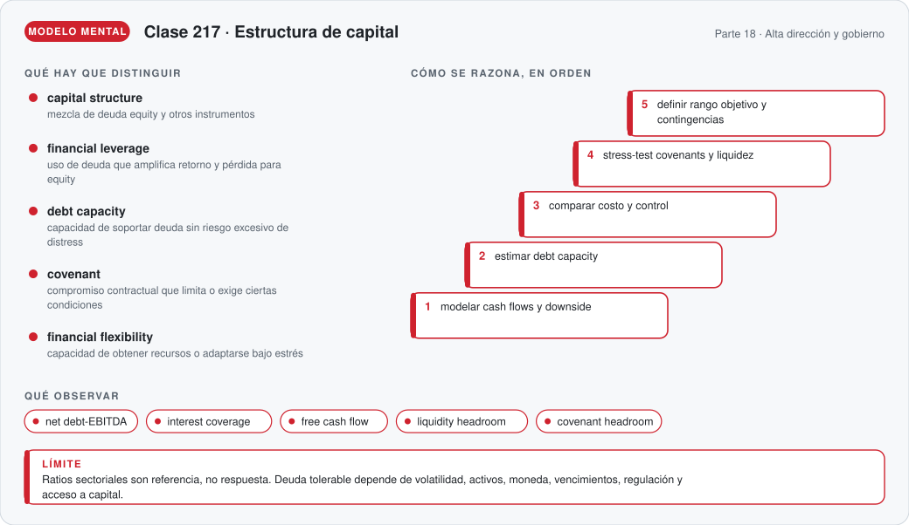

# Clase 217 — Estructura de capital

<!-- nav:inicio -->
> **Parte 18 · Finanzas corporativas, capital y M&A** — clase 1 de 12 · [índice de la parte](../../README.md) · [temario](../../../../SYLLABUS.md)
<!-- nav:fin -->

**Parte:** 18 — Finanzas corporativas, capital y M&A  
**Nivel:** Etapa 5 — CEO → Capital allocator  
**Duración sugerida:** 150–180 minutos · **Estándar:** deep-class-v2

## 🎯 Propósito

La estructura de capital es la mezcla de deuda y capital propio con que una empresa financia sus activos. En los textos aparece como un problema de optimización: hay un nivel de deuda que minimiza el costo de capital y maximiza el valor. En la práctica es una decisión de **supervivencia y de control**: cuánta deuda puede soportar la empresa si el negocio va peor de lo previsto, cuánto estamos dispuestos a diluir a los propietarios, qué condiciones aceptamos de los acreedores y qué margen de seguridad dejamos para aprovechar oportunidades o resistir crisis. Muchas empresas que quebraron no tenían un mal negocio sino una estructura de capital que no resistió un mal año; otras perdieron oportunidades porque, por temor a endeudarse, financiaron todo con capital más caro.

La clase aborda la estructura de capital como una decisión de **rango con margen de seguridad**, apoyada en la teoría de Brealey, Myers y Allen, en la idea de Myers sobre el «rompecabezas» de la estructura de capital y la jerarquía de las fuentes de financiamiento, en la evidencia de Graham y Harvey sobre cómo deciden realmente los gerentes financieros y en la visión de Koller y colaboradores sobre valor y financiamiento. Al terminar sabrás modelar caja y peor caso, estimar la capacidad de deuda, comparar costo y control de cada fuente, someter la estructura a pruebas de estrés y definir un rango objetivo con contingencias.

## 📚 Resultados de aprendizaje

Al finalizar podrás:

1. **Distinguir** estructura de capital y apalancamiento financiero.
2. **Estimar** la capacidad de deuda con flujos, escenarios adversos y restricciones.
3. **Comparar** el costo y el control de deuda y capital propio.
4. **Someter** la estructura a pruebas de estrés de liquidez y de condiciones contractuales.
5. **Definir** un rango objetivo con márgenes y un plan de contingencia.

## 🧭 Agenda

| Tramo | Qué se hace |
|---|---|
| 0–20 min | Recuperación: ¿qué nivel de deuda de tu empresa te dejaría sin dormir si el negocio cae 25 % y por qué? |
| 20–60 min | Teorías, capacidad de deuda, costo y control, estrés, rango y contingencia. |
| 60–105 min | Ejemplo trabajado: tres formas de financiar una inversión de 4.000 millones. |
| 105–150 min | Caso ejecutivo y práctica. |
| 150–175 min | Límites y entregable. |

## 🧩 Conceptos centrales

| Concepto | Definición | Cómo se reconoce |
|---|---|---|
| **Estructura de capital** | Proporción de deuda y capital propio con que se financia la empresa. | Razones de deuda sobre capital o sobre EBITDA. |
| **Apalancamiento financiero** | Efecto de la deuda sobre el retorno y el riesgo del capital propio. | Retorno propio más volátil. |
| **Capacidad de deuda** | Deuda máxima que el flujo soporta en el escenario adverso. | Cobertura de intereses y de servicio de deuda. |
| **Covenant** | Condición financiera impuesta por el acreedor. | Razón máxima de deuda o mínima de cobertura. |
| **Costo de quiebra** | Pérdida de valor por dificultades financieras. | Pérdida de clientes, talento y opciones. |
| **Rango objetivo** | Intervalo de deuda con margen de seguridad. | Define cuándo endeudarse y cuándo reducir. |

## 🧠 Modelo mental

**Cómo leer el diagrama.** Una cadena de cinco pasos con retorno. **Caja y peor caso**: flujos esperados y escenario adverso. **Capacidad de deuda**: cuánta deuda soporta el flujo. **Costo y control**: qué cuesta y qué se cede con cada fuente. **Estrés**: covenants y liquidez bajo escenarios duros. **Rango y contingencias**: meta con márgenes y plan B. La flecha indica que los resultados reajustan el rango. La nota afirma que la estructura de capital es un rango con margen de seguridad y que lo que importa es poder cumplir los compromisos en el peor caso razonable; el pie, que los covenants se leen en los contratos.

## 📖 Desarrollo

### 1. Qué dice la teoría y qué se observa

La teoría clásica de las finanzas corporativas, tal como la presentan Brealey, Myers y Allen, parte de que en un mercado sin fricciones el valor de la empresa no depende de cómo se financia (proposición de Modigliani y Miller), y que las fricciones reales (impuestos que favorecen la deuda, costos de dificultades financieras, problemas de agencia y asimetría de información) explican por qué la estructura importa. Eso da una lógica de **equilibrio**: la deuda aporta ventajas (costo menor, disciplina, efecto tributario según la ley) pero eleva el riesgo de dificultades. Myers describió además que las empresas tienden a seguir una **jerarquía de fuentes** (primero fondos internos, luego deuda y al final capital nuevo), porque los inversionistas externos descuentan lo que los gerentes saben y ellos no. Graham y Harvey, en una encuesta a gerentes financieros, encontraron que la **flexibilidad financiera** y la **calificación crediticia** pesan más en sus decisiones que un óptimo teórico.

### 2. Modelar caja y escenario adverso

La decisión comienza con la **caja operativa** que la empresa genera antes del servicio de la deuda: EBITDA menos inversión de mantención, impuestos y variación de capital de trabajo. Se proyecta en un escenario base y en **escenarios adversos plausibles**: caída de ventas, pérdida de un cliente grande, alza de costos, atraso de cobranzas. Brealey y colaboradores insisten en que el riesgo del negocio determina cuánta deuda es prudente: un negocio con flujos estables y contratos largos soporta más deuda que uno cíclico o con alta concentración. El escenario adverso no es un pronóstico sino un **ejercicio de supervivencia**: ¿qué pasa con la caja y los compromisos si ocurre lo que no queremos que ocurra?

### 3. Capacidad de deuda

La capacidad de deuda se determina por las **restricciones que se activan primero**: cobertura de intereses (caja operativa sobre intereses), cobertura del servicio de la deuda (considerando amortizaciones), razón de deuda sobre EBITDA, liquidez mínima y condiciones de los covenants. Se calcula la deuda máxima que cumple cada restricción **en el escenario adverso** y se toma la más baja: esa es la capacidad. No se usa el EBITDA de un buen año: las crisis llegan cuando los flujos caen y los compromisos no. También se consideran las **fechas de vencimiento**: una deuda grande que vence en un año de crisis es más riesgosa que una igual con vencimientos escalonados. Koller y colaboradores recuerdan que el valor se crea con el negocio, y la deuda solo cambia cómo se reparte el riesgo y los impuestos.

### 4. Costo y control

Cada fuente tiene un **costo** (la tasa de la deuda, el retorno exigido por los propietarios) y un **control** asociado: la deuda exige pagos y condiciones pero no cede propiedad; el capital propio no obliga a pagar pero diluye a los actuales dueños y suma derechos de nuevos socios. La **flexibilidad** también cuenta: la deuda con covenants estrictos reduce la libertad de decisión; el capital permite resistir pérdidas sin quiebra inmediata. Myers y Majluf mostraron que emitir capital puede interpretarse como señal de que los gerentes creen que sus acciones están caras, lo que **encarece** la emisión; por eso muchas empresas prefieren fondos internos y deuda. La decisión se toma comparando el costo adicional del capital con el valor de la **seguridad** que compra.

### 5. Estrés: covenants y liquidez

Se aplica a la estructura propuesta un conjunto de **pruebas de estrés**: ¿qué pasa si el EBITDA cae 25 %?, ¿si las tasas suben 200 puntos base?, ¿si un cliente clave se va?, ¿si se corta una línea de crédito?, ¿si hay una multa o un siniestro? Para cada escenario se verifican: **cumplimiento de covenants**, **liquidez** (caja más líneas disponibles frente a vencimientos de los próximos 12 a 24 meses), **cobertura** y **capacidad de refinanciar**. Se identifican los **puntos de quiebre**: el nivel de caída del EBITDA a partir del cual se incumple un covenant y cuánto tiempo quedaría para reaccionar. Las condiciones exactas de los contratos de financiamiento se leen en el texto y se consultan con asesoría.

### 6. Rango objetivo y contingencias

El resultado es un **rango**, no un número. Un enfoque habitual es fijar un límite máximo de uso de la capacidad (por ejemplo, 70 % de la capacidad de deuda en el escenario adverso) y un mínimo por debajo del cual la empresa está desaprovechando financiamiento barato. Se definen **reglas de acción**: si la deuda sube sobre el rango, se reducen dividendos o inversiones; si baja, se evalúan recompras, inversiones o distribución. Se prepara un **plan de contingencia**: líneas de crédito comprometidas no utilizadas, activos vendibles, posibilidad de aporte de propietarios, calendario de vencimientos y una conversación abierta con los acreedores antes de una crisis. El rango se **revisa** cada año o cuando cambian el negocio, las tasas o los covenants.

### 7. Señales de mala estructura

Algunas señales de que la estructura de capital es frágil: **vencimientos concentrados** en un mismo año; **dependencia de una sola fuente** o de un banco; **covenants ajustados** que dejan poco margen; **deuda en moneda distinta** de los ingresos sin cobertura; **recurrencia de refinanciamientos** de emergencia; **dividendos financiados con deuda**; y **ausencia de un plan para el peor caso**. También hay señales de estructura **demasiado conservadora**: caja ociosa persistente, rechazo a invertir proyectos rentables por temor a la deuda o un costo de capital más alto que el de comparables. El equilibrio depende del negocio, del ciclo y de la cultura de riesgo del directorio.

## 📚 Lectura comparada

| Obra | Qué aporta | Qué no resuelve | Pregunta para contrastar |
|---|---|---|---|
| Brealey, Myers y Allen | Teoría de la estructura de capital y de las fricciones. | No da un nivel específico para cada empresa. | ¿Qué fricción pesa más en nuestro caso? |
| Myers (1984) | Jerarquía de fuentes y rompecabezas de la estructura de capital. | Modelo con límites empíricos. | ¿Qué fuente usamos primero y por qué? |
| Myers y Majluf | Asimetría de información y costo de emitir capital. | Teoría estilizada. | ¿Qué señal envía emitir ahora? |
| Graham y Harvey | Cómo deciden los gerentes: flexibilidad y calificación. | Encuesta de una época y de empresas de EE. UU. | ¿Qué valoramos más: costo o flexibilidad? |
| Koller y otros | Financiamiento en relación con la creación de valor. | Foco en valoración. | ¿El financiamiento cambia el valor o solo el riesgo? |

## 🧮 Ejemplo trabajado

**Situación (hipotética).** Una empresa tiene EBITDA de 12.000 millones de pesos, deuda neta de 11.000 millones (0,92 veces el EBITDA), costo de deuda de 8 % antes de impuestos y tasa de impuestos de 27 %. Evalúa una inversión de 4.000 millones.

**Caja operativa antes del servicio de deuda.** Base: 12.000 (EBITDA) − 3.000 (inversión de mantención) − 1.900 (impuestos) − 600 (capital de trabajo) = 6.500 millones. En un escenario adverso con EBITDA 25 % menor (9.000): 9.000 − 3.000 − 1.000 − 300 = 4.700 millones.

**Capacidad de deuda en el escenario adverso.**

| Restricción | Cálculo | Deuda máxima |
|---|---|---|
| Cobertura de intereses ≥ 3,0 veces | Intereses máximos = 4.700 ÷ 3 = 1.566,7; deuda = 1.566,7 ÷ 0,08 | 19.583 |
| Cobertura del servicio de deuda ≥ 1,3 veces (amortización de 10 % anual: servicio = 0,18 × deuda) | 4.700 ÷ (1,3 × 0,18) | 20.085 |
| Covenant de deuda neta ≤ 3,0 veces el EBITDA | 3,0 × 9.000 | 27.000 |
| **Capacidad (la menor)** | | **19.583** |

**Rango objetivo.** Entre 55 % y 70 % de la capacidad: de 10.771 a 13.708 millones. La deuda actual de 11.000 equivale a 56,2 % (11.000 ÷ 19.583): dentro del rango, cerca del piso.

**Tres formas de financiar los 4.000 millones.**

| Opción | Financiamiento | Deuda neta | Deuda/EBITDA | En estrés | Cobertura de intereses en estrés | Servicio de deuda en estrés | Uso de la capacidad |
|---|---|---|---|---|---|---|---|
| A | 4.000 de deuda | 15.000 | 1,25 | 1,67 | 4.700 ÷ 1.200 = 3,92 | 4.700 ÷ 2.700 = 1,74 | 76,6 % |
| B | 2.500 de deuda + 1.500 de caja propia (menos dividendos) | 13.500 | 1,13 | 1,50 | 4.700 ÷ 1.080 = 4,35 | 4.700 ÷ 2.430 = 1,93 | 68,9 % |
| C | 1.000 de deuda + 3.000 de capital nuevo | 12.000 | 1,00 | 1,33 | 4.700 ÷ 960 = 4,90 | 4.700 ÷ 2.160 = 2,18 | 61,3 % |

**Costo.** La deuda cuesta 8 % × (1 − 0,27) = 5,84 % después de impuestos; el capital propio, supongamos 13 %. Frente a la opción A, B usa 1.500 de capital propio en lugar de deuda: costo adicional anual = 1.500 × (13 % − 5,84 %) = 107,4 millones. C usa 3.000 de capital propio: 3.000 × 7,16 % = 214,8 millones, además de dilución.

**Decisión.** La opción A cumple todos los covenants y coberturas en estrés, pero deja la empresa en el 76,6 % de su capacidad, sobre el rango del 70 %. La opción B mantiene la estructura dentro del rango con un costo adicional de 107 millones al año y sin dilución. La opción C compra más seguridad que la necesaria a un costo mayor. Se elige **B**, con un plan de contingencia: línea de crédito comprometida de 2.000 millones sin utilizar y revisión anual del rango.

**Cuidados.** El costo del capital propio es una estimación; los covenants, las condiciones de los créditos y el tratamiento tributario de los intereses se verifican en los contratos y con asesoría; las cifras son ilustrativas.

**Qué muestra.** (1) La capacidad se calculó con el escenario adverso y no con el año bueno. (2) La decisión comparó el costo con el margen de seguridad. (3) Se definió un rango y un plan de contingencia.

## 🔀 Comparación y límites

**Estructura de capital frente a política de dividendos.** El pago de dividendos es un uso de la caja que afecta cuánta deuda se necesita; ambas decisiones se toman en conjunto.

**Límites.** No existe un nivel óptimo universal: los modelos informan, pero no sustituyen el juicio. Los escenarios adversos son hipótesis; las tasas y los costos de capital cambian. La disponibilidad de financiamiento depende del mercado. Las normas contables y tributarias aplicables y los términos de los contratos se verifican en la fuente. Las cifras del ejemplo son ilustrativas.

## 🪜 De profesional a owner

| Nivel | Cómo participa en la estructura de capital |
|---|---|
| **Profesional** | Entiende cómo el flujo de su área sostiene los compromisos. |
| **Jefe / Team Lead** | Cuida el capital de trabajo de su equipo. |
| **Gerente** | Presenta proyecciones realistas con escenarios adversos. |
| **CEO / Director** | Fija el rango de deuda con el directorio y protege la liquidez. |
| **Founder / Owner** | Decide cuánto de su patrimonio y de su control está dispuesto a arriesgar. |

## 🏢 Caso ejecutivo

Una empresa de transporte con ingresos de 130.000 millones de pesos y EBITDA de 15.600 millones (12 %) tiene una deuda neta de 31.200 millones (2,0 veces) con vencimientos concentrados: 14.000 millones en el próximo año. Su principal covenant es una razón máxima de deuda neta sobre EBITDA de 3,0 veces. El 40 % de los ingresos depende de dos clientes; la caída de ventas en el último ciclo fue de 22 %. El directorio evalúa una expansión de flota de 9.000 millones que se financiaría con deuda, y los propietarios piden mantener el dividendo de 3.500 millones. El banco ofrece una nueva línea con covenants más ajustados (2,5 veces), y un fondo propone aportar capital a cambio de 18 % de la propiedad. El gerente financiero dice que «con el EBITDA actual tenemos holgura»; un director cree que la empresa «está al límite».

Entrega un **memo de estructura de capital** que contenga: (a) la caja operativa en el escenario base y en el adverso, con supuestos; (b) la capacidad de deuda con las restricciones y la más exigente; (c) la comparación de al menos tres alternativas de financiamiento con costo, control y dilución; (d) las pruebas de estrés de covenants y liquidez, incluidos los vencimientos del año próximo; (e) el rango objetivo y las reglas de acción; (f) el plan de contingencia y las verificaciones contractuales y tributarias pendientes.

## 🧪 Práctica

1. Calcula la caja operativa antes del servicio de deuda de tu empresa en el escenario base y en uno adverso.
2. Estima la capacidad de deuda con tres restricciones y señala la más exigente.
3. Compara dos formas de financiar una inversión con costo, riesgo y control.
4. Diseña tres pruebas de estrés y verifica covenants y liquidez en cada una.
5. Define un rango objetivo de deuda con reglas de acción y un plan de contingencia.

## ⚠️ Errores frecuentes

| Error | Por qué ocurre | Cómo corregirlo |
|---|---|---|
| Calcular la capacidad con un buen año | Se mira el flujo actual | Usar el escenario adverso. |
| Buscar un óptimo único | Se confía en la teoría | Definir un rango con margen. |
| Vencimientos concentrados | Se sigue la oferta disponible | Escalonar y anticipar refinanciamientos. |
| Ignorar covenants | Se consideran un detalle | Probar su cumplimiento en estrés. |
| Dividendos con deuda | Presión de propietarios | Vincular dividendos al rango de deuda. |
| Evitar la deuda por temor | Cultura conservadora | Comparar el costo del capital propio con el valor de la seguridad. |

## ❓ Preguntas de comprobación

1. ¿Por qué importa la estructura de capital si, en teoría, el valor no depende del financiamiento?
2. ¿Qué es la jerarquía de fuentes de Myers?
3. ¿Cómo se estima la capacidad de deuda?
4. ¿Qué pruebas de estrés se aplican a una estructura propuesta?
5. ¿Qué compara la decisión entre deuda y capital propio?
6. ¿Qué es un rango objetivo y para qué sirve?
7. ¿Qué señales muestran una estructura frágil?

Claves de respuesta

1. Porque hay fricciones (impuestos, costos de dificultades financieras, agencia, información) que hacen que la mezcla afecte el valor y el riesgo.
2. La tendencia a financiarse primero con fondos internos, luego con deuda y al final con capital nuevo, por la asimetría de información.
3. Con la caja operativa en el escenario adverso y la deuda máxima que cumple cada restricción; se toma la menor.
4. Caída del EBITDA, alza de tasas, pérdida de un cliente, corte de líneas y eventos extraordinarios, verificando covenants, liquidez y cobertura.
5. El costo adicional del capital propio frente al valor de la seguridad y de la flexibilidad, junto con el control y la dilución.
6. Un intervalo de deuda con márgenes de seguridad que define cuándo endeudarse o reducir y reglas de acción.
7. Vencimientos concentrados, dependencia de una fuente, covenants ajustados, descalce de monedas, refinanciamientos de emergencia y dividendos financiados con deuda.

## 📥 Entregable

Guarda en `portfolio/217-estructura-de-capital/`:

- `modelo-financiero-y-memo-de-decision.md` (plantilla [Modelo financiero y memo de decisión](../../../../templates/modelo-financiero-y-memo-de-decision.md)) con el memo del caso ejecutivo;
- `cash-runway.md` (plantilla [Cash runway](../../../../templates/cash-runway.md)) con la proyección de caja y de liquidez en estrés;
- `decision-journal.md` con los supuestos, los covenants y el plan de contingencia.

## 📗 Fuentes y verificación

- Richard Brealey, Stewart Myers & Franklin Allen — *Principles of Corporate Finance* (McGraw-Hill International Book Co, 1984). **Uso en esta clase:** teoría de la estructura de capital y de las fricciones. **Localizador:** [ISBN-13 9780070662025](https://openlibrary.org/isbn/9780070662025).
- Stewart C. Myers — *The Capital Structure Puzzle* (The Journal of Finance, 1984). **Uso en esta clase:** jerarquía de fuentes y rompecabezas de la estructura de capital. **Localizador:** [DOI 10.1111/j.1540-6261.1984.tb03646.x](https://doi.org/10.1111/j.1540-6261.1984.tb03646.x).
- Stewart C. Myers & Nicholas S. Majluf — *Corporate financing and investment decisions when firms have information that investors do not have* (Journal of Financial Economics, 1984). **Uso en esta clase:** asimetría de información y costo de emitir capital. Lectura selectiva sobre **estructura de capital**. **Localizador:** [DOI 10.1016/0304-405X(84)90023-0](https://doi.org/10.1016/0304-405X(84)90023-0).
- John R. Graham & Campbell R. Harvey — *The theory and practice of corporate finance: evidence from the field* (Journal of Financial Economics, 2001). **Uso en esta clase:** cómo deciden los gerentes financieros. Lectura selectiva sobre **estructura de capital**. **Localizador:** [DOI 10.1016/s0304-405x(01)00044-7](https://doi.org/10.1016/s0304-405x(01)00044-7).
- Tim Koller, Marc Goedhart & David Wessels — *Valuation: Measuring and Managing the Value of Companies* (Wiley, 2005). **Uso en esta clase:** financiamiento y creación de valor. Lectura selectiva sobre **estructura de capital**. **Localizador:** [ISBN-13 9780471702191](https://openlibrary.org/isbn/9780471702191).

> **Regla de fuentes para Estructura de capital:** las obras anteriores estructuran las perspectivas de esta materia; cualquier norma, ley o estándar vivo mencionado debe comprobarse nuevamente en su fuente primaria vigente, incluidos los contratos de financiamiento, los covenants y el tratamiento tributario y contable. Los ejemplos y casos son hipotéticos, con cifras ilustrativas. El desarrollo es original y no reproduce capítulos protegidos.

<!-- pie:inicio -->
---

| Anterior | Índice | Siguiente |
|---|---|---|
| [← 216 · Capstone: board meeting](../../../17-boards-corporate-governance/classes/216-capstone-board-meeting/README.md) | [Parte 18](../../README.md) · [Programa](../../../../SYLLABUS.md) | [218 · Costo de capital →](../218-costo-de-capital/README.md) |
<!-- pie:fin -->
