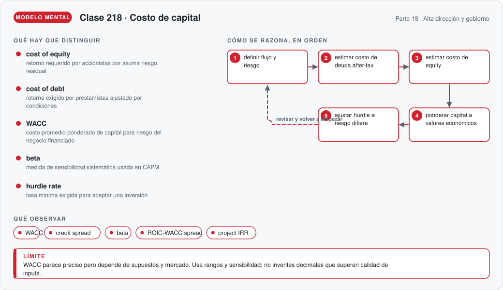

# Clase 218 — Costo de capital

<!-- nav:inicio -->
> **Parte 18 · Finanzas corporativas, capital y M&A** — clase 2 de 12 · [índice de la parte](../../README.md) · [temario](../../../../SYLLABUS.md)
<!-- nav:fin -->

**Parte:** 18 — Finanzas corporativas, capital y M&A  
**Nivel:** Etapa 5 — CEO → Capital allocator  
**Duración sugerida:** 150–180 minutos · **Estándar:** deep-class-v2

## 🎯 Propósito

Una empresa solo crea valor cuando gana más que lo que cuesta el capital con que se financia. Parece obvio, y sin embargo muchas decisiones se toman sin saber cuánto cuesta ese capital: se aprueban proyectos que rinden 9 % cuando los propietarios exigían 12 %, se descartan otros que rinden 14 % porque «no llegan a la meta de 18 %» que alguien fijó sin fundamento, o se usa la misma tasa para un proyecto rutinario y para una apuesta incierta. El **costo de capital** es el retorno mínimo que los proveedores de capital (acreedores y propietarios) exigen por financiar la empresa dado su riesgo. Es la vara con la que se mide cualquier inversión, y también una de las cifras más maltratadas: se copia de un libro, se calcula con una fórmula que nadie entiende o se ajusta hasta que «sale» el resultado deseado.

La clase explica cómo estimar el costo de capital con criterio: el costo de la deuda después de impuestos, el costo del capital propio con modelos y con juicio, la ponderación a valores económicos, y el ajuste cuando el riesgo del proyecto difiere del de la empresa. Se apoya en los textos de Brealey, Myers y Allen y de Ross, Westerfield y colaboradores, en la valoración de Koller y colaboradores y de Damodaran, y en el modelo de factores de Fama y French. Al terminar sabrás calcular un costo de capital con parámetros explícitos, reconocer su incertidumbre y usarlo como umbral de decisión, no como falsa precisión.

## 📚 Resultados de aprendizaje

Al finalizar podrás:

1. **Estimar** el costo de la deuda después de impuestos.
2. **Estimar** el costo del capital propio con un modelo y con juicio.
3. **Calcular** el costo promedio ponderado con pesos a valores económicos.
4. **Ajustar** la tasa cuando el riesgo del proyecto difiere del de la empresa.
5. **Usar** el costo de capital como umbral de decisión reconociendo su incertidumbre.

## 🧭 Agenda

| Tramo | Qué se hace |
|---|---|
| 0–20 min | Recuperación: ¿qué tasa mínima de retorno usa tu empresa para aprobar proyectos y de dónde salió? |
| 20–60 min | Deuda, capital propio, ponderación, riesgo del proyecto, errores y umbral. |
| 60–105 min | Ejemplo trabajado: costo de capital de la empresa y de un proyecto más riesgoso. |
| 105–150 min | Caso ejecutivo y práctica. |
| 150–175 min | Límites y entregable. |

## 🧩 Conceptos centrales

| Concepto | Definición | Cómo se reconoce |
|---|---|---|
| **Costo de capital** | Retorno mínimo exigido por quienes financian la empresa. | Umbral para evaluar inversiones. |
| **Costo de la deuda** | Tasa a la que la empresa puede endeudarse hoy, neta de impuestos. | Se estima con tasas de mercado. |
| **Costo del capital propio** | Retorno que exigen los propietarios por soportar el riesgo residual. | Se estima con modelos como el CAPM. |
| **Beta** | Sensibilidad del retorno de un activo al del mercado. | Mayor beta, mayor riesgo sistemático. |
| **WACC** | Costo promedio ponderado de capital. | Promedio de deuda y capital propio con sus pesos. |
| **Tasa de corte (*hurdle rate*)** | Retorno mínimo exigido a un proyecto. | Costo de capital ajustado por riesgo. |

## 🧠 Modelo mental

**Cómo leer el diagrama.** Tres columnas. **Deuda después de impuestos**: la tasa a la que la empresa se endeuda hoy, ajustada por el efecto tributario, no la tasa histórica del crédito. **Capital propio**: el retorno que exigen los propietarios por el riesgo, estimado con modelos y con juicio, siempre mayor que el de la deuda. **Ponderar y ajustar**: pesos a valores económicos y no contables, y una tasa distinta si el riesgo del proyecto difiere, usada como umbral de decisión. La nota afirma que el costo de capital es una estimación con rango y no un dato; el pie, que los parámetros de mercado cambian con el tiempo.

## 📖 Desarrollo

### 1. Qué es y para qué sirve

Brealey, Myers y Allen definen el costo de capital como el retorno esperado que los inversionistas demandan de activos de riesgo comparable. Aplicado a la empresa, es el retorno que debe ganar un proyecto para **compensar a quienes aportan el capital**. Si un proyecto rinde más que su costo de capital, crea valor (valor presente neto positivo); si rinde menos, lo destruye aunque tenga utilidades contables. Por eso el costo de capital funciona como **umbral**: no se comprueba si el proyecto «gana plata», sino si gana más que lo exigido por el riesgo que implica. Koller y colaboradores añaden que el crecimiento solo crea valor cuando el retorno sobre el capital invertido supera ese costo.

### 2. Costo de la deuda

El costo de la deuda es la **tasa a la que la empresa puede endeudarse hoy** a plazos comparables, no la que pagó en el pasado. Se estima con los rendimientos de bonos de empresas de riesgo similar, con ofertas de bancos o con la tasa libre de riesgo más un **diferencial por riesgo de crédito**. Como los intereses suelen ser deducibles de impuestos (según la ley aplicable), el costo relevante es **después de impuestos**: tasa × (1 − tasa de impuesto). Se cuida de no confundir la tasa **nominal** con la **real** ni mezclar monedas: la deuda y los flujos deben estar en la misma moneda y con la misma inflación implícita. El tratamiento tributario vigente se verifica con asesoría y con la autoridad tributaria.

### 3. Costo del capital propio

El capital propio **no tiene un costo observable**: los propietarios no reciben un interés fijo, y su retorno es incierto. Se estima con modelos. El más usado es el **modelo de valoración de activos de capital (CAPM)**: costo del capital propio = tasa libre de riesgo + beta × prima de riesgo del mercado. La **beta** mide la sensibilidad al mercado; se estima con regresiones históricas o con betas de empresas comparables, y se ajusta por apalancamiento. Ross, Westerfield y colaboradores y Damodaran explican las dificultades prácticas: la elección de la tasa libre de riesgo, la prima de mercado (con rangos amplios entre fuentes) y la inestabilidad de las betas. Fama y French mostraron que, además del mercado, el **tamaño** y el **valor** de las empresas explican diferencias de retorno; por eso algunas prácticas incorporan primas adicionales (tamaño, liquidez, país). Todos los parámetros son **estimaciones** y deben explicitarse con sus fuentes y fechas.

### 4. Ponderar: valores económicos y estructura objetivo

El costo promedio ponderado (WACC) combina deuda y capital propio con **pesos a valores de mercado** (o económicos), no a valores contables: el capital propio contable puede estar muy por debajo del valor de mercado y subponderaría al costo más alto. Se usa la **estructura objetivo de largo plazo** (la proporción que la empresa pretende mantener), no la estructura coyuntural. Si la estructura cambia, también cambian la beta (que sube con el apalancamiento) y los pesos. La fórmula es: WACC = (E/V) × costo del capital propio + (D/V) × costo de la deuda × (1 − t). Brealey y colaboradores recomiendan comprobar la **consistencia**: más deuda abarata el promedio solo en apariencia si encarece el capital propio.

### 5. Riesgo del proyecto: una tasa por riesgo

Usar el WACC de la empresa para todos los proyectos es un error frecuente: se **aprueban** proyectos riesgosos que debieron exigir más y se **rechazan** proyectos seguros que debieron exigir menos. La tasa de un proyecto debe reflejar **su** riesgo, no el de la empresa: un negocio nuevo, un país distinto o una tecnología incierta requieren un retorno mayor. Para estimarla se usan **betas de empresas comparables** del mismo negocio, se **desapalanca** su beta (quitándole el efecto de su deuda) y se **reapalanca** con la estructura objetivo del proyecto. Otra práctica es agregar una **prima de riesgo** explícita; en cualquier caso, se evita «inflar» la tasa para compensar flujos optimistas: el riesgo se refleja en la tasa y los flujos deben ser esperados, no optimistas ni pesimistas.

### 6. Errores frecuentes

Algunos errores comunes: **usar la tasa histórica de la deuda** o la tasa de un crédito específico; **olvidar los impuestos**; **ponderar a valores contables**; **mezclar nominal y real**; **usar la misma tasa para todo**; **copiar** la beta o la prima de un informe sin entender su origen; **fijar una tasa de corte arbitraria** («18 % porque sí»); y **«calibrar» la tasa** para que los proyectos favoritos pasen. También es un error suponer precisión: la diferencia entre 9,5 % y 10,5 % puede cambiar una decisión marginal; por eso se hacen **análisis de sensibilidad** y se explicita el rango.

### 7. Usar el costo de capital en decisiones

En la práctica, el costo de capital sirve para: **evaluar proyectos** (valor presente neto, retorno frente a la tasa), **valorar empresas** (clase 220), **medir desempeño** (valor económico agregado: utilidad operativa después de impuestos menos el cargo de capital), **decidir estructura de capital** (clase 217) y **comparar alternativas** de asignación (clase 198). El comité de capital fija una **tasa de corte** para la empresa y **ajustes por riesgo** por tipo de proyecto, y los revisa al menos una vez al año o cuando cambian las condiciones de mercado. Más importante que la exactitud es la **coherencia**: aplicar los mismos criterios a todos y documentar los supuestos.

## 📚 Lectura comparada

| Obra | Qué aporta | Qué no resuelve | Pregunta para contrastar |
|---|---|---|---|
| Brealey, Myers y Allen | Definición, CAPM, WACC y riesgo del proyecto. | No da parámetros de un mercado específico. | ¿Qué riesgo tiene este proyecto? |
| Ross, Westerfield y otros | Estimación práctica y dificultades de la beta y la prima. | Contexto principalmente de EE. UU. | ¿De dónde salen nuestros parámetros? |
| Koller y otros | Retorno sobre el capital frente al costo de capital. | Foco en valoración. | ¿El retorno supera el costo? |
| Damodaran | Estimación de betas, primas y costo de capital con ejemplos. | Datos por mercado y época. | ¿Qué prima usamos y qué fuente respalda? |
| Fama y French | Tamaño y valor como factores de riesgo adicionales. | Debate académico sobre su interpretación. | ¿Hay primas adicionales aplicables? |

## 🧮 Ejemplo trabajado

**Situación (hipotética).** Una empresa tiene un valor de mercado del capital propio de 60.000 millones de pesos y deuda de 15.000 millones. Tasa de impuestos: 27 %. Parámetros de mercado supuestos para el ejemplo: tasa libre de riesgo 5,0 %; prima de riesgo de mercado 6,0 %; beta del capital propio 1,1; costo de la deuda antes de impuestos 8,0 %.

**Costo de la deuda después de impuestos.** 8,0 % × (1 − 0,27) = 5,84 %.

**Costo del capital propio (CAPM).** 5,0 % + 1,1 × 6,0 % = 11,6 %.

**Pesos.** V = 60.000 + 15.000 = 75.000. E/V = 80 %; D/V = 20 %.

**WACC.** 0,80 × 11,6 % + 0,20 × 5,84 % = 9,28 % + 1,168 % = 10,45 %.

**Proyecto de mayor riesgo.** La empresa evalúa un negocio digital cuyas empresas comparables tienen una beta del activo (desapalancada) de 1,3, y con una estructura objetivo del proyecto de 15 % de deuda y 85 % de capital (D/E = 15 ÷ 85 = 0,1765).

- Beta reapalancada: 1,3 × [1 + (1 − 0,27) × 0,1765] = 1,3 × 1,1288 = 1,468.
- Costo del capital propio: 5,0 % + 1,468 × 6,0 % = 13,8 %.
- WACC del proyecto: 0,85 × 13,8 % + 0,15 × 5,84 % = 11,73 % + 0,876 % = 12,61 %.

**Valor del proyecto con las dos tasas.** El proyecto requiere una inversión de 3.000 millones y genera un flujo libre de 700 millones por año durante 8 años.

| Tasa | Factor de anualidad | Valor presente de los flujos | VAN |
|---|---|---|---|
| WACC de la empresa (10,45 %) | 5,249 | 3.674 | +674 |
| WACC del proyecto (12,61 %) | 4,863 | 3.404 | +404 |

**Lectura.** Usar la tasa de la empresa **sobrestima el VAN en 270 millones** (674 − 404). El proyecto sigue siendo positivo con la tasa ajustada, y se aprueba, pero con una holgura menor. Con un flujo de 600 millones por año, el VAN a 12,61 % sería: 600 × 4,863 − 3.000 = −82, es decir, negativo; el resultado depende del flujo y de la tasa.

**Sensibilidad.** Si la prima de mercado fuera 5,0 % en lugar de 6,0 %, el costo del capital propio de la empresa sería 5,0 % + 1,1 × 5,0 % = 10,5 % y el WACC, 0,8 × 10,5 % + 0,2 × 5,84 % = 9,57 %. Una variación de 1 punto de prima mueve el WACC cerca de 0,9 puntos: el rango razonable es de 9,5 % a 10,5 %.

**Beta desapalancada de la empresa (control).** Con D/E = 15.000 ÷ 60.000 = 0,25: 1,1 ÷ [1 + 0,73 × 0,25] = 1,1 ÷ 1,1825 = 0,93. Es menor que la del proyecto digital (1,3), consistente con un negocio de menor riesgo.

**Decisión.** El comité fija una tasa de corte de 10,5 % para proyectos del negocio actual, 12,5 % para proyectos de tecnología nuevos y 14 % para iniciativas en mercados nuevos, con revisión anual y documentación de parámetros.

**Cuidados.** Los parámetros de mercado son supuestos del ejemplo; el tratamiento tributario de los intereses y las condiciones de financiamiento se verifican con asesoría y en las fuentes oficiales; las cifras son ilustrativas.

**Qué muestra.** (1) El costo de capital se construyó con parámetros explícitos. (2) El riesgo del proyecto cambió la tasa. (3) La sensibilidad mostró el rango razonable.

## 🔀 Comparación y límites

**Costo de capital frente a tasa de corte.** El costo de capital es una estimación técnica; la tasa de corte es una decisión de gestión que parte de él y agrega criterios de riesgo y de estrategia.

**Límites.** Los modelos de estimación (como el CAPM) simplifican; los parámetros de mercado son inciertos y cambian. La beta histórica no garantiza el riesgo futuro. Se evita la falsa precisión: el costo de capital es un rango. Las cifras del ejemplo son ilustrativas y los parámetros no corresponden a un mercado en particular.

## 🪜 De profesional a owner

| Nivel | Cómo se relaciona con el costo de capital |
|---|---|
| **Profesional** | Entiende que un proyecto debe ganar más que su costo de capital. |
| **Jefe / Team Lead** | Presenta propuestas con flujos y tasa explícitos. |
| **Gerente** | Aplica la tasa adecuada al riesgo de su proyecto. |
| **CEO / Director** | Fija las tasas de corte y vigila su coherencia. |
| **Founder / Owner** | Conoce el retorno que exige de su propio capital. |

## 🏢 Caso ejecutivo

Una empresa de energía con un valor de mercado del capital propio de 280.000 millones de pesos y deuda de 120.000 millones usa una tasa de corte única de 9 % para todos los proyectos desde hace seis años. Evalúa tres inversiones: (1) ampliar una central hidroeléctrica en operación, con flujos estables (inversión de 18.000 millones, flujo de 2.600 millones al año durante 15 años); (2) un proyecto de hidrógeno verde con tecnología incipiente (inversión de 30.000 millones, flujo esperado de 5.200 millones al año durante 12 años, con alta incertidumbre); y (3) una concesión en otro país con riesgo regulatorio (inversión de 22.000 millones, flujo de 3.700 millones al año durante 10 años). Su deuda se emitió a 6 % hace cinco años; hoy se endeudaría a 8,2 %. El gerente financiero dice que «la tasa de 9 % fue aprobada por el directorio»; el comité propone usar 9 % para los tres «para no complicar»; un director pide ajustar por riesgo. La prima de mercado y la beta que usa la empresa provienen de un informe de hace cuatro años.

Entrega un **memo de costo de capital** que contenga: (a) la estimación del costo de la deuda después de impuestos con la tasa actual; (b) la estimación del costo del capital propio con parámetros explícitos, fuentes y rango; (c) el WACC de la empresa con pesos a valores de mercado; (d) las tasas ajustadas por riesgo para los tres proyectos con betas de comparables; (e) el VAN de cada proyecto con tasa única y con tasa ajustada, y la decisión; (f) el análisis de sensibilidad y las verificaciones tributarias y de parámetros pendientes.

## 🧪 Práctica

1. Calcula el costo de la deuda después de impuestos con la tasa actual de tu empresa o una referencia.
2. Estima el costo del capital propio con CAPM y tres combinaciones de prima y beta.
3. Calcula el WACC con pesos a valor de mercado y compáralo con uno a valor contable.
4. Ajusta la tasa para un proyecto de mayor riesgo con beta de una empresa comparable.
5. Evalúa un proyecto con dos tasas y explica cómo cambia la decisión.

## ⚠️ Errores frecuentes

| Error | Por qué ocurre | Cómo corregirlo |
|---|---|---|
| Usar la tasa histórica de la deuda | Es el dato disponible | Usar la tasa actual de mercado. |
| Pesos a valores contables | Es lo que muestra el balance | Usar valores de mercado y estructura objetivo. |
| Tasa única para todo | Se busca simplicidad | Ajustar por el riesgo del proyecto. |
| Mezclar nominal y real | Se descuida la inflación | Mantener la coherencia entre flujos y tasa. |
| Tasa arbitraria | Se hereda de una decisión antigua | Fundamentarla y revisarla cada año. |
| Falsa precisión | Se presenta un decimal | Entregar rangos y sensibilidad. |

## ❓ Preguntas de comprobación

1. ¿Qué es el costo de capital y para qué sirve?
2. ¿Cómo se estima el costo de la deuda después de impuestos?
3. ¿Cómo se estima el costo del capital propio con CAPM?
4. ¿Por qué se ponderan deuda y capital propio a valores de mercado?
5. ¿Por qué no conviene usar el WACC de la empresa para todos los proyectos?
6. ¿Qué es desapalancar y reapalancar una beta?
7. ¿Qué límites tiene el costo de capital?

Claves de respuesta

1. El retorno mínimo que exigen quienes financian la empresa dado su riesgo; sirve como umbral para evaluar inversiones.
2. Con la tasa actual a la que se endeuda la empresa, multiplicada por uno menos la tasa de impuestos.
3. Tasa libre de riesgo más beta por la prima de riesgo del mercado, con parámetros explícitos y rangos.
4. Porque el capital propio a valor de mercado suele ser mayor que el contable y el peso del capital más caro se subestimaría.
5. Porque el riesgo de cada proyecto difiere; usar una tasa única aprueba proyectos riesgosos y rechaza seguros.
6. Quitar a la beta de comparables el efecto de su deuda y volver a aplicarle el apalancamiento objetivo del proyecto.
7. Es una estimación con parámetros inciertos; los modelos simplifican y los datos cambian.

## 📥 Entregable

Guarda en `portfolio/218-costo-de-capital/`:

- `modelo-financiero-y-memo-de-decision.md` (plantilla [Modelo financiero y memo de decisión](../../../../templates/modelo-financiero-y-memo-de-decision.md)) con el memo del caso ejecutivo;
- `capital-allocation.md` (plantilla [Capital allocation](../../../../templates/capital-allocation.md)) con las tasas de corte por tipo de proyecto;
- `decision-journal.md` con los parámetros, las fuentes, la sensibilidad y las verificaciones pendientes.

## 📗 Fuentes y verificación

- Richard Brealey, Stewart Myers & Franklin Allen — *Principles of Corporate Finance* (McGraw-Hill International Book Co, 1984). **Uso en esta clase:** definición del costo de capital, CAPM y WACC. **Localizador:** [ISBN-13 9780070662025](https://openlibrary.org/isbn/9780070662025).
- Stephen Ross, Randolph Westerfield et al. — *Corporate Finance* (McGraw-Hill Education, 2018). **Uso en esta clase:** estimación práctica de la beta y la prima de riesgo. Lectura selectiva sobre **costo de capital**. **Localizador:** [ISBN-13 9781259918940](https://openlibrary.org/isbn/9781259918940).
- Tim Koller, Marc Goedhart & David Wessels — *Valuation: Measuring and Managing the Value of Companies* (Wiley, 2005). **Uso en esta clase:** retorno sobre el capital frente al costo de capital. **Localizador:** [ISBN-13 9780471702191](https://openlibrary.org/isbn/9780471702191).
- Aswath Damodaran — *Investment Valuation* (John Wiley & Sons, Incorporated, 2012). **Uso en esta clase:** estimación de betas, primas y costo de capital. **Localizador:** [ISBN-13 9781118206546](https://openlibrary.org/isbn/9781118206546).
- Eugene F. Fama & Kenneth R. French — *Common risk factors in the returns on stocks and bonds* (Journal of Financial Economics, 1993). **Uso en esta clase:** tamaño y valor como factores de riesgo adicionales. Lectura selectiva sobre **costo de capital**. **Localizador:** [DOI 10.1016/0304-405X(93)90023-5](https://doi.org/10.1016/0304-405X(93)90023-5).

> **Regla de fuentes para Costo de capital:** las obras anteriores estructuran las perspectivas de esta materia; cualquier norma, ley o estándar vivo mencionado debe comprobarse nuevamente en su fuente primaria vigente, incluido el tratamiento tributario de los intereses y los parámetros de mercado. Los ejemplos y casos son hipotéticos, con cifras ilustrativas. El desarrollo es original y no reproduce capítulos protegidos.

<!-- pie:inicio -->
---

| Anterior | Índice | Siguiente |
|---|---|---|
| [← 217 · Estructura de capital](../217-estructura-de-capital/README.md) | [Parte 18](../../README.md) · [Programa](../../../../SYLLABUS.md) | [219 · Deuda versus equity →](../219-deuda-versus-equity/README.md) |
<!-- pie:fin -->
