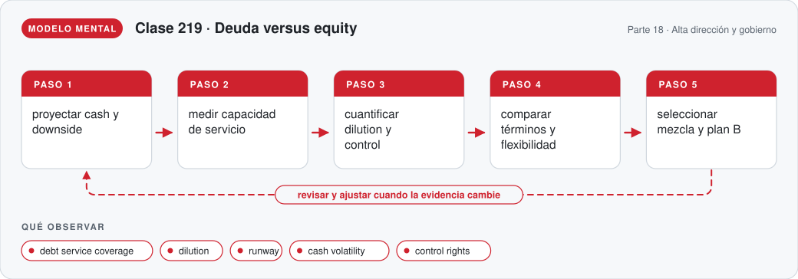

# Clase 219 — Deuda versus equity

<!-- nav:inicio -->
> **Parte 18 · Finanzas corporativas, capital y M&A** — clase 3 de 12 · [índice de la parte](../../README.md) · [temario](../../../../SYLLABUS.md)
<!-- nav:fin -->

**Parte:** 18 — Finanzas corporativas, capital y M&A  
**Nivel:** Etapa 5 — CEO → Capital allocator  
**Duración sugerida:** 150–180 minutos · **Estándar:** deep-class-v2

## 🎯 Propósito

Cuando una empresa necesita financiar una expansión, una adquisición o simplemente más caja, la discusión suele reducirse a una frase: «¿pedimos un crédito o traemos un socio?». Cada alternativa tiene defensores. Los partidarios de la deuda dicen que es más barata, no diluye y mantiene el control; los del capital dicen que no obliga a pagar, que da tranquilidad y que un socio aporta más que dinero. Ambos tienen razón y ambos omiten lo esencial: **el resultado depende del escenario**. Si el proyecto sale bien, la deuda deja más valor a los propietarios; si sale mal, la deuda puede llevarlos a perder el control de la empresa, mientras que el socio de capital comparte la pérdida. Elegir bien exige proyectar la caja, probar el escenario adverso, medir qué se cede y a qué precio, y dejar un plan B.

La clase compara deuda y capital con un método explícito. Se apoya en el análisis de Brealey, Myers y Allen sobre fuentes de financiamiento, en Myers y Majluf sobre la asimetría de información y el costo de emitir capital, en Jensen y Meckling sobre los conflictos entre propietarios, gerentes y acreedores, y en Feld y Mendelson sobre las condiciones del capital de riesgo. Al terminar sabrás proyectar caja y escenario adverso, medir la capacidad de servicio, cuantificar dilución y control, comparar términos y flexibilidad, y seleccionar una mezcla con un plan alternativo.

## 📚 Resultados de aprendizaje

Al finalizar podrás:

1. **Proyectar** la caja y el escenario adverso con y sin financiamiento.
2. **Medir** la capacidad de servicio de deuda en cada escenario.
3. **Cuantificar** la dilución y el efecto en el valor de los propietarios.
4. **Comparar** términos, covenants y flexibilidad de cada fuente.
5. **Seleccionar** una mezcla y definir un plan B.

## 🧭 Agenda

| Tramo | Qué se hace |
|---|---|
| 0–20 min | Recuperación: ¿en qué escenario te arrepentirías de haber usado deuda y en cuál de haber vendido parte de la empresa? |
| 20–60 min | Obligaciones, costo, control, información, instrumentos mixtos y decisión. |
| 60–105 min | Ejemplo trabajado: financiar 6.000 millones con deuda, capital o una mezcla. |
| 105–150 min | Caso ejecutivo y práctica. |
| 150–175 min | Límites y entregable. |

## 🧩 Conceptos centrales

| Concepto | Definición | Cómo se reconoce |
|---|---|---|
| **Deuda** | Financiamiento con obligación de pagar intereses y capital en fechas. | Contratos, covenants y garantías. |
| **Capital propio (*equity*)** | Aporte de propietarios sin obligación fija de pago. | Acciones, participaciones. |
| **Dilución** | Reducción de la participación de los actuales propietarios. | Nuevas acciones emitidas. |
| **Cobertura del servicio de deuda (DSCR)** | Caja disponible sobre intereses y amortizaciones del período. | Mide capacidad de cumplir. |
| **Instrumento híbrido** | Mezcla de deuda y capital, como un convertible. | Se convierte según condiciones. |
| **Plan B de financiamiento** | Alternativa si falla la fuente principal. | Línea comprometida, venta de activos, aporte. |

## 🧠 Modelo mental

**Cómo leer el diagrama.** Dos paneles. A la izquierda, **financiar con deuda**: costo menor y, según la ley, con efecto tributario; obligación de pagar aunque el negocio vaya mal; y control que se mantiene, sin dilución pero con condiciones del acreedor. A la derecha, **financiar con capital propio**: sin obligación fija, lo que permite soportar pérdidas sin quiebra inmediata; costo mayor y dilución, porque se cede propiedad; y nuevos socios que aportan recursos y también derechos. La nota explica que no hay una fuente mejor en abstracto; el pie, que los efectos tributarios y regulatorios se verifican con asesoría.

## 📖 Desarrollo

### 1. Las diferencias de fondo

La **deuda** es un contrato: el acreedor recibe intereses y la devolución del capital en fechas fijas, tenga o no la empresa un buen año; si no se cumple, puede ejecutar garantías o forzar una reestructuración. A cambio de ese riesgo menor, su retorno exigido es menor. El **capital propio** es un derecho residual: el propietario recibe lo que queda después de pagar a todos los demás, sin fecha ni monto fijo; asume el mayor riesgo y exige un mayor retorno. Brealey, Myers y Allen explican que, en consecuencia, la deuda **eleva el riesgo del capital propio** (más apalancamiento, más variabilidad) y que el costo del capital propio sube con ella, de modo que la deuda no es «gratis». Pero hay fricciones (los intereses pueden ser deducibles de impuestos, según la ley) que le dan una ventaja neta hasta cierto punto.

### 2. El escenario manda

El mismo financiamiento puede ser excelente o catastrófico según el escenario. En el **escenario favorable**, la deuda deja más valor a los propietarios: pagan un costo fijo y se quedan con todo el excedente. En el **escenario adverso**, la deuda aumenta la probabilidad de dificultades: cada peso de intereses y amortizaciones debe pagarse, el acreedor puede exigir garantías y covenants, y la empresa puede perder clientes, talento y opciones por su fragilidad. El capital propio, en cambio, **absorbe** las pérdidas. Por eso la decisión se prueba con **al menos tres escenarios** (base, adverso y favorable), calculando para cada uno la caja disponible, la cobertura del servicio de deuda y el valor para los propietarios.

### 3. Dilución y control

Emitir capital **cede propiedad**: los antiguos propietarios pasan a tener un porcentaje menor de una empresa que, con suerte, vale más. Lo importante no es el porcentaje en sí sino el **valor de la participación**: tener el 80 % de una empresa que vale más puede ser mejor que el 100 % de una que vale menos. El control depende de los **derechos** que acompañan al capital: representación en el directorio, vetos, información, preferencias de liquidación, antidilución, arrastre (clase 224). Jensen y Meckling señalan que cada fuente genera sus propios **conflictos de agencia**: los acreedores quieren que no se asuman riesgos excesivos y por eso imponen covenants; los accionistas externos quieren supervisar a los gerentes y por eso piden derechos. Se evalúa **qué tan cómodo** es convivir con las condiciones de cada fuente.

### 4. Información y señales

Myers y Majluf mostraron que, cuando los gerentes saben más que los inversionistas, **emitir acciones puede interpretarse como una señal negativa**: si las acciones estuvieran baratas, ¿por qué venderlas? Los inversionistas lo anticipan y piden un **descuento**, que encarece la emisión. Esto contribuye a que muchas empresas prefieran fondos internos y deuda antes que capital nuevo, salvo cuando la deuda ya es excesiva o la incertidumbre es alta (empresas jóvenes y tecnológicas). En el caso de empresas privadas y de capital de riesgo, la dinámica de información es distinta: los inversionistas especializados negocian con **mucha más información** (la sala de evidencia, clase 222) y la valoración depende de los hitos más que de señales de mercado.

### 5. Instrumentos mixtos y estructuras intermedias

Entre deuda y capital hay un espectro: **deuda subordinada**, **deuda convertible** (se convierte en acciones si se cumplen ciertas condiciones), **acciones preferentes** (con derechos de cobro antes que las ordinarias), **opciones y *warrants***, **deuda con pago contingente** (el interés depende de los resultados) y **financiamiento por ingresos futuros**. Ofrecen flexibilidad, pero con **complejidad** (mayor costo de asesoría, riesgo de interpretaciones) y, a veces, **costos escondidos** (cláusulas de conversión que diluyen más en un escenario favorable). Se evalúan con las mismas pruebas: ¿qué ocurre con la caja, con la propiedad y con el valor para los propietarios en cada escenario?

### 6. Términos, covenants y flexibilidad

Al comparar ofertas no basta el precio. Se revisan: **plazo y calendario de pagos** (¿se ajusta al flujo?), **covenants** (ratios, restricciones a dividendos, inversiones o endeudamiento adicional), **garantías**, **cláusulas de incumplimiento cruzado**, **derechos de aceleración**, y en el capital, los **derechos de control** y de salida. Una oferta con tasa baja pero con covenants estrictos puede ser peor que otra con tasa mayor y más holgura. La **flexibilidad** vale dinero: poder prepagar sin penalidad, tener una línea de crédito disponible o contar con socios que pueden aportar más capital en una crisis. Los contratos se leen completos y se revisan con asesoría legal antes de firmar.

### 7. Elegir la mezcla y el plan B

La elección razonable suele ser una **mezcla** que cumple tres condiciones: sobrevive al escenario adverso con holgura (cobertura mínima definida), no cede más control del necesario y mantiene el costo total razonable. Se define también un **plan B**: ¿qué pasa si el financiamiento previsto no se concreta o si el escenario adverso ocurre? Opciones: líneas de crédito comprometidas sin usar, posibilidad de vender activos o negocios no estratégicos, aportes adicionales de propietarios, acuerdos previos con acreedores y la capacidad de reducir inversión rápidamente. Se documenta la decisión con los escenarios, el razonamiento y las condiciones que obligarían a reconsiderarla.

## 📚 Lectura comparada

| Obra | Qué aporta | Qué no resuelve | Pregunta para contrastar |
|---|---|---|---|
| Brealey, Myers y Allen | Deuda, capital, riesgo y costo; apalancamiento. | No da la mezcla de cada empresa. | ¿Qué pasa con el riesgo del capital propio? |
| Myers y Majluf | Señales y costo de emitir capital con información asimétrica. | Modelo estilizado. | ¿Qué señal enviamos al emitir? |
| Jensen y Meckling | Conflictos entre propietarios, gerentes y acreedores. | Supone comportamientos simplificados. | ¿Qué conflicto crea cada fuente? |
| Feld y Mendelson | Condiciones típicas del capital de riesgo. | Enfocado en startups de EE. UU. | ¿Qué derechos acompañan al capital? |
| Myers (1984) | Jerarquía de fuentes de financiamiento. | Evidencia mixta. | ¿Por qué elegimos esta secuencia? |

## 🧮 Ejemplo trabajado

**Situación (hipotética).** Una empresa tiene EBITDA de 5.000 millones de pesos, deuda de 4.000 millones (interés de 8 %: 320 millones al año; amortización de 400 al año) y un valor de empresa de 8 veces el EBITDA (40.000 millones; patrimonio de 36.000). Necesita 6.000 millones para un proyecto. Para simplificar, el ejemplo ignora impuestos y se mantienen múltiplo y deuda existente constantes.

**Escenarios a tres años.**

| Escenario | EBITDA | Valor de empresa (8×) |
|---|---|---|
| Adverso (negocio actual −20 %; el proyecto aporta 300) | 4.300 | 34.400 |
| Base (el proyecto aporta 1.500) | 6.500 | 52.000 |
| Favorable (negocio +5 %; el proyecto aporta 2.500) | 7.750 | 62.000 |

**Opciones de financiamiento.**

- **A. Deuda de 6.000 al 9 %** (interés 540; amortización 1.200 al año en cinco años). Deuda total: 10.000.
- **B. Capital de 6.000 a una valoración posterior de 36.000** (los inversionistas reciben 6.000 ÷ 36.000 = 16,7 %). Deuda total: 4.000.
- **C. Mezcla: 3.000 de deuda (interés 270; amortización 600 al año) y 3.000 de capital** (8,33 %). Deuda total: 7.000.

**Valor para los antiguos propietarios (valor de empresa menos deuda, por su participación).**

| Opción | Adverso | Base | Favorable |
|---|---|---|---|
| A (100 %) | 34.400 − 10.000 = 24.400 | 52.000 − 10.000 = 42.000 | 62.000 − 10.000 = 52.000 |
| B (83,3 %) | (34.400 − 4.000) × 0,8333 = 25.333 | (52.000 − 4.000) × 0,8333 = 40.000 | (62.000 − 4.000) × 0,8333 = 48.333 |
| C (91,7 %) | (34.400 − 7.000) × 0,9167 = 25.117 | (52.000 − 7.000) × 0,9167 = 41.250 | (62.000 − 7.000) × 0,9167 = 50.417 |

**Capacidad de servicio.** Caja operativa antes del servicio de deuda = EBITDA − inversión de mantención (2.000) − impuestos (aproximación: 800 en base y favorable; 400 en adverso).

| Escenario | Caja operativa | Servicio A | Servicio B | Servicio C |
|---|---|---|---|---|
| Adverso | 4.300 − 2.000 − 400 = 1.900 | 320 + 540 + 400 + 1.200 = 2.460 → 0,77 | 320 + 400 = 720 → 2,64 | 320 + 270 + 400 + 600 = 1.590 → 1,19 |
| Base | 6.500 − 2.000 − 800 = 3.700 | 1,50 | 5,14 | 2,33 |

**Lectura.** La opción A deja el mayor valor a los propietarios en el escenario base (42.000) y favorable (52.000), pero en el adverso **no puede pagar** (cobertura de 0,77 < 1): quedaría obligada a refinanciar, vender activos o pedir capital en la peor posición. La opción B es la más segura (cobertura de 2,64 en el adverso) y deja más valor que A en el adverso (25.333 frente a 24.400), pero cede más en el base (40.000 frente a 42.000) y en el favorable (48.333 frente a 52.000). La opción C intermedia mantiene una cobertura de 1,19 en el adverso, con un valor para los propietarios cercano al de B en el adverso (25.117) y mejor en base y favorable (41.250 y 50.417).

**Decisión.** Se elige **C**, con una línea de crédito comprometida de 1.500 millones sin utilizar como plan B, condiciones de covenants con holgura de 30 % sobre el escenario base y un acuerdo con los nuevos socios que limita sus derechos de veto a materias esenciales.

**Cuidados.** El ejemplo omite impuestos y supone múltiplos constantes; los efectos tributarios, los términos y covenants, y los derechos de los inversionistas se verifican con asesoría y en los contratos; las cifras son ilustrativas.

**Qué muestra.** (1) El resultado cambia con el escenario. (2) La cobertura mostró el riesgo de la deuda total. (3) La mezcla equilibró valor, seguridad y control.

## 🔀 Comparación y límites

**Deuda y capital frente a financiamiento interno.** Los fondos generados por el negocio (retener utilidades) son la fuente más barata y flexible, pero limitada; reducir dividendos tiene costo para los propietarios.

**Límites.** Las comparaciones dependen de los escenarios y de supuestos como el múltiplo y la tasa. El ejemplo simplifica impuestos y amortizaciones. Las condiciones de mercado cambian. Los derechos de inversionistas y los covenants son contractuales y se revisan con asesoría. Las cifras son ilustrativas.

## 🪜 De profesional a owner

| Nivel | Cómo participa en la decisión |
|---|---|
| **Profesional** | Prepara proyecciones realistas y escenarios. |
| **Jefe / Team Lead** | Entiende que un proyecto puede requerir condiciones de financiamiento. |
| **Gerente** | Presenta el plan de caja y los escenarios de su inversión. |
| **CEO / Director** | Elige la mezcla con el directorio y fija el plan B. |
| **Founder / Owner** | Decide cuánta propiedad y cuánto riesgo está dispuesto a ceder. |

## 🏢 Caso ejecutivo

Una empresa de tecnología con ventas de 45.000 millones de pesos, EBITDA de 7.200 millones y deuda neta de 9.000 millones necesita 15.000 millones para adquirir a un competidor y modernizar su plataforma. Alternativas: un banco ofrece 15.000 millones a 9,5 % con covenants de deuda neta sobre EBITDA máximo de 3,0 veces y garantías sobre los activos; un fondo ofrece 15.000 millones de capital por el 22 % de la empresa (valoración posterior de 68.000 millones) con derecho a dos directores, veto sobre endeudamiento y preferencia de liquidación; un inversionista estratégico ofrece 8.000 millones de capital por 12 % y exclusividad comercial en un mercado. La proyección base muestra un EBITDA de 11.000 millones en tres años; en un escenario adverso (pérdida del 30 % de los ingresos de un cliente grande y retraso de la integración), 6.000 millones. Los fundadores tienen el 70 % de la propiedad y no quieren perder el control.

Entrega un **memo de decisión de financiamiento** que contenga: (a) las proyecciones de caja en tres escenarios; (b) la cobertura de servicio y el cumplimiento de covenants en cada opción; (c) la dilución y el valor para los propietarios en cada escenario; (d) la comparación de términos, derechos de control y flexibilidad; (e) la mezcla recomendada, con el plan B y las condiciones que reabrirían la decisión; (f) las verificaciones contractuales, tributarias y regulatorias pendientes.

## 🧪 Práctica

1. Proyecta la caja de una inversión en tres escenarios y calcula la cobertura del servicio de deuda de cada uno.
2. Calcula el valor para los propietarios con financiamiento por deuda y por capital en esos escenarios.
3. Lista cinco covenants o derechos de control que revisarías en una oferta.
4. Diseña una mezcla de deuda y capital con un plan B y define su disparador.
5. Redacta el razonamiento de la decisión para el directorio en una página.

## ⚠️ Errores frecuentes

| Error | Por qué ocurre | Cómo corregirlo |
|---|---|---|
| Elegir por el costo nominal | Es el dato más visible | Comparar valor, riesgo y control en escenarios. |
| Mirar solo el escenario base | Optimismo | Probar el adverso y la cobertura. |
| Ignorar covenants | Se enfoca en la tasa | Leer y estresar las condiciones. |
| Temer la dilución sin calcular | Apego a la propiedad | Comparar el valor de la participación, no el porcentaje. |
| No tener plan B | Se confía en la oferta | Línea comprometida y alternativas. |
| Aceptar derechos de control sin entenderlos | Presión por cerrar | Simular los efectos y consultar asesoría. |

## ❓ Preguntas de comprobación

1. ¿Qué diferencia hay entre deuda y capital propio en obligaciones y retorno?
2. ¿Por qué el escenario adverso es clave en la decisión?
3. ¿Qué es la dilución y por qué importa más el valor que el porcentaje?
4. ¿Qué señal puede enviar la emisión de acciones según Myers y Majluf?
5. ¿Qué instrumentos mixtos existen?
6. ¿Qué términos se comparan además del precio?
7. ¿Qué características tiene una buena mezcla y un buen plan B?

Claves de respuesta

1. La deuda obliga a pagar en fechas y tiene un retorno exigido menor; el capital propio es residual, sin pago fijo y con mayor retorno.
2. Porque la deuda aumenta la probabilidad de dificultades si el negocio va mal, mientras que el capital absorbe pérdidas.
3. Es la reducción de la participación de los antiguos propietarios; importa el valor de su participación, que puede ser mayor aunque el porcentaje sea menor.
4. Que los gerentes creen que las acciones están caras, por lo que los inversionistas piden descuento y encarecen la emisión.
5. Deuda subordinada, convertible, acciones preferentes, opciones o warrants, deuda con pago contingente y financiamiento por ingresos futuros.
6. Plazos, covenants, garantías, aceleración, derechos de control, flexibilidad y derechos de salida.
7. Sobrevive al escenario adverso con holgura, cede el control necesario y mantiene un costo razonable; el plan B incluye líneas comprometidas, venta de activos o aportes adicionales.

## 📥 Entregable

Guarda en `portfolio/219-deuda-versus-equity/`:

- `leadership-decision-brief.md` (plantilla [Leadership Decision Brief](../../../../templates/leadership-decision-brief.md)) con el memo del caso ejecutivo;
- `cash-runway.md` (plantilla [Cash runway](../../../../templates/cash-runway.md)) con las proyecciones de caja y la cobertura de servicio;
- `decision-journal.md` con los escenarios, los términos comparados y el plan B.

## 📗 Fuentes y verificación

- Richard Brealey, Stewart Myers & Franklin Allen — *Principles of Corporate Finance* (McGraw-Hill International Book Co, 1984). **Uso en esta clase:** deuda, capital, apalancamiento y costo. Lectura selectiva sobre **deuda versus equity**. **Localizador:** [ISBN-13 9780070662025](https://openlibrary.org/isbn/9780070662025).
- Stewart C. Myers & Nicholas S. Majluf — *Corporate financing and investment decisions when firms have information that investors do not have* (Journal of Financial Economics, 1984). **Uso en esta clase:** asimetría de información y costo de emitir capital. Lectura selectiva sobre **deuda versus equity**. **Localizador:** [DOI 10.1016/0304-405X(84)90023-0](https://doi.org/10.1016/0304-405X(84)90023-0).
- Michael C. Jensen & William H. Meckling — *Theory of the firm: Managerial behavior, agency costs and ownership structure* (Journal of Financial Economics, 1976). **Uso en esta clase:** conflictos entre propietarios, gerentes y acreedores. Lectura selectiva sobre **deuda versus equity**. **Localizador:** [DOI 10.1016/0304-405X(76)90026-X](https://doi.org/10.1016/0304-405X(76)90026-X).
- Brad Feld & Jason Mendelson — *Venture Deals* (Wiley, 2011). **Uso en esta clase:** condiciones típicas del capital de riesgo. Lectura selectiva sobre **deuda versus equity**. **Localizador:** [ISBN-13 9781118443613](https://openlibrary.org/isbn/9781118443613).
- Stewart C. Myers — *The Capital Structure Puzzle* (The Journal of Finance, 1984). **Uso en esta clase:** jerarquía de fuentes de financiamiento. Lectura selectiva sobre **deuda versus equity**. **Localizador:** [DOI 10.1111/j.1540-6261.1984.tb03646.x](https://doi.org/10.1111/j.1540-6261.1984.tb03646.x).

> **Regla de fuentes para Deuda versus equity:** las obras anteriores estructuran las perspectivas de esta materia; cualquier norma, ley o estándar vivo mencionado debe comprobarse nuevamente en su fuente primaria vigente, incluidos los contratos de financiamiento, los efectos tributarios y las normas de ofertas de valores. Los ejemplos y casos son hipotéticos, con cifras ilustrativas. El desarrollo es original y no reproduce capítulos protegidos.

<!-- pie:inicio -->
---

| Anterior | Índice | Siguiente |
|---|---|---|
| [← 218 · Costo de capital](../218-costo-de-capital/README.md) | [Parte 18](../../README.md) · [Programa](../../../../SYLLABUS.md) | [220 · Valoración por flujos →](../220-valoracion-por-flujos/README.md) |
<!-- pie:fin -->
