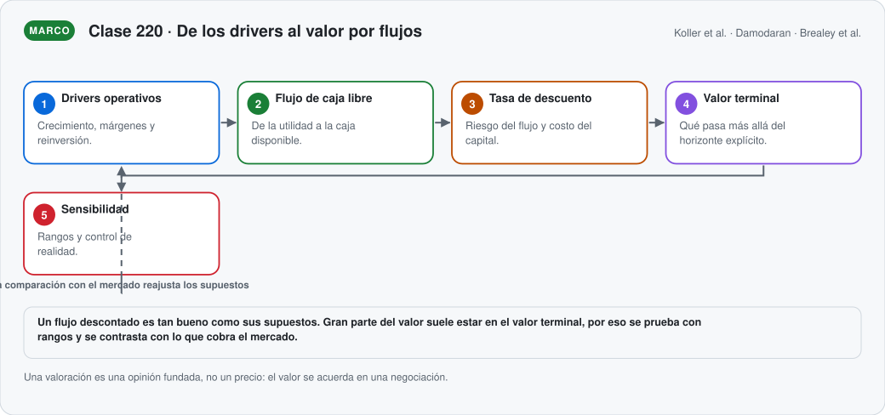

# Clase 220 — Valoración por flujos

<!-- nav:inicio -->
> **Parte 18 · Finanzas corporativas, capital y M&A** — clase 4 de 12 · [índice de la parte](../../README.md) · [temario](../../../../SYLLABUS.md)
<!-- nav:fin -->

**Parte:** 18 — Finanzas corporativas, capital y M&A  
**Nivel:** Etapa 5 — CEO → Capital allocator  
**Duración sugerida:** 150–180 minutos · **Estándar:** deep-class-v2

## 🎯 Propósito

Cuando se compra, se vende, se levanta capital o se evalúa un gran proyecto, alguien tiene que decir cuánto vale algo. Y casi nunca hay una respuesta única: el vendedor cree que vale mucho, el comprador que vale poco, el mercado fija un precio que cambia cada día y los modelos entregan cifras distintas según los supuestos. La **valoración por flujos de caja descontados** (DCF) responde a una pregunta clara: **¿cuánto vale hoy la caja que este negocio generará en el futuro, dado su riesgo?** Es el método más fundamental porque parte de lo que realmente crea valor, el flujo de caja libre disponible para quienes financian la empresa, y obliga a explicitar los supuestos de crecimiento, rentabilidad, inversión y riesgo. Su fortaleza es la transparencia; su debilidad, que el resultado es muy sensible a esos supuestos, en particular al valor terminal.

La clase presenta el DCF con ejemplo completo, y se apoya en el texto de Koller y colaboradores, en la práctica de valoración de Damodaran, en la visión de Brealey, Myers y Allen sobre valor presente y en el análisis contable de Penman y de Palepu, Healy y Peek. Al terminar sabrás proyectar los motores operativos, convertir utilidades en flujo de caja libre, elegir la tasa de descuento, calcular el valor terminal con criterios consistentes, hacer análisis de sensibilidad y reconciliar con comparables y con el sentido común.

## 📚 Resultados de aprendizaje

Al finalizar podrás:

1. **Proyectar** crecimiento, márgenes y reinversión como motores del valor.
2. **Convertir** la utilidad operativa en flujo de caja libre.
3. **Elegir** una tasa de descuento coherente con el riesgo del flujo.
4. **Calcular** el valor terminal con supuestos consistentes y medir su peso.
5. **Hacer** sensibilidad y controles de realidad antes de concluir.

## 🧭 Agenda

| Tramo | Qué se hace |
|---|---|
| 0–20 min | Recuperación: ¿cuánto del valor de una empresa que conozcas está en la caja de los próximos cinco años y cuánto después? |
| 20–60 min | Valor presente, flujo libre, tasa, valor terminal, sensibilidad y control de realidad. |
| 60–105 min | Ejemplo trabajado: DCF de una empresa de 80.000 millones de ventas. |
| 105–150 min | Caso ejecutivo y práctica. |
| 150–175 min | Límites y entregable. |

## 🧩 Conceptos centrales

| Concepto | Definición | Cómo se reconoce |
|---|---|---|
| **Flujo de caja libre (FCF)** | Caja operativa después de impuestos e inversión, disponible para los financistas. | NOPAT menos reinversión neta. |
| **Valor presente** | Valor hoy de un flujo futuro, descontado por riesgo y tiempo. | Flujo ÷ (1 + tasa)ⁿ. |
| **NOPAT** | Utilidad operativa después de impuestos, antes de costos financieros. | EBIT × (1 − impuesto). |
| **Reinversión neta** | Inversión en capital fijo y de trabajo por encima de la depreciación. | Sostiene el crecimiento. |
| **Valor terminal** | Valor de los flujos posteriores al horizonte explícito. | Suele ser la mayor parte del valor. |
| **Valor de empresa y de patrimonio** | El primero valora todo el negocio; el segundo, lo que corresponde a los propietarios. | Patrimonio = empresa − deuda neta. |

## 🧠 Modelo mental

**Cómo leer el diagrama.** Una cadena de cinco pasos con retorno. **Drivers operativos**: crecimiento, márgenes y reinversión. **Flujo de caja libre**: de la utilidad a la caja disponible. **Tasa de descuento**: riesgo del flujo y costo del capital. **Valor terminal**: qué pasa más allá del horizonte explícito. **Sensibilidad**: rangos y control de realidad. La flecha indica que la comparación con el mercado reajusta los supuestos. La nota afirma que un flujo descontado es tan bueno como sus supuestos y que gran parte del valor está en el valor terminal; el pie, que una valoración es una opinión fundada y no un precio.

## 📖 Desarrollo

### 1. La lógica: valor es caja futura descontada

Brealey, Myers y Allen presentan el principio básico: un peso futuro vale menos que un peso hoy (tiempo) y un flujo incierto vale menos que uno seguro (riesgo). El **valor presente** de un flujo es su monto dividido por (1 + tasa) elevado al número de períodos, con una tasa que refleje el riesgo del flujo. El valor de un negocio es la suma de los valores presentes de los flujos de caja libres que generará. Koller y colaboradores sostienen que el valor depende de dos motores: el **retorno sobre el capital invertido** (qué tan rentable es el capital) y el **crecimiento** (cuánto se puede reinvertir a ese retorno); el crecimiento solo crea valor si el retorno supera el costo de capital. Esa es la base de un buen DCF: se construye desde los motores del negocio, no desde porcentajes arbitrarios.

### 2. Proyectar los motores

La proyección parte de **ingresos** (mercado, participación, precios, volúmenes), pasa por **márgenes** (costos, escala, mezcla) y llega a la **reinversión** necesaria para crecer (capital fijo y capital de trabajo). Damodaran subraya la importancia de que las proyecciones sean **coherentes con la historia** y con el entorno competitivo: un crecimiento muy superior al del mercado, o márgenes crecientes sin explicación, deben justificarse con ventajas competitivas reales (clase 161). Se proyecta típicamente entre 5 y 10 años, hasta que el negocio alcanza un estado más estable. Se construyen **al menos tres escenarios** (base, adverso y favorable), con probabilidades explícitas si es posible, porque la valoración es un valor esperado de futuros posibles.

### 3. De la utilidad al flujo de caja libre

La utilidad contable no es caja. Para obtener el flujo de caja libre a los financistas se parte de la **utilidad operativa (EBIT)**, se descuentan los impuestos sobre ella (NOPAT = EBIT × (1 − t)), se suma la **depreciación** (que no es salida de caja) y se resta la **inversión en capital fijo y en capital de trabajo**. Equivale a: FCF = NOPAT − reinversión neta. Penman y Palepu, Healy y Peek enfatizan la **calidad de las cifras**: antes de proyectar hay que **normalizar** los estados (eliminar partidas únicas, ajustar políticas contables agresivas, tratar arriendos y provisiones de forma consistente). Un error común es proyectar flujos sin reinversión, lo que equivale a suponer crecimiento gratis.

### 4. La tasa de descuento

La tasa debe corresponder al **riesgo de los flujos y a la moneda**: en un DCF de empresa (flujos antes de los financistas) se usa el **WACC** (clase 218); en un DCF del patrimonio (flujos después del servicio de deuda) se usa el costo del capital propio. Se mantiene **coherencia** entre flujos y tasa: nominales con tasa nominal, en la misma moneda, antes o después de la deuda según corresponda. Los proyectos o negocios con riesgo distinto del de la empresa requieren tasas distintas. La tasa es una estimación incierta: se la trata como **rango** y se pone a prueba en la sensibilidad. Una práctica errónea consiste en «subir la tasa» para compensar proyecciones optimistas; el riesgo se refleja en la tasa y los flujos deben ser esperados.

### 5. El valor terminal

Después del horizonte explícito, la empresa sigue existiendo. El **valor terminal** captura el valor de todos los flujos posteriores, y suele representar entre el 60 y el 80 % del valor total. Se calcula con la fórmula de crecimiento perpetuo: valor terminal = flujo del año siguiente ÷ (tasa − crecimiento). Hay reglas de consistencia: el crecimiento terminal **no puede superar** el de la economía en el largo plazo; el **retorno sobre el nuevo capital** terminal debe ser razonable (en competencia, tiende hacia el costo de capital); y la **reinversión** terminal debe ser coherente: reinversión = crecimiento ÷ retorno sobre el capital nuevo. Otra opción es calcular el valor terminal con un **múltiplo de salida**, con la advertencia de que implícitamente supone un crecimiento perpetuo que conviene verificar.

### 6. Sensibilidad y controles de realidad

Una valoración puntual da una falsa sensación de precisión. Se presentan **rangos**: valor con tasas y crecimientos terminales distintos, con escenarios y con márgenes alternativos. Se identifica **qué supuestos mueven más el resultado** (casi siempre la tasa, el crecimiento terminal y el margen). Se hacen **controles de realidad**: el múltiplo implícito (valor de empresa ÷ EBITDA) frente al de comparables (clase 221); el peso del valor terminal; el retorno sobre el capital implícito; el crecimiento frente al del mercado; la comparación con transacciones similares. Si el DCF dice que la empresa vale el doble que cualquier comparable, o cuatro veces su valor en libros, hay que explicar con ventajas reales o corregir los supuestos.

### 7. De valor de empresa a valor del patrimonio y a una decisión

El valor de empresa (de todo el negocio) se convierte en **valor del patrimonio** restando la **deuda neta** y otras obligaciones financieras (arriendos, provisiones, pensiones, minoritarios) y sumando activos no operativos. Luego se compara con el **precio** (en una compra o venta) o con el **costo** (en un proyecto). El valor por flujos es el piso de una negociación: informa cuánto se puede pagar sin destruir valor, pero **el precio lo fija la negociación** y depende de alternativas, urgencia e información. Quien negocia sabe su **valor máximo de pago** (comprador) o su **valor mínimo aceptable** (vendedor), y se retira si el precio lo cruza (clase 225).

## 📚 Lectura comparada

| Obra | Qué aporta | Qué no resuelve | Pregunta para contrastar |
|---|---|---|---|
| Koller y otros | DCF construido desde retorno sobre el capital y crecimiento. | Exige disciplina para proyectar. | ¿Qué retorno sobre capital implican los supuestos? |
| Damodaran | Valoración práctica, coherencia y tratamiento de la incertidumbre. | Casos de EE. UU.; hay que adaptar a otros mercados. | ¿Qué historia cuenta el modelo? |
| Brealey, Myers y Allen | Valor presente, riesgo y tasa de descuento. | No detalla la proyección de negocios. | ¿Tasa y flujos son coherentes? |
| Penman | Análisis de estados financieros para valorar. | Enfoque contable. | ¿Qué cifras debo normalizar? |
| Palepu, Healy y Peek | Análisis de negocio y de estados para valoración. | Casos y estilo de libro de texto. | ¿Qué dice la estrategia sobre los márgenes? |

## 🧮 Ejemplo trabajado

**Situación (hipotética).** Una empresa tiene ventas de 80.000 millones de pesos, margen operativo (EBIT) de 12 %, impuestos de 27 % y deuda neta de 15.000 millones. Se valora con un horizonte de cinco años. Supuestos: crecimiento de ventas de 8 %, 7 %, 6 %, 5 % y 4 %; margen operativo constante; reinversión neta de 25 % del NOPAT; tasa de descuento (WACC) de 10 %; crecimiento terminal de 3 %, con un retorno sobre el capital nuevo de 12 % (reinversión terminal = 3 % ÷ 12 % = 25 %).

**Proyección (millones de pesos).**

| Año | Ventas | EBIT (12 %) | NOPAT (× 0,73) | Reinversión (25 %) | FCF | Factor al 10 % | Valor presente |
|---|---|---|---|---|---|---|---|
| 1 | 86.400 | 10.368 | 7.569 | 1.892 | 5.676 | 0,9091 | 5.160 |
| 2 | 92.448 | 11.094 | 8.098 | 2.025 | 6.074 | 0,8264 | 5.020 |
| 3 | 97.995 | 11.759 | 8.584 | 2.146 | 6.438 | 0,7513 | 4.837 |
| 4 | 102.895 | 12.347 | 9.014 | 2.253 | 6.760 | 0,6830 | 4.617 |
| 5 | 107.010 | 12.841 | 9.374 | 2.344 | 7.031 | 0,6209 | 4.366 |
| **Suma** | | | | | | | **24.000** |

**Valor terminal.** NOPAT del año 6: 9.374 × 1,03 = 9.655; FCF del año 6 con reinversión de 25 %: 9.655 × 0,75 = 7.242. Valor terminal al año 5: 7.242 ÷ (0,10 − 0,03) = 103.450. Valor presente: 103.450 × 0,6209 = 64.234.

**Valor de empresa y de patrimonio.** Valor de empresa: 24.000 + 64.234 = **88.234 millones**. El valor terminal pesa 64.234 ÷ 88.234 = 72,8 %. Valor del patrimonio: 88.234 − 15.000 = **73.234 millones**.

**Sensibilidad (valor de empresa, millones).**

| Supuesto | Valor | Variación |
|---|---|---|
| Base (tasa 10 %, crecimiento 3 %) | 88.234 | — |
| Tasa 9 % | 103.091 | +16,8 % |
| Tasa 11 % | 77.095 | −12,6 % |
| Crecimiento terminal 2 % | 85.844 | −2,7 % |
| Crecimiento terminal 4 % | 91.260 | +3,4 % |

**Controles de realidad.** (1) EBITDA actual: EBIT de 9.600 (12 % de 80.000) más depreciación de 2.400 (3 % de las ventas) = 12.000. Múltiplo implícito: 88.234 ÷ 12.000 = 7,4 veces, razonable si los comparables transan entre 7 y 9 veces. (2) El crecimiento del año 5 (4 %) y el terminal (3 %) no exceden el de la economía. (3) Retorno sobre el capital invertido supuesto de 12 %, apenas por encima del costo de capital: no se supone una ventaja competitiva eterna.

**Conclusión.** La valoración por flujos es de un rango de 77.000 a 103.000 millones de valor de empresa, con un punto central de 88.000; el valor del patrimonio es de unos 62.000 a 88.000 millones. Un precio de 95.000 millones de valor de empresa solo se justificaría con una tasa menor de 9,5 % o un crecimiento o márgenes superiores; el comprador decide si cree en esos supuestos.

**Cuidados.** Los supuestos son hipotéticos; el tratamiento tributario, la normalización contable y la clasificación de deuda y otras obligaciones se verifican con asesoría; las cifras son ilustrativas.

**Qué muestra.** (1) El DCF se construyó desde los motores del negocio. (2) El valor terminal domina y se reconoció. (3) La sensibilidad y los controles de realidad entregaron un rango y no un número.

## 🔀 Comparación y límites

**DCF frente a múltiplos.** El DCF parte de los fundamentos y es transparente en los supuestos; los múltiplos reflejan cómo el mercado valora hoy a empresas comparables. Se usan juntos: cada uno controla al otro.

**Límites.** Un DCF es tan bueno como sus supuestos; pequeñas variaciones de tasa o de crecimiento terminal cambian mucho el resultado. Las proyecciones suelen ser optimistas. El valor terminal es la parte más incierta. Una valoración no es un precio. Las cifras del ejemplo son ilustrativas.

## 🪜 De profesional a owner

| Nivel | Cómo participa en la valoración |
|---|---|
| **Profesional** | Aporta datos operativos fiables para las proyecciones. |
| **Jefe / Team Lead** | Explica los drivers de su área y sus riesgos. |
| **Gerente** | Construye proyecciones coherentes con la historia y la estrategia. |
| **CEO / Director** | Usa la valoración para decidir precios máximos y asignar capital. |
| **Founder / Owner** | Entiende cuánto vale su empresa y qué supuestos sostienen ese valor. |

## 🏢 Caso ejecutivo

Una empresa de software con ventas de 36.000 millones de pesos, crecimiento de 22 % en el último año, margen operativo de 6 % (con inversión creciente en producto) y deuda neta nula recibe una oferta de adquisición por 120.000 millones de pesos de valor de empresa (3,3 veces las ventas). El comprador es un competidor que valora el negocio con un múltiplo de ventas de comparables (entre 2,5 y 4,0 veces) y dice que «el precio es justo». El equipo fundador cree que vale 200.000 millones. Su plan proyecta crecer 20 %, 18 %, 15 %, 12 % y 10 % en cinco años, con márgenes que suben hasta 22 %; la reinversión necesaria es alta (35 % del NOPAT en los primeros años). El churn de clientes es de 11 %; el principal cliente es 18 % de las ventas. El directorio debe responder a la oferta en 30 días.

Entrega un **memo de valoración** que contenga: (a) los supuestos operativos y los escenarios (base, adverso y favorable) con su justificación; (b) el cálculo del flujo de caja libre y del valor por flujos con tasa y crecimiento terminal explícitos; (c) el peso del valor terminal y la sensibilidad a tasa, crecimiento y margen; (d) los controles de realidad con múltiplos y transacciones comparables; (e) el valor mínimo aceptable y la estrategia de respuesta; (f) las verificaciones contables, tributarias y legales pendientes.

## 🧪 Práctica

1. Proyecta durante cinco años los ingresos, el EBIT, el NOPAT, la reinversión y el flujo libre de una empresa.
2. Calcula el valor presente de los flujos y el valor terminal con dos tasas.
3. Determina el peso del valor terminal y la reinversión terminal coherente con el crecimiento.
4. Construye una tabla de sensibilidad con tasa y crecimiento terminal.
5. Calcula el múltiplo implícito y compáralo con un rango de comparables.

## ⚠️ Errores frecuentes

| Error | Por qué ocurre | Cómo corregirlo |
|---|---|---|
| Crecer sin reinvertir | Se olvida el capital que exige el crecimiento | Vincular reinversión con crecimiento y retorno. |
| Crecimiento terminal alto | Optimismo | Limitarlo al crecimiento de la economía. |
| Tasa «inflada» para compensar | Se mezclan riesgo y optimismo | Flujos esperados y tasa de riesgo. |
| Ignorar el peso del valor terminal | Se mira solo el período explícito | Medirlo y estresarlo. |
| Valor puntual | Se busca una cifra | Rango y sensibilidad. |
| No normalizar estados | Se usan cifras tal como vienen | Ajustar partidas únicas y políticas contables. |

## ❓ Preguntas de comprobación

1. ¿Qué es el valor presente y por qué se descuenta?
2. ¿Cómo se pasa de la utilidad operativa al flujo de caja libre?
3. ¿Qué tasa se usa en un DCF de empresa y en uno del patrimonio?
4. ¿Cómo se calcula el valor terminal y qué reglas de consistencia tiene?
5. ¿Qué supuestos suelen mover más el valor?
6. ¿Qué controles de realidad se aplican?
7. ¿Qué diferencia hay entre valor y precio?

Claves de respuesta

1. El valor hoy de un flujo futuro; se descuenta por el tiempo y por el riesgo.
2. Restando impuestos sobre el EBIT (NOPAT), sumando depreciación y restando inversión en capital fijo y de trabajo; equivale a NOPAT menos reinversión neta.
3. El WACC en el DCF de empresa; el costo del capital propio en el del patrimonio, con coherencia de moneda y de flujos.
4. Flujo del año siguiente ÷ (tasa − crecimiento); el crecimiento no supera el de la economía, el retorno sobre el nuevo capital es razonable y la reinversión es coherente.
5. La tasa de descuento, el crecimiento terminal y el margen.
6. Múltiplo implícito frente a comparables, peso del valor terminal, retorno sobre el capital, crecimiento frente al mercado y transacciones similares.
7. El valor es una estimación fundada de los flujos; el precio se fija en la negociación según alternativas, urgencia e información.

## 📥 Entregable

Guarda en `portfolio/220-valoracion-por-flujos/`:

- `modelo-financiero-y-memo-de-decision.md` (plantilla [Modelo financiero y memo de decisión](../../../../templates/modelo-financiero-y-memo-de-decision.md)) con el memo del caso ejecutivo;
- `strategy-memo.md` (plantilla [Strategy memo](../../../../templates/strategy-memo.md)) con la narrativa de los supuestos y la respuesta a la oferta;
- `decision-journal.md` con las proyecciones, la sensibilidad y los controles de realidad.

## 📗 Fuentes y verificación

- Tim Koller, Marc Goedhart & David Wessels — *Valuation: Measuring and Managing the Value of Companies* (Wiley, 2005). **Uso en esta clase:** DCF construido desde retorno sobre el capital y crecimiento. Lectura selectiva sobre **valoración por flujos**. **Localizador:** [ISBN-13 9780471702191](https://openlibrary.org/isbn/9780471702191).
- Aswath Damodaran — *Investment Valuation* (John Wiley & Sons, Incorporated, 2012). **Uso en esta clase:** valoración práctica y tratamiento de la incertidumbre. Lectura selectiva sobre **valoración por flujos**. **Localizador:** [ISBN-13 9781118206546](https://openlibrary.org/isbn/9781118206546).
- Richard Brealey, Stewart Myers & Franklin Allen — *Principles of Corporate Finance* (McGraw-Hill International Book Co, 1984). **Uso en esta clase:** valor presente, riesgo y tasa de descuento. Lectura selectiva sobre **valoración por flujos**. **Localizador:** [ISBN-13 9780070662025](https://openlibrary.org/isbn/9780070662025).
- Stephen H. Penman — *Financial Statement Analysis and Security Valuation* (McGraw-Hill/Irwin, 2001). **Uso en esta clase:** análisis de estados financieros para valorar. Lectura selectiva sobre **valoración por flujos**. **Localizador:** [ISBN-13 9780072903331](https://openlibrary.org/isbn/9780072903331).
- Krishna G. Palepu, Paul M. Healy & Erik Peek — *Business Analysis and Valuation* (South-Western College Pub, 1996). **Uso en esta clase:** análisis de negocio y de estados para valoración. Lectura selectiva sobre **valoración por flujos**. **Localizador:** [ISBN-13 9780324375817](https://openlibrary.org/isbn/9780324375817).

> **Regla de fuentes para Valoración por flujos:** las obras anteriores estructuran las perspectivas de esta materia; cualquier norma, ley o estándar vivo mencionado debe comprobarse nuevamente en su fuente primaria vigente, incluidos el tratamiento tributario y contable y las obligaciones legales de una transacción. Los ejemplos y casos son hipotéticos, con cifras ilustrativas. El desarrollo es original y no reproduce capítulos protegidos.

<!-- pie:inicio -->
---

| Anterior | Índice | Siguiente |
|---|---|---|
| [← 219 · Deuda versus equity](../219-deuda-versus-equity/README.md) | [Parte 18](../../README.md) · [Programa](../../../../SYLLABUS.md) | [221 · Múltiplos y comparables →](../221-multiplos-y-comparables/README.md) |
<!-- pie:fin -->
