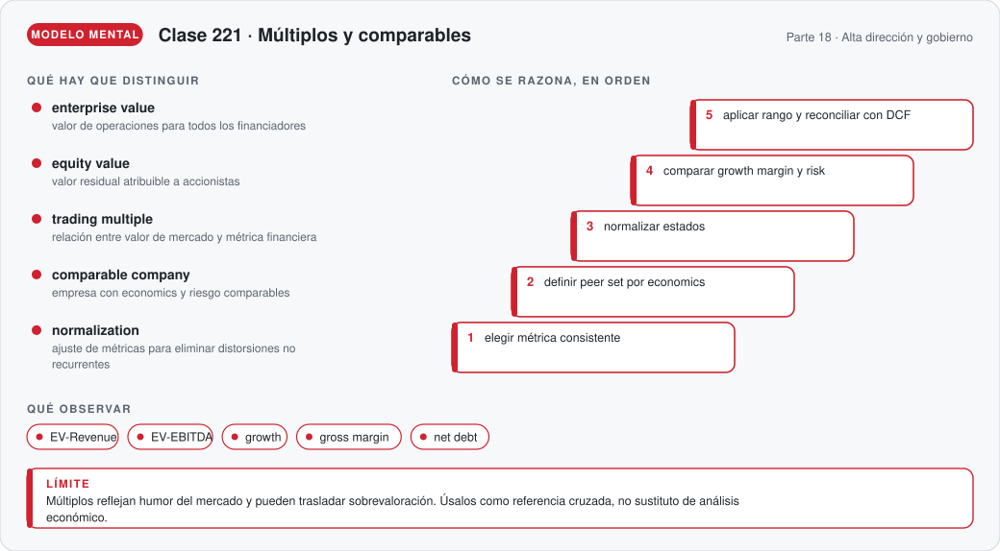

# Clase 221 — Múltiplos y comparables

<!-- nav:inicio -->
> **Parte 18 · Finanzas corporativas, capital y M&A** — clase 5 de 12 · [índice de la parte](../../README.md) · [temario](../../../../SYLLABUS.md)
<!-- nav:fin -->

**Parte:** 18 — Finanzas corporativas, capital y M&A  
**Nivel:** Etapa 5 — CEO → Capital allocator  
**Duración sugerida:** 150–180 minutos · **Estándar:** deep-class-v2

## 🎯 Propósito

Cuando alguien dice «esa empresa se vendió a ocho veces el EBITDA», está usando el lenguaje más frecuente del mercado: los **múltiplos**. Son rápidos, intuitivos y permiten comparar: si empresas parecidas se transan a 8 veces su EBITDA, la nuestra debería valer algo cercano. Por eso los usan banqueros, inversionistas y compradores, y por eso se abusa de ellos: se copia un múltiplo de un titular de prensa, se compara una empresa en crecimiento con una madura, se aplica a una cifra sin normalizar, se mezclan múltiplos de valor de empresa con otros del patrimonio o se pretende que un múltiplo sea «el precio». Un múltiplo no explica nada por sí solo: es el resultado de crecimiento, rentabilidad, riesgo y estado del mercado. Quien lo usa debe saber qué lo explica.

La clase enseña a valorar con múltiplos con rigor: elegir una métrica consistente, definir el grupo de comparables por la economía del negocio, normalizar los estados, comparar crecimiento, margen y riesgo, aplicar un rango y reconciliar con el flujo descontado. Se apoya en Koller y colaboradores y en Damodaran, en el análisis de estados de Penman y de Palepu, Healy y Peek, y en la práctica de transacciones de DePamphilis. Al terminar sabrás distinguir valor de empresa y de patrimonio, escoger y calcular múltiplos coherentes, evitar los errores clásicos y usar los comparables como control, no como sustituto del análisis.

## 📚 Resultados de aprendizaje

Al finalizar podrás:

1. **Distinguir** valor de empresa y valor del patrimonio y los múltiplos que corresponden a cada uno.
2. **Elegir** una métrica consistente y un grupo de comparables por su economía.
3. **Normalizar** los estados financieros antes de comparar.
4. **Comparar** crecimiento, margen y riesgo para ajustar el rango.
5. **Reconciliar** el resultado con el flujo descontado.

## 🧭 Agenda

| Tramo | Qué se hace |
|---|---|
| 0–20 | Recuperación: ¿qué múltiplo oíste la última vez que se habló del valor de una empresa y qué decía realmente? |
| 20–60 | Valor de empresa y patrimonio, métricas, comparables, normalización, ajustes y reconciliación. |
| 60–105 | Ejemplo trabajado: valoración por múltiplos con seis comparables. |
| 105–150 | Caso ejecutivo y práctica. |
| 150–175 | Límites y entregable. |

## 🧩 Conceptos centrales

| Concepto | Definición | Cómo se reconoce |
|---|---|---|
| **Múltiplo** | Razón entre el valor (o precio) de una empresa y una métrica financiera. | EV/EBITDA, precio/utilidad. |
| **Valor de empresa (EV)** | Valor del negocio operativo para todos los financistas. | Patrimonio + deuda neta. |
| **Valor del patrimonio** | Valor de lo que corresponde a los propietarios. | EV − deuda neta. |
| **Comparables** | Empresas similares en economía, riesgo y crecimiento. | Se eligen por fundamentos, no solo por sector. |
| **Normalización** | Ajuste de las cifras por partidas únicas y políticas distintas. | EBITDA «ajustado». |
| **Múltiplo de transacciones** | Múltiplo pagado en compras de empresas, incluye prima de control. | Datos de adquisiciones. |

## 🧠 Modelo mental

**Cómo leer el diagrama.** Una tabla con cuatro múltiplos habituales. **Valor empresa/EBITDA**: precio del negocio por peso de caja operativa; sirve con inversión y deuda distintas; ignora la inversión que exige el crecimiento. **Valor empresa/ventas**: precio por peso de ingresos; sirve cuando aún no hay utilidades; no refleja márgenes ni calidad. **Precio/utilidad**: precio del capital propio por peso de utilidad; sirve en empresas maduras y comparables; se ve afectado por la deuda y las partidas únicas. **Valor empresa/flujo libre**: precio por caja disponible; sirve cuando la inversión es relevante; los flujos volátiles dificultan comparar. La nota recuerda que se reconcilia siempre con el flujo descontado; el pie, que los múltiplos cambian con el ciclo.

## 📖 Desarrollo

### 1. Valor de empresa y valor del patrimonio

La confusión más frecuente es mezclar el numerador con la métrica del denominador. El **valor de empresa (EV)** es lo que vale el negocio operativo para todos sus financistas: patrimonio más deuda neta (más intereses minoritarios y otras obligaciones, menos activos no operativos). Por eso se divide por métricas que **no dependen de la deuda**: EBITDA, EBIT, ventas, flujo libre antes de intereses. El **valor del patrimonio** (precio o capitalización de mercado) se divide por métricas **después de intereses**: utilidad neta, flujo del patrimonio. Koller y colaboradores recomiendan EV/EBITDA o EV/EBIT sobre precio/utilidad porque son menos sensibles a la estructura de capital, y recuerdan que los múltiplos de utilidad pueden engañar cuando hay deuda, partidas únicas o políticas contables distintas.

### 2. Elegir métricas coherentes

La métrica debe reflejar lo que crea valor en ese negocio. EV/EBITDA es la más usada por su simplicidad, pero ignora cuánto hay que invertir para sostener el EBITDA: dos empresas con el mismo EBITDA pueden valer distinto si una exige mucha más inversión. EV/EBIT incorpora la depreciación como aproximación de la inversión de mantención. EV/ventas se usa cuando no hay utilidades (empresas jóvenes), pero supone que algún día los márgenes serán normales. El **precio/utilidad** es útil para empresas maduras y de estructura similar. En sectores específicos (inmobiliarias, bancos, seguros, software) hay métricas propias (valor por activo, precio/valor libro, múltiplo de ingresos recurrentes). Damodaran subraya la **consistencia**: numerador y denominador deben corresponder al mismo concepto y al mismo período (histórico, proyectado, normalizado).

### 3. Elegir comparables por su economía

Un buen grupo de comparables no se define solo por el sector, sino por la **economía del negocio**: crecimiento, rentabilidad, intensidad de capital, riesgo, tamaño, geografía y modelo de ingresos. Dos empresas del mismo sector pueden valer distinto si una crece al 15 % y la otra al 3 %. Se recomienda construir un grupo de **cinco a diez** comparables, documentar los criterios de inclusión y exclusión, y estudiar **por qué** difieren sus múltiplos. La **mediana** suele ser preferible al promedio porque resiste valores extremos. Penman y Palepu, Healy y Peek advierten que la comparabilidad depende de la **calidad contable**: distintas políticas de depreciación, de reconocimiento de ingresos o de arriendos pueden distorsionar las razones.

### 4. Normalizar las cifras

Antes de aplicar un múltiplo hay que **normalizar** las cifras de la empresa y de los comparables: eliminar partidas únicas (venta de activos, reestructuraciones, litigios), ajustar efectos de políticas contables, incorporar el costo real de arriendos y de remuneraciones de los dueños en empresas familiares, y llevar todas las cifras a un mismo criterio y período (por ejemplo, los últimos 12 meses o el año proyectado). Una cifra sin normalizar puede cambiar la valoración en decenas de millones: un EBITDA de 11.200 con una partida única negativa de 800 equivale a 12.000 normalizado; a 7,65 veces la diferencia es de 6.120. Pero también hay que cuidarse de las «normalizaciones» exageradas, que convierten cualquier pérdida en un «hecho único».

### 5. Ajustar por crecimiento, margen y riesgo

Aun con buenos comparables, la empresa a valorar difiere. Una empresa que crece más rápido, con mejores márgenes o con menos riesgo merece un múltiplo **mayor**; una con mayor concentración de clientes o deuda más cara, uno **menor**. Se comparan variables explicativas (crecimiento esperado, margen, retorno sobre el capital, volatilidad, tamaño) y se aplican **ajustes cualitativos** con criterio o regresiones simples cuando hay datos suficientes. El resultado es un **rango** justificado, no un punto. Damodaran muestra que gran parte de la dispersión de los múltiplos se explica por crecimiento, riesgo y retorno sobre el capital; por eso, aplicar el múltiplo promedio sin ajustar es una decisión implícita de «somos iguales al promedio».

### 6. Múltiplos de mercado y de transacciones

Los **múltiplos de empresas cotizadas** reflejan el precio de pequeñas participaciones sin control y con liquidez. Los **múltiplos de transacciones** (adquisiciones de empresas completas) incluyen una **prima de control** por la capacidad de dirigir, y a veces sinergias pagadas. DePamphilis subraya que el comprador debe distinguir entre el valor **independiente** del negocio y el valor con **sinergias**, y que lo que paga el mercado en una operación específica depende de las circunstancias (competencia entre oferentes, urgencia, ciclo). Las transacciones comparables deben ser **recientes** y de **empresas similares**; con pocos datos, se usan como referencia y no como regla. Los descuentos por **iliquidez** y por **tamaño** se consideran en empresas cerradas.

### 7. Reconciliar con el flujo descontado

Los múltiplos y el DCF (clase 220) se usan **juntos**. El DCF responde a «qué debería valer según los fundamentos»; los múltiplos, a «qué paga hoy el mercado por empresas parecidas». Se contrasta: ¿el múltiplo implícito en el DCF está dentro del rango de los comparables?, ¿qué crecimiento, margen o riesgo explican la diferencia? Si el DCF implica un múltiplo muy superior, hay que justificarlo con ventajas reales o corregir los supuestos; si es muy inferior, quizás el mercado esté asumiendo algo que no hemos considerado. El **resultado final** es un rango de valor con la lógica de cada método, no un promedio mecánico de ambos.

## 📚 Lectura comparada

| Obra | Qué aporta | Qué no resuelve | Pregunta para contrastar |
|---|---|---|---|
| Koller y otros | Preferencia por múltiplos basados en valor de empresa y sus cuidados. | Requiere datos de calidad. | ¿El numerador y la métrica coinciden? |
| Damodaran | Múltiplos como función de crecimiento, riesgo y retorno. | Basado en mercados desarrollados. | ¿Qué explica la diferencia de múltiplos? |
| Penman | Calidad de las cifras contables y su comparabilidad. | Enfoque contable. | ¿Las cifras son comparables? |
| Palepu, Healy y Peek | Análisis del negocio para elegir comparables. | Estilo de libro de texto. | ¿Qué hace comparable a esta empresa? |
| DePamphilis | Múltiplos de transacciones, prima de control y sinergias. | Datos de operaciones pasadas. | ¿Cuánto es control y cuánto sinergia? |

## 🧮 Ejemplo trabajado

**Situación (hipotética).** Se valora una empresa con ventas de 80.000 millones de pesos, EBITDA reportado de 11.200 millones y deuda neta de 15.000 millones. El EBITDA incluye una partida única negativa de 800 millones (provisión por un litigio resuelto). Crece 8 % anual con un margen EBITDA de 15 %.

**Normalización.** EBITDA normalizado: 11.200 + 800 = 12.000 millones (margen de 15 %).

**Comparables (seis empresas).**

| Empresa | Crecimiento esperado | Margen EBITDA | EV/EBITDA |
|---|---|---|---|
| A | 4 % | 13 % | 6,8 |
| B | 6 % | 14 % | 7,4 |
| C | 7 % | 15 % | 7,9 |
| D | 9 % | 16 % | 8,5 |
| E | 12 % | 18 % | 9,6 |
| F | 2 % | 12 % | 5,9 |
| **Mediana** | | | **7,65** |
| **Promedio** | 6,7 % | 14,7 % | 7,68 |

**Ajuste.** La empresa a valorar crece 8 % con un margen de 15 %: está entre las empresas C (7 %; 15 %) y D (9 %; 16 %). Su múltiplo razonable es 7,9 a 8,5, y con un ajuste por riesgo (concentración de clientes) se toma un rango de **7,0 a 8,5 veces**.

**Valoración.**

| Múltiplo | Valor de empresa | Valor del patrimonio (− 15.000) |
|---|---|---|
| 7,0 | 12.000 × 7,0 = 84.000 | 69.000 |
| 7,65 (mediana) | 91.800 | 76.800 |
| 8,5 | 102.000 | 87.000 |

**Efecto de no normalizar.** Con el EBITDA reportado (11.200) y la mediana de 7,65: 11.200 × 7,65 = 85.680. Con el normalizado: 91.800. Diferencia: 6.120 millones (7,1 % de 85.680).

**Reconciliación con el DCF.** El valor por flujos del ejemplo de la clase 220 (88.234 millones de valor de empresa) cae dentro del rango por múltiplos (84.000 a 102.000) y equivale a un múltiplo implícito de 88.234 ÷ 12.000 = 7,35 veces, ligeramente bajo la mediana. Ambos métodos se refuerzan; se concluye un **rango de valor de empresa de 84.000 a 98.000 millones**, con un punto central de 90.000.

**Precio/utilidad como control.** Utilidad neta aproximada: (EBIT 9.600 − intereses de 15.000 × 8 % = 1.200) × 0,73 = 6.132 millones. Con el valor del patrimonio de 76.800: precio/utilidad de 12,5 veces. Si los comparables transan a 13,2 veces en promedio, el resultado es coherente, aunque la deuda y las partidas únicas afectan la comparación.

**Múltiplo de transacciones.** Dos adquisiciones recientes de empresas similares se pagaron a 8,8 y 9,4 veces el EBITDA, con una prima de control estimada de 15 %. El valor sin prima sería de 8,8 ÷ 1,15 ≈ 7,65 y 9,4 ÷ 1,15 ≈ 8,17: consistente con el rango.

**Cuidados.** Los múltiplos cambian con el ciclo; las normalizaciones deben documentarse y verificarse con los estados financieros; la información de comparables se obtiene de fuentes confiables y se verifican las definiciones; las cifras son ilustrativas.

**Qué muestra.** (1) La normalización cambió el valor en 6.120 millones. (2) El ajuste por crecimiento y riesgo generó un rango. (3) El DCF y los múltiplos se reconciliaron.

## 🔀 Comparación y límites

**Múltiplos frente a precio de mercado.** Un múltiplo de comparables indica cómo valora el mercado a empresas parecidas; el precio de una transacción se negocia y puede distar de él.

**Límites.** Los múltiplos son relativos: si el mercado está caro o barato, la valoración lo refleja. Los comparables nunca son idénticos. Las cifras contables no son totalmente comparables. Los múltiplos de transacciones incluyen primas de control y sinergias. Las cifras del ejemplo son ilustrativas.

## 🪜 De profesional a owner

| Nivel | Cómo participa en la valoración por múltiplos |
|---|---|
| **Profesional** | Prepara estados normalizados con criterios explícitos. |
| **Jefe / Team Lead** | Explica las partidas únicas de su área. |
| **Gerente** | Construye grupos de comparables con criterios documentados. |
| **CEO / Director** | Usa los múltiplos como control de las valoraciones y de las ofertas. |
| **Founder / Owner** | Entiende cómo el mercado valora empresas como la suya y por qué. |

## 🏢 Caso ejecutivo

Una empresa de logística con ventas de 120.000 millones de pesos, EBITDA reportado de 14.400 millones y deuda neta de 30.000 millones va a vender el 100 % de su capital. El banco de inversión propone un múltiplo de 9,5 veces el EBITDA porque «una empresa del sector se vendió a ese precio». El EBITDA reportado incluye ingresos únicos de 1.600 millones por la venta de un camión de su flota y excluye gastos de arriendo de bodegas con partes relacionadas por 900 millones al año (por debajo de mercado). La empresa tiene un cliente que representa el 30 % de las ventas y crece 3 % anual; la empresa vendida a 9,5 veces crecía 11 % y tenía diversificación de clientes. Los comparables cotizados transan entre 5,5 y 7,5 veces. El comprador ofrece 8,0 veces sobre el EBITDA reportado.

Entrega un **memo de valoración por múltiplos** que contenga: (a) la normalización del EBITDA con cada ajuste y su efecto; (b) la selección de comparables con criterios y diferencias de crecimiento, margen y riesgo; (c) el rango de múltiplos ajustado y el valor de empresa y de patrimonio; (d) el análisis de los múltiplos de transacciones y de la prima de control; (e) la reconciliación con un flujo descontado simplificado y la postura de negociación; (f) las verificaciones contables y legales pendientes.

## 🧪 Práctica

1. Calcula el valor de empresa de una compañía a partir de su capitalización y su deuda neta.
2. Normaliza el EBITDA de una empresa con tres partidas y calcula el efecto en el valor.
3. Construye un grupo de seis comparables con crecimiento, margen y múltiplo, y calcula mediana y promedio.
4. Ajusta el múltiplo según diferencias de crecimiento y riesgo y obtén un rango.
5. Compara el múltiplo implícito de un DCF con el rango de comparables y explica la diferencia.

## ⚠️ Errores frecuentes

| Error | Por qué ocurre | Cómo corregirlo |
|---|---|---|
| Mezclar EV con métricas del patrimonio | Falta de claridad en el concepto | Numerador y denominador coherentes. |
| Comparar por sector solamente | Es lo más fácil | Comparar por crecimiento, margen y riesgo. |
| No normalizar | Se usan cifras reportadas | Ajustar partidas únicas y políticas. |
| Usar el promedio sin ajustar | Se supone igualdad | Ajustar por diferencias explicativas. |
| Confundir control con mercado | Se mezclan datos | Separar múltiplos cotizados y de transacciones. |
| Tratar el múltiplo como precio | Se simplifica la negociación | Usarlo como rango y reconciliar con el DCF. |

## ❓ Preguntas de comprobación

1. ¿Qué diferencia hay entre valor de empresa y valor del patrimonio?
2. ¿Por qué EV/EBITDA es más robusto frente a la estructura de capital que precio/utilidad?
3. ¿Cómo se elige un buen grupo de comparables?
4. ¿Qué es normalizar y por qué importa?
5. ¿Por qué se ajusta el múltiplo por crecimiento y riesgo?
6. ¿Qué diferencia hay entre múltiplos de mercado y de transacciones?
7. ¿Cómo se reconcilian múltiplos y DCF?

Claves de respuesta

1. El valor de empresa es el del negocio para todos los financistas; el del patrimonio es el de los propietarios, igual al primero menos la deuda neta.
2. Porque el EBITDA y el valor de empresa no dependen de la deuda, mientras que la utilidad y el precio sí.
3. Por la economía del negocio (crecimiento, rentabilidad, intensidad de capital, riesgo, tamaño, modelo) y no solo por sector, de cinco a diez empresas y con criterios documentados.
4. Eliminar partidas únicas y diferencias contables para que las cifras sean comparables; cambia el valor de forma material.
5. Porque una empresa que crece más o es menos riesgosa merece un múltiplo mayor, y viceversa.
6. Los de mercado reflejan participaciones sin control; los de transacciones incluyen prima de control y a veces sinergias.
7. Comparando el múltiplo implícito del DCF con el rango de comparables y explicando las diferencias con crecimiento, margen y riesgo.

## 📥 Entregable

Guarda en `portfolio/221-multiplos-y-comparables/`:

- `leadership-decision-brief.md` (plantilla [Leadership Decision Brief](../../../../templates/leadership-decision-brief.md)) con el memo del caso ejecutivo;
- `modelo-financiero-y-memo-de-decision.md` (plantilla [Modelo financiero y memo de decisión](../../../../templates/modelo-financiero-y-memo-de-decision.md)) con la tabla de comparables y la normalización;
- `decision-journal.md` con los criterios de selección, los ajustes y la reconciliación.

## 📗 Fuentes y verificación

- Tim Koller, Marc Goedhart & David Wessels — *Valuation: Measuring and Managing the Value of Companies* (Wiley, 2005). **Uso en esta clase:** múltiplos basados en valor de empresa y sus cuidados. Lectura selectiva sobre **múltiplos y comparables**. **Localizador:** [ISBN-13 9780471702191](https://openlibrary.org/isbn/9780471702191).
- Aswath Damodaran — *Investment Valuation* (John Wiley & Sons, Incorporated, 2012). **Uso en esta clase:** múltiplos como función de crecimiento, riesgo y retorno. Lectura selectiva sobre **múltiplos y comparables**. **Localizador:** [ISBN-13 9781118206546](https://openlibrary.org/isbn/9781118206546).
- Stephen H. Penman — *Financial Statement Analysis and Security Valuation* (McGraw-Hill/Irwin, 2001). **Uso en esta clase:** calidad y comparabilidad de las cifras contables. Lectura selectiva sobre **múltiplos y comparables**. **Localizador:** [ISBN-13 9780072903331](https://openlibrary.org/isbn/9780072903331).
- Krishna G. Palepu, Paul M. Healy & Erik Peek — *Business Analysis and Valuation* (South-Western College Pub, 1996). **Uso en esta clase:** análisis del negocio para elegir comparables. Lectura selectiva sobre **múltiplos y comparables**. **Localizador:** [ISBN-13 9780324375817](https://openlibrary.org/isbn/9780324375817).
- Donald DePamphilis — *Mergers, Acquisitions, and Other Restructuring Activities* (Elsevier Science & Technology Books, 2001). **Uso en esta clase:** múltiplos de transacciones, prima de control y sinergias. Lectura selectiva sobre **múltiplos y comparables**. **Localizador:** [ISBN-13 9780323910545](https://openlibrary.org/isbn/9780323910545).

> **Regla de fuentes para Múltiplos y comparables:** las obras anteriores estructuran las perspectivas de esta materia; cualquier norma, ley o estándar vivo mencionado debe comprobarse nuevamente en su fuente primaria vigente, incluidas las definiciones contables y las obligaciones de información en una transacción. Los ejemplos y casos son hipotéticos, con cifras ilustrativas. El desarrollo es original y no reproduce capítulos protegidos.

<!-- pie:inicio -->
---

| Anterior | Índice | Siguiente |
|---|---|---|
| [← 220 · Valoración por flujos](../220-valoracion-por-flujos/README.md) | [Parte 18](../../README.md) · [Programa](../../../../SYLLABUS.md) | [222 · Fundraising y narrativa financiera →](../222-fundraising-y-narrativa-financiera/README.md) |
<!-- pie:fin -->
