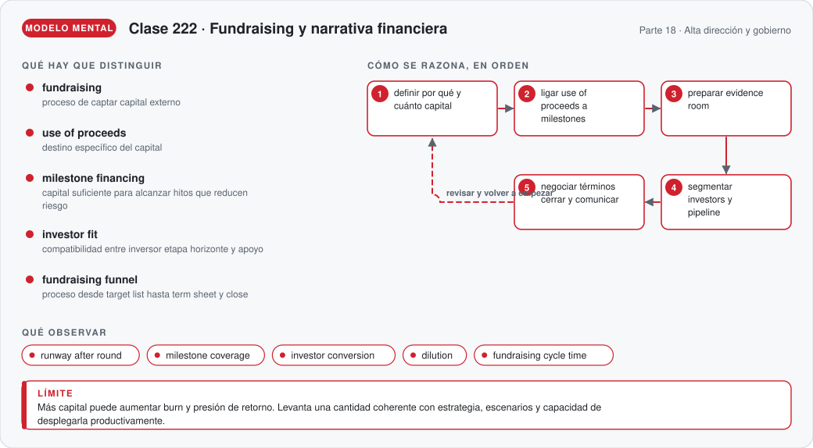

# Clase 222 — Fundraising y narrativa financiera

<!-- nav:inicio -->
> **Parte 18 · Finanzas corporativas, capital y M&A** — clase 6 de 12 · [índice de la parte](../../README.md) · [temario](../../../../SYLLABUS.md)
<!-- nav:fin -->

**Parte:** 18 — Finanzas corporativas, capital y M&A  
**Nivel:** Etapa 5 — CEO → Capital allocator  
**Duración sugerida:** 150–180 minutos · **Estándar:** deep-class-v2

## 🎯 Propósito

Levantar capital es una de las pocas actividades del CEO en la que se compite directamente por la confianza de personas que no conocen el negocio por dentro y que pueden pedir cuentas. Muchos fundadores lo viven como una venta de entusiasmo: una presentación vistosa, una gran visión y una cifra de crecimiento. Pero los inversionistas experimentados compran otra cosa: **un plan verificable en el que cada peso aportado se convierte en un resultado medible** que aumenta el valor de la empresa y permite una siguiente etapa. La narrativa financiera de una captación no es un relato inspirador sino un argumento con números: por qué se necesita capital, cuánto y para qué; qué hitos se lograrán y cuándo; qué evidencia respalda las proyecciones; y qué ocurre si las cosas salen distinto.

La clase presenta el proceso de captación como una disciplina: definir necesidad y monto, ligar el uso de fondos a hitos, preparar una sala de evidencia, gestionar el pipeline de inversionistas, negociar y cerrar, y comunicar con coherencia. Se apoya en Feld y Mendelson sobre las dinámicas del capital de riesgo, en Horowitz sobre las duras decisiones de un fundador, en Wasserman sobre los dilemas de control y propiedad, en Brealey, Myers y Allen sobre financiamiento y en Myers y Majluf sobre los problemas de información al emitir capital. Al terminar sabrás calcular el monto y el calendario de una ronda, preparar una narrativa con números consistentes, ordenar un proceso y evitar errores que erosionan credibilidad.

## 📚 Resultados de aprendizaje

Al finalizar podrás:

1. **Definir** por qué, cuánto y cuándo levantar capital con un cálculo de caja.
2. **Ligar** el uso de fondos a hitos medibles y a la siguiente ronda.
3. **Preparar** una sala de evidencia coherente con la narrativa.
4. **Gestionar** un pipeline de inversionistas con tiempos y conversión.
5. **Negociar y comunicar** con consistencia y honestidad sobre riesgos.

## 🧭 Agenda

| Tramo | Qué se hace |
|---|---|
| 0–20 min | Recuperación: ¿qué hitos logró tu empresa con el último capital que recibió y cuáles prometió y no cumplió? |
| 20–60 min | Necesidad, monto, hitos, narrativa, evidencia, proceso y cierre. |
| 60–105 min | Ejemplo trabajado: cálculo de la ronda, uso de fondos y embudo de inversionistas. |
| 105–150 min | Caso ejecutivo y práctica. |
| 150–175 min | Límites y entregable. |

## 🧩 Conceptos centrales

| Concepto | Definición | Cómo se reconoce |
|---|---|---|
| **Captación (*fundraising*)** | Proceso de obtener capital de inversionistas. | Rondas, roadshow, términos. |
| **Uso de fondos** | Destino planificado del capital levantado. | Ligado a hitos. |
| **Pista de caja (*runway*)** | Meses de operación que permite la caja disponible. | Caja ÷ consumo mensual. |
| **Hito** | Resultado verificable que reduce la incertidumbre del negocio. | Ingresos, retención, producto. |
| **Sala de evidencia (*data room*)** | Repositorio ordenado de documentos y datos para inversionistas. | Financiero, legal, comercial, técnico. |
| **Embudo de inversionistas** | Secuencia de contactos, reuniones y ofertas. | Tasas de conversión por etapa. |

## 🧠 Modelo mental

**Cómo leer el diagrama.** Una cadena de cinco pasos con retorno. **Por qué y cuánto**: necesidad real y monto con margen. **Uso y hitos**: cada peso ligado a un resultado. **Sala de evidencia**: datos y documentos listos para revisar. **Inversionistas**: segmentos, ajuste y pipeline. **Términos y cierre**: negociar y comunicar con coherencia. La flecha indica que las conversaciones ajustan la propuesta. La nota afirma que levantar capital es vender un plan verificable y no una promesa; el pie, que las ofertas de valores y la relación con inversionistas tienen regulación.

## 📖 Desarrollo

### 1. Por qué y cuánto: partir de la caja

Una ronda empieza con una pregunta de **necesidad**: ¿qué no podemos hacer con el capital actual y qué lograríamos con más? Se responde con un **modelo de caja**: ingresos, costos, inversión y consumo mensual proyectados, con la **pista de caja** actual (caja ÷ consumo mensual neto). Un error clásico es iniciar el proceso cuando quedan seis meses de pista: los procesos de captación suelen tomar de **tres a seis meses** o más, y los inversionistas perciben la urgencia y negocian desde la fuerza. Una regla práctica es comenzar con **doce meses de pista** o al menos nueve. El **monto** se calcula como el consumo proyectado hasta lograr los hitos que permitan la siguiente ronda en mejores condiciones, más un **colchón** (por ejemplo, tres a seis meses). Pedir de más diluye innecesariamente; pedir de menos obliga a regresar pronto y en peor posición.

### 2. Uso de fondos ligado a hitos

Los inversionistas financian **hitos**, no gastos. El plan de uso de fondos debe traducirse a resultados medibles que reduzcan la incertidumbre: ingresos recurrentes alcanzados, retención de clientes, costo de adquisición, producto lanzado, aprobaciones regulatorias, márgenes. Cada categoría de gasto (producto, comercial, operaciones, reserva) se vincula con uno o más hitos y con **fechas**. La pregunta de fondo es: «¿qué será verdad en 18 a 24 meses que hoy no lo es, y cómo hará eso que la empresa valga más?». Brealey, Myers y Allen recuerdan que el capital se asigna a proyectos con valor presente neto positivo; en un contexto de alta incertidumbre, los hitos son la forma de **reducir el riesgo por etapas** y justificar valoraciones crecientes.

### 3. La narrativa financiera

La narrativa es el **hilo** que conecta la oportunidad, el modelo de negocio, la tracción, el equipo, los números y el uso de fondos. Una narrativa sólida: define un **problema** relevante y un mercado accesible; muestra **evidencia** (clientes, ingresos, retención) más que adjetivos; explica el **modelo de negocio** y la **economía unitaria** (clase 163); presenta **proyecciones** con supuestos claros y un escenario prudente; reconoce **riesgos principales** y su mitigación; y concluye con una **solicitud concreta** (monto, uso, hitos). Horowitz, desde su experiencia como fundador, enfatiza que el liderazgo en una captación implica honestidad sobre las dificultades: ocultarlas se descubre en la revisión y destruye la confianza. Los números deben ser **consistentes** entre documentos (presentación, modelo, contratos, cifras bancarias).

### 4. Sala de evidencia y preparación

La **sala de evidencia** reúne los documentos que un inversionista revisará: estados financieros y modelo con supuestos; métricas del negocio (ingresos, retención, adquisición, ciclos de venta); contratos principales y condiciones comerciales; propiedad y tabla de capitalización (clase 223); cumplimiento legal, laboral y tributario; propiedad intelectual; y organigrama y personas clave. Se organiza **antes** del proceso, con accesos controlados y un índice. Una sala de evidencia incompleta o incoherente alarga el proceso, erosiona la confianza y aparece en la negociación como descuento. Se prepara también al equipo para **preguntas difíciles** (concentración de clientes, rotación, contingencias, deuda) y se acuerda quién responde qué.

### 5. Segmentar inversionistas y gestionar el pipeline

No todos los inversionistas son iguales: los hay **especializados** en una etapa, sector o región; con **cheques** de distintos tamaños; con **estilos** diferentes (activos o pasivos); y con **capacidad de seguimiento** en rondas posteriores. Se arma una lista **segmentada** por ajuste (etapa, sector, tamaño de cheque, valor agregado), y se gestiona el pipeline como un **embudo**: contactos, primeras reuniones, segundas reuniones, revisión de evidencia, ofertas (*term sheets*). Se registra la **conversión** por etapa y se acotan los tiempos para crear tensión competitiva: múltiples conversaciones paralelas, con calendario. Feld y Mendelson señalan que tener más de una oferta mejora el poder de negociación y que conviene conocer a los inversionistas antes de recibir su dinero (referencias de otros fundadores).

### 6. Negociar, cerrar y comunicar

Cuando llegan ofertas, no solo importa la valoración: importan los **términos** (clase 224), el **valor agregado** del inversionista (contactos, experiencia, capacidad de aportar en próximas rondas), la **compatibilidad** cultural y los **derechos de control**. Wasserman muestra, a partir de estudios de startups, que los fundadores enfrentan dilemas entre **riqueza y control**, y que ciertas decisiones tempranas sobre socios, propiedad y financiamiento tienen consecuencias duraderas. El cierre incluye revisión legal de los documentos, cumplimiento de condiciones previas y un plan de **comunicación**: a empleados, a otros inversionistas, a clientes y, si corresponde, al mercado. Las ofertas de valores a inversionistas están reguladas y requieren asesoría legal para evitar infracciones (por ejemplo, restricciones sobre ofertas públicas).

### 7. Después del cierre: cumplir lo prometido

La captación no termina con la firma sino con el **cumplimiento de los hitos prometidos**. Se establece un **calendario de informes** a inversionistas (mensual o trimestral), con métricas acordadas y transparencia sobre desvíos; se alinea el uso de fondos con el plan y se comunican los ajustes. Myers y Majluf recuerdan que los inversionistas se informan menos que la gerencia; la confianza se construye cumpliendo los compromisos y avisando temprano de los problemas. Cada ronda siguiente se apoya en el historial: quien cumplió sus hitos levanta mejor y quien no los cumplió paga más caro. Y se prepara la **siguiente ronda** con anticipación: la pista de caja posterior al cierre debe cubrir los hitos y el proceso siguiente.

## 📚 Lectura comparada

| Obra | Qué aporta | Qué no resuelve | Pregunta para contrastar |
|---|---|---|---|
| Feld y Mendelson | Dinámica del capital de riesgo: procesos, ofertas y términos. | Orientado a EE. UU. y a startups. | ¿Qué espera este inversionista? |
| Horowitz | Honestidad y liderazgo bajo presión al levantar capital. | Experiencia personal. | ¿Cómo comunico lo difícil? |
| Wasserman | Dilemas de riqueza y control de los fundadores. | Evidencia de startups de ciertos mercados. | ¿Qué decisión de propiedad hoy afectará mañana? |
| Brealey, Myers y Allen | Financiamiento y asignación de capital por valor. | No cubre el proceso de captación. | ¿Los hitos justifican el capital? |
| Myers y Majluf | Problemas de información en la emisión de capital. | Modelo teórico. | ¿Cómo reduzco la asimetría de información? |

## 🧮 Ejemplo trabajado

**Situación (hipotética).** Una empresa de software tiene ventas recurrentes anuales (ARR) de 4.000 millones de pesos, caja de 1.800 millones y un consumo neto de 260 millones al mes.

**Pista de caja actual.** 1.800 ÷ 260 = 6,9 meses: demasiado corta para un proceso de captación (de tres a cinco meses más cierre).

**Medidas inmediatas.** Reducir el consumo en 10 % (a 234 millones): pista de 1.800 ÷ 234 = 7,7 meses; negociar una línea de capital de trabajo de 600 millones como puente.

**Cálculo del monto.** Plan a 20 meses para alcanzar un ARR de 9.000 millones y una retención neta de 115 %, con consumo creciente:

| Período | Meses | Consumo mensual | Consumo del período |
|---|---|---|---|
| Meses 1 a 6 | 6 | 280 | 1.680 |
| Meses 7 a 12 | 6 | 330 | 1.980 |
| Meses 13 a 20 | 8 | 380 | 3.040 |
| **Total** | 20 | | **6.700** |

Monto requerido = consumo (6.700) − caja actual (1.800) + colchón de tres meses de consumo final (3 × 380 = 1.140) = **6.040**, que se redondea a **6.000 millones**.

**Pista tras el cierre.** Caja: 1.800 + 6.000 = 7.800. Consumo en los primeros 12 meses: 1.680 + 1.980 = 3.660; quedan 4.140. A 380 por mes: 4.140 ÷ 380 = 10,9 meses. Pista total: 12 + 10,9 ≈ **22,9 meses**, suficiente para los hitos (20 meses) más el proceso de la siguiente ronda.

**Uso de fondos ligado a hitos.**

| Uso | % | Millones | Hito |
|---|---|---|---|
| Producto e ingeniería | 35 | 2.100 | Lanzar el módulo empresarial en 9 meses |
| Comercial y marketing | 40 | 2.400 | ARR de 9.000 millones y retención neta de 115 % a 20 meses |
| Operaciones y soporte | 15 | 900 | Costo de servicio por cliente −20 % |
| Reserva | 10 | 600 | Contingencias |

**Valoración y dilución.** Si el inversionista valora la empresa en 24.000 millones antes de la inversión (pre-money): valoración posterior de 30.000 millones; participación del nuevo inversionista: 6.000 ÷ 30.000 = 20 %.

**Embudo de inversionistas.** Se contacta a 40 inversionistas segmentados por ajuste: 18 primeras reuniones (45 %); 8 segundas reuniones (44 %); 4 ofertas (50 %). Con cuatro ofertas hay poder de negociación; basta con tres para generar competencia. Con un calendario de 12 semanas desde el primer contacto hasta las ofertas, más seis semanas de revisión legal: cerca de 4,5 meses.

**Sala de evidencia.** Estados financieros auditados, modelo con los supuestos, panel de métricas (ARR, retención, costo de adquisición), 20 contratos principales, tabla de capitalización totalmente diluida, informe de cumplimiento laboral y tributario, y un registro de riesgos. Se revisan cifras para que coincidan con la presentación.

**Comunicación y cumplimiento.** Informe trimestral a inversionistas con diez métricas acordadas, y aviso de desvíos mayores a 10 % en 15 días.

**Cuidados.** Las ofertas de valores y las condiciones de los inversionistas se revisan con asesoría legal; las proyecciones son hipotéticas y no constituyen una promesa de resultados; las cifras son ilustrativas.

**Qué muestra.** (1) La pista de caja determinó cuándo y cuánto. (2) El uso de fondos se ligó a hitos medibles. (3) El embudo y la sala de evidencia ordenaron el proceso.

## 🔀 Comparación y límites

**Captación frente a financiamiento bancario.** El banco evalúa capacidad de pago y garantías; el inversionista de capital evalúa potencial de crecimiento y participa en el riesgo y la propiedad. Los procesos, la información y los tiempos difieren.

**Límites.** Los tiempos de proceso, las tasas de conversión y las valoraciones varían con el mercado y el momento. Los hitos pueden no cumplirse. Un buen proceso no garantiza capital. Las ofertas de valores tienen restricciones legales. Las cifras del ejemplo son ilustrativas.

## 🪜 De profesional a owner

| Nivel | Cómo participa en la captación |
|---|---|
| **Profesional** | Prepara datos exactos para la sala de evidencia. |
| **Jefe / Team Lead** | Explica la tracción de su área con métricas verificables. |
| **Gerente** | Construye el plan de uso de fondos y los hitos. |
| **CEO / Director** | Lidera la narrativa, el proceso y la relación con inversionistas. |
| **Founder / Owner** | Equilibra capital, control y visión a largo plazo. |

## 🏢 Caso ejecutivo

Una empresa de tecnología para salud con 70 personas, ARR de 6.500 millones de pesos, crecimiento de 60 % anual, margen bruto de 68 %, caja de 2.400 millones y un consumo neto de 380 millones al mes decide levantar capital. Hay un fondo interesado que ofrece 9.000 millones con una valoración previa de 36.000 millones; un inversionista estratégico propone 5.000 millones con exclusividad comercial; los fundadores tienen 62 % de la propiedad. El director comercial quiere pedir 15.000 millones «para crecer más rápido»; el director financiero advierte que el consumo subiría a 700 millones al mes; la tabla de capitalización tiene errores; la retención neta cayó de 118 % a 104 % en dos trimestres; un cliente representa el 24 % del ARR. El plan prevé un ARR de 16.000 millones en 24 meses. Los fundadores se preocupan por la dilución, y un empleado clave amenaza con irse si no recibe más opciones.

Entrega un **plan de captación** que contenga: (a) el cálculo de pista de caja, monto y calendario con el escenario de consumo; (b) el uso de fondos ligado a hitos y a la siguiente ronda; (c) la narrativa financiera con el tratamiento honesto de la caída de retención y la concentración; (d) la sala de evidencia y el plan para corregir la tabla de capitalización; (e) el embudo de inversionistas, con criterios de selección y tiempos; (f) la comparación de ofertas, el plan de comunicación y las verificaciones legales y regulatorias pendientes.

## 🧪 Práctica

1. Calcula la pista de caja de tu empresa y decide cuándo habría que empezar una ronda.
2. Estima el monto necesario para 20 meses con tres tramos de consumo y un colchón.
3. Liga cada categoría de uso de fondos a un hito medible con fecha.
4. Arma una lista segmentada de 30 inversionistas con criterios de ajuste y calcula el embudo esperado.
5. Redacta el índice de una sala de evidencia con los documentos clave.

## ⚠️ Errores frecuentes

| Error | Por qué ocurre | Cómo corregirlo |
|---|---|---|
| Empezar con poca pista de caja | Se posterga la decisión | Iniciar con 9 a 12 meses de pista. |
| Pedir sin plan de hitos | Se piensa en el monto, no en el uso | Ligar cada peso a un resultado medible. |
| Cifras inconsistentes | Cada documento se prepara aparte | Una sola fuente y revisión cruzada. |
| Ocultar problemas | Miedo a perder la oferta | Presentar riesgos y mitigaciones con honestidad. |
| Una sola conversación | Falta de pipeline | Procesos paralelos y calendario. |
| No cumplir después | Se da por terminado | Informes periódicos y aviso temprano de desvíos. |

## ❓ Preguntas de comprobación

1. ¿Cuándo conviene iniciar una ronda según la pista de caja?
2. ¿Cómo se calcula el monto de una ronda?
3. ¿Por qué se liga el uso de fondos a hitos?
4. ¿Qué incluye una narrativa financiera sólida?
5. ¿Qué contiene una sala de evidencia?
6. ¿Cómo se gestiona el pipeline de inversionistas?
7. ¿Qué se hace después del cierre?

Claves de respuesta

1. Con al menos nueve a doce meses de pista, porque el proceso toma varios meses y la urgencia debilita la negociación.
2. Consumo proyectado hasta los hitos, menos la caja actual, más un colchón de tres a seis meses.
3. Porque los inversionistas financian resultados que reducen la incertidumbre y justifican valoraciones crecientes.
4. Problema y mercado, evidencia, modelo de negocio y economía unitaria, proyecciones con supuestos, riesgos y mitigación, y solicitud concreta.
5. Estados financieros y modelo, métricas, contratos, tabla de capitalización, cumplimiento legal y tributario, propiedad intelectual y personas clave.
6. Con una lista segmentada por ajuste, un embudo con conversión por etapa y un calendario que genere competencia.
7. Cumplir hitos, informar con regularidad, avisar de desvíos y preparar la siguiente ronda con anticipación.

## 📥 Entregable

Guarda en `portfolio/222-fundraising-y-narrativa-financiera/`:

- `modelo-financiero-y-memo-de-decision.md` (plantilla [Modelo financiero y memo de decisión](../../../../templates/modelo-financiero-y-memo-de-decision.md)) con el plan de captación del caso ejecutivo;
- `cash-runway.md` (plantilla [Cash runway](../../../../templates/cash-runway.md)) con la pista de caja y el monto de la ronda;
- `decision-journal.md` con el uso de fondos, el embudo y las verificaciones legales pendientes.

## 📗 Fuentes y verificación

- Brad Feld & Jason Mendelson — *Venture Deals* (Wiley, 2011). **Uso en esta clase:** dinámica del capital de riesgo, procesos y ofertas. Lectura selectiva sobre **fundraising y narrativa financiera**. **Localizador:** [ISBN-13 9781118443613](https://openlibrary.org/isbn/9781118443613).
- Ben Horowitz — *The Hard Thing About Hard Things* (HarperCollins Publishers, 2014). **Uso en esta clase:** honestidad y liderazgo bajo presión al levantar capital. Lectura selectiva sobre **fundraising y narrativa financiera**. **Localizador:** [ISBN-13 9780062273215](https://openlibrary.org/isbn/9780062273215).
- Noam Wasserman — *The Founder's Dilemmas* (Princeton University Press, 2012). **Uso en esta clase:** dilemas de riqueza y control de los fundadores. Lectura selectiva sobre **fundraising y narrativa financiera**. **Localizador:** [ISBN-13 9780691149134](https://openlibrary.org/isbn/9780691149134).
- Richard Brealey, Stewart Myers & Franklin Allen — *Principles of Corporate Finance* (McGraw-Hill International Book Co, 1984). **Uso en esta clase:** financiamiento y asignación de capital por valor. Lectura selectiva sobre **fundraising y narrativa financiera**. **Localizador:** [ISBN-13 9780070662025](https://openlibrary.org/isbn/9780070662025).
- Stewart C. Myers & Nicholas S. Majluf — *Corporate financing and investment decisions when firms have information that investors do not have* (Journal of Financial Economics, 1984). **Uso en esta clase:** problemas de información al emitir capital. Lectura selectiva sobre **fundraising y narrativa financiera**. **Localizador:** [DOI 10.1016/0304-405X(84)90023-0](https://doi.org/10.1016/0304-405X(84)90023-0).
- David Skok — *SaaS Metrics resources* (For Entrepreneurs (Matrix Partners)). **Uso en esta clase:** métricas de negocios de software por suscripción que sostienen la narrativa financiera. **Fuente primaria:** <https://www.forentrepreneurs.com/saas-metrics-2/>.

> **Regla de fuentes para Fundraising y narrativa financiera:** las obras anteriores estructuran las perspectivas de esta materia; cualquier norma, ley o estándar vivo mencionado debe comprobarse nuevamente en su fuente primaria vigente, incluidas las normas de ofertas de valores y de relación con inversionistas. Los ejemplos y casos son hipotéticos, con cifras ilustrativas. El desarrollo es original y no reproduce capítulos protegidos.

<!-- pie:inicio -->
---

| Anterior | Índice | Siguiente |
|---|---|---|
| [← 221 · Múltiplos y comparables](../221-multiplos-y-comparables/README.md) | [Parte 18](../../README.md) · [Programa](../../../../SYLLABUS.md) | [223 · Cap table y dilución →](../223-cap-table-y-dilucion/README.md) |
<!-- pie:fin -->
