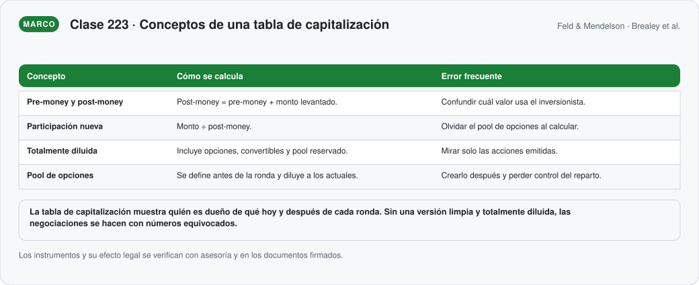

# Clase 223 — Cap table y dilución

<!-- nav:inicio -->
> **Parte 18 · Finanzas corporativas, capital y M&A** — clase 7 de 12 · [índice de la parte](../../README.md) · [temario](../../../../SYLLABUS.md)
<!-- nav:fin -->

**Parte:** 18 — Finanzas corporativas, capital y M&A  
**Nivel:** Etapa 5 — CEO → Capital allocator  
**Duración sugerida:** 150–180 minutos · **Estándar:** deep-class-v2

## 🎯 Propósito

La tabla de capitalización (*cap table*) es el documento que dice quién es dueño de qué en una empresa. Parece una planilla simple: nombres, acciones, porcentajes. Pero es el cimiento de todas las negociaciones de capital: cuánto vale cada acción, cuánto se diluye a los fundadores, cuánto recibe cada uno en una venta, qué poder tiene cada socio. Y es una fuente frecuente de errores caros: opciones que nadie contó, convertibles que se transforman en más acciones de lo esperado, un *pool* de opciones que se agrega después de acordar el precio, socios que creen tener un porcentaje que no tienen. Los inversionistas lo detectan en la revisión y lo castigan con descuentos, demoras o la pérdida de la operación. Los fundadores lo descubren, a veces, cuando se vende la empresa.

La clase enseña a construir, leer y simular una tabla de capitalización: limpiarla, convertirla a una base totalmente diluida, modelar una nueva emisión y su *pool*, calcular la participación posterior a la inversión y simular rondas y salidas. Se apoya en Feld y Mendelson sobre las ofertas de capital de riesgo, en Brealey, Myers y Allen sobre emisión de capital, en Wasserman sobre los dilemas de propiedad de los fundadores, en Jensen y Meckling sobre los conflictos entre dueños y en Koller y colaboradores sobre valor. Al terminar sabrás distinguir valoración previa y posterior, calcular participaciones, entender el efecto del *pool* de opciones y planificar las rondas con una visión de largo plazo.

## 📚 Resultados de aprendizaje

Al finalizar podrás:

1. **Limpiar** una tabla de capitalización y detectar errores comunes.
2. **Convertir** la tabla a una base totalmente diluida.
3. **Calcular** participaciones y precio por acción en una nueva emisión.
4. **Explicar** el efecto del *pool* de opciones sobre la valoración efectiva.
5. **Simular** rondas sucesivas y su efecto en los fundadores.

## 🧭 Agenda

| Tramo | Qué se hace |
|---|---|
| 0–20 min | Recuperación: ¿qué porcentaje de tu empresa tienes hoy y qué porcentaje tendrías si se ejercieran todas las opciones y convertibles? |
| 20–60 min | Tabla limpia, base diluida, precio por acción, *pool*, rondas y control. |
| 60–105 min | Ejemplo trabajado: una ronda de 6.000 millones con *pool* ampliado. |
| 105–150 min | Caso ejecutivo y práctica. |
| 150–175 min | Límites y entregable. |

## 🧩 Conceptos centrales

| Concepto | Definición | Cómo se reconoce |
|---|---|---|
| **Tabla de capitalización** | Registro de los propietarios y sus participaciones. | Acciones, opciones, convertibles, porcentajes. |
| **Valoración previa (*pre-money*)** | Valor de la empresa antes de recibir el nuevo capital. | Se negocia con el inversionista. |
| **Valoración posterior (*post-money*)** | Valoración previa más el capital recibido. | Define el porcentaje del inversionista. |
| **Base totalmente diluida** | Cuenta todas las acciones posibles: emitidas, opciones, convertibles y *pool*. | Se usa para calcular el precio por acción. |
| **Pool de opciones** | Acciones reservadas para empleados futuros. | Se define antes de la ronda. |
| **Dilución** | Reducción del porcentaje de un propietario por nuevas acciones. | Se mide en puntos o en proporción. |

## 🧠 Modelo mental

**Cómo leer el diagrama.** Una tabla con cuatro conceptos. **Pre-money y post-money**: la valoración posterior es la previa más el monto levantado; el error frecuente es confundir cuál valor usa el inversionista. **Participación nueva**: monto dividido por la valoración posterior; error frecuente, olvidar el *pool* de opciones al calcular. **Totalmente diluida**: incluye opciones, convertibles y *pool* reservado; error frecuente, mirar solo las acciones emitidas. **Pool de opciones**: se define antes de la ronda y diluye a los actuales; error frecuente, crearlo después y perder el control del reparto. La nota afirma que sin una versión limpia y totalmente diluida las negociaciones se hacen con números equivocados.

## 📖 Desarrollo

### 1. Qué muestra una tabla de capitalización

Una tabla de capitalización lista a **cada titular** (fundadores, socios, inversionistas, empleados con opciones, asesores), el **tipo de instrumento** (acciones ordinarias, preferentes, opciones, *warrants*, instrumentos convertibles o similares), la **cantidad**, el **precio de emisión** o de ejercicio, las **fechas** y las **condiciones** (por ejemplo, de consolidación de derechos, o *vesting*). Su porcentaje se calcula sobre el total de acciones de una **base elegida**. Feld y Mendelson subrayan que una tabla limpia y actualizada es una condición para que un inversionista avance: la existencia de acuerdos informales, promesas de acciones o errores de registro es una señal de desorden que suele traducirse en menor valoración o retraso. La validez de los títulos y los derechos de cada titular se verifican con los documentos societarios y con asesoría legal.

### 2. Limpiar: los errores más comunes

Antes de negociar se **limpia** la tabla: se concilia con los registros societarios (libro de acciones, actas, pactos); se verifican las **emisiones** efectivamente aprobadas y pagadas; se documentan **promesas informales** de acciones u opciones a empleados, asesores y socios; se revisan **convertibles**, notas y acuerdos de inversión simples (con sus tasas de descuento y topes de valoración); se confirman **calendarios de consolidación** (*vesting*) y condiciones de salida; y se identifican **derechos especiales** (preferencias, vetos, antidilución). Las contingencias más caras: «el socio que ayudó al inicio» sin documento, opciones prometidas pero nunca formalizadas, y acciones emitidas sin el procedimiento societario correcto. Se regularizan con asesoría antes de la ronda.

### 3. Base totalmente diluida

El porcentaje que importa en una negociación es el calculado sobre la **base totalmente diluida**: todas las acciones emitidas, más las que surgirían del ejercicio de **todas las opciones** otorgadas, de la conversión de **instrumentos convertibles** y del **pool** reservado para el futuro. Si un fundador tiene 5.000.000 de acciones de un total emitido de 9.000.000, parece tener 55,6 %; pero si hay 700.000 opciones otorgadas y 300.000 reservadas, la base diluida es 10.000.000 y su participación es 50 %. Brealey, Myers y Allen recuerdan que lo que se valora es el derecho sobre el flujo de la empresa; la dilución potencial es una reducción de ese derecho. Por eso el **precio por acción** de una nueva emisión se calcula dividiendo la valoración previa por las acciones totalmente diluidas **antes** de la emisión (incluido el *pool* acordado).

### 4. Valoración previa y posterior

La **valoración previa** (*pre-money*) es el valor acordado de la empresa antes de recibir el dinero; la **posterior** (*post-money*) es la previa más la inversión. La participación del inversionista es la inversión dividida por la valoración posterior: invertir 6.000 sobre una valoración previa de 24.000 implica una valoración posterior de 30.000 y una participación de 20 %. Un error frecuente es calcularla sobre la previa (6.000 ÷ 24.000 = 25 %). El **precio por acción** surge de dividir la valoración previa por la base totalmente diluida previa (incluido el *pool* ampliado). Se confirma siempre cuál criterio usa la oferta, porque una valoración previa «de titular» puede ocultar ajustes que reducen el valor efectivo para los actuales propietarios.

### 5. El pool de opciones

El **pool de opciones** reserva acciones para atraer y retener a futuros empleados. Los inversionistas suelen exigir que, después de la ronda, exista un *pool* disponible de cierto tamaño (por ejemplo, 10 % de la base diluida posterior) para cubrir las contrataciones hasta la siguiente ronda. Lo relevante es **quién lo paga**: si el *pool* se incorpora en la valoración previa, la dilución recae solo en los propietarios actuales, y la **valoración efectiva** para ellos es menor que la del titular (el llamado efecto *option pool shuffle*). Se negocia el tamaño según el **plan de contrataciones** real (cuántas personas, a qué nivel, con qué porcentaje), no por un porcentaje estándar. Y se define cuánto del *pool* ya está otorgado para no contar dos veces.

### 6. Rondas sucesivas y el camino de los fundadores

Cada ronda diluye a los propietarios existentes. Se simula un **camino de capital**: las rondas probables (semilla, A, B), sus montos, valoraciones y *pools*, para estimar la participación de los fundadores en una salida futura. Una participación que parece sana hoy (50 %) puede ser de 20 % tras tres rondas; la cuestión es si el **valor** de esa participación es mayor. Wasserman ilustra que los fundadores enfrentan decisiones que equilibran **riqueza** y **control** (ceder una mayor porción por una valoración más alta, o aceptar menos capital para mantener el control) y que las decisiones tempranas sobre socios y propiedad son difíciles de revertir. La dilución en sí no es mala; es el precio del capital y debe compararse con el valor que ese capital permite crear.

### 7. Control, derechos y conflictos

La propiedad no es solo porcentaje: es también **derechos**. Los distintos tipos de acciones o los pactos pueden dar a algunos titulares derechos de voto superiores, vetos, representación en el directorio, preferencias de liquidación (clase 224) o protección antidilución. Jensen y Meckling señalan que las relaciones entre propietarios con intereses distintos generan **costos de agencia**: un fundador con control y un inversionista con preferencia pueden preferir decisiones diferentes. Se documentan los acuerdos entre socios (pacto de accionistas) con reglas claras sobre **decisiones reservadas**, **salida**, **transferencia de acciones**, **derechos de arrastre y de acompañamiento**, y **resolución de disputas**. Las implicancias legales y tributarias de cada instrumento se verifican con asesoría en la jurisdicción correspondiente.

## 📚 Lectura comparada

| Obra | Qué aporta | Qué no resuelve | Pregunta para contrastar |
|---|---|---|---|
| Feld y Mendelson | Tabla de capitalización, pool y mecánica de las rondas. | Práctica de EE. UU.; adaptar a cada país. | ¿Quién paga el pool? |
| Brealey, Myers y Allen | Emisión de capital y derechos sobre los flujos. | No detalla la mecánica de startups. | ¿Qué parte del flujo cede cada emisión? |
| Wasserman | Dilemas de propiedad y control de los fundadores. | Evidencia de ciertos mercados. | ¿Qué decisión de propiedad es difícil de revertir? |
| Jensen y Meckling | Conflictos entre propietarios con intereses distintos. | Teoría estilizada. | ¿Qué conflicto crea este instrumento? |
| Koller y otros | Valor de la participación frente a porcentaje. | No cubre cap tables. | ¿Vale más una porción menor de algo mayor? |

## 🧮 Ejemplo trabajado

**Situación (hipotética).** Una empresa tiene esta tabla antes de una ronda de 6.000 millones de pesos con una valoración previa de 24.000 millones (titular).

| Titular | Acciones | % de la base diluida (10.000.000) |
|---|---|---|
| Fundador A | 5.000.000 | 50,0 % |
| Fundador B | 3.000.000 | 30,0 % |
| Inversionista ángel | 1.000.000 | 10,0 % |
| Opciones otorgadas a empleados | 700.000 | 7,0 % |
| *Pool* disponible | 300.000 | 3,0 % |
| **Total diluido** | **10.000.000** | **100 %** |

(Las acciones emitidas son 9.000.000; sobre esa base, el fundador A parecería tener 55,6 %.)

**Condiciones de la oferta.** Valoración posterior = 24.000 + 6.000 = 30.000 millones; el inversionista recibe 6.000 ÷ 30.000 = 20 %. El inversionista exige un *pool* disponible de 10 % de la base diluida posterior, incluido en la valoración previa.

**Cálculo.** Los titulares actuales con acciones y opciones otorgadas (A, B, ángel y opciones otorgadas) suman 9.700.000 y deben representar el 70 % de la base posterior (100 % − 20 % − 10 %). Base posterior: 9.700.000 ÷ 0,70 = 13.857.143. Acciones del inversionista: 0,20 × 13.857.143 = 2.771.429. *Pool* disponible: 0,10 × 13.857.143 = 1.385.714, es decir, 1.085.714 acciones nuevas sobre las 300.000 existentes.

**Precio por acción.** 6.000.000.000 ÷ 2.771.429 ≈ 2.165 pesos. Comprobación: 2.165 × 11.085.714 (base previa incluyendo el nuevo *pool*) ≈ 24.000 millones.

**Tabla posterior.**

| Titular | Acciones | % posterior |
|---|---|---|
| Fundador A | 5.000.000 | 36,1 % |
| Fundador B | 3.000.000 | 21,6 % |
| Inversionista ángel | 1.000.000 | 7,2 % |
| Opciones otorgadas | 700.000 | 5,1 % |
| *Pool* disponible | 1.385.714 | 10,0 % |
| Inversionista nuevo | 2.771.429 | 20,0 % |
| **Total** | **13.857.143** | **100 %** |

**Efecto del *pool*.** Valoración efectiva previa para los titulares actuales: 2.165 × 9.700.000 ≈ 21.000 millones, frente a los 24.000 del titular: 12,5 % menos (3.000 ÷ 24.000). El *pool* ampliado «cuesta» 3.000 millones a los propietarios actuales.

**Dilución del fundador A.** De 50,0 % a 36,1 %: una caída de 13,9 puntos (27,8 % en términos relativos). Su participación vale, a la valoración posterior de 30.000 millones: 0,361 × 30.000 = 10.825 millones, frente a 0,50 × 24.000 = 12.000 antes (el valor de su participación sobre la valoración previa titular). La diferencia refleja el *pool* y el efecto del precio; el valor sube si la empresa crece más que lo que se diluyó.

**Simulación de una serie B.** Una ronda posterior diluye 20 %: el fundador A baja a 36,1 % × 0,80 = 28,9 %. Si la valoración posterior a la serie B es de 90.000 millones (3 veces la de la serie A), su participación pasa a valer 0,289 × 90.000 ≈ 26.000 millones: más del doble de los 10.825 millones de hoy, pese a la dilución.

**Acciones de limpieza.** Se formalizan dos promesas de opciones a asesores y un acuerdo con un exsocio; se revisan los calendarios de consolidación de los fundadores; se actualiza el libro de acciones y se documenta el pacto de socios.

**Cuidados.** Los instrumentos, derechos y obligaciones tienen efectos legales y tributarios que se verifican con asesoría; los cálculos suponen un solo tipo de acciones y omiten preferencias; las cifras son ilustrativas.

**Qué muestra.** (1) La base diluida cambió el porcentaje aparente. (2) El *pool* redujo la valoración efectiva. (3) La simulación mostró que la dilución puede acompañarse de mayor valor.

## 🔀 Comparación y límites

**Cap table frente a pacto de accionistas.** La tabla muestra cuántos títulos hay; el pacto establece derechos y obligaciones entre socios. Ambos deben coincidir con los documentos societarios.

**Límites.** La mecánica varía según el tipo de sociedad, la jurisdicción y los instrumentos. Las simulaciones simplifican (un solo tipo de acciones, sin preferencias, sin impuestos). Las valoraciones de las rondas futuras son hipótesis. La existencia de derechos especiales puede cambiar el reparto en una salida. Las cifras del ejemplo son ilustrativas.

## 🪜 De profesional a owner

| Nivel | Cómo participa |
|---|---|
| **Profesional** | Pregunta cuántas opciones tiene y con qué condiciones. |
| **Jefe / Team Lead** | Entiende que las opciones son parte del paquete de su equipo. |
| **Gerente** | Mantiene registros precisos de lo prometido. |
| **CEO / Director** | Modela rondas, evalúa la dilución y negocia el pool. |
| **Founder / Owner** | Decide el equilibrio entre control, riqueza y capital. |

## 🏢 Caso ejecutivo

Una empresa de tecnología con 85 personas prepara una ronda de 12.000 millones de pesos con una valoración previa de titular de 48.000 millones. La tabla es la siguiente: dos fundadores con 4.000.000 y 3.500.000 acciones; un exsocio que se retiró y dice tener «un 5 %» por un acuerdo verbal (no hay documento); un inversionista ángel con 900.000 acciones; 60 empleados con opciones prometidas por 1.100.000 acciones (de las cuales solo 600.000 están formalizadas); un convertible de 1.500 millones con un descuento de 20 % y un tope de valoración de 30.000 millones; y un *pool* sin asignar de 150.000 acciones. El inversionista que lidera la ronda pide un *pool* disponible de 12 % de la base diluida posterior incluido en la valoración previa y tiene preferencia de liquidación. El CEO cree que su porcentaje es 47 %; la CFO, que es 38 %. Un empleado clave exige más opciones o se irá a la competencia.

Entrega un **análisis de capitalización y dilución** que contenga: (a) la limpieza de la tabla con cada contingencia y su tratamiento; (b) la base totalmente diluida antes de la ronda; (c) el cálculo de la conversión del convertible con descuento y tope; (d) el precio por acción, la tabla posterior y la valoración efectiva con el *pool*; (e) la simulación de una serie B y de una salida; (f) las verificaciones societarias, legales y tributarias pendientes.

## 🧪 Práctica

1. Construye una tabla de capitalización con cinco titulares y calcula los porcentajes sobre la base emitida y sobre la diluida.
2. Calcula la participación del inversionista y el precio por acción de una ronda con valoración previa y posterior.
3. Determina cuánto cuesta a los actuales propietarios un *pool* ampliado incluido en la valoración previa.
4. Simula una segunda ronda y calcula el valor de la participación de un fundador antes y después.
5. Redacta una lista de diez verificaciones para limpiar una tabla de capitalización.

## ⚠️ Errores frecuentes

| Error | Por qué ocurre | Cómo corregirlo |
|---|---|---|
| Calcular sobre acciones emitidas | Es la cifra visible | Usar la base totalmente diluida. |
| Confundir previa y posterior | Se usa una por otra | Participación = monto ÷ valoración posterior. |
| Ignorar el *pool* | Se piensa en él después | Negociarlo y modelarlo desde la oferta. |
| Promesas informales | Se confía en la relación | Formalizar con documentos societarios. |
| No modelar rondas futuras | Se mira solo la actual | Simular el camino de capital. |
| Mirar solo el porcentaje | Apego a la propiedad | Calcular el valor de la participación. |

## ❓ Preguntas de comprobación

1. ¿Qué muestra una tabla de capitalización?
2. ¿Qué es la base totalmente diluida y por qué importa?
3. ¿Cómo se calcula la participación de un inversionista?
4. ¿Qué efecto tiene un *pool* incluido en la valoración previa?
5. ¿Qué errores comunes se corrigen al limpiar una tabla?
6. ¿Por qué simular rondas futuras?
7. ¿Por qué la propiedad no es solo porcentaje?

Claves de respuesta

1. Quién es dueño de qué: titulares, instrumentos, cantidades, precios, condiciones y porcentajes.
2. Incluye acciones emitidas, opciones, convertibles y *pool*; es la base sobre la que se negocia y se calcula el precio por acción.
3. Monto invertido dividido por la valoración posterior.
4. Reduce la valoración efectiva para los actuales propietarios, porque la dilución del *pool* recae solo en ellos.
5. Promesas informales, opciones no formalizadas, convertibles no considerados, emisiones sin procedimiento correcto y derechos especiales no documentados.
6. Para ver la participación y el valor de los fundadores en una salida y decidir el equilibrio entre riqueza y control.
7. Porque los derechos (voto, veto, preferencias, antidilución) también determinan el poder y el reparto.

## 📥 Entregable

Guarda en `portfolio/223-cap-table-y-dilucion/`:

- `leadership-decision-brief.md` (plantilla [Leadership Decision Brief](../../../../templates/leadership-decision-brief.md)) con el análisis del caso ejecutivo;
- `modelo-financiero-y-memo-de-decision.md` (plantilla [Modelo financiero y memo de decisión](../../../../templates/modelo-financiero-y-memo-de-decision.md)) con las tablas anterior y posterior y la simulación de rondas;
- `decision-journal.md` con las contingencias, las decisiones de limpieza y las verificaciones legales pendientes.

## 📗 Fuentes y verificación

- Brad Feld & Jason Mendelson — *Venture Deals* (Wiley, 2011). **Uso en esta clase:** tabla de capitalización, pool y mecánica de las rondas. Lectura selectiva sobre **cap table y dilución**. **Localizador:** [ISBN-13 9781118443613](https://openlibrary.org/isbn/9781118443613).
- Richard Brealey, Stewart Myers & Franklin Allen — *Principles of Corporate Finance* (McGraw-Hill International Book Co, 1984). **Uso en esta clase:** emisión de capital y derechos sobre los flujos. Lectura selectiva sobre **cap table y dilución**. **Localizador:** [ISBN-13 9780070662025](https://openlibrary.org/isbn/9780070662025).
- Noam Wasserman — *The Founder's Dilemmas* (Princeton University Press, 2012). **Uso en esta clase:** dilemas de propiedad y control de los fundadores. Lectura selectiva sobre **cap table y dilución**. **Localizador:** [ISBN-13 9780691149134](https://openlibrary.org/isbn/9780691149134).
- Michael C. Jensen & William H. Meckling — *Theory of the firm: Managerial behavior, agency costs and ownership structure* (Journal of Financial Economics, 1976). **Uso en esta clase:** conflictos entre propietarios con intereses distintos. Lectura selectiva sobre **cap table y dilución**. **Localizador:** [DOI 10.1016/0304-405X(76)90026-X](https://doi.org/10.1016/0304-405X(76)90026-X).
- Tim Koller, Marc Goedhart & David Wessels — *Valuation: Measuring and Managing the Value of Companies* (Wiley, 2005). **Uso en esta clase:** valor de la participación frente al porcentaje. Lectura selectiva sobre **cap table y dilución**. **Localizador:** [ISBN-13 9780471702191](https://openlibrary.org/isbn/9780471702191).

> **Regla de fuentes para Cap table y dilución:** las obras anteriores estructuran las perspectivas de esta materia; cualquier norma, ley o estándar vivo mencionado debe comprobarse nuevamente en su fuente primaria vigente, incluidos los efectos societarios, legales y tributarios de acciones, opciones y convertibles. Los ejemplos y casos son hipotéticos, con cifras ilustrativas. El desarrollo es original y no reproduce capítulos protegidos.

<!-- pie:inicio -->
---

| Anterior | Índice | Siguiente |
|---|---|---|
| [← 222 · Fundraising y narrativa financiera](../222-fundraising-y-narrativa-financiera/README.md) | [Parte 18](../../README.md) · [Programa](../../../../SYLLABUS.md) | [224 · Term sheets: economía y control →](../224-term-sheets-economia-y-control/README.md) |
<!-- pie:fin -->
