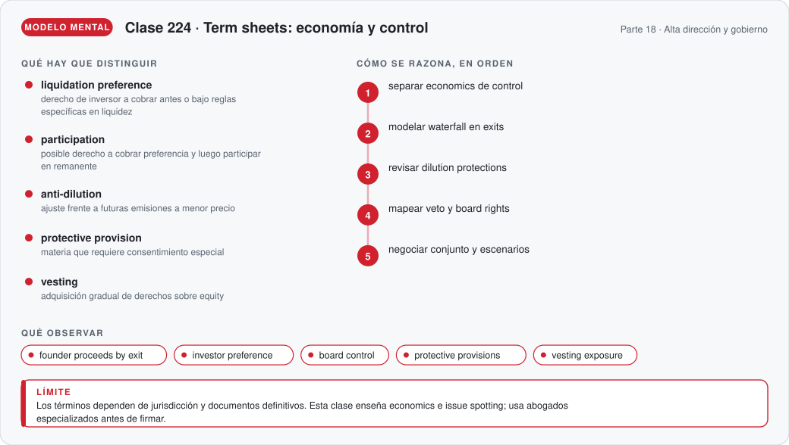

# Clase 224 — Term sheets: economía y control

<!-- nav:inicio -->
> **Parte 18 · Finanzas corporativas, capital y M&A** — clase 8 de 12 · [índice de la parte](../../README.md) · [temario](../../../../SYLLABUS.md)
<!-- nav:fin -->

**Parte:** 18 — Finanzas corporativas, capital y M&A  
**Nivel:** Etapa 5 — CEO → Capital allocator  
**Duración sugerida:** 150–180 minutos · **Estándar:** deep-class-v2

## 🎯 Propósito

Un *term sheet* (hoja de términos) es un documento de una a cinco páginas que resume las condiciones principales de una inversión antes de redactar los contratos definitivos. Aunque en general no es vinculante en lo económico, **marca el terreno de toda la negociación posterior**: lo que no se discute aquí difícilmente se corrige después. Muchos fundadores se concentran en un único número, la valoración, y firman sin entender el resto: una preferencia de liquidación del doble de lo invertido, un derecho de veto sobre casi todas las decisiones, una protección contra la dilución que los castiga si la empresa debe levantar capital más barato. Una valoración alta con términos duros puede ser peor que una más baja con términos limpios; solo se sabe simulando qué recibe cada parte en distintas salidas y qué poder tiene cada una en las decisiones.

La clase separa los términos en tres bloques: **economía** (cuánto y cómo se reparte el valor), **control** (quién decide) y **protección** (qué ocurre si el escenario cambia). Se apoya en Feld y Mendelson, cuyo libro describe en detalle los términos de las ofertas de capital de riesgo, en Wasserman sobre los dilemas de control de los fundadores, en Jensen y Meckling sobre conflictos de agencia, en Brealey, Myers y Allen sobre valor y financiamiento y en Myers y Majluf sobre información. Al terminar sabrás leer un *term sheet*, modelar el reparto en una salida (el *waterfall*), revisar protecciones contra la dilución y derechos de veto, y negociar el conjunto con escenarios.

## 📚 Resultados de aprendizaje

Al finalizar podrás:

1. **Separar** los términos económicos de los de control y de protección.
2. **Modelar** el reparto de una salida con preferencias de liquidación.
3. **Revisar** las cláusulas antidilución y calcular su efecto en una ronda a la baja.
4. **Mapear** los derechos de veto y de representación en el directorio.
5. **Negociar** el conjunto simulando escenarios de salida.

## 🧭 Agenda

| Tramo | Qué se hace |
|---|---|
| 0–20 min | Recuperación: ¿qué cláusula de una oferta de capital firmarías sin leer y cuál te preocuparía en un escenario malo? |
| 20–60 min | Economía, preferencias, antidilución, control, salida y negociación. |
| 60–105 min | Ejemplo trabajado: *waterfall* de cuatro salidas y una ronda a la baja. |
| 105–150 min | Caso ejecutivo y práctica. |
| 150–175 min | Límites y entregable. |

## 🧩 Conceptos centrales

| Concepto | Definición | Cómo se reconoce |
|---|---|---|
| **Term sheet** | Resumen de las condiciones principales de una inversión. | Valoración, preferencias, derechos. |
| **Preferencia de liquidación** | Derecho del inversionista a cobrar primero en una salida. | Múltiplo de lo invertido (1x, 2x). |
| **Participación** | Derecho de cobrar la preferencia y además compartir el resto. | «Participating». |
| **Antidilución** | Protección que ajusta el precio de conversión si hay rondas a la baja. | Promedio ponderado o *full ratchet*. |
| **Derecho de veto** | Capacidad de bloquear ciertas decisiones. | Lista de materias protegidas. |
| **Arrastre y acompañamiento** | Reglas para vender el 100 % o para acompañar una venta. | *Drag-along*, *tag-along*. |

## 🧠 Modelo mental

**Cómo leer el diagrama.** Tres columnas. **Economía**: valoración y monto, preferencia de liquidación y participación en las salidas. **Control**: directores y derechos de veto, información y decisiones reservadas, condiciones de salida y arrastre. **Protección**: antidilución en rondas posteriores, derechos de preferencia, y opciones y consolidación de derechos (*vesting*) de los fundadores. La nota afirma que una valoración alta con términos duros puede ser peor que una más baja con términos limpios, y que se simula el reparto en varias salidas; el pie, que los términos y su interpretación son contractuales y se revisan con asesoría.

## 📖 Desarrollo

### 1. Qué es y qué no es un term sheet

Feld y Mendelson explican que un *term sheet* resume los **términos económicos y de control** de una inversión: monto, valoración, tipo de acciones, preferencias, derechos de voto y de información, composición del directorio, protecciones, condiciones previas, exclusividad de negociación y plazos. Suele ser **no vinculante** en lo esencial (salvo cláusulas como confidencialidad y exclusividad), pero en la práctica **ancla la negociación**: pedir cambios mayores después de firmarlo se percibe como mala fe y suele costar tiempo y confianza. Por eso conviene negociarlo con asesoría legal y con simulaciones, y entender cada cláusula antes de firmar. Lo que aquí se resume es una guía de lectura, no una interpretación jurídica; los contratos definitivos y su efecto legal dependen de la ley aplicable.

### 2. Economía: valoración y preferencias

La **valoración** determina el porcentaje del inversionista (inversión ÷ valoración posterior; clase 223). Pero la **preferencia de liquidación** determina quién cobra qué cuando hay una salida (venta, liquidación). Con una preferencia **1x no participativa**, el inversionista elige: recuperar su inversión o convertirse en acciones ordinarias y recibir su porcentaje, lo que le convenga más. Con **participación**, cobra su preferencia **y además** comparte el remanente con los demás en proporción, de modo que obtiene más que su porcentaje, sobre todo en salidas bajas o medianas. Hay también preferencias de **2x o más**, y **límites** a la participación (*caps*). Feld y Mendelson recomiendan negociar primero estas condiciones antes de ceder valoración: dos ofertas con la misma valoración titular pueden diferir en millones para los fundadores según la preferencia.

### 3. El waterfall: simular el reparto

El **waterfall** (cascada de pagos) calcula, para cada valor de salida, cuánto recibe cada clase de titulares, aplicando el orden de prelación: primero las deudas, luego las preferencias de los inversionistas y finalmente el remanente entre ordinarios. Se simula con **varias salidas** (por ejemplo, por debajo, en y por encima de la valoración posterior) para ver cómo cambia el reparto. Las salidas bajas muestran el efecto de las preferencias: el inversionista puede recibir una parte desproporcionada del valor; las altas muestran que, con buenos resultados, las preferencias importan poco porque todos se convierten. Este análisis sirve para decidir **qué términos importan en cada escenario** y a qué precio se puede ceder.

### 4. Antidilución: qué pasa si el precio baja

Las cláusulas **antidilución** protegen al inversionista cuando la empresa emite acciones a un precio **menor** al que él pagó (una ronda «a la baja»). La más usual es la de **promedio ponderado**, que ajusta su precio de conversión según cuántas acciones se emiten y a qué precio, de forma moderada; la más severa es la de **ajuste total** (*full ratchet*), que lleva su precio al nuevo precio más bajo, sin ponderar. La antidilución transfiere el costo de una ronda a la baja a los demás propietarios, y especialmente a los fundadores, y puede desatar una espiral. Se negocia que sea de promedio ponderado amplio, con excepciones razonables (opciones para empleados, conversiones previstas), y se calcula su efecto en distintos escenarios antes de aceptarla.

### 5. Control: directorio, vetos e información

Wasserman muestra que el control de la empresa es uno de los grandes dilemas de los fundadores, y que se pierde de a poco: por la **composición del directorio** (cuántos directores designan los fundadores, los inversionistas, los independientes), por **derechos de veto** (*protective provisions*) sobre decisiones como emitir nuevas acciones, vender la empresa, endeudarse, cambiar el negocio, modificar el *pool* de opciones o aprobar presupuestos, y por **derechos de información**. Se mapea quién puede **bloquear** qué decisión y con qué mayoría. Un conjunto de vetos extenso puede hacer que un inversionista minoritario controle de hecho la empresa. Jensen y Meckling recuerdan que cada derecho es una forma de controlar los conflictos de agencia, pero también un costo en flexibilidad; se busca un equilibrio proporcionado a la inversión y al riesgo.

### 6. Salida, arrastre y otros términos

Se definen reglas para la **salida**: los derechos de **arrastre** (*drag-along*) permiten a una mayoría obligar a los demás a vender en una operación aprobada; los de **acompañamiento** (*tag-along*) permiten a los minoritarios vender en las mismas condiciones que los mayoritarios; los **derechos de preferencia** en nuevas emisiones permiten a los inversionistas mantener su porcentaje; las **restricciones a la transferencia** limitan la venta de acciones a terceros; y las cláusulas de **consolidación de derechos** (*vesting*) de los fundadores vinculan su propiedad a la permanencia (típicamente, varios años con una consolidación inicial). También hay cláusulas de **exclusividad** (la empresa no negocia con otros durante un tiempo), **condiciones previas** (diligencia debida, aprobaciones) y **gastos**. Cada término tiene un efecto económico o de control que se evalúa.

### 7. Negociar el conjunto

La negociación debe mirar el **paquete**: valoración, preferencia, participación, antidilución, directorio, vetos, vesting, *pool*. Se establece una lista de **prioridades** (qué es imprescindible, qué es deseable, qué se puede conceder) y se preparan alternativas: otras ofertas, otras fuentes (deuda), o posponer la ronda. Brealey, Myers y Allen recuerdan que el costo del capital propio se paga en parte con **derechos futuros**: la valoración es solo uno de ellos. Myers y Majluf señalan que la asimetría de información favorece a los gerentes, lo que explica por qué los inversionistas piden protecciones; reducir esa asimetría con transparencia mejora los términos. Se aprende a decir que no a cláusulas que, simuladas, hacen inviable el negocio en escenarios plausibles, y se verifican siempre los documentos definitivos con asesoría legal especializada.

## 📚 Lectura comparada

| Obra | Qué aporta | Qué no resuelve | Pregunta para contrastar |
|---|---|---|---|
| Feld y Mendelson | Términos típicos del capital de riesgo y su efecto. | Práctica de EE. UU.; hay que adaptar a cada país. | ¿Qué cláusula cambia más el reparto? |
| Wasserman | Dilemas de control y riqueza de los fundadores. | Evidencia de ciertos mercados. | ¿Quién controla de hecho la empresa? |
| Jensen y Meckling | Conflictos de agencia y mecanismos de control. | Teoría estilizada. | ¿Qué conflicto resuelve este derecho? |
| Brealey, Myers y Allen | Valor y costo del capital propio. | No cubre el detalle contractual. | ¿Cuál es el costo total del capital? |
| Myers y Majluf | Información asimétrica y protecciones. | Modelo teórico. | ¿Qué desconfianza justifica esta cláusula? |

## 🧮 Ejemplo trabajado

**Situación (hipotética).** Un inversionista aporta 6.000 millones de pesos por el 20 % (valoración posterior de 30.000 millones). Los demás propietarios tienen el 80 %. Se compara el reparto en cuatro salidas con tres tipos de preferencia (en millones de pesos).

**Preferencia 1x no participativa** (el inversionista recibe lo mayor entre 6.000 y 20 % de la salida):

| Salida | Inversionista | Demás propietarios |
|---|---|---|
| 15.000 | 6.000 (40 %) | 9.000 |
| 30.000 | 6.000 (20 %) | 24.000 |
| 60.000 | 12.000 (20 %) | 48.000 |
| 120.000 | 24.000 (20 %) | 96.000 |

**Preferencia 1x participativa sin límite** (recibe 6.000 más el 20 % del resto):

| Salida | Cálculo | Inversionista | % de la salida | Demás propietarios |
|---|---|---|---|---|
| 15.000 | 6.000 + 0,2 × 9.000 | 7.800 | 52,0 % | 7.200 |
| 30.000 | 6.000 + 0,2 × 24.000 | 10.800 | 36,0 % | 19.200 |
| 60.000 | 6.000 + 0,2 × 54.000 | 16.800 | 28,0 % | 43.200 |
| 120.000 | 6.000 + 0,2 × 114.000 | 28.800 | 24,0 % | 91.200 |

**Preferencia 2x no participativa** (el mayor entre 12.000 y 20 % de la salida):

| Salida | Inversionista | Demás propietarios |
|---|---|---|
| 15.000 | 12.000 | 3.000 |
| 30.000 | 12.000 | 18.000 |
| 60.000 | 12.000 (indiferente) | 48.000 |
| 120.000 | 24.000 | 96.000 |

**Lectura.** En una salida de 30.000 (igual a la valoración posterior), con participación el inversionista recibe el 36 % con una propiedad de 20 %; con 2x, el 40 % del valor de salida de 30.000 (12.000), y los demás solo 18.000 en vez de 24.000. En una salida de 15.000, con 2x los demás propietarios reciben solo 3.000 de 15.000. En una salida alta (120.000) los tres esquemas casi se igualan. La valoración es la misma en los tres casos; el valor económico para los fundadores es muy distinto.

**Antidilución: ronda a la baja.** Dos años después, la empresa necesita 3.000 millones y solo consigue invertir a 1.200 pesos por acción (el precio de la serie A fue de 2.165). Acciones antes de la emisión: 13.857.143. Nuevas acciones: 3.000.000.000 ÷ 1.200 = 2.500.000.

- **Promedio ponderado amplio:** nuevo precio de conversión = 2.165 × (13.857.143 + 3.000.000.000 ÷ 2.165) ÷ (13.857.143 + 2.500.000) = 2.165 × (13.857.143 + 1.385.713) ÷ 16.357.143 ≈ 2.017. Acciones al convertir: 6.000.000.000 ÷ 2.017 ≈ 2.974.000, unas 202.600 más que las 2.771.429 originales (+7,3 %).
- **Ajuste total (*full ratchet*):** el precio de conversión baja a 1.200: 6.000.000.000 ÷ 1.200 = 5.000.000 de acciones, unas 2.228.600 más (+80,4 %). El costo para fundadores y demás titulares es mucho mayor.

**Control.** El directorio propuesto tiene cinco miembros: dos fundadores, un inversionista, un independiente nombrado de común acuerdo y el CEO. Los vetos del inversionista cubren: emitir acciones preferentes, vender la empresa, modificar el *pool*, endeudarse más de 3.000 millones y cambiar el giro. Con cinco vetos, el inversionista de 20 % bloquea decisiones clave; se negocia limitar los vetos a tres (emitir acciones preferentes con mejores derechos, vender la empresa y modificar los derechos de sus acciones) con un umbral de monto para el endeudamiento.

**Resultado de la negociación (hipotético).** Valoración previa de 24.000 sin cambios, preferencia 1x no participativa, antidilución de promedio ponderado amplio, tres vetos, consolidación de derechos de los fundadores en cuatro años con 25 % consolidado al inicio, y exclusividad de 45 días.

**Cuidados.** Los términos, su interpretación y su efecto legal y tributario se verifican con asesoría especializada en la jurisdicción correspondiente; el ejemplo omite impuestos, deudas y otros titulares; las cifras son ilustrativas.

**Qué muestra.** (1) La misma valoración puede producir repartos muy distintos. (2) La antidilución puede encarecer mucho una ronda a la baja. (3) El mapa de vetos revela quién controla de hecho.

## 🔀 Comparación y límites

**Term sheet frente a contrato definitivo.** El primero fija los términos esenciales y marca el rumbo; el segundo los desarrolla con precisión y es vinculante. Conviene revisar con la misma atención ambos.

**Límites.** Las prácticas de mercado cambian con el ciclo y la jurisdicción. Los modelos de reparto simplifican (un solo inversionista, sin deudas, sin otros preferentes). La interpretación de las cláusulas es legal y específica. Un buen paquete de términos no garantiza una buena relación con el inversionista. Las cifras del ejemplo son ilustrativas.

## 🪜 De profesional a owner

| Nivel | Cómo participa |
|---|---|
| **Profesional** | Entiende que sus opciones dependen de los términos de las rondas. |
| **Jefe / Team Lead** | Sabe que las decisiones reservadas afectan los tiempos de su equipo. |
| **Gerente** | Prepara los datos para simular las salidas. |
| **CEO / Director** | Negocia el paquete completo y protege la flexibilidad de la empresa. |
| **Founder / Owner** | Decide cuánto control y cuánto valor está dispuesto a ceder. |

## 🏢 Caso ejecutivo

Una empresa de tecnología financiera con 90 personas y un ARR de 8.000 millones de pesos recibe dos *term sheets*. El fondo A ofrece 12.000 millones con una valoración previa de 60.000 millones (post-money de 72.000; 16,7 %), preferencia 2x participativa con un tope de 3x, antidilución de ajuste total, derecho a tres de siete directores, vetos sobre presupuesto, contratación de ejecutivos, endeudamiento y cualquier pago a los fundadores, y consolidación de derechos de los fundadores en seis años. El fondo B ofrece 12.000 millones con una valoración previa de 48.000 millones (post-money de 60.000; 20 %), preferencia 1x no participativa, antidilución de promedio ponderado, un director de siete y vetos limitados a venta de la empresa y emisión de nuevas acciones preferentes, y consolidación en cuatro años. Los fundadores tienen 58 % de la empresa; los empleados, 12 % en opciones. La plataforma podría necesitar otra ronda en 18 meses, y el mercado de capital es incierto. El CEO prefiere la oferta A «por la valoración»; la CFO, la B; un empleado clave pide protegerse de una dilución excesiva.

Entrega un **análisis de term sheets** que contenga: (a) la separación de términos en economía, control y protección para cada oferta; (b) el *waterfall* de cada oferta en al menos cuatro salidas (por ejemplo, 20.000; 72.000; 150.000 y 300.000 millones); (c) el efecto de la antidilución en una ronda a la baja del 30 %; (d) el mapa de vetos y de control del directorio; (e) la estrategia de negociación con prioridades y alternativas; (f) las verificaciones legales y tributarias con asesoría especializada.

## 🧪 Práctica

1. Calcula el reparto de una salida de tu empresa con una preferencia 1x no participativa y una participativa.
2. Simula una ronda a la baja y calcula la nueva conversión con promedio ponderado y con ajuste total.
3. Lista los derechos de veto de una oferta y marca los que bloquearían decisiones operativas.
4. Compara dos ofertas con distinta valoración y distintos términos en tres salidas.
5. Redacta una lista de prioridades de negociación con tres «imprescindibles» y tres «concesiones».

## ⚠️ Errores frecuentes

| Error | Por qué ocurre | Cómo corregirlo |
|---|---|---|
| Mirar solo la valoración | Es la cifra más visible | Simular el reparto en salidas. |
| Aceptar ajuste total | Se subestima una ronda a la baja | Promedio ponderado y simulación. |
| Vetos amplios | Se desea cerrar rápido | Limitar a decisiones esenciales. |
| No leer el consolidado | Se piensa en lo económico | Revisar vesting y condiciones de salida. |
| Negociar sin alternativas | Falta de otras ofertas | Preparar alternativas y calendario. |
| Firmar sin asesoría | Se busca ahorrar | Revisión legal especializada. |

## ❓ Preguntas de comprobación

1. ¿Qué es un *term sheet* y por qué marca la negociación?
2. ¿Qué diferencia hay entre preferencia participativa y no participativa?
3. ¿Qué es un *waterfall* y para qué sirve?
4. ¿Qué es la antidilución y qué tipos se mencionan?
5. ¿Cómo se pierde el control de la empresa en una ronda?
6. ¿Qué son arrastre y acompañamiento?
7. ¿Por qué no basta mirar la valoración?

Claves de respuesta

1. Un resumen de condiciones principales de una inversión; ancla la negociación posterior aunque no sea vinculante en lo esencial.
2. En la no participativa el inversionista elige entre su preferencia o convertirse; en la participativa cobra la preferencia y además comparte el resto.
3. El cálculo del reparto de una salida según el orden de prelación; sirve para ver el efecto real de cada cláusula en distintos escenarios.
4. Una protección que ajusta el precio de conversión si hay una ronda a un precio menor; promedio ponderado (moderada) y ajuste total (severa).
5. Por la composición del directorio, los vetos sobre decisiones clave y los derechos de información.
6. El arrastre permite a una mayoría obligar a los demás a vender; el acompañamiento permite a los minoritarios vender en las mismas condiciones.
7. Porque preferencias, antidilución y control pueden cambiar mucho el reparto y el poder aunque la valoración sea alta.

## 📥 Entregable

Guarda en `portfolio/224-term-sheets-economia-y-control/`:

- `risk-governance-brief.md` (plantilla [Risk Governance Brief](../../../../templates/risk-governance-brief.md)) con el análisis de las ofertas del caso ejecutivo;
- `modelo-financiero-y-memo-de-decision.md` (plantilla [Modelo financiero y memo de decisión](../../../../templates/modelo-financiero-y-memo-de-decision.md)) con los *waterfalls* y la simulación de antidilución;
- `decision-journal.md` con la lista de prioridades, el mapa de vetos y las verificaciones legales pendientes.

## 📗 Fuentes y verificación

- Brad Feld & Jason Mendelson — *Venture Deals* (Wiley, 2011). **Uso en esta clase:** términos típicos del capital de riesgo y su efecto. Lectura selectiva sobre **term sheets: economía y control**. **Localizador:** [ISBN-13 9781118443613](https://openlibrary.org/isbn/9781118443613).
- Noam Wasserman — *The Founder's Dilemmas* (Princeton University Press, 2012). **Uso en esta clase:** dilemas de control y riqueza de los fundadores. Lectura selectiva sobre **term sheets: economía y control**. **Localizador:** [ISBN-13 9780691149134](https://openlibrary.org/isbn/9780691149134).
- Michael C. Jensen & William H. Meckling — *Theory of the firm: Managerial behavior, agency costs and ownership structure* (Journal of Financial Economics, 1976). **Uso en esta clase:** conflictos de agencia y mecanismos de control. Lectura selectiva sobre **term sheets: economía y control**. **Localizador:** [DOI 10.1016/0304-405X(76)90026-X](https://doi.org/10.1016/0304-405X(76)90026-X).
- Richard Brealey, Stewart Myers & Franklin Allen — *Principles of Corporate Finance* (McGraw-Hill International Book Co, 1984). **Uso en esta clase:** valor y costo del capital propio. Lectura selectiva sobre **term sheets: economía y control**. **Localizador:** [ISBN-13 9780070662025](https://openlibrary.org/isbn/9780070662025).
- Stewart C. Myers & Nicholas S. Majluf — *Corporate financing and investment decisions when firms have information that investors do not have* (Journal of Financial Economics, 1984). **Uso en esta clase:** información asimétrica y protecciones. Lectura selectiva sobre **term sheets: economía y control**. **Localizador:** [DOI 10.1016/0304-405X(84)90023-0](https://doi.org/10.1016/0304-405X(84)90023-0).

> **Regla de fuentes para Term sheets: economía y control:** las obras anteriores estructuran las perspectivas de esta materia; cualquier norma, ley o estándar vivo mencionado debe comprobarse nuevamente en su fuente primaria vigente, incluida la interpretación jurídica de cada cláusula, que corresponde a asesoría legal especializada. Los ejemplos y casos son hipotéticos, con cifras ilustrativas. El desarrollo es original y no reproduce capítulos protegidos.

<!-- pie:inicio -->
---

| Anterior | Índice | Siguiente |
|---|---|---|
| [← 223 · Cap table y dilución](../223-cap-table-y-dilucion/README.md) | [Parte 18](../../README.md) · [Programa](../../../../SYLLABUS.md) | [225 · M&A: lógica estratégica →](../225-m-a-logica-estrategica/README.md) |
<!-- pie:fin -->
