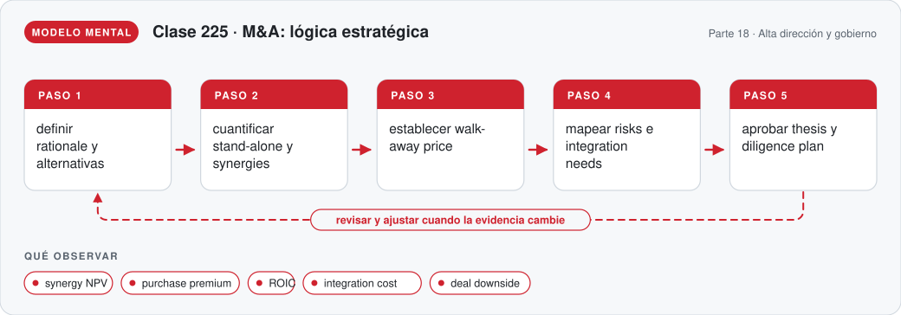

# Clase 225 — M&A: lógica estratégica

<!-- nav:inicio -->
> **Parte 18 · Finanzas corporativas, capital y M&A** — clase 9 de 12 · [índice de la parte](../../README.md) · [temario](../../../../SYLLABUS.md)
<!-- nav:fin -->

**Parte:** 18 — Finanzas corporativas, capital y M&A  
**Nivel:** Etapa 5 — CEO → Capital allocator  
**Duración sugerida:** 150–180 minutos · **Estándar:** deep-class-v2

## 🎯 Propósito

Comprar otra empresa es la decisión más grande, más visible y más irreversible que suele tomar un CEO. Es también una de las que más se equivocan: la evidencia académica sugiere que, en promedio, los compradores pagan en exceso y que una proporción considerable de las adquisiciones no crea el valor prometido. Las razones se repiten: un precio que cede al vendedor casi todas las sinergias, una tesis estratégica poco clara («porque está barata», «porque el competidor la quiere»), el entusiasmo del equipo que dirige la operación, la presión del banco de inversión o del directorio por «hacer algo», y una integración subestimada. Aun así, hay adquisiciones extraordinarias que construyen ventajas que nadie podría haber logrado orgánicamente. La diferencia no está en el instinto del CEO, sino en la disciplina: una tesis explícita, un valor independiente, un precio máximo fijado antes de negociar y la voluntad de retirarse.

La clase trata la lógica estratégica y financiera de una adquisición: definir la razón de ser y las alternativas, cuantificar el valor independiente y las sinergias, fijar un precio máximo (*walk-away price*), mapear riesgos y necesidades de integración y decidir qué se aprueba y qué se debe verificar. Se apoya en DePamphilis, en la hipótesis de la soberbia de Roll, en el estudio de Andrade, Mitchell y Stafford sobre fusiones y en el de Moeller, Schlingemann y Stulz sobre el tamaño de los compradores, además de Koller y colaboradores sobre valoración. Al terminar sabrás evaluar una operación con método y decir que no cuando corresponde.

## 📚 Resultados de aprendizaje

Al finalizar podrás:

1. **Formular** la tesis estratégica de una adquisición y sus alternativas.
2. **Cuantificar** el valor independiente y las sinergias con probabilidades y costos.
3. **Fijar** un precio máximo de pago antes de negociar.
4. **Mapear** los riesgos y las necesidades de integración.
5. **Aprobar** la tesis con condiciones y retirarse cuando el precio lo supera.

## 🧭 Agenda

| Tramo | Qué se hace |
|---|---|
| 0–20 min | Recuperación: ¿qué adquisición conoces que no cumplió lo prometido y qué dijo la tesis original? |
| 20–60 min | Evidencia, tesis, alternativas, valor independiente, sinergias, precio máximo y riesgos. |
| 60–105 min | Ejemplo trabajado: valor independiente, sinergias y precio máximo de una compra. |
| 105–150 min | Caso ejecutivo y práctica. |
| 150–175 min | Límites y entregable. |

## 🧩 Conceptos centrales

| Concepto | Definición | Cómo se reconoce |
|---|---|---|
| **Tesis estratégica** | Razón por la que la combinación vale más que las partes por separado. | Se puede explicar en pocas líneas y verificar con datos. |
| **Valor independiente (*stand-alone*)** | Valor del objetivo sin considerar la compra. | Flujos y múltiplos del negocio actual. |
| **Sinergia** | Valor adicional por combinar los negocios. | De costos, de ingresos o financiera. |
| **Prima de control** | Sobreprecio que se paga por tomar el control. | Diferencia entre el precio y el valor independiente. |
| **Precio máximo (*walk-away price*)** | Precio por encima del cual no se compra. | Fijado antes de negociar. |
| **Soberbia (*hubris*)** | Exceso de confianza del comprador en su valoración. | Se paga más de lo justificado. |

## 🧠 Modelo mental

**Cómo leer el diagrama.** Un cuadrante con el ajuste estratégico en el eje horizontal y el precio frente al valor en el vertical. **Con ajuste estratégico y precio bajo el valor**: candidata a comprar, avanzar con rigor. **Con ajuste pero precio sobre el valor**: esperar o renegociar, con precio máximo claro o pago contingente. **Sin ajuste pero precio bajo el valor**: oportunista, solo con un plan de reventa o de mejora. **Sin ajuste y caro**: descartar. La nota recuerda que la evidencia sugiere que muchos compradores pagan de más y que el exceso de confianza influye; el pie, que las adquisiciones tienen aspectos regulatorios y de competencia.

## 📖 Desarrollo

### 1. Lo que sabemos sobre el resultado de las adquisiciones

Andrade, Mitchell y Stafford revisaron las fusiones de las últimas décadas y encontraron que, en promedio, el valor combinado de comprador y objetivo **aumenta ligeramente**, pero que la ganancia se concentra en los **accionistas del objetivo**, que reciben la prima; el comprador, en promedio, obtiene un retorno cercano a cero o negativo. Moeller, Schlingemann y Stulz mostraron que las adquisiciones de **grandes compradores** destruyeron valor de forma notable en cierto período, con pérdidas elevadas en unas pocas operaciones. Roll formuló la **hipótesis de la soberbia**: los gerentes que valoran un objetivo tienden a sobreestimar su valor y a pagar de más, porque el comprador más optimista es el que gana la subasta (la «maldición del ganador»). Estos estudios no dicen que no se deba comprar, sino que **la disciplina es excepcional** y que el resultado promedio es decepcionante.

### 2. La tesis estratégica y las alternativas

Una buena tesis responde con claridad: **¿qué valor creamos que ninguna de las dos empresas puede crear por separado?** Las razones habituales: **escala** (reducir costos), **alcance** (nuevos productos, clientes o mercados), **capacidades** (tecnología, talento) y **consolidación** (reducir competencia, sujeto a normas de libre competencia). Se evalúan las **alternativas**: crecer de forma orgánica, aliarse, licenciar, invertir de manera minoritaria, comprar parcialmente o contratar un equipo. La tesis debe resistir la pregunta: «¿por qué comprar y no construir o aliarnos?». DePamphilis insiste en que el análisis estratégico precede al financiero: la valoración responde cuánto vale, no por qué conviene. Una tesis difusa («es una buena empresa», «nos dará posicionamiento») suele ocultar la ausencia de un plan.

### 3. Valor independiente y precio de mercado

Se valora el objetivo **por sí solo** (clases 220 y 221): flujos con sus supuestos, múltiplos de comparables y transacciones. Este es el **valor independiente**, que el vendedor ya tiene en su poder. Todo lo que se pague por encima es una **prima**, y debe justificarse con **valor creado por la combinación**. Se examina la **calidad del negocio** (concentración de clientes, recurrencia, márgenes, dependencia de personas clave), los activos **no operativos**, las deudas y los compromisos fuera de balance, y el **riesgo** de que el desempeño reciente sea irrepetible. Se estima además la **dispersión** del valor: un rango, no un punto.

### 4. Sinergias: contar solo las que se pueden lograr

Las **sinergias de costos** (consolidar funciones, compras, plantas, sistemas) son las más confiables; las de **ingresos** (venta cruzada, nuevos mercados) son más inciertas y deben aplicarse con **probabilidades**. Cada sinergia se descompone: qué se hará, quién lo hará, cuánto tiempo toma, qué cuesta lograrla (costos de integración, indemnizaciones, sistemas), qué riesgos hay (pérdida de clientes y de talento). El valor presente de las sinergias netas de costos de integración y de impuestos es el **máximo teórico** de prima que se puede pagar; pagar todo lo anterior al vendedor significa que **todo el valor creado se transfiere a él**. Una regla prudente: no pagar más de una fracción de las sinergias (por ejemplo, la mitad) y solo las más seguras.

### 5. Precio máximo y estructura

Antes de negociar se **fija el precio máximo**: el valor independiente más la parte de las sinergias que se está dispuesto a pagar, con un margen de seguridad. Es una decisión del comité y del directorio, **por escrito**, para evitar la tentación de subirlo en la negociación («ya llegamos hasta aquí»). Si el vendedor pide más, se renuncia o se propone una **estructura** que traslade riesgo: **pago contingente** (*earn-out*) ligado a resultados, **pago diferido**, **retención de parte de la propiedad por los vendedores**, **cláusulas de ajuste de precio**, o compra de **una parte** del negocio. Estas estructuras alinean intereses, pero también añaden complejidad y posibles disputas, y se revisan con asesoría legal y contable.

### 6. Riesgos y necesidades de integración

Antes de aprobar se mapean los **riesgos**: de **negocio** (clientes que se van, competidores que reaccionan), de **personas** (talento clave que se retira, choque cultural), **tecnológicos** (sistemas incompatibles, ciberseguridad), **legales y regulatorios** (libre competencia, licencias, contingencias), **financieros** (apalancamiento, covenants) y de **ejecución** (capacidad de la organización para absorber el cambio). Se estiman los **recursos** necesarios: un equipo de integración, un presupuesto, un calendario y un dueño (clase 227). Si la empresa no tiene capacidad de integrar sin afectar su negocio actual, el riesgo es elevado, aunque el precio parezca atractivo. La debida diligencia (clase 226) convierte estas preocupaciones en preguntas y en precio.

### 7. Aprobar con condiciones: la decisión del directorio

El directorio aprueba **la tesis y el marco** (precio máximo, estructura, condiciones), no solo el precio final. Se establecen **condiciones**: resultados mínimos de la debida diligencia, aprobaciones regulatorias, acuerdos de permanencia de personas clave, financiamiento comprometido y límites de apalancamiento. Se asigna un **responsable de la integración**. Y se fija de antemano qué hallazgos **reabrirían** la decisión o llevarían a **retirarse**. Se documenta el razonamiento para poder comparar después lo prometido con lo logrado (clase 198). Un buen directorio hace la pregunta incómoda: «¿qué tendría que ser verdad para que esto sea un error?». Los aspectos regulatorios y de competencia de la operación se verifican con asesoría especializada.

## 📚 Lectura comparada

| Obra | Qué aporta | Qué no resuelve | Pregunta para contrastar |
|---|---|---|---|
| DePamphilis | Marco completo de fusiones y adquisiciones. | No decide la tesis de cada empresa. | ¿Por qué comprar y no construir? |
| Roll | Soberbia del comprador y maldición del ganador. | Teoría; el efecto exacto es discutido. | ¿Estamos sobreestimando el valor? |
| Andrade, Mitchell y Stafford | Resultados promedio de fusiones: ganancia para el objetivo. | Estudio de un período y mercado. | ¿Quién captura el valor? |
| Moeller, Schlingemann y Stulz | Pérdidas de compradores grandes y el tamaño como factor. | Período específico. | ¿Estamos siendo demasiado grandes para la operación? |
| Koller y otros | Valoración independiente y sinergias en términos de valor. | No cubre la integración. | ¿Cuánto valor es del vendedor y cuánto nuestro? |

## 🧮 Ejemplo trabajado

**Situación (hipotética).** Una empresa evalúa comprar a un competidor con un EBITDA de 800 millones de pesos. El vendedor pide 6.800 millones (8,5 veces el EBITDA).

**Valor independiente.** Con un flujo descontado y comparables, el valor independiente es 5.500 millones (6,9 veces el EBITDA).

**Sinergias (impuestos de 27 %, tasa de descuento de 10 %).**

| Concepto | Cálculo | Valor presente (millones) |
|---|---|---|
| Sinergia de costos: 150 millones antes de impuestos por año | 150 × 0,73 = 109,5 por año ÷ 0,10 | 1.095 |
| Sinergia de ingresos: contribución de 100 antes de impuestos por año, con probabilidad de 50 % | 100 × 0,73 × 0,50 = 36,5 por año ÷ 0,10 | 365 |
| Costos de integración (600 antes de impuestos, una vez) | 600 × 0,73 | −438 |
| **Sinergias netas** | 1.095 + 365 − 438 | **1.022** |

**Valor máximo de la combinación para el comprador.** 5.500 + 1.022 = 6.522 millones. Pagar más de esa cifra destruye valor, sin considerar los riesgos de ejecución.

**Precio máximo (*walk-away*).** Valor independiente más la mitad de las sinergias netas: 5.500 + 0,5 × 1.022 = 6.011, que el comité fija en **6.000 millones** (7,5 veces el EBITDA), con una prima de 500 sobre el valor independiente (9,1 %; 500 ÷ 5.500).

**Evaluación del precio pedido (6.800).**

| Precio | Prima sobre independiente | Valor creado para el comprador (6.522 − precio) |
|---|---|---|
| 6.000 | 500 (9,1 %) | +522 |
| 6.500 | 1.000 (18,2 %) | +22 |
| 6.800 | 1.300 (23,6 %) | −278 |

Con 6.800 se paga más que el 100 % de las sinergias netas (1.300 > 1.022) y se destruye valor aunque todo salga bien.

**Sensibilidad.** Si las sinergias de costos se logran solo al 60 % y las de ingresos fallan: 0,6 × 1.095 = 657; menos costos de integración 438: sinergias netas de 219. El valor combinado es 5.719, y un precio de 6.000 ya sería negativo en 281. Por eso el comité exige evidencia de las sinergias de costos y estructura parte del precio como pago contingente.

**Estructura propuesta.** Hasta 6.000 millones en total: 4.500 al cierre más 1.500 contingentes a que la empresa objetivo retenga al menos 85 % de las ventas de su principal cliente durante 18 meses, con acuerdos de permanencia de tres ejecutivos clave.

**Prueba de apalancamiento.** Con deuda neta actual de 14.400, EBITDA de 12.000 y pago al cierre de 4.500 financiado con deuda: deuda neta de 18.900; EBITDA combinado de 12.800: 1,48 veces; con el pago contingente, 20.400 ÷ 12.800 = 1,59 veces. Dentro del apetito de 2,5 veces.

**Decisión.** Aprobar la tesis y un marco con precio máximo de 6.000 millones, condiciones de debida diligencia, integración con dueño y regla de retiro: si el vendedor insiste en 6.800 o los hallazgos reducen las sinergias netas bajo 500 millones, se retira la oferta.

**Cuidados.** Las sinergias y las probabilidades son estimaciones; los aspectos de libre competencia, regulatorios, laborales y tributarios de la operación se verifican con asesoría; las cifras son ilustrativas.

**Qué muestra.** (1) El precio máximo se fijó antes de negociar. (2) La prima se comparó con las sinergias netas. (3) La estructura trasladó parte del riesgo al vendedor.

## 🔀 Comparación y límites

**Adquirir frente a construir o aliarse.** Comprar da velocidad y capacidades ya hechas a un precio alto y con riesgo de integración; construir es lento pero barato en prima; aliarse es flexible pero con menos control.

**Límites.** La evidencia académica es promedio y no predice una operación concreta. Las sinergias son las estimaciones más inciertas. La competencia entre oferentes puede llevar a pagar más de lo racional. Los aspectos regulatorios y de competencia dependen de cada jurisdicción. Las cifras del ejemplo son ilustrativas.

## 🪜 De profesional a owner

| Nivel | Cómo participa en una adquisición |
|---|---|
| **Profesional** | Aporta datos para la debida diligencia y para las sinergias. |
| **Jefe / Team Lead** | Prepara la integración de su área. |
| **Gerente** | Estima sinergias con evidencia y se compromete con ellas. |
| **CEO / Director** | Fija el precio máximo, aprueba con condiciones y se retira cuando corresponde. |
| **Founder / Owner** | Decide si vender o comprar con una visión de largo plazo. |

## 🏢 Caso ejecutivo

Una empresa de distribución con ventas de 250.000 millones de pesos y EBITDA de 22.500 millones recibe del banco de inversión la oportunidad de comprar un competidor regional con ventas de 90.000 millones y EBITDA de 6.300 millones, en un proceso competitivo con otros dos interesados. El precio indicativo es de 62.000 millones (9,8 veces el EBITDA). El valor independiente por DCF es de 46.000 millones y por comparables, de 44.000 a 52.000 millones. El plan del equipo promete sinergias de costos de 2.800 millones al año antes de impuestos (consolidar bodegas y compras) y de ingresos de 3.500 millones (venta cruzada), con costos de integración de 4.500 millones. El competidor tiene un cliente que representa el 28 % de sus ventas y una rotación de gerentes de 21 %. El directorio quiere crecer «de forma inorgánica»; el CEO teme que el competidor sea adquirido por un rival; el banco dice que «hay que decidir en dos semanas».

Entrega un **memo de lógica estratégica de la adquisición** que contenga: (a) la tesis y las alternativas (orgánico, alianza, compra parcial); (b) el valor independiente con rango y las sinergias con probabilidades y costos; (c) el precio máximo y la estructura de pago; (d) el cuadro de riesgos con su efecto y su mitigación; (e) la prueba de apalancamiento y de sensibilidad; (f) la decisión recomendada, las condiciones y las verificaciones regulatorias, de competencia y legales pendientes.

## 🧪 Práctica

1. Escribe la tesis de una adquisición en cinco líneas y tres alternativas.
2. Valora un objetivo con un rango de valor independiente y define su prima máxima.
3. Calcula el valor presente neto de sinergias de costos y de ingresos con probabilidades.
4. Fija un precio máximo y evalúa tres precios posibles frente a las sinergias.
5. Diseña una estructura con pago contingente y define las condiciones del retiro.

## ⚠️ Errores frecuentes

| Error | Por qué ocurre | Cómo corregirlo |
|---|---|---|
| Tesis difusa | Entusiasmo por la oportunidad | Una frase y datos que la prueben. |
| Pagar las sinergias al vendedor | Competencia entre oferentes | Precio máximo con fracción de sinergias. |
| Contar sinergias de ingresos como ciertas | Optimismo | Probabilidades y costos de logro. |
| Fijar el precio durante la negociación | Presión y compromiso previo | Precio máximo por escrito antes. |
| Subestimar la integración | Se piensa en la firma, no en el después | Plan, dueño y presupuesto. |
| No retirarse | Costos hundidos y orgullo | Regla de retiro acordada con el directorio. |

## ❓ Preguntas de comprobación

1. ¿Qué dice la evidencia promedio sobre el resultado de las adquisiciones?
2. ¿Qué es la hipótesis de la soberbia?
3. ¿Qué responde una buena tesis estratégica?
4. ¿Cómo se estiman las sinergias y qué se resta?
5. ¿Qué es el precio máximo y cuándo se fija?
6. ¿Qué estructuras trasladan riesgo al vendedor?
7. ¿Qué condiciones suele aprobar el directorio?

Claves de respuesta

1. El valor combinado sube ligeramente, pero la ganancia se concentra en los accionistas del objetivo; el comprador promedio obtiene poco o pierde, con grandes pérdidas en algunas operaciones de grandes compradores.
2. Que los compradores tienden a sobreestimar el valor del objetivo y a pagar de más; gana quien es más optimista.
3. Qué valor se crea que ninguna empresa puede crear por separado y por qué conviene comprar frente a construir o aliarse.
4. Por tipo, con probabilidades y plazos, restando costos de integración e impuestos; las de costos son más confiables que las de ingresos.
5. El precio por encima del cual no se compra; se fija por escrito antes de negociar.
6. Pago contingente (*earn-out*), pago diferido, retención parcial por los vendedores, cláusulas de ajuste de precio y compra parcial.
7. Resultados mínimos de la debida diligencia, aprobaciones regulatorias, permanencia de personas clave, financiamiento y límites de apalancamiento, con un responsable de integración y regla de retiro.

## 📥 Entregable

Guarda en `portfolio/225-m-a-logica-estrategica/`:

- `strategy-memo.md` (plantilla [Strategy memo](../../../../templates/strategy-memo.md)) con el memo del caso ejecutivo;
- `modelo-financiero-y-memo-de-decision.md` (plantilla [Modelo financiero y memo de decisión](../../../../templates/modelo-financiero-y-memo-de-decision.md)) con el valor independiente, las sinergias y el precio máximo;
- `decision-journal.md` con las condiciones, la regla de retiro y las verificaciones regulatorias y legales.

## 📗 Fuentes y verificación

- Donald DePamphilis — *Mergers, Acquisitions, and Other Restructuring Activities* (Elsevier Science & Technology Books, 2001). **Uso en esta clase:** marco de fusiones y adquisiciones. Lectura selectiva sobre **m&a: lógica estratégica**. **Localizador:** [ISBN-13 9780323910545](https://openlibrary.org/isbn/9780323910545).
- Richard Roll — *The Hubris Hypothesis of Corporate Takeovers* (The Journal of Business, 1986). **Uso en esta clase:** soberbia del comprador y maldición del ganador. Lectura selectiva sobre **m&a: lógica estratégica**. **Localizador:** [DOI 10.1086/296325](https://doi.org/10.1086/296325).
- Gregor Andrade, Mark Mitchell & Erik Stafford — *New Evidence and Perspectives on Mergers* (Journal of Economic Perspectives, 2001). **Uso en esta clase:** resultados promedio de las fusiones. Lectura selectiva sobre **m&a: lógica estratégica**. **Localizador:** [DOI 10.1257/jep.15.2.103](https://doi.org/10.1257/jep.15.2.103).
- Sara B. Moeller, Frederik P. Schlingemann & René M. Stulz — *Firm size and the gains from acquisitions* (Journal of Financial Economics, 2004). **Uso en esta clase:** tamaño del comprador y pérdidas en adquisiciones. Lectura selectiva sobre **m&a: lógica estratégica**. **Localizador:** [DOI 10.1016/j.jfineco.2003.07.002](https://doi.org/10.1016/j.jfineco.2003.07.002).
- Tim Koller, Marc Goedhart & David Wessels — *Valuation: Measuring and Managing the Value of Companies* (Wiley, 2005). **Uso en esta clase:** valoración independiente y sinergias. Lectura selectiva sobre **m&a: lógica estratégica**. **Localizador:** [ISBN-13 9780471702191](https://openlibrary.org/isbn/9780471702191).

> **Regla de fuentes para M&A: lógica estratégica:** las obras anteriores estructuran las perspectivas de esta materia; cualquier norma, ley o estándar vivo mencionado debe comprobarse nuevamente en su fuente primaria vigente, incluidos los aspectos de libre competencia, regulatorios, laborales y tributarios de una adquisición. Los ejemplos y casos son hipotéticos, con cifras ilustrativas. El desarrollo es original y no reproduce capítulos protegidos.

<!-- pie:inicio -->
---

| Anterior | Índice | Siguiente |
|---|---|---|
| [← 224 · Term sheets: economía y control](../224-term-sheets-economia-y-control/README.md) | [Parte 18](../../README.md) · [Programa](../../../../SYLLABUS.md) | [226 · Due diligence →](../226-due-diligence/README.md) |
<!-- pie:fin -->
