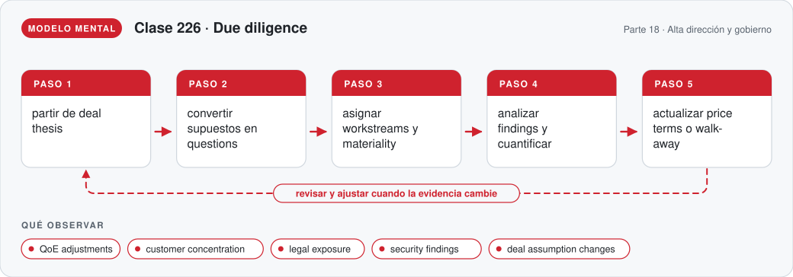

# Clase 226 — Due diligence

<!-- nav:inicio -->
> **Parte 18 · Finanzas corporativas, capital y M&A** — clase 10 de 12 · [índice de la parte](../../README.md) · [temario](../../../../SYLLABUS.md)
<!-- nav:fin -->

**Parte:** 18 — Finanzas corporativas, capital y M&A  
**Nivel:** Etapa 5 — CEO → Capital allocator  
**Duración sugerida:** 150–180 minutos · **Estándar:** deep-class-v2

## 🎯 Propósito

La debida diligencia (*due diligence*) es el momento en que una adquisición se encuentra con la realidad. Hasta entonces, el comprador ha visto una presentación del vendedor, algunos datos seleccionados y una conversación con el equipo directivo; todo orientado a mostrar lo mejor. Entre la oferta y el cierre, el comprador accede a la información de verdad: contratos, estados financieros detallados, cifras de clientes, litigios, sistemas, personas. Muchos equipos viven esta etapa como un trámite de verificación («confirmar que todo está en orden»), y por eso sus hallazgos llegan tarde, se minimizan o se interpretan en el sentido favorable a la operación. La debida diligencia bien hecha parte de la actitud contraria: **su trabajo es desafiar la tesis**, convertir cada supuesto en una pregunta, cuantificar cada hallazgo y, si hace falta, cambiar el precio, las condiciones o retirarse.

La clase presenta la debida diligencia como un proceso con método: partir de la tesis, formular preguntas, asignar frentes de trabajo con criterios de materialidad, analizar hallazgos con números y actualizar precio y condiciones. Se apoya en DePamphilis sobre fusiones y adquisiciones, en Koller y colaboradores sobre valoración, en el análisis de estados financieros de Penman y de Palepu, Healy y Peek (que fundamenta la «calidad de las utilidades») y en Gawande, cuya idea de las listas de verificación ayuda a no omitir lo evidente. Al terminar sabrás organizar una debida diligencia, distinguir la revisión financiera de la calidad de utilidades, cuantificar hallazgos y decidir qué hacer con ellos.

## 📚 Resultados de aprendizaje

Al finalizar podrás:

1. **Convertir** la tesis de la operación en preguntas verificables.
2. **Organizar** frentes de trabajo con criterios de materialidad.
3. **Analizar** la calidad de las utilidades y las deudas implícitas.
4. **Cuantificar** hallazgos y su efecto en valor, precio y condiciones.
5. **Decidir** entre ajustar el precio, pedir protecciones o retirarse.

## 🧭 Agenda

| Tramo | Qué se hace |
|---|---|
| 0–20 min | Recuperación: ¿qué sorpresa desagradable encontró alguien, después de comprar, que se pudo haber visto antes? |
| 20–60 min | Tesis, preguntas, frentes, calidad de utilidades, hallazgos y decisiones. |
| 60–105 min | Ejemplo trabajado: ajuste del EBITDA y del precio tras la diligencia financiera. |
| 105–150 min | Caso ejecutivo y práctica. |
| 150–175 min | Límites y entregable. |

## 🧩 Conceptos centrales

| Concepto | Definición | Cómo se reconoce |
|---|---|---|
| **Debida diligencia** | Revisión del objetivo antes del cierre para verificar la tesis y detectar riesgos. | Frentes comerciales, financieros, legales, operativos. |
| **Calidad de utilidades (*quality of earnings*)** | Análisis de cuánto del resultado reportado es recurrente y real. | Ajustes al EBITDA. |
| **Deuda implícita (*debt-like items*)** | Obligaciones que se comportan como deuda aunque no estén en el balance. | Pagos diferidos, provisiones, contingencias. |
| **Capital de trabajo normal** | Nivel de capital de trabajo necesario para operar. | Se fija como referencia de entrega. |
| **Materialidad** | Umbral a partir del cual un hallazgo importa. | Define qué se investiga. |
| **Declaraciones y garantías** | Afirmaciones del vendedor sobre el negocio, con consecuencias si son falsas. | Cláusulas del contrato de compra. |

## 🧠 Modelo mental

**Cómo leer el diagrama.** Tres columnas. **Comercial**: clientes, concentración y retención; mercado y competidores; calidad de las sinergias propuestas. **Financiera y fiscal**: calidad de las utilidades y de la caja; deuda y compromisos fuera de balance; contingencias tributarias. **Legal y operativa**: contratos, litigios y licencias; sistemas, datos y ciberseguridad; personas clave y cultura. La nota explica que la debida diligencia convierte los supuestos de la tesis en preguntas y las respuestas en precio, condiciones o una salida; el pie, que los hallazgos con efecto legal o regulatorio se escalan a asesoría especializada.

## 📖 Desarrollo

### 1. Qué busca realmente la debida diligencia

DePamphilis la describe como la etapa en que el comprador **verifica la información** que fundó su oferta, **identifica riesgos y pasivos** y **recopila lo necesario** para negociar los términos finales y planificar la integración. Pero su verdadero objetivo es doble: **proteger de pagar de más** (corregir el precio) y **proteger de comprar un problema** (condiciones, garantías o retiro). La actitud importa: se trata de **buscar evidencia en contra** de la tesis, no de confirmarla. Un equipo que solo recoge lo que apoya la compra ha confundido la diligencia con la justificación. Por eso se recomienda que el liderazgo de la diligencia sea independiente de quien más desea cerrar la operación, o al menos que exista una revisión independiente de sus conclusiones.

### 2. De la tesis a las preguntas

La tesis (clase 225) contiene supuestos: «los clientes se quedarán», «las sinergias de costos son de 150 millones», «el equipo clave seguirá», «los márgenes son sostenibles». Cada supuesto se convierte en **preguntas verificables** y en **evidencia requerida**: ¿cuál es la retención por cohorte de clientes a 36 meses?, ¿qué contratos tienen cláusulas de cambio de control?, ¿qué parte del margen depende de un proveedor único?, ¿qué compromisos tiene el vendedor con terceros? Gawande muestra, a partir de la medicina y la aviación, que las **listas de verificación** evitan omisiones en procesos complejos; una lista de preguntas estándar por frente, ajustada a la operación, reduce el riesgo de olvidar lo básico. Se complementa con preguntas libres a partir de lo que se descubre.

### 3. Frentes de trabajo y materialidad

Se organiza en **frentes** con responsables: **comercial** (mercado, clientes, competencia, sinergias de ingresos), **financiero y fiscal** (utilidades, caja, deudas, impuestos), **legal** (contratos, litigios, propiedad intelectual, licencias, cumplimiento), **operativo y tecnológico** (procesos, sistemas, ciberseguridad), **personas y cultura** (talento clave, compensaciones, pasivos laborales) y, si corresponde, **ambiental y regulatorio**. Cada frente tiene **preguntas prioritarias**, plazos y un **umbral de materialidad** (por ejemplo, hallazgos sobre 50 millones o sobre el 1 % del valor, o cualquier asunto de cumplimiento grave). Se fija un **calendario** que permita ajustar el precio antes de la firma y una **sala de datos** con acceso controlado. Los asesores externos (legales, contables, tributarios, técnicos) se contratan según los riesgos.

### 4. Calidad de las utilidades

El EBITDA reportado puede no reflejar la capacidad real de generar caja. La revisión de **calidad de las utilidades** (*quality of earnings*) ajusta el resultado por: **partidas únicas** (positivas y negativas); **costos capitalizados** que debieron ir a resultados; **reconocimiento anticipado de ingresos** (adelantar ventas de períodos futuros); **remuneraciones de propietarios por debajo o por encima del mercado**; **transacciones con partes relacionadas** a precios no de mercado; **cambios de políticas contables**; y **estacionalidad** y **efecto de pérdidas de clientes** ya ocurridas pero aún no reflejadas. Penman y Palepu, Healy y Peek explican que las cifras contables dependen de elecciones y estimaciones, y que el analista debe reconstruir un resultado **comparable y recurrente**. Se concilian utilidades con **flujo de caja**: una empresa que reporta utilidades pero no genera caja requiere explicación.

### 5. Deuda implícita y capital de trabajo

Además de la deuda financiera, el comprador identifica **obligaciones que actúan como deuda**: pagos diferidos a proveedores o a vendedores previos, impuestos adeudados o contingentes, provisiones por litigios o garantías, bonos y vacaciones devengados, arrendamientos financieros, deudas con partes relacionadas y compromisos de pensiones. Estas partidas **reducen el precio de patrimonio** (o se tratan como deuda en el ajuste). También se fija el **capital de trabajo normal** como referencia: si el vendedor entrega la empresa con menos capital de trabajo del necesario (por ejemplo, pagó proveedores tarde para mostrar caja), el precio se ajusta. Estos mecanismos se pactan en el contrato y se verifican con asesoría contable y legal.

### 6. Cuantificar los hallazgos

Un hallazgo sin cifra no sirve para negociar. Cada hallazgo relevante se **cuantifica**: ¿cuánto cambia el EBITDA recurrente, el flujo, el valor? Se estima su **probabilidad** (cierta, probable, posible) y su **efecto** (puntual o recurrente). Un ajuste recurrente de 100 millones al EBITDA, a un múltiplo de 7,5 veces, equivale a 750 millones de valor; una contingencia puntual de 200 millones con 40 % de probabilidad, a 80 en valor esperado. Se clasifican los hallazgos en: **ajustes de valor** (cambian el precio), **riesgos para proteger por contrato** (garantías, indemnizaciones, retenciones, seguros), **condiciones previas al cierre** (resolver antes), **planes de integración** (resolver después) y **motivos de retiro** (el negocio no es lo que se dijo).

### 7. Qué hacer con los hallazgos

La decisión se toma con un marco claro. Si los hallazgos **reducen el valor** pero la tesis sigue en pie, se **renegocia el precio** con base en cifras, y se rechazan los intentos de «compensar» con argumentos cualitativos. Si los riesgos **no son cuantificables** o dependen de eventos inciertos, se piden **protecciones contractuales**: declaraciones y garantías del vendedor, **indemnizaciones**, **retenciones del precio** en garantía (*escrow*), **ajustes posteriores** o **pagos contingentes** (clase 225); su redacción y alcance son materia de asesoría legal. Si los hallazgos **invalidan la tesis** (clientes que se irán, una contingencia que amenaza el negocio, información engañosa), se **retira** la oferta; recordar el precio máximo y la regla de retiro acordada con el directorio es esencial. Y los hallazgos se transfieren al equipo de integración (clase 227).

## 📚 Lectura comparada

| Obra | Qué aporta | Qué no resuelve | Pregunta para contrastar |
|---|---|---|---|
| DePamphilis | Etapas, alcance y objetivos de la debida diligencia. | Marco general. | ¿Qué verificamos y qué supusimos? |
| Koller y otros | Efecto de los hallazgos en el valor. | No cubre los frentes legales. | ¿Cuánto vale este hallazgo? |
| Penman | Calidad de utilidades y análisis de estados. | Enfoque contable. | ¿Qué es recurrente y qué no? |
| Palepu, Healy y Peek | Análisis del negocio y de las cifras reportadas. | Orientado a análisis externo. | ¿Qué elecciones contables influyen? |
| Gawande | Listas de verificación para evitar omisiones. | No define el contenido de cada lista. | ¿Qué hemos olvidado preguntar? |

## 🧮 Ejemplo trabajado

**Situación (hipotética).** Continuando el ejemplo de la clase 225: la empresa objetivo reporta un EBITDA de 800 millones de pesos y la oferta era de 6.000 millones (7,5 veces). La debida diligencia financiera encuentra lo siguiente.

**Ajustes de calidad de utilidades (EBITDA, millones).**

| Concepto | Efecto |
|---|---|
| EBITDA reportado | 800 |
| Gastos únicos de reestructuración (se suman) | +40 |
| Costos de desarrollo de software capitalizados que debieron ir a resultados | −120 |
| Ingresos reconocidos antes de la entrega (adelanto de ventas) | −60 |
| Remuneración del dueño muy por debajo de mercado (ajuste a costo de reemplazo) | −50 |
| **EBITDA ajustado recurrente** | **610** |

El EBITDA ajustado es 23,8 % menor que el reportado (190 ÷ 800).

**Efecto en el valor independiente.** A un múltiplo de 6,9 veces (el implícito del valor independiente de 5.500 ÷ 800): 6,9 × 610 = 4.209 millones, es decir, 1.291 menos que 5.500.

**Nuevo valor máximo.** Las sinergias netas de 1.022 se mantienen (aunque se revisarán). Valor combinado: 4.209 + 1.022 = 5.231. Precio máximo (valor independiente más la mitad de las sinergias): 4.209 + 511 = 4.720 millones de valor de empresa.

**Deuda implícita y capital de trabajo.**

| Partida | Millones |
|---|---|
| Pagos diferidos a proveedores y a un vendedor anterior (deuda implícita) | 350 |
| Contingencia tributaria probable | 100 |
| Capital de trabajo normal (1.200) frente al entregado (1.050): faltante | 150 |

**Ajuste del precio de patrimonio.** Con deuda financiera neta nula: precio máximo de valor de empresa 4.720 − 350 (deuda implícita) − 150 (capital de trabajo) = **4.220 millones**; la contingencia tributaria de 100 se cubre con una retención en garantía.

**Comparación con la oferta original.** 6.000 − 4.220 = 1.780 millones menos (−29,7 %). El vendedor argumentará que el EBITDA reportado fue auditado; el comprador responde con la conciliación y con las normas contables aplicadas.

**Otros hallazgos.** (1) Llamadas con los diez principales clientes: dos de los tres mayores dicen que evaluarán alternativas si el dueño sale; la probabilidad de pérdida de uno de ellos sube de 15 % a 35 %; el comprador condiciona el pago contingente a la retención. (2) Un contrato con cláusula de cambio de control con un proveedor clave: se exige la autorización previa como condición del cierre. (3) Una licencia de software con vencimiento a 8 meses: se negocia la renovación antes de la firma.

**Decisión.** Se presenta al vendedor una oferta revisada de 4.700 millones de valor de empresa con ajustes por deuda implícita y capital de trabajo, retención en garantía de 100 millones y pago contingente. Si el vendedor insiste en el precio original, se retira la oferta (regla de retiro: precio sobre 4.800 millones de valor de empresa).

**Cuidados.** Las declaraciones, garantías, retenciones e indemnizaciones se redactan con asesoría legal; la interpretación contable y tributaria de cada partida se verifica con asesores; las cifras son ilustrativas.

**Qué muestra.** (1) La calidad de utilidades cambió el valor de forma material. (2) La deuda implícita y el capital de trabajo ajustaron el precio. (3) La regla de retiro quedó definida con cifras.

## 🔀 Comparación y límites

**Debida diligencia frente a auditoría.** Una auditoría opina sobre estados financieros con un criterio de materialidad general; la debida diligencia busca riesgos y supuestos que afectan el precio y la tesis, con un alcance definido por el comprador.

**Límites.** La información proviene en gran parte del vendedor y puede ser incompleta. El tiempo y el costo de la diligencia son limitados; se prioriza por materialidad. Algunos riesgos no se pueden cuantificar. Los ajustes de calidad de utilidades implican juicio. Las garantías contractuales dependen de la solvencia del vendedor y de la ley aplicable. Las cifras del ejemplo son ilustrativas.

## 🪜 De profesional a owner

| Nivel | Cómo participa |
|---|---|
| **Profesional** | Prepara y revisa datos con rigor y señala inconsistencias. |
| **Jefe / Team Lead** | Responde preguntas de la diligencia con evidencia. |
| **Gerente** | Lidera un frente y cuantifica hallazgos. |
| **CEO / Director** | Exige independencia en la diligencia y respeta la regla de retiro. |
| **Founder / Owner** | Prepara su empresa para una diligencia sin sorpresas. |

## 🏢 Caso ejecutivo

Una empresa de servicios industriales con 1.800 personas negocia la compra de una empresa de ingeniería con ventas de 54.000 millones de pesos, EBITDA reportado de 6.800 millones y un precio acordado en carta de intención de 52.000 millones (7,6 veces). En la diligencia se descubre: costos de proyectos pendientes de reconocer por 1.100 millones; reconocimiento de ingresos al 100 % de avance en proyectos que están al 85 %; un contrato con un cliente (31 % de las ventas) que vence en 14 meses sin renovación; litigios laborales con una pérdida probable estimada en 900 millones y posible por 2.500; deudas con proveedores vencidas hace más de 120 días por 1.800 millones; un sistema de gestión sin soporte del proveedor; una investigación de un regulador sobre seguridad en obras; y el fundador, que dirige todas las relaciones comerciales, quiere salir a los seis meses. El equipo de la operación, que lleva ocho meses trabajando, propone «cerrar rápido para que no se enfríe». El comité de capital pide un informe independiente.

Entrega un **informe de debida diligencia** que contenga: (a) la conversión de la tesis en preguntas con evidencia requerida por frente; (b) el ajuste de calidad de utilidades con cada partida y el EBITDA recurrente; (c) la deuda implícita, el capital de trabajo y el efecto en el precio; (d) la clasificación de los hallazgos (ajuste de valor, protección contractual, condición previa, integración, motivo de retiro); (e) la recomendación sobre precio, estructura y retiro, con la regla de decisión; (f) las verificaciones legales, regulatorias y contables pendientes.

## 🧪 Práctica

1. Convierte cinco supuestos de una tesis de adquisición en preguntas con la evidencia que las respondería.
2. Redacta una lista de verificación de diez preguntas para el frente financiero.
3. Ajusta el EBITDA de una empresa con cuatro partidas y calcula el efecto en el valor.
4. Calcula el efecto de una deuda implícita y de un faltante de capital de trabajo en el precio.
5. Clasifica seis hallazgos según la acción que corresponde y justifica.

## ⚠️ Errores frecuentes

| Error | Por qué ocurre | Cómo corregirlo |
|---|---|---|
| Diligencia como confirmación | Deseo de cerrar | Buscar evidencia en contra y revisión independiente. |
| No cuantificar hallazgos | Se describen cualitativamente | Cifrar efecto y probabilidad. |
| Ignorar la caja y el capital de trabajo | Se mira solo el EBITDA | Conciliar con caja y fijar el nivel normal. |
| Dejar la deuda implícita | No está en el balance | Revisar compromisos y provisiones. |
| Ceder a la presión del calendario | «Se enfría la operación» | Calendario realista y regla de retiro. |
| Confiar solo en el vendedor | Información disponible | Verificar con terceros (clientes, proveedores). |

## ❓ Preguntas de comprobación

1. ¿Qué busca la debida diligencia además de confirmar?
2. ¿Cómo se pasa de la tesis a las preguntas?
3. ¿Qué es la calidad de utilidades y qué ajustes incluye?
4. ¿Qué son las deudas implícitas y el capital de trabajo normal?
5. ¿Cómo se cuantifica un hallazgo?
6. ¿Qué opciones hay frente a un hallazgo?
7. ¿Por qué conviene una revisión independiente?

Claves de respuesta

1. Desafiar la tesis, proteger de pagar de más y de comprar un problema, y reunir lo necesario para negociar e integrar.
2. Convirtiendo cada supuesto en preguntas verificables y definiendo la evidencia que las respondería, apoyándose en listas de verificación.
3. El análisis de cuánto del resultado es recurrente; ajusta partidas únicas, costos capitalizados, ingresos adelantados, remuneraciones fuera de mercado y partes relacionadas.
4. Obligaciones que se comportan como deuda aunque no estén en el balance, y el nivel de capital de trabajo necesario para operar, que se usa como referencia de entrega.
5. Estimando su efecto en EBITDA, flujo y valor, su probabilidad y si es puntual o recurrente.
6. Renegociar el precio, pedir protecciones contractuales o condiciones previas, planificar en la integración o retirarse.
7. Porque el equipo más interesado en cerrar puede minimizar hallazgos; la independencia protege la calidad del juicio.

## 📥 Entregable

Guarda en `portfolio/226-due-diligence/`:

- `leadership-decision-brief.md` (plantilla [Leadership Decision Brief](../../../../templates/leadership-decision-brief.md)) con el informe del caso ejecutivo;
- `risk-register.md` (plantilla [Risk register](../../../../templates/risk-register.md)) con los hallazgos clasificados y su tratamiento;
- `decision-journal.md` con las preguntas, los ajustes de valor y las verificaciones pendientes.

## 📗 Fuentes y verificación

- Donald DePamphilis — *Mergers, Acquisitions, and Other Restructuring Activities* (Elsevier Science & Technology Books, 2001). **Uso en esta clase:** etapas, alcance y objetivos de la debida diligencia. Lectura selectiva sobre **due diligence**. **Localizador:** [ISBN-13 9780323910545](https://openlibrary.org/isbn/9780323910545).
- Tim Koller, Marc Goedhart & David Wessels — *Valuation: Measuring and Managing the Value of Companies* (Wiley, 2005). **Uso en esta clase:** efecto de los hallazgos en el valor. Lectura selectiva sobre **due diligence**. **Localizador:** [ISBN-13 9780471702191](https://openlibrary.org/isbn/9780471702191).
- Stephen H. Penman — *Financial Statement Analysis and Security Valuation* (McGraw-Hill/Irwin, 2001). **Uso en esta clase:** calidad de utilidades y análisis de estados. Lectura selectiva sobre **due diligence**. **Localizador:** [ISBN-13 9780072903331](https://openlibrary.org/isbn/9780072903331).
- Krishna G. Palepu, Paul M. Healy & Erik Peek — *Business Analysis and Valuation* (South-Western College Pub, 1996). **Uso en esta clase:** análisis del negocio y de las cifras reportadas. Lectura selectiva sobre **due diligence**. **Localizador:** [ISBN-13 9780324375817](https://openlibrary.org/isbn/9780324375817).
- Atul Gawande — *The Checklist Manifesto* (Penguin Random House, 2014). **Uso en esta clase:** listas de verificación para evitar omisiones. Lectura selectiva sobre **due diligence**. **Localizador:** [ISBN-13 9780143423225](https://openlibrary.org/isbn/9780143423225).

> **Regla de fuentes para Due diligence:** las obras anteriores estructuran las perspectivas de esta materia; cualquier norma, ley o estándar vivo mencionado debe comprobarse nuevamente en su fuente primaria vigente, incluidos los aspectos contables, tributarios, laborales, regulatorios y contractuales de una operación. Los ejemplos y casos son hipotéticos, con cifras ilustrativas. El desarrollo es original y no reproduce capítulos protegidos.

<!-- pie:inicio -->
---

| Anterior | Índice | Siguiente |
|---|---|---|
| [← 225 · M&A: lógica estratégica](../225-m-a-logica-estrategica/README.md) | [Parte 18](../../README.md) · [Programa](../../../../SYLLABUS.md) | [227 · Integración post-adquisición →](../227-integracion-post-adquisicion/README.md) |
<!-- pie:fin -->
