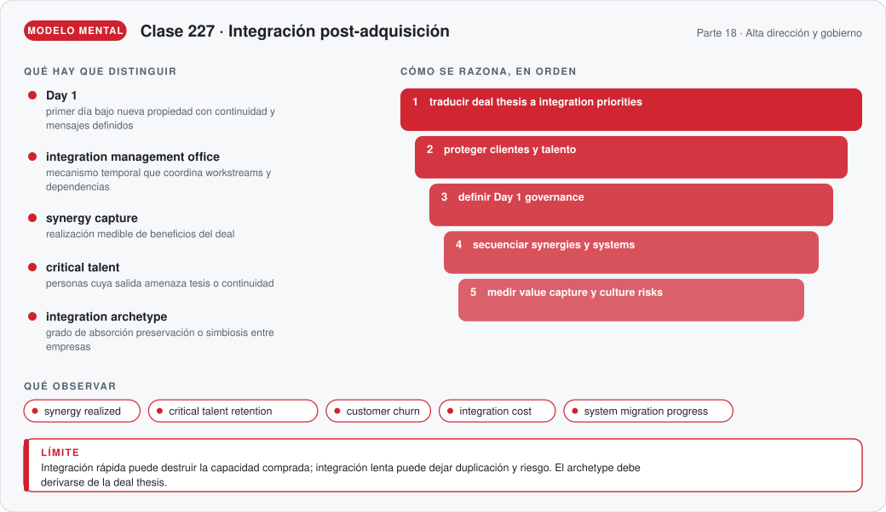

# Clase 227 — Integración post-adquisición

<!-- nav:inicio -->
> **Parte 18 · Finanzas corporativas, capital y M&A** — clase 11 de 12 · [índice de la parte](../../README.md) · [temario](../../../../SYLLABUS.md)
<!-- nav:fin -->

**Parte:** 18 — Finanzas corporativas, capital y M&A  
**Nivel:** Etapa 5 — CEO → Capital allocator  
**Duración sugerida:** 150–180 minutos · **Estándar:** deep-class-v2

## 🎯 Propósito

La firma de una adquisición marca el comienzo del trabajo, no el final. Todo lo prometido en la tesis (sinergias de costos, ventas cruzadas, nuevas capacidades) solo ocurre si dos organizaciones, con culturas, sistemas, incentivos y prioridades distintos, se integran de verdad. Y ahí se pierde con facilidad el valor: clientes que se inquietan y se van, personas clave que reciben una oferta de la competencia, decisiones que se paralizan por no saber quién manda, sistemas que no se integran, sinergias que se prometieron sin dueño ni calendario, y un equipo directivo agotado que además debe seguir operando el negocio. Estudios sobre fusiones sugieren que una proporción importante no logra el valor esperado, y que la causa suele estar más en la ejecución posterior que en el precio.

La clase presenta la integración como un proyecto de **gestión del cambio con dueño y medición**: traducir la tesis a prioridades, proteger a clientes y talento desde el primer día, definir el gobierno del día 1, secuenciar sinergias y sistemas de forma realista y medir la captura de valor. Se apoya en DePamphilis, en Andrade, Mitchell y Stafford y en Moeller, Schlingemann y Stulz sobre los resultados de las fusiones, en Kotter sobre la conducción de cambios y en Watkins sobre las transiciones de liderazgo. Al terminar sabrás diseñar el plan de integración, estimar el efecto de los retrasos en el valor de las sinergias y establecer indicadores y reglas de corrección.

## 📚 Resultados de aprendizaje

Al finalizar podrás:

1. **Traducir** la tesis de la adquisición en prioridades de integración con dueños.
2. **Proteger** a clientes y talento clave desde antes del cierre.
3. **Definir** el gobierno del día 1 y la oficina de integración.
4. **Secuenciar** sinergias y sistemas con un calendario realista.
5. **Medir** la captura de valor y corregir el rumbo.

## 🧭 Agenda

| Tramo | Qué se hace |
|---|---|
| 0–20 min | Recuperación: ¿qué integración vivida o conocida perdió clientes o talento en los primeros seis meses y por qué? |
| 20–60 min | Tesis, protección, gobierno, sinergias, sistemas, cultura y medición. |
| 60–105 min | Ejemplo trabajado: calendario de sinergias, costos y valor presente. |
| 105–150 min | Caso ejecutivo y práctica. |
| 150–175 min | Límites y entregable. |

## 🧩 Conceptos centrales

| Concepto | Definición | Cómo se reconoce |
|---|---|---|
| **Integración** | Proceso de combinar operaciones, sistemas y personas tras la compra. | Plan con hitos y responsables. |
| **Día 1** | Primer día de operación conjunta. | Comunicación, gobierno y continuidad. |
| **Oficina de integración (IMO)** | Equipo que coordina y mide la integración. | Dueño, calendario y tablero. |
| **Captura de sinergias** | Valor efectivamente logrado frente al prometido. | Seguimiento por iniciativa. |
| **Costo de lograr (*cost to achieve*)** | Gasto necesario para obtener las sinergias. | Indemnizaciones, sistemas, traslados. |
| **Retención de talento y clientes** | Permanencia de personas y clientes críticos. | Indicadores de rotación y ventas. |

## 🧠 Modelo mental

**Cómo leer el diagrama.** Una cadena de cinco pasos con retorno. **Tesis a prioridades**: qué valor se prometió y cómo se logra. **Clientes y talento**: proteger lo que se compró. **Gobierno del día 1**: quién decide qué desde el primer día. **Sinergias y sistemas**: secuencia realista y dueños. **Medir captura**: valor logrado frente a lo prometido. La flecha indica que lo medido ajusta el plan de integración. La nota afirma que gran parte del valor de una adquisición se pierde o se gana después de firmarla; el pie, que los cambios que afectan a personas se verifican con asesoría laboral y normas vigentes.

## 📖 Desarrollo

### 1. La integración empieza antes del cierre

DePamphilis insiste en que la planificación de la integración debe comenzar **durante la debida diligencia**, no después de la firma. Las razones: los hallazgos de la diligencia (clientes frágiles, personas clave, sistemas incompatibles) son insumos del plan; el período entre la firma y el cierre permite preparar el día 1; y el comprador puede estructurar el contrato para proteger lo esencial (acuerdos de permanencia, pagos contingentes). Un equipo de integración con un **dueño con autoridad** (muchas veces, un ejecutivo senior ajeno a quienes negociaron la compra) se forma desde la fase de diligencia, con representantes de las funciones clave de ambas empresas. Si no hay dueño, nadie responde por el valor prometido.

### 2. De la tesis a prioridades

La tesis contiene las **fuentes de valor** (sinergias de costos, de ingresos, capacidades). Cada una se traduce en **iniciativas** con dueño, meta, plazo, costo y riesgo. Se **priorizan** según valor, probabilidad y rapidez: primero las que aseguran el negocio (retener clientes y personas, mantener la operación), luego las que generan caja temprana (compras, costos duplicados), y después las estructurales (sistemas, plantas, reorganizaciones). Kotter sugiere que los cambios de gran escala necesitan **urgencia**, una **coalición** y **victorias tempranas** (clase 177); en una integración, las primeras victorias visibles (por ejemplo, el primer pedido conjunto, una compra consolidada con ahorro verificable) construyen confianza. Se evita comprometer demasiadas iniciativas simultáneas: la organización necesita seguir operando.

### 3. Proteger clientes y talento

El mayor riesgo del primer año es la **fuga** de lo que se compró. Los **clientes** perciben cambios (nuevos contactos, atrasos, cambios de condiciones) y evalúan alternativas; se les comunica pronto y con claridad, se asigna a cada cliente clave un responsable y se **monitorea** la retención. Los **competidores** aprovechan el período para captar clientes. Las **personas clave** (directivos, ingenieros, vendedores con relaciones, técnicos con conocimiento único) se identifican desde la diligencia, se les ofrece claridad sobre su rol y futuro, **incentivos de permanencia** proporcionados (diferidos, ligados a hitos) y reconocimiento. Watkins advierte que los períodos de transición son delicados: la claridad temprana de roles y expectativas reduce la ansiedad. Los acuerdos con personas se verifican con asesoría laboral y las normas vigentes.

### 4. Gobierno del día 1 y oficina de integración

El **día 1** define cómo se percibe la nueva organización. Se prepara: **comunicación** coherente para empleados, clientes, proveedores y autoridades; **estructura de mando** clara (quién decide qué, a quién se reporta); **continuidad operativa** (pagos, nómina, facturación, atención a clientes); y **cumplimiento** de obligaciones legales (por ejemplo, información a trabajadores y autoridades, aprobaciones regulatorias). La **oficina de integración** coordina las iniciativas, mantiene el calendario, resuelve conflictos entre funciones, mide el avance y reporta al comité y al directorio. Se define un **ritmo** (reunión semanal del equipo de integración, revisión mensual con el CEO) y **reglas de escalamiento**. Las decisiones sobre quién ocupa cada cargo se toman con **criterios transparentes** y con la mayor rapidez posible para reducir la incertidumbre.

### 5. Secuenciar sinergias y sistemas

Las sinergias de **costos** son las más rápidas pero cuestan: indemnizaciones, cierres, traslados, sistemas (el costo de lograrlas). Las de **ingresos** son más lentas y dependen de clientes y equipos comerciales. Los **sistemas** (ERP, CRM, datos) son la fuente más frecuente de retrasos: integrarlos exige tiempo, pruebas y riesgo operativo; muchas empresas operan en paralelo meses o años y migran por etapas. Se construye un **calendario realista** con las dependencias y se calcula el **valor presente** de la captura: una sinergia que se logra en tres años vale menos que una inmediata. Cada retraso tiene un costo estimable. Se evita prometer sinergias a un ritmo que la organización no puede soportar, porque el costo en servicio y en personas puede superar el ahorro.

### 6. Cultura y comunicación

Dos culturas distintas (formas de decidir, jerarquía, ritmo, estilo de comunicación, tolerancia al riesgo) se encuentran en la integración. Ignorar la cultura produce malentendidos y desgaste; imponerla produce resistencia. Se diagnostican las **diferencias** (clase 174) y se acuerdan **prácticas comunes** donde importa (seguridad, ética, atención al cliente, decisiones) y se **respeta** la diversidad donde no afecta el negocio. La comunicación es continua: **qué se sabe, qué no se sabe, qué se decidió y cuándo se sabrá más** (clase 200). Se escuchan las preocupaciones de las personas y se corrigen rumores con información. Kotter subraya la necesidad de anclar los cambios en la cultura mediante nuevas rutinas y reconocimientos.

### 7. Medir la captura de valor y corregir

La integración se mide con un **tablero**: **sinergias** (logradas frente a plan, por iniciativa, en run-rate anual y en caja), **costos de lograrlas** (real frente a presupuesto), **retención de clientes y de ventas**, **retención de talento clave**, **indicadores operativos** (calidad, plazos, incidentes), **clima** (encuestas pulso) y **riesgos**. Se comparan con la tesis: ¿cuánto del valor prometido se ha capturado?, ¿qué iniciativas van atrasadas?, ¿qué supuestos fallaron? Moeller, Schlingemann y Stulz y Andrade, Mitchell y Stafford sugieren que el valor se pierde cuando las expectativas no se cumplen; el seguimiento permite **corregir** a tiempo: reasignar recursos, ajustar plazos, detener iniciativas que no valen, y comunicar al directorio con honestidad. A los 12 y 24 meses se hace una **revisión posterior** que alimenta el aprendizaje para futuras operaciones.

## 📚 Lectura comparada

| Obra | Qué aporta | Qué no resuelve | Pregunta para contrastar |
|---|---|---|---|
| DePamphilis | Planificación y etapas de la integración. | Marco general. | ¿Quién es el dueño de la integración? |
| Andrade, Mitchell y Stafford | Resultados promedio de fusiones y dónde se pierde valor. | No detalla la ejecución. | ¿Qué parte del valor depende de ejecutar bien? |
| Moeller, Schlingemann y Stulz | Pérdidas en compradores grandes. | Período específico. | ¿Podemos absorber esta operación? |
| Kotter | Conducción de cambios: urgencia, coalición, victorias, anclaje. | No es específico de M&A. | ¿Qué victorias tempranas mostraremos? |
| Watkins | Transiciones de liderazgo y claridad de roles. | No cubre sistemas. | ¿Cuándo sabrán las personas su rol? |

## 🧮 Ejemplo trabajado

**Situación (hipotética).** Continuando la operación de las clases 225 y 226: la empresa compra al objetivo y espera sinergias de costos de 150 millones de pesos al año antes de impuestos y costos de integración de 600 millones. Impuestos de 27 %, tasa de descuento de 10 %.

**Calendario de captura previsto (run-rate antes de impuestos).**

| Año | Run-rate de sinergias | Costos de integración |
|---|---|---|
| 1 | 60 (40 %) | 400 |
| 2 | 120 (80 %) | 200 |
| 3 y siguientes | 150 (100 %) | 0 |

**Valor presente de las sinergias netas.**

- Año 1: 60 × 0,73 = 43,8 ÷ 1,10 = 39,8
- Año 2: 120 × 0,73 = 87,6 ÷ 1,21 = 72,4
- Año 3 en adelante (perpetuidad de 150 × 0,73 = 109,5): valor al final del año 2: 109,5 ÷ 0,10 = 1.095; valor presente: 1.095 ÷ 1,21 = 905,0
- **Total sinergias:** 39,8 + 72,4 + 905,0 = 1.017,2

- Costos de integración después de impuestos: año 1: 400 × 0,73 = 292 ÷ 1,10 = 265,5; año 2: 200 × 0,73 = 146 ÷ 1,21 = 120,7; total 386,2.
- **Sinergias netas:** 1.017,2 − 386,2 = **631**.

(En la clase 225 se había supuesto 1.022 con captura inmediata; la captura gradual y el descuento reducen el valor a 631, un 38 % menos.)

**Efecto de un retraso de un año.** Si la captura se desplaza un año: año 1: 0; año 2: 60; año 3: 120; año 4 en adelante: 150. Valor presente: año 2: 60 × 0,73 = 43,8 ÷ 1,21 = 36,2; año 3: 87,6 ÷ 1,331 = 65,8; perpetuidad desde el año 4: valor al final del año 3 = 109,5 ÷ 0,10 = 1.095, ÷ 1,331 = 822,7; total 924,7. Costos: se mantienen (suponiendo que se gastan igual): 386,2. Sinergias netas: 538,5. El retraso de un año cuesta 631 − 538,5 = 92,5 millones.

**Primeros 12 meses (hipotético).** Plan: run-rate de 60; logrado: 48 (80 %). Costos de lograr: plan 400, real 420 (105 %). Retención de ventas del objetivo: 94 % de la base. Talento clave: 8 de 10 personas retenidas (80 %). Incidentes del día 1: 3 menores. Migración de sistemas: planificada en el mes 14.

**Acciones correctivas.** (1) La iniciativa de consolidación de compras va 3 meses atrasada: se asigna un responsable con autoridad y se prioriza. (2) Dos personas clave se fueron: se activan los reemplazos y se refuerzan los incentivos de permanencia de las demás. (3) Se mantiene el pago contingente ligado a la retención del cliente principal.

**Gobierno.** Reunión semanal del equipo de integración; revisión mensual con el CEO; informe trimestral al directorio con tablero de sinergias, costos, retención y riesgos; revisión posterior a los 12 y 24 meses.

**Cuidados.** Las decisiones que afectan a personas (cargos, indemnizaciones, traslados) y las obligaciones de información laboral y regulatoria se verifican con asesoría y normas vigentes; las cifras son ilustrativas.

**Qué muestra.** (1) El valor de las sinergias depende del calendario. (2) El retraso tiene un costo calculable. (3) El tablero permitió corregir a tiempo.

## 🔀 Comparación y límites

**Integración frente a mantener independiente.** A veces el mayor valor se logra preservando la autonomía del negocio adquirido (marca, cultura, clientes) e integrando solo funciones específicas. La integración total no siempre es lo mejor.

**Límites.** Los resultados dependen de factores difíciles de prever (reacción de clientes, mercado, personas). Los plazos de integración tienden a subestimarse. Los modelos de cambio son marcos generales. La evidencia sobre fusiones es promedio. Las cifras del ejemplo son ilustrativas.

## 🪜 De profesional a owner

| Nivel | Cómo participa en la integración |
|---|---|
| **Profesional** | Documenta su conocimiento y colabora con colegas de la otra empresa. |
| **Jefe / Team Lead** | Mantiene la operación y contiene la incertidumbre de su equipo. |
| **Gerente** | Lidera iniciativas con metas de sinergia y reporta avance. |
| **CEO / Director** | Nombra al dueño de la integración y exige medición y honestidad. |
| **Founder / Owner** | Decide su rol y el del equipo adquirido y cumple los acuerdos de la venta. |

## 🏢 Caso ejecutivo

Una empresa de alimentos con 2.600 personas adquirió hace cuatro meses a una empresa regional con 850 personas, ventas de 60.000 millones de pesos y una marca muy querida en su zona. La tesis prometía sinergias de costos de 3.600 millones al año (compras, logística, administración) y de ingresos de 2.400 millones (distribución conjunta), con costos de integración de 5.500 millones. A la fecha: no hay dueño de la integración (la dirige el director financiero en sus ratos libres); el nuevo organigrama aún no está definido y los directivos de la adquirida no saben si seguirán; dos de los cinco principales clientes de la adquirida redujeron pedidos; 12 personas clave recibieron ofertas de la competencia, 4 ya se fueron; se cambiaron las condiciones de pago a proveedores de la adquirida sin avisar, y dos dejaron de despachar; la migración de sistemas está planificada en 8 meses sin pruebas; el clima en la adquirida cayó 30 puntos. El CEO dice que «hay que acelerar para capturar sinergias»; la adquirida pide más autonomía; el directorio pregunta cuánto valor se ha capturado.

Entrega un **plan de integración** que contenga: (a) la traducción de la tesis en iniciativas con dueño, meta, plazo y costo; (b) el plan de protección de clientes y talento con incentivos y comunicación; (c) el gobierno, la oficina de integración y las reglas de decisión; (d) el calendario de sinergias y sistemas con el valor presente y el efecto de retrasos; (e) el tablero de medición y las acciones correctivas; (f) las verificaciones laborales, contractuales y regulatorias pendientes.

## 🧪 Práctica

1. Traduce cinco fuentes de valor de una tesis en iniciativas con dueño, meta y plazo.
2. Identifica diez personas y diez clientes críticos y diseña una medida de protección para cada grupo.
3. Calcula el valor presente de las sinergias con captura gradual y con un retraso de un año.
4. Diseña un tablero de integración con diez indicadores y umbrales de alerta.
5. Redacta el plan de comunicación del día 1 para empleados, clientes y proveedores.

## ⚠️ Errores frecuentes

| Error | Por qué ocurre | Cómo corregirlo |
|---|---|---|
| Sin dueño de la integración | Se agrega a las tareas del día a día | Ejecutivo con autoridad y dedicación. |
| Prometer sinergias inmediatas | Se omite el calendario | Calcular valor presente con captura gradual. |
| Descuidar clientes y talento | Se mira la estructura | Plan de protección desde la diligencia. |
| Integrar sistemas sin pruebas | Se busca ahorrar | Pruebas, paralelo y migración por etapas. |
| Ignorar la cultura | Se ve como «blando» | Diagnóstico y prácticas comunes. |
| No medir | Se confía en el plan | Tablero y revisión posterior a 12 y 24 meses. |

## ❓ Preguntas de comprobación

1. ¿Cuándo debe empezar la planificación de la integración?
2. ¿Cómo se pasa de la tesis a prioridades de integración?
3. ¿Qué medidas protegen a clientes y talento?
4. ¿Qué define el gobierno del día 1?
5. ¿Por qué el calendario cambia el valor de las sinergias?
6. ¿Qué indicadores forman parte del tablero de integración?
7. ¿Qué límites tiene la integración total?

Claves de respuesta

1. Durante la debida diligencia, antes del cierre, con un dueño con autoridad.
2. Traduciendo cada fuente de valor en iniciativas con dueño, meta, plazo, costo y riesgo, y priorizando por valor, probabilidad y rapidez.
3. Comunicación temprana, responsables por cliente clave, monitoreo de retención, claridad de roles e incentivos de permanencia proporcionados.
4. Quién decide qué, estructura de mando, comunicación coherente, continuidad operativa y cumplimiento legal.
5. Porque una sinergia que se logra más tarde vale menos por el descuento y por el costo de espera; cada retraso es cuantificable.
6. Sinergias frente al plan, costos de lograrlas, retención de clientes y de talento, indicadores operativos, clima y riesgos.
7. A veces conviene preservar la autonomía del negocio adquirido (marca, cultura, clientes) e integrar solo funciones específicas.

## 📥 Entregable

Guarda en `portfolio/227-integracion-post-adquisicion/`:

- `leadership-decision-brief.md` (plantilla [Leadership Decision Brief](../../../../templates/leadership-decision-brief.md)) con el plan de integración del caso ejecutivo;
- `project-charter.md` (plantilla [Project charter](../../../../templates/project-charter.md)) con la oficina de integración, el calendario y los hitos;
- `decision-journal.md` con el tablero de captura de valor, las acciones correctivas y las verificaciones pendientes.

## 📗 Fuentes y verificación

- Donald DePamphilis — *Mergers, Acquisitions, and Other Restructuring Activities* (Elsevier Science & Technology Books, 2001). **Uso en esta clase:** planificación y etapas de la integración. Lectura selectiva sobre **integración post-adquisición**. **Localizador:** [ISBN-13 9780323910545](https://openlibrary.org/isbn/9780323910545).
- Gregor Andrade, Mark Mitchell & Erik Stafford — *New Evidence and Perspectives on Mergers* (Journal of Economic Perspectives, 2001). **Uso en esta clase:** resultados promedio de fusiones y dónde se pierde valor. Lectura selectiva sobre **integración post-adquisición**. **Localizador:** [DOI 10.1257/jep.15.2.103](https://doi.org/10.1257/jep.15.2.103).
- Sara B. Moeller, Frederik P. Schlingemann & René M. Stulz — *Firm size and the gains from acquisitions* (Journal of Financial Economics, 2004). **Uso en esta clase:** pérdidas en compradores grandes. Lectura selectiva sobre **integración post-adquisición**. **Localizador:** [DOI 10.1016/j.jfineco.2003.07.002](https://doi.org/10.1016/j.jfineco.2003.07.002).
- John P. Kotter — *Leading Change* (Harvard Business School Press, 1996). **Uso en esta clase:** conducción de cambios con urgencia, coalición y victorias. Lectura selectiva sobre **integración post-adquisición**. **Localizador:** [ISBN-13 9780875847474](https://openlibrary.org/isbn/9780875847474).
- Michael D. Watkins — *The First 90 Days* (Harvard Business School Press, 2003). **Uso en esta clase:** transiciones de liderazgo y claridad de roles. Lectura selectiva sobre **integración post-adquisición**. **Localizador:** [ISBN-13 9781591391104](https://openlibrary.org/isbn/9781591391104).

> **Regla de fuentes para Integración post-adquisición:** las obras anteriores estructuran las perspectivas de esta materia; cualquier norma, ley o estándar vivo mencionado debe comprobarse nuevamente en su fuente primaria vigente, incluidas las normas laborales, contractuales y regulatorias de una integración. Los ejemplos y casos son hipotéticos, con cifras ilustrativas. El desarrollo es original y no reproduce capítulos protegidos.

<!-- pie:inicio -->
---

| Anterior | Índice | Siguiente |
|---|---|---|
| [← 226 · Due diligence](../226-due-diligence/README.md) | [Parte 18](../../README.md) · [Programa](../../../../SYLLABUS.md) | [228 · Capstone: comité de capital →](../228-capstone-comite-de-capital/README.md) |
<!-- pie:fin -->
