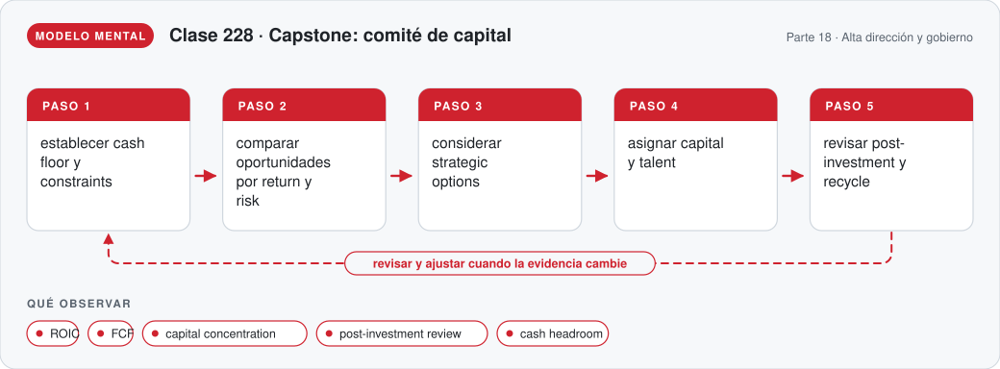

# Clase 228 — Capstone: comité de capital

<!-- nav:inicio -->
> **Parte 18 · Finanzas corporativas, capital y M&A** — clase 12 de 12 · [índice de la parte](../../README.md) · [temario](../../../../SYLLABUS.md)
<!-- nav:fin -->

**Parte:** 18 — Finanzas corporativas, capital y M&A  
**Nivel:** Etapa 5 — CEO → Capital allocator  
**Duración sugerida:** 150–180 minutos · **Estándar:** deep-class-v2

## 🎯 Propósito

Esta clase integra la parte 18. Las clases anteriores entregaron las piezas de un marco de capital: la estructura de capital y su capacidad de deuda (217), el costo de capital (218), la elección entre deuda y capital propio (219), la valoración por flujos y por múltiplos (220 y 221), la captación de capital, la tabla de capitalización y los términos de una ronda (222 a 224) y la lógica, la diligencia y la integración de las adquisiciones (225 a 227). Un **comité de capital** reúne todo ello en una decisión recurrente y difícil: con una caja y una capacidad de endeudamiento limitadas, ¿a qué se asigna el capital de la empresa este año, a qué se renuncia, qué se financia por etapas y qué se revisa después? Es la sala donde se materializa la estrategia, porque lo que se financia es lo que realmente ocurrirá.

El trabajo del capstone es un **memo de asignación**: restricciones, comparación de oportunidades por retorno y riesgo, valor de las opciones estratégicas, asignación de capital y talento con etapas y condiciones, y un plan de revisión posterior. Se apoya en Bower sobre el proceso de asignación de recursos, en Thorndike sobre las opciones de uso del capital, en Koller y colaboradores sobre valor y retorno sobre el capital, en Brealey, Myers y Allen sobre decisión de inversión y en Mankins y Garton sobre asignación de talento y atención. Al terminar tendrás un documento que podrías presentar a un directorio.

## 📚 Resultados de aprendizaje

Al finalizar podrás:

1. **Establecer** el piso de caja y las restricciones duras antes de evaluar propuestas.
2. **Comparar** oportunidades por retorno, riesgo y alternativas de uso del capital.
3. **Valorar** opciones estratégicas que no caben en una fórmula.
4. **Asignar** capital y talento por etapas con condiciones y puertas de decisión.
5. **Diseñar** la revisión posterior y el aprendizaje del comité.

## 🧭 Agenda

| Tramo | Qué se hace |
|---|---|
| 0–20 min | Recuperación: ¿qué criterio usa tu empresa para decir que sí a un proyecto y cuál para decir que no? |
| 20–60 min | Marco, restricciones, comparación, opciones, etapas, talento y revisión. |
| 60–105 min | Ejemplo trabajado: asignar 8.800 millones entre siete propuestas con etapas. |
| 105–150 min | Caso ejecutivo y práctica. |
| 150–175 min | Límites y entregable. |

## 🧩 Conceptos centrales

| Concepto | Definición | Cómo se reconoce |
|---|---|---|
| **Marco de asignación de capital** | Principios y criterios con que se decide dónde va el capital. | Se fija antes de ver las propuestas. |
| **Presupuesto de capital** | Aplicación anual del marco a las propuestas concretas. | Lista de proyectos aprobados y montos. |
| **Piso de caja** | Liquidez mínima que no se compromete. | Se respeta en el escenario adverso. |
| **Puerta de decisión (*stage gate*)** | Punto en que se decide continuar, ajustar o detener. | Hito y criterio para liberar el capital siguiente. |
| **Opción estratégica** | Derecho, no obligación, de invertir más si se cumplen condiciones. | Pilotos y compras en etapas. |
| **Revisión posterior (*post-investment review*)** | Comparación de lo logrado con lo prometido. | Informe con aprendizaje. |

## 🧠 Modelo mental

**Cómo leer el diagrama.** Una cadena de cinco pasos con retorno. **Piso de caja**: liquidez mínima y restricciones duras. **Comparar oportunidades**: retorno, riesgo y alternativas. **Opciones estratégicas**: valor que no cabe en la fórmula. **Asignar capital y talento**: decisión con dueños y condiciones. **Revisión posterior**: resultado real frente a lo prometido. La flecha indica que la revisión recalibra los criterios. La nota afirma que el marco fija criterios antes de ver las propuestas y que el presupuesto de capital es solo su aplicación anual; el pie, que las decisiones de financiamiento y adquisiciones se verifican con asesoría.

## 📖 Desarrollo

### 1. El marco antes de las propuestas

Bower mostró que la estrategia de una empresa surge del proceso por el que se asigna su capital: quién propone, con qué criterios y con qué información se decide. Un **marco de asignación de capital** fija, antes de ver propuestas: los **usos posibles** del capital (reinvertir, adquirir, devolver a propietarios, reducir deuda, mantener caja), el **orden de prioridad** (primero lo obligatorio y la seguridad, luego lo que crea más valor), los **criterios** (retorno sobre el capital invertido frente a costo de capital ajustado por riesgo, plazo de recuperación, ajuste estratégico, riesgo, capacidad de ejecución) y las **reglas** (límites de deuda, política de dividendos, tamaño máximo por proyecto sin aprobación del directorio). Thorndike observó que los CEO con mejores resultados trataban el capital como su responsabilidad central y consideraban todo el menú de usos. El **presupuesto de capital** es la aplicación anual de ese marco, no su sustituto.

### 2. Restricciones duras: piso de caja y capacidad

El comité parte de **cuánto capital hay disponible** y de **qué no se puede violar**. La disponibilidad se compone de: **flujo de caja libre** del período (después de impuestos y de la inversión de mantención), **caja sobre el piso** (la liquidez mínima que se mantiene, definida en escenarios adversos, clase 217), **capacidad de endeudamiento** dentro del rango objetivo y, si corresponde, **capital propio** que se pueda levantar. Se restan los **compromisos** (dividendos, amortizaciones, inversiones obligatorias). El resultado es el **monto disponible**, que se prueba en un **escenario adverso**: si el EBITDA cae 25 %, ¿el plan de inversión sigue siendo financiable? Si no, se estructura por etapas, con parte del capital condicionado a que se cumplan los resultados del año.

### 3. Comparar oportunidades

Cada propuesta se presenta en un **formato uniforme**: monto, retorno (VAN, TIR, plazo de recuperación) con supuestos explícitos, riesgos y su probabilidad, ajuste estratégico, necesidades de talento, hitos y dueño. Se evalúan con la **tasa de corte ajustada por riesgo** (clase 218) y se ordenan por **VAN por peso invertido** cuando el capital es limitado. Se aplican las lecciones de las clases anteriores: **escenarios** pesimistas, **pre-mortem** (qué haría fracasar el proyecto), **revisión independiente** de los supuestos y comparación con **alternativas** (incluida no hacer, devolver capital o reducir deuda). Bower advierte que las propuestas llegan «prefabricadas» por los niveles medios, con supuestos que favorecen su aprobación; el comité contrarresta con datos comparables y con calibración histórica: ¿qué tan precisas fueron las proyecciones de esta área en el pasado?

### 4. Opciones estratégicas y lo que no cabe en la fórmula

El VAN puede subestimar proyectos que **abren opciones**: un piloto que, si funciona, permite escalar; una tecnología que habilita varios negocios; una pequeña inversión que mantiene a la empresa en un mercado emergente. Estas **opciones estratégicas** se valoran explícitamente: costo de la opción (la inversión inicial), cuánto se aprende, qué se puede hacer después, probabilidad de éxito y valor si se escala. Se evitan dos errores: **justificar cualquier proyecto** con «valor estratégico» sin cuantificarlo, y **descartar** todo lo que no tiene VAN positivo hoy. Una regla: las apuestas estratégicas tienen un **presupuesto limitado** (por ejemplo, 10 % del capital), reglas de **puertas de decisión** y un responsable que responde por los aprendizajes (clase 198).

### 5. Asignar con etapas, condiciones y dueños

La decisión del comité es **asignar** y a la vez **condicionar**. Para cada proyecto aprobado se define: **monto comprometido** y **monto condicionado** (que se libera al cumplir un hito), **dueño**, **métricas** de seguimiento y **puertas de decisión**. Las etapas protegen contra el escenario adverso y permiten aprender. También se decide **qué no se financia** y por qué, con una **medida interina** si corresponde (por ejemplo, un piloto menor). La asignación incluye al **talento**: ¿quién liderará cada proyecto aprobado y qué dejará de hacer? Mankins y Garton observan que las organizaciones asignan el dinero con rigor y el talento por inercia; se contrasta el presupuesto con la lista de los líderes más críticos y se mide cuántos de ellos trabajan en las prioridades.

### 6. Adquisiciones y rondas dentro del marco

Las operaciones de fusiones y adquisiciones, de captación y de financiamiento (clases 219 a 227) se evalúan **dentro del mismo marco**: una adquisición compite por capital con la expansión orgánica, la automatización o la recompra de acciones. Se aplican sus reglas específicas: **precio máximo** fijado de antemano, **diligencia independiente** y **plan de integración con dueño**. En el lado del financiamiento, el comité fija el **rango de deuda** y aprueba los **términos** que afectan al control. Se evita el riesgo de **decidir en silos**: aprobar una adquisición que consume la capacidad de endeudamiento que otro proyecto necesitaba, o levantar capital que diluye a los propietarios sin que el comité haya comparado alternativas.

### 7. Revisión posterior y aprendizaje del comité

El comité **aprende** si compara lo prometido con lo ocurrido: revisión posterior de cada inversión relevante a los 12 y 24 meses, por alguien **independiente del proponente**, con los mismos indicadores del caso original (ingresos, costos, plazos, retorno, aprendizajes). Se mide también la **calidad del proceso**: precisión de las proyecciones por área, proporción de proyectos que cumplieron sus hitos, **tasa de reasignación** (capital que se mueve de lo que no funciona), porcentaje de talento clave en las prioridades. Los resultados alimentan la **calibración** (si un área sobreestima en 20 %, sus propuestas se ajustan) y el **marco** (criterios, límites, tasas de corte). Y el comité revisa su propio **funcionamiento**: ¿decidimos con información suficiente?, ¿desafiamos?, ¿registramos?

## 📚 Lectura comparada

| Obra | Qué aporta | Qué no resuelve | Pregunta para contrastar |
|---|---|---|---|
| Bower | La estrategia surge del proceso de asignación; propuestas «prefabricadas». | Estudio de casos de su época. | ¿Qué favorece nuestro proceso? |
| Thorndike | Menú completo de usos del capital y disciplina de CEO. | Casos seleccionados por su éxito. | ¿Qué usos no estamos considerando? |
| Koller y otros | Retorno sobre el capital frente al costo de capital. | No cubre el proceso decisorio. | ¿Cuánto valor crea cada peso? |
| Brealey, Myers y Allen | Criterios de decisión de inversión y riesgo. | No cubre la dimensión organizacional. | ¿Qué tasa y qué riesgo usamos? |
| Mankins y Garton | Talento y atención como recursos a asignar. | Estudios agregados. | ¿Dónde están nuestros mejores líderes? |

## 🧮 Ejemplo trabajado

**Situación (hipotética).** Una empresa tiene un EBITDA de 12.000 millones de pesos, deuda neta de 11.000 millones, caja de 5.000 y un piso de caja de 3.000. Su flujo de caja libre antes de dividendos es de 6.500 millones; los dividendos son 2.400. Su capacidad de deuda en el escenario adverso es 19.583 y el rango objetivo llega hasta el 70 % (13.708).

**Capital disponible este año.**

| Fuente | Millones |
|---|---|
| Flujo libre después de dividendos (6.500 − 2.400) | 4.100 |
| Caja sobre el piso (5.000 − 3.000) | 2.000 |
| Deuda adicional dentro del rango (13.708 − 11.000) | 2.708 |
| **Total** | **8.808** (≈ 8.800) |

**Prueba de estrés.** Con un EBITDA 25 % menor, el flujo libre antes de dividendos baja a 4.700; después de dividendos, 2.300. Capital disponible: 2.300 + 2.000 + 2.708 = 7.008 millones: **1.800 menos** que en el escenario base. Por eso parte de la asignación se condiciona.

**Propuestas.**

| # | Propuesta | Capital | VAN | TIR | VAN/capital | Observación |
|---|---|---|---|---|---|---|
| 1 | Mantención crítica (obligatoria) | 1.200 | n. a. | n. a. | n. a. | Seguridad y continuidad |
| 2 | Automatización de planta | 1.800 | 1.100 | 26 % | 0,61 | Riesgo bajo |
| 3 | Expansión comercial en una región | 2.500 | 900 | 17 % | 0,36 | Divisible en dos fases |
| 4 | Plataforma digital | 3.000 | 1.300 | 21 % | 0,43 | Divisible en dos fases |
| 5 | Adquisición de un competidor | 4.500 al cierre | 600 | 14 % | 0,13 | Bajo la tasa de corte de 15 % |
| 6 | Piloto de hidrógeno verde | 1.000 | 800 (opción) | n. a. | 0,80 | Apuesta estratégica con puertas |

**Asignación.**

1. **Obligatoria**: propuesta 1, 1.200. Quedan 7.600.
2. **Opción estratégica** (presupuesto máximo de 10 % del capital, 880): propuesta 6 con un piloto de 1.000 en dos tramos de 500, con puertas de decisión; dentro del límite se aprueba el primer tramo con el segundo condicionado. Para el cálculo se asignan 1.000 y se condiciona la mitad. Quedan 6.600.
3. **Por VAN por peso**: propuesta 2 (0,61): 1.800. Quedan 4.800.
4. Propuesta 4 (0,43): 3.000 en dos fases de 1.500. Quedan 1.800.
5. Propuesta 3 (0,36): primera fase de 1.500 (60 % del capital: 0,6 × 2.500). Queda 300 de reserva.
6. **Propuesta 5 (adquisición)**: no cumple la tasa de corte (14 % < 15 %) y no hay capital: **se rechaza** como está; se invita a reestructurarla con pago contingente y a presentarla de nuevo si baja el precio.

**Compromiso firme frente a condicionado.**

| Concepto | Millones |
|---|---|
| Firme: propuesta 1 (1.200), 2 (1.800), primer tramo de 6 (500), fase 1 de 4 (1.500) | 5.000 |
| Condicionado: segundo tramo de 6 (500), fase 2 de 4 (1.500), fase 1 de 3 (1.500) | 3.500 |
| **Total asignado** | **8.500** |
| Reserva | 300 |

El compromiso firme de 5.000 cabe en el escenario adverso (7.008). Los 3.500 condicionados se liberan si el EBITDA del primer semestre es al menos 95 % del presupuesto y la caja supera el piso.

**VAN esperado.** Propuesta 2: 1.100; propuesta 4: 1.300; propuesta 3 (fase 1: 60 % de 900) = 540; propuesta 6 (opción): 800. Total: 3.740. Capital discrecional: 1.000 + 1.800 + 3.000 + 1.500 = 7.300. Índice: 3.740 ÷ 7.300 = 0,51.

**Talento.** De los 12 líderes más críticos, 3 (25 %) trabajaban en estas prioridades. Se reasignan 5: 8 de 12 (66,7 %). Los cargos que dejan se cubren con sucesores identificados (clase 201).

**Revisión posterior.** A los 12 meses: comparación con los hitos y el VAN esperado; revisión independiente de la propuesta 2 y de la fase 1 de la propuesta 4; calibración de las proyecciones del área comercial (sobrestimación de 18 % en el último ciclo: se ajusta 15 % a la baja en la propuesta 3).

**Cuidados.** Las condiciones de financiamiento, los covenants, las obligaciones contractuales y los aspectos regulatorios de adquisiciones y expansión se verifican con asesoría; las cifras son ilustrativas.

**Qué muestra.** (1) Las restricciones se probaron con estrés. (2) La asignación combinó retorno, opciones y etapas. (3) El talento y la revisión posterior cerraron el ciclo.

## 🔀 Comparación y límites

**Marco frente a presupuesto.** El marco son los criterios permanentes; el presupuesto es su aplicación anual. Cambiar los criterios para aprobar un proyecto favorito rompe el marco.

**Límites.** Las proyecciones son inciertas y optimistas. Las opciones estratégicas se valoran con juicio. El comité decide con información limitada. Los criterios cuantitativos no sustituyen el criterio sobre personas y contexto. Las cifras del ejemplo son ilustrativas y no corresponden a una empresa real.

## 🪜 De profesional a owner

| Nivel | Cómo participa en la asignación de capital |
|---|---|
| **Profesional** | Prepara propuestas con supuestos honestos y datos verificables. |
| **Jefe / Team Lead** | Comprende cómo los proyectos compiten por capital y talento. |
| **Gerente** | Propone con retorno, riesgo y etapas, y responde por los resultados. |
| **CEO / Director** | Preside el comité, fija el marco y decide qué no se financia. |
| **Founder / Owner** | Equilibra reinversión, retorno a los propietarios y riesgo para su patrimonio. |

## 🏢 Caso ejecutivo

Una empresa de energía y servicios con ventas de 210.000 millones de pesos, EBITDA de 31.500 millones, deuda neta de 52.000 millones (1,65 veces), caja de 14.000 millones y un piso de caja de 8.000 recibe este año nueve propuestas por un total de 68.000 millones: ampliación de una planta (14.000; TIR de 18 %), automatización de procesos (6.500; 24 %), parque solar (22.000; 12 %, con contratos de largo plazo), plataforma de clientes (9.000; 20 %), adquisición de un competidor regional (18.000 al cierre; TIR de 13 %; con una diligencia incompleta), mantenimiento obligatorio (7.500), pilotos de almacenamiento de energía (3.000), recompra de acciones solicitada por los propietarios (5.000) y reducción de deuda (4.000). El flujo libre antes de dividendos es de 15.000 millones; los dividendos, 6.000. El costo de capital es de 9,5 % y la tasa de corte, 13 % para proyectos del negocio actual y 15 % para nuevos. El directorio quiere «un presupuesto equilibrado»; el CEO prefiere la adquisición; los propietarios piden la recompra; el director financiero advierte que el covenant exige menos de 3,0 veces. De los 20 líderes más críticos, solo 5 trabajan en las prioridades del plan.

Entrega un **memo de asignación de capital** que contenga: (a) las restricciones duras (piso de caja, capacidad de deuda, covenants) y el capital disponible en el escenario base y adverso; (b) la comparación de las nueve propuestas con retorno, riesgo y ajuste a la tasa de corte; (c) el tratamiento de las opciones estratégicas y de la adquisición; (d) la asignación con monto firme y condicionado, etapas y puertas; (e) la asignación de talento y la medición «talento en prioridades»; (f) el plan de revisión posterior y las verificaciones financieras, contractuales y regulatorias pendientes.

## 🧪 Práctica

1. Calcula el capital disponible de una empresa con flujo libre, caja sobre el piso y capacidad de deuda, en dos escenarios.
2. Ordena cinco propuestas por VAN por peso invertido y aplica una tasa de corte y un límite de capital.
3. Diseña un proyecto en dos fases con una puerta de decisión y su criterio de liberación.
4. Asigna talento a las prioridades de un plan y mide el porcentaje de líderes críticos asignados.
5. Redacta el formato de la revisión posterior de una inversión con cinco indicadores.

## ⚠️ Errores frecuentes

| Error | Por qué ocurre | Cómo corregirlo |
|---|---|---|
| Evaluar propuestas sin restricciones | Se parte del entusiasmo | Fijar piso de caja y capacidad primero. |
| Repartir parejo | Se evita el conflicto | Asignar por retorno, riesgo y ajuste. |
| Justificar con «valor estratégico» sin cuantificar | Se busca aprobar | Valorar la opción y limitar su presupuesto. |
| Comprometer todo de una vez | No se prueba el escenario adverso | Etapas y puertas de decisión. |
| Asignar talento por costumbre | Las personas se quedan donde están | Contrastar con los líderes críticos. |
| No revisar | Se da por terminado | Revisión posterior independiente. |

## ❓ Preguntas de comprobación

1. ¿Qué diferencia hay entre marco de asignación y presupuesto de capital?
2. ¿De qué se compone el capital disponible y cómo se prueba en estrés?
3. ¿Cómo se comparan oportunidades cuando el capital es limitado?
4. ¿Qué son las opciones estratégicas y cómo se limitan?
5. ¿Qué es una puerta de decisión y para qué sirve?
6. ¿Cómo se integra el talento en la asignación?
7. ¿Qué mide la revisión posterior?

Claves de respuesta

1. El marco son los criterios y reglas permanentes; el presupuesto es su aplicación anual a propuestas concretas.
2. De flujo libre después de dividendos, caja sobre el piso y deuda adicional dentro del rango; se prueba con un escenario de caída del EBITDA que reduce el capital disponible.
3. Con el VAN por peso invertido, la tasa de corte ajustada por riesgo, escenarios, pre-mortem, revisión independiente y alternativas.
4. Inversiones que abren la posibilidad de invertir más si se cumplen condiciones; se limitan con un presupuesto máximo, puertas y un responsable.
5. Un punto de decisión donde se libera, ajusta o detiene el capital siguiente según hitos.
6. Contrastando el presupuesto con los líderes más críticos y midiendo cuántos trabajan en las prioridades, con sucesores para los cargos que dejan.
7. Lo logrado frente a lo prometido en ingresos, costos, plazos y retorno, la precisión de las proyecciones y el aprendizaje para el marco.

## 📥 Entregable

Guarda en `portfolio/228-capstone-comite-de-capital/`:

- `modelo-financiero-y-memo-de-decision.md` (plantilla [Modelo financiero y memo de decisión](../../../../templates/modelo-financiero-y-memo-de-decision.md)) con el memo de asignación del caso ejecutivo;
- `capital-allocation.md` (plantilla [Capital allocation](../../../../templates/capital-allocation.md)) con el presupuesto firme y condicionado y las puertas de decisión;
- `leadership-decision-brief.md` (plantilla [Leadership Decision Brief](../../../../templates/leadership-decision-brief.md)) con la decisión sobre adquisición y recompra;
- `decision-journal.md` con las restricciones, el plan de revisión posterior y las verificaciones pendientes.

## 📗 Fuentes y verificación

- Joseph L. Bower — *Managing the Resource Allocation Process* (Harvard Business School, 1970). **Uso en esta clase:** la estrategia como resultado del proceso de asignación de recursos. Lectura selectiva sobre **capstone: comité de capital**. **Localizador:** [ISBN-13 9780875840833](https://openlibrary.org/isbn/9780875840833).
- William N. Thorndike — *The Outsiders* (Harvard Business Review Press, 2012). **Uso en esta clase:** menú completo de usos del capital y disciplina de los CEO. Lectura selectiva sobre **capstone: comité de capital**. **Localizador:** [ISBN-13 9781422162675](https://openlibrary.org/isbn/9781422162675).
- Tim Koller, Marc Goedhart & David Wessels — *Valuation: Measuring and Managing the Value of Companies* (Wiley, 2005). **Uso en esta clase:** retorno sobre el capital frente al costo de capital. Lectura selectiva sobre **capstone: comité de capital**. **Localizador:** [ISBN-13 9780471702191](https://openlibrary.org/isbn/9780471702191).
- Richard Brealey, Stewart Myers & Franklin Allen — *Principles of Corporate Finance* (McGraw-Hill International Book Co, 1984). **Uso en esta clase:** criterios de decisión de inversión y riesgo. Lectura selectiva sobre **capstone: comité de capital**. **Localizador:** [ISBN-13 9780070662025](https://openlibrary.org/isbn/9780070662025).
- Michael C. Mankins & Eric Garton — *Time, Talent, Energy* (Harvard Business Review Press, 2017). **Uso en esta clase:** talento y atención como recursos a asignar. Lectura selectiva sobre **capstone: comité de capital**. **Localizador:** [ISBN-13 9781633691766](https://openlibrary.org/isbn/9781633691766).

> **Regla de fuentes para el Capstone del comité de capital:** las obras anteriores estructuran las perspectivas de esta materia; cualquier norma, ley o estándar vivo mencionado debe comprobarse nuevamente en su fuente primaria vigente, incluidos los covenants, los contratos de financiamiento y los aspectos regulatorios de adquisiciones y expansión. Los ejemplos y casos son hipotéticos, con cifras ilustrativas. El desarrollo es original y no reproduce capítulos protegidos.

<!-- pie:inicio -->
---

| Anterior | Índice | Siguiente |
|---|---|---|
| [← 227 · Integración post-adquisición](../227-integracion-post-adquisicion/README.md) | [Parte 18](../../README.md) · [Programa](../../../../SYLLABUS.md) | [229 · Tecnología como capacidad empresarial →](../../../19-technology-data-ai-digital-transformation/classes/229-tecnologia-como-capacidad-empresarial/README.md) |
<!-- pie:fin -->
