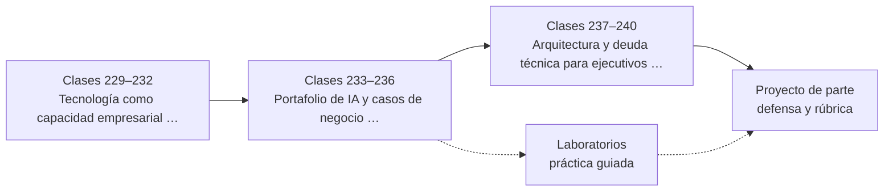

# Parte 19 — Tecnología, datos, IA y transformación digital para ejecutivos

<!-- parte:inicio -->

> ← [Parte 18 — Finanzas corporativas, capital y M&A](../18-corporate-finance-capital-ma/README.md) · [Temario](../../SYLLABUS.md) · [Parte 20 — Founder y creación de empresas](../20-founder-venture-creation/README.md) →

*Dirigir la inversión tecnológica por valor, riesgo y capacidad*

**Etapa:** 5 — Alta dirección y gobierno  
**Duración:** 12 clases · 30 horas  
**Resultado de salida:** Dirigir inversión tecnológica y de IA por valor, riesgo y capacidad organizacional, no por moda.

🔴 [Ver las 6 etapas](../../SYLLABUS.md) · 12 clases (229–240) · 4 laboratorios · [proyecto de parte](project.md)

## 🎯 De qué trata esta parte

La tecnología ya no es una función de apoyo: es parte del modelo de negocio. Un ejecutivo debe decidir sin ser técnico, entendiendo qué preguntar y qué riesgos aceptar.

El eje es **valor antes que moda**: cada inversión en nube, datos o IA se justifica por un caso de negocio, un riesgo gobernado y una capacidad organizacional que la sostiene.

## 🧱 Con qué hay que llegar

| Parte | Qué aporta |
|---|---|
| [13 — Estrategia y competencia](../13-strategy-competition/README.md) | Estrategia. |
| [15 — Riesgo, legal, compliance, ciberseguridad e IA](../15-risk-legal-compliance-cyber-ai-governance/README.md) | Gobierno de datos, ciberseguridad e IA. |
| [09 — Finanzas y contabilidad para gerentes](../09-managerial-finance-accounting/README.md) | Casos de negocio. |

Cada clase supone la anterior: el orden importa, y saltarse una deja sin base a las que vienen después.

## 📚 Resultados de la parte

Al terminar esta parte podrás:

1. **Entender** la tecnología como capacidad empresarial.
2. **Evaluar** economía de nube y plataformas.
3. **Tratar** los datos como activo con dueño y calidad.
4. **Decidir** build, buy, partner o retire.
5. **Gobernar** un portafolio de IA, con supervisión humana y responsable.

## 🗺️ Mapa de la parte

## 🧭 Cómo se encadenan las 12 clases

Las clases **229 a 232** definen la estrategia: tecnología, estrategia digital, nube y datos.

Las clases **233 a 236** cubren la decisión: IA, automatización, ciberseguridad y build o buy.

Las clases **237 a 240** cubren la gestión: deuda técnica, métricas de entrega, cambio laboral por IA y el capstone de transformation board.

## 📘 Las 12 clases

| # | Clase | Qué se trabaja | Entregable | Min |
|---:|---|---|---|---:|
| 229 | [Tecnología como capacidad empresarial](classes/229-tecnologia-como-capacidad-empresarial/README.md) | Capacidad de negocio, Activo tecnológico, Habilitador | [operating-improvement-brief](../../templates/operating-improvement-brief.md) | 150 |
| 230 | [Estrategia digital](classes/230-estrategia-digital/README.md) | Digitalización, Estrategia digital, Recorrido del cliente | [strategy-memo](../../templates/strategy-memo.md) | 150 |
| 231 | [Economía de cloud y plataformas](classes/231-economia-de-cloud-y-plataformas/README.md) | Elasticidad, Costo unitario, FinOps | [risk-governance-brief](../../templates/risk-governance-brief.md) | 150 |
| 232 | [Datos como activo operativo](classes/232-datos-como-activo-operativo/README.md) | Activo de datos, Producto de datos, Dominio | [leadership-decision-brief](../../templates/leadership-decision-brief.md) | 150 |
| 233 | [Portafolio de IA y casos de negocio](classes/233-portafolio-de-ia-y-casos-de-negocio/README.md) | Caso de uso de IA, Portafolio de IA, Línea base | [strategy-memo](../../templates/strategy-memo.md) | 150 |
| 234 | [Automatización y rediseño de trabajo](classes/234-automatizacion-y-rediseno-de-trabajo/README.md) | Descomposición en tareas, Automatización, Aumento (*augmentation*) | [operating-improvement-brief](../../templates/operating-improvement-brief.md) | 150 |
| 235 | [Ciberseguridad desde el directorio](classes/235-ciberseguridad-desde-el-directorio/README.md) | Escenario cibernético, Activos críticos (*crown jewels*), Riesgo residual | [risk-governance-brief](../../templates/risk-governance-brief.md) | 150 |
| 236 | [Build, buy, partner o retire](classes/236-build-buy-partner-o-retire/README.md) | Construir (*build*), Comprar (*buy*), Asociarse (*partner*) | [leadership-decision-brief](../../templates/leadership-decision-brief.md) | 150 |
| 237 | [Arquitectura y deuda técnica para ejecutivos](classes/237-arquitectura-y-deuda-tecnica-para-ejecutivos/README.md) | Arquitectura, Atributo de calidad, Modularidad | [leadership-decision-brief](../../templates/leadership-decision-brief.md) | 150 |
| 238 | [Métricas de entrega tecnológica](classes/238-metricas-de-entrega-tecnologica/README.md) | Frecuencia de despliegue, Tiempo de entrega de cambios, Tasa de fallas en cambios | [leadership-decision-brief](../../templates/leadership-decision-brief.md) | 150 |
| 239 | [Cambio laboral provocado por IA](classes/239-cambio-laboral-provocado-por-ia/README.md) | Exposición de tareas, Productividad realizable, Desplazamiento de tareas | [risk-governance-brief](../../templates/risk-governance-brief.md) | 150 |
| 240 | [Capstone: transformation board](classes/240-capstone-transformation-board/README.md) | Tablero de transformación, Portafolio de iniciativas, Dependencia | [board-or-executive-memo](../../templates/board-or-executive-memo.md) | 150 |

## ⚠️ Riesgos característicos

- Invertir en IA sin un caso de negocio.
- Ignorar la deuda técnica hasta que paraliza.
- Delegar en el sistema una decisión que exige responsable humano.
- Subestimar el efecto en el trabajo y las personas.

## 🔤 Glosario de la parte

70 conceptos definidos en las clases, con la definición operacional que usa cada una.

| Concepto | Definición operacional |
|---|---|
| **Acoplamiento** | Grado de dependencia entre componentes o equipos. |
| **Activo de datos** | Dato con dueño, calidad definida y uso que genera valor. |
| **Activo tecnológico** | Sistema, plataforma o dato que habilita una capacidad. |
| **Activos críticos (*crown jewels*)** | Sistemas, datos y procesos sin los que el negocio no opera o sufre daño grave. |
| **Arquitectura** | Estructura de componentes de un sistema y sus relaciones. |
| **Aseguramiento independiente** | Verificación de los controles por terceros ajenos a su operación. |
| **Asociarse (*partner*)** | Obtener la capacidad con un socio sin comprarla ni construirla. |
| **Atributo de calidad** | Propiedad que el sistema debe tener: velocidad, seguridad, escala, costo. |
| **Aumento (*augmentation*)** | Apoyo tecnológico al juicio y trabajo de una persona. |
| **Automatización** | Ejecución de una tarea por una máquina sin intervención humana. |
| **Calidad de datos** | Grado en que los datos sirven al uso previsto. |
| **Cambio de habilidades** | Variación de las capacidades demandadas. |
| **Capacidad de entrega** | Personas y tiempo disponibles para ejecutar. |
| **Capacidad de negocio** | Lo que la empresa sabe hacer de forma repetible para generar valor. |
| **Caso de uso de IA** | Aplicación concreta de IA a un problema de negocio. |
| **Comprar (*buy*)** | Adquirir una solución de un proveedor. |
| **Compromiso de capacidad** | Contrato por uso mínimo a cambio de descuento. |
| **Construir (*build*)** | Desarrollar la capacidad con recursos propios. |
| **Contrato de datos** | Acuerdo entre productor y consumidores sobre formato, significado y plazos. |
| **Costo de cambio** | Tiempo y esfuerzo de modificar el sistema. |
| **Costo de cambio (*switching cost*)** | Costo del usuario por pasar a otro proveedor. |
| **Costo de salida** | Costo de cambiar a otra opción. |
| **Costo de servir** | Costo de atender a un cliente o transacción. |
| **Costo total de propiedad (TCO)** | Costo de adquirir, operar y mantener a lo largo de la vida útil. |
| **Costo unitario** | Costo de la nube por unidad de negocio. |
| **Creación de tareas** | Nuevas actividades humanas que surgen. |
| **Criterio de parada** | Condición que obliga a detener o cambiar un piloto. |
| **Cuello de botella** | Punto que limita el flujo de valor. |
| **Dependencia** | Relación por la que una iniciativa necesita el resultado de otra. |
| **Dependencia (*lock-in*)** | Costo y dificultad de cambiar de proveedor. |
| **Descomposición en tareas** | División de un trabajo en actividades concretas. |
| **Desperdicio** | Recursos pagados y no usados o sobredimensionados. |
| **Desplazamiento de tareas** | Tareas que dejan de hacer las personas. |
| **Deuda técnica** | Costo futuro de atajos o diseños que se acumulan. |
| **Digitalización** | Traspaso de procesos existentes a soporte digital. |
| **Dominio** | Área del negocio responsable de ciertos datos. |
| **Efecto de red** | Valor que crece con el número de usuarios. |
| **Ejercicio de mesa** | Simulación de una crisis con decisores. |
| **Elasticidad** | Capacidad de aumentar o disminuir recursos con la demanda. |
| **Escenario cibernético** | Historia de ataque con causa, evento y consecuencia de negocio. |
| **Espacio de pruebas (*sandbox*)** | Entorno de bajo riesgo para experimentar con controles ligeros. |
| **Estrategia digital** | Decisiones sobre cómo la tecnología cambia el modelo de negocio y la ventaja. |
| **Excepción** | Caso que no cumple las reglas y requiere juicio. |
| **Exposición de tareas** | Parte del trabajo que la IA podría asistir o hacer. |
| **FinOps** | Práctica de gestión financiera de la nube entre finanzas, tecnología y negocio. |
| **Flujo de valor** | Secuencia de actividades que entrega valor al cliente. |
| **Frecuencia de despliegue** | Con qué frecuencia se lleva software a producción. |
| **Habilitador** | Tecnología, proceso o talento que hace posible la capacidad. |
| **Linaje** | Trazabilidad del origen y las transformaciones de un dato. |
| **Línea base** | Medida del desempeño actual antes de la IA. |
| **Modularidad** | División en partes con límites claros. |
| **Portafolio de IA** | Conjunto priorizado de casos con distinto riesgo y horizonte. |
| **Portafolio de iniciativas** | Conjunto de proyectos con distinto riesgo y horizonte. |
| **Procesamiento directo (STP)** | Porcentaje de casos que pasan sin intervención humana. |
| **Productividad realizable** | Mejora efectiva del trabajo tras considerar adopción y calidad. |
| **Producto de datos** | Conjunto de datos tratado como producto: con dueño, usuarios y garantías. |
| **Puerta de decisión (*stage gate*)** | Punto en que se libera capital según resultados. |
| **Recorrido del cliente** | Secuencia de interacciones del cliente con la empresa. |
| **Restricción** | Paso que limita el flujo completo. |
| **Retirar (*retire*)** | Dejar de ofrecer o usar la capacidad. |
| **Riesgo residual** | Riesgo que queda tras los controles. |
| **Tablero de transformación** | Instancia de dirección que prioriza y gobierna las iniciativas de transformación. |
| **Tarea rutinaria** | Tarea que sigue reglas explícitas. |
| **Tasa de fallas en cambios** | Porcentaje de cambios que causan fallas o exigen corrección. |
| **Tiempo de entrega de cambios** | Tiempo entre que un cambio está listo y funciona en producción. |
| **Tiempo de recuperación** | Tiempo real para volver a operar. |
| **Tiempo de restauración** | Tiempo para recuperar el servicio tras una falla. |
| **Transición laboral** | Plan para las personas cuyo trabajo cambia. |
| **Valor realizable** | Parte del valor estimado que se traduce en caja o resultado. |
| **Viabilidad** | Posibilidad práctica de lograr el caso con datos, técnica y organización. |

## 📦 Qué queda como evidencia

- Un caso de negocio de IA con riesgos.
- Una decisión build, buy, partner o retire.
- Un plan de cambio laboral.
- El capstone: transformation board.

## 🔗 Cómo se conecta

Se conecta con la parte 15 (gobierno de IA) y con la clase 202, donde el error de un agente de IA exige responsabilidad humana. Alimenta la parte 22.

## 🧪 Cómo se trabaja

Son **12 clases de 150 minutos** —30 horas— con **4 laboratorios** y un proyecto integrador. Cada clase trae su propósito, sus conceptos, un caso, práctica, errores frecuentes, preguntas de comprobación, entregable y fuentes, y se evalúa con su `assessment.md`. Los laboratorios se resuelven con datos propios o sintéticos, nunca con datos reales de terceros, y la parte se cierra con el proyecto y su defensa. Las reglas de recorrido están en [la guía de navegación](../../docs/NAVIGATION.md).

<!-- parte:fin -->

## Laboratorios

- [Lab 01 — Digital portfolio review](labs/lab-01.md)
- [Lab 02 — AI business case](labs/lab-02.md)
- [Lab 03 — Build-vs-buy memo](labs/lab-03.md)
- [Lab 04 — Transformation roadmap](labs/lab-04.md)

## Proyecto de parte

Priorizar una cartera de transformación digital e IA con presupuesto restringido.

## Bibliografía rectora

- Marco Iansiti & Karim R. Lakhani — *Competing in the Age of AI* (IA y estrategia)
- Thomas H. Davenport & Nitin Mittal — *All-In on AI* (IA empresarial)
- George Westerman, Didier Bonnet & Andrew McAfee — *Leading Digital* (Transformación digital)
- Nicole Forsgren, Jez Humble & Gene Kim — *Accelerate* (Entrega tecnológica)
- Andrew McAfee & Erik Brynjolfsson — *Machine, Platform, Crowd* (Economía digital)

## Criterio de aprobación

80/100 y entrega del proyecto integrador.
