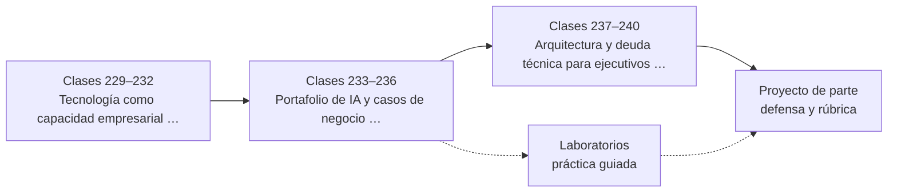

# Parte 19 — Tecnología, datos, IA y transformación digital para ejecutivos

<!-- parte:inicio -->

> ← [Parte 18 — Finanzas corporativas, capital y M&A](../18-corporate-finance-capital-ma/README.md) · [Temario](../../SYLLABUS.md) · [Parte 20 — Founder y creación de empresas](../20-founder-venture-creation/README.md) →

*Dirigir la inversión tecnológica por valor, riesgo y capacidad*

**Etapa:** 5 — Alta dirección y gobierno  
**Duración:** 12 clases · 30 horas  
**Resultado de salida:** Dirigir inversión tecnológica y de IA por valor, riesgo y capacidad organizacional, no por moda.

🔴 [Ver las 6 etapas](../../SYLLABUS.md) · 12 clases (229–240) · 4 laboratorios · [proyecto de parte](project.md)

## 🎯 De qué trata esta parte

La tecnología ya no es una función de apoyo: es parte del modelo de negocio. Un ejecutivo debe decidir sin ser técnico, entendiendo qué preguntar y qué riesgos aceptar.

El eje es **valor antes que moda**: cada inversión en nube, datos o IA se justifica por un caso de negocio, un riesgo gobernado y una capacidad organizacional que la sostiene.

## 🧱 Con qué hay que llegar

| Parte | Qué aporta |
|---|---|
| [13 — Estrategia y competencia](../13-strategy-competition/README.md) | Estrategia. |
| [15 — Riesgo, legal, compliance, ciberseguridad e IA](../15-risk-legal-compliance-cyber-ai-governance/README.md) | Gobierno de datos, ciberseguridad e IA. |
| [09 — Finanzas y contabilidad para gerentes](../09-managerial-finance-accounting/README.md) | Casos de negocio. |

Cada clase supone la anterior: el orden importa, y saltarse una deja sin base a las que vienen después.

## 📚 Resultados de la parte

Al terminar esta parte podrás:

1. **Entender** la tecnología como capacidad empresarial.
2. **Evaluar** economía de nube y plataformas.
3. **Tratar** los datos como activo con dueño y calidad.
4. **Decidir** build, buy, partner o retire.
5. **Gobernar** un portafolio de IA, con supervisión humana y responsable.

## 🗺️ Mapa de la parte

## 🧭 Cómo se encadenan las 12 clases

Las clases **229 a 232** definen la estrategia: tecnología, estrategia digital, nube y datos.

Las clases **233 a 236** cubren la decisión: IA, automatización, ciberseguridad y build o buy.

Las clases **237 a 240** cubren la gestión: deuda técnica, métricas de entrega, cambio laboral por IA y el capstone de transformation board.

## 📘 Las 12 clases

| # | Clase | Qué se trabaja | Entregable | Min |
|---:|---|---|---|---:|
| 229 | [Tecnología como capacidad empresarial](classes/229-tecnologia-como-capacidad-empresarial/README.md) | business capability, technology asset, technical dependency | [operating-improvement-brief](../../templates/operating-improvement-brief.md) | 150 |
| 230 | [Estrategia digital](classes/230-estrategia-digital/README.md) | digital strategy, digitization, digitalization | [strategy-memo](../../templates/strategy-memo.md) | 150 |
| 231 | [Economía de cloud y plataformas](classes/231-economia-de-cloud-y-plataformas/README.md) | cloud economics, elasticity, unit cost | [risk-governance-brief](../../templates/risk-governance-brief.md) | 150 |
| 232 | [Datos como activo operativo](classes/232-datos-como-activo-operativo/README.md) | data product, data quality, data owner | [leadership-decision-brief](../../templates/leadership-decision-brief.md) | 150 |
| 233 | [Portafolio de IA y casos de negocio](classes/233-portafolio-de-ia-y-casos-de-negocio/README.md) | AI use case, AI portfolio, automation rate | [strategy-memo](../../templates/strategy-memo.md) | 150 |
| 234 | [Automatización y rediseño de trabajo](classes/234-automatizacion-y-rediseno-de-trabajo/README.md) | task decomposition, augmentation, straight-through processing | [operating-improvement-brief](../../templates/operating-improvement-brief.md) | 150 |
| 235 | [Ciberseguridad desde el directorio](classes/235-ciberseguridad-desde-el-directorio/README.md) | cyber oversight, threat scenario, crown jewel | [risk-governance-brief](../../templates/risk-governance-brief.md) | 150 |
| 236 | [Build, buy, partner o retire](classes/236-build-buy-partner-o-retire/README.md) | build, buy, partner | [leadership-decision-brief](../../templates/leadership-decision-brief.md) | 150 |
| 237 | [Arquitectura y deuda técnica para ejecutivos](classes/237-arquitectura-y-deuda-tecnica-para-ejecutivos/README.md) | architecture, technical debt, coupling | [leadership-decision-brief](../../templates/leadership-decision-brief.md) | 150 |
| 238 | [Métricas de entrega tecnológica](classes/238-metricas-de-entrega-tecnologica/README.md) | deployment frequency, lead time for changes, change failure rate | [leadership-decision-brief](../../templates/leadership-decision-brief.md) | 150 |
| 239 | [Cambio laboral provocado por IA](classes/239-cambio-laboral-provocado-por-ia/README.md) | task exposure, skill shift, reskilling | [risk-governance-brief](../../templates/risk-governance-brief.md) | 150 |
| 240 | [Capstone: transformation board](classes/240-capstone-transformation-board/README.md) | transformation portfolio, value case, dependency map | [board-or-executive-memo](../../templates/board-or-executive-memo.md) | 150 |

## ⚠️ Riesgos característicos

- Invertir en IA sin un caso de negocio.
- Ignorar la deuda técnica hasta que paraliza.
- Delegar en el sistema una decisión que exige responsable humano.
- Subestimar el efecto en el trabajo y las personas.

## 🔤 Glosario de la parte

60 conceptos definidos en las clases, con la definición operacional que usa cada una.

| Concepto | Definición operacional |
|---|---|
| **AI portfolio** | conjunto priorizado de casos por value feasibility y risk. |
| **AI unit economics** | costo total por tarea o outcome automatizado. |
| **AI use case** | aplicación específica de IA dentro de un workflow. |
| **architectural runway** | capacidad técnica preparada para próximas necesidades. |
| **architecture** | estructura de componentes interfaces y decisiones que condicionan sistemas. |
| **augmentation** | uso de tecnología para aumentar capacidad humana. |
| **augmentation strategy** | uso de IA para elevar desempeño humano en vez de solo sustituir. |
| **automation rate** | proporción de trabajo realizado sin intervención humana. |
| **benefit owner** | ejecutivo accountable por realizar valor después de entrega. |
| **build** | desarrollar capacidad internamente. |
| **business capability** | habilidad organizacional necesaria para lograr un outcome. |
| **buy** | adquirir producto o servicio de mercado. |
| **change failure rate** | proporción de cambios que causan degradación o incidente. |
| **cloud economics** | relación entre consumo cloud arquitectura y valor. |
| **coupling** | grado de dependencia entre componentes. |
| **crown jewel** | activo o proceso cuya pérdida es material. |
| **cyber oversight** | supervisión del board sobre riesgo y resiliencia digital. |
| **cyber resilience** | capacidad de mantener o recuperar funciones frente a ataque. |
| **data owner** | rol accountable por definición y uso de un dominio. |
| **data product** | conjunto gestionado de datos con usuarios owner SLA y propósito. |
| **data quality** | grado de exactitud completitud oportunidad y consistencia. |
| **dependency map** | relaciones entre data platforms teams y vendors. |
| **deployment frequency** | frecuencia con que cambios llegan a producción. |
| **developer experience** | condiciones que afectan capacidad de entregar software de forma efectiva. |
| **digital business model** | modelo donde software y datos son parte central de creación y captura de valor. |
| **digital strategy** | conjunto de choices sobre cómo tecnología y datos crean ventaja y valor. |
| **digital transformation** | cambio sistémico de modelo y capabilities habilitado por digital. |
| **digitalization** | usar tecnología para mejorar procesos existentes. |
| **digitization** | convertir información analógica a digital. |
| **elasticity** | capacidad de ajustar recursos con demanda. |
| **exception handling** | proceso para casos fuera de reglas. |
| **FinOps** | disciplina de colaboración para gestionar valor y costo cloud. |
| **human-in-the-loop** | diseño donde una persona revisa o decide en puntos definidos. |
| **job redesign** | reconfiguración de responsabilidades después de automatización. |
| **lead time for changes** | tiempo desde cambio hasta producción. |
| **legacy** | tecnología que sigue soportando valor pero impone restricciones. |
| **lineage** | trazabilidad desde origen a transformación y consumo. |
| **partner** | compartir capacidad o riesgo con tercero. |
| **platform** | conjunto reutilizable de servicios que acelera múltiples productos. |
| **reskilling** | aprendizaje para desempeñar tareas o roles nuevos. |
| **retire** | eliminar sistema o capability que ya no crea valor. |
| **single source of truth** | fuente autorizada para una definición específica. |
| **skill shift** | cambio en capacidades requeridas por un rol. |
| **stage gate** | punto de decisión basado en evidencia. |
| **straight-through processing** | flujo automatizado sin intervención manual. |
| **tabletop exercise** | simulación de respuesta para probar decisiones y dependencias. |
| **task decomposition** | descomposición del trabajo en actividades con distinto potencial de automatización. |
| **task exposure** | grado en que una tarea puede ser automatizada o aumentada por IA. |
| **TCO** | costo total de propiedad durante ciclo de vida. |
| **technical debt** | costo futuro creado al elegir soluciones que aumentan fricción o riesgo. |
| **technical dependency** | relación donde una capacidad depende de tecnología específica. |
| **technology asset** | sistema o plataforma que habilita capacidades. |
| **technology portfolio** | cartera de sistemas e inversiones gestionada por valor y riesgo. |
| **threat scenario** | secuencia plausible de amenaza explotación e impacto. |
| **time to restore** | tiempo para recuperar servicio tras fallo. |
| **transformation portfolio** | cartera de apuestas tecnológicas ligadas a outcomes. |
| **unit cost** | costo técnico por transacción cliente o workload. |
| **value case** | argumento cuantificado o verificable de beneficio. |
| **vendor lock-in** | costo y dificultad de cambiar proveedor. |
| **work redesign** | recomposición de tareas responsabilidades e interfaces. |

## 📦 Qué queda como evidencia

- Un caso de negocio de IA con riesgos.
- Una decisión build, buy, partner o retire.
- Un plan de cambio laboral.
- El capstone: transformation board.

## 🔗 Cómo se conecta

Se conecta con la parte 15 (gobierno de IA) y con la clase 202, donde el error de un agente de IA exige responsabilidad humana. Alimenta la parte 22.

## 🧪 Cómo se trabaja

Son **12 clases de 150 minutos** —30 horas— con **4 laboratorios** y un proyecto integrador. Cada clase trae su propósito, sus conceptos, un caso, práctica, errores frecuentes, preguntas de comprobación, entregable y fuentes, y se evalúa con su `assessment.md`. Los laboratorios se resuelven con datos propios o sintéticos, nunca con datos reales de terceros, y la parte se cierra con el proyecto y su defensa. Las reglas de recorrido están en [la guía de navegación](../../docs/NAVIGATION.md).

<!-- parte:fin -->

## Laboratorios

- [Lab 01 — Digital portfolio review](labs/lab-01.md)
- [Lab 02 — AI business case](labs/lab-02.md)
- [Lab 03 — Build-vs-buy memo](labs/lab-03.md)
- [Lab 04 — Transformation roadmap](labs/lab-04.md)

## Proyecto de parte

Priorizar una cartera de transformación digital e IA con presupuesto restringido.

## Bibliografía rectora

- Marco Iansiti & Karim R. Lakhani — *Competing in the Age of AI* (IA y estrategia)
- Thomas H. Davenport & Nitin Mittal — *All-In on AI* (IA empresarial)
- George Westerman, Didier Bonnet & Andrew McAfee — *Leading Digital* (Transformación digital)
- Nicole Forsgren, Jez Humble & Gene Kim — *Accelerate* (Entrega tecnológica)
- Andrew McAfee & Erik Brynjolfsson — *Machine, Platform, Crowd* (Economía digital)

## Criterio de aprobación

80/100 y entrega del proyecto integrador.
