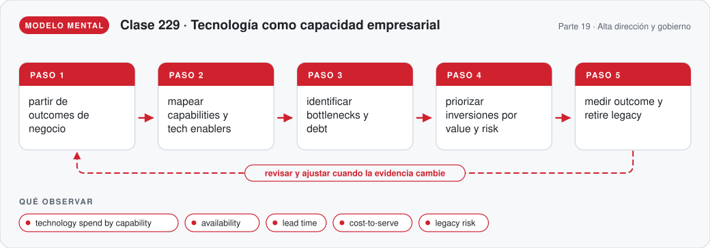

# Clase 229 — Tecnología como capacidad empresarial

<!-- nav:inicio -->
> **Parte 19 · Tecnología, datos, IA y transformación digital para ejecutivos** — clase 1 de 12 · [índice de la parte](../../README.md) · [temario](../../../../SYLLABUS.md)
<!-- nav:fin -->

**Parte:** 19 — Tecnología, datos, IA y transformación digital para ejecutivos  
**Nivel:** Etapa 5 — CEO → Transformador digital  
**Duración sugerida:** 150–180 minutos · **Estándar:** deep-class-v2

## 🎯 Propósito

En muchas empresas la tecnología llega a la mesa del comité de dirección como un presupuesto: «necesitamos 3.000 millones para renovar el sistema». El comité no sabe qué preguntar, pide una justificación, recibe una presentación con siglas y termina decidiendo por confianza, por presión o por recorte. El problema no es técnico sino de **lenguaje**: la tecnología no se compra como un fin, se invierte para lograr una **capacidad de negocio** (cumplir pedidos más rápido, conocer mejor al cliente, lanzar productos en semanas, operar con menos errores), y esa capacidad se mide en resultados. Cuando el ejecutivo piensa en términos de capacidades, puede preguntar lo correcto: ¿qué resultado de negocio buscamos?, ¿qué capacidad lo produce?, ¿qué tecnología la habilita?, ¿qué la frena hoy y cuánto cuesta ese freno?

La clase se apoya en el análisis de Iansiti y Lakhani sobre empresas cuya operación se organiza en torno a datos y algoritmos, en el estudio de Westerman, Bonnet y McAfee sobre cómo las empresas lideran su transformación digital, en el trabajo de McAfee y Brynjolfsson sobre máquinas, plataformas y multitudes, en la noción de innovación arquitectónica de Henderson y Clark y en la metáfora de la deuda técnica de Cunningham. Al terminar sabrás mapear resultados, capacidades y habilitadores tecnológicos, identificar cuellos de botella y deuda, priorizar inversiones por valor y medir si la capacidad realmente mejoró.

## 📚 Resultados de aprendizaje

Al finalizar podrás:

1. **Distinguir** capacidad de negocio y activo tecnológico.
2. **Mapear** resultados, capacidades y habilitadores tecnológicos.
3. **Identificar** cuellos de botella y deuda que frenan una capacidad.
4. **Priorizar** inversiones por valor, riesgo y tiempo.
5. **Medir** el efecto de la inversión en el resultado de negocio.

## 🧭 Agenda

| Tramo | Qué se hace |
|---|---|
| 0–20 min | Recuperación: ¿qué sistema de tu empresa se aprobó «porque era necesario» y qué resultado de negocio se esperaba? |
| 20–60 min | Capacidades, habilitadores, cuellos de botella, deuda, priorización y medición. |
| 60–105 min | Ejemplo trabajado: tres alternativas para mejorar la tasa de cumplimiento de pedidos. |
| 105–150 min | Caso ejecutivo y práctica. |
| 150–175 min | Límites y entregable. |

## 🧩 Conceptos centrales

| Concepto | Definición | Cómo se reconoce |
|---|---|---|
| **Capacidad de negocio** | Lo que la empresa sabe hacer de forma repetible para generar valor. | Se describe en resultados: «entregar en 24 horas». |
| **Activo tecnológico** | Sistema, plataforma o dato que habilita una capacidad. | Aplicaciones, infraestructura, datos. |
| **Habilitador** | Tecnología, proceso o talento que hace posible la capacidad. | Se mapea por capacidad. |
| **Cuello de botella** | Punto que limita el flujo de valor. | Colas, esperas, trabajo manual. |
| **Deuda técnica** | Costo futuro de atajos o diseños que se acumulan. | Cada cambio es más lento y riesgoso. |
| **Flujo de valor** | Secuencia de actividades que entrega valor al cliente. | Del pedido a la entrega. |

## 🧠 Modelo mental

**Cómo leer el diagrama.** Una cadena de cinco pasos con retorno. **Resultados de negocio**: qué se quiere lograr con clientes y costos. **Capacidades**: qué sabe hacer la empresa y qué tecnología lo habilita. **Cuellos de botella y deuda**: dónde se frena el flujo de valor. **Priorizar por valor**: inversiones según resultado, riesgo y tiempo. **Medir y ajustar**: evidencia de que la capacidad mejoró. La flecha indica que lo medido redefine las prioridades. La nota afirma que se invierte en capacidades y no en tecnologías sueltas; el pie, que una tecnología nueva sin capacidad de negocio que la use solo agrega costo.

## 📖 Desarrollo

### 1. Empresas organizadas alrededor de capacidades

Iansiti y Lakhani describen empresas cuya operación depende de una **fábrica de datos y algoritmos**: el valor se genera porque la empresa puede recopilar datos, analizarlos, tomar decisiones automatizadas y mejorar continuamente, con costos marginales bajos y escalas muy grandes. Aunque pocas empresas son así, la idea es útil para todas: la tecnología deja de ser un departamento de apoyo y pasa a ser **parte del modelo de operación**. Westerman y colaboradores encontraron que las empresas que lideran la transformación digital combinan **capacidad digital** (experiencia del cliente, procesos, modelos de negocio) con **capacidad de liderazgo** (visión, gobierno, cultura), y que lo segundo suele ser el factor limitante. El comité de dirección debe entender la tecnología como un modo de producir resultados, no como un gasto.

### 2. Del resultado a la capacidad y al habilitador

El método comienza por los **resultados de negocio** (crecer 8 %, reducir 3 puntos de costos, subir la retención, bajar el tiempo de entrega) y pregunta qué **capacidades** los producen (planificar demanda, fijar precios, gestionar inventario, atender consultas, lanzar ofertas). Luego, para cada capacidad: qué **procesos**, **personas**, **datos** y **tecnología** la habilitan y cuál es su **nivel actual** (por ejemplo, de 1 a 5) frente al nivel requerido. Esto genera un **mapa de capacidades** con brechas. McAfee y Brynjolfsson observan que las empresas obtienen valor de las máquinas, las plataformas y las multitudes cuando **rediseñan sus procesos y su organización**, no solo cuando instalan tecnología. La inversión se ubica donde la brecha de capacidad es grande y el resultado vale.

### 3. Cuellos de botella y flujo de valor

Para cada capacidad crítica se dibuja el **flujo de valor**: los pasos desde el disparador (un pedido, una solicitud) hasta la entrega, con los tiempos de trabajo y de espera. Casi siempre se descubre que el **trabajo activo** es una fracción pequeña del tiempo total, y que la mayor parte es **espera**: aprobaciones, traspasos entre sistemas, reprocesos, conciliaciones manuales. El **cuello de botella** es el paso que limita el flujo; mejorar cualquier otro no mejora el conjunto (clase 194). Henderson y Clark muestran que las innovaciones **arquitectónicas**, las que cambian cómo se conectan los componentes, son difíciles porque las organizaciones tienden a reproducir sus estructuras previas; por eso, a veces el cuello de botella no es una tecnología sino la forma en que están conectados sistemas y equipos.

### 4. Deuda técnica y límites de la tecnología heredada

Cunningham propuso la metáfora de la **deuda técnica**: tomar atajos en el diseño de un sistema acelera hoy, pero genera un «interés» que se paga después como lentitud y riesgo en cada cambio. Con los años, los sistemas heredados acumulan **dependencias** y **conocimiento tácito**, y cada mejora cuesta más. La deuda técnica se vuelve un tema de negocio cuando afecta una capacidad: pedidos que no se pueden procesar, productos que tardan meses en lanzarse, incidentes frecuentes (clase 237). El ejecutivo no necesita entender el código; necesita preguntar: ¿cuánto del tiempo del equipo se va en mantener y corregir?, ¿qué capacidades están frenadas por sistemas obsoletos?, ¿cuánto cuesta no cambiarlos?

### 5. Priorizar inversiones por valor, riesgo y tiempo

Las propuestas de tecnología compiten entre sí y con otras inversiones (clase 198). Se evalúan con criterios comunes: **valor** (efecto en el resultado, medido en ingresos, costos, riesgo evitado o cumplimiento), **costo total** (inversión, operación y mantenimiento por varios años), **riesgo** (de ejecución, de dependencia, de seguridad), **tiempo** hasta el beneficio y **capacidad de absorber el cambio** (personas, procesos). Se distinguen las inversiones **de crecimiento** (nuevas capacidades), de **eficiencia** (hacer lo mismo con menos), de **resiliencia y cumplimiento** (evitar pérdidas) y de **opciones** (explorar, con puertas). No todo valor tecnológico se traduce de inmediato en ingresos: la resiliencia, el cumplimiento y el valor de opción requieren un lenguaje económico propio, pero explícito.

### 6. Medir: ¿mejoró la capacidad?

Cada inversión debe tener una **medida de resultado** (por ejemplo, tasa de cumplimiento de pedidos, tiempo de ciclo, costo por transacción, retención) con **línea base**, **meta** y **fecha**, y un **dueño de negocio** que responde por ella (no solo el área de tecnología). Además se miden **indicadores de adopción** (uso real) y de **salud técnica** (incidentes, tiempos de cambio). Se evita medir solo el avance del proyecto (hitos y gasto): un proyecto «en plazo y presupuesto» puede no mejorar nada. Westerman y colaboradores destacan que las empresas líderes establecen **gobierno** claro de la inversión digital: quién decide, con qué criterios y cómo se revisa. La revisión posterior (clase 228) compara lo prometido con lo logrado.

### 7. Errores frecuentes del comité de dirección

Los errores típicos son: **aprobar por miedo a quedarse atrás** («todos están haciendo IA»); **comprar tecnología antes de definir la capacidad**; **delegar toda la decisión** a tecnología sin dueño de negocio; **medir proyectos y no resultados**; **subestimar la integración y el cambio** de procesos y personas; **ignorar la deuda técnica** hasta que paraliza; y **no cerrar sistemas antiguos**, de modo que se pagan dos veces. Un buen comité hace preguntas simples y exige respuestas en términos de negocio: ¿qué cambiará para el cliente?, ¿qué decisiones se tomarán distinto?, ¿qué dejaremos de hacer?, ¿cómo sabremos que funcionó?

## 📚 Lectura comparada

| Obra | Qué aporta | Qué no resuelve | Pregunta para contrastar |
|---|---|---|---|
| Iansiti y Lakhani | Empresas organizadas alrededor de datos y algoritmos. | Casos de empresas muy digitales. | ¿Qué parte de nuestro modelo de operación es digital? |
| Westerman, Bonnet y McAfee | Capacidad digital y capacidad de liderazgo en la transformación. | Marco general de estudios de empresas. | ¿Qué falta: capacidad o liderazgo? |
| McAfee y Brynjolfsson | Valor de máquinas, plataformas y multitudes con rediseño de procesos. | No da métodos de priorización. | ¿Qué proceso rediseñamos junto con la tecnología? |
| Henderson y Clark | Innovación arquitectónica y por qué las organizaciones la resisten. | No habla de sistemas de información. | ¿Qué conexión entre componentes frena el cambio? |
| Cunningham | Deuda técnica como costo futuro de atajos. | Metáfora; hay que cuantificarla. | ¿Cuánto cuesta cada cambio por la deuda? |

## 🧮 Ejemplo trabajado

**Situación (hipotética).** Una empresa de distribución con ventas de 120.000 millones de pesos y un margen de contribución de 25 % tiene una tasa de cumplimiento de pedidos (*fill rate*) de 91 %. La meta de negocio es 97 %.

**Impacto de la brecha.** Pedidos no cumplidos: 9 %. De ellos, 15 % se pierden (el cliente compra a otro); el resto se atiende más tarde.

- Ventas perdidas: 120.000 × 9 % × 15 % = 1.620 millones al año.
- Margen perdido: 1.620 × 25 % = 405 millones al año.

**Diagnóstico.** El flujo de valor muestra que el cuello de botella está en la reposición: el sistema de bodega procesa por lotes nocturnos y el stock se concilia a mano (22 horas diarias de trabajo manual de analistas). Se identifican tres alternativas.

| Alternativa | Inversión | Efecto en el cumplimiento | Ahorro de trabajo manual |
|---|---|---|---|
| A. Reemplazo completo del sistema de bodega | 2.400 millones | 91 % → 97 % | Total |
| B. Integración en tiempo real y reglas de reposición sobre el sistema actual | 600 millones | 91 % → 95 % | Total |
| C. Más analistas | 300 millones al año | 91 % → 92 % | Ninguno |

**Valor anual.**

| Alternativa | Margen recuperado | Trabajo manual evitado | Valor anual |
|---|---|---|---|
| A | 405 − 135 = 270 | 59,4 | 329,4 |
| B | 405 − 225 = 180 | 59,4 | 239,4 |

(Margen con 95 %: ventas perdidas 120.000 × 5 % × 15 % = 900; × 25 % = 225. Con 97 %: 540 × 25 % = 135. Trabajo manual: 22 horas diarias × 300 días × 9.000 pesos la hora = 59,4 millones.)

**Plazo de recuperación.** A: 2.400 ÷ 329,4 ≈ 7,3 años; B: 600 ÷ 239,4 ≈ 2,5 años.

**Decisión.** La alternativa B entrega el 73 % del valor de A (239,4 ÷ 329,4) con la cuarta parte de la inversión; se aprueba como **primer paso** con una **puerta de decisión**: si a los seis meses el cumplimiento llega al 94 % y el trabajo manual cae 80 %, se evalúa la alternativa A solo para los módulos que sigan limitando. Se asigna un **dueño de negocio** (gerente de abastecimiento), se mide el cumplimiento semanalmente y se retira la conciliación manual al cierre.

**Lo que el cálculo no incluye.** Riesgo de continuidad de un sistema antiguo, costo de mantenimiento y cambios de proveedores; se revisan en la hoja de riesgos.

**Cuidados.** Los supuestos (porcentaje de pérdida, margen, horas) deben verificarse con datos reales; los proveedores y contratos se revisan con asesoría; las cifras son ilustrativas.

**Qué muestra.** (1) La inversión partió de un resultado de negocio. (2) La priorización comparó valor, costo y plazo. (3) La medición y la puerta de decisión protegen del sobre-gasto.

## 🔀 Comparación y límites

**Capacidad frente a proyecto.** Un proyecto termina; una capacidad se sostiene y se mejora. Pensar en capacidades evita celebrar la puesta en marcha de un sistema que no cambia el resultado.

**Límites.** No todo valor tecnológico se mide en ingresos de corto plazo; la resiliencia, el cumplimiento y las opciones necesitan otro lenguaje económico, igualmente explícito. Los niveles de madurez de capacidades son juicios. Las estimaciones de pérdida y de beneficio son inciertas. Las cifras del ejemplo son ilustrativas.

## 🪜 De profesional a owner

| Nivel | Cómo trata la tecnología |
|---|---|
| **Profesional** | Usa los sistemas y avisa dónde frenan el trabajo. |
| **Jefe / Team Lead** | Propone mejoras vinculadas a un resultado. |
| **Gerente** | Es dueño de una capacidad y responde por su resultado. |
| **CEO / Director** | Prioriza inversiones por capacidad y exige medición. |
| **Founder / Owner** | Decide qué capacidades son centrales y cuáles no. |

## 🏢 Caso ejecutivo

Una empresa de seguros con 1.600 personas y primas de 95.000 millones de pesos tiene un tiempo medio de emisión de pólizas de 9 días (competidores: 2 días), un 28 % de reclamos que requieren reingreso de datos manual y un sistema central de 22 años cuya mantención consume el 70 % del presupuesto de tecnología (3.900 millones al año). Las propuestas del área de tecnología: renovar el sistema central (11.000 millones, cuatro años), migrar a la nube (3.200 millones), una plataforma de autoservicio para clientes (2.800 millones) y un proyecto de IA para reclamos (1.500 millones). La pérdida de clientes por demoras se estima en 2,4 % de las primas al año; la rotación de analistas, 21 %. El CEO dice que «tenemos que modernizarnos»; el director de tecnología, que sin renovar el núcleo nada funcionará; el gerente comercial, que lo urgente es el autoservicio; el directorio quiere un plan.

Entrega un **memo de capacidades y priorización** que contenga: (a) los resultados de negocio y las capacidades que los producen, con su nivel actual y requerido; (b) el flujo de valor de la emisión y los cuellos de botella; (c) la deuda técnica cuantificada en tiempo, riesgo y costo; (d) la comparación de las cuatro propuestas con valor, costo, riesgo y plazo, y la secuencia recomendada con puertas; (e) las medidas de resultado, los dueños de negocio y la medición de adopción; (f) los riesgos y las verificaciones contractuales pendientes.

## 🧪 Práctica

1. Define tres resultados de negocio de tu área y las capacidades que los producen.
2. Dibuja el flujo de valor de una capacidad con tiempos de trabajo y de espera.
3. Identifica el cuello de botella y estima su costo anual.
4. Compara dos inversiones por valor anual, costo y plazo de recuperación.
5. Define una medida de resultado con línea base, meta y dueño.

## ⚠️ Errores frecuentes

| Error | Por qué ocurre | Cómo corregirlo |
|---|---|---|
| Comprar antes de definir la capacidad | Presión o moda | Partir del resultado de negocio. |
| Medir el proyecto y no el resultado | Es más fácil | Línea base y meta de negocio. |
| Delegar todo en tecnología | Falta de dueño de negocio | Un dueño de negocio por capacidad. |
| Ignorar la deuda técnica | Se ve como un tema técnico | Cuantificarla en tiempo, riesgo y costo. |
| Optimizar un paso que no limita | Se mejora lo visible | Identificar el cuello de botella. |
| No cerrar el sistema antiguo | Se teme el riesgo | Plan de retiro con fechas. |

## ❓ Preguntas de comprobación

1. ¿En qué se distingue una capacidad de negocio de un activo tecnológico?
2. ¿Cómo se pasa de un resultado a un habilitador tecnológico?
3. ¿Qué es un cuello de botella y cómo se encuentra?
4. ¿Qué es la deuda técnica y cuándo es un tema del comité?
5. ¿Qué criterios se usan para priorizar inversiones?
6. ¿Qué se mide para saber si mejoró la capacidad?
7. ¿Qué errores comete con frecuencia un comité?

Claves de respuesta

1. La capacidad es lo que la empresa sabe hacer de forma repetible para generar valor; el activo es el sistema, plataforma o dato que la habilita.
2. Se parte del resultado, se identifica la capacidad que lo produce y se mapean los procesos, personas, datos y tecnología que la habilitan, con su brecha.
3. Es el paso que limita el flujo de valor; se encuentra dibujando el flujo con tiempos de trabajo y de espera.
4. El costo futuro de atajos y diseños acumulados; es un tema del comité cuando frena una capacidad de negocio.
5. Valor, costo total, riesgo, tiempo y capacidad de absorber el cambio, distinguiendo crecimiento, eficiencia, resiliencia y opciones.
6. Un resultado de negocio con línea base y meta, la adopción y la salud técnica, con un dueño de negocio.
7. Aprobar por miedo a quedarse atrás, comprar antes de definir la capacidad, delegar, medir proyectos, subestimar el cambio e ignorar la deuda.

## 📥 Entregable

Guarda en `portfolio/229-tecnologia-como-capacidad-empresarial/`:

- `operating-improvement-brief.md` (plantilla [Operating improvement brief](../../../../templates/operating-improvement-brief.md)) con el memo del caso ejecutivo;
- `process-map.md` (plantilla [Process map](../../../../templates/process-map.md)) con el flujo de valor y los cuellos de botella;
- `decision-journal.md` con el mapa de capacidades, la priorización y las medidas de resultado.

## 📗 Fuentes y verificación

- Marco Iansiti & Karim R. Lakhani — *Competing in the Age of AI* (Harvard Business Review Press, 2020). **Uso en esta clase:** empresas organizadas alrededor de datos y algoritmos. Lectura selectiva sobre **tecnología como capacidad empresarial**. **Localizador:** [ISBN-13 9781633697621](https://openlibrary.org/isbn/9781633697621).
- George Westerman, Didier Bonnet & Andrew McAfee — *Leading Digital* (Harvard Business Review Press, 2014). **Uso en esta clase:** capacidad digital y capacidad de liderazgo. Lectura selectiva sobre **tecnología como capacidad empresarial**. **Localizador:** [ISBN-13 9781625272478](https://openlibrary.org/isbn/9781625272478).
- Andrew McAfee & Erik Brynjolfsson — *Machine, Platform, Crowd* (Norton & Company, Incorporated, W. W., 2017). **Uso en esta clase:** máquinas, plataformas y multitudes con rediseño de procesos. Lectura selectiva sobre **tecnología como capacidad empresarial**. **Localizador:** [ISBN-13 9780393254303](https://openlibrary.org/isbn/9780393254303).
- Rebecca M. Henderson & Kim B. Clark — *Architectural Innovation: The Reconfiguration of Existing Product Technologies and the Failure of Established Firms* (Administrative Science Quarterly, 1990). **Uso en esta clase:** innovación arquitectónica y resistencia organizacional. Lectura selectiva sobre **tecnología como capacidad empresarial**. **Localizador:** [DOI 10.2307/2393549](https://doi.org/10.2307/2393549).
- Ward Cunningham — *The WyCash portfolio management system* (OOPSLA '92 Addendum, 1992). **Uso en esta clase:** deuda técnica como costo futuro de atajos. Lectura selectiva sobre **tecnología como capacidad empresarial**. **Localizador:** [DOI 10.1145/157709.157715](https://doi.org/10.1145/157709.157715).

> **Regla de fuentes para Tecnología como capacidad empresarial:** las obras anteriores estructuran las perspectivas de esta materia; cualquier norma, ley o estándar vivo mencionado debe comprobarse nuevamente en su fuente primaria vigente, incluidos los contratos con proveedores y las obligaciones de datos y ciberseguridad. Los ejemplos y casos son hipotéticos, con cifras ilustrativas. El desarrollo es original y no reproduce capítulos protegidos.

<!-- pie:inicio -->
---

| Anterior | Índice | Siguiente |
|---|---|---|
| [← 228 · Capstone: comité de capital](../../../18-corporate-finance-capital-ma/classes/228-capstone-comite-de-capital/README.md) | [Parte 19](../../README.md) · [Programa](../../../../SYLLABUS.md) | [230 · Estrategia digital →](../230-estrategia-digital/README.md) |
<!-- pie:fin -->
