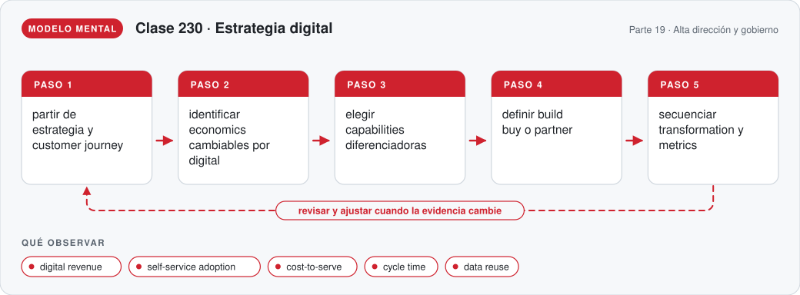

# Clase 230 — Estrategia digital

<!-- nav:inicio -->
> **Parte 19 · Tecnología, datos, IA y transformación digital para ejecutivos** — clase 2 de 12 · [índice de la parte](../../README.md) · [temario](../../../../SYLLABUS.md)
<!-- nav:fin -->

**Parte:** 19 — Tecnología, datos, IA y transformación digital para ejecutivos  
**Nivel:** Etapa 5 — CEO → Transformador digital  
**Duración sugerida:** 150–180 minutos · **Estándar:** deep-class-v2

## 🎯 Propósito

«Necesitamos una estrategia digital» es una frase que suele significar tres cosas distintas: una aplicación móvil, un sitio web más moderno o un programa para reemplazar papeles por pantallas. Todas son formas de **digitalizar**, es decir, de pasar procesos existentes a un soporte tecnológico. Una **estrategia digital** es otra cosa: es una decisión sobre cómo la tecnología cambia la **economía** del negocio, la **propuesta de valor** para el cliente y las **fuentes de ventaja** frente a competidores que tienen las mismas herramientas. La diferencia se nota en las preguntas: digitalizar pregunta «¿cómo hago este proceso en un sistema?»; la estrategia digital pregunta «¿qué parte de nuestra economía puede cambiar con tecnología y cuál será la ventaja de hacerlo bien?».

La clase se apoya en el estudio de Westerman, Bonnet y McAfee sobre cómo lideran las empresas su transformación digital, en el análisis de Iansiti y Lakhani sobre negocios organizados alrededor de datos y algoritmos, en las ideas de McAfee y Brynjolfsson sobre plataformas y multitudes, en la economía de la información y de las redes de Shapiro y Varian y en la definición de estrategia de Rumelt. Al terminar sabrás partir de la estrategia y del recorrido del cliente, identificar las economías que la tecnología puede cambiar, elegir capacidades diferenciadoras, definir el modelo operativo y las inversiones y sostener la medición.

## 📚 Resultados de aprendizaje

Al finalizar podrás:

1. **Distinguir** digitalización y estrategia digital.
2. **Identificar** qué economías del negocio puede cambiar la tecnología.
3. **Elegir** capacidades digitales diferenciadoras y renunciar a otras.
4. **Rediseñar** procesos y decisiones antes o junto con la tecnología.
5. **Definir** el modelo operativo, las inversiones y las métricas.

## 🧭 Agenda

| Tramo | Qué se hace |
|---|---|
| 0–20 min | Recuperación: ¿qué iniciativa «digital» de tu empresa cambió realmente la economía del negocio y cuál solo cambió el soporte? |
| 20–60 min | Estrategia, recorrido del cliente, economías, capacidades, proceso, modelo operativo y métricas. |
| 60–105 min | Ejemplo trabajado: canal de pedidos digital para clientes empresariales. |
| 105–150 min | Caso ejecutivo y práctica. |
| 150–175 min | Límites y entregable. |

## 🧩 Conceptos centrales

| Concepto | Definición | Cómo se reconoce |
|---|---|---|
| **Digitalización** | Traspaso de procesos existentes a soporte digital. | Menos papel y mayor registro. |
| **Estrategia digital** | Decisiones sobre cómo la tecnología cambia el modelo de negocio y la ventaja. | Cambia costos, ingresos o propuesta. |
| **Recorrido del cliente** | Secuencia de interacciones del cliente con la empresa. | Pasos, emociones y fricciones. |
| **Costo de servir** | Costo de atender a un cliente o transacción. | Costo por pedido, por cliente. |
| **Efecto de red** | Valor que crece con el número de usuarios. | Plataformas y mercados. |
| **Costo de cambio (*switching cost*)** | Costo del usuario por pasar a otro proveedor. | Datos y hábitos retenidos. |

## 🧠 Modelo mental

**Cómo leer el diagrama.** Una tabla de cinco filas que compara digitalizar con una estrategia digital. En la **pregunta**, digitalizar pregunta cómo hacer un proceso en un sistema; la estrategia pregunta cómo cambia la economía y la propuesta de valor. En el **alcance**, uno es un proceso o una función; la otra, clientes, modelo de negocio y operación. En el **resultado**, menos papel y menos errores frente a costos, ingresos o ventajas distintas. En el **riesgo**, automatizar desperdicio frente a competir con reglas que otros dominan. En el **responsable**, tecnología o el área usuaria frente al comité de dirección. La nota explica que la estrategia digital parte de la estrategia de la empresa y del recorrido del cliente.

## 📖 Desarrollo

### 1. Digitalizar no es una estrategia

Westerman y colaboradores encontraron que las empresas con mejor desempeño digital no eran las que más gastaban en tecnología, sino las que combinaban **intensidad digital** (qué tanto cambian la experiencia del cliente, los procesos y los modelos de negocio) con **intensidad de gestión de la transformación** (visión, gobierno, compromiso, cultura). Muchas organizaciones tienen mucha tecnología y poca estrategia: aplicaciones que nadie usa, procesos digitales que replican los antiguos, datos que no se explotan. Digitalizar un proceso es una mejora de eficiencia que **puede ser valiosa**, pero que **no cambia la posición competitiva** si los competidores hacen lo mismo. La estrategia pregunta dónde la tecnología permite hacer algo que antes no era posible o rentable.

### 2. Partir de la estrategia y del cliente

Rumelt define la estrategia como un diagnóstico, una política guía y acciones coherentes (clase 212); la estrategia digital debe encajar en ella, no sustituirla. El punto de partida es doble: **¿cuál es el desafío crítico del negocio?** y **¿cómo vive el cliente su relación con nosotros?** Se mapea el **recorrido del cliente** (búsqueda, compra, uso, servicio, renovación), se identifican **fricciones** (esperas, errores, llamadas repetidas, trámites) y **momentos de verdad** (donde se gana o se pierde la relación), y se cuantifica su efecto en ingresos, retención y costos. Muchos proyectos digitales fracasan porque resuelven un problema que el cliente no tiene, o que tienen en un paso menos importante del recorrido.

### 3. Qué economías puede cambiar la tecnología

La tecnología cambia sobre todo cuatro economías. El **costo de servir**: una transacción digital de autoservicio cuesta mucho menos que una atendida por una persona. El **alcance y la velocidad**: llegar a más clientes y lanzar productos en semanas. La **información**: datos que permiten personalizar, fijar precios, prever demanda o evaluar riesgo. Y la **estructura de mercado**: plataformas que conectan a dos lados, con **efectos de red** y **costos de cambio**. Shapiro y Varian explican cómo, en la economía de la información, los costos fijos altos y marginales bajos, los efectos de red y los costos de cambio producen dinámicas de **ganador se lleva casi todo**, y cómo los datos y los hábitos del cliente se vuelven barreras. La estrategia digital identifica cuál de estas economías es relevante para el negocio.

### 4. Elegir capacidades diferenciadoras

No todo se puede ni conviene hacer. La estrategia digital **elige** las pocas capacidades en que la empresa quiere ser mejor que los demás (por ejemplo, la experiencia de compra, el uso de datos de clientes, la logística, el riesgo) y **acepta ser estándar** en las demás, comprándolas (clase 236). Iansiti y Lakhani muestran que la ventaja digital proviene de combinar **datos**, **algoritmos** y **un modelo de operación** que escala con bajo costo marginal; las empresas que no lo tienen pueden competir por otros caminos (cercanía, especialización), pero necesitan una decisión explícita. Se renuncia con claridad: lo que no se prioriza no se financia.

### 5. Rediseñar el proceso y la decisión

Digitalizar un proceso ineficiente es automatizar el desperdicio. McAfee y Brynjolfsson sostienen que las empresas obtienen valor de las nuevas tecnologías cuando **rediseñan procesos, organización y decisiones**, no solo cuando las instalan. Antes de construir, se pregunta: ¿este paso es necesario?, ¿esta aprobación agrega valor?, ¿quién decide y con qué información?, ¿qué excepciones se pueden eliminar? Un proceso rediseñado, aunque siga siendo manual, ya produce ahorros; luego la tecnología los multiplica. En la práctica, conviene hacer la **simplificación primero** o **junto con** la tecnología, no después.

### 6. Modelo operativo, inversiones y gobierno

La estrategia se traduce en un **modelo operativo**: qué equipos construyen y operan los productos digitales (equipos de producto con tecnología y negocio juntos), qué plataformas comunes existen (datos, identidad, pagos), qué decisiones se toman en cada nivel y cómo se financia (por producto o capacidad, no por proyecto). Westerman y colaboradores destacan el papel del **gobierno**: un comité de dirección que define prioridades, arbitra conflictos y evalúa resultados, y un responsable (ejecutivo) con autoridad para coordinar. Se fija un **portafolio de iniciativas** con distintos niveles de riesgo: mejoras de eficiencia, nuevas capacidades y apuestas, con etapas y puertas de decisión (clase 228).

### 7. Medir y ajustar

La estrategia digital se evalúa con **indicadores de negocio**: costo de servir por canal, tasa de adopción digital, retención, ingresos por cliente, tiempo de lanzamiento de productos, satisfacción y resultados financieros. Se contrastan con la **línea base** y con las metas que justificaron la inversión. Se revisan los **supuestos** (¿los clientes adoptan?, ¿el costo de servir bajó?, ¿los competidores reaccionaron?). Y se aprende: lo que funcionó se escala, lo que no se corrige o se detiene. Una estrategia digital no es un plan de tres años cerrado, sino una **hipótesis** sobre cómo la tecnología cambiará la economía, que se prueba y se ajusta.

## 📚 Lectura comparada

| Obra | Qué aporta | Qué no resuelve | Pregunta para contrastar |
|---|---|---|---|
| Westerman, Bonnet y McAfee | Intensidad digital e intensidad de gestión de la transformación. | Marco descriptivo. | ¿Qué falta: tecnología o liderazgo? |
| Iansiti y Lakhani | Negocios con datos, algoritmos y bajo costo marginal. | Casos de empresas muy digitales. | ¿Nuestro modelo escala con bajo costo marginal? |
| McAfee y Brynjolfsson | Rediseño de procesos junto con máquinas, plataformas y multitudes. | No da pasos específicos. | ¿Qué proceso se rediseña? |
| Shapiro y Varian | Efectos de red, costos de cambio y economía de la información. | Foco en mercados de información. | ¿Qué barrera construye la tecnología? |
| Rumelt | Estrategia como diagnóstico, política guía y acciones coherentes. | No habla de tecnología. | ¿Cuál es el desafío crítico? |

## 🧮 Ejemplo trabajado

**Situación (hipotética).** Una empresa de distribución recibe 150.000 pedidos al año de clientes empresariales, atendidos por vendedores y asistentes a un costo de servir de 38.000 pesos por pedido. Un canal digital de autoservicio costaría 9.000 pesos por pedido atendido. Inversión: 2.800 millones de pesos; operación anual: 400 millones.

**Ahorro por adopción.**

| Adopción | Pedidos digitales | Ahorro bruto (29.000 por pedido) | Ahorro neto (− 400) | Plazo de recuperación |
|---|---|---|---|---|
| 25 % | 37.500 | 1.087,5 millones | 687,5 millones | 2.800 ÷ 687,5 ≈ 4,1 años |
| 40 % | 60.000 | 1.740 millones | 1.340 millones | 2.800 ÷ 1.340 ≈ 2,1 años |

La decisión depende de la **adopción**, un supuesto de comportamiento del cliente, no de tecnología.

**Preguntas de estrategia.** (1) ¿Por qué adoptarían los clientes? El recorrido muestra que el 55 % de los pedidos se repiten cada semana y que los clientes esperan una confirmación de stock inmediata. (2) ¿Qué ventaja da? Costo de cambio: historial, listas de compra y facturación integrada. (3) ¿Qué se renuncia? Atención personalizada para los pedidos pequeños; los vendedores se concentran en cuentas grandes.

**Rediseño del proceso antes de la tecnología.** El proceso actual exige tres aprobaciones internas por pedido, de las cuales dos casi nunca cambian la decisión. Se eliminan: el costo de servir del canal tradicional baja de 38.000 a 31.000 pesos. En el escenario de 40 % de adopción, los 90.000 pedidos restantes ahorran 90.000 × 7.000 = 630 millones al año, **sin inversión**.

**Resultado combinado (40 % de adopción).** Ahorro neto del canal digital: 1.340 millones; ahorro por rediseño: 630. Total anual: 1.970 millones. La inversión de 2.800 se recupera en 2.800 ÷ 1.970 ≈ 1,4 años. Si la adopción es de 25 %, los restantes 112.500 pedidos ahorran 112.500 × 7.000 = 787,5; total: 687,5 + 787,5 = 1.475 millones; recuperación en 1,9 años. El **rediseño** protege el resultado ante una adopción menor.

**Indicadores.** Adopción digital por segmento; costo de servir por canal; retención de clientes; tiempo de confirmación; satisfacción; ventas por vendedor en cuentas grandes. Metas a 12 meses: 30 % de adopción, costo de servir de 31.000 en el canal tradicional y retención de 95 %.

**Puerta de decisión.** Si a los seis meses la adopción es menor al 15 %, se detiene la segunda fase de inversión y se rediseña la oferta.

**Cuidados.** La adopción, los costos y los efectos en vendedores son hipótesis; los cambios que afectan funciones o comisiones del personal se verifican con asesoría laboral; las cifras son ilustrativas.

**Qué muestra.** (1) La estrategia partió de la economía del negocio y del cliente. (2) El rediseño del proceso produjo ahorro sin tecnología. (3) La adopción fue el supuesto crítico y tiene una puerta de decisión.

## 🔀 Comparación y límites

**Estrategia digital frente a transformación digital.** La estrategia define adónde y por qué; la transformación es el proceso de cambio organizacional para lograrlo (clase 178).

**Límites.** La tecnología cambia rápido y los supuestos de adopción son inciertos. Los efectos de red y los costos de cambio no se dan en todos los negocios. Digitalizar un mal proceso automatiza el desperdicio; rediseñar proceso y decisión es parte de la estrategia. Las cifras del ejemplo son ilustrativas.

## 🪜 De profesional a owner

| Nivel | Cómo participa |
|---|---|
| **Profesional** | Señala fricciones del recorrido del cliente y del proceso. |
| **Jefe / Team Lead** | Rediseña pasos innecesarios de su proceso. |
| **Gerente** | Es dueño de un recorrido o producto digital con métricas. |
| **CEO / Director** | Fija la estrategia digital, elige capacidades y exige resultados. |
| **Founder / Owner** | Decide si cambiar el modelo de negocio o defender el actual. |

## 🏢 Caso ejecutivo

Una cadena de ferreterías con 85 tiendas y ventas de 200.000 millones de pesos quiere «ser digital». El área de tecnología propone una aplicación de compra y retiro (2.900 millones), un programa de lealtad con datos (1.800 millones) y un portal para contratistas (2.400 millones). Hechos: el 22 % de las ventas proviene de contratistas profesionales que compran por teléfono y planilla; el 70 % de los clientes consulta stock por teléfono; la competencia lanzó una aplicación con compra y retiro en una hora; el costo de atender una venta telefónica es de 4.800 pesos y una digital, de 900; hay 38.000 llamadas diarias para consultar stock; las tiendas tienen inventario con 14 % de diferencias con el sistema; los vendedores ganan comisiones por venta atendida. El directorio pregunta cuál iniciativa va primero.

Entrega un **memo de estrategia digital** que contenga: (a) el desafío crítico, el recorrido del cliente y las fricciones; (b) las economías que la tecnología puede cambiar, con números; (c) las capacidades diferenciadoras y las que se compran, con lo que se renuncia; (d) el rediseño de procesos y decisiones previo o simultáneo; (e) el modelo operativo, el portafolio con puertas de decisión y las métricas; (f) los riesgos, los supuestos críticos y las verificaciones laborales y de datos pendientes.

## 🧪 Práctica

1. Describe el recorrido de un cliente en cinco pasos y marca dos fricciones con su costo.
2. Calcula el costo de servir de dos canales y el ahorro por transacción.
3. Identifica una capacidad que quieres diferenciar y tres que comprarías.
4. Rediseña un proceso eliminando dos pasos antes de digitalizarlo.
5. Define cuatro indicadores de éxito con línea base, meta y puerta de decisión.

## ⚠️ Errores frecuentes

| Error | Por qué ocurre | Cómo corregirlo |
|---|---|---|
| Digitalizar el proceso actual | Es lo más rápido | Rediseñar antes o junto con la tecnología. |
| Partir de la herramienta | Moda o oferta de proveedores | Partir de estrategia y recorrido del cliente. |
| Querer todo | No se elige | Elegir pocas capacidades diferenciadoras. |
| Suponer adopción | Optimismo | Probar con pilotos y puertas de decisión. |
| Estrategia solo de tecnología | Se delega | Comité de dirección y dueños de negocio. |
| No medir el costo de servir | Se desconoce el dato | Línea base por canal. |

## ❓ Preguntas de comprobación

1. ¿Qué diferencia hay entre digitalizar y tener una estrategia digital?
2. ¿Qué economías puede cambiar la tecnología?
3. ¿Por qué se parte del recorrido del cliente?
4. ¿Qué significa elegir capacidades diferenciadoras?
5. ¿Por qué rediseñar el proceso antes o junto con la tecnología?
6. ¿Qué incluye el modelo operativo digital?
7. ¿Qué supuesto suele ser crítico en un canal digital?

Claves de respuesta

1. Digitalizar traspasa procesos existentes a un soporte tecnológico; la estrategia digital decide cómo la tecnología cambia la economía, la propuesta y la ventaja.
2. El costo de servir, el alcance y la velocidad, la información y la estructura del mercado, incluidos efectos de red y costos de cambio.
3. Para resolver problemas reales del cliente y localizar las fricciones y momentos de verdad con efecto económico.
4. Elegir las pocas capacidades en que se quiere ser mejor y aceptar ser estándar, comprándolas, en las demás.
5. Porque digitalizar un proceso ineficiente automatiza el desperdicio; la simplificación ya produce ahorros.
6. Equipos de producto, plataformas comunes, decisiones por nivel, financiamiento por capacidad y gobierno de dirección.
7. La adopción por parte de los clientes, que es un supuesto de comportamiento.

## 📥 Entregable

Guarda en `portfolio/230-estrategia-digital/`:

- `strategy-memo.md` (plantilla [Strategy memo](../../../../templates/strategy-memo.md)) con el memo del caso ejecutivo;
- `process-map.md` (plantilla [Process map](../../../../templates/process-map.md)) con el recorrido del cliente y el proceso rediseñado;
- `decision-journal.md` con las economías, los supuestos críticos y las puertas de decisión.

## 📗 Fuentes y verificación

- George Westerman, Didier Bonnet & Andrew McAfee — *Leading Digital* (Harvard Business Review Press, 2014). **Uso en esta clase:** intensidad digital e intensidad de gestión de la transformación. Lectura selectiva sobre **estrategia digital**. **Localizador:** [ISBN-13 9781625272478](https://openlibrary.org/isbn/9781625272478).
- Marco Iansiti & Karim R. Lakhani — *Competing in the Age of AI* (Harvard Business Review Press, 2020). **Uso en esta clase:** negocios con datos, algoritmos y bajo costo marginal. Lectura selectiva sobre **estrategia digital**. **Localizador:** [ISBN-13 9781633697621](https://openlibrary.org/isbn/9781633697621).
- Andrew McAfee & Erik Brynjolfsson — *Machine, Platform, Crowd* (Norton & Company, Incorporated, W. W., 2017). **Uso en esta clase:** rediseño de procesos con máquinas, plataformas y multitudes. Lectura selectiva sobre **estrategia digital**. **Localizador:** [ISBN-13 9780393254303](https://openlibrary.org/isbn/9780393254303).
- Carl Shapiro & Hal R. Varian — *Information Rules* (Harvard Business School Press, 1998). **Uso en esta clase:** efectos de red, costos de cambio y economía de la información. Lectura selectiva sobre **estrategia digital**. **Localizador:** [ISBN-13 9780875848631](https://openlibrary.org/isbn/9780875848631).
- Richard Rumelt — *Good Strategy/Bad Strategy* (Profile Books, 2011). **Uso en esta clase:** estrategia como diagnóstico, política guía y acciones coherentes. Lectura selectiva sobre **estrategia digital**. **Localizador:** [ISBN-13 9781846684807](https://openlibrary.org/isbn/9781846684807).

> **Regla de fuentes para Estrategia digital:** las obras anteriores estructuran las perspectivas de esta materia; cualquier norma, ley o estándar vivo mencionado debe comprobarse nuevamente en su fuente primaria vigente, incluidas las normas de datos personales, de comercio electrónico y laborales. Los ejemplos y casos son hipotéticos, con cifras ilustrativas. El desarrollo es original y no reproduce capítulos protegidos.

<!-- pie:inicio -->
---

| Anterior | Índice | Siguiente |
|---|---|---|
| [← 229 · Tecnología como capacidad empresarial](../229-tecnologia-como-capacidad-empresarial/README.md) | [Parte 19](../../README.md) · [Programa](../../../../SYLLABUS.md) | [231 · Economía de cloud y plataformas →](../231-economia-de-cloud-y-plataformas/README.md) |
<!-- pie:fin -->
