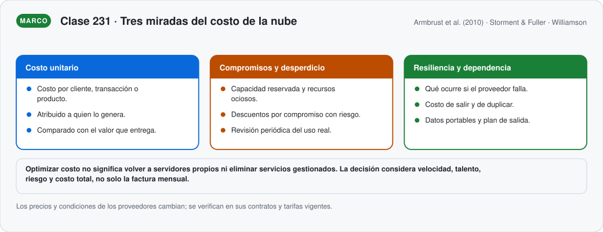

# Clase 231 — Economía de cloud y plataformas

<!-- nav:inicio -->
> **Parte 19 · Tecnología, datos, IA y transformación digital para ejecutivos** — clase 3 de 12 · [índice de la parte](../../README.md) · [temario](../../../../SYLLABUS.md)
<!-- nav:fin -->

**Parte:** 19 — Tecnología, datos, IA y transformación digital para ejecutivos  
**Nivel:** Etapa 5 — CEO → Transformador digital  
**Duración sugerida:** 150–180 minutos · **Estándar:** deep-class-v2

## 🎯 Propósito

La nube prometió convertir los costos fijos de tecnología (servidores comprados, centros de datos) en costos variables que se pagan por uso. Para muchas empresas, esa promesa se cumplió en velocidad y flexibilidad, pero también produjo una sorpresa: una factura mensual que crece sin que nadie la entienda. Los equipos de producto crean recursos sin apagarlos, los entornos de prueba funcionan los fines de semana, los compromisos de capacidad se contratan sin saber la demanda, y el comité de dirección recibe un reporte con un número grande y una pregunta incómoda: ¿estamos gastando bien? La **economía de la nube** consiste en responder con precisión: cuánto cuesta cada cliente, transacción o producto; cuánto desperdicio hay; qué compromisos conviene tomar; qué riesgo de dependencia se asume; y cuándo el beneficio (velocidad, escala, resiliencia) justifica el costo.

La clase se apoya en el estudio clásico de Armbrust y colaboradores sobre la computación en la nube, en la práctica de gestión financiera de la nube (FinOps) descrita por Storment y Fuller, en la economía de los costos de transacción de Williamson para analizar la dependencia de proveedores, en Shapiro y Varian sobre costos de cambio y en el libro de ingeniería de confiabilidad de Beyer y colaboradores. Al terminar sabrás calcular costos unitarios, identificar desperdicio, decidir compromisos, evaluar resiliencia y dependencia y optimizar sin sacrificar velocidad ni seguridad.

## 📚 Resultados de aprendizaje

Al finalizar podrás:

1. **Calcular** el costo unitario de la nube por cliente, transacción o producto.
2. **Identificar** desperdicio y oportunidades de compromiso de capacidad.
3. **Evaluar** el riesgo de dependencia y el costo de salida de un proveedor.
4. **Modelar** resiliencia y su costo frente al riesgo de interrupción.
5. **Decidir** una optimización considerando velocidad, talento y riesgo, no solo la factura.

## 🧭 Agenda

| Tramo | Qué se hace |
|---|---|
| 0–20 min | Recuperación: ¿cuánto cuesta en la nube atender a un cliente de tu empresa y quién lo sabe? |
| 20–60 min | Modelo de costos, costo unitario, desperdicio, compromisos, dependencia y resiliencia. |
| 60–105 min | Ejemplo trabajado: costo unitario, ahorros y decisión sobre múltiples nubes. |
| 105–150 min | Caso ejecutivo y práctica. |
| 150–175 min | Límites y entregable. |

## 🧩 Conceptos centrales

| Concepto | Definición | Cómo se reconoce |
|---|---|---|
| **Elasticidad** | Capacidad de aumentar o disminuir recursos con la demanda. | Pago por uso. |
| **Costo unitario** | Costo de la nube por unidad de negocio. | Por usuario activo, transacción o pedido. |
| **FinOps** | Práctica de gestión financiera de la nube entre finanzas, tecnología y negocio. | Etiquetas, presupuestos, revisiones. |
| **Compromiso de capacidad** | Contrato por uso mínimo a cambio de descuento. | Reservas, planes de ahorro. |
| **Desperdicio** | Recursos pagados y no usados o sobredimensionados. | Servidores ociosos, almacenamiento olvidado. |
| **Dependencia (*lock-in*)** | Costo y dificultad de cambiar de proveedor. | Servicios propietarios, datos atrapados. |

## 🧠 Modelo mental

**Cómo leer el diagrama.** Tres columnas. **Costo unitario**: costo por cliente, transacción o producto, atribuido a quien lo genera y comparado con el valor que entrega. **Compromisos y desperdicio**: capacidad reservada y recursos ociosos, descuentos por compromiso con riesgo y revisión periódica del uso real. **Resiliencia y dependencia**: qué ocurre si el proveedor falla, el costo de salir y de duplicar, y datos portables con plan de salida. La nota afirma que optimizar costo no significa volver a servidores propios ni eliminar servicios gestionados; el pie, que los precios y condiciones cambian y se verifican en contratos y tarifas vigentes.

## 📖 Desarrollo

### 1. Qué cambió con la nube y qué no

Armbrust y colaboradores describieron la computación en la nube como la ilusión de **recursos infinitos disponibles bajo demanda**, la eliminación del compromiso inicial de capital y el **pago por uso** a corto plazo. Identificaron además los incentivos económicos: la **elasticidad** permite ajustar la capacidad a una demanda variable, evitando el sobredimensionamiento que se hacía con servidores propios, y la **transferencia de riesgo** de subutilización al proveedor. Pero también señalaron obstáculos: dependencia del proveedor, confidencialidad, cuellos de botella de transferencia de datos, e impredecibilidad del desempeño. La conclusión para el ejecutivo es que la nube **cambia la estructura de costos y de riesgos**, no los elimina: el costo se vuelve variable y, por tanto, gestionable, pero solo si alguien lo gestiona.

### 2. Costo unitario: lo que importa es por unidad de negocio

Una factura total de 180 millones al mes no dice nada si no se sabe cuánto se vende o cuántos clientes se atienden. La práctica de **FinOps**, descrita por Storment y Fuller, propone que finanzas, tecnología y negocio trabajen juntos con datos compartidos: **etiquetar** recursos por producto, equipo y entorno; **atribuir** costos a quien los genera; y calcular **costos unitarios** (por usuario activo, por transacción, por pedido, por cliente). El costo unitario permite comparar productos, ver economías de escala (¿baja a medida que crece la demanda?) y detectar degradaciones (¿sube sin que cambie el negocio?). También permite fijar **precios y márgenes** informados: un producto cuyo costo en la nube por cliente supera lo que el cliente paga destruye valor aunque «crezca».

### 3. Desperdicio: la fuente de ahorro más rápida

La mayor parte de los ahorros iniciales proviene de eliminar **desperdicio**: instancias sobredimensionadas (más grandes de lo necesario), recursos ociosos (servidores que nadie usa, volúmenes de almacenamiento sin dueño), entornos de desarrollo y prueba que funcionan las 24 horas, datos que se conservan sin necesidad, servicios con redundancia innecesaria y transferencias de datos mal diseñadas. Se detecta con **informes de uso** y con la costumbre de revisar periódicamente. Se evita la tentación de recortar sin criterio: apagar un recurso que alguien usa causa un incidente. El método es **visibilidad primero** (etiquetas y dueños), luego **acción** acordada con los equipos, y **automatización** (apagado programado, políticas de tamaño).

### 4. Compromisos de capacidad: ahorrar con riesgo

Los proveedores ofrecen **descuentos por compromiso**: si el cliente se compromete a usar cierta capacidad durante uno o tres años, paga menos que la tarifa por demanda. Es un buen negocio para la **demanda base estable**, pero un riesgo para la variable: si la demanda cae o la arquitectura cambia, se paga por capacidad no usada. La regla práctica es **comprometer una fracción de la base mínima que se prevé estable** (por ejemplo, 60 a 70 %), dejar el resto bajo demanda y **revisar** regularmente. Se evalúa el efecto en distintos escenarios: ¿cuánto se ahorra si la demanda es la prevista?, ¿cuánto se pierde si cae 30 % o 50 %? Los términos y descuentos cambian y se verifican en los contratos.

### 5. Dependencia: el costo de salir

Williamson explica que cuando una parte realiza inversiones específicas en una relación (integraciones, personal capacitado, datos migrados), queda **expuesta** a decisiones de la otra (clase 185). Shapiro y Varian añaden que los **costos de cambio** son una fuente de poder en los mercados de tecnología. En la nube, la dependencia se concentra en los servicios **propietarios** (bases de datos, funciones, herramientas de análisis) y en los **datos** (el costo de extraerlos y transferirlos). Se estima el **costo de salida**: personas, rediseño, migración de datos, riesgo y tiempo de operación en paralelo. Se compara con el costo anual y con el **riesgo** que se mitiga: ¿una dependencia con un proveedor grande con buena trayectoria es peor que construir la propia infraestructura?, ¿qué pasa si cambian precios o condiciones?

### 6. Resiliencia: cuánto cuesta y qué evita

La disponibilidad tiene un costo creciente: operar en varias zonas de un mismo proveedor, en varias regiones o en varios proveedores aumenta la resiliencia y el costo (duplicación de infraestructura, complejidad, mayor necesidad de talento). Beyer y colaboradores, en el libro de ingeniería de confiabilidad de sitios, subrayan que la confiabilidad se diseña con **objetivos de nivel de servicio** y presupuestos de error: no se busca el 100 %, sino el nivel que justifica el negocio. La decisión se toma comparando el **costo de la redundancia** con el **costo esperado de interrupción** (probabilidad × impacto), considerando los tiempos de recuperación (clase 191). Una estrategia de múltiples nubes puede ser justificada por regulación o riesgo de concentración; con frecuencia, un diseño de buena resiliencia dentro de un proveedor, con datos portables y pruebas de recuperación, ofrece mejor relación costo-beneficio.

### 7. Optimizar sin destruir valor

Optimizar costos no es volver a servidores propios ni evitar los servicios gestionados. Estos últimos pueden ser más caros por unidad, pero reducen el costo de **talento y de operación** y aceleran la entrega. La decisión considera **velocidad** (tiempo de llegada al mercado), **talento** (qué equipo se necesita para operar), **riesgo** (seguridad, cumplimiento, dependencia) y **costo total**, no solo la factura. Se evita la «optimización» que ahorra 10 % de la factura y retrasa un producto tres meses. Se establecen **objetivos** (por ejemplo, costo unitario decreciente), **responsables por producto** y **revisiones mensuales** con negocio, finanzas y tecnología. Y se incorpora **seguridad** y **cumplimiento** desde el diseño, porque el costo de un incidente supera ampliamente el de la optimización.

## 📚 Lectura comparada

| Obra | Qué aporta | Qué no resuelve | Pregunta para contrastar |
|---|---|---|---|
| Armbrust y otros | Economía y obstáculos de la computación en la nube. | Texto de 2010; los servicios cambiaron. | ¿Qué riesgo transferimos y cuál conservamos? |
| Storment y Fuller | Gestión financiera de la nube con etiquetas, costos unitarios y colaboración. | Prácticas generales. | ¿Quién responde por el costo de cada producto? |
| Williamson | Dependencia por inversiones específicas. | Teoría general. | ¿Cuánto cuesta salir? |
| Shapiro y Varian | Costos de cambio en mercados de tecnología. | Foco en información. | ¿Qué nos ata a este proveedor? |
| Beyer y otros | Objetivos de nivel de servicio y confiabilidad. | Orientado a ingeniería. | ¿Qué disponibilidad necesita el negocio? |

## 🧮 Ejemplo trabajado

**Situación (hipotética).** Una empresa de comercio electrónico tiene una factura de nube de 180 millones de pesos al mes (2.160 millones al año), con 1,2 millones de usuarios activos mensuales y 40 millones de transacciones al mes.

**Costos unitarios.** 180 millones ÷ 1,2 millones = **150 pesos por usuario activo**; 180 millones ÷ 40 millones = **4,5 pesos por transacción**.

**Desperdicio detectado.** El análisis de uso muestra que el 22 % del gasto corresponde a recursos ociosos o sobredimensionados: 0,22 × 180 = 39,6 millones al mes. Se estima que se puede eliminar el 60 %: 23,8 millones al mes (285 millones al año).

**Compromisos de capacidad.** El gasto base estable es de 120 millones al mes (el resto, 60, es variable). Se compromete el 70 % de la base: 84 millones de capacidad a un descuento de 28 %. Costo con compromiso: 84 × 0,72 = 60,5 millones. Ahorro: 84 − 60,5 = 23,5 millones al mes (282 millones al año).

**Riesgo del compromiso.** Si la demanda base cae 30 % (de 120 a 84), la capacidad comprometida se usa por completo y el ahorro se mantiene. Si cae 50 % (a 60), la empresa paga 60,5 millones por una capacidad de la que solo usa 60 millones de equivalente: el costo es casi igual al de pagar por demanda (60), es decir, el ahorro desaparece, pero la pérdida es pequeña. Por eso se compromete el 70 % de la base y no más; con el 100 % de la base (120 millones comprometidos, 86,4 de costo), una caída de 50 % costaría 86,4 − 60 = 26,4 millones al mes sobre lo que se habría pagado por demanda.

**Ahorro total anual esperado.** 285 + 282 = **567 millones** (26,2 % de 2.160). El gasto mensual baja de 180 a 132,7 millones (180 − 23,8 − 23,5) y el costo unitario, de 150 a unos 111 pesos por usuario (132,7 ÷ 1,2).

**Decisión sobre múltiples nubes.** La empresa evalúa duplicar la plataforma en otro proveedor para evitar dependencia. Costo de salida actual estimado: 900 millones (migración, rediseño y operación en paralelo). Sobrecosto anual de una arquitectura de múltiples nubes: 15 % de 2.160 = 324 millones, más talento adicional. Riesgo evitado: probabilidad de una interrupción prolongada del proveedor de 5 % al año con un impacto de 1.500 millones: pérdida esperada de 75 millones. Los 324 millones de sobrecosto superan en 4,3 veces la pérdida esperada (324 ÷ 75); **no se justifica**.

**Alternativa elegida.** Resiliencia dentro del proveedor (varias zonas), pruebas de recuperación trimestrales, datos en formatos abiertos con exportaciones programadas, contenedores en los servicios críticos y un plan de salida documentado. Costo único: 120 millones; reduce el costo de salida de 900 a 500 millones.

**Gobierno.** Etiquetado obligatorio; presupuestos por producto; revisión mensual con finanzas; objetivo de costo unitario bajo 115 pesos por usuario en 12 meses; ninguna medida que aumente el tiempo de lanzamiento de un producto en más de dos semanas sin aprobación de negocio.

**Cuidados.** Los descuentos, compromisos y condiciones dependen del contrato con el proveedor y cambian con el tiempo; la seguridad y el cumplimiento se verifican con los responsables y la normativa vigente; las cifras son ilustrativas.

**Qué muestra.** (1) El costo unitario dio sentido a la factura. (2) El desperdicio y los compromisos generaron ahorro con riesgo acotado. (3) La decisión sobre dependencia comparó costo y riesgo esperado.

## 🔀 Comparación y límites

**Nube frente a infraestructura propia.** Una infraestructura propia puede ser más barata a gran escala con demanda estable y talento especializado; la nube ofrece velocidad y elasticidad. La decisión depende de la carga, el talento y el riesgo.

**Límites.** Los precios y descuentos cambian; las proyecciones de demanda son inciertas. La estimación de desperdicio capturable es aproximada. Los costos de salida son estimaciones. La resiliencia total no existe: se busca el nivel que el negocio justifica. Las cifras del ejemplo son ilustrativas.

## 🪜 De profesional a owner

| Nivel | Cómo participa en la economía de la nube |
|---|---|
| **Profesional** | Etiqueta y apaga lo que no usa. |
| **Jefe / Team Lead** | Conoce el costo de los recursos de su equipo. |
| **Gerente** | Es dueño del costo unitario de su producto. |
| **CEO / Director** | Fija objetivos de costo unitario y de resiliencia coherentes con el negocio. |
| **Founder / Owner** | Equilibra velocidad, costo y dependencia con los recursos disponibles. |

## 🏢 Caso ejecutivo

Una empresa de salud digital con 1.100 personas y 2,4 millones de pacientes registrados tiene una factura de nube de 310 millones de pesos al mes, que ha crecido 65 % en un año mientras los ingresos crecieron 22 %. Hechos: no hay etiquetado, de modo que nadie sabe qué producto genera cada gasto; un análisis preliminar sugiere que el 30 % corresponde a entornos de prueba y datos duplicados; hay un compromiso de capacidad de 3 años por 4.200 millones firmado hace un año, de los cuales se usa el 58 %; tres servicios críticos usan bases de datos propietarias del proveedor; el contrato de migración a otro proveedor fue cotizado en 2.800 millones; el regulador exige conservar datos clínicos por un plazo y que se mantengan en cierta jurisdicción; hubo una interrupción de 5 horas el año pasado que costó 380 millones; y el área de tecnología propone «volver a un centro de datos propio» para ahorrar. El director financiero pide un plan de reducción de 25 %.

Entrega un **memo de economía de la nube** que contenga: (a) los costos unitarios por producto y paciente, con el plan de etiquetado; (b) el desperdicio estimado y el plan de captura con riesgos; (c) la evaluación del compromiso existente y de nuevos compromisos con escenarios; (d) el análisis de dependencia, costo de salida y alternativas (múltiples nubes, portabilidad, retorno a infraestructura propia); (e) la resiliencia con objetivos de nivel de servicio y costo frente al riesgo; (f) las verificaciones contractuales, regulatorias y de seguridad pendientes.

## 🧪 Práctica

1. Calcula el costo unitario de tu producto o área por usuario y por transacción.
2. Estima el desperdicio de un entorno de prueba y su ahorro con apagado programado.
3. Evalúa un compromiso de capacidad en tres escenarios de demanda.
4. Estima el costo de salida de un proveedor y compáralo con el costo anual.
5. Compara el costo de una redundancia con la pérdida esperada de una interrupción.

## ⚠️ Errores frecuentes

| Error | Por qué ocurre | Cómo corregirlo |
|---|---|---|
| Mirar solo la factura total | No hay datos por unidad | Etiquetas y costos unitarios. |
| Recortar sin dueño | Se busca ahorro rápido | Visibilidad, dueños y automatización. |
| Comprometer demasiado | Descuento tentador | Comprometer una fracción de la base estable. |
| Duplicar todo por miedo a la dependencia | No se calcula el riesgo | Comparar costo y pérdida esperada. |
| Volver a lo propio sin analizar | Idea de «ahorro» | Costo total con talento, velocidad y riesgo. |
| No incluir seguridad | Se ve como costo | Diseño seguro y cumplimiento desde el inicio. |

## ❓ Preguntas de comprobación

1. ¿Qué cambia la nube en la estructura de costos y riesgos?
2. ¿Qué es un costo unitario y para qué sirve?
3. ¿Dónde suele estar el desperdicio?
4. ¿Cuándo conviene un compromiso de capacidad y qué riesgo tiene?
5. ¿Qué es el costo de salida?
6. ¿Cómo se decide la inversión en resiliencia?
7. ¿Por qué optimizar la factura no es optimizar el negocio?

Claves de respuesta

1. Convierte costos fijos en variables, da elasticidad y transfiere riesgos de capacidad, pero introduce dependencia y exige gestionar el costo.
2. El costo de la nube por usuario, transacción o producto; sirve para comparar, ver economías de escala y fijar márgenes.
3. En instancias sobredimensionadas, recursos ociosos, entornos de prueba que funcionan sin parar, datos duplicados y almacenamiento sin dueño.
4. Para la demanda base estable, comprometiendo una fracción; el riesgo es pagar capacidad no usada si la demanda cae.
5. El costo de cambiar de proveedor: migración, rediseño, personas, datos y operación en paralelo.
6. Comparando el costo de la redundancia con el costo esperado de interrupción (probabilidad por impacto) y los objetivos de nivel de servicio.
7. Porque puede ahorrar una parte de la factura y aumentar el costo de talento, riesgo o tiempo de lanzamiento.

## 📥 Entregable

Guarda en `portfolio/231-economia-de-cloud-y-plataformas/`:

- `risk-governance-brief.md` (plantilla [Risk Governance Brief](../../../../templates/risk-governance-brief.md)) con el memo del caso ejecutivo;
- `cash-runway.md` (plantilla [Cash runway](../../../../templates/cash-runway.md)) con la proyección de costos de nube y ahorros;
- `decision-journal.md` con los costos unitarios, los compromisos y el análisis de dependencia.

## 📗 Fuentes y verificación

- Michael Armbrust et al. — *A view of cloud computing* (Communications of the ACM, 2010). **Uso en esta clase:** economía y obstáculos de la computación en la nube. Lectura selectiva sobre **economía de cloud y plataformas**. **Localizador:** [DOI 10.1145/1721654.1721672](https://doi.org/10.1145/1721654.1721672).
- J. R. Storment & Mike Fuller — *Cloud FinOps* (O'Reilly Media, 2020). **Uso en esta clase:** gestión financiera de la nube con etiquetas y costos unitarios. Lectura selectiva sobre **economía de cloud y plataformas**. **Localizador:** [ISBN-13 9781492054627](https://openlibrary.org/isbn/9781492054627).
- Oliver E. Williamson — *Transaction-Cost Economics: The Governance of Contractual Relations* (The Journal of Law and Economics, 1979). **Uso en esta clase:** dependencia por inversiones específicas. Lectura selectiva sobre **economía de cloud y plataformas**. **Localizador:** [DOI 10.1086/466942](https://doi.org/10.1086/466942).
- Carl Shapiro & Hal R. Varian — *Information Rules* (Harvard Business School Press, 1998). **Uso en esta clase:** costos de cambio en mercados de tecnología. Lectura selectiva sobre **economía de cloud y plataformas**. **Localizador:** [ISBN-13 9780875848631](https://openlibrary.org/isbn/9780875848631).
- Betsy Beyer, Chris Jones, Jennifer Petoff & Niall Richard Murphy — *Site Reliability Engineering* (O'Reilly Media, 2016). **Uso en esta clase:** objetivos de nivel de servicio y confiabilidad. Lectura selectiva sobre **economía de cloud y plataformas**. **Localizador:** [ISBN-13 9781491929124](https://openlibrary.org/isbn/9781491929124).

> **Regla de fuentes para Economía de cloud y plataformas:** las obras anteriores estructuran las perspectivas de esta materia; cualquier norma, ley o estándar vivo mencionado debe comprobarse nuevamente en su fuente primaria vigente, incluidos los contratos con proveedores, las tarifas y las normas de datos y de ciberseguridad. Los ejemplos y casos son hipotéticos, con cifras ilustrativas. El desarrollo es original y no reproduce capítulos protegidos.

<!-- pie:inicio -->
---

| Anterior | Índice | Siguiente |
|---|---|---|
| [← 230 · Estrategia digital](../230-estrategia-digital/README.md) | [Parte 19](../../README.md) · [Programa](../../../../SYLLABUS.md) | [232 · Datos como activo operativo →](../232-datos-como-activo-operativo/README.md) |
<!-- pie:fin -->
