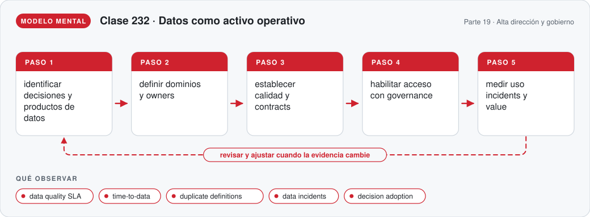

# Clase 232 — Datos como activo operativo

<!-- nav:inicio -->
> **Parte 19 · Tecnología, datos, IA y transformación digital para ejecutivos** — clase 4 de 12 · [índice de la parte](../../README.md) · [temario](../../../../SYLLABUS.md)
<!-- nav:fin -->

**Parte:** 19 — Tecnología, datos, IA y transformación digital para ejecutivos  
**Nivel:** Etapa 5 — CEO → Transformador digital  
**Duración sugerida:** 150–180 minutos · **Estándar:** deep-class-v2

## 🎯 Propósito

«Los datos son el nuevo petróleo» es una frase que se repite en los directorios y que casi nunca se traduce en decisiones. En la práctica, los datos de muchas empresas son más parecidos a un depósito de residuos que a un activo: hay tres versiones del cliente, cada área calcula las ventas de otra manera, nadie sabe quién es dueño de qué tabla, los analistas pasan días buscando datos antes de poder analizarlos, y los proyectos de inteligencia artificial se detienen porque «los datos no están listos». Tratar los datos como **activo operativo** significa darles lo que se da a cualquier otro activo de la empresa: dueño, calidad definida, costo, uso y retorno. Un dato sin dueño es una responsabilidad sin responsable; un dato sin consumidores es un costo sin beneficio.

La clase se apoya en el tratado de Kleppmann sobre sistemas intensivos en datos, en el enfoque de malla de datos de Dehghani (los datos como producto con dominios y dueños), en el análisis de Provost y Fawcett sobre ciencia de datos para negocios, en el estudio de Davenport y Harris sobre competir con análisis y en la taxonomía de problemas de privacidad de Solove. Al terminar sabrás identificar las decisiones y productos que dependen de datos, definir dominios y dueños, establecer calidad y contratos de datos, habilitar el acceso con gobierno y medir el valor del uso.

## 📚 Resultados de aprendizaje

Al finalizar podrás:

1. **Distinguir** un producto de datos de un simple conjunto de datos.
2. **Identificar** las decisiones y procesos que dependen de datos críticos.
3. **Definir** dominios, dueños, calidad y contratos de datos.
4. **Habilitar** el acceso con gobierno, privacidad y trazabilidad.
5. **Medir** el uso y el valor de los productos de datos.

## 🧭 Agenda

| Tramo | Qué se hace |
|---|---|
| 0–20 min | Recuperación: ¿cuántas versiones de «cliente activo» circulan en tu empresa y quién decide cuál vale? |
| 20–60 min | Decisiones, dominios, calidad, contratos, acceso, privacidad y valor. |
| 60–105 min | Ejemplo trabajado: el producto de datos «cliente único» y su retorno. |
| 105–150 min | Caso ejecutivo y práctica. |
| 150–175 min | Límites y entregable. |

## 🧩 Conceptos centrales

| Concepto | Definición | Cómo se reconoce |
|---|---|---|
| **Activo de datos** | Dato con dueño, calidad definida y uso que genera valor. | Se gestiona como los demás activos. |
| **Producto de datos** | Conjunto de datos tratado como producto: con dueño, usuarios y garantías. | Documentado, confiable y accesible. |
| **Dominio** | Área del negocio responsable de ciertos datos. | Clientes, productos, finanzas. |
| **Calidad de datos** | Grado en que los datos sirven al uso previsto. | Exactitud, completitud, oportunidad. |
| **Contrato de datos** | Acuerdo entre productor y consumidores sobre formato, significado y plazos. | Esquema, definiciones, niveles de servicio. |
| **Linaje** | Trazabilidad del origen y las transformaciones de un dato. | Se sabe de dónde viene y quién lo usa. |

## 🧠 Modelo mental

**Cómo leer el diagrama.** Una cadena de cinco pasos con retorno. **Decisiones y productos**: qué decisiones mejoran con datos. **Dominios y dueños**: quién responde por cada conjunto de datos. **Calidad y contratos**: definiciones y acuerdos de servicio. **Acceso con gobierno**: permisos, privacidad y trazabilidad. **Valor medido**: uso real y efecto en resultados. La flecha indica que el uso ajusta los productos de datos. La nota afirma que una única fuente física no siempre es necesaria y que lo crítico es el significado compartido y el gobierno; el pie, que los datos personales tienen reglas legales que se verifican en la fuente oficial.

## 📖 Desarrollo

### 1. Datos para decisiones, no datos por acumular

Davenport y Harris estudiaron empresas que compiten con **análisis** y encontraron que las que lo logran comparten un rasgo: tienen un **objetivo de negocio claro** para sus datos (decisiones de precios, de crédito, de inventario, de retención) y la capacidad organizacional para convertir el análisis en acción. Provost y Fawcett agregan que el valor de los datos depende de **qué decisión mejoran** y de si la empresa puede actuar sobre la recomendación. Por eso el primer paso no es construir una plataforma ni limpiar todo, sino listar las **decisiones y productos críticos** que dependen de datos, y a partir de ellos, los **datos que importan**. Esto evita un proyecto interminable de «ordenar los datos» sin consumidores.

### 2. Datos como producto: dominios y dueños

Dehghani propone, en su enfoque de **malla de datos**, tratar los datos como **producto** con tres rasgos: **propiedad por dominio** (el área que genera y conoce los datos es responsable de ponerlos a disposición con calidad), **dueño de producto** (alguien responde por usuarios, calidad y evolución) y **servicio autónomo** (los consumidores pueden descubrir, entender y usar los datos sin pasar por un cuello de botella central). El contraste es la práctica en que un equipo central de datos recibe pedidos de todas las áreas y se convierte en el cuello de botella. No se trata de descentralizar el gobierno, sino de **distribuir la responsabilidad** con estándares comunes (definiciones, seguridad, catálogos). La propiedad por dominio es más viable cuando hay **plataforma común** que reduce el costo de producir datos de buena calidad.

### 3. Calidad y significado compartido

La calidad de los datos se evalúa según su uso: **exactitud** (¿refleja la realidad?), **completitud** (¿faltan registros o campos?), **consistencia** (¿coinciden entre sistemas?), **oportunidad** (¿llegan a tiempo?), **unicidad** (¿hay duplicados?) y **validez** (¿cumplen el formato y las reglas?). Kleppmann subraya que, en sistemas con muchos componentes, la **consistencia** y la **evolución** de los datos son problemas de diseño: los esquemas cambian, los sistemas fallan y los datos se copian. Lo crítico para el negocio es el **significado compartido**: ¿qué es un «cliente activo»?, ¿qué es una «venta»?, ¿cuándo se cuenta un pedido? Cuando cada área define lo suyo, las reuniones se convierten en discusiones de definición. No siempre se necesita una única fuente física; se necesita una **semántica común** y un gobierno claro.

### 4. Contratos de datos y niveles de servicio

Un **contrato de datos** es un acuerdo explícito entre quien produce un conjunto de datos y quienes lo consumen: **esquema** (campos y tipos), **definiciones** (significado de cada campo), **calidad esperada** (porcentaje de completitud, tasa de errores), **frescura** (cada cuánto se actualiza), **disponibilidad**, **cambios** (cómo se avisan y cuándo) y **responsable**. Esto evita que un cambio en un sistema de origen rompa informes y modelos sin aviso. Se implementa con **pruebas automáticas**, **alertas** y **catálogos** que documentan los datos. Un producto de datos sin contrato es una promesa verbal; con contrato, es una obligación medible.

### 5. Acceso, privacidad y gobierno

Un buen acceso a datos equilibra **uso** y **protección**. Se define quién puede ver qué (por rol y por necesidad), qué datos son **personales o sensibles** y requieren controles adicionales (clase 186), cómo se registran los **accesos** y los **usos**, y cómo se asegura el **linaje** para saber de dónde viene un dato y quién lo usa. Solove muestra que los daños de privacidad no se limitan a la filtración: incluyen usos inesperados, agregaciones que revelan más de lo consentido y decisiones automatizadas inapropiadas; por eso el gobierno de datos incluye **evaluaciones de impacto** para nuevos usos. Un acceso demasiado restrictivo lleva a los equipos a crear copias paralelas y sombras; uno demasiado laxo crea riesgos. Las obligaciones de protección de datos personales se verifican en la normativa vigente y con asesoría.

### 6. Calidad de datos y economía

La mala calidad tiene costos medibles: entregas fallidas por direcciones erróneas, campañas duplicadas, decisiones basadas en informes inconsistentes, horas de analistas dedicadas a limpiar, sanciones por errores en datos regulatorios, modelos que fallan. Estimar estos costos permite **justificar la inversión** en calidad y priorizar los datos críticos. Se evita la perfección: la calidad requerida depende de la decisión; un dato para una decisión estratégica puede tolerar menos precisión que un dato para una facturación. El criterio es **suficiente para el uso**, medido y mejorado. Y se mide el **costo de la plataforma de datos** frente a su uso: datos que nadie consulta son una carga.

### 7. Medir el valor y evitar los errores típicos

Algunos indicadores: **porcentaje de datos críticos con dueño y contrato**, **calidad medida** (puntaje por conjunto), **tiempo para encontrar y acceder** a un dato, **número de consumidores activos** de cada producto, **decisiones o procesos que cambiaron** gracias a los datos, y **costo de la mala calidad evitado**. Errores frecuentes: **centralizar todo** y crear un cuello de botella; **descentralizar sin estándares**, con definiciones contradictorias; **construir plataformas sin casos de uso**; **dejar la calidad para después**; **ignorar la privacidad**; y **no retirar** datos y reportes que ya nadie usa. El éxito se ve en que las decisiones se toman más rápido y con más confianza, no en el tamaño del almacén de datos.

## 📚 Lectura comparada

| Obra | Qué aporta | Qué no resuelve | Pregunta para contrastar |
|---|---|---|---|
| Davenport y Harris | Competir con análisis: objetivo de negocio y capacidad organizacional. | Casos de empresas muy analíticas. | ¿Qué decisión mejora este dato? |
| Provost y Fawcett | Pensamiento de datos para decisiones de negocio. | Enfoque técnico-ejecutivo. | ¿Podemos actuar sobre la recomendación? |
| Kleppmann | Consistencia, evolución y diseño de sistemas de datos. | Técnico; hay que traducirlo. | ¿Qué pasa cuando cambia el esquema? |
| Dehghani | Datos como producto, dominios y dueños. | Exige madurez de plataforma. | ¿Quién es el dueño de este dato? |
| Solove | Problemas de privacidad: más allá de la filtración. | No da obligaciones legales. | ¿Qué daño podría causar este uso? |

## 🧮 Ejemplo trabajado

**Situación (hipotética).** Una empresa de comercio con 400.000 clientes en cuatro sistemas, 150.000 pedidos al año y 25 analistas diagnostica sus datos críticos: de 12 conjuntos de datos críticos, solo 5 tienen dueño (41,7 %); el tiempo promedio para encontrar y acceder a un dato es de 6 días; los registros de clientes duplicados llegan al 8 %.

**Costo de la mala calidad (anual).**

| Concepto | Cálculo | Millones |
|---|---|---|
| Campañas enviadas a clientes duplicados | 400.000 × 8 % = 32.000 duplicados × 600 pesos × 6 campañas | 115,2 |
| Entregas fallidas por datos erróneos | 150.000 pedidos × 0,6 % = 900 × 18.000 pesos | 16,2 |
| Tiempo de analistas perdido en buscar y limpiar | 250 solicitudes × 5 días × 8 horas × 30 % productivas × 18.000 pesos la hora | 54,0 |
| **Total** | | **185,4** |

**Producto de datos «cliente único».** Dueño: gerente de clientes (dominio comercial). Contrato: un registro por cliente, definición única de «cliente activo» (compra en los últimos 12 meses), actualización diaria, duplicados bajo 1 %, disponibilidad de 99,5 %, cambios avisados con 30 días. Costo: 280 millones de desarrollo (una vez) y 60 millones al año de operación.

**Efecto esperado.** Duplicados de 8 % a 1 %: ahorro de campañas = 115,2 × (7 ÷ 8) = 100,8 millones; entregas fallidas: reducción de 70 %: 11,3 millones; tiempo de analistas: 5 días a 1 día (reducción de 80 %): 43,2 millones. Total: 100,8 + 11,3 + 43,2 = **155,3 millones al año**. Beneficio neto: 155,3 − 60 = 95,3 millones al año.

**Retorno.** 280 ÷ 95,3 ≈ 2,9 años. El caso mejora si el dato único habilita mejores decisiones comerciales (por ejemplo, un aumento de 1 % de ventas recurrentes sobre 60.000 millones y margen de 25 %: 150 millones), que no se incluyó en el cálculo conservador.

**Gobierno.** Catálogo de datos con dueños; cuatro dominios con estándares comunes; datos personales con acceso por rol y registro de uso; evaluación de impacto para nuevos usos (por ejemplo, modelos de crédito); métricas mensuales.

**Indicadores a 12 meses (hipotéticos).** Conjuntos críticos con dueño y contrato: de 5 a 12 de 12; tiempo para acceder a un dato: de 6 a 1,5 días; duplicados: 1,2 %; consumidores activos del producto: 38 (análisis, marketing, operaciones, finanzas).

**Cuidados.** Los costos de mala calidad son estimaciones; el tratamiento de datos personales, el consentimiento y los usos permitidos se verifican en la normativa vigente y con asesoría; las cifras son ilustrativas.

**Qué muestra.** (1) La calidad se tradujo a pesos. (2) El producto de datos tuvo dueño, contrato y consumidores. (3) El retorno se calculó con supuestos conservadores.

## 🔀 Comparación y límites

**Datos como producto frente a plataforma de datos.** La plataforma es infraestructura común; el producto es el conjunto de datos con dueño y garantías que se construye sobre ella. Una plataforma sin productos no genera valor.

**Límites.** Una única fuente física no siempre es necesaria; centralizar todo puede reducir la velocidad sin mejorar la consistencia. La calidad perfecta no existe ni es necesaria. Los costos de la mala calidad son aproximados. Las reglas de privacidad varían por jurisdicción. Las cifras del ejemplo son ilustrativas.

## 🪜 De profesional a owner

| Nivel | Cómo trata los datos |
|---|---|
| **Profesional** | Registra datos con exactitud y respeta las definiciones. |
| **Jefe / Team Lead** | Reporta errores de datos y los corrige en la fuente. |
| **Gerente** | Es dueño de los datos de su dominio y responde por su calidad. |
| **CEO / Director** | Exige definiciones únicas y decide qué datos son críticos. |
| **Founder / Owner** | Trata los datos como parte del patrimonio de la empresa y de la confianza de los clientes. |

## 🏢 Caso ejecutivo

Una empresa de retail con 3.800 personas y 6 millones de clientes en seis sistemas (tiendas, comercio electrónico, programa de lealtad, call center, créditos y marketing) tiene tres definiciones de «cliente activo» (compró en 3, 6 o 12 meses), de modo que sus informes dan 1,8, 2,6 y 3,4 millones de clientes activos. Las ventas por cliente varían 40 % según el informe. El 14 % de los registros está duplicado; un proyecto de personalización con IA fracasó porque los modelos usaban datos inconsistentes; un analista cuenta que dedica el 60 % de su tiempo a limpiar datos. El área de tecnología propone «un lago de datos centralizado» de 4.800 millones; el área comercial quiere sus propios datos «porque no confía en tecnología»; el regulador pidió información sobre el tratamiento de datos de menores. El CEO pregunta cuántos clientes activos tiene y no recibe una respuesta única.

Entrega un **plan de datos como activo operativo** que contenga: (a) las decisiones y productos que dependen de datos y los datos críticos; (b) los dominios, dueños y el producto de datos «cliente único» con su contrato; (c) las definiciones únicas y la calidad medida con metas; (d) el modelo de acceso, privacidad y linaje con atención a los datos de menores; (e) el cálculo del costo de la mala calidad y del retorno; (f) el gobierno, los indicadores y las verificaciones legales y regulatorias pendientes.

## 🧪 Práctica

1. Lista cinco decisiones de tu área y los datos de los que dependen.
2. Asigna dominio y dueño a cinco conjuntos de datos y detecta los que no tienen.
3. Redacta el contrato de datos de un producto en una página con esquema, definiciones, calidad y frescura.
4. Estima el costo anual de la mala calidad de un conjunto de datos.
5. Define cinco indicadores de valor y de uso para un producto de datos.

## ⚠️ Errores frecuentes

| Error | Por qué ocurre | Cómo corregirlo |
|---|---|---|
| Construir plataformas sin casos de uso | Se piensa «primero la infraestructura» | Partir de decisiones y productos. |
| Cuello de botella central | Todo pasa por un equipo | Dominios con dueños y estándares comunes. |
| Definiciones contradictorias | Cada área define lo suyo | Semántica común y gobierno. |
| Calidad al final | Se deja para después | Calidad y contratos desde el diseño. |
| Ignorar la privacidad | Se ve como un freno | Gobierno de acceso y evaluaciones de impacto. |
| No medir el valor | Falta de indicadores | Uso, calidad y efecto en decisiones. |

## ❓ Preguntas de comprobación

1. ¿Qué diferencia hay entre un conjunto de datos y un producto de datos?
2. ¿Por qué se parte de las decisiones y no de la plataforma?
3. ¿Qué dimensiones tiene la calidad de datos?
4. ¿Qué incluye un contrato de datos?
5. ¿Cómo se equilibran acceso y protección?
6. ¿Cómo se estima el costo de la mala calidad?
7. ¿Por qué no siempre hace falta una única fuente física?

Claves de respuesta

1. El producto tiene dueño, usuarios, calidad definida y garantías; un conjunto de datos solo almacena registros.
2. Porque el valor de los datos depende de la decisión que mejoran y de que se pueda actuar sobre ella.
3. Exactitud, completitud, consistencia, oportunidad, unicidad y validez.
4. Esquema, definiciones, calidad esperada, frescura, disponibilidad, avisos de cambios y responsable.
5. Con acceso por rol y necesidad, registro de usos, linaje y evaluaciones de impacto, evitando tanto restricciones que generan copias paralelas como accesos laxos.
6. Sumando costos de entregas fallidas, campañas duplicadas, tiempo de analistas, decisiones erróneas y sanciones, con supuestos explícitos.
7. Porque lo crítico es el significado compartido y el gobierno; centralizar todo puede restar velocidad sin mejorar la consistencia.

## 📥 Entregable

Guarda en `portfolio/232-datos-como-activo-operativo/`:

- `leadership-decision-brief.md` (plantilla [Leadership Decision Brief](../../../../templates/leadership-decision-brief.md)) con el plan del caso ejecutivo;
- `ceo-dashboard.md` (plantilla [CEO dashboard](../../../../templates/ceo-dashboard.md)) con los indicadores de calidad y uso de los datos;
- `decision-journal.md` con los dueños, los contratos, el costo de la mala calidad y las verificaciones pendientes.

## 📗 Fuentes y verificación

- Thomas H. Davenport & Jeanne G. Harris — *Competing on Analytics* (Harvard Business School Press, 2007). **Uso en esta clase:** competir con análisis: objetivo de negocio y capacidad organizacional. Lectura selectiva sobre **datos como activo operativo**. **Localizador:** [ISBN-13 9781422103326](https://openlibrary.org/isbn/9781422103326).
- Foster Provost & Tom Fawcett — *Data Science for Business* (SHROFF - O'REILLY, 2013). **Uso en esta clase:** pensamiento de datos para decisiones de negocio. Lectura selectiva sobre **datos como activo operativo**. **Localizador:** [ISBN-13 9789351102670](https://openlibrary.org/isbn/9789351102670).
- Martin Kleppmann — *Designing Data-Intensive Applications* (O'Reilly publications, 2017). **Uso en esta clase:** consistencia, evolución y diseño de sistemas de datos. Lectura selectiva sobre **datos como activo operativo**. **Localizador:** [ISBN-13 9789352135240](https://openlibrary.org/isbn/9789352135240).
- Zhamak Dehghani — *Data Mesh* (O'Reilly Media, 2022). **Uso en esta clase:** datos como producto, dominios y dueños. Lectura selectiva sobre **datos como activo operativo**. **Localizador:** [ISBN-13 9781492092391](https://openlibrary.org/isbn/9781492092391).
- Daniel J. Solove — *Understanding Privacy* (Harvard University Press, 2008). **Uso en esta clase:** problemas de privacidad más allá de la filtración. Lectura selectiva sobre **datos como activo operativo**. **Localizador:** [ISBN-13 9780674035072](https://openlibrary.org/isbn/9780674035072).

> **Regla de fuentes para Datos como activo operativo:** las obras anteriores estructuran las perspectivas de esta materia; cualquier norma, ley o estándar vivo mencionado debe comprobarse nuevamente en su fuente primaria vigente, incluidas las normas de protección de datos personales y de datos de menores. Los ejemplos y casos son hipotéticos, con cifras ilustrativas. El desarrollo es original y no reproduce capítulos protegidos.

<!-- pie:inicio -->
---

| Anterior | Índice | Siguiente |
|---|---|---|
| [← 231 · Economía de cloud y plataformas](../231-economia-de-cloud-y-plataformas/README.md) | [Parte 19](../../README.md) · [Programa](../../../../SYLLABUS.md) | [233 · Portafolio de IA y casos de negocio →](../233-portafolio-de-ia-y-casos-de-negocio/README.md) |
<!-- pie:fin -->
