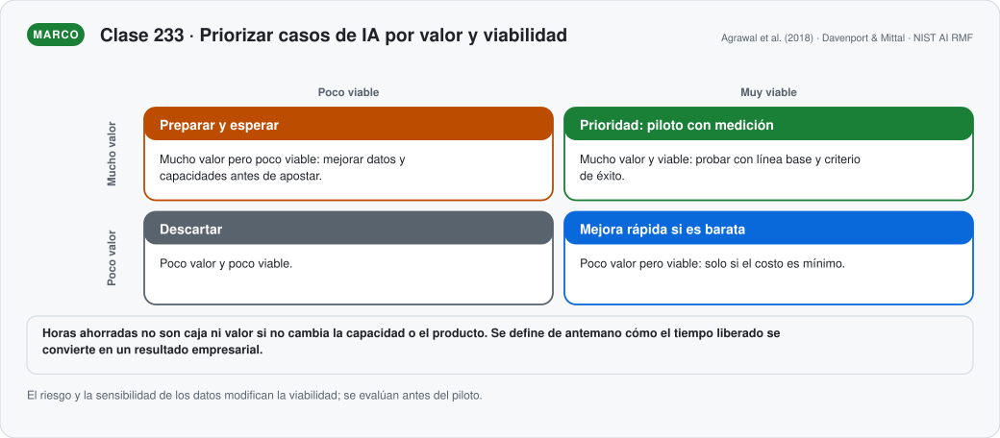

# Clase 233 — Portafolio de IA y casos de negocio

<!-- nav:inicio -->
> **Parte 19 · Tecnología, datos, IA y transformación digital para ejecutivos** — clase 5 de 12 · [índice de la parte](../../README.md) · [temario](../../../../SYLLABUS.md)
<!-- nav:fin -->

**Parte:** 19 — Tecnología, datos, IA y transformación digital para ejecutivos  
**Nivel:** Etapa 5 — CEO → Transformador digital  
**Duración sugerida:** 150–180 minutos · **Estándar:** deep-class-v2

## 🎯 Propósito

Las empresas llegan a la inteligencia artificial por dos caminos, y ninguno es bueno si se recorre sin método. El primero es la **moda**: se compran licencias, se abren pilotos en todas las áreas, se anuncian «iniciativas de IA», y un año después nadie puede decir qué resultado de negocio produjeron. El segundo es el **miedo**: se prohíbe todo hasta que haya un marco perfecto, mientras los empleados usan herramientas por su cuenta y los competidores avanzan. Entre ambos hay un camino sensato: tratar la IA como un **portafolio de casos de negocio**, cada uno con un problema concreto, una línea base, un valor medible, una evaluación de viabilidad (datos, técnica, riesgo), un piloto con criterio de éxito y una decisión posterior de escalar, ajustar o detener.

La clase se apoya en el análisis de Agrawal, Gans y Goldfarb, que describen la IA como una **reducción del costo de la predicción** y sus consecuencias económicas; en Davenport y Mittal sobre cómo las empresas se comprometen con IA a escala; en Iansiti y Lakhani sobre negocios organizados alrededor de datos y algoritmos; en Provost y Fawcett sobre pensamiento de datos; y en el marco de gestión de riesgos de IA del NIST. Al terminar sabrás inventariar flujos de trabajo y dolores, estimar valor frente a una línea base, evaluar viabilidad y riesgo, priorizar con un portafolio y pilotear con criterios de éxito y de parada.

## 📚 Resultados de aprendizaje

Al finalizar podrás:

1. **Distinguir** un caso de uso de IA de un portafolio de casos.
2. **Inventariar** flujos de trabajo y dolores que podrían beneficiarse de IA.
3. **Estimar** valor realizable frente a una línea base, distinguiendo ahorro de caja.
4. **Evaluar** viabilidad de datos y técnica, y el riesgo de cada caso.
5. **Priorizar** y pilotear con criterios de éxito, escalamiento y parada.

## 🧭 Agenda

| Tramo | Qué se hace |
|---|---|
| 0–20 min | Recuperación: ¿qué piloto de IA de tu empresa terminó sin que nadie supiera si funcionó? |
| 20–60 min | Economía de la predicción, inventario, valor, viabilidad, riesgo, portafolio y piloto. |
| 60–105 min | Ejemplo trabajado: seis casos con valor realizable, probabilidad y presupuesto. |
| 105–150 min | Caso ejecutivo y práctica. |
| 150–175 min | Límites y entregable. |

## 🧩 Conceptos centrales

| Concepto | Definición | Cómo se reconoce |
|---|---|---|
| **Caso de uso de IA** | Aplicación concreta de IA a un problema de negocio. | Problema, usuario, dato y resultado. |
| **Portafolio de IA** | Conjunto priorizado de casos con distinto riesgo y horizonte. | Presupuesto, etapas y revisión. |
| **Línea base** | Medida del desempeño actual antes de la IA. | Costo, tiempo, error, ingresos. |
| **Valor realizable** | Parte del valor estimado que se traduce en caja o resultado. | Menos que el ahorro bruto de horas. |
| **Viabilidad** | Posibilidad práctica de lograr el caso con datos, técnica y organización. | Datos disponibles, equipo, integración. |
| **Criterio de parada** | Condición que obliga a detener o cambiar un piloto. | Métrica y fecha. |

## 🧠 Modelo mental

**Cómo leer el diagrama.** Un cuadrante con la viabilidad en el eje horizontal (poco viable o muy viable) y el valor en el vertical (poco o mucho). **Mucho valor y muy viable**: prioridad, con piloto medido, línea base y criterio de éxito. **Mucho valor pero poco viable**: preparar y esperar, mejorando datos y capacidades antes de apostar. **Poco valor pero viable**: mejora rápida solo si es barata. **Poco valor y poco viable**: descartar. La nota recuerda que horas ahorradas no son caja ni valor si no cambia la capacidad o el producto; el pie, que el riesgo y la sensibilidad de los datos modifican la viabilidad.

## 📖 Desarrollo

### 1. Qué hace económicamente la IA

Agrawal, Gans y Goldfarb proponen una lectura económica clara: la inteligencia artificial moderna es, en esencia, una **tecnología de predicción** (completar información que falta a partir de la que se tiene), y su efecto principal es **abaratar la predicción**. Cuando algo se abarata, se usa más y se vuelven más valiosos sus complementos: los **datos**, el **juicio** humano para decidir qué hacer con la predicción y la **acción** (procesos que actúan). Esto orienta la búsqueda de casos: donde hay decisiones basadas en predicciones (demanda, fraude, riesgo, mantenimiento, cancelación de clientes, clasificación de documentos) y donde el costo o la lentitud de esas predicciones limita el negocio. Davenport y Mittal añaden que las empresas con resultados llevan sus proyectos de IA a producción con **objetivos de negocio**, no solo experimentos.

### 2. Inventariar flujos de trabajo y dolores

Se parte de los **flujos de trabajo** y de sus **dolores**, no de la tecnología: ¿dónde se pierde tiempo, dinero o clientes?, ¿qué decisiones se toman con información incompleta?, ¿qué tareas repetitivas consumen horas de personas calificadas?, ¿qué errores son frecuentes y costosos? Se lista el inventario con área, dueño, volumen, costo actual y qué haría una predicción o un asistente. Se incluyen tanto los usos **internos** (productividad, finanzas, personas) como los **orientados al cliente** (recomendaciones, atención, precios, riesgo). Y se registra el uso **espontáneo** de herramientas de IA por los empleados (clase 188), que revela dolores reales y riesgos.

### 3. Estimar el valor: línea base y valor realizable

Cada caso necesita una **línea base** (cómo se hace hoy y con qué resultado) y una **hipótesis de mejora** (qué cambiaría y cuánto). El error más frecuente es confundir **ahorro de horas** con **ahorro de caja**. Si un asistente ahorra 12.000 horas al año a 40.000 pesos la hora, el ahorro «de papel» es de 480 millones; pero solo se vuelve caja si se **reduce gasto** (no reemplazar vacantes, reducir contratistas) o se **usa la capacidad liberada** para generar más ingresos o atender más sin contratar. Se calcula un **valor realizable**, con la **tasa de conversión** de horas a caja y los **costos** (licencias, integración, datos, gobierno, cambio de procesos, mantenimiento). Si no se define cómo el tiempo liberado se convierte en un resultado empresarial, el valor es ficticio.

### 4. Evaluar viabilidad: datos, técnica y organización

La viabilidad tiene tres frentes. **Datos** (clase 232): ¿existen en cantidad y calidad suficientes?, ¿son accesibles y se pueden usar legal y éticamente? **Técnica**: ¿la tarea es adecuada para la tecnología disponible?, ¿qué nivel de precisión se necesita y se puede lograr?, ¿cómo se integra con los sistemas? **Organización**: ¿hay un dueño de negocio y usuarios dispuestos?, ¿los procesos permiten usar la predicción?, ¿hay talento para construir, operar y mantener? Provost y Fawcett subrayan que la calidad de una solución de datos depende de definir bien el problema y la métrica de éxito; un modelo con alta precisión en una métrica irrelevante no sirve. Se prefieren casos donde la **mejora marginal** ya tiene valor y donde el error es tolerable o controlable.

### 5. Evaluar riesgo e impacto

El marco de gestión de riesgos de IA del NIST invita a mapear el **contexto**, medir los riesgos y gestionarlos. Para cada caso se evalúan: **impacto sobre personas** (decisiones sobre crédito, empleo, salud o precios), **sensibilidad de los datos** (personales, confidenciales), **riesgo de errores** (alucinaciones, sesgo, fallas de seguridad), **dependencia de proveedores**, **cumplimiento** (clase 188) y **reputación**. Los casos de alto impacto exigen supervisión humana efectiva, pruebas de sesgo y trazabilidad; los de bajo impacto, reglas básicas de uso. El riesgo no necesariamente descarta un caso, pero determina el **gobierno** y el **costo** necesarios, y se incorpora al cálculo.

### 6. Armar el portafolio

Un portafolio equilibra: **casos de productividad interna** (rápidos, de bajo riesgo), **casos que cambian procesos centrales** (mayor valor, más complejos), **casos de producto o cliente** (estratégicos, con mayor riesgo) y **apuestas exploratorias** (opciones). Se ordenan por **valor esperado** (probabilidad de éxito × valor realizable − costo) y por **retorno por peso invertido**, con límites de capacidad (equipo de datos, integración, cambio organizacional). Se incluye **presupuesto limitado para exploración**, con puertas de decisión (clase 228). Se evita el exceso de pilotos simultáneos: la capacidad de absorción de la organización es el cuello de botella. Y se decide qué **no** se hará, y por qué.

### 7. Pilotear, escalar o detener

Un piloto bien diseñado tiene: **hipótesis** (qué creemos que ocurrirá), **línea base**, **grupo de comparación** cuando sea posible, **métricas** de resultado (no solo de uso), **duración**, **criterios de éxito** y **criterios de parada**, y un **plan de escalamiento** condicionado (qué cambia en procesos, personas, tecnología y control). Davenport y Mittal observan que muchas empresas quedan atrapadas en el «purgatorio de pilotos» porque no definen cómo pasar a producción. Se decide con evidencia: **escalar** (resultados sobre el umbral), **ajustar** (resultados parciales con causas claras) o **detener** (no hay valor o el riesgo es inaceptable). Se documenta el aprendizaje y se compara el resultado real con el estimado para calibrar futuras estimaciones.

## 📚 Lectura comparada

| Obra | Qué aporta | Qué no resuelve | Pregunta para contrastar |
|---|---|---|---|
| Agrawal, Gans y Goldfarb | La IA como reducción del costo de la predicción y sus complementos. | Marco conceptual. | ¿Qué predicción abarata y qué decisión mejora? |
| Davenport y Mittal | Compromiso de las empresas con IA a escala y salida del purgatorio de pilotos. | Casos de empresas grandes. | ¿Cómo pasamos a producción? |
| Iansiti y Lakhani | Modelos de negocio basados en datos y algoritmos. | Enfocado en empresas muy digitales. | ¿Qué parte de nuestro negocio se vuelve un problema de datos? |
| Provost y Fawcett | Definición de problemas y métricas de éxito. | Técnico-ejecutivo. | ¿La métrica del modelo refleja el negocio? |
| NIST AI RMF | Mapear, medir y gestionar riesgos de IA. | Voluntario y genérico. | ¿Qué riesgo cambia el gobierno de este caso? |

## 🧮 Ejemplo trabajado

**Situación (hipotética).** Una empresa tiene un presupuesto anual de IA de 400 millones de pesos y seis casos candidatos. Todas las cifras son anuales y de valor **realizable** (caja o ingresos efectivos), no ahorro de papel.

**Ejemplo de la conversión de horas.** Un asistente para atención al cliente ahorra 12.000 horas al año a 40.000 pesos: 480 millones «de papel». La conversión a caja es de 35 % (se evita contratar por rotación natural y se atiende un crecimiento sin nuevas incorporaciones): valor realizable = 0,35 × 480 = **168 millones**.

**Casos (millones de pesos).**

| # | Caso | Valor realizable | Costo anual | Probabilidad de éxito | Valor esperado (p × valor − costo) | Valor esperado por peso invertido |
|---|---|---|---|---|---|---|
| 1 | Asistente de atención al cliente | 168 | 110 | 80 % | 0,8 × 168 − 110 = 24,4 | 0,22 |
| 2 | Pronóstico de demanda | 310 | 120 | 60 % | 0,6 × 310 − 120 = 66,0 | 0,55 |
| 3 | Detección de fraude en pagos | 420 | 150 | 70 % | 0,7 × 420 − 150 = 144,0 | 0,96 |
| 4 | Contenido de marketing | 90 | 60 | 90 % | 0,9 × 90 − 60 = 21,0 | 0,35 |
| 5 | Conciliación automática | 135 | 55 | 85 % | 0,85 × 135 − 55 = 59,75 | 1,09 |
| 6 | Asistente de contratos | 80 | 95 | 60 % | 0,6 × 80 − 95 = −47,0 | −0,49 |

**Selección con un presupuesto de 400 millones.** Por valor esperado por peso: caso 5 (55), caso 3 (150), caso 2 (120) y caso 4 (60): total 385 millones; quedan 15. Se **descartan** el caso 6 (valor esperado negativo) y se **posterga** el 1 (retorno bajo; se puede reconsiderar si cambia la conversión a caja).

**Valor esperado del portafolio.** 59,75 + 144,0 + 66,0 + 21,0 = **290,75 millones**; sobre un costo de 385: 0,76 por peso.

**Riesgo y gobierno.**

| Caso | Impacto | Gobierno |
|---|---|---|
| 3 Fraude | Alto: afecta a clientes que podrían ver rechazadas operaciones | Supervisión humana, pruebas de sesgo, reclamación, bitácora (clase 188) |
| 2 Pronóstico | Medio: decisiones de compra | Monitoreo de precisión y de deriva |
| 5 Conciliación | Bajo: procesos internos con revisión por muestra | Reglas básicas y registro |
| 4 Marketing | Bajo a medio: contenido a clientes | Revisión humana, política de marca y datos permitidos |

**Piloto del caso 3 (ejemplo).** Línea base: pérdidas por fraude de 1.200 millones al año con 35 % de detección. Hipótesis: el modelo detecta 35 % adicional con 1 % de falsos positivos. Criterio de éxito: ahorro de al menos 300 millones anualizados con menos de 2 % de operaciones legítimas rechazadas; criterio de parada: falsos positivos sobre 3 % o reclamos sobre un umbral. Duración: cuatro meses con un grupo de control. Plan de escalamiento: integración con el sistema de pagos y capacitación del equipo de revisión.

**Hitos del portafolio.** A los seis meses se compara el valor real con el estimado; si un caso rinde menos de 50 % de lo esperado, se detiene y se reasigna su presupuesto.

**Cuidados.** Las probabilidades y los valores son estimaciones; el uso de datos personales y las decisiones automatizadas se verifican con la normativa vigente y con asesoría; las cifras son ilustrativas.

**Qué muestra.** (1) El valor se midió como caja y no como horas. (2) El portafolio se priorizó por valor esperado. (3) El riesgo definió el gobierno y hubo criterio de parada.

## 🔀 Comparación y límites

**Portafolio frente a caso aislado.** Un caso se juzga por sí solo; el portafolio equilibra riesgo, horizonte y capacidad, y asigna recursos limitados.

**Límites.** Las probabilidades de éxito son juicios. Las tasas de conversión de horas a caja dependen de decisiones organizacionales. Los resultados de pilotos pueden no replicarse a escala. El estado de la tecnología cambia con rapidez. Las cifras del ejemplo son ilustrativas.

## 🪜 De profesional a owner

| Nivel | Cómo participa en el portafolio |
|---|---|
| **Profesional** | Identifica tareas que consumen horas y propone casos. |
| **Jefe / Team Lead** | Mide la línea base de su proceso y evalúa pilotos. |
| **Gerente** | Es dueño de un caso con valor medido. |
| **CEO / Director** | Asigna el presupuesto del portafolio y exige criterios de parada. |
| **Founder / Owner** | Equilibra el costo de esperar con el de apostar mal. |

## 🏢 Caso ejecutivo

Un banco regional con 2.900 empleados y un presupuesto de innovación de 1.200 millones de pesos recibe 23 propuestas de IA: asistente de atención en sucursales, análisis de riesgo de crédito, detección de fraude, redacción de contratos, clasificación de reclamos, predicción de fuga de clientes, generación de código para tecnología, resumen de reuniones, y otras. Hay tres pilotos en curso sin métricas; un área compró 400 licencias de un asistente general que se usa poco; un proveedor ofrece «IA lista para usar» con un contrato de tres años por 600 millones. El directorio pregunta cuánto valor se ha capturado y no hay línea base. Un director propone «prohibir mientras tanto»; el CEO, «hacer pilotos en todas las áreas». Los datos de clientes están en sistemas dispersos y de calidad desigual.

Entrega un **portafolio de IA** que contenga: (a) el inventario y la clasificación de los casos con dueño, línea base y dato requerido; (b) la estimación de valor realizable con conversión a caja y costos; (c) la evaluación de viabilidad y riesgo por caso; (d) la priorización con presupuesto, valor esperado y capacidad; (e) el diseño de pilotos con métricas, criterios de éxito y de parada, y el plan de escalamiento; (f) el gobierno proporcional al riesgo y las verificaciones legales y contractuales pendientes.

## 🧪 Práctica

1. Inventaría diez flujos de trabajo de tu área y marca los dolores con costo estimado.
2. Para un caso, calcula el ahorro de horas, la conversión a caja y el valor realizable.
3. Evalúa la viabilidad de tres casos en datos, técnica y organización.
4. Calcula el valor esperado de cuatro casos y ordénalos por retorno por peso invertido.
5. Diseña un piloto con hipótesis, línea base, éxito, parada y escalamiento.

## ⚠️ Errores frecuentes

| Error | Por qué ocurre | Cómo corregirlo |
|---|---|---|
| Medir horas ahorradas | Es la métrica más fácil | Definir cómo se convierten en caja o resultado. |
| Pilotos sin línea base | Se parte de la tecnología | Medir antes y comparar. |
| Purgatorio de pilotos | No hay plan de producción | Criterios de escalamiento desde el diseño. |
| Ignorar el riesgo | Se ve como freno | Gobierno proporcional al impacto. |
| Demasiados casos a la vez | Entusiasmo | Capacidad limitada y portafolio priorizado. |
| Comprar paquetes cerrados | Presión comercial | Evaluar valor, datos y dependencia. |

## ❓ Preguntas de comprobación

1. ¿Qué hace económicamente la IA según Agrawal, Gans y Goldfarb?
2. ¿Por qué se parte de flujos de trabajo y no de tecnologías?
3. ¿Por qué las horas ahorradas no son valor por sí solas?
4. ¿Qué tres frentes tiene la viabilidad?
5. ¿Cómo se priorizan los casos de un portafolio?
6. ¿Qué incluye el diseño de un piloto?
7. ¿Qué se decide al terminar un piloto?

Claves de respuesta

1. Abarata la predicción y aumenta el valor de sus complementos: datos, juicio y acción.
2. Porque el valor surge de resolver dolores concretos; la tecnología es un medio.
3. Porque solo se vuelven caja o resultado si se reduce gasto o se usa la capacidad liberada para generar más valor.
4. Datos, técnica y organización.
5. Por valor esperado y retorno por peso invertido, con límites de capacidad, equilibrio de riesgos y presupuesto de exploración.
6. Hipótesis, línea base, grupo de comparación, métricas de resultado, duración, criterios de éxito y de parada, y plan de escalamiento.
7. Escalar, ajustar o detener, documentando el aprendizaje y calibrando futuras estimaciones.

## 📥 Entregable

Guarda en `portfolio/233-portafolio-de-ia-y-casos-de-negocio/`:

- `strategy-memo.md` (plantilla [Strategy memo](../../../../templates/strategy-memo.md)) con el portafolio del caso ejecutivo;
- `ai-business-case.md` (plantilla [AI business case](../../../../templates/ai-business-case.md)) con el caso de negocio de un caso priorizado;
- `decision-journal.md` con las estimaciones, los criterios de éxito y de parada y las verificaciones pendientes.

## 📗 Fuentes y verificación

- Ajay Agrawal, Joshua Gans & Avi Goldfarb — *Prediction Machines* (Harvard Business Review Press, 2018). **Uso en esta clase:** la IA como reducción del costo de la predicción. Lectura selectiva sobre **portafolio de ia y casos de negocio**. **Localizador:** [ISBN-13 9781633695672](https://openlibrary.org/isbn/9781633695672).
- Thomas H. Davenport & Nitin Mittal — *All-In on AI* (Harvard Business Review Press, 2022). **Uso en esta clase:** compromiso con la IA a escala y salida del purgatorio de pilotos. Lectura selectiva sobre **portafolio de ia y casos de negocio**. **Localizador:** [ISBN-13 9781647824693](https://openlibrary.org/isbn/9781647824693).
- Marco Iansiti & Karim R. Lakhani — *Competing in the Age of AI* (Harvard Business Review Press, 2020). **Uso en esta clase:** modelos de negocio basados en datos y algoritmos. Lectura selectiva sobre **portafolio de ia y casos de negocio**. **Localizador:** [ISBN-13 9781633697621](https://openlibrary.org/isbn/9781633697621).
- Foster Provost & Tom Fawcett — *Data Science for Business* (SHROFF - O'REILLY, 2013). **Uso en esta clase:** definición de problemas y métricas de éxito. Lectura selectiva sobre **portafolio de ia y casos de negocio**. **Localizador:** [ISBN-13 9789351102670](https://openlibrary.org/isbn/9789351102670).
- NIST — *AI Risk Management Framework (AI RMF 1.0)*. **Uso en esta clase:** mapear, medir y gestionar riesgos de IA. **Fuente primaria:** <https://www.nist.gov/itl/ai-risk-management-framework>.

> **Regla de fuentes para Portafolio de IA y casos de negocio:** las obras anteriores estructuran las perspectivas de esta materia; cualquier norma, ley o estándar vivo mencionado debe comprobarse nuevamente en su fuente primaria vigente, incluidas las normas de protección de datos, de decisiones automatizadas y los contratos con proveedores. Los ejemplos y casos son hipotéticos, con cifras ilustrativas. El desarrollo es original y no reproduce capítulos protegidos.

<!-- pie:inicio -->
---

| Anterior | Índice | Siguiente |
|---|---|---|
| [← 232 · Datos como activo operativo](../232-datos-como-activo-operativo/README.md) | [Parte 19](../../README.md) · [Programa](../../../../SYLLABUS.md) | [234 · Automatización y rediseño de trabajo →](../234-automatizacion-y-rediseno-de-trabajo/README.md) |
<!-- pie:fin -->
