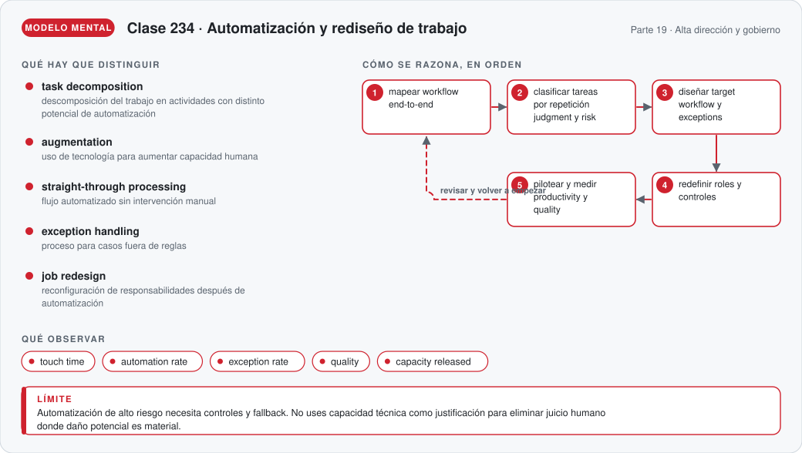

# Clase 234 — Automatización y rediseño de trabajo

<!-- nav:inicio -->
> **Parte 19 · Tecnología, datos, IA y transformación digital para ejecutivos** — clase 6 de 12 · [índice de la parte](../../README.md) · [temario](../../../../SYLLABUS.md)
<!-- nav:fin -->

**Parte:** 19 — Tecnología, datos, IA y transformación digital para ejecutivos  
**Nivel:** Etapa 5 — CEO → Transformador digital  
**Duración sugerida:** 150–180 minutos · **Estándar:** deep-class-v2

## 🎯 Propósito

Cuando una empresa quiere «automatizar», suele partir de las tareas más visibles: llenar formularios, copiar datos entre sistemas, preparar informes. Se instala una herramienta, se elimina un paso y se celebra el ahorro. Meses después, los resultados son modestos: la tarea automatizada era una pequeña parte del trabajo, las excepciones siguen consumiendo el tiempo de personas calificadas, nadie rediseñó el proceso de punta a punta, los roles no cambiaron y los empleados dudan si la tecnología es una ayuda o una amenaza. **Automatizar tareas no es rediseñar el trabajo**. El valor aparece cuando se descompone el flujo completo en tareas, se decide qué conviene automatizar, qué conviene aumentar con apoyo tecnológico y qué debe seguir en manos del criterio humano, y se rediseñan roles, controles y capacitación en consecuencia.

La clase se apoya en el análisis económico del trabajo de Autor, Levy y Murnane sobre el contenido de habilidades de los cambios tecnológicos, en la revisión de Autor sobre por qué siguen existiendo tantos empleos pese a la automatización, en el modelo de tareas y automatización de Acemoglu y Restrepo, en Brynjolfsson y McAfee sobre la segunda era de las máquinas y en Agrawal, Gans y Goldfarb sobre la predicción y el juicio. Al terminar sabrás mapear un flujo de punta a punta, clasificar tareas, diseñar el flujo objetivo con excepciones y controles, rediseñar roles y planificar la transición de las personas.

## 📚 Resultados de aprendizaje

Al finalizar podrás:

1. **Descomponer** un flujo de trabajo en tareas con tiempo, frecuencia y riesgo.
2. **Clasificar** tareas por repetición, juicio y riesgo, y decidir automatizar o aumentar.
3. **Diseñar** el flujo objetivo con excepciones, controles y respaldo.
4. **Rediseñar** roles, capacidades y carga de trabajo.
5. **Planificar** la transición de las personas respetando las obligaciones laborales.

## 🧭 Agenda

| Tramo | Qué se hace |
|---|---|
| 0–20 min | Recuperación: ¿qué tarea automatizó tu empresa que no cambió el tiempo total del proceso y por qué? |
| 20–60 min | Tareas y habilidades, clasificación, flujo objetivo, excepciones, roles y transición. |
| 60–105 min | Ejemplo trabajado: tramitación de reclamos con 60 % de procesamiento directo. |
| 105–150 min | Caso ejecutivo y práctica. |
| 150–175 min | Límites y entregable. |

## 🧩 Conceptos centrales

| Concepto | Definición | Cómo se reconoce |
|---|---|---|
| **Descomposición en tareas** | División de un trabajo en actividades concretas. | Lista con tiempos, frecuencias y reglas. |
| **Automatización** | Ejecución de una tarea por una máquina sin intervención humana. | Procesamiento directo (*straight-through*). |
| **Aumento (*augmentation*)** | Apoyo tecnológico al juicio y trabajo de una persona. | La persona decide con mejor información. |
| **Tarea rutinaria** | Tarea que sigue reglas explícitas. | Se puede programar. |
| **Procesamiento directo (STP)** | Porcentaje de casos que pasan sin intervención humana. | Indicador de automatización real. |
| **Excepción** | Caso que no cumple las reglas y requiere juicio. | Se deriva a una persona. |

## 🧠 Modelo mental

**Cómo leer el diagrama.** Una tabla de cuatro tipos de tarea. **Rutinaria y de bajo riesgo**: repetitiva con reglas claras; se automatiza con muestreo y registro. **Rutinaria y de alto riesgo**: reglas claras con daño posible; se automatiza con respaldo, revisión y plan alterno. **Con juicio**: contexto y excepciones; se aumenta al profesional y decide la persona. **Con relación humana**: confianza y negociación; se apoya y no se reemplaza, midiendo calidad y satisfacción. La nota explica que se rediseña el trabajo de punta a punta y no solo las tareas sueltas; el pie, que los cambios en roles tienen condiciones laborales que se verifican con asesoría.

## 📖 Desarrollo

### 1. Trabajo como conjunto de tareas

Autor, Levy y Murnane propusieron analizar el trabajo no como «ocupaciones» sino como conjuntos de **tareas**, y distinguieron las **rutinarias** (que siguen reglas explícitas y pueden programarse) de las **no rutinarias** (que exigen resolución de problemas, creatividad, interacción compleja). La tecnología computacional sustituye con más facilidad las tareas rutinarias y complementa las no rutinarias. Autor revisó la historia de la automatización y concluyó que la tecnología **sustituye** tareas pero **complementa** otras, aumenta la productividad y, en muchos casos, crea nueva demanda de trabajo; pero también advirtió que los efectos son desiguales y que el ajuste puede ser lento y doloroso para ciertas personas. Para el ejecutivo, la lección es práctica: el efecto de una tecnología se entiende **por tarea**, no por empleo o por departamento.

### 2. Mapear el flujo de punta a punta

El primer paso es dibujar el **flujo completo**: desde el disparador (una solicitud, un reclamo, un pedido) hasta el resultado para el cliente. Para cada **tarea** se registra: quién la hace, cuánto tarda (trabajo y espera), con qué frecuencia, qué información usa, qué reglas sigue, qué excepciones tiene, qué errores comete y qué riesgo implica un error. Se descubre que el flujo real difiere del documentado: pasos informales, correos, planillas paralelas. Brynjolfsson y McAfee observan que las nuevas tecnologías generan valor cuando se **reorganiza el trabajo** y no solo se reemplazan tareas individuales; un mapa de punta a punta evita automatizar pasos que podrían eliminarse.

### 3. Clasificar las tareas: repetición, juicio y riesgo

Cada tarea se clasifica en tres dimensiones. **Repetición y regularidad**: ¿sigue reglas claras?, ¿ocurre con alto volumen?, ¿los datos son estructurados? **Juicio y contexto**: ¿requiere interpretar situaciones nuevas, equilibrar valores o negociar? **Riesgo del error**: ¿qué daño produce un error (dinero, seguridad, derechos de una persona, reputación)? Con ellas se decide el tratamiento: **automatizar** las rutinarias de bajo riesgo; **automatizar con controles y respaldo** las rutinarias de alto riesgo; **aumentar** las que exigen juicio (la persona decide con mejores herramientas); y **conservar y fortalecer** las que dependen de la relación humana. Agrawal, Gans y Goldfarb explican que la IA abarata la predicción, pero el **juicio** (decidir qué hacer con la predicción) sigue siendo humano mientras no se pueda codificar; por eso muchas decisiones se **aumentan** más que se automatizan.

### 4. Diseñar el flujo objetivo: excepciones y controles

El flujo objetivo define: qué casos pasan por **procesamiento directo** (cumplen reglas y umbrales), qué casos se derivan a **revisión humana** (excepciones, montos o riesgos altos, baja confianza), cómo se **muestrean** los casos automatizados para detectar errores, qué **registros** quedan, cómo se **corrigen** los errores y cómo se comunica al cliente. En tareas de **alto riesgo**, se mantiene un **respaldo** manual (si el sistema falla, el proceso continúa) y la capacidad de **revertir** decisiones. No se usa la capacidad técnica como justificación para eliminar el juicio humano donde el daño potencial es material (clase 188). Un indicador esencial es el **porcentaje de procesamiento directo** y la **tasa de error** de los casos automáticos.

### 5. Rediseñar roles y capacidades

Cuando parte de las tareas se automatiza, el **trabajo restante** cambia: más excepciones y casos complejos, más análisis de calidad, más relación con clientes, más supervisión de sistemas. Acemoglu y Restrepo muestran que el efecto de la automatización sobre el trabajo depende de un equilibrio entre **desplazamiento** de tareas y creación de **nuevas tareas** en las que las personas tienen ventaja comparativa; la empresa influye en ese equilibrio con sus decisiones de diseño. Se rediseñan los **roles** (qué hace ahora cada cargo), las **capacidades requeridas** (análisis, comunicación, uso de herramientas), los **perfiles de selección**, los **incentivos** y las **métricas** (ya no tiempo por tarea sino calidad y resolución de casos). La capacitación se planifica antes del cambio.

### 6. Planificar la transición de las personas

El rediseño genera **capacidad liberada**. Hay varias formas de usarla: **absorber crecimiento** sin contratar, **reducir contratistas**, **no reemplazar vacantes** por rotación natural, **redistribuir** a otras funciones (con **reentrenamiento**) y, solo en último término y conforme a la ley, **reducir dotación**. Una transición responsable incluye: comunicación **temprana y honesta** (qué cambia y qué no), **participación** de quienes hacen el trabajo en el rediseño, **reentrenamiento** con tiempo y apoyo, **criterios transparentes** para los nuevos roles, **plazos realistas** y **medidas de apoyo**. Se verifican con asesoría laboral las condiciones legales de cambios de funciones, traslados, capacitación y término de la relación laboral.

### 7. Medir: productividad, calidad y personas

Se mide el **efecto real**: tiempo de ciclo, costo por caso, porcentaje de procesamiento directo, tasa de error, satisfacción del cliente, carga de trabajo y **clima y rotación** de las personas. Se evalúa también el **costo oculto**: tiempo de revisión de los casos automáticos, mantenimiento de las reglas, gestión de excepciones, capacitación. Y se comparan los resultados con la línea base y con la hipótesis: ¿se cumplió el ahorro?, ¿mejoró la calidad?, ¿cómo vive el equipo el cambio? Los indicadores de personas son tan importantes como los de eficiencia: un ahorro que se paga con fuga de talento clave es un mal negocio. Los aprendizajes se incorporan al siguiente rediseño.

## 📚 Lectura comparada

| Obra | Qué aporta | Qué no resuelve | Pregunta para contrastar |
|---|---|---|---|
| Autor, Levy y Murnane | Análisis del trabajo por tareas rutinarias y no rutinarias. | Estudio de décadas pasadas. | ¿Qué tareas son rutinarias aquí? |
| Autor (2015) | Sustitución y complemento de la automatización; empleos y ajuste. | Visión agregada. | ¿Qué tareas complementa la tecnología? |
| Acemoglu y Restrepo | Desplazamiento y creación de tareas en la automatización. | Modelo económico. | ¿Qué nuevas tareas creamos? |
| Brynjolfsson y McAfee | Rediseño organizacional junto con las máquinas. | Visión general. | ¿Qué parte del flujo reorganizamos? |
| Agrawal, Gans y Goldfarb | Predicción barata y juicio humano como complemento. | Marco conceptual. | ¿Qué decisión sigue siendo humana? |

## 🧮 Ejemplo trabajado

**Situación (hipotética).** Una aseguradora tramita 100.000 reclamos al año. El flujo actual toma 100 minutos de trabajo humano por reclamo: ingreso de datos, validación de cobertura, cálculo, revisión y comunicación.

**Hoy.** 100.000 × 100 minutos = 10.000.000 minutos = 166.667 horas; con 1.800 horas por persona: **92,6 personas equivalentes**.

**Clasificación de tareas (resumen).**

| Tarea | Minutos | Clasificación | Tratamiento |
|---|---|---|---|
| Ingreso de datos | 15 | Rutinaria, bajo riesgo | Automatizar |
| Validación de cobertura | 20 | Rutinaria, riesgo medio | Automatizar con reglas y excepciones |
| Cálculo de indemnización | 25 | Rutinaria, alto riesgo (dinero) | Automatizar con límites y muestreo |
| Revisión y decisión | 30 | Con juicio | Aumentar |
| Comunicación al cliente | 10 | Con relación humana | Apoyar con borradores |

**Flujo objetivo.** El 60 % de los reclamos (simples y de monto bajo) pasa por procesamiento directo con una revisión final de 8 minutos; el 40 % son excepciones o montos altos, con 85 minutos de trabajo asistido (en lugar de 100).

- Tiempo promedio: 0,6 × 8 + 0,4 × 85 = 4,8 + 34,0 = **38,8 minutos** (reducción de 61,2 %).
- Horas liberadas: (100 − 38,8) × 100.000 ÷ 60 = 102.000 horas (56,7 personas equivalentes).
- Valor «de papel» a 35.000 pesos la hora: 3.570 millones al año.

**De horas a caja (plan de capacidad).** Con un crecimiento de volumen de 10 % anual, el trabajo del año siguiente sería 110.000 × 38,8 ÷ 60 = 71.133 horas (39,5 personas): la capacidad liberada absorbe el crecimiento sin contratar. Plan a 24 meses: 35 personas se reducen por rotación natural (14 % anual) y no renovación de contratistas, no mediante despidos; 22 personas se reentrenan para roles de calidad, análisis de fraude y atención de casos complejos.

- Ahorro realizable al régimen: 35 × 1.800 horas × 35.000 = 2.205 millones al año.

**Costos y controles.**

| Concepto | Millones al año |
|---|---|
| Errores en decisiones automáticas (60.000 reclamos × 0,5 % × 120.000 pesos) | 36 |
| Revisión por muestreo (5 % de 60.000 = 3.000 casos × 20 minutos × 35.000 pesos la hora) | 35 |
| Operación y mantenimiento de la solución | 300 |
| **Total** | **371** |

**Resultado neto.** 2.205 − 371 = **1.834 millones al año** al régimen. La inversión inicial de 1.900 millones (solución, integración, cambio y reentrenamiento de 22 personas a 4,5 millones: 99) se recupera en aproximadamente 1.900 ÷ 1.834 ≈ 1,04 años desde el régimen; con una transición de 24 meses y un 50 % del ahorro en el primer año, el plazo total es cercano a 2 años.

**Salvaguardas.** Umbrales de monto y de riesgo para derivar a revisión humana; respaldo manual; registro de cada decisión; reclamación del cliente; evaluación de sesgo; monitoreo de errores por tipo de reclamo; pruebas antes del despliegue.

**Indicadores.** Procesamiento directo (meta 60 %); error en automáticos (meta menor de 0,5 %); tiempo de ciclo; satisfacción; carga de trabajo por persona; rotación y clima.

**Cuidados.** Los cambios de funciones, la capacitación y cualquier reducción de personal se verifican con asesoría laboral y las normas vigentes; las decisiones automatizadas sobre derechos de clientes se revisan con asesoría legal; las cifras son ilustrativas.

**Qué muestra.** (1) El flujo se rediseñó de punta a punta. (2) Las horas se convirtieron en capacidad y caja con un plan para las personas. (3) El riesgo se controló con excepciones y muestreo.

## 🔀 Comparación y límites

**Automatizar frente a aumentar.** Automatizar reemplaza la ejecución de una tarea; aumentar mejora la capacidad de la persona que la hace. Con frecuencia, aumentar produce más valor donde el juicio es esencial.

**Límites.** Las predicciones laborales cambian rápido y dependen del sector. Los porcentajes de procesamiento directo se logran con el tiempo y con datos de calidad. La automatización de alto riesgo necesita controles y respaldo; la capacidad técnica no justifica eliminar el juicio humano donde el daño potencial es material. Las obligaciones laborales y las normas sobre decisiones automatizadas se verifican en la fuente. Las cifras son ilustrativas.

## 🪜 De profesional a owner

| Nivel | Cómo participa en el rediseño |
|---|---|
| **Profesional** | Documenta cómo hace el trabajo y propone mejoras. |
| **Jefe / Team Lead** | Participa en el diseño del flujo y acompaña a su equipo. |
| **Gerente** | Es dueño del flujo de punta a punta y de sus resultados. |
| **CEO / Director** | Decide el equilibrio entre eficiencia y personas, y exige controles. |
| **Founder / Owner** | Equilibra productividad, calidad y la confianza de su equipo. |

## 🏢 Caso ejecutivo

Un banco con 3.200 empleados tiene un área de operaciones de 410 personas que procesa 2,4 millones de solicitudes al año (cuentas, créditos de consumo, cambios de datos, reclamos). El tiempo medio por solicitud es de 28 minutos; el 34 % tiene errores que obligan a reprocesar; la rotación del área es de 26 % anual; los clientes esperan 6 días en promedio. La alta dirección contrata a un proveedor para automatizar «lo más posible» en seis meses, con la meta de reducir 120 posiciones. En el piloto, el sistema automatizó la validación de documentos, pero cometió errores en el 3 % de los créditos con ingresos informales y no explicaba sus decisiones; los supervisores dicen que ya no entienden el proceso; 40 empleados con más de diez años temen perder su empleo; un sindicato pidió información; y el regulador consultó cómo se tratan las decisiones automatizadas sobre créditos.

Entrega un **rediseño del trabajo** que contenga: (a) el mapa de punta a punta con tareas, tiempos, errores y riesgos; (b) la clasificación de tareas y el tratamiento (automatizar, aumentar, conservar); (c) el flujo objetivo con excepciones, controles, respaldo y revisión humana de los créditos; (d) el rediseño de roles, capacidades y carga de trabajo; (e) el plan de transición de las personas con reentrenamiento y comunicación; (f) los indicadores, el cálculo de valor y las verificaciones laborales, regulatorias y legales pendientes.

## 🧪 Práctica

1. Descompón un proceso de tu área en diez tareas con tiempo, frecuencia y riesgo.
2. Clasifica cada tarea como automatizar, automatizar con controles, aumentar o conservar.
3. Calcula el tiempo promedio por caso con un porcentaje de procesamiento directo y excepciones.
4. Diseña los controles de una tarea automatizada de alto riesgo: umbrales, muestreo y respaldo.
5. Redacta un plan de transición con comunicación, reentrenamiento y plazos.

## ⚠️ Errores frecuentes

| Error | Por qué ocurre | Cómo corregirlo |
|---|---|---|
| Automatizar tareas sueltas | Se mira lo visible | Rediseñar el flujo de punta a punta. |
| Ignorar las excepciones | Se piensa en el caso típico | Diseñar derivación y revisión humana. |
| Eliminar el juicio en alto riesgo | La técnica lo permite | Respaldo, supervisión y reclamación. |
| Medir solo eficiencia | Es lo más fácil | Calidad, satisfacción y personas. |
| Comunicar tarde | Se teme la reacción | Comunicación temprana y participación. |
| Ahorro prometido sin plan | Se cuenta el ahorro de horas | Plan de capacidad y de caja. |

## ❓ Preguntas de comprobación

1. ¿Por qué analizar el trabajo por tareas?
2. ¿Cómo se clasifica una tarea y qué tratamiento corresponde?
3. ¿Qué incluye el flujo objetivo de un proceso automatizado?
4. ¿Qué diferencia hay entre automatizar y aumentar?
5. ¿Cómo se rediseñan los roles tras la automatización?
6. ¿Qué elementos tiene una transición responsable?
7. ¿Qué se mide para evaluar el resultado?

Claves de respuesta

1. Porque la tecnología sustituye algunas tareas y complementa otras; el efecto se entiende por tarea y no por empleo.
2. Por repetición, juicio y riesgo; se automatiza lo rutinario de bajo riesgo, con controles lo de alto riesgo, se aumenta lo que requiere juicio y se conserva lo relacional.
3. Casos de procesamiento directo, excepciones a revisión humana, muestreo, registros, corrección de errores, respaldo y comunicación al cliente.
4. Automatizar reemplaza la ejecución; aumentar mejora la capacidad de la persona que decide o actúa.
5. Definiendo el trabajo restante (excepciones, calidad, relación con clientes), las capacidades, la selección, los incentivos y las métricas.
6. Comunicación temprana, participación, reentrenamiento, criterios transparentes, plazos realistas, apoyo y verificación laboral.
7. Tiempo de ciclo, costo por caso, procesamiento directo, error, satisfacción, carga, clima y rotación, y costos ocultos.

## 📥 Entregable

Guarda en `portfolio/234-automatizacion-y-rediseno-de-trabajo/`:

- `operating-improvement-brief.md` (plantilla [Operating improvement brief](../../../../templates/operating-improvement-brief.md)) con el rediseño del caso ejecutivo;
- `process-map.md` (plantilla [Process map](../../../../templates/process-map.md)) con el flujo actual y el objetivo;
- `decision-journal.md` con la clasificación de tareas, el plan de transición y las verificaciones pendientes.

## 📗 Fuentes y verificación

- David H. Autor, Frank Levy & Richard J. Murnane — *The Skill Content of Recent Technological Change: An Empirical Exploration* (The Quarterly Journal of Economics, 2003). **Uso en esta clase:** análisis del trabajo por tareas rutinarias y no rutinarias. Lectura selectiva sobre **automatización y rediseño de trabajo**. **Localizador:** [DOI 10.1162/003355303322552801](https://doi.org/10.1162/003355303322552801).
- David H. Autor — *Why Are There Still So Many Jobs? The History and Future of Workplace Automation* (Journal of Economic Perspectives, 2015). **Uso en esta clase:** sustitución y complemento de la automatización. Lectura selectiva sobre **automatización y rediseño de trabajo**. **Localizador:** [DOI 10.1257/jep.29.3.3](https://doi.org/10.1257/jep.29.3.3).
- Daron Acemoglu & Pascual Restrepo — *Tasks, Automation, and the Rise in U.S. Wage Inequality* (Econometrica, 2022). **Uso en esta clase:** desplazamiento y creación de tareas por la automatización. Lectura selectiva sobre **automatización y rediseño de trabajo**. **Localizador:** [DOI 10.3982/ECTA19815](https://doi.org/10.3982/ECTA19815).
- Erik Brynjolfsson & Andrew McAfee — *The Second Machine Age* (W. W. Norton, 2014). **Uso en esta clase:** rediseño organizacional junto con las máquinas. Lectura selectiva sobre **automatización y rediseño de trabajo**. **Localizador:** [ISBN-13 9780393350647](https://openlibrary.org/isbn/9780393350647).
- Ajay Agrawal, Joshua Gans & Avi Goldfarb — *Prediction Machines* (Harvard Business Review Press, 2018). **Uso en esta clase:** predicción barata y juicio humano como complemento. Lectura selectiva sobre **automatización y rediseño de trabajo**. **Localizador:** [ISBN-13 9781633695672](https://openlibrary.org/isbn/9781633695672).

> **Regla de fuentes para Automatización y rediseño de trabajo:** las obras anteriores estructuran las perspectivas de esta materia; cualquier norma, ley o estándar vivo mencionado debe comprobarse nuevamente en su fuente primaria vigente, incluidas las normas laborales y las de decisiones automatizadas y de protección de datos. Los ejemplos y casos son hipotéticos, con cifras ilustrativas. El desarrollo es original y no reproduce capítulos protegidos.

<!-- pie:inicio -->
---

| Anterior | Índice | Siguiente |
|---|---|---|
| [← 233 · Portafolio de IA y casos de negocio](../233-portafolio-de-ia-y-casos-de-negocio/README.md) | [Parte 19](../../README.md) · [Programa](../../../../SYLLABUS.md) | [235 · Ciberseguridad desde el directorio →](../235-ciberseguridad-desde-el-directorio/README.md) |
<!-- pie:fin -->
