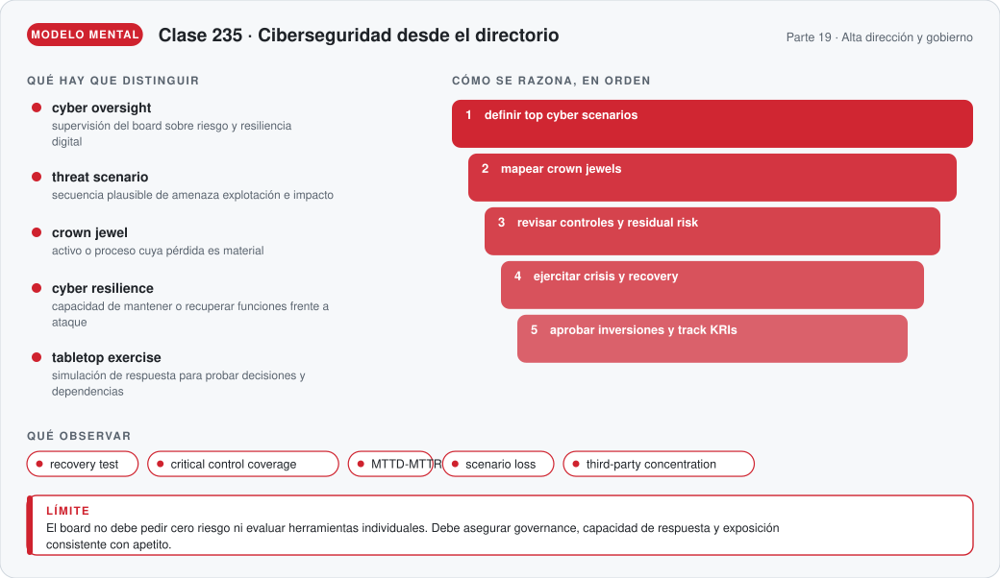

# Clase 235 — Ciberseguridad desde el directorio

<!-- nav:inicio -->
> **Parte 19 · Tecnología, datos, IA y transformación digital para ejecutivos** — clase 7 de 12 · [índice de la parte](../../README.md) · [temario](../../../../SYLLABUS.md)
<!-- nav:fin -->

**Parte:** 19 — Tecnología, datos, IA y transformación digital para ejecutivos  
**Nivel:** Etapa 5 — CEO → Transformador digital  
**Duración sugerida:** 150–180 minutos · **Estándar:** deep-class-v2

## 🎯 Propósito

Cuando un directorio se pregunta si la empresa está «segura» en términos cibernéticos, suele recibir una de dos respuestas igual de inútiles: un conjunto de siglas y estadísticas técnicas que no puede interpretar, o una frase tranquilizadora («tenemos las mejores herramientas»). Ninguna le permite ejercer su responsabilidad: entender qué puede pasar, cuánto puede costar, cuánto riesgo se acepta, si la empresa puede responder y si la inversión es proporcionada. La ciberseguridad vista desde el directorio no es una disciplina técnica sino una **conversación de gobierno** sobre escenarios, activos críticos, controles, capacidad de respuesta y decisiones de inversión. Y no existe el «riesgo cero»: el objetivo es una exposición **coherente con el apetito** y una **capacidad de respuesta** probada.

La clase complementa el gobierno de ciberseguridad ejecutivo (clase 187) y la supervisión de riesgos y controles (clase 213) con la mirada específica del directorio. Se apoya en el marco de ciberseguridad del NIST 2.0, en la visión de Anderson sobre la ingeniería de seguridad, en el análisis estratégico de Clarke y Knake sobre resiliencia, en el marco COSO de gestión de riesgos y en las responsabilidades del directorio descritas por Tricker. Al terminar sabrás definir escenarios principales, identificar los activos críticos, revisar controles y riesgo residual con evidencia independiente, ejercitar la respuesta y decidir inversiones con criterios.

## 📚 Resultados de aprendizaje

Al finalizar podrás:

1. **Definir** pocos escenarios cibernéticos con impacto de negocio.
2. **Identificar** los activos críticos («joyas de la corona») y su protección.
3. **Revisar** controles y riesgo residual con evidencia independiente.
4. **Ejercitar** la respuesta y la recuperación con la participación del directorio.
5. **Aprobar** inversiones y excepciones con criterios y registro.

## 🧭 Agenda

| Tramo | Qué se hace |
|---|---|
| 0–20 min | Recuperación: ¿qué le preguntarías hoy a tu responsable de seguridad para saber si la empresa podría operar tras un ciberataque grave? |
| 20–60 min | Rol del directorio, escenarios, activos críticos, controles, ejercicios, inversión y reporte. |
| 60–105 min | Ejemplo trabajado: cuatro escenarios, un menú de inversión de 300 millones y un ejercicio de recuperación. |
| 105–150 min | Caso ejecutivo y práctica. |
| 150–175 min | Límites y entregable. |

## 🧩 Conceptos centrales

| Concepto | Definición | Cómo se reconoce |
|---|---|---|
| **Escenario cibernético** | Historia de ataque con causa, evento y consecuencia de negocio. | «Ransomware detiene la planta cinco días». |
| **Activos críticos (*crown jewels*)** | Sistemas, datos y procesos sin los que el negocio no opera o sufre daño grave. | Su caída o fuga es material. |
| **Riesgo residual** | Riesgo que queda tras los controles. | Se compara con el apetito. |
| **Aseguramiento independiente** | Verificación de los controles por terceros ajenos a su operación. | Pruebas de intrusión, auditoría. |
| **Ejercicio de mesa** | Simulación de una crisis con decisores. | La dirección y el directorio toman decisiones. |
| **Tiempo de recuperación** | Tiempo real para volver a operar. | Se prueba, no se supone. |

## 🧠 Modelo mental

**Cómo leer el diagrama.** Tres columnas. **Escenarios y activos críticos**: pocos escenarios con impacto de negocio, los activos que no pueden fallar y un apetito alineado con la exposición. **Controles y riesgo residual**: controles clave con pruebas independientes, brechas con dueño y plazo, y exposición de proveedores críticos. **Respuesta y recuperación**: plan ensayado con la dirección, tiempos reales de recuperación y decisiones previas sobre comunicación. La nota afirma que el directorio no pide riesgo cero ni evalúa herramientas una por una: asegura gobierno, capacidad de respuesta y una exposición coherente con el apetito; el pie, que las obligaciones de reporte de incidentes se verifican en la fuente oficial.

## 📖 Desarrollo

### 1. Qué le corresponde al directorio

El marco de ciberseguridad del NIST, en su versión 2.0, incorpora una función de **gobierno** que incluye el contexto organizacional, la estrategia de gestión de riesgos, los roles y responsabilidades, las políticas y la **supervisión**. En ese esquema, el directorio no gestiona la seguridad ni selecciona herramientas: **supervisa que exista un sistema de gestión** adecuado, **aprueba el apetito** de riesgo cibernético, **revisa los riesgos principales**, **exige información independiente** y **decide inversiones y excepciones** de alto impacto. Tricker recuerda que el gobierno corporativo incluye el deber de supervisar los riesgos materiales; el ciberriesgo lo es en casi todas las empresas. El estándar es una supervisión razonable, con evidencia de que el directorio preguntó, recibió información y exigió acciones, no la garantía de que no habrá incidentes.

### 2. Escenarios: lo que puede pasar y cuánto cuesta

Una conversación útil parte de **pocos escenarios** (cuatro a seis), cada uno con causa, evento, consecuencia de negocio, probabilidad e impacto estimados con rango, como en la gestión de riesgos (clase 181): un **ransomware** que paraliza sistemas de producción, una **filtración de datos** de clientes, el **compromiso de un proveedor** crítico, el **fraude por suplantación** o el **sabotaje interno**. Para cada uno se estima el impacto en ingresos, costos de respuesta, sanciones, pérdida de clientes y reputación, y el **tiempo** que la empresa podría estar sin operar. Anderson recuerda que muchas fallas de seguridad son de **diseño e incentivos**, no solo técnicas, por lo que los escenarios incluyen también errores de procesos y de personas. Estos escenarios son la base para decidir qué proteger, cuánto invertir y qué preparar.

### 3. Activos críticos: qué no puede fallar

No todo merece la misma protección. Se identifican las **«joyas de la corona»**: los datos, sistemas y procesos cuya pérdida, alteración o indisponibilidad causaría el mayor daño (por ejemplo, el sistema de despacho, la base de clientes, la propiedad intelectual, los sistemas de pago, la información de una fusión). Para cada uno se pregunta: ¿dónde está?, ¿quién tiene acceso?, ¿cómo se protege?, ¿cuánto tiempo se puede estar sin él?, ¿tiene respaldo probado?, ¿depende de un proveedor? El inventario de activos críticos permite que el directorio pregunte por su **cobertura de protección** en lugar de por la totalidad de los controles. Clarke y Knake enfatizan que, ante adversarios capaces, la estrategia debe incluir **resiliencia**: asumir que algo fallará y poder continuar o recuperarse.

### 4. Controles, riesgo residual y evidencia independiente

Para los escenarios y activos críticos, el directorio pregunta por los **controles clave** (autenticación fuerte, respaldos aislados y probados, segmentación, parches de vulnerabilidades críticas, protección de correo y equipos, gestión de accesos privilegiados, monitoreo) y por el **riesgo residual** que queda. La gerencia informa sobre sus propios controles; por eso se exige **evidencia independiente**: pruebas de intrusión, auditorías, evaluaciones de madurez contra el marco NIST, ejercicios de «equipo rojo» y revisiones de terceros (clase 213). El directorio no evalúa la herramienta A frente a la B; evalúa si el conjunto de controles reduce el riesgo a un nivel coherente con el apetito y si las **brechas** críticas tienen dueño, plazo y seguimiento. Se pregunta también por los **proveedores críticos**: qué acceso tienen, qué evidencia de seguridad entregan y qué plan existe si fallan.

### 5. Ejercitar: la respuesta se prueba

Un plan de respuesta que no se ha ensayado es una hipótesis. El directorio y la dirección participan al menos una vez al año en un **ejercicio de mesa**: se presenta un escenario realista (por ejemplo, ransomware un viernes) y los decisores deben resolver: ¿quién declara el incidente?, ¿se apagan sistemas?, ¿se informa a clientes y autoridades y cuándo?, ¿se paga o no?, ¿cómo se opera en modo manual?, ¿quién habla públicamente? (clases 187 y 190). Además, se hacen **pruebas técnicas** de recuperación (restaurar un sistema crítico desde los respaldos y medir el tiempo). Se registran los aprendizajes y se corrigen las brechas. Las obligaciones de reporte de incidentes a autoridades y afectados tienen plazos y contenidos legales que se verifican con asesoría y en la fuente oficial.

### 6. Decidir la inversión con criterios

Las solicitudes de presupuesto de ciberseguridad suelen crecer con el miedo. El directorio pide un **menú de inversión** con, para cada propuesta: el escenario o riesgo que reduce, la **reducción estimada** de exposición (probabilidad e impacto), el **costo** (inversión y operación), el **plazo** y los **efectos secundarios** (fricción para los usuarios, dependencias). Se ordena por **reducción por peso invertido**, se priorizan los **controles básicos** de alto efecto y se verifica la **capacidad de ejecución** de la organización. Se registra lo que **no** se financia y quién acepta el riesgo remanente (clase 192). Las estimaciones son inciertas; por eso se complementan con juicio y con los efectos de cola (el peor caso razonable) en relación con el EBITDA y el patrimonio.

### 7. Reportar al directorio con información que sirva

Un buen informe de ciberriesgo es **breve** y estructurado: escenarios principales con su exposición residual y tendencia; estado de los activos críticos; resultados de pruebas independientes; brechas críticas con plazo; incidentes y casi-incidentes relevantes y lecciones; indicadores clave (cobertura de autenticación fuerte, tiempo de corrección de vulnerabilidades críticas, resultados de pruebas de respaldo, proveedores críticos evaluados); decisiones y excepciones requeridas; y obligaciones legales o regulatorias pendientes. El responsable de seguridad tiene **acceso directo** al comité (sin filtro de la gerencia) al menos una vez al año. El directorio responde con preguntas y registra sus decisiones. Los indicadores se miden por **reducción de riesgo**, no por actividad (número de alertas, de bloqueos).

## 📚 Lectura comparada

| Obra | Qué aporta | Qué no resuelve | Pregunta para contrastar |
|---|---|---|---|
| NIST CSF 2.0 | Función de gobierno y resultados de ciberseguridad. | Marco voluntario y genérico. | ¿Qué función está débil? |
| Anderson | Seguridad como ingeniería, incentivos y amenazas internas. | Técnico; requiere traducción. | ¿Qué incentivo debilita este control? |
| Clarke y Knake | Resiliencia y estrategia de defensa. | Enfoque de seguridad nacional. | ¿Podemos operar bajo ataque? |
| COSO ERM | Riesgo cibernético dentro del sistema de gestión de riesgos. | No específico de seguridad. | ¿Cómo se integra con el mapa de riesgos? |
| Tricker | Deberes del directorio frente a los riesgos materiales. | No es técnico. | ¿Qué evidencia de supervisión tenemos? |

## 🧮 Ejemplo trabajado

**Situación (hipotética).** Una empresa con ventas de 90.000 millones de pesos y EBITDA de 12.000 millones evalúa su exposición cibernética con cuatro escenarios.

**Escenarios y pérdida esperada anual (millones).**

| Escenario | Probabilidad anual | Impacto | Pérdida esperada |
|---|---|---|---|
| Ransomware en sistemas de producción | 8 % | 1.400 | 112 |
| Filtración de datos de clientes | 6 % | 900 | 54 |
| Compromiso de un proveedor crítico | 10 % | 500 | 50 |
| Fraude por suplantación (correo y pagos) | 12 % | 250 | 30 |
| **Total** | | | **246** |

**Peor caso razonable.** El ransomware: 1.400 millones, es decir, 11,7 % del EBITDA (1.400 ÷ 12.000).

**Activos críticos.** Sistema de producción y despacho; base de clientes; sistema de pagos; correo corporativo. Hallazgos de la revisión: autenticación multifactor en 62 % de los accesos críticos; tiempo medio de corrección de vulnerabilidades críticas de 38 días; respaldos conectados a la red principal, probados una sola vez.

**Prueba de recuperación.** Se restaura el sistema de despacho desde respaldos: 31 horas, frente a un objetivo de 12.

**Menú de inversión (presupuesto de 300 millones).**

| Propuesta | Costo | Reducción de pérdida esperada | Reducción por peso |
|---|---|---|---|
| Respaldos inmutables y pruebas de restauración | 90 | 56 (reduce a la mitad el impacto del ransomware: 0,5 × 112) | 0,62 |
| Autenticación multifactor y gestión de accesos privilegiados | 150 | 67 (ransomware de 8 % a 4,5 %: 0,035 × 1.400 = 49; filtración de 6 % a 4 %: 0,02 × 900 = 18) | 0,45 |
| Programa de evaluación de proveedores críticos | 60 | 20 (de 10 % a 6 %: 0,04 × 500) | 0,33 |
| Detección y respuesta en equipos | 200 | 30 | 0,15 |
| Capacitación y simulacros de suplantación | 40 | 6 | 0,15 |

**Selección.** Por reducción por peso invertido: respaldos (90), autenticación (150) y proveedores (60) suman 300 millones. Reducción estimada: 56 + 67 + 20 = 143 millones de pérdida esperada (58 % de 246), con un solapamiento que hace la cifra algo optimista. Pérdida esperada residual: 246 − 143 = **103 millones**.

**Decisión del directorio.** Aprobar los 300 millones; **no financiar** la detección en equipos (200) este año, con una medida interina (servicio gestionado básico de 40 millones) y revisión en seis meses; aceptar formalmente el riesgo residual de 103 millones; exigir una prueba de recuperación en 90 días con meta de 12 horas.

**Indicadores a seis meses (hipotéticos).** Autenticación multifactor en accesos críticos: de 62 % a 100 %; corrección de vulnerabilidades críticas: de 38 a 14 días; prueba de restauración: 11 horas; proveedores críticos evaluados: 12 de 12. Un ejercicio de mesa con el directorio permitió decidir en 3 horas la comunicación a clientes, que antes demoraba un día.

**Cuidados.** Las probabilidades y los impactos son estimaciones; las obligaciones de reporte de incidentes, de protección de datos y de ciberseguridad se verifican en la normativa vigente y con asesoría; las cifras son ilustrativas.

**Qué muestra.** (1) Los escenarios se tradujeron a pesos. (2) La inversión se ordenó por reducción por peso y se registró lo no financiado. (3) La prueba de recuperación dio evidencia, no suposiciones.

## 🔀 Comparación y límites

**Directorio frente a gerencia en ciberseguridad.** La gerencia gestiona la seguridad; el directorio supervisa que el sistema de gestión exista, funcione y sea proporcional al riesgo.

**Límites.** El directorio no debe pedir cero riesgo ni evaluar herramientas individuales: debe asegurar gobierno, capacidad de respuesta y exposición coherente con el apetito. Las probabilidades de ataque son inciertas y cambian. Las reducciones de pérdida se solapan. Los reguladores pueden exigir más. Las cifras del ejemplo son ilustrativas.

## 🪜 De profesional a owner

| Nivel | Cómo participa |
|---|---|
| **Profesional** | Cumple los hábitos de seguridad y reporta lo sospechoso. |
| **Jefe / Team Lead** | Controla accesos y simulacros de su equipo. |
| **Gerente** | Es dueño de los procesos críticos y de sus brechas. |
| **CEO / Director** | Participa en ejercicios, aprueba apetito e inversión y exige evidencia independiente. |
| **Founder / Owner** | Entiende que un ataque grave puede poner en riesgo la continuidad de la empresa. |

## 🏢 Caso ejecutivo

Una cadena de clínicas con 2.700 personas, ingresos de 160.000 millones de pesos y EBITDA de 17.000 millones sufrió, hace un año, un ransomware que detuvo los sistemas clínicos de tres centros durante 31 horas, con costos directos de 640 millones y una investigación del regulador. El informe de ciberseguridad que recibe el directorio es una presentación de 60 láminas con 45 indicadores técnicos; el responsable de seguridad depende del director de tecnología y nunca ha hablado con el directorio; la última prueba independiente es de hace tres años; el 40 % de los accesos administrativos no usa autenticación fuerte; dos proveedores críticos (historia clínica electrónica y facturación) no han sido evaluados; los respaldos se probaron una vez. La gerencia solicita 1.800 millones para «blindar» la empresa con herramientas de última generación. Un director pide «cero riesgo»; otro, «reducir el presupuesto, que ya es alto».

Entrega un **paquete de supervisión cibernética del directorio** que contenga: (a) los cuatro a seis escenarios con probabilidad, impacto y pérdida esperada, y el peor caso en relación con el EBITDA; (b) los activos críticos y su cobertura de protección; (c) la evidencia independiente exigida y el análisis de riesgo residual; (d) el diseño del ejercicio de mesa y de la prueba de recuperación; (e) el menú de inversión ordenado por reducción por peso, con lo que se financia y lo que no; (f) el formato del informe al directorio, los indicadores y las verificaciones legales y regulatorias pendientes.

## 🧪 Práctica

1. Redacta cuatro escenarios cibernéticos de tu empresa con probabilidad e impacto en pesos.
2. Lista tus cinco activos críticos y para cada uno el tiempo máximo tolerable de interrupción.
3. Diseña un ejercicio de mesa de una hora con tres decisiones que debería tomar el directorio.
4. Ordena un menú de inversión por reducción de pérdida esperada por peso invertido.
5. Define seis indicadores de reducción de riesgo para un informe de una página.

## ⚠️ Errores frecuentes

| Error | Por qué ocurre | Cómo corregirlo |
|---|---|---|
| Pedir riesgo cero | Miedo a la responsabilidad | Apetito y exposición coherentes. |
| Revisar herramientas | Es lo visible | Revisar escenarios, activos y controles clave. |
| Informes técnicos extensos | Se mide actividad | Informe breve con exposición y decisiones. |
| No ensayar | Se confía en el plan escrito | Ejercicios de mesa y pruebas de recuperación. |
| Solo evidencia de la gerencia | Falta de segunda mirada | Pruebas independientes y acceso directo al comité. |
| Invertir por miedo | Presión | Menú con reducción por peso y registro de lo no financiado. |

## ❓ Preguntas de comprobación

1. ¿Qué le corresponde al directorio en ciberseguridad?
2. ¿Qué es un escenario cibernético y qué incluye?
3. ¿Qué son los activos críticos y por qué se identifican?
4. ¿Qué tipo de evidencia debe exigir el directorio sobre los controles?
5. ¿Para qué sirve un ejercicio de mesa?
6. ¿Cómo se decide una inversión en ciberseguridad?
7. ¿Qué debe incluir el informe al directorio?

Claves de respuesta

1. Supervisar que exista y funcione el sistema de gestión, aprobar el apetito, revisar riesgos principales, exigir información independiente y decidir inversiones y excepciones de alto impacto.
2. Una historia de ataque con causa, evento y consecuencia de negocio, con probabilidad e impacto estimados.
3. Los sistemas, datos y procesos cuya pérdida causaría el mayor daño; permiten enfocar la protección y las preguntas.
4. Pruebas de intrusión, auditorías, evaluaciones de madurez, ejercicios de equipo rojo y revisiones de terceros.
5. Para que los decisores practiquen las decisiones de una crisis y se detecten brechas del plan antes de un incidente real.
6. Con un menú ordenado por reducción de exposición por peso invertido, priorizando controles básicos y registrando lo no financiado y el riesgo aceptado.
7. Escenarios y exposición residual, activos críticos, resultados de pruebas, brechas con plazo, incidentes, indicadores de reducción de riesgo y decisiones requeridas.

## 📥 Entregable

Guarda en `portfolio/235-ciberseguridad-desde-el-directorio/`:

- `risk-governance-brief.md` (plantilla [Risk Governance Brief](../../../../templates/risk-governance-brief.md)) con el paquete del caso ejecutivo;
- `board-or-executive-memo.md` (plantilla [Board or executive memo](../../../../templates/board-or-executive-memo.md)) con el informe de ciberriesgo al directorio;
- `decision-journal.md` con los escenarios, el menú de inversión y las verificaciones legales pendientes.

## 📗 Fuentes y verificación

- NIST — *Cybersecurity Framework (CSF) 2.0*. **Uso en esta clase:** función de gobierno y resultados de ciberseguridad. **Fuente primaria:** <https://www.nist.gov/cyberframework>.
- Ross Anderson — *Security Engineering* (John Wiley & Sons, Incorporated, 2001). **Uso en esta clase:** seguridad como ingeniería, incentivos y amenazas internas. Lectura selectiva sobre **ciberseguridad desde el directorio**. **Localizador:** [ISBN-13 9781119642831](https://openlibrary.org/isbn/9781119642831).
- Richard A. Clarke & Robert K. Knake — *The Fifth Domain* (Penguin Press, 2019). **Uso en esta clase:** resiliencia y estrategia de defensa. Lectura selectiva sobre **ciberseguridad desde el directorio**. **Localizador:** [ISBN-13 9780525561965](https://openlibrary.org/isbn/9780525561965).
- COSO — *Enterprise Risk Management—Integrating with Strategy and Performance*. **Uso en esta clase:** riesgo cibernético dentro del sistema de gestión de riesgos. **Fuente primaria:** <https://www.coso.org/>.
- Bob Tricker — *Corporate Governance* (Oxford University Press, 2019). **Uso en esta clase:** deberes del directorio frente a los riesgos materiales. Lectura selectiva sobre **ciberseguridad desde el directorio**. **Localizador:** [ISBN-13 9780198809869](https://openlibrary.org/isbn/9780198809869).

> **Regla de fuentes para Ciberseguridad desde el directorio:** las obras anteriores estructuran las perspectivas de esta materia; cualquier norma, ley o estándar vivo mencionado debe comprobarse nuevamente en su fuente primaria vigente, en particular las obligaciones de ciberseguridad y los plazos de notificación de incidentes. Los ejemplos y casos son hipotéticos, con cifras ilustrativas. El desarrollo es original y no reproduce capítulos protegidos.

<!-- pie:inicio -->
---

| Anterior | Índice | Siguiente |
|---|---|---|
| [← 234 · Automatización y rediseño de trabajo](../234-automatizacion-y-rediseno-de-trabajo/README.md) | [Parte 19](../../README.md) · [Programa](../../../../SYLLABUS.md) | [236 · Build, buy, partner o retire →](../236-build-buy-partner-o-retire/README.md) |
<!-- pie:fin -->
