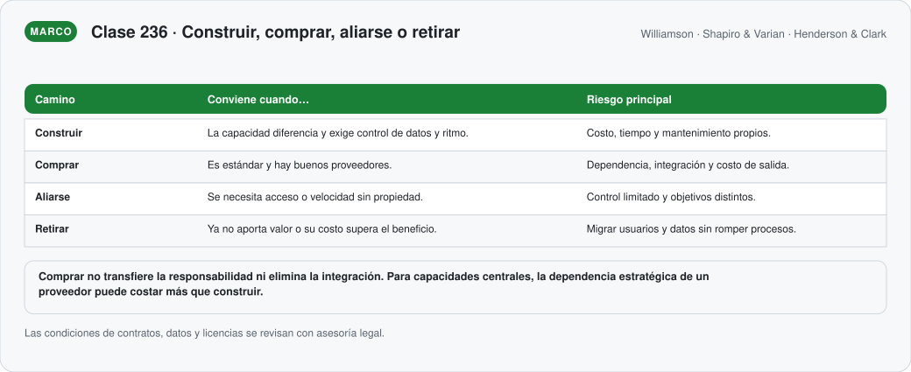

# Clase 236 — Build, buy, partner o retire

<!-- nav:inicio -->
> **Parte 19 · Tecnología, datos, IA y transformación digital para ejecutivos** — clase 8 de 12 · [índice de la parte](../../README.md) · [temario](../../../../SYLLABUS.md)
<!-- nav:fin -->

**Parte:** 19 — Tecnología, datos, IA y transformación digital para ejecutivos  
**Nivel:** Etapa 5 — CEO → Transformador digital  
**Duración sugerida:** 150–180 minutos · **Estándar:** deep-class-v2

## 🎯 Propósito

Cada capacidad tecnológica de una empresa se obtiene de cuatro maneras: la **construye** (con su propio equipo), la **compra** (software o servicio de un proveedor), se **asocia** (con un socio que aporta tecnología, datos o canal a cambio de ingresos compartidos) o la **retira** (deja de ofrecerla o de usarla). La decisión parece técnica y, por eso, suele delegarse; sin embargo es una de las más estratégicas: determina qué sabe hacer la empresa por sí misma, de qué proveedores depende, cuánto controla sus datos y qué ventaja puede construir. Construir lo que no diferencia es malgastar talento escaso; comprar lo que diferencia es entregar el corazón de la estrategia; asociarse sin cuidado es ceder la relación con el cliente; mantener lo que ya no aporta es pagar por una capacidad que no se usa.

La clase ofrece un método: definir la capacidad y su grado de diferenciación, modelar tiempo y costo total, analizar control de datos y dependencia, evaluar talento e integración, y decidir con una regla y una salida. Se apoya en la economía de los costos de transacción de Williamson, en el análisis de costos de cambio de Shapiro y Varian, en la innovación arquitectónica de Henderson y Clark, en Iansiti y Lakhani sobre empresas basadas en datos y algoritmos y en Davenport y Mittal sobre la adopción de IA. Al terminar sabrás comparar las cuatro opciones con números y con criterios no financieros, y registrar la decisión con sus condiciones.

## 📚 Resultados de aprendizaje

Al finalizar podrás:

1. **Clasificar** una capacidad según su grado de diferenciación estratégica.
2. **Modelar** el tiempo y el costo total de propiedad de cada opción.
3. **Analizar** el control de datos, la dependencia y el costo de salida.
4. **Evaluar** el talento, la integración y la capacidad de absorber el cambio.
5. **Decidir** y documentar la opción con condiciones y plan de salida.

## 🧭 Agenda

| Tramo | Qué se hace |
|---|---|
| 0–20 min | Recuperación: ¿qué sistema de tu empresa se compró «porque construirlo era caro» y qué costó después cambiarlo? |
| 20–60 min | Diferenciación, costo total, tiempo, datos, dependencia, talento y retiro. |
| 60–105 min | Ejemplo trabajado: construir, comprar o asociarse para una plataforma de experiencia de cliente. |
| 105–150 min | Caso ejecutivo y práctica. |
| 150–175 min | Límites y entregable. |

## 🧩 Conceptos centrales

| Concepto | Definición | Cómo se reconoce |
|---|---|---|
| **Construir (*build*)** | Desarrollar la capacidad con recursos propios. | Equipo, código y propiedad propios. |
| **Comprar (*buy*)** | Adquirir una solución de un proveedor. | Licencias o suscripción. |
| **Asociarse (*partner*)** | Obtener la capacidad con un socio sin comprarla ni construirla. | Alianza, ingresos compartidos. |
| **Retirar (*retire*)** | Dejar de ofrecer o usar la capacidad. | Cierre con migración. |
| **Costo total de propiedad (TCO)** | Costo de adquirir, operar y mantener a lo largo de la vida útil. | Suma por varios años. |
| **Costo de salida** | Costo de cambiar a otra opción. | Migración, datos, rediseño. |

## 🧠 Modelo mental

**Cómo leer el diagrama.** Una tabla de cuatro caminos. **Construir**: conviene cuando la capacidad diferencia y exige control de datos y ritmo; su riesgo es el costo, el tiempo y el mantenimiento propios. **Comprar**: conviene cuando es estándar y hay buenos proveedores; su riesgo es la dependencia, la integración y el costo de salida. **Aliarse**: conviene cuando se necesita acceso o velocidad sin propiedad; su riesgo es el control limitado y los objetivos distintos. **Retirar**: conviene cuando ya no aporta valor o su costo supera el beneficio; su riesgo es migrar usuarios y datos sin romper procesos. La nota afirma que comprar no transfiere la responsabilidad ni elimina la integración.

## 📖 Desarrollo

### 1. Primero, ¿qué tan diferenciadora es la capacidad?

La pregunta inicial no es técnica sino estratégica: ¿esta capacidad **diferencia** a la empresa frente a sus competidores, o es una **commodity** necesaria pero estándar? Iansiti y Lakhani muestran que, en empresas organizadas alrededor de datos y algoritmos, las capacidades que acumulan datos propios y aprenden de ellos son fuente de ventaja; esas no se entregan sin cuidado a terceros. En cambio, la contabilidad, la nómina o el correo son estándar y se compran. Se clasifican las capacidades en: **centrales** (diferencian), **de apoyo** (necesarias, con proveedores buenos) y **commodities**. La regla de partida: construir las centrales cuando haya talento y tiempo, comprar o aliarse en el resto y retirar lo que dejó de aportar. Henderson y Clark advierten que lo que parece un «componente» puede cambiar la arquitectura del negocio: delegar un componente central transfiere también el conocimiento acumulado.

### 2. Tiempo y costo total de propiedad

Se modelan **tres horizontes de costo**: **inversión inicial** (desarrollo o licencia y puesta en marcha), **operación** (infraestructura, soporte, equipo, licencias recurrentes con sus alzas) y **cambio** (mejoras, actualizaciones, migración futura). El **costo total de propiedad** (TCO) a cinco años permite comparar. A él se agrega el **tiempo**: construir suele tardar más que comprar o asociarse, y cada mes de retraso tiene un costo (ingresos o ahorros que no se obtienen). Un error común es comparar el costo de **licencia** de la opción comprada con el **desarrollo** de la construida, olvidando la integración, la operación, el cambio y el costo de oportunidad del talento. Otro es subestimar el costo de construir: los proyectos de software suelen exceder sus plazos y presupuestos.

### 3. Datos, control y dependencia

Williamson explica que las **inversiones específicas** (personalizaciones, integraciones, personal capacitado, datos migrados) generan dependencia y exponen a la parte que invierte a decisiones del proveedor (clase 185). Shapiro y Varian muestran que los **costos de cambio** son una fuente de poder en los mercados de tecnología: quien controla los datos, los formatos y los hábitos del usuario retiene al cliente. Se analizan: ¿quién es dueño de los datos y puede extraerlos en un formato usable?, ¿qué ocurre con el servicio si el proveedor sube precios, cambia condiciones, es adquirido o quiebra?, ¿qué parte de la funcionalidad es propietaria? Se estima el **costo de salida** y su probabilidad de materializarse, y se incorpora al comparativo. Las **cláusulas** de portabilidad, depósito de código (*escrow*) y asistencia de transición reducen el riesgo.

### 4. Talento, integración y absorción del cambio

Construir exige talento escaso (ingenieros, datos, producto, operación) y la capacidad de **sostenerlo**: el equipo que construye hoy debe mantener mañana. Comprar exige **integración** (con sistemas, datos y procesos), **gestión del proveedor** (contratos, niveles de servicio, relación) y **gestión del cambio** (adopción por los usuarios). Asociarse exige **gobierno de la alianza** (objetivos, reparto de valor, datos, salida). En todos los casos, la organización tiene una **capacidad limitada** de absorber cambios (clase 176): una cartera con demasiadas iniciativas simultáneas falla. Davenport y Mittal observan que las empresas que adoptan IA a escala combinan **construcción** de capacidades centrales y **compra** de componentes; lo hacen con un modelo operativo claro y con dueños de negocio, no solo de tecnología.

### 5. Asociarse: velocidad con control limitado

Una alianza puede dar acceso a tecnología, datos, clientes o canales con rapidez y bajo capital, a cambio de **ingresos compartidos**, **dependencia** y **control limitado**. El riesgo es que el socio capte la relación con el cliente, se convierta en competidor o cambie de prioridades. Se define: **qué aporta cada parte**, **cómo se reparte el valor** (porcentaje, límites), **quién es dueño de los datos y de la relación con el cliente**, **exclusividad**, **duración**, **condiciones de salida** y **gobierno**. Se aplican las mismas pruebas de TCO, de dependencia y de salida. Una alianza que se siente barata en el primer año puede resultar cara cuando el negocio crece y el reparto de ingresos se mantiene.

### 6. Retirar: la decisión que se evita

Las empresas acumulan sistemas, productos y servicios que ya no aportan valor pero consumen recursos: licencias, infraestructura, equipo de soporte, riesgo de seguridad, complejidad. **Retirar** es una decisión explícita con su análisis: ¿cuántos usuarios y qué ingresos dependen?, ¿qué cuesta mantenerlo?, ¿qué riesgo tiene?, ¿qué alternativa tienen los usuarios?, ¿cuánto cuesta migrarlos y qué obligaciones legales o contractuales hay (conservación de datos, compromisos con clientes)? La resistencia suele ser emocional y organizacional («por si acaso»). Un plan de retiro tiene **fecha**, **responsable**, **comunicación**, **migración de usuarios y datos**, **conservación de lo exigido legalmente** y **apagado verificado**. Retirar libera capacidad para invertir en lo que importa.

### 7. Decidir y dejar una salida

La decisión se documenta con: **la capacidad y su clasificación**, **las opciones comparadas** (TCO, tiempo, control, dependencia, talento, riesgo), **la opción elegida y su razón**, **las condiciones** (por ejemplo, cláusulas de portabilidad, hitos, presupuesto máximo) y **el plan de salida o de reversión** (qué haríamos si falla). Se fijan **criterios de revisión** (en 12 a 24 meses): si el precio sube más de cierto porcentaje, si el proveedor incumple, si la capacidad pasa a ser central. Y se asigna un **dueño de negocio** de la capacidad y un **responsable de la relación** con el proveedor o socio. Comprar no transfiere la responsabilidad ante clientes, reguladores o el directorio: sigue siendo de la empresa.

## 📚 Lectura comparada

| Obra | Qué aporta | Qué no resuelve | Pregunta para contrastar |
|---|---|---|---|
| Williamson | Inversiones específicas, dependencia y diseño de acuerdos. | Teoría general. | ¿Qué inversiones específicas tendremos que hacer? |
| Shapiro y Varian | Costos de cambio y control de datos en tecnología. | Foco en mercados de información. | ¿Qué nos impide cambiar de proveedor? |
| Henderson y Clark | Componentes y arquitectura: qué conocimiento se delega. | No es específico de software. | ¿Qué conocimiento perdemos al comprar? |
| Iansiti y Lakhani | Capacidades de datos y algoritmos como fuente de ventaja. | Casos muy digitales. | ¿Esta capacidad acumula datos propios? |
| Davenport y Mittal | Combinar construir y comprar en IA a escala. | Casos de empresas grandes. | ¿Cuál es nuestro modelo operativo? |

## 🧮 Ejemplo trabajado

**Situación (hipotética).** Una empresa de retail con ventas de 150.000 millones de pesos evalúa una plataforma de experiencia de cliente (recomendaciones, promociones personalizadas, seguimiento). Cada mes que la capacidad esté operando aporta unos 90 millones de margen adicional (estimación del área comercial).

**Tres opciones a cinco años.**

| Concepto | Construir | Comprar (suscripción) | Asociarse (ingresos compartidos) |
|---|---|---|---|
| Inversión inicial | 3.200 | 600 (integración) | 0 |
| Operación anual | 450 (equipo de 8 personas y nube) | 520, con alza de 7 % anual | 6 % de 12.000 de ventas atribuibles = 720, con crecimiento de 8 % anual |
| **Costo total a 5 años** | 3.200 + 5 × 450 = **5.450** | 600 + 520 × 5,7507 = **3.590** | 720 × 5,8666 = **4.224** |
| Tiempo hasta operar | 14 meses | 5 meses | 3 meses |

(Los factores 5,7507 y 5,8666 son las sumas de las series crecientes a 7 % y 8 % durante 5 años.)

**Valor del tiempo.** Cada mes de operación vale 90 millones. Frente a construir (14 meses), comprar llega 9 meses antes: 810 millones; asociarse, 11 meses antes: 990 millones.

**Costo ajustado por tiempo.** Construir: 5.450. Comprar: 3.590 − 810 = 2.780. Asociarse: 4.224 − 990 = 3.234.

**Riesgo de dependencia.** Comprar: probabilidad de 25 % de tener que cambiar de proveedor con un costo de salida de 1.500 millones: costo esperado de 375. Asociarse: 15 % de probabilidad con un costo de 800: 120 (más pérdida de control de la relación con el cliente, no cuantificada). Costos ajustados por riesgo: comprar 2.780 + 375 = **3.155**; asociarse 3.234 + 120 = **3.354**; construir 5.450.

**Valor de diferenciación.** El equipo comercial sostiene que construir permitiría funciones propias que elevan la retención y aportarían 250 millones al año de margen extra desde el mes 14 (46 meses hasta el mes 60, es decir, 3,83 años): 958 millones. Costo ajustado de construir: 5.450 − 958 = 4.492. Sigue siendo 1.337 millones más que comprar (4.492 − 3.155).

**Decisión.** **Comprar** la plataforma base, con tres condiciones: derecho a exportar datos en formato abierto, cláusula de transición y tope de aumento anual de 7 %; **construir** solo la capa de modelos de recomendación propios sobre los datos de la empresa (inversión de 600 millones), que es donde se acumula la diferenciación; y no asociarse en este caso por la cesión de la relación con el cliente.

**Retirar.** El mismo análisis señala que la plataforma de campañas antigua (costo operativo de 180 millones al año, 4 % de los clientes activos) debe retirarse: migración de usuarios y datos 90 millones; ahorro neto de 90 millones el primer año y 180 después; recuperación en 6 meses.

**Revisión.** A los 18 meses se revisa: aumento de precios, desempeño del proveedor, calidad de los datos portados, si la capa propia es realmente diferenciadora.

**Cuidados.** Los contratos, licencias, propiedad intelectual y tratamiento de datos se revisan con asesoría legal; las estimaciones de tiempo, costo y valor son hipótesis; las cifras son ilustrativas.

**Qué muestra.** (1) El TCO se ajustó por tiempo y riesgo. (2) La diferenciación se valoró y no cambió la decisión de la base. (3) Se decidió construir lo que acumula ventaja, comprar lo estándar y retirar lo obsoleto.

## 🔀 Comparación y límites

**Comprar frente a asociarse.** Comprar da propiedad de la licencia y control sobre su uso; asociarse da acceso con reparto de ingresos y menos control. En ambos casos la responsabilidad ante clientes y reguladores sigue siendo de la empresa.

**Límites.** Para capacidades centrales, la dependencia estratégica de un proveedor puede costar más que desarrollar. Las estimaciones de desarrollo son inciertas y suelen subestimarse. Las condiciones de proveedores y mercados cambian. Las cifras del ejemplo son ilustrativas.

## 🪜 De profesional a owner

| Nivel | Cómo participa en la decisión |
|---|---|
| **Profesional** | Aporta requisitos y evalúa alternativas con criterios. |
| **Jefe / Team Lead** | Prueba soluciones y reporta fricciones de integración. |
| **Gerente** | Es dueño de la capacidad y responde por el resultado. |
| **CEO / Director** | Clasifica capacidades, decide la opción y exige plan de salida. |
| **Founder / Owner** | Decide qué debe seguir siendo propio y qué puede depender de terceros. |

## 🏢 Caso ejecutivo

Una empresa de logística con 2.300 personas y ventas de 130.000 millones de pesos opera un sistema de gestión de transporte desarrollado hace doce años por un equipo interno de 14 personas (costo de 1.100 millones al año) que ya no puede evolucionar al ritmo del negocio: lanzar una nueva funcionalidad tarda ocho meses. Un proveedor ofrece una plataforma estándar (suscripción de 780 millones al año con aumentos de 9 %, e integración de 1.400 millones), pero no cubre algunas funciones propias de optimización de rutas que dan ventaja a la empresa. Otra empresa propone una alianza: usaría la plataforma de la empresa para sus clientes pequeños a cambio de 8 % de los ingresos de ese segmento (estimados en 9.000 millones al año), con exclusividad de cinco años. El equipo interno teme perder su empleo; el área comercial quiere velocidad; el director de tecnología prefiere «mantener lo propio»; el directorio pide una recomendación. Además existen tres sistemas pequeños que consumen 350 millones al año y que casi no se usan.

Entrega un **memo de decisión de capacidades** que contenga: (a) la clasificación de las capacidades del caso como centrales, de apoyo o commodities; (b) el TCO a cinco años, el valor del tiempo y el costo de dependencia de cada opción; (c) el análisis de control de datos, costo de salida y cláusulas de protección; (d) la evaluación de talento, integración y capacidad de cambio, incluida la situación del equipo interno; (e) la decisión recomendada para cada capacidad, incluido el retiro de los tres sistemas; (f) las condiciones, los criterios de revisión y las verificaciones contractuales y laborales pendientes.

## 🧪 Práctica

1. Clasifica diez capacidades tecnológicas de tu empresa como centrales, de apoyo o commodities.
2. Calcula el TCO a cinco años de dos opciones, incluyendo operación y alzas.
3. Estima el valor de llegar tres meses antes y ajusta el costo.
4. Estima el costo de salida de una opción comprada y su probabilidad.
5. Redacta un plan de retiro para un sistema con fecha, responsable y migración.

## ⚠️ Errores frecuentes

| Error | Por qué ocurre | Cómo corregirlo |
|---|---|---|
| Construir lo que no diferencia | Orgullo técnico | Clasificar la capacidad y comprar lo estándar. |
| Comprar lo que diferencia | Presión de tiempo | Construir la capa que acumula ventaja. |
| Comparar solo licencias | Se omiten costos | TCO con integración, operación y cambio. |
| Ignorar el costo de salida | Se piensa en el corto plazo | Cláusulas de portabilidad y estimación del costo. |
| No retirar | «Por si acaso» | Plan de retiro con fecha y responsable. |
| Creer que comprar transfiere la responsabilidad | Falta de claridad | Responsabilidad ante clientes y reguladores sigue siendo propia. |

## ❓ Preguntas de comprobación

1. ¿Cómo se clasifica una capacidad para decidir construir o comprar?
2. ¿Qué incluye el costo total de propiedad?
3. ¿Por qué importa el tiempo hasta operar?
4. ¿Qué es el costo de salida y cómo se reduce?
5. ¿Cuándo conviene asociarse y cuál es su riesgo?
6. ¿Por qué cuesta retirar un sistema y cómo se hace bien?
7. ¿Qué se documenta en la decisión?

Claves de respuesta

1. Según si diferencia a la empresa (central), es necesaria con buenos proveedores (apoyo) o es estándar (commodity).
2. Inversión inicial, operación con sus alzas y costos de cambio, a varios años, más integración y talento.
3. Porque cada mes de retraso tiene un costo en ingresos o ahorros no obtenidos y puede cambiar la decisión.
4. El costo de cambiar de opción: migración, datos, rediseño; se reduce con portabilidad, depósito de código y asistencia de transición.
5. Cuando se necesita acceso o velocidad sin propiedad; el riesgo es el control limitado, la dependencia y los objetivos distintos.
6. Por razones emocionales y organizacionales; se hace con fecha, responsable, migración, comunicación y conservación de lo exigido legalmente.
7. La clasificación, las opciones comparadas, la elección y su razón, las condiciones, el plan de salida y los criterios de revisión.

## 📥 Entregable

Guarda en `portfolio/236-build-buy-partner-o-retire/`:

- `leadership-decision-brief.md` (plantilla [Leadership Decision Brief](../../../../templates/leadership-decision-brief.md)) con el memo del caso ejecutivo;
- `modelo-financiero-y-memo-de-decision.md` (plantilla [Modelo financiero y memo de decisión](../../../../templates/modelo-financiero-y-memo-de-decision.md)) con el comparativo de TCO, tiempo y dependencia;
- `decision-journal.md` con las condiciones, el plan de salida y las verificaciones pendientes.

## 📗 Fuentes y verificación

- Oliver E. Williamson — *Transaction-Cost Economics: The Governance of Contractual Relations* (The Journal of Law and Economics, 1979). **Uso en esta clase:** inversiones específicas, dependencia y diseño de acuerdos. Lectura selectiva sobre **build, buy, partner o retire**. **Localizador:** [DOI 10.1086/466942](https://doi.org/10.1086/466942).
- Carl Shapiro & Hal R. Varian — *Information Rules* (Harvard Business School Press, 1998). **Uso en esta clase:** costos de cambio y control de datos en tecnología. Lectura selectiva sobre **build, buy, partner o retire**. **Localizador:** [ISBN-13 9780875848631](https://openlibrary.org/isbn/9780875848631).
- Rebecca M. Henderson & Kim B. Clark — *Architectural Innovation: The Reconfiguration of Existing Product Technologies and the Failure of Established Firms* (Administrative Science Quarterly, 1990). **Uso en esta clase:** componentes, arquitectura y conocimiento que se delega. Lectura selectiva sobre **build, buy, partner o retire**. **Localizador:** [DOI 10.2307/2393549](https://doi.org/10.2307/2393549).
- Marco Iansiti & Karim R. Lakhani — *Competing in the Age of AI* (Harvard Business Review Press, 2020). **Uso en esta clase:** capacidades de datos y algoritmos como fuente de ventaja. Lectura selectiva sobre **build, buy, partner o retire**. **Localizador:** [ISBN-13 9781633697621](https://openlibrary.org/isbn/9781633697621).
- Thomas H. Davenport & Nitin Mittal — *All-In on AI* (Harvard Business Review Press, 2022). **Uso en esta clase:** combinar construir y comprar en IA a escala. Lectura selectiva sobre **build, buy, partner o retire**. **Localizador:** [ISBN-13 9781647824693](https://openlibrary.org/isbn/9781647824693).

> **Regla de fuentes para Build, buy, partner o retire:** las obras anteriores estructuran las perspectivas de esta materia; cualquier norma, ley o estándar vivo mencionado debe comprobarse nuevamente en su fuente primaria vigente, incluidos los contratos, la propiedad intelectual, el tratamiento de datos y las condiciones laborales. Los ejemplos y casos son hipotéticos, con cifras ilustrativas. El desarrollo es original y no reproduce capítulos protegidos.

<!-- pie:inicio -->
---

| Anterior | Índice | Siguiente |
|---|---|---|
| [← 235 · Ciberseguridad desde el directorio](../235-ciberseguridad-desde-el-directorio/README.md) | [Parte 19](../../README.md) · [Programa](../../../../SYLLABUS.md) | [237 · Arquitectura y deuda técnica para ejecutivos →](../237-arquitectura-y-deuda-tecnica-para-ejecutivos/README.md) |
<!-- pie:fin -->
